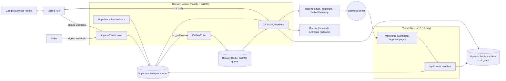

# RepWorth (archived)

> **Status: shut down on 2026-10-03/04.** This repository is kept for reference only.
> Only the marketing website at **https://repworth.net** is live. It shows a closure notice at
> [`/closed`](https://repworth.net/closed). Every backend service is stopped, paused or deleted.
> No new work lands here.

RepWorth was an agentic reputation-management platform for small and medium businesses. It
read a business's Google reviews, drafted a reply to each one in the owner's voice, and posted
the reply to Google only after an explicit approval. A small team of AI "personas" did the work,
and two "watchdogs" supervised them. The product was sold as two subscription tiers:
**Copilot** (the owner approves everything) and **Autopilot** (bounded autonomy).

This README is a single place to understand what RepWorth was, how it was built, what state it
was left in, and how to bring it back if that is ever wanted.

---

## Contents

1. [Shutdown record](#1-shutdown-record)
2. [What the product did](#2-what-the-product-did)
3. [How a review became a posted reply](#3-how-a-review-became-a-posted-reply)
4. [Architecture](#4-architecture)
5. [Code map](#5-code-map)
6. [Data layer](#6-data-layer)
7. [AI, cost and safety layer](#7-ai-cost-and-safety-layer)
8. [The 15 architecture invariants](#8-the-15-architecture-invariants)
9. [External services](#9-external-services)
10. [Feature flags](#10-feature-flags)
11. [Engineering workflow](#11-engineering-workflow)
12. [Environments and deployment](#12-environments-and-deployment)
13. [Documentation map](#13-documentation-map)
14. [Project history and numbers](#14-project-history-and-numbers)
15. [How to bring RepWorth back](#15-how-to-bring-repworth-back)
16. [Known stale documents](#16-known-stale-documents)

---

## 1. Shutdown record

### 1.1 What is still live

| Thing | State |
|---|---|
| `https://repworth.net` | **Live.** Marketing pages (`/`, `/features`, `/how-it-works`, `/pricing`, `/security`, `/help`, `/legal/*`) plus a site-wide banner and the `/closed` notice. |
| `www.repworth.net` | Redirects to `repworth.net`. |
| App routes | `/signup`, `/login`, `/forgot-password`, `/reset-password`, `/book-a-demo`, `/demo`, `/approve`, `/u`, `/onboarding`, `/dashboard`, `/settings`, `/account`, `/mfa`, `/admin`, `/q`, `/r` (each with `/:path*`) all **redirect (307) to `/closed`**. `/api/**` is not redirected; those routes fail because the backend is gone. |
| Mail on `repworth.net` | **Kept.** Google Workspace (`MX 1 smtp.google.com`). The team still uses it. The privacy policy sends data-access and deletion requests to `support@repworth.net`, so that address must keep working. |
| The domain `repworth.net` | **Kept.** DNS on Cloudflare (`wally` / `zahir.ns.cloudflare.com`). Keep auto-renew on while the site is live. |

The closure notice was added in PR **#1492** (squash commit `51c5d9f`). It is static: the marketing
pages and `/closed` have no database, Supabase, Redis or network dependency, so they keep working
with the whole backend offline. `src/proxy.ts` skips Supabase work for public paths.

### 1.2 What was shut down, and how

| Service | Final state | Reversible? |
|---|---|---|
| **Supabase** | Org "Startups" downgraded to the Free plan. Both projects paused on 2026-10-04: `RepWorth` (prod, ref `udeyaqnvpojbwgoaxwdg`) and `RepWorth-staging` (ref `kubdiqdhqbhwmqfditeg`). | Yes. Supabase lets you restore a paused Free project for about 90 days (until roughly early January 2027). After that, use the backup in §1.3. |
| **Railway** (project `repworth`) | Staging worker and staging Redis deployments removed. The owner chose to leave the project in place. At the time of writing the production worker and Redis still had a **staged, unapplied deletion**. With every key revoked and the database paused, they cannot do any work. | Yes, until the services are deleted. |
| **Vercel** | `rep-worth` (this repo) stays live for the marketing site. `admin-app` paused. The `staging` Custom Environment (`staging.repworth.net`) was scheduled for removal. | Yes. |
| **Stripe** | The only live subscription was canceled on 2026-10-04 05:39 UTC. It was a beta account on a comp coupon; its last invoice was $0, so no refund was due. No webhook endpoints remain. The account stays open for tax records. | Not needed. |
| **Zernio** | Account deleted by the owner. The last Google connection was already marked `disconnected` (`auth_error_on_ingest`). | No (new account needed). |
| **Upstash** (cache Redis) | Account closed. | No (new database needed). |
| **Twilio** (WhatsApp) | Account closed. | No. |
| **All API keys** (OpenAI, Anthropic, SerpAPI, Resend, Sentry, PostHog, Google Cloud, Telegram, Zernio, Stripe, Supabase service keys) | Revoked by the owner. All local `.env*` secret files were deleted. | Generate new keys. |
| **GitHub** | Repos moved from the `RepWorth` org to the personal account `norbertesekiel47` (`ai-review-responder`, `admin-app`). CI runner variables set to `ubuntu-latest`. | Yes. |
| **Admin app** | `admin.repworth.net` is paused and its DNS records are gone. | Yes. |

Why the repos moved: the Vercel team is on the **Hobby** plan, and Hobby refuses to deploy a
**private repository owned by a GitHub organization** ("Cannot deploy from a private GitHub
organization repository on the Hobby plan"). Under a personal account the same repo deploys
normally. Keep the repo personal, or the website cannot be redeployed.

### 1.3 The final database backup

A final encrypted dump of the production database was taken before anything was changed.

| | |
|---|---|
| File | `~/RepWorth-archive/repworth-prod-20261004T041330Z.dump.enc` (512 KB) |
| sha256 | `bc0550058d98345b8aaa49ca06ea05b05e4b5a08b643d3858905ac97e5f0a4f7` |
| Contents | `pg_dump` custom format (Postgres 17) of schemas `public` and `auth`, `--no-owner --no-privileges`. 85 tables with data, including `auth.users` and `accounts`. |
| Encryption | AES-256-CBC, PBKDF2 with 600,000 iterations, OpenSSL. The key was saved as `~/RepWorth-archive/KEY-move-to-password-manager-then-delete.txt` and moved into the owner's password manager. |

List what is inside (needs Docker, because the local `pg_dump` is version 16):

```bash
openssl enc -d -aes-256-cbc -pbkdf2 -iter 600000 \
  -pass file:/path/to/key.txt \
  -in ~/RepWorth-archive/repworth-prod-20261004T041330Z.dump.enc \
| docker run --rm -i postgres:17 pg_restore --list
```

Restore into an empty Postgres 17 database (`PGURL` holds its connection string):

```bash
export PGURL='postgresql://…'
openssl enc -d -aes-256-cbc -pbkdf2 -iter 600000 -pass file:/path/to/key.txt \
  -in ~/RepWorth-archive/repworth-prod-20261004T041330Z.dump.enc \
| docker run --rm -i -e PGURL postgres:17 \
  sh -c 'pg_restore --no-owner --no-privileges --schema=public -d "$PGURL"'
```

The `auth` schema belongs to Supabase. In a new Supabase project, restore `public` first. Restore
`auth` data with `--data-only --schema=auth` only if you need the old users, and expect to fix
conflicts by hand.

### 1.4 DNS at shutdown

Records to **keep** on `repworth.net`:

| Name | Type | Value | Why |
|---|---|---|---|
| `repworth.net` | A | `64.29.17.1`, `216.198.79.1` | Vercel (the website) |
| `www` | CNAME | `bcbe3f07b195b43d.vercel-dns-017.com` | Vercel (redirect to apex) |
| `repworth.net` | MX | `1 smtp.google.com` | Google Workspace mail |
| `repworth.net` | TXT | `v=spf1 include:_spf.google.com ~all` | SPF for Google mail |
| `repworth.net` | TXT | `google-site-verification=…` | Google domain verification |
| `google._domainkey` | TXT | `v=DKIM1;k=rsa;p=…` | DKIM for Google mail |
| `_dmarc` | TXT | `v=DMARC1; p=quarantine; …` | DMARC (reports go to Postmark's free DMARC monitor) |
| `repworth.net` | TXT | `6166b3d9520222229cf738d261b241fc` | Unknown verification token; harmless |

Records that belonged to shut-down services (Vercel staging, Railway, Resend and the
Solicitation sending lane on Amazon SES) were listed for removal on 2026-10-04:
`staging`, `_railway-verify.worker`, `send` (MX + TXT), `resend._domainkey`,
`bounce.feedback` (MX + TXT), `resend._domainkey.feedback`, `_dmarc.feedback`,
`bounce.feedback.staging` (MX + TXT), `resend._domainkey.feedback.staging`,
`_dmarc.feedback.staging`. `admin` and `admin.staging` were already gone.

---

## 2. What the product did

### 2.1 Tiers and prices

Source of truth: `TIER_CONFIG` in `src/lib/accounts/tier-config.ts` (repriced in PR #1290,
2026-09-16). Prices are monthly, in USD, and are stored on each `accounts` row at checkout, so a
customer keeps the price they signed up at (invariant #9a).

| Tier | List | Founding | Included locations | Each extra location | What it allows |
|---|---|---|---|---|---|
| **Copilot** | $79 | $49 | 1 | $79 | Agents draft, monitor and report. The owner approves every public action. |
| **Autopilot** | $149 | $99 | 1 | $149 | Agents act alone inside the owner's rating-band policy, behind hard gates, a veto window, daily caps and the Governor. |

- Trial: a 30-day free trial with a card up front, behind `TRIAL_ENABLED` (off in production).
- Autopilot could be bought only when `AUTOPILOT_PURCHASABLE` **and** the auto-approval runtime
  were both on (`src/lib/payments/tier-purchasability.ts`). It never went on sale in production.

### 2.2 Personas and watchdogs

| Agent | Job | Flag |
|---|---|---|
| **Reply** | Drafts a reply to every review in the owner's voice. On Autopilot it auto-posts replies in the positive quadrant. | `AUTO_APPROVAL_ENABLED` (auto-post only) |
| **Guardian** | Triage: classifies the severity of negative reviews and escalates to the owner. Never acts in public. | `TRIAGE_ENABLED`, `ESCALATION_ENABLED` |
| **Insights** | The weekly digest and monthly impact email. | none (scheduler) |
| **Judge** (watchdog) | LLM review of 100% of auto-posts. If the Judge is off or unavailable, auto-posts fall back to owner review. | `JUDGE_ENABLED` |
| **Governor** (watchdog) | Suspends autonomy per account when quality drops, and notifies owner and admin. | `GOVERNOR_ENABLED` |
| **Owner Operator** | A chat surface at `/dashboard/operator`. Each turn makes one model call and returns proposal cards; nothing changes until the owner clicks Apply. | `OWNER_OPERATOR_ENABLED` |
| **Solicitation ("Requests")** | Builds batches of review requests to a business's customers with a fixed rule set (no LLM in the decision). Watch mode decides but sends nothing; send mode sends. Consent and suppression ledgers, one-click unsubscribe. | `SOLICITATION_WATCH_ENABLED`, `SOLICITATION_SEND_ENABLED`, `SOLICITATION_AUTO_APPROVAL_ENABLED` |

Every persona action was recorded on the **run spine** (`agent_runs`, `agent_run_steps`,
`agent_outcomes`) through one writer, `src/lib/agents/run-spine.ts`. What the agents chose **not**
to do was recorded in the **Refusal ledger** (`refusal_events`) and shown to owners on the
**Restraint** tab.

### 2.3 Owner features

- **Onboarding:** self-serve signup (`/signup`, behind `SELF_SERVE_SIGNUP_ENABLED`, off in
  production); an admin invite funnel; a pre-pay demo lane (`/onboarding/start → demo → pay →
  payment-success → business`, behind `ONBOARDING_DEMO_ENABLED`); tokenized prospect demos at
  `/demo/[slug]`.
- **Dashboard:** home KPIs, reviews list and history, per-review timeline, analytics, the Restraint
  tab, Requests (contacts, QR codes), Owner Operator, Google connection (`/dashboard/connect`),
  add-location.
- **Settings:** profile, brand voice, auto-approval policy, billing, notification channels,
  competitors, locations, review QR, security (MFA).
- **Approval channels:** email (Resend) with a read-only approval page at `/approve/[token]`;
  Telegram bot; WhatsApp via Twilio, with failover between channels.
- **Multi-location:** one `businesses` row per Google location under one `accounts` billing
  parent, with per-location overage billing (`MULTI_LOCATION_ENABLED`).
- **Review import consent:** owners chose whether to import existing reviews.
- **Offboarding:** two modes, `cancel_only` and `delete_data`. Delete-data schedules a purge after
  a 30-day window (`ACCOUNT_OFFBOARDING_ENABLED`).
- **Digests:** weekly value report and monthly impact email.

### 2.4 Safety promises

- No reply reaches Google without a recorded approval (`approval_method='owner'` or `'auto_policy'`).
- Moderation is an absolute veto. High-severity drafts are held for admin review and never sent to the owner.
- Approval tokens are stored only as SHA-256 hashes. Approval links expire after 48 hours.
- Every owner read and write is scoped by `account_id` and `business_id`.
- Feature flags are decided on the server only.
- Workers check the subscription status before doing customer-facing work.

---

## 3. How a review became a posted reply

1. **Ingest.** Zernio (a Google Business Profile API broker) sent a signed `review.new` /
   `review.updated` webhook to the worker (`worker/ingress/zernio/zernio.ts`, HMAC check, dedup via
   `claimInboundEvent`). A safety-net poller (`ZernioRecentReviewPoller`) caught anything missed.
   Both paths called `processReview` (`src/lib/reviews/process-review.ts`), which normalized the
   review into a `NormalizedReview` and wrote it plus a `job_outbox` row in one transaction.
2. **Dispatch.** `OutboxPoller` claimed pending outbox rows (`FOR UPDATE SKIP LOCKED`) and pushed
   them to BullMQ.
3. **Triage.** `ResponseGeneratorWorker` ran Guardian triage for reviews of 3 stars or fewer
   (`worker/jobs/response-generation/triage.ts`).
4. **Draft.** The reply was generated through the LLM seam
   (`worker/jobs/response-generation/generate-draft.ts`).
5. **Moderation.** `moderateResponse` ran a local regex filter plus the OpenAI moderation API. A
   high-severity flag wrote `flagged_responses` and skipped the owner notification in the same
   transaction.
6. **Approval.**
   - *Owner path:* `NotificationWorker` sent the draft by email, Telegram or WhatsApp. The owner
     approved, edited, regenerated or vetoed at `/approve/[token]` or in the dashboard.
   - *Auto path (Autopilot, never enabled in production):*
     `worker/jobs/response-generation/auto-approval.ts` applied the policy gates, then
     `PendingPostNoticeWorker` opened a 15- or 30-minute veto window. Daily cap
     default 10, ceiling 50.
7. **Publish.** `ResponsePublisherWorker` re-checked the veto window, the Judge, the held flag and
   the subscription, then posted through `src/lib/publishing/zernio-review-publisher.ts`.
8. **Judge.** `JudgeSweepPoller` and `JudgeWorker` reviewed every auto-post and wrote
   `judge_verdicts`. The Governor read those verdicts.

---

## 4. Architecture



The split was strict:

- **Vercel served UI only.** LLM calls, provider calls and long work ran on Railway. ESLint blocked
  `src/app/**` and `src/components/**` from importing `openai`, `@anthropic-ai/sdk`, `bullmq`,
  `postgres` or the response generator (ADR 0001 lists the two narrow exceptions).
- **Every third-party webhook terminated on Railway** (`worker/ingress/*`), never on Next.js.
- **Postgres was the source of truth.** BullMQ was fed only from the transactional outbox, so a
  queue failure could never lose a state change.
- **Two Redis instances on two providers.** The BullMQ queue ran on Railway Redis over private
  networking (no egress cost). The cache and cost guard ran on Upstash with TLS, because Vercel
  needed to reach it.
- **Single-replica worker** by design during beta (ADR 0005).
- **The Admin UI moved to its own repo** (`admin-app`, ADR 0024) and called the Admin API in this
  repo (`src/app/api/admin/**`) with a bearer token and exact-origin CORS (ADR 0026).

---

## 5. Code map

The full, CI-checked map is `docs/directory.md` plus `docs/directory/*.md`.

### 5.1 Top level

| Path | Holds |
|---|---|
| `src/` | The Next.js 16 app: `app/`, `lib/`, `components/`, `hooks/`, `proxy.ts` (auth, role and MFA gate at the edge), `instrumentation*.ts` (Sentry). |
| `worker/` | The Railway worker: Fastify ingress plus BullMQ jobs, pollers and schedulers. |
| `supabase/migrations/` | 126 SQL migrations, `001_initial_schema.sql` to `126_outreach_remnant_survives_contact_delete.sql`. |
| `docs/` | Code map, ADRs, runbooks, roadmap and design docs, specs and plans, security, legal, finance, brand assets. |
| `scripts/` | CI audit scripts (`scripts/ci/*`), worktree and test-DB setup helpers. |
| `tests/` | The LLM safety eval harness (`tests/llm-eval/`). |
| `e2e/` | Playwright specs, harness and seed. |
| `public/` | Static assets and `.well-known/security.txt`. |
| `.claude/` | Agent context: `CLAUDE.md` (the invariants), `rules/`, `skills/`, `reference/` (migrations log, env vars, lab notes). |
| `.github/workflows/` | CI. |
| `.agents/`, `.codex/`, `.design-sync/` | Agent tooling config. |
| Root files | `next.config.mjs`, `railway.toml`, `package.json`, `eslint.config.mjs`, `lefthook.yml`, `vitest*.ts`, `playwright.config.ts`, `.env.example`, `.gitleaks.toml`, `AGENTS.md`, `CONTEXT-MAP.md`, `DESIGN.md`, `PRODUCT.md`. |

### 5.2 `src/app` (routes)

- `(public)/`: landing, features, how-it-works, pricing, security, help, legal (terms, privacy, AUP,
  cookies, sub-processors), login, signup, password reset, `approve/[token]`, `u/[token]`
  (unsubscribe), `demo/[slug]`, book-a-demo, feedback, and `closed/` (added at shutdown).
- `(authenticated)/`: the owner app. `dashboard/*`, `settings/*`, `account/offboarding/status`.
- `admin/`: only five pages stayed here (login, password reset, impersonation). The rest live in
  the separate Admin app.
- `onboarding/`: start → demo → pay → payment-success → business wizard.
- `mfa/challenge`: AAL2 step-up.
- `q/[businessId]`: review-QR redirect. `r/google/[responseId]`: redirect to a posted Google reply.
- `api/`: 143 route handlers. Largest areas: dashboard (39), admin (38), auth (10), settings (8).

### 5.3 `src/lib` (domain modules)

| Module | Purpose |
|---|---|
| `account-offboarding` | Cancel-only / delete-data offboarding and purge stages |
| `accounts` | Billing parent, tiers (`tier-config.ts`), quota, locks |
| `admin` | Admin services and the Admin API contract |
| `agents` | Run-spine writer and reads; `operator/` (Owner Operator) |
| `analytics` | PostHog event queue and dispatch |
| `approval` | Email and token approval |
| `audit` | `writeAccountAuditLog` |
| `auth` | Owner and admin gates, MFA, scope |
| `auto-approval` | Auto-policy evaluation, Governor, suspension |
| `channels` | Telegram and WhatsApp enrollment |
| `competitors` | Competitor resolution for the digest |
| `config` | Client / server / worker env lanes, flag reader |
| `costs` | Cost guard |
| `dashboard` | Dashboard queries |
| `db` | Postgres and Redis clients, admission gate |
| `demos` | Demo lifecycle and view tracking |
| `escalations` | Guardian escalations |
| `google` | Google Sheets lead mirror |
| `kpi` | Analytics windows |
| `legal` | Rendered legal content |
| `llm` | The LLM task seam |
| `locations` | Location lifecycle |
| `messaging` | Channel-neutral messaging adapter |
| `moderation` | Output moderation and the safety review |
| `notifications` | Owner approval notifications |
| `onboarding` | Funnel entry, business creation, start flow |
| `past-replies` | Reviews-list derivations |
| `payments` | `getStripe()`, checkout |
| `publishing` | The `ReviewPublisher` seam and Zernio adapter |
| `ranking` | Ranking tracking flag |
| `refusals` | Refusal ledger |
| `responses` | Reply generator, prompt policy, brand voice |
| `reviews` | Normalize, triage, sentiment, import consent |
| `security` | CSP, BotID, PHI scanner |
| `shared` | Types, queue names, outbox helpers, logger, schemas |
| `solicitation` | The Solicitation agent |
| `ui` | Class-name helpers, disclosures |
| `zernio` | Zernio client and connect state |

### 5.4 `worker/`

- `worker/index.ts` is the composition root. It builds the Fastify app, registers **37** BullMQ
  `Worker`s and starts **24** background loops (19 pollers + 5 schedulers).
- `worker/queues.ts` creates one queue per topic. Default 3 attempts with jittered exponential
  backoff; LLM queues get 5. Names come from `src/lib/shared/queue-names.ts`.

**Webhook ingress** (per-IP rate limit, 120/min, on `/ingress/*`):

| Route | Purpose |
|---|---|
| `POST /ingress/stripe` | Billing events. `apply-subscription-state.ts` is the only writer of subscription status. |
| `POST /ingress/resend` | Email delivery, bounce and complaint events (Svix signature). |
| `POST /ingress/telegram` | Bot enrollment and Approve/Regenerate buttons. |
| `POST /ingress/twilio/whatsapp-inbound` | WhatsApp buttons, enrollment, STOP/START. |
| `POST /ingress/twilio/whatsapp-status` | WhatsApp delivery status. |
| `POST /ingress/zernio` | New and updated reviews, account disconnects (HMAC). |
| `GET`/`POST /ingress/unsubscribe/:token` | RFC 8058 one-click unsubscribe. |

Health endpoints: `/api/health`, `/ready`, `/internal/queue-health`.

**Queues (37), by area:**

- Ingest: `ingest_zernio_review`, `zernio_initial_backfill`
- Replies: `generate_response`, `send_notification`, `publish_response`, `drain_pending_owner_connect`, `send_owner_email`
- Notices: `auto_post_notice`, `pending_post_notice`, `escalation_notice`, `autonomy_suspended_notice`, `autonomy_admin_alert`
- Judge and Operator: `judge_verdict`, `agent_turn`
- Demos: `generate_demo`, `onboarding_demo_response`
- Email and alerts: `weekly_summary`, `send_monthly_impact`, `engagement_alert`, `onboarding_drip`, `notify_admin_review_exception`
- Other: `validate_place_id`, `track_ranking`
- Billing: `update_stripe_overage_quantity`, `stripe_subscription_mirror_sync`, `stripe_checkout_session_reconcile`
- Offboarding: `account_offboarding_billing_schedule`, `_email`, `_reactivation`, `_teardown`, `_purge`
- Solicitation: `csv_ingest`, `build_solicitation_batch`, `generate_solicitation_asks`, `solicitation_send`, `solicitation_veto_notice`, `solicitation_attribution`

**Pollers (19):** Outbox, NotificationFailover, Archival, EngagementMonitor,
CleanupAbandonedSignups, EmailChannelReconcile, CancellationGrace, StripeLocationsReconcile,
ZernioRecentReview, AnalyticsDispatch, five AccountOffboarding pollers (AccessEnd, Purge,
PurgeReminder, ReactivationReset, TeardownRetry), HealthAlert, JudgeSweep, SolicitationRelease,
DemoViewFlush.

**Schedulers (5):** WeeklySummary, MonthlyImpact, RankingTracking, OnboardingDrip, AutonomyGovernor.

---

## 6. Data layer

- **Postgres on Supabase**, 126 migrations, UUIDv7 primary keys. The authoritative migration
  history is `.claude/reference/migrations-log.md`.
- **Two Postgres clients, on purpose:** `postgres` (Postgres.js) for transactional writes
  (`sql`, `sqlRead`, `sqlUnsubscribe` in `src/lib/db/server.ts`, wrapped by the admission gate in
  `src/lib/db/admission.ts`), and `@supabase/supabase-js` for auth, storage and reads.
- **Transactional outbox:** a state change and its `job_outbox` row are written in one
  transaction. `OutboxPoller` (every 5 s) dispatches them to BullMQ and marks them `dispatched`.
  The in-flight status set `('pending', 'dispatching', 'dispatched')` is a byte-for-byte contract
  in `src/lib/shared/job-outbox-status.ts`.
- **Run spine (migration 071):** `agent_runs`, `agent_run_steps`, `agent_outcomes`. Deny-all RLS;
  one writer.

Key tables:

| Table | Holds |
|---|---|
| `accounts` | The billing parent: tier, stored prices, Stripe IDs, subscription status |
| `businesses` | One row per Google location |
| `users` | App users, mapped to Supabase Auth via `auth_id` |
| `reviews` | Normalized reviews with deterministic star-based sentiment |
| `responses` | Drafts and their status, from `pending_approval` to `posted` / `failed` |
| `approval_links` | SHA-256 token hashes only |
| `approval_audit_log` | Every approval action |
| `inbound_events` | Webhook dedup and raw payloads for replay |
| `notification_deliveries`, `channel_enrollments` | Owner notification channels |
| `zernio_connections` | Google connections through Zernio |
| `api_costs` | Every paid API call, with prompt-policy version |
| `flagged_responses` | Held unsafe drafts (admin-only) |
| `judge_verdicts` | Judge results |
| `refusal_events` | The Refusal ledger |
| `agent_conversations`, `agent_turns`, `agent_proposals` | Owner Operator |
| `solicitation_*` | Requests: batches, asks, consent, suppression |
| `account_offboardings` | Offboarding state |
| `job_outbox` | The transactional outbox |

Postgres gotchas that shaped the code (details in `.claude/reference/lab-notes/postgres.md`):
PgBouncer can return JSONB as a string; `SELECT … FOR UPDATE` is a no-op outside `sql.begin()`
under transaction pooling; `timestamptz` loses microseconds when decoded to a JS `Date`; PgBouncer's
~8 s statement timeout was raised to 30 s on the client.

---

## 7. AI, cost and safety layer

- **One LLM seam:** `runLlmTask(taskId, prompt)` in `src/lib/llm/run-task.ts` is the only
  executor. It tries the primary model, falls back to the secondary, classifies errors as transient
  or terminal and validates structured output with zod.
- **Seven registered tasks** (`src/lib/llm/tasks.ts`): `reply_generation`, `insights`, `triage`,
  `safety_review`, `judge`, `solicitation_ask`, `owner_operator`.
- **Pinned models:** `gpt-4o-mini-2024-07-18` (primary) and `claude-haiku-4-5-20251001`
  (fallback). Never bare aliases; `model-pinning.test.ts` guards this. SDK timeout 30 s, no SDK
  retries.
- **Circuit breaker** per provider: trips after 5 transient failures, opens for 30 s, then allows
  one probe (`LLM_CIRCUIT_BREAKER_ENABLED`, on by default).
- **Cost guard** (`src/lib/costs/`): `withCostGuard` reserves the worst-case cost in Upstash Redis
  before every paid call, then finalizes with the actual cost. Per-business, per-tier and global
  daily ceilings, plus 3 concurrent calls per business. A Redis outage is retryable; an exceeded
  budget is terminal. Rate limits fail open by design because the cost reservation already bounds
  spend.
- **Moderation:** a local regex filter always runs; the OpenAI moderation API runs when
  `OPENAI_MODERATION_ENABLED` is on and fails open. `safety-review.ts` is an LLM gate on
  auto-approval and fails closed. It sees the draft, never the review (ADR 0032).
- **Prompt policy** is versioned (`src/lib/responses/prompt-policy.ts`) and the version hash is
  stored on every `api_costs` row.
- **LLM safety evals:** `pnpm eval:llm` (`tests/llm-eval/`), offline by default.

---

## 8. The 15 architecture invariants

Full text with the reasoning: `.claude/CLAUDE.md`.

1. Vercel = UI only.
2. Transactional outbox: state change and follow-up work in one Postgres transaction.
3. No unapproved posting.
4. High-confidence unsafe drafts are held, not notified.
5. Approval tokens are never stored raw.
6. Third-party ingress terminates on Railway.
7. ReviewSource contract: every source normalizes to `NormalizedReview`.
8. Auth scope is enforced in the app (`account_id` / `business_id`).
9. A `businesses` row is a location; an `accounts` row is the billing parent.
10. Use Node.js native crypto.
11. Subscription guard in every customer-facing worker.
12. Entry points orchestrate; modules own failure behavior.
13. Feature flags are server-authoritative (no `NEXT_PUBLIC_*` flag companions).
14. Auto-approval policy access is server-owned.
15. Domain modules receive their DB client as an explicit parameter.

Most of these were enforced by CI audits, not by review alone (§11.4).

---

## 9. External services

Full catalog with every environment variable: `docs/eservices-variables.md`.

| Service | Used for | State at shutdown |
|---|---|---|
| Vercel | Next.js UI hosting | `rep-worth` live (marketing only); `admin-app` paused |
| Railway | Worker + BullMQ Redis | Staging removed; prod left with a staged deletion |
| Supabase | Postgres, Auth, SMTP via Resend | Free plan, both projects paused |
| Upstash | Cache Redis and cost guard | Closed |
| OpenAI | Primary LLM and moderation | Key revoked |
| Anthropic | Fallback LLM | Key revoked |
| Zernio | Google Business Profile review ingest and reply posting | Account deleted |
| SerpAPI | Review and ranking prefill | Key revoked |
| Google Maps Platform | Onboarding place autocomplete | Key revoked |
| Google Sheets | Optional lead mirror | Key revoked |
| Resend | Transactional email, approval email, Solicitation sending domain | Key revoked |
| Twilio | WhatsApp channel | Closed |
| Telegram | Bot approval channel | Token revoked |
| Stripe | Subscriptions and billing | Subscription canceled, no webhooks, account kept for records |
| Sentry | Error tracking and cron monitor | Key revoked |
| PostHog | Product analytics (server only) | Key revoked |
| Blacksmith | CI runners (4 vCPU) | Was installed on the old GitHub org |
| Cloudflare | DNS | Kept |
| Google Workspace | Mail on `repworth.net` | Kept |

---

## 10. Feature flags

Behavior of every flag: `.claude/reference/env-vars.md`. Flags were server-only and read
through `src/lib/config`.

There is no flag snapshot from the shutdown date. The last full production read is in
`docs/runbooks/launch-flag-readiness.md` (2026-08-31), with two later changes:

| State in production | Flags |
|---|---|
| **On** | `ZERNIO_PUBLISHING_ENABLED`, `ONBOARDING_DEMO_ENABLED`, `OPENAI_MODERATION_ENABLED`, `EXTERNAL_REPLY_IMPORT_ENABLED`, `MFA_ENFORCEMENT_ENABLED` (from 2026-09-08), `OWNER_OPERATOR_ENABLED` (from 2026-09-15), `REFUSAL_LEDGER_ENABLED` and `LLM_CIRCUIT_BREAKER_ENABLED` (default on) |
| **Off** | `AUTO_APPROVAL_ENABLED`, `AUTOPILOT_PURCHASABLE`, `TRIAGE_ENABLED`, `ESCALATION_ENABLED`, `JUDGE_ENABLED`, `GOVERNOR_ENABLED`, `SELF_SERVE_SIGNUP_ENABLED`, `TRIAL_ENABLED`, `MULTI_LOCATION_ENABLED`, `CHANNELS_TELEGRAM_ENABLED`, `CHANNELS_WHATSAPP_ENABLED`, `RANKING_TRACKING_ENABLED`, `EDIT_REPLIES_ENABLED`, `ACCOUNT_OFFBOARDING_ENABLED`, all `SOLICITATION_*` |

The planned go-live order for the autonomy flags (design doc §8.4) never started: every autonomy
flag stayed off in production.

The closure notice depends on `SELF_SERVE_SIGNUP_ENABLED` staying off. If it is turned on, the nav
shows "Create account" and "Log in" again; both still redirect to `/closed`.

---

## 11. Engineering workflow

### 11.1 Tooling

Node `24.15.0` (`.nvmrc`), pnpm `11.0.9`, Next.js 16.3, React 19.2, TypeScript 6.0, vitest 4.1,
Playwright 1.60, lefthook, gitleaks 8.30.1, fallow. pnpm only (no npm or yarn lockfiles).

### 11.2 Commands

| Command | Does |
|---|---|
| `pnpm install` | Installs deps and the lefthook pre-push hook |
| `pnpm dev` | Next.js dev server (UI only) |
| `pnpm worker` | The worker via `tsx` on port 3001 |
| `pnpm dev:all` | The full local stack |
| `pnpm build` / `pnpm start` | Production build / serve |
| `pnpm lint` | ESLint, including the Vercel-UI-only import boundaries |
| `pnpm typecheck` | `tsc --noEmit` |
| `pnpm test` | The full vitest suite, including live-DB integration suites when `TEST_DATABASE_POOL_URL` is set |
| `pnpm test:db:setup` | Rebuilds the local test DB to the migration head (drops schema `public` first) |
| `pnpm test:integration` | A fast path for one publisher suite |
| `pnpm test:e2e` | Playwright against a production build |
| `pnpm eval:llm` | LLM safety evals (`--live` needs provider keys) |
| `pnpm worktree:new <branch> [base]` | A sibling worktree at `../RepWorth-worktrees/<branch>/` with its own `node_modules` |
| `pnpm ci:*` | The 26 CI audits (§11.4) |

Local runs need a `.env.local` built from `.env.example`. Set `MOCK_EXTERNAL_APIS=true` to bypass
every external API. All real keys were revoked at shutdown.

### 11.3 Tests

- 1,263 test files: unit tests next to the code, 153 `*.integration.test.ts` live-DB suites,
  17 Playwright e2e specs.
- At the final website change (`f1e0a1caa`), the full unit suite passed locally: 1,125 files and
  15,756 tests, 0 failures (live-DB suites skipped because the local test DB was down).
- Live-DB suites assert their schema instead of applying migrations, so a stale test DB fails
  loudly. Run `pnpm test:db:setup` after each new migration.

### 11.4 CI audits (`pnpm ci:*`, `scripts/ci/*.ts`)

| Group | Audits |
|---|---|
| Tenancy and security | `tenant-scope`, `rls-audit`, `admin-aal2`, `static-policy` (invariants #10, #13, #14), `secret-scan` (gitleaks over the PR's commits; fails closed) |
| Outbox and DB | `outbox-topics`, `outbox-status`, `outbox-seam`, `db-imports` (invariant #15), `dropped-columns`, `pool-fanout`, `live-db-suites`, `reviews-status` |
| Config and env | `env-registry`, `process-env`, `config-coverage` |
| API contracts | `response-status`, `admin-contract`, `analytics-events` |
| Docs and process drift | `directory-map`, `agent-config`, `feature-surface`, `merge-ledger`, `weakened-checks` |
| Codebase health | `fallow` (developer sweep), `fallow:coverage` (advisory CI job) |

`src/__tests__/ci-audit-wiring.test.ts` keeps `package.json`, `ci.yml` and `lefthook.yml` in sync.

### 11.5 CI workflows (`.github/workflows/`)

| Workflow | Does |
|---|---|
| `ci.yml` | Runs on non-draft PRs only. Jobs: `changes` (path classifier), `lint` (typecheck + audits), `test`, `llm-eval`, `build`, `deploy-install`, `fallow` (advisory). Docs-only PRs skip the heavy jobs. |
| `e2e.yml` | Playwright against a production build for UI changes. Not required. |
| `react-doctor.yml` | React diagnostics on non-draft PRs. |
| `cache-warm.yml` | Warms pnpm and Playwright caches on `main` when the lockfile or `.nvmrc` changes. |
| `admin-contract-delivery.yml` | Opens a PR in the Admin app with the regenerated Admin API contract (ADR 0028). |
| `claude.yml`, `claude-code-review.yml` | Claude responds to `@claude` and reviews ready PRs. |

Runner routing used repo variables `CI_RUNNER_HEAVY` (Blacksmith 4 vCPU) and `CI_RUNNER_LIGHT`.
At shutdown both were set to `ubuntu-latest`. **On free GitHub runners the heavy jobs do not
finish:** `tsc` and `next build` run out of memory at Node's ~2 GB default heap, and the `test`
job hits its 15-minute timeout. Branch protection is also no longer enforced, because a private
repo under a free personal account cannot use rulesets.

The pre-push hook (`lefthook.yml`) runs lint, typecheck, every audit and the affected tests in
parallel. It needs the `gitleaks` binary.

---

## 12. Environments and deployment

The model was trunk-based: `main` is production, and promotion means merging a PR into `main`.

| Lane | What runs | Hosts |
|---|---|---|
| Preview | Per-PR Vercel UI only (no worker, queue or webhooks) | Vercel preview URLs |
| Staging | Full stack with test/sandbox keys: Vercel Custom Env, Railway `staging`, separate Supabase project | `staging.repworth.net`, `repworth-worker-staging.up.railway.app` |
| Production | Full stack with live keys | `repworth.net`, `worker.repworth.net` |

- Anything touching the worker, a webhook, a migration or billing rode `staging` first.
- Migrations were applied to both Supabase projects in lockstep, staging first.
- After each promotion `staging` was realigned to `main` (`docs/runbooks/deployment-guide.md`).
- Vercel builds `main` to production automatically. Railway deployed the worker from `main`
  (production) and `staging` (staging); `railway.toml` sets `pnpm worker` and a `/ready`
  health check.
- The Admin app is a separate repo (`norbertesekiel47/admin-app`, formerly `RepWorth/admin-app`)
  deployed to `admin.repworth.net`.

---

## 13. Documentation map

Start here:

| Doc | What it is |
|---|---|
| `.claude/CLAUDE.md` | The engineering entry point: invariants, commands, CI rules, gotchas |
| `AGENTS.md` | The Codex entry point; points to `.claude/CLAUDE.md` |
| `docs/agents/context-layout.md` | Where each kind of context lives and its size limits |
| `docs/directory.md` + `docs/directory/*.md` | The code map, kept complete by `ci:directory-map` |
| `docs/currents.md` | What is true now, per feature (older entries in `docs/progress-archive/`) |
| `docs/roadmap/2026-07-01-agentic-reputation-platform-design.md` | Design of record; §8 is the as-built status of the agentic platform |
| `docs/roadmap/2026-09-11-owner-operator.md` | Owner Operator spec and release log |
| `.claude/reference/lab-notes/README.md` | Index of 21 lab-note topics (postgres, stripe, zernio, CI, testing, …) |
| `.claude/reference/migrations-log.md` | Every migration and why |
| `.claude/reference/env-vars.md` | Every flag and its behavior |
| `docs/eservices-variables.md` | Every external service and env var |
| `CONTEXT-MAP.md` + `docs/context/*.md` | The domain glossary |
| `DESIGN.md` + `docs/brand-asset-library/` | Visual design systems (Landing, Island, Console) and brand assets |
| `docs/legal/` | Terms, privacy policy, DPA |

### 13.1 Architecture decision records (`docs/adr/`)

| ADR | Decision |
|---|---|
| 0001 | Next.js routes may run short OAuth-handshake calls |
| 0002 | Next.js routes may run the Vercel BotID server-side check |
| 0003 | Conversational-channel seams for a future RepWorth AI agent |
| 0004 | Accessible teal token split for public UI contrast |
| 0005 | Beta-launch posture: owner-approval-only, single-replica worker |
| 0006 | Poller cursor persistence: write-sequence CAS |
| 0007 | Supavisor flattens `application_name`; reaping identity is a query-comment marker |
| 0008 | Pool-wedge root cause (proven): sequential health bundle + boot-storm hardening |
| 0009 | Split the Postgres pool: read bulkhead + pool-wait observability |
| 0010 | Owner-unreachable outcome |
| 0011 | Watch-mode executor: children are runs, lifecycle/fan-out off the spine |
| 0012 | Sentiment-blind withhold enum (`recent_negative` rejected) |
| 0013 | Deployment-lane resolution |
| 0014 | Send-mode: one terminal spine state |
| 0015 | Consented review import ships unflagged |
| 0016 | Import consent enforcement stays in the worker |
| 0017 | Persist-boundary content-freshness gate |
| 0018 | Reviews-list row state as two axes + action projection |
| 0019 | Reputation KPIs anchor on review time |
| 0020 | Ask regeneration refused once a batch is approved |
| 0021 | Ask withdrawal is restraint, not re-approval |
| 0022 | Solicitation lane gets a rate cap, not a yield |
| 0023 | Refusal ledger surfaces a category, never a reason |
| 0024 | Admin UI moves to its own repo; Admin API stays |
| 0025 | Dual-mode admin gate |
| 0026 | CORS for the Admin API: one owner in `src/proxy.ts` |
| 0027 | Admin API read gaps: two, not five |
| 0028 | Admin API contract: generated, CI-gated, pushed to the Admin app |
| 0029 | Where every `/admin/` link points; the legacy admin portal shrinks |
| 0030 | Admin app starter: two gates, hybrid token plumbing |
| 0031 | Retiring the legacy admin portal: four tranches |
| 0032 | Safety review sees the draft, never the review |
| 0033 | A contact delete erases the person and keeps the signal |
| 0034 | Readiness' Autopilot entitlement is tier-only |

### 13.2 Runbooks (`docs/runbooks/`)

49 runbooks, plus `completed_runbooks/` and `evidence/`. The most useful for a revival:
`deployment-guide.md`, `rollback.md`, `operational-runbook.md`, `oncall-3am.md`,
`beta-production-standup.md`, `launch-flag-readiness.md`, `pitr-restore-drill.md`,
`secrets-rotation-*.md`, `beta-launch-alerting.md`, `observability.md`.

---

## 14. Project history and numbers

| | |
|---|---|
| First commit | 2026-04-05, `b91af8ee1` ("Initial commit") |
| First merged PR | #1 on 2026-04-19 |
| Closure notice | PR #1492, merged 2026-10-04 06:38 UTC (`51c5d9f`) |
| Commits on `main` before this README | 1,497 |
| Merged PRs before this README | 1,032 |
| TypeScript | 2,618 tracked `.ts`/`.tsx` files, about 600,000 lines |
| Test files | 1,263 |
| Migrations | 126 |
| ADRs | 34 |
| Runbooks | 49 |
| CI audits | 26 |
| API route handlers | 143 |
| Worker queues / pollers / schedulers | 37 / 19 / 5 |

Dated anchors (dates of the commits, specs and decisions named; not ship dates for every feature):

| Date | Event |
|---|---|
| 2026-04-05 | First commit |
| 2026-04-19 | First merged PR |
| 2026-05-29 | Deployment plan: trunk-based lanes, separate staging Supabase project, split Redis |
| 2026-06-05 | Owner offboarding design spec |
| 2026-06-09 | Multi-location hardening design spec |
| 2026-07-01 | Agentic reputation platform design of record (personas, watchdogs, tiers) |
| 2026-07-28 | Solicitation suppression/unsubscribe and send-mode approval specs |
| 2026-08-05 | Consented review import spec |
| 2026-08-14 | Admin invite funnel plan |
| 2026-08-31 | Last full production flag read |
| 2026-09-06 | Production worker online |
| 2026-09-08 | MFA enforcement on in production |
| 2026-09-11 | Admin app split complete (ADRs 0024–0031); Owner Operator spec |
| 2026-09-15 | Owner Operator on in production |
| 2026-09-16 | Repricing to $79 / $149 merged (PR #1290) |
| 2026-10-03/04 | Shutdown: closure notice (PR #1492), services stopped, this README |

RepWorth was built with AI coding assistants, mainly Claude, working under the founder's
direction. Most commits carry a `Co-Authored-By:` trailer naming the model. The repo also carries
Codex configuration (`AGENTS.md`, `.codex/`).

---

## 15. How to bring RepWorth back

Every key was revoked and several accounts were closed, so a revival is a fresh stand-up that
reuses this code. Do it on staging first.

1. **Database.**
   - Within about 90 days of 2026-10-04: restore the paused Supabase projects from the dashboard.
   - Later: create a new Supabase project and restore the backup (§1.3). The dump is at the
     migration head (126).
2. **New accounts and keys.** Recreate Upstash (cache), Zernio, and Twilio if WhatsApp is needed.
   Generate new keys for OpenAI, Anthropic, Resend, SerpAPI, Sentry, PostHog, Google Maps, Stripe
   and Supabase. Use `docs/eservices-variables.md` and `.env.example` as the checklist.
3. **Worker.** In Railway, deploy `repworth-worker` from this repo (`main` for production), plus a
   Redis service in the same environment (private networking, `?family=0`). Set the variables in
   `docs/runbooks/deployment-guide.md` §5.2.
4. **Webhooks.** Point Stripe, Resend, Zernio, Telegram and Twilio webhooks at the worker's
   `/ingress/*` routes, with new signing secrets (deployment guide §6).
5. **Website.** Update the Vercel env vars, then revert the closure notice in a PR:
   `git revert 51c5d9f`.
6. **DNS.** Re-add `worker`, `staging`, `admin` and the Resend records.
7. **CI.** Install Blacksmith (or another runner with more memory) on the GitHub account and
   point `CI_RUNNER_HEAVY` / `CI_RUNNER_LIGHT` at it, or raise the Node heap in `ci.yml`.
   Branch protection needs GitHub Pro or a public repo.
8. **Flags.** Turn flags on with the `flag-flip` skill, in the order in design doc §8.4. Keep
   `MOCK_EXTERNAL_APIS=false` in every deployed environment.

---

## 16. Known stale documents

These docs were not updated before the shutdown. Trust the code over them.

| Doc | Stale claim | Actual |
|---|---|---|
| `.claude/CLAUDE.md`, many runbooks | Repo is `RepWorth/ai-review-responder`; CI on Blacksmith; `main` protected | Repo is `norbertesekiel47/ai-review-responder`; CI variables are `ubuntu-latest`; no branch protection |
| `docs/roadmap/2026-07-01-agentic-reputation-platform-design.md` §8.2 | Copilot $29/$19, Autopilot $69/$49 | $79/$49 and $149/$99 (`tier-config.ts`, PR #1290) |
| `docs/runbooks/deployment-guide.md` "Current cloud state (2026-07-28)" | Prod worker never deployed | It was deployed and online from 2026-09-06 until the shutdown |
| `docs/runbooks/deployment-guide.md` §1.2 | `repworth.net` mail is on Zoho | MX is Google Workspace (`smtp.google.com`) |
| `docs/directory/repo-surfaces.md` | Migration head 098; e2e in `tests/e2e/` | Head 126; e2e in `e2e/` |
| `docs/directory/lib-platform.md` (`llm/types.ts` row) | 4 LLM task IDs | 7 tasks in `src/lib/llm/tasks.ts` |
| `.claude/CLAUDE.md` invariant #2 note | "18 of 32 topics" | 37 queue names |
| `docs/currents.md` (Owner Operator lines) | Production flag off | On in production from 2026-09-15 |
