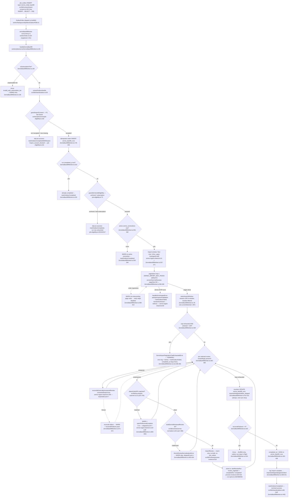

# F1 — Review import (consented `zernio_initial_backfill`)

Pathfinder Phase 1 flowchart. Feature glossary: CONTEXT.md "Review import" / "Import window" / "Live-ingest cutoff".

## Sources consulted

| Path | Lines |
|---|---|
| `worker/jobs/zernio/ZernioBackfillWorker.ts` | 1–445 (whole file) |
| `worker/jobs/zernio/job-eligibility.ts` | 1–221 (whole file; `guardImportConsent` 192–220, `guardZernioJobEligibility` 73–122) |
| `worker/jobs/zernio/zernio-ingest-shared.ts` | 1–587 (whole file; `liveIngestCutoff` 51–58, `handleZernioIngestError` 83–117, `openPhiReviewException` 119–181, `reconcileExternallyAnsweredReview` 205–393, private import helpers 410–586) |
| `src/lib/reviews/process-review.ts` | 144–243 (`insertNewReviewRow`, `startReviewRun`, `maybeEnqueueFirstReviewIngested`), 476–548 (`importReview`) |
| `worker/index.ts` | 218–228 (worker construction, concurrency 1), 438–441 (`workersByQueue` registration) |
| `src/lib/reviews/import-consent.ts` | 352 (`recordImportDecisionAndEnqueue`), ~700–724 (sanctioned raw `INSERT … SELECT` enqueue of the topic) |
| `src/lib/agents/run-spine.ts` | 150 (`startOrGetActiveRun`), 488 (`recordStep`), 565 (`completeRun`) — signatures only |
| `src/lib/shared/outbox.ts` | 56 (`extractOutboxHandle`), 86 (`markOutboxCompleted`), 134 (`markOutboxCompletedWithReason`), 160 (`markOutboxFailed`) — signatures only |
| `src/lib/reviews/zernio-normalize.ts` | 24 (`ZernioReviewNormalizationError`), 60 (`buildZernioMonitoredReview`), 92 (`extractLocationFromReviewName`) — signatures only |
| `src/lib/security/phi-scanner.ts` | 15 (`detectLikelyPhi`) — signature only |
| `CONTEXT.md` | glossary entries "Review import", "Import consent", "Import window", "Live-ingest cutoff" |

## Happy path narrative

An accepted import offer makes `recordImportDecisionAndEnqueue` insert a `job_outbox` row with topic `zernio_initial_backfill` (deduped against in-flight rows). The OutboxPoller dispatches it to the BullMQ queue whose handler is `handleZernioBackfill` (concurrency 1, registered `worker/index.ts:441`). The handler asserts the tier, resolves its outbox handle, then runs the **fail-closed F2 consent gate** `guardImportConsent` — deliberately *before* any durable write, so a refused run leaves no `zernio_backfill_runs` trace (only `completion_reason='import_consent_blocked'` on the outbox row). On `accepted` it idempotently claims a `zernio_backfill_runs` row (`completed_at IS NULL` sentinel), passes the shared archived/subscription gates, reads `connected_at` from the active connection, and computes the Import window: floor = now − 12 months, upper bound = `liveIngestCutoff(connected_at)` (connected_at − 5 min grace; null → unbounded). It then pages `zernioClient.listReviews` (50/page, cap `ZERNIO_IMPORT_MAX_PAGES` default 6), deduping by review id, with early stops (≥100 in-window selected, or page older than floor) trusted only while page ordering stays descending — a non-descending page logs the dirty-ordering WARN and disables both early stops for the run. `selectImportWindow` picks the newest ≤100 in-window reviews (location-filtered). Per review: answered rows go to `reconcileExternallyAnsweredReview({consentedImport:true})` (imports the external reply as a `'posted'` response and/or supersedes stale local drafts); unanswered rows are PHI-screened, normalized, then stored inventory-only via `importReview` — which writes the review row, opens **and completes** its run-spine run in the same transaction, and enqueues *no* draft (D2, invariant #3). Counters (`imported_count`, `skipped_count`, `oldest_skipped_create_time`) are always persisted — even before a retry-throw — then `completed_at` is stamped, the completion line logged, and the outbox row completed.

## Mermaid flowchart

## Side effects table

| # | Side effect | Where | Notes |
|---|---|---|---|
| 1 | `job_outbox` row completed | `markOutboxCompleted` — ZernioBackfillWorker.ts:225,264,443; job-eligibility.ts:93/102/117 | Skip-as-success convention: every skip completes, never fails |
| 2 | `job_outbox` completed with `completion_reason='import_consent_blocked'` | job-eligibility.ts:215 (`markOutboxCompletedWithReason`, same tx as the `businesses` row lock) | Durable refusal marker (#695); 7-day archival window, not an audit record |
| 3 | `job_outbox` row failed (terminal) | ZernioBackfillWorker.ts:354 (cap exhausted); zernio-ingest-shared.ts:97/102/107 (auth/permanent/validation) | Auth path also runs `applyIngestionAuthErrorFallback` (connection state mutation) |
| 4 | `zernio_backfill_runs` INSERT (claim) | ZernioBackfillWorker.ts:180-202 | `ON CONFLICT DO NOTHING` on `correlation_id` (reactivation) or `business_id WHERE run_reason='initial'` |
| 5 | `zernio_backfill_runs` counters UPDATE | ZernioBackfillWorker.ts:414-421 | `imported_count`, `skipped_count`, `oldest_skipped_create_time` — written even when a retry-throw follows (ops audit) |
| 6 | `zernio_backfill_runs.completed_at` stamp | ZernioBackfillWorker.ts:432-436 | The idempotency sentinel; stays NULL on every skip/failure path |
| 7 | `reviews` INSERT (inventory) | `insertNewReviewRow` — process-review.ts:144, `ON CONFLICT (provider, provider_review_name) DO NOTHING` | Sentiment classified at write site; `'unchanged'` = zero writes |
| 8 | Run spine: `agent_runs` + `agent_run_steps` | process-review.ts:533-542 → run-spine.ts:150 (`startOrGetActiveRun`), :488 (`recordStep 'review_ingested'`), :565 (`completeRun 'completed'`) | Same tx as the review INSERT; run completed immediately — no downstream worker would ever complete it |
| 9 | Analytics `first_review_ingested` | `maybeEnqueueFirstReviewIngested` — process-review.ts:210 | Same tx; only when no earlier review exists for the account |
| 10 | `reviews` INSERT + `responses` INSERT `'posted'` (answered rows) | zernio-ingest-shared.ts:410 (`insertImportedReview`), :471 (`insertImportedResponse`) | Via reconcile; ON CONFLICT-idempotent; `responses_one_posted_per_review` partial unique index |
| 11 | `responses` UPDATE → `'superseded'`, `posting_error='already_replied_external'` | zernio-ingest-shared.ts:349-356 | When a stale local draft exists for an externally answered review |
| 12 | `zernio_backfill_runs.external_reply_ingested_count` bump | zernio-ingest-shared.ts:511-521 | Only on actual insert, never on ON CONFLICT no-op |
| 13 | `review_exceptions` row + `NOTIFY_ADMIN` outbox row + Sentry `zernio_likely_phi_review_blocked` | `openPhiReviewException` — zernio-ingest-shared.ts:119-181 | One tx (transactional-outbox invariant); dedupes on still-open exception |
| 14 | Sentry `captureException` | ZernioBackfillWorker.ts:352 | Pagination-cap-exhausted terminal error |
| 15 | Logs that matter | dirty-ordering WARN :310-313 (disables early stops — the ops signal for a Zernio ordering change); PHI WARN :381 (redacted); malformed WARN :401; reconcile-failure WARN :373; consent-blocked log job-eligibility.ts:211 (the ONLY record of *which* state refused); completion log :438-441 | Consent-refusal state lives in the log line and nowhere else (deliberate) |

## Error branches

| Branch | Trigger | Disposition |
|---|---|---|
| `invalid_ws8_subscription_tier` throw (ZernioBackfillWorker.ts:135-137) | Unparseable tier in payload | Throw → BullMQ retry; deliberately AHEAD of the consent gate (plan T4 carve-out) |
| Consent refusal (job-eligibility.ts:208-218) | State ≠ `accepted` (pending/declined/derived-expired/missing row) | Skip-as-success + `import_consent_blocked` reason; NO `zernio_backfill_runs` row minted |
| Run row missing after upsert (ZernioBackfillWorker.ts:220-222) | Should be unreachable | Throw → BullMQ retry |
| Archived / subscription skip (job-eligibility.ts:97-119) | `archived_at` set, or `checkSubscription` denies (`workerType:'generator'`) | Complete outbox, leave `completed_at` NULL → retryable via future re-enqueue |
| No active connection (ZernioBackfillWorker.ts:262-266) | No `status='active'` `zernio_connections` row | WARN + complete outbox, `completed_at` NULL |
| Zernio HTTP errors during pagination (:329-335 → zernio-ingest-shared.ts:83) | Auth → fallback + fail permanent; Permanent/Validation → fail permanent; Transient/unknown → rethrow (BullMQ backoff) | Per spec §6.3 table |
| `ZernioImportPaginationCapExhaustedError` (:113, :339-356) | Cap pages walked, `nextPageToken` still set, <100 in-window selected | TERMINAL + loud: error log + Sentry + `markOutboxFailed`; `completed_at` NULL keeps run claimable after ops bumps `ZERNIO_IMPORT_MAX_PAGES`. Dirty-ordering cap-outs with ≥100 candidates proceed best-effort instead |
| PHI skip, unanswered lane (:379-394) | `detectLikelyPhi` match on comment | Exception row + admin notify + Sentry, `skippedCount++`, review NOT stored |
| Malformed review skip (:396-406) | `ZernioReviewNormalizationError` | WARN, `skippedCount++`; any other error rethrows |
| Reconcile failure accumulation (:371-374, :423-429) | Per-review reconcile threw | Counters still persisted, then one aggregate throw → BullMQ retry re-runs the import (idempotent via ON CONFLICTs) |

## External dependencies (other features called)

- **F2 — Import consent**: `guardImportConsent` (`worker/jobs/zernio/job-eligibility.ts:192`), which composes `importConsentStateSql` from `src/lib/reviews/import-consent.ts` (single owner of the derived-expiry predicate). Also the entry producer: `recordImportDecisionAndEnqueue` (`import-consent.ts:352`) is what mints the outbox row. Treated as external — internals not re-traced here.
- **Live-ingest shared reconcile**: `reconcileExternallyAnsweredReview`, `liveIngestCutoff`, `handleZernioIngestError`, `openPhiReviewException` (`worker/jobs/zernio/zernio-ingest-shared.ts:205/51/83/119`) — shared with `ZernioReviewIngestWorker`; the import passes `{consentedImport:true}` to bypass the `EXTERNAL_REPLY_IMPORT_ENABLED` flag on the import branches only.
- **Run spine**: `startOrGetActiveRun` / `recordStep` / `completeRun` (`src/lib/agents/run-spine.ts:150/488/565`) — single writer for `agent_runs`/`agent_run_steps`; the import both opens and completes the run in the insert transaction.
- **Shared worker gates**: `guardZernioJobEligibility` (`job-eligibility.ts:73`) → `checkSubscription` (`src/lib/shared/subscription-guard.ts`); outbox seam `extractOutboxHandle`/`markOutbox*` (`src/lib/shared/outbox.ts:56/86/134/160`).
- **Zernio provider client**: `zernioClient.listReviews` (`src/lib/zernio/client.ts`) — the only external API call in the flow.
- **PHI scanner**: `detectLikelyPhi` / `redactPhiForLog` (`src/lib/security/phi-scanner.ts:15`).
- **Normalization**: `buildZernioMonitoredReview` / `extractLocationFromReviewName` (`src/lib/reviews/zernio-normalize.ts:60/92`).
- **Analytics**: `enqueueAnalyticsEvent` via `maybeEnqueueFirstReviewIngested` (`process-review.ts:210`).

## Confidence + gaps

**Confidence: high.** Every node was read from source this session (2026-08-10 checkout, branch `main`); the whole of `ZernioBackfillWorker.ts`, `job-eligibility.ts`, and `zernio-ingest-shared.ts` were read end-to-end, plus the `importReview` block and its helpers.

Gaps / not traced (by design or scope):

1. `reconcileExternallyAnsweredReview` internals ARE charted at side-effect level (supersede/import/PHI) but its legacy `serpapi_poll` field-match arm and the protect-set canonicalization were not exhaustively verified against `zernio-field-match.ts` / `canonicalize-reply.ts`.
2. `guardImportConsent` internals summarized from its own doc comment and body; `importConsentStateSql`'s derivation SQL not re-read (F2 territory per task).
3. OutboxPoller dispatch mechanics (claim CTE, watchdog rescue) not re-traced — referenced as the generic outbox→BullMQ seam.
4. `startOrGetActiveRun`/`recordStep`/`completeRun` bodies not read — signatures + call sites only; the "single writer" claim rests on CLAUDE.md.
5. Reactivation catch-up (`backfill_reason='reactivation'`) shares this exact path (different claim key `correlation_id`); its producer (`archive-location-tx.ts`) not traced.
6. Counter asymmetry noted but not chased into reporting surfaces: a PHI-skipped *answered* review still counts `imported` (exception row is the audit trail), while a PHI-skipped *unanswered* review counts `skipped` — readers of `imported_count` should know it is not "rows stored".
