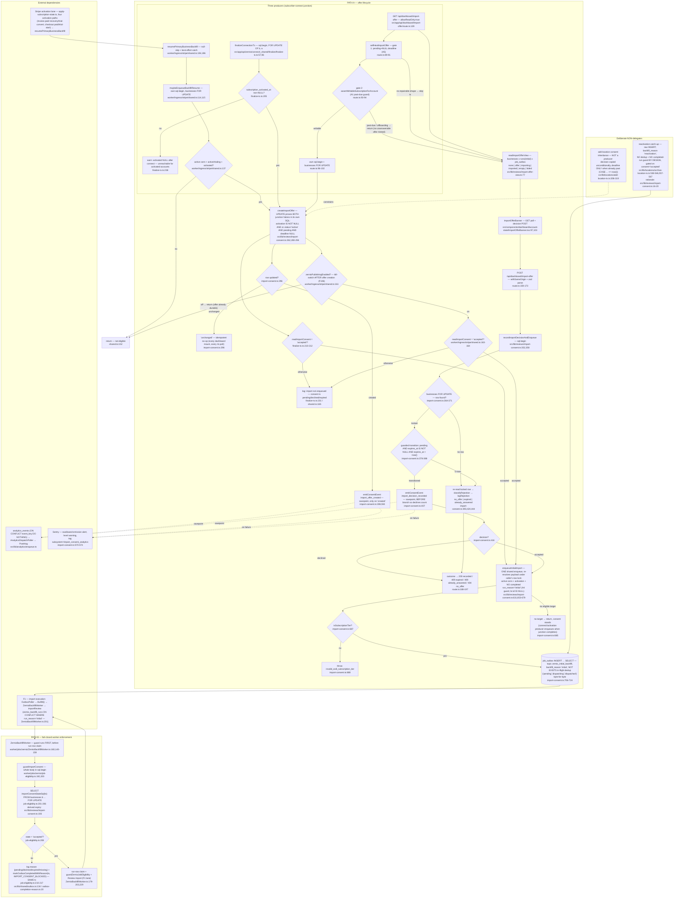

# F2 — Import consent / Import offer

Pathfinder Phase 1 flowchart. Feature per `CONTEXT.md:28-29` ("Import consent" + "Import offer"
locked terms). Two happy paths traced: **(A)** the offer lifecycle from junction mint to the
shared enqueue, **(B)** the fail-closed worker enforcement gate. They meet at the
`zernio_initial_backfill` outbox row.

## Sources consulted

All read in full or at the cited ranges during this trace — nothing charted from memory.

| File | What it owns |
|---|---|
| `src/lib/reviews/import-consent.ts` (whole file) | ONE owner of §5.3 derivation, offer write, acceptance tx, shared enqueue, savepointed analytics |
| `src/lib/reviews/import-offer-view.ts` (whole file) | Banner read model (discriminated union, 2-query) |
| `src/app/api/dashboard/import-offer/route.ts` (whole file) | GET self-heal + banner read; POST decision |
| `src/app/api/zernio/connect/_shared/finalize/finalize-tx.ts:1-243` | Producer 1 (connect junction) |
| `worker/ingress/stripe/shared.ts:60-201` | Producer 2 (Stripe activation resume) |
| `worker/jobs/zernio/job-eligibility.ts` (whole file) | Path B: `guardImportConsent` + shared eligibility gate |
| `worker/jobs/zernio/ZernioBackfillWorker.ts:130-240` | Guard call site, run-row claim ordering |
| `src/lib/locations/archive-location-tx.ts:500-629` | Producer 4 / deliberate NON-delegate (reactivation raw insert) |
| `src/lib/locations/add-location-tx.ts:230-319` | Consent inheritance on re-add (NOT a producer) |
| `src/lib/shared/outbox-completion-reason.ts` | `IMPORT_CONSENT_BLOCKED` vocabulary |
| `src/lib/shared/outbox.ts:120-152` | `markOutboxCompletedWithReason` CAS |
| `src/components/dashboard/account-state/ImportOfferBanner.tsx:12-103` | Banner surface (fetch sites only) |
| `CONTEXT.md:24-31` | Locked terms: Review import, Import consent, Import offer, Import window |
| `docs/reviews/feat-677-import-offer-prompt-decision/plan-review-round-2.md:14-29`, `plan-review-round-3.md:9-36` | The GREATEST(NULL,x) junction-anchor trap history |

## Happy paths narrative

**Path A — offer lifecycle.** The Import offer is minted at the *subscribe+connect junction*
(activation non-NULL AND an active `zernio_connections` row) by whichever of three producers
gets there: (1) `finalizeConnectionTx` inside the Zernio connect transaction
(`finalize-tx.ts:208`, already holding `FOR UPDATE OF b, a` from :96); (2) the Stripe
activation resume `maybeEnqueueBackfillResume` (`worker/ingress/stripe/shared.ts:159`,
its own `sql.begin` + businesses `FOR UPDATE`, invoked best-effort *after* the billing tx
commits); (3) the dashboard GET self-heal (`route.ts:139` → `selfHealImportOffer` :89,
own `sql.begin` + row lock, repairing junction-time writes that failed). All three delegate
to `createImportOffer` (`import-consent.ts:262`), whose single UPDATE *proves both junction
halves in its own SQL* and stamps `import_offer_expires_at = now() + 7 days` only onto a
`pending` row with a NULL deadline. Only the `'created'` branch emits `import_offer_created`
(savepoint-wrapped, :308).

The banner (`ImportOfferBanner.tsx:97`) polls `GET /api/dashboard/import-offer`, which
self-heals **then** reads `readImportOfferView` (`import-offer-view.ts:77`) — a
`businesses × zernio_backfill_runs(run_reason='initial') × job_outbox` read model returning
`none | offer | importing | imported | empty | failed`. The owner POSTs accept/decline
(:159, `withSameOrigin` + zod), and the route calls exactly one module function:
`recordImportDecisionAndEnqueue` (`import-consent.ts:352`) — `sql.begin` → businesses
`FOR UPDATE` (:364) → guarded transition (:378, `pending AND expires_at IS NOT NULL AND > now()`)
→ savepointed `import_decision_recorded` (:407, before the branch so declines are counted)
→ on accept, `enqueueInitialImport` (:631).

`enqueueInitialImport` is THE one shared enqueue for the three consent-honouring producers:
it re-resolves the payload under the caller's row lock (:653 — active connection, activation,
`run_reason='initial'` completed-run guard via `br.id IS NULL`), then INSERTs the
`zernio_initial_backfill` outbox row with a `NOT EXISTS` in-flight dedup spelled byte-for-byte
`('pending','dispatching','dispatched')` (:706-724). Two deliberate NON-delegates:
`archive-location-tx.ts:557-567` raw-inserts a `backfill_reason:'reactivation'` row (rationale
`import-consent.ts:16-20` — the worker's `ON CONFLICT … WHERE run_reason='initial'` must NOT
dedup a catch-up that is supposed to recur), and `add-location-tx.ts:306-319` is not a producer
at all — it inherits a sibling's decision unconditionally but copies the deadline **only when
already past**, so `createImportOffer` remains the only writer able to mint a live deadline.

**Path B — enforcement.** `ZernioBackfillWorker` runs `guardImportConsent`
(`job-eligibility.ts:192`) as its FIRST act after resolving the outbox handle — deliberately
*before* the `zernio_backfill_runs` claim (`ZernioBackfillWorker.ts:160`, ordering rationale
:140-159: a refused run must leave no durable run-row trace). The guard's whole body is one
`sql.begin`: `SELECT ${importConsentStateSql(tx)} … FOR UPDATE` (:201) derives expiry in
Postgres via the same §5.3 fragment (`import-consent.ts:193`, hardcoded alias `b`,
Postgres `now()`, inclusive `<=`). `accepted` → proceed; anything else (pending / declined /
derived-expired / missing row) → structured log + `markOutboxCompletedWithReason(tx, …,
IMPORT_CONSENT_BLOCKED)` on the SAME tx (:215) → skip-as-success. The tx + row lock + same-tx
completion closes the interleaving where a guard reading `pending` races an acceptance whose
in-flight dedup then inserts no replacement (silent permanent loss for a yes — :155-169).

**Where they meet:** every accepted-path enqueue lands a `job_outbox` row on topic
`zernio_initial_backfill`; OutboxPoller dispatches it to BullMQ; the backfill worker's first
gate is Path B. Consent is enforced at all four product enqueue paths AND at the one
chokepoint every path (including hand-inserted admin rows) shares.

## Mermaid

## Side effects table

| # | Site | Effect | Transactional shape |
|---|---|---|---|
| 1 | `createImportOffer` — `import-consent.ts:280-294` | `businesses.import_offer_expires_at = now() + 7d` (the offer mint) | Caller's tx; caller MUST hold the businesses row lock (`TransactionSql` signature + lock-order source tripwire) |
| 2 | `emitConsentEvent(import_offer_created)` — `import-consent.ts:308` | `analytics_events` row, key `import_offer_created_<businessId>` | **Savepoint** inside caller tx; commits with parent, rolls back alone; only on `'created'` branch |
| 3 | `recordImportDecisionAndEnqueue` — `import-consent.ts:378-388` | `businesses.import_decision` + `import_decision_at` (terminal, first-write-wins) | Own `sql.begin`, businesses `FOR UPDATE` first |
| 4 | `emitConsentEvent(import_decision_recorded)` — `import-consent.ts:407` | `analytics_events` row, key `import_decision_recorded_<businessId>` | Savepoint on `tx` (never outer `sql`); emitted BEFORE decline/accept branch |
| 5 | `enqueueInitialImport` — `import-consent.ts:706-724` | `job_outbox` INSERT, topic `zernio_initial_backfill`, `backfill_reason:'initial'` | Same tx as decision (or producer tx); `NOT EXISTS` in-flight dedup, hand-spelled status tuple |
| 6 | Reactivation raw insert — `archive-location-tx.ts:557-567` | `job_outbox` INSERT, `backfill_reason:'reactivation'`, NO dedup | Inside `lockArchiveContext` tx; deliberately not `enqueueInitialImport` |
| 7 | Consent inheritance — `add-location-tx.ts:306-319` | `businesses` UPDATE on the NEW row: decision copied; deadline copied only if `<= now()` | Inside add-location tx; CASE evaluated in-database (Postgres `now()`) |
| 8 | `guardImportConsent` refusal — `job-eligibility.ts:215-217` | `job_outbox.status='completed'` + `completion_reason='import_consent_blocked'` (#695, ADR 0016) | Same tx as the businesses `FOR UPDATE` — load-bearing against the acceptance race |
| 9 | Emission-failure alert — `import-consent.ts:570-588` | Sentry `captureMessage` (warning, `subsystem=import_consent_analytics`) + stdout `warn` | Own try/catch each; can never resurface into the caller tx (connect-outage guard) |
| 10 | Rejection/skip log lines | `logRejection` `import-consent.ts:449`; not-enqueued logs `finalize-tx.ts:231`, `shared.ts:165`, `archive-location-tx.ts:570`; guard block `job-eligibility.ts:211` | Structured, ids only — the support loop for "the button did nothing" |

## Error branches

- **A1 past-due guard (self-heal gate 2)** — `route.ts:93-94`: `assertWritableSubscriptionForAccount` before the self-heal tx. GET reads with `allowReadOnly:true`, but the self-heal is a MUTATION — minting a 7-day offer for an owner whose POST would 402 permanently consumes the location's one-time offer (expiry is derived and terminal, #670).
- **A5 cheap gate (self-heal gate 1)** — `route.ts:90-91`: no tx unless the row is repairable (`pending` + NULL deadline). Neither gate is an authority — `createImportOffer` re-proves everything under the lock.
- **A4 completed-run guard** — `import-consent.ts:667-670`: the shared enqueue's LEFT JOIN is scoped `run_reason='initial'`, matching `readImportOfferView:96-102`. The pre-#677 divergence (three hand-rolled copies, unscoped guard) let one completed reactivation run suppress the one-time import forever while the banner polled `importing` every 4s.
- **Junction half-proofs / the GREATEST(NULL,x) trap** — plan rounds 2–3 (`docs/reviews/feat-677-import-offer-prompt-decision/plan-review-round-2.md:29`, `plan-review-round-3.md:9`): the rejected junction anchor `GREATEST(subscription_activated_at, connected_at)` returns the non-NULL half when one is NULL, so a one-sided location could be handed a pre-junction offer (and NULL/NULL could report a NULL-write as 'created'). Fix shipped: BOTH halves are top-level predicates in `createImportOffer`'s own UPDATE (`import-consent.ts:290-292`), the anchor was deleted outright (`:124-139` — 7 days from creation, self-healed offers restart the clock at repair).
- **Manufactured-consent POST** — `import-consent.ts:385`: `import_offer_expires_at IS NOT NULL` in the guarded transition. Migration 100 defaults every row to `pending`+NULL, so without it a direct POST could mint `accepted` for a never-offered location (round-1 Critical); the banner mirrors this by rendering `none` for pending+NULL (`import-offer-view.ts:114-117`).
- **Zero-row classification race** — `import-consent.ts:339-342,390-394`: the rejection re-read is race-free only under the `FOR UPDATE` taken first; four causes map to three rejections via `classifyRejection` (:424).
- **Path B acceptance/guard interleaving** — `job-eligibility.ts:155-169`: without tx+lock+same-tx completion, guard reads `pending` → owner accepts → acceptance's `NOT EXISTS` sees the in-flight row and inserts nothing → guard completes it: `accepted` with no runnable row, silent permanent loss. Either serialized order now resolves correctly.
- **Emission failure classes** — `import-consent.ts:557`: errors carrying a string `code` (Postgres SQLSTATEs, postgres.js `CONNECTION_*`, Node socket codes) are swallowed → Sentry+warn; a `TypeError` from a handle without `.savepoint` and `enqueueAnalyticsEvent`'s registry error rethrow (wiring bugs, impossible states).
- **Tier assert** — `import-consent.ts:687-689` (also `finalize-tx.ts:102`, `shared.ts:153`): `invalid_ws8_subscription_tier` throws rather than enqueues; in the worker it stays AHEAD of the consent gate (throw/retry, not skip-complete — `ZernioBackfillWorker.ts:156-159`).
- **Stripe best-effort boundary** — `shared.ts:196-200`: a resume failure is logged and swallowed so it can never flip an already-committed activation to `failed`; the F106 ordering keeps offer creation BEFORE the `zernioPublishingEnabled` kill-switch return (durable offer, gated enqueue).
- **Connect unreachable branch** — `finalize-tx.ts:235-241`: `subscription_activated_at` NULL after a successful connect logs a warn; upstream writable-subscription gating makes it unreachable for activated accounts.

## External dependencies

- **F1 enqueue target** — `job_outbox` topic `zernio_initial_backfill` → OutboxPoller → BullMQ → `ZernioBackfillWorker` (run-row claim `ON CONFLICT (business_id) WHERE run_reason='initial'` at `ZernioBackfillWorker.ts:201`; import execution is F1's flowchart).
- **Stripe activation lane** — `worker/ingress/stripe/apply-subscription-state.ts` + the four activation paths converge on `resumePrimaryBusinessBackfill` (`shared.ts:176-194`); invoked OUTSIDE the activation tx.
- **Analytics** — `enqueueAnalyticsEvent` (`src/lib/analytics/enqueue.ts`) → `analytics_events` (idempotent on `event_key`) → `AnalyticsDispatchPoller` → PostHog. DB check constraint `analytics_events_event_name_check` must admit both names (migration 102) — the savepoint exists because it once didn't.
- **Sentry** — `@sentry/node` capture for swallowed emissions, routed by `tags.subsystem` per `docs/runbooks/beta-launch-alerting.md` §1.
- **Migrations 100/101/102** — consent columns + default `pending`/NULL, derived-expiry contract, analytics name registration (read via code comments; SQL not opened this trace).

## Confidence + gaps

**Confidence: high** on both happy paths and all charted branches — every node was read from
source at the cited lines this session; the three producers, the shared enqueue, both
non-delegates, and the worker guard were each verified in their own file, and the two paths'
meeting point (the outbox topic + the guard's first-act ordering) was confirmed on both sides.

Gaps (uncharted, adjacent):
- `resolveOwnerScope` / `withSameOrigin` internals not traced (treated as auth boundary).
- OutboxPoller dispatch mechanics and the import execution itself (Import window, `importReview`) are F1 territory — represented as one external node.
- Migration SQL (100/101/102) trusted from code comments + `CONTEXT.md`, not opened.
- `ImportOfferBanner.tsx` read only at its fetch sites (:97, :103); render/poll cadence (4s while importing) taken from comments in `import-consent.ts:299-301`.
- `assertWritableSubscriptionForAccount` internals (`route-helpers.ts:194`) not opened.
