# F3 — On-demand generation (Pathfinder Phase 1 flowchart)

Feature: **F3 — On-demand generation** (CONTEXT.md:33). Owner-initiated LLM drafting from the Reviews list — `Generate` on a never-replied review, `Regenerate` on an already-replied one — distinct from the live-ingest lane's automatic drafting.

## Sources consulted

Every file read in full (or the cited region) during this trace — nothing charted from memory:

- `/Users/norbertesekiel/Developer/startups/RepWorth/src/app/api/dashboard/reviews/[reviewId]/generate/route.ts` (all 146 lines)
- `/Users/norbertesekiel/Developer/startups/RepWorth/src/lib/reviews/on-demand-generate.ts` (all 163 lines)
- `/Users/norbertesekiel/Developer/startups/RepWorth/src/app/api/dashboard/reviews/[reviewId]/draft-status/route.ts` (all 126 lines)
- `/Users/norbertesekiel/Developer/startups/RepWorth/src/app/api/dashboard/past-replies/draft/route.ts` (all 266 lines)
- `/Users/norbertesekiel/Developer/startups/RepWorth/src/app/api/dashboard/past-replies/draft-status/route.ts` (all 172 lines)
- `/Users/norbertesekiel/Developer/startups/RepWorth/src/app/api/dashboard/past-replies/publish/route.ts` (all 211 lines)
- `/Users/norbertesekiel/Developer/startups/RepWorth/src/app/api/dashboard/past-replies/draft/[responseId]/route.ts` (all 268 lines)
- `/Users/norbertesekiel/Developer/startups/RepWorth/src/lib/shared/dashboard-regen-rate-limit.ts` (all 116 lines)
- `/Users/norbertesekiel/Developer/startups/RepWorth/worker/jobs/ResponseGeneratorWorker.ts` (all 194 lines)
- `/Users/norbertesekiel/Developer/startups/RepWorth/worker/jobs/response-generation/generate-draft.ts` (all 334 lines)
- `/Users/norbertesekiel/Developer/startups/RepWorth/worker/jobs/response-generation/persist.ts` (grep of the F6-boundary markers only — persist internals deliberately not re-traced)
- `/Users/norbertesekiel/Developer/startups/RepWorth/src/app/api/dashboard/past-replies/_shared/edit-reply-request.ts` (`resolveEditReplyScope`, lines 52–72; flag gate at :56)
- `/Users/norbertesekiel/Developer/startups/RepWorth/src/app/api/dashboard/reviews/[reviewId]/regenerate/route.ts` (lines 1–60 — third rate-limiter caller, noted but out of primary scope)
- `/Users/norbertesekiel/Developer/startups/RepWorth/src/lib/shared/job-outbox-helpers.ts` (`enqueueGenerateResponse`, lines 222–252)
- `/Users/norbertesekiel/Developer/startups/RepWorth/src/lib/moderation/held-draft.ts` (signatures: `openFlagExistsSql` :57, `hasOpenFlag` :73)
- `/Users/norbertesekiel/Developer/startups/RepWorth/src/lib/costs/tracker.ts` (seam names only: `reserveCost` :149, `withCostGuard` per header comment :146–147)
- `/Users/norbertesekiel/Developer/startups/RepWorth/worker/queues.ts` (`generate_response` queue registration :55)
- `/Users/norbertesekiel/Developer/startups/RepWorth/CONTEXT.md` ("On-demand generation" glossary entry)

## Narrative

**Generate happy path.** `POST /api/dashboard/reviews/[reviewId]/generate` (`generate/route.ts:145`, same-origin wrapped) is a pure composition root. Order is fixed: owner auth (`:42`) → **rate limit first** (`enforceDashboardRegenRateLimit`, `:47`, per-account burst 10/60s + hour 30/hr on distinct Redis keys, fails open) → tenant proof (`:54`, review must join a non-archived business under the caller's account — never the location cookie) → writable/offboarding pre-check (`:80`, one guard: `assertWritableSubscriptionForAccount` resolves offboarding in the same query) → **budget peek second** (`enforceRegenBudgetForReview`, `:90`, read-only advisory MGET of `regen:{reviewId}:{date}`, consumes nothing, fails open) → `sql.begin(onDemandGenerateTx)` (`:94`).

`onDemandGenerateTx` (`src/lib/reviews/on-demand-generate.ts:44`) runs six ordered guards under a `reviews FOR UPDATE` lock (`:51`): TOCTOU writable re-check (`:67` — the pre-tx check can go stale and what commits is a chargeable LLM enqueue), posted-sibling → `already_answered` (`:79`), non-terminal-sibling → `draft_already_exists` (`:90`), orphan `failed` sibling with `post_after_delete_failed_` prefix → `orphan_recovery_pending` (`:118` — Generate must not race the `/retry`–`/restore-original` recovery path), in-flight `generate_response` outbox row → `regenerate_in_progress` (`:130`), then `version = MAX+1` (`:144`) and the atomic `enqueueGenerateResponse` (`:153`) with `origin_lane='on_demand_generate'` + `suppressNotification=true` — the double structural exclusion from auto-approval (invariant #3: origin lane is the primary exclusion from `isAutoApprovalCandidate`; `suppressNotification` is belt-and-braces; neither is redundant).

OutboxPoller dispatches the row to BullMQ `generate_response` (`worker/queues.ts:55`) → `handleResponseGeneration` (`worker/jobs/ResponseGeneratorWorker.ts:20`): `loadGenerationContext` (`:37`, subscription guard + idempotency — `already_exists` completes the outbox without spend) → `runTriagePhase` (`:82`, negative lane only, flag-gated) → `generateDraft` (`:92`). Inside `generateDraft` (`worker/jobs/response-generation/generate-draft.ts:94`): voice-learning fetch (`:104`), the **authoritative** regen-budget gate `checkRegenBudget` for `version > 1` only (`:107`–`:109`, Lua INCR, terminal on `RegenBudgetExceededError` — the first Generate is free by construction), then `generateResponse` behind the **cost-guard seam** (`src/lib/costs/tracker.ts` — `reserveCost`/`withCostGuard`, pessimistic Redis reservation *before* the LLM call; seam named only, per F-costs), then the avoid-facts guardrail (`:152`, one bounded regenerate-and-recheck). Terminal failures route to `checkpointTerminalGeneration` (`ResponseGeneratorWorker.ts:148` — outbox failed + WS5 live-draft guard + run-spine completion); transient ones re-throw for BullMQ retry. Then `moderateResponse` (`:105`) and **hand-off to F6**: `persistResponseAndNotify` (`:110`, `persist.ts`) persists response + moderation hold + notification decision in one tx — not re-traced here. Two F6 outcomes matter to F3: the **stale-content skip** (`:125`–`:131`, ADR 0017 → `markOutboxCompletedWithReason(STALE_REVIEW_CONTENT)`) and the on-demand lane's `suppressNotification` meaning no `send_notification` enqueue ever (`persist.ts:228`). Success: `maybeEnqueueFirstResponseDrafted` analytics (`:135`) + `markOutboxCompleted` (`:144`).

**Regenerate door.** `POST /api/dashboard/past-replies/draft` (`draft/route.ts:266`), two modes. Gates: `resolveEditReplyScope` (`:70`) — which is where **`EDIT_REPLIES_ENABLED` gating lives** (`edit-reply-request.ts:56`, 503 `feature_disabled`); the Generate door has no such gate — then `assertCanEditReply` tier+ownership (`:85`), mode-dependent offboarding gate (`:92`–`:98`: regenerate=processing-class, manual=operational-UI-class), and the shared rate limiter for **regenerate mode only** (`:102`–`:105`; manual is a plain INSERT). **Notably absent: the `enforceRegenBudgetForReview` peek** — this door relies solely on the worker's authoritative `checkRegenBudget` (and regenerate rows are always `version > 1`, so the budget always arms). In-tx (`:108`): review lock (`:111`), resume-existing-draft branch (`:131` — held check `hasOpenFlag` `:153` → 409 `held_for_review`, else 409 `draft_already_exists` with resume payload), in-flight outbox guard (`:172`), `validateOptimisticConcurrency` (`:185`, absent from the Generate door — there is no live reply to be concurrent with), version MAX+1 (`:205`), then manual INSERT (`:229`) or `enqueueGenerateResponse` with `origin_lane='regenerate'` + `suppressNotification=true` (`:245`). Same worker consumes both lanes; all three doors (Generate, dashboard `/regenerate` at `regenerate/route.ts`, past-replies Regenerate) share the one per-account rate counter and the one per-review budget counter.

**Twin polls.** `GET /api/dashboard/reviews/[reviewId]/draft-status` (`route.ts:29`) vs `GET /api/dashboard/past-replies/draft-status?outbox_id=` (`route.ts:44`) — full divergence table under "Error branches". Headline: the reviews twin keys on `reviewId` (survives refresh), checks the responses row *first* and falls back to the outbox; the past-replies twin keys on **`outbox_id`** (client state a refresh loses; the query param — not `responseId`), reads the outbox first and resolves the response only on `completed`. Both compose `openFlagExistsSql` (reviews `:72`, past-replies `:124`) so a held draft never leaks text — but they present heldness differently: `{status:'idle'}` (reviews `:84`, stops the poller, list re-renders held from its own query) vs `{status:'failed', error:'held_for_review'}` (past-replies `:147`).

**Publish + PATCH/DELETE (compact).** Regenerate-lane drafts publish through `POST /past-replies/publish` (`publish/route.ts:211`): review lock → OCC → response lock + `pending_approval` check → held gate (`:159`) → status transition with `approval_method='owner'` + `approved_text` COALESCE backfill (`:169`) → session audit (`:181`) → `enqueuePublishResponse` (`:193`) in one tx — hand-off to the publisher/F6 boundary. Generate-lane drafts publish through `reviews/[reviewId]/approve` instead (per `generate/route.ts:13`–`14`), not charted here. `PATCH /draft/:responseId` (`:60`) edits text in place — status **stays** `pending_approval` (held gate `:164`). `DELETE /draft/:responseId` (`:187`) supersedes idempotently (204 on missing/terminal; held gate `:245` refuses 409).

## Mermaid

```mermaid
flowchart TD

  %% ═══════════ GENERATE DOOR ═══════════
  subgraph GEN_DOOR["Generate door — never-replied review"]
    G0["POST withSameOrigin<br/>reviews/[reviewId]/generate/route.ts:145"]
    G1["requireDashboardReviewOwner<br/>generate/route.ts:42"]
    G2["enforceDashboardRegenRateLimit — RATE first, fails open<br/>generate/route.ts:47"]
    G3["Tenant proof review→business→account<br/>generate/route.ts:54"]
    G4["assertWritableSubscriptionForAccount<br/>generate/route.ts:80"]
    G5["enforceRegenBudgetForReview — BUDGET peek second, advisory, fails open<br/>generate/route.ts:90"]
    G6["sql.begin<br/>generate/route.ts:94"]
  end

  G0 --> G1 --> G2
  G2 -->|429 rate_limited| ERR_RATE["429 rate_limited<br/>dashboard-regen-rate-limit.ts:66"]
  G2 --> G3
  G3 -->|no row| ERR_404G["404 review_not_found<br/>generate/route.ts:64"]
  G3 --> G4
  G4 -->|402/403| ERR_WRIT["402/403 not writable / offboarding<br/>generate/route.ts:82"]
  G4 --> G5
  G5 -->|429 regen_limit_reached| ERR_BUDGET["429 regen_limit_reached — budget exhausted<br/>dashboard-regen-rate-limit.ts:107"]
  G5 --> G6 --> T1

  %% ═══════════ GENERATE TX ═══════════
  subgraph GEN_TX["onDemandGenerateTx — on-demand-generate.ts:44"]
    T1["Lock reviews FOR UPDATE<br/>on-demand-generate.ts:51"]
    T2["TOCTOU writable re-check in-tx<br/>on-demand-generate.ts:67"]
    T3["posted sibling?<br/>on-demand-generate.ts:79"]
    T4["non-terminal sibling?<br/>on-demand-generate.ts:90"]
    T5["orphan failed sibling post_after_delete_failed_?<br/>on-demand-generate.ts:118"]
    T6["in-flight generate_response outbox?<br/>on-demand-generate.ts:130"]
    T7["version = MAX+1<br/>on-demand-generate.ts:144"]
    T8["enqueueGenerateResponse origin_lane=on_demand_generate suppressNotification=true<br/>on-demand-generate.ts:153"]
  end

  T1 -->|miss| ERR_404T["404 review_not_found in-tx<br/>generate/route.ts:102"]
  T1 --> T2
  T2 -->|stale| ERR_WRIT
  T2 --> T3
  T3 -->|yes| ERR_ANS["409 already_answered<br/>generate/route.ts:109"]
  T3 --> T4
  T4 -->|yes| ERR_DUP["409 draft_already_exists<br/>generate/route.ts:111"]
  T4 --> T5
  T5 -->|yes| ERR_ORPH["409 orphan_recovery_pending<br/>generate/route.ts:116"]
  T5 --> T6
  T6 -->|yes| ERR_INFLT["409 regenerate_in_progress<br/>generate/route.ts:118"]
  T6 --> T7 --> T8
  T8 --> G_OK["200 outbox_id + version<br/>generate/route.ts:132"]
  T8 --> OUTBOX

  %% ═══════════ REGENERATE DOOR ═══════════
  subgraph REGEN_DOOR["Regenerate door — already-replied review"]
    R0["POST withSameOrigin<br/>past-replies/draft/route.ts:266"]
    R1["resolveEditReplyScope — EDIT_REPLIES_ENABLED gate HERE<br/>edit-reply-request.ts:56 via draft/route.ts:70"]
    R2["assertCanEditReply tier + ownership<br/>draft/route.ts:85"]
    R3["Offboarding gate — mode-dependent class<br/>draft/route.ts:92"]
    R4["enforceDashboardRegenRateLimit — regenerate mode ONLY, NO budget peek<br/>draft/route.ts:102"]
    R5["Lock reviews FOR UPDATE<br/>draft/route.ts:111"]
    R6["Existing non-terminal draft? resume branch<br/>draft/route.ts:131"]
    R7["hasOpenFlag on existing draft<br/>draft/route.ts:153"]
    R8["in-flight generate_response outbox?<br/>draft/route.ts:172"]
    R9["validateOptimisticConcurrency<br/>draft/route.ts:185"]
    R10["version = MAX+1<br/>draft/route.ts:205"]
    R11["mode=manual: INSERT pending_approval row<br/>draft/route.ts:229"]
    R12["mode=regenerate: enqueueGenerateResponse origin_lane=regenerate suppressNotification=true<br/>draft/route.ts:245"]
  end

  R0 --> R1
  R1 -->|flag off| ERR_FLAG["503 feature_disabled<br/>edit-reply-request.ts:59"]
  R1 --> R2 --> R3
  R3 -->|blocked| ERR_OFFB["403 account_offboarding_blocked<br/>draft/route.ts:97"]
  R3 --> R4
  R4 -->|429| ERR_RATE
  R4 --> R5 --> R6
  R6 -->|exists| R7
  R7 -->|held| ERR_HELD_DR["409 held_for_review — F5 refusal<br/>draft/route.ts:154"]
  R7 -->|not held| ERR_DUP2["409 draft_already_exists + resume payload<br/>draft/route.ts:156"]
  R6 -->|none| R8
  R8 -->|yes| ERR_INFLT
  R8 --> R9
  R9 -->|drift| ERR_OCC["409 review_changed / response_changed<br/>draft/route.ts:188"]
  R9 --> R10
  R10 --> R11
  R10 --> R12
  R12 --> OUTBOX

  %% ═══════════ OUTBOX → WORKER ═══════════
  OUTBOX["job_outbox topic=generate_response — invariant #2 same-tx enqueue<br/>job-outbox-helpers.ts:222"]
  OUTBOX --> POLLER["OutboxPoller dispatch → BullMQ generate_response queue<br/>worker/queues.ts:55"]
  POLLER --> W0

  subgraph WORKER["generate_response worker"]
    W0["handleResponseGeneration<br/>worker/jobs/ResponseGeneratorWorker.ts:20"]
    W1["loadGenerationContext — subscription guard + idempotency<br/>ResponseGeneratorWorker.ts:37"]
    W2["runTriagePhase — negative lane, flag-gated<br/>ResponseGeneratorWorker.ts:82"]
    W3["generateDraft<br/>response-generation/generate-draft.ts:94"]
    W4["checkRegenBudget — AUTHORITATIVE Lua INCR, version>1 only, first draft free<br/>generate-draft.ts:107"]
    W5["generateResponse via cost-guard seam reserve→LLM→finalize<br/>generate-draft.ts:139"]
    W6["applyAvoidFactsGuardrail — one bounded retry<br/>generate-draft.ts:152"]
    W7["moderateResponse<br/>ResponseGeneratorWorker.ts:105"]
    W8["persistResponseAndNotify — F6 BOUNDARY, one tx<br/>ResponseGeneratorWorker.ts:110"]
    W9["maybeEnqueueFirstResponseDrafted analytics<br/>ResponseGeneratorWorker.ts:135"]
    W10["markOutboxCompleted<br/>ResponseGeneratorWorker.ts:144"]
    WTERM["checkpointTerminalGeneration — outbox failed + live-draft guard + run spine<br/>ResponseGeneratorWorker.ts:148"]
  end

  W0 --> W1
  W1 -->|not found| WFAIL["markOutboxFailed<br/>ResponseGeneratorWorker.ts:41"]
  W1 -->|skipped / already_exists| WIDEM["markOutboxCompleted idempotent<br/>ResponseGeneratorWorker.ts:52"]
  W1 --> W2 --> W3 --> W4
  W4 -->|RegenBudgetExceeded terminal| WTERM
  W4 --> W5
  W5 -->|cost cap exhausted — Sentry alert, terminal| WTERM
  W5 -->|transient LLM / cost-infra / concurrency| WRETRY["re-throw → BullMQ retry<br/>generate-draft.ts:202"]
  W5 --> W6
  W6 -->|still violates terminal| WTERM
  W6 --> W7 --> W8
  W8 -->|stale-content skip ADR 0017 — F6| WSTALE["markOutboxCompletedWithReason STALE_REVIEW_CONTENT<br/>ResponseGeneratorWorker.ts:130"]
  W8 -->|high-severity held — F5 flag write, no notification| W9
  W8 --> W9 --> W10

  %% ═══════════ TWIN POLLS ═══════════
  subgraph POLL_REVIEWS["Draft-status twin A — keyed by reviewId, account-scoped, NO flag gate"]
    PA0["GET draft-status<br/>reviews/[reviewId]/draft-status/route.ts:29"]
    PA1["Tenant proof same shape as door<br/>draft-status/route.ts:43"]
    PA2["Responses row FIRST + openFlagExistsSql AS held<br/>draft-status/route.ts:72"]
    PA3["held? → status idle, never text<br/>draft-status/route.ts:80"]
    PA4["draft → status ready + response_text<br/>draft-status/route.ts:86"]
    PA5["else newest outbox by aggregate_id=reviewId<br/>draft-status/route.ts:93"]
    PA6["OUTBOX_IN_FLIGHT_STATUSES imported constant → generating<br/>draft-status/route.ts:110"]
    PA7["completed-but-no-draft → idle<br/>draft-status/route.ts:113"]
    PA8["else → failed + last_error<br/>draft-status/route.ts:118"]
  end

  PA0 --> PA1 --> PA2
  PA2 -->|held row| PA3
  PA2 -->|clean row| PA4
  PA2 -->|no row| PA5
  PA5 --> PA6 --> PA7 --> PA8

  subgraph POLL_PAST["Draft-status twin B — keyed by outbox_id, cookie-location-scoped, EDIT_REPLIES gated"]
    PB0["GET draft-status?outbox_id=<br/>past-replies/draft-status/route.ts:44"]
    PB1["editRepliesEnabled gate 503<br/>past-replies/draft-status/route.ts:45"]
    PB2["resolveOwnerScope rw_location_scope cookie<br/>past-replies/draft-status/route.ts:52"]
    PB3["Outbox row FIRST by id + JSONB string guard<br/>past-replies/draft-status/route.ts:70"]
    PB4["payload.business_id === locationId else 403<br/>past-replies/draft-status/route.ts:95"]
    PB5["hand-spelled pending/dispatching/dispatched → generating<br/>past-replies/draft-status/route.ts:99"]
    PB6["completed → resolve response 3-status subset + openFlagExistsSql AS held<br/>past-replies/draft-status/route.ts:124"]
    PB7["response business_id re-check else 403 — tenant refusal beats heldness<br/>past-replies/draft-status/route.ts:138"]
    PB8["held? → status failed error held_for_review<br/>past-replies/draft-status/route.ts:146"]
    PB9["→ response_id + row status + response_text<br/>past-replies/draft-status/route.ts:152"]
    PB10["terminal → failed + last_error<br/>past-replies/draft-status/route.ts:164"]
  end

  PB0 --> PB1 --> PB2 --> PB3 --> PB4 --> PB5
  PB5 -->|completed| PB6 --> PB7 --> PB8
  PB8 -->|clean| PB9
  PB5 -->|failed/other| PB10

  W10 -.->|row visible on next poll| PA2
  W10 -.->|outbox completed on next poll| PB3

  %% ═══════════ COMPACT BRANCHES ═══════════
  subgraph PUBLISH["Publish hand-off — regenerate lane only"]
    PU0["POST publish withSameOrigin<br/>past-replies/publish/route.ts:211"]
    PU1["lock review → OCC → lock response pending_approval<br/>publish/route.ts:106"]
    PU2["hasOpenFlag held gate — F5<br/>publish/route.ts:159"]
    PU3["status→approved/edited approval_method=owner + COALESCE approved_text<br/>publish/route.ts:169"]
    PU4["insertAuditLogSession approve_edit<br/>publish/route.ts:181"]
    PU5["enqueuePublishResponse same tx → publisher/F6<br/>publish/route.ts:193"]
  end

  PB9 --> PU0
  PU0 --> PU1 --> PU2
  PU2 -->|held| ERR_HELD_PU["409 held_for_review<br/>publish/route.ts:160"]
  PU2 --> PU3 --> PU4 --> PU5

  PA4 -.->|Generate lane publishes via reviews/approve NOT past-replies/publish<br/>generate/route.ts:13| APPROVE["reviews/[reviewId]/approve<br/>out of F3 scope"]

  subgraph EDIT_DEL["PATCH / DELETE draft — compact"]
    ED0["PATCH edit-further — flag gate, CSRF, OCC, locks, held gate :164, text UPDATE stays pending_approval<br/>draft/[responseId]/route.ts:60"]
    ED1["DELETE cancel — flag gate, CSRF, lock, held gate :245, pending_approval→superseded, idempotent 204<br/>draft/[responseId]/route.ts:187"]
  end

  PB9 --> ED0
  PB9 --> ED1
  ED0 -->|409 held_for_review| ERR_HELD_ED["409 held_for_review<br/>draft/[responseId]/route.ts:165 and :246"]
  ED1 -->|409 held_for_review| ERR_HELD_ED

  %% ═══════════ EXTERNAL DEPS ═══════════
  subgraph EXTERNAL["External dependencies"]
    X_F5["F5 held-draft semantic owner openFlagExistsSql/hasOpenFlag<br/>src/lib/moderation/held-draft.ts:57"]
    X_F6["F6 persist + notification + auto-approval decision<br/>worker/jobs/response-generation/persist.ts"]
    X_F4["F4 Reviews-list rendering deriveAxes/deriveRowAction<br/>src/lib/past-replies/replies-view.ts"]
    X_COST["Cost-guard seam reserveCost/withCostGuard + regen budget counters<br/>src/lib/costs/tracker.ts:149"]
  end

  PA2 -.-> X_F5
  PB6 -.-> X_F5
  PU2 -.-> X_F5
  W8 -.-> X_F6
  W5 -.-> X_COST
  W4 -.-> X_COST
  G5 -.-> X_COST
  PA3 -.->|row re-renders held from list query| X_F4
```

## Side effects

| Where | Effect |
| --- | --- |
| `on-demand-generate.ts:153` / `draft/route.ts:245` | **Outbox enqueue** — `enqueueGenerateResponse` (`job-outbox-helpers.ts:222`) inside the same tx as the review lock (invariant #2). Payload pins `origin_lane` (`on_demand_generate` / `regenerate`) + `suppress_notification: true` — the structural auto-approval exclusion (invariant #3). |
| `generate-draft.ts:139` | **Cost-guard reservation** — seam only: `src/lib/costs/tracker.ts` (`reserveCost`/`withCostGuard`), pessimistic Redis reserve before the LLM call, finalize from actual tokens. `cost:daily:{bizId}:{date}` + `cost:global:{date}`. |
| `generate-draft.ts:109` | **Regen budget consumption** — authoritative Lua INCR on `regen:{reviewId}:{date}` (3/day), `version > 1` only; route peeks (`dashboard-regen-rate-limit.ts:102`) never consume. |
| `dashboard-regen-rate-limit.ts:48` | **Rate counters advanced** on every request — `dashregen:owner:{acct}:burst` + `:hour`, distinct keys, both increment even when one blocks. |
| `ResponseGeneratorWorker.ts:135` | **Analytics** — `maybeEnqueueFirstResponseDrafted` (`response-generation/analytics.ts`), durable `analytics_events` insert, suppressed during active offboarding (`:60`). |
| `generate-draft.ts:77` | **Sentry alert** on cost-cap exhaustion (`alertCostCapExhausted`) — dropped paid work is never silent. |
| `publish/route.ts:181,193` | Publish branch: session **audit-log row** + `publish_response` **outbox enqueue** in the same tx as the status transition. |
| `generate/route.ts:124` | Post-commit structured log `on_demand_generate_enqueued` (can never report a rolled-back enqueue). |

## Error branches

**Route-level (Generate door), in order:** 429 `rate_limited` (rate before budget — `generate/route.ts:47` vs `:90`), 404 `review_not_found`, 402/403 not-writable/offboarding, 429 `regen_limit_reached` (budget exhausted — advisory peek; fails open on Upstash outage, D-F: absent map entry = proceed, absent key = `used:0`). In-tx: `already_answered`, `draft_already_exists`, `orphan_recovery_pending`, `regenerate_in_progress` (all 409).

**Regenerate door extras:** 503 `feature_disabled` (**`EDIT_REPLIES_ENABLED` gates this side only** — via `resolveEditReplyScope`, `edit-reply-request.ts:56`), tier gate, mode-dependent offboarding class, 409 `held_for_review` on resume of a held draft (F5 refusal, `draft/route.ts:154`), OCC 409s (`review_changed`/`response_changed`) — no OCC on the Generate side (nothing live to be concurrent with), and **no budget peek** (worker gate only).

**Worker-level:** `RegenBudgetExceededError` → terminal (`generate-draft.ts:111`); cost-cap (`CostLimitExceededError`/`GlobalCostLimitExceededError`) → terminal + Sentry (`:196`); transient (`TransientLLMError`/`CostInfraUnavailableError`/`ConcurrencyLimitExceededError`) → re-throw for BullMQ retry (`:202`); guardrail-still-violates → terminal (`:213`); **stale-content skip** (F6, ADR 0017) → outbox *completed* with reason `STALE_REVIEW_CONTENT`, zero writes (`ResponseGeneratorWorker.ts:125–131`); high-severity moderation → **held** inside F6's persist tx (F5, invariant #4) — the job still *succeeds*; heldness surfaces only through the polls.

**Twin draft-status divergences (beyond keying):**

| Axis | reviews/[reviewId]/draft-status (:29) | past-replies/draft-status (:44) |
| --- | --- | --- |
| Key | `reviewId` path param — refresh resumes the poll | `outbox_id` **query param** (not `responseId`) — client state a refresh loses |
| Flag | **No** `EDIT_REPLIES_ENABLED` gate (Generate never touches a live Google reply) | 503 `feature_disabled` without the flag (`:45`) |
| Tenant scope | Account-scoped review→business join up-front (`:43`) | Cookie-location scope (`resolveOwnerScope`) + outbox `payload.business_id` equality (`:95`) + response-row `business_id` re-check (`:138`); JSONB-as-string PgBouncer guard (`:86`) |
| Query order | Responses row **first**, outbox fallback | Outbox row **first**, response resolved only on `completed` |
| In-flight set | Imports `OUTBOX_IN_FLIGHT_STATUSES` constant (`:110`) | Hand-spells `'pending' \|\| 'dispatching' \|\| 'dispatched'` (`:99–103`) |
| Response-status filter | `NON_TERMINAL_STATUSES` via `statusArraySql` (`:76`) | Hand-spelled 3-value subset `('pending_approval','approved','edited')` with a `status-audit-ignore` waiver (`:127`) |
| Held presentation | `{status:'idle'}` — stops the poller; list re-renders held from its own F4 query (`:84`) | `{status:'failed', error:'held_for_review'}` — terminal for the poller (`:147`) |
| Held vs tenant ordering | Tenant proof is up-front, before any draft read | Held checked **after** the response tenant re-check so a cross-tenant poll gets a heldness-free 403 (`:141–145`) |
| Ready shape | `{status:'ready', response_id, response_text}` | `{response_id, status:<row status>, response_text}` — no `'ready'` literal |
| openFlagExistsSql | Composed at `:72` (`resp.id` ref) | Composed at `:124` (`responses.id` ref) |

## External dependencies

- **F5 held-draft** — `src/lib/moderation/held-draft.ts` (`openFlagExistsSql` :57, `hasOpenFlag` :73): semantic owner of "is this draft held"; composed by both polls, the Regenerate resume branch, publish, PATCH, DELETE.
- **F6 persist** — `worker/jobs/response-generation/persist.ts` (`persistResponseAndNotify`): response persistence + moderation hold + notification/auto-approval decision, one tx; F3 hands off at `ResponseGeneratorWorker.ts:110` and consumes only its `skipped_stale_content` outcome and the `suppressNotification` contract.
- **F4 list rendering** — `src/lib/past-replies/replies-view.ts` (`deriveAxes`/`deriveRowAction`): projects the `generate`/`generating`/`draft_ready`/`regenerate` action slot the doors are launched from; a held row re-renders from F4's query after the reviews poll returns `idle`.
- **costs/tracker** — `src/lib/costs/tracker.ts`: cost-guard seam (`reserveCost`/`withCostGuard`), regen-budget counters (`checkRegenBudget` authoritative, `peekRegenBudgetBatch` advisory); plus `src/lib/shared/rate-limit.ts` (`checkRateLimit`) under the shared limiter.
- **Downstream, out of scope:** `reviews/[reviewId]/approve` (Generate-lane publish), `publish_response` worker / `ReviewPublisher` seam (post-publish), OutboxPoller (dispatch fabric).

## Confidence + gaps

**Confidence: high.** Every charted node was read from source this session; all cited line numbers were verified against file contents.

Gaps / notes:

1. **Task-prompt correction:** the past-replies draft-status twin is keyed by **`outbox_id`** (query param, `route.ts:61`), not `responseId` as the assignment stated. Charted as-built.
2. `persist.ts` internals (F6) deliberately not re-traced — only its boundary contract (stale skip, held write, `suppressNotification`, auto-approval structural block at `persist.ts:105–109`) is charted.
3. A **third door** shares the rate + budget counters: `reviews/[reviewId]/regenerate/route.ts` (the Needs-Action-queue regenerate via `regenerateBySession`). Noted (the `generate/route.ts:46` "C3 THIRD caller" comment) but not fully traced — outside the two doors this assignment scoped.
4. The Generate-lane publish path (`reviews/[reviewId]/approve`) is asserted from the route header comment (`generate/route.ts:13–14`) and CONTEXT.md, not traced.
5. `CONTEXT.md:33` was verified as the F3 "On-demand generation" glossary entry; exact line may drift as the glossary grows.
