# F4 — Reviews list (Pathfinder Phase 1 flowchart)

Feature: **Reviews list** (CONTEXT.md:32) — the owner's single inventory of every review for a location at `/dashboard/reviews/history`, grouped Unanswered → Answered, `PAGE_SIZE` 50. Read model only; every affordance derives server-side from the two-axes model (ADR 0018, #727).

## Sources consulted

All read on 2026-08-10; nothing charted from memory.

| File | What it contributed |
|---|---|
| `src/app/(authenticated)/dashboard/reviews/history/page.tsx` (:25-67) | Composition root: auth gate, flag read, view load, `notFound()`, prop fan-out |
| `src/lib/past-replies/load-replies.ts` (:87-405) | `loadPastRepliesPageView`: biz lookup, single row source (LEFT JOIN + 4 LATERALs), merged denominator query, regen-budget peek, Map→Record seam |
| `src/lib/past-replies/replies-view.ts` (:1-387) | `parsePageParam`, `deriveAxes` (:114), `deriveRowAction` (:136), `provenanceBadge` (:179), `toCardRow` (:308), `groupReplies` (:375), `ReplyFacts` mappers |
| `src/app/(authenticated)/dashboard/reviews/history/PastRepliesClient.tsx` (:89-423) | Client shell: stats, filters, sections, pagination, drawer host |
| `src/components/dashboard/reviews/PastReplyCard.tsx` (:132-542) | Card: `ReplySide` switch on `row_action` (:199), `AnsweredControls` (:418), `RecoveryControl` (:478), held-panel reconstruction (:247-282) |
| `src/lib/past-replies/flags.ts` (:20-22) | `editRepliesEnabled()` — sole reader of `EDIT_REPLIES_ENABLED` |
| `src/lib/moderation/held-draft.ts` (:57-66) | `openFlagExistsSql` — F5 seam composed into the draft LATERAL |
| `src/lib/costs/tracker.ts` (:354-426) | `peekRegenBudgetBatch` — one MGET, fail-open, no rejection path |
| `src/components/dashboard/reviews/useInlineGenerate.ts` (:11-21, :130, :180, :204) | F3 route contract for Generate/approve/edit/draft-status |
| `src/components/dashboard/reviews/edit-reply/useEditReplyDraft.ts` (:21-30) | F3 route contract for Regenerate drawer + orphan recovery (`/retry`, `/restore-original`) |
| `src/lib/auth/require-owner-access.ts` (:42-97), `src/lib/auth/get-request-scope.ts` | Verified the auth gate is read-only |
| `CONTEXT.md` (:32) | Locked vocabulary: Reviews list, two axes, Action slot, held-never-crosses-the-wire |

## Narrative

`PastRepliesPage` (page.tsx:25) is the composition root — the only place in this path that imports the `sql` singleton (invariant #15). It awaits `requireOwnerAccess(sql)` (redirect-only guard, no writes), parses `?page=` through `parsePageParam` (clamp to ≥1, replies-view.ts:48), reads `editRepliesEnabled()` server-side (invariant #13 — the flag travels as a prop, never a `NEXT_PUBLIC_*`), and calls `loadPastRepliesPageView` (load-replies.ts:87). A `null` view (location not found / not owned) renders `notFound()` (page.tsx:37); an unknown stored tier fails closed with a throw (load-replies.ts:130-132).

`loadPastRepliesPageView` issues exactly **three queries**: the biz/tier lookup (:111), then a `Promise.all` pair —

1. **The single row source** (:174-303): `reviews LEFT JOIN responses resp ON status='posted'` — `resp.id IS NULL` **is** the unanswered predicate — plus four LATERAL sidecars, each de-duped to one row: `fail_sidecar` (`delete_failed_*` sibling of a still-live reply, :216), `draft` (live non-terminal response, with `openFlagExistsSql(sql, sql\`resp2.id\`)` **projected** as a `held` column at :244 — projected, not filtered, per invariant #4/D9: filtering would make a held draft indistinguishable from no draft and re-offer Generate), `pending_gen` (in-flight `generate_response` outbox row, re-spelling the byte-for-byte in-flight status set, :261-268), `orphan_sidecar` (`post_after_delete_failed_*` with no posted sibling, :274) and `orphan_superseded` (recovery drawer's "original" pane text, :286). `is_orphan` is computed **as a column** (:197) — orphan-ness is data, not caller discipline. `ORDER BY (resp.id IS NOT NULL), review_date DESC, r.id DESC` (:301) puts unanswered first with a total order (the `r.id DESC` tie-break prevents rows swapping across an OFFSET boundary — F7), then `LIMIT 50 OFFSET (page-1)*50` (:302).
2. **The merged denominator** (:350-362): one snapshot for `COUNT(*) FILTER (WHERE p.review_id IS NULL)`, the answered complement, and `AVG(star_rating)` — #731 merged three queries so unanswered + answered ≡ COUNT(*) by construction. Orphans need no term: no posted sibling → already counted unanswered.

Rows flow through `groupReplies` (replies-view.ts:375) → `toCardRow` (:308) per row: `deriveAxes` (:114) reads five facts into the two axes — Posted-reply axis (`none`/`posted`/`orphan`; `is_orphan` already encodes `resp.id IS NULL`, so orphan/posted exclusivity holds by construction) and the **server-internal** Replacement-draft axis (`none`/`generating`/`ready`/`held`, precedence held > ready > generating > none: a settled response row outranks an in-flight outbox row). `deriveRowAction` (:136) collapses the 3×4 cross-product into the single Action slot (matrix below). One dispatch on the reply axis picks `orphanReplyFacts` (:259, maps from the `orphan_*` LATERALs — `response_id` carries the FAILED id for `/retry`/`/restore-original`) or `liveReplyFacts` (:280); the `Required<Pick<…>>` `ReplyFacts` type (:236) makes omitting a field a compile error (#678 round-2 Defect A). `provenanceBadge` (:179) reads the **dispatched** `approval_method` so an orphan can never badge `auto_approved` for a reply not on Google. Grouping splits on `reply_state !== 'posted'` (:383-384) — orphan `recover` rows and held rows group under **Unanswered**.

Back in load-replies: `peekRegenBudgetBatch(answeredRows.map(review_id))` (:387) — answered rows only (a first Generate is free by construction), one read-only MGET, fail-open with **no rejection path** (tracker.ts:394-426: an Upstash outage resolves to an empty Map; a MISSING key means UNKNOWN, never "0 remaining" — inverting that would disable every Regenerate during an outage; the authoritative gate stays the worker's Lua INCR). The Map→Record conversion happens at the seam (:399, D12) because a `Map` does not serialize across the server→client boundary. `totalPages` is a TRUE denominator over all reviews (:403) so a fresh import's tail pages are reachable.

`PastRepliesClient` (PastRepliesClient.tsx:89) is presentation only: stat tiles, client-side search/rating filters over the current page (`useReplyFilters` :53), two `ReplySection`s (:277), `?page=` link pagination (:327), and the `EditReplyDrawer` host (:367, mounted only when `editRepliesEnabled`). `PastReplyCard`'s `ReplySide` (PastReplyCard.tsx:199) is a `switch` on the server-derived `row_action` with a `never`-typed default — the card renders what the server derived and computes nothing (D-D). The withdrawn slot (`'none'`) branches on `reply_state`: `posted` keeps the live reply visible with a **silent** withdrawal of Regenerate (:250-263); `none` reconstructs the "Reply on hold" panel from the two wire fields alone (:264-282) — **the `held` value itself never crosses the wire** (invariant #4 as structure: `DraftState` is typed server-internal at replies-view.ts:83-88, and `PastReplyRow` carries only `reply_state` + `row_action`).

**Side effects: none — verified, not assumed.** Every SQL statement in the path is a SELECT (`load-replies.ts` has no INSERT/UPDATE/DELETE and no `job_outbox` write; `require-owner-access.ts` and `get-request-scope.ts` grep clean for writes; the Supabase cookie `setAll` is an explicit no-op). The only non-Postgres I/O is the single Redis MGET in `peekRegenBudgetBatch`, documented and implemented as "no INCR, no eval, no LLM spend" (tracker.ts:368). All mutations live behind the F3 routes the rendered actions link to.

## Mermaid

```mermaid
flowchart TD
    subgraph ROOT["Composition root (server)"]
        PAGE["PastRepliesPage<br/>src/app/(authenticated)/dashboard/reviews/history/page.tsx:25"]
        AUTH["requireOwnerAccess (read-only, redirects)<br/>src/lib/auth/require-owner-access.ts:42"]
        PPARAM["parsePageParam (clamp ≥1)<br/>src/lib/past-replies/replies-view.ts:48"]
        FLAG["editRepliesEnabled()<br/>src/lib/past-replies/flags.ts:20"]
        NF["notFound() on null view<br/>page.tsx:37"]
    end

    subgraph LOAD["Read model — loadPastRepliesPageView (3 queries + 1 MGET, zero writes)"]
        LOADFN["loadPastRepliesPageView<br/>src/lib/past-replies/load-replies.ts:87"]
        BIZ["biz lookup: businesses JOIN accounts<br/>tier fail-closed throw :130<br/>load-replies.ts:111"]
        ROWSQL["single row source<br/>reviews LEFT JOIN responses (status='posted')<br/>resp.id IS NULL = unanswered<br/>ORDER BY answered-last, date DESC, r.id DESC (F7)<br/>LIMIT 50 OFFSET :302<br/>load-replies.ts:174"]
        LAT1["fail_sidecar LATERAL<br/>delete_failed_* newest<br/>load-replies.ts:216"]
        LAT2["draft LATERAL<br/>non-terminal resp + held PROJECTED not filtered (inv #4/D9)<br/>load-replies.ts:241"]
        FLAGSQL["openFlagExistsSql(sql, resp2.id) AS held<br/>load-replies.ts:244"]
        LAT3["pending_gen LATERAL<br/>job_outbox in-flight set (byte-for-byte, inv #2)<br/>load-replies.ts:261"]
        LAT4["orphan_sidecar LATERAL<br/>post_after_delete_failed_* newest<br/>load-replies.ts:274"]
        LAT5["orphan_superseded LATERAL<br/>original text for recovery pane<br/>load-replies.ts:286"]
        DENOM["merged denominator: COUNT FILTER unanswered/answered + AVG(star)<br/>one snapshot (#731)<br/>load-replies.ts:350"]
        PEEK["peekRegenBudgetBatch (answered ids only)<br/>1 MGET, fail-open, no rejection path<br/>src/lib/costs/tracker.ts:394"]
        SER["Map → Record at the seam (D12)<br/>load-replies.ts:399"]
        TP["totalPages = ceil((unans+ans)/50)<br/>true denominator, tail pages reachable<br/>load-replies.ts:403"]
    end

    subgraph DERIVE["Server derivation — replies-view.ts"]
        GROUP["groupReplies<br/>split on reply_state !== 'posted'<br/>(orphans + held → Unanswered)<br/>replies-view.ts:375"]
        CARDROW["toCardRow (one dispatch on reply axis)<br/>replies-view.ts:308"]
        AXES["deriveAxes<br/>reply: none|posted|orphan<br/>draft (SERVER-INTERNAL): none|generating|ready|held<br/>replies-view.ts:114"]
        ACTION["deriveRowAction<br/>3×4 → Action slot (total, 12 cells)<br/>replies-view.ts:136"]
        OFACTS["orphanReplyFacts<br/>response_id = FAILED id<br/>replies-view.ts:259"]
        LFACTS["liveReplyFacts<br/>replies-view.ts:280"]
        PROV["provenanceBadge (dispatched approval_method)<br/>replies-view.ts:179"]
    end

    subgraph CLIENT["Client (wire carries reply_state + row_action only — held NEVER crosses)"]
        PRC["PastRepliesClient<br/>PastRepliesClient.tsx:89"]
        FILT["useReplyFilters (page-local search + rating)<br/>PastRepliesClient.tsx:53"]
        SECT["ReplySection ×2 (Unanswered, Answered)<br/>PastRepliesClient.tsx:277"]
        PAGER["ReplyPagination ?page= links<br/>PastRepliesClient.tsx:327"]
        DRAWERHOST["ReplyDrawer host (gated on editRepliesEnabled)<br/>PastRepliesClient.tsx:367"]
        CARD["PastReplyCard<br/>PastReplyCard.tsx:132"]
        SIDE["ReplySide switch(row_action)<br/>never-typed default<br/>PastReplyCard.tsx:199"]
        GEN["InlineGeneratePanel (generate | generating)<br/>PastReplyCard.tsx:294"]
        DRLINK["Draft ready → Link /dashboard/reviews<br/>(cross-link, no second LLM spend)<br/>PastReplyCard.tsx:239"]
        ANSC["AnsweredControls (regenerate; budget counter; exhausted disable)<br/>PastReplyCard.tsx:418"]
        RECC["RecoveryControl (needs failed_response_id)<br/>PastReplyCard.tsx:478"]
        HELDP["'Reply on hold' panel — reconstructed from<br/>reply_state 'none' + row_action 'none'<br/>PastReplyCard.tsx:264"]
        POSTHELD["posted×held: live reply visible, silent withdrawal<br/>PastReplyCard.tsx:250"]
        EDRAWER["EditReplyDrawer (edit | recovery mode)<br/>src/components/dashboard/reviews/EditReplyDrawer.tsx"]
    end

    subgraph EXT["External dependencies"]
        F5["F5 — moderation hold seam<br/>openFlagExistsSql (flagged_responses, status='open' literal)<br/>src/lib/moderation/held-draft.ts:57"]
        F3A["F3 — on-demand generation routes<br/>POST /api/dashboard/reviews/:id/generate + draft-status/approve/edit<br/>useInlineGenerate.ts:12-21"]
        F3B["F3 — regenerate + orphan recovery routes<br/>/api/dashboard/past-replies/draft|publish|:id/retry|:id/restore-original<br/>edit-reply/useEditReplyDraft.ts:21-30"]
        F3C["F3 — regen budget (advisory peek of the shared counter regen:{reviewId}:{date})<br/>src/lib/costs/tracker.ts:394"]
        F1["F1 — imported reviews as content<br/>external_reply_ingested_at → provenance badge<br/>replies-view.ts:187"]
        FLAGS["Flag: EDIT_REPLIES_ENABLED (server-authoritative, inv #13)<br/>src/lib/past-replies/flags.ts:20"]
    end

    PAGE --> AUTH
    PAGE --> PPARAM
    PAGE --> FLAG
    PAGE --> LOADFN
    LOADFN -->|null| NF
    LOADFN --> BIZ
    LOADFN --> ROWSQL
    LOADFN --> DENOM
    ROWSQL --> LAT1
    ROWSQL --> LAT2
    LAT2 --> FLAGSQL
    ROWSQL --> LAT3
    ROWSQL --> LAT4
    ROWSQL --> LAT5
    LOADFN --> GROUP
    GROUP --> CARDROW
    CARDROW --> AXES
    AXES --> ACTION
    CARDROW -->|reply='orphan'| OFACTS
    CARDROW -->|reply='posted' or 'none'| LFACTS
    CARDROW --> PROV
    LOADFN --> PEEK
    PEEK --> SER
    DENOM --> TP
    PAGE --> PRC
    PRC --> FILT
    PRC --> SECT
    PRC --> PAGER
    PRC --> DRAWERHOST
    SECT --> CARD
    CARD --> SIDE
    SIDE -->|generate / generating| GEN
    SIDE -->|draft_ready| DRLINK
    SIDE -->|regenerate| ANSC
    SIDE -->|recover| RECC
    SIDE -->|none + reply_state none| HELDP
    SIDE -->|none + reply_state posted| POSTHELD
    POSTHELD --> RECC
    ANSC -->|failed sibling outranks edit| RECC
    ANSC -->|onEditClick| DRAWERHOST
    RECC -->|onRecoveryClick| DRAWERHOST
    DRAWERHOST --> EDRAWER
    FLAGSQL -.composes.-> F5
    PEEK -.reads shared counter.-> F3C
    GEN -.POST generate, poll draft-status.-> F3A
    EDRAWER -.draft/publish/retry/restore.-> F3B
    PROV -.badges imported rows.-> F1
    FLAG -.prop, never NEXT_PUBLIC.-> FLAGS
```

## Axes matrix — the full 12-cell cross-product

`deriveRowAction(reply, draft)` (replies-view.ts:136) is **total over all 12 cells**; every cell below cites the returning line.

| reply \ draft | `none` | `generating` | `ready` | `held` |
|---|---|---|---|---|
| **`none`** | `generate` (:156) | `generating` (:158) | `draft_ready` (:160) | **`none`** (:164) — held withdrawn; card reconstructs "Reply on hold" from the two wire fields |
| **`posted`** | `regenerate` (:152) | `regenerate` (:152) — drawer resumes the in-flight replacement | `regenerate` (:152) — drawer resumes the pending draft | **`none`** (:152) — silent withdrawal; live reply stays visible |
| **`orphan`** | `recover` (:149) | `recover` (:149) | `recover` (:149) | `recover` (:149) — recovery addresses the incident, not the draft (#723) |

Load-bearing structure, verified against the code:

- **`held` never crosses the wire** (invariant #4 as structure). `DraftState` is declared server-internal (replies-view.ts:83-88); `PastReplyRow` carries only `reply_state` + `row_action` (PastReplyCard.tsx:38-46); both held cells that withdraw project the same `'none'` the card cannot distinguish from other causes. The none×held panel (PastReplyCard.tsx:264-282) shows generic "double-checking" copy — no draft text, no affordance, no cross-link.
- **`held` is tested on the SAME branch as `ready`** (deriveAxes :124-131): a held draft can never read as absent and project `generate` — an LLM spend the partial unique index (migrations 023+026+029) would reject. Upstream, the draft LATERAL **projects** the hold rather than filtering it (load-replies.ts:241-250) for exactly this reason.
- **`orphan` dominates every draft state** (:138-149): `/retry` and `/restore-original` 409 `newer_draft_exists` while any non-terminal sibling exists, so dominance is about the *affordance*; orphan×held's producer paths are closed (`on-demand-generate` refuses orphans).
- **Intra-axis draft precedence** held > ready > generating > none (:124-131): a settled response row outranks an in-flight outbox row.
- **Exclusivity by construction**: `is_orphan` already conjoins `resp.id IS NULL` in SQL (load-replies.ts:197), so orphan×posted cannot occur — the matrix's rows are genuinely disjoint.

## Edge and error branches

- **Unanswered-first grouping**: SQL `ORDER BY (resp.id IS NOT NULL), review_date DESC, r.id DESC` (load-replies.ts:301) — false-sorts-first puts never-replied on top; `groupReplies` then splits on `reply_state !== 'posted'` (replies-view.ts:383-384), so orphan `recover` rows and unanswered-held rows all group under Unanswered. The `r.id DESC` tie-break is load-bearing (F7): without a total order, same-date rows can swap across an OFFSET boundary (one row twice, another never).
- **Pagination**: `parsePageParam` clamps to ≥1 and swallows NaN (replies-view.ts:48-51); `LIMIT 50 OFFSET (page-1)*50` (:302); `totalPages = max(1, ceil((unansweredTotal+answeredTotal)/50))` (:403) over the merged one-snapshot denominator (#731) — a posted-only denominator made a fresh import's tail pages unreachable (#671 landmine 3). Rows-vs-counts skew across the two snapshots is accepted as inherent and can never render N > M. Client pager is plain `?page=` links with disabled ends (PastRepliesClient.tsx:327-364).
- **Orphan recovery rows**: post-F3 the separate orphan query is gone — orphans arrive from the single row source (is_orphan column :197, orphan_sidecar :274, orphan_superseded :286), so they paginate inside the LIMIT/OFFSET window and sit inside `unansweredTotal` by construction instead of repeating on every page. `orphanReplyFacts` (replies-view.ts:259) maps `response_id` to the FAILED id (what `/retry`/`/restore-original` address) and surfaces the superseded text for the drawer's "original" pane.
- **Failure modes**: missing/unowned location → `null` → `notFound()` (page.tsx:37); non-paid stored tier → fail-closed throw `invalid_ws8_subscription_tier` (load-replies.ts:130-132); zero-review location → the aggregate returns one row of 0/0/NULL (:365-370); Redis outage → empty budget map, no counter rendered, Regenerate stays ENABLED (D-F, tracker.ts:380-386); a budget entry with `remaining === 0` disables the button client-side (PastReplyCard.tsx:454) — advisory only, the worker's Lua INCR remains the authoritative gate.
- **Side effects: NONE — verified.** Three SELECT statements + one Redis MGET; no INSERT/UPDATE/DELETE, no `job_outbox` writes, no cookie writes (the Supabase `setAll` is an explicit no-op), no LLM calls. This surface is a pure read model; all mutation flows through the F3 routes its actions link to.

## External dependencies

| Dep | Direction | Seam | Cited at |
|---|---|---|---|
| **F5 — moderation hold** | composed into SQL | `openFlagExistsSql` fragment (semantic owner of "held while an open `flagged_responses` row exists"; `'open'` is a literal for partial-index inference, migration 051) | `src/lib/moderation/held-draft.ts:57`, composed at `load-replies.ts:244` |
| **F3 — on-demand generation** | outbound links + shared counter | `InlineGeneratePanel`/`useInlineGenerate` → `POST /api/dashboard/reviews/:id/generate`, `GET .../draft-status`, `POST .../approve`, `POST .../edit`; advisory peek of the shared `regen:{reviewId}:{date}` counter via `peekRegenBudgetBatch` | `useInlineGenerate.ts:12-21,180`; `tracker.ts:394`; `load-replies.ts:387` |
| **F3 — regenerate + recovery** | outbound links | `EditReplyDrawer`/`useEditReplyDraft` → `/api/dashboard/past-replies/draft`, `/publish`, `/draft-status`, `/:id/retry`, `/:id/restore-original` | `edit-reply/useEditReplyDraft.ts:21-30` |
| **F1 — Review import** | inbound content | imported rows appear as ordinary reviews; `external_reply_ingested_at` feeds `provenanceBadge` (`posted_before_joining` vs `replied_on_google`, split on the activation anchor) | `replies-view.ts:179-197`; `load-replies.ts:134-136` |
| **Flag — `EDIT_REPLIES_ENABLED`** | server → prop | gates only the live-Google mutation surfaces (Regenerate drawer, recovery buttons); Generate is deliberately ungated; never a `NEXT_PUBLIC_*` companion (inv #13) | `flags.ts:20`; `page.tsx:63`; `PastReplyCard.tsx:431,487` |

Also touched (not charted as features): `job_outbox` read-only for the in-flight generation set (invariant #2's byte-for-byte vocabulary, `load-replies.ts:261-268`), and the Needs Action queue as the `draft_ready` cross-link destination (`PastReplyCard.tsx:239`).

## Confidence + gaps

**Confidence: high.** Every node, cell, and line number was read from the working tree this session; the 12-cell matrix was traced cell-by-cell through `deriveRowAction`'s switch, and the no-side-effects claim was verified by inspecting every statement in the path (including the auth gate and the Redis peek).

Gaps / boundaries deliberately not traced:

- `EditReplyDrawer` internals (two-pane comparison, `DraftConflictPanel`, `ReviewChangedPanel`, optimistic-concurrency flows) — F3 territory; this chart stops at the drawer host and the route contract in `useEditReplyDraft.ts:21-30`.
- `getRequestScope` location-resolution details (cookie fallback to primary location) — verified write-free, not charted node-by-node.
- The `__tests__` suites pinning these behaviours (e.g. the pre-#727 grouping equivalence "pinned by test", replies-view.ts:367) were not enumerated.
- `AutoApprovedBadge` renders only inside the legacy provenance fallback (`PastReplyCard.tsx:406`) — noted, not expanded.
- CONTEXT.md's claim that a `draft_ready` review appears in both surfaces was verified on this surface only; the Needs Action side (`ReviewFeedCard.tsx:59-66`) was not re-read.
