# F5 — Held-draft seam (invariant #4, read side)

Not a feature: a 79-line cross-cutting seam. `src/lib/moderation/held-draft.ts`
owns the ONE read-side spelling of "response X has an OPEN moderation flag"
(`openFlagExistsSql`, :57), the boolean wrapper (`hasOpenFlag`, :73), and the
owner-release refusal (`HeldForReviewError`, :38). Charted by the orchestrator
from the Phase 0 consumer inventory (exhaustive grep, non-test filtered).

Consolidated by #730 (PR #746) from 7 inline spellings. The module header
(:17-30) enumerates the consumer categories that must NOT consolidate onto it —
most load-bearing `purge-verification.ts`, which counts ALL statuses; an
`'open'`-filtered predicate there would be a correctness bug.

```mermaid
flowchart TD
    SEAM["openFlagExistsSql / hasOpenFlag<br/>src/lib/moderation/held-draft.ts:57,:73"]

    subgraph F4["F4 Reviews list"]
        LR["loadPastRepliesPageView<br/>load-replies.ts:244"]
    end
    subgraph F3["F3 On-demand generation"]
        DS1["draft-status by reviewId<br/>reviews/[reviewId]/draft-status/route.ts:72"]
        DS2["draft-status by responseId<br/>past-replies/draft-status/route.ts:124"]
        DR["draft PATCH gates<br/>draft/[responseId]/route.ts:164,:245"]
        DP["draft POST gate<br/>draft/route.ts:153"]
        PB["publish gate<br/>publish/route.ts:159"]
    end
    subgraph STACKB["Dashboard read stack (Stack B)"]
        SVC["recent-reviews feed exclusion<br/>dashboard/service.ts:254"]
        PC["pending counts ×2<br/>dashboard/pending-count.ts:18,:43"]
        AGG["aggregate exclusion<br/>dashboard/aggregate-service.ts:405"]
    end
    subgraph OUT["Out-of-window consumers"]
        AGR["agents read (NOT EXISTS)<br/>agents/read.ts:332"]
        APR["approval routes<br/>approval/http-routes.ts:217-218,:254"]
        PUB["publisher held-flag gate<br/>publisher/held-flag-gate.ts:45"]
    end

    LR --> SEAM
    DS1 --> SEAM
    DS2 --> SEAM
    DR --> SEAM
    DP --> SEAM
    PB --> SEAM
    SVC --> SEAM
    PC --> SEAM
    AGG --> SEAM
    AGR --> SEAM
    APR --> SEAM
    PUB --> SEAM

    PRODUCER["PRODUCER (writes flagged_responses):<br/>recordModerationAndHold<br/>response-generation/persist.ts:652<br/>keeps its own module-local status const<br/>per held-draft.ts:29-30 — deliberate"]
    PRODUCER -.->|"deliberately NOT a consumer"| SEAM
```

## Deliberate non-consumers (do not "fix")

| Category | Why |
|---|---|
| `purge-verification.ts` | counts ALL statuses — an `'open'` filter is a correctness bug |
| Admin disposition/queue/badge | operate on the flag rows themselves, not "has open flag" |
| Health-alert backlog | same — status-vocabulary consumer |
| The producer (`persist.ts:652`) | write side; owns its own status const |

## Invariants this seam carries

- Invariant #4's read half: a held draft surfaces neither text nor affordance
  on any owner door. Every owner-facing door composes this fragment.
- `held` never crosses the wire to the browser (F4's `deriveAxes` maps
  posted×held and none×held to action `'none'` — replies-view.ts:150,:161-164).

Confidence: high — consumer list is the #725 inventory verified by exhaustive
grep in Phase 0. Gap: none material; the seam is small enough to read whole.
