# F6 — Content-freshness gate + persist boundary

Pathfinder Phase 1 flowchart. Feature locked as **Content-freshness gate** (CONTEXT.md, ADR 0017, tickets #724/#728): the lane-independent hash comparison at the persist boundary of response generation, plus the three terminal fates of a draft that passes it.

## Sources consulted

All read in full or in the cited regions on 2026-08-10 (charted from code, not memory):

- `/Users/norbertesekiel/Developer/startups/RepWorth/worker/jobs/response-generation/persist.ts` (entire file, 1–696 — including the previously uncharted 209–696 region)
- `/Users/norbertesekiel/Developer/startups/RepWorth/worker/jobs/response-generation/auto-approval.ts` (entire file, 1–417)
- `/Users/norbertesekiel/Developer/startups/RepWorth/worker/jobs/ResponseGeneratorWorker.ts` (entire file, 1–195)
- `/Users/norbertesekiel/Developer/startups/RepWorth/worker/jobs/response-generation/generate-draft.ts` (entire file — cost-cap/transient classification, avoid-facts guardrail)
- `/Users/norbertesekiel/Developer/startups/RepWorth/worker/jobs/response-generation/triage.ts` (1–80)
- `/Users/norbertesekiel/Developer/startups/RepWorth/worker/jobs/response-generation/analytics.ts` (1–60)
- `/Users/norbertesekiel/Developer/startups/RepWorth/src/lib/moderation/held-draft.ts` (entire file — F5 boundary, esp. :29–30)
- `/Users/norbertesekiel/Developer/startups/RepWorth/src/lib/shared/outbox-completion-reason.ts` (entire file, esp. :30)
- `/Users/norbertesekiel/Developer/startups/RepWorth/src/lib/costs/cost-guard.ts` (:29, :45–105 — `onFinalizeError` seam) and `/Users/norbertesekiel/Developer/startups/RepWorth/src/lib/responses/generator.ts` (:172–181 — the seam's call site)
- `CONTEXT.md` "Content-freshness gate" locked-terms entry

## Narrative

A `generate_response` job enters at `handleResponseGeneration` (ResponseGeneratorWorker.ts:20). After the load/idempotency phase (`loadGenerationContext`, :37), the triage phase (`runTriagePhase`, triage.ts:46 — transient classification errors THROW for BullMQ retry; committed triage makes the retry spend-free), and the generation phase (`generateDraft`, generate-draft.ts:94 — cost-cap and permanent errors become `{kind:'failed'}` → `checkpointTerminalGeneration` ResponseGeneratorWorker.ts:148; transient/`CostInfraUnavailableError`/concurrency errors re-throw for BullMQ retry via the single classifier `isTransientGenerationError` generate-draft.ts:58), the draft is moderated (`moderateResponse`, ResponseGeneratorWorker.ts:105) and handed to **`persistResponseAndNotify` (persist.ts:88)**.

**The cost finalize seam is upstream of persist and deliberately non-fatal:** `withCostGuard` (src/lib/costs/cost-guard.ts:45) is invoked by the generator with `onFinalizeError: 'log-and-return-value'` (src/lib/responses/generator.ts:181, handled at cost-guard.ts:105) — a post-LLM finalize failure never triggers a job-level retry (which would re-spend); the LLM result flows on to persist regardless.

Inside persist, the **structural auto-approval candidacy predicate** is computed from env + job inputs alone, before the transaction (persist.ts:105–109): `autoApprovalRuntimeEnabled() && originLane === LIVE_INGEST_NEW && version === 1 && !suppressNotification`. Non-candidates never take the businesses lock and never read migration-074 columns.

The transaction (`sql.begin`, persist.ts:111) opens with **`acquirePersistLocks` (persist.ts:337)**: the reviews row `FOR UPDATE` is the tx's FIRST statement and the same statement re-reads `review_content_hash` (persist.ts:365–369) — the freshness re-read rides the lock, so it cannot race a concurrent content-changed ingest. Taking `FOR UPDATE` first also subsumes the responses INSERT's implicit FK `FOR KEY SHARE`, pre-empting a share→exclusive upgrade deadlock. A missing review row Sentry-warns (`orphan_response_review`, :375) but proceeds — the gate then compares against a null hash, which passes. Candidates additionally lock `businesses FOR UPDATE` (:399–402) and the tier entitlement (`acquireTierEntitlementLock`, :405) in fixed WS8 order: reviews → businesses → entitlement.

**The content-freshness gate** then fires before the lane split, covering all lanes: `hasStaleReviewContent` (persist.ts:79) returns true only when BOTH hashes are non-null AND differ — a null on either side passes (:83–86; a freshness check, not a provenance proof — legacy pre-hash reviews keep generating). If stale, the gate logs and returns `{kind:'skipped_stale_content'}` (:125–134) — **the tx commits with ZERO writes**, keeping the `(review_id, version)` slot free for the colliding fresh job. The worker then completes (never fails) the outbox row with the one-owner reason `OUTBOX_COMPLETION_REASON.STALE_REVIEW_CONTENT` (`markOutboxCompletedWithReason`, ResponseGeneratorWorker.ts:130; constant at outbox-completion-reason.ts:30 — operator-read, no poller, no alert).

If fresh, the draft persists: `responses` INSERT at `pending_approval` (:136–146), `api_costs.response_id` linkage for the primary and any avoid-facts-retry cost row (:148–158), then **`recordModerationAndHold` (persist.ts:652)** — moderation metadata onto the final output's `api_costs` row (:669–679), and for a `high`-severity flag a `flagged_responses` row at status `'open'` (:683–693) in the SAME tx (invariant 4). Run-spine checkpoints follow (`recordDraftSpineCheckpoints`, :419: `draft_generated`, `moderation_checked` — status `failed` when held — and the `reply_drafted` outcome).

`resolveAutoApprovalDecision` (persist.ts:251) then splits: structural non-candidates get `structurallyBlockedDecision` (auto-approval.ts:294) with zero DB reads; candidates run `loadAutoApprovalRuntimeState` (auto-approval.ts:157 — idempotent re-take of the businesses lock :213, daily-cap count on `approval_audit_log` not `responses` :226–232, active zernio-connection check :246) and **`evaluateAutoApprovalCandidate` (auto-approval.ts:317)** — ~20 block reasons including the stricter hash gate (`review_content_hash_missing` / `review_content_changed_before_persist`, auto-approval.ts:43–44 via `reviewContentHashBlockReason` :383–391), the triage veto (`triage_high_severity` / `triage_fallback`, :347–348), moderation vetoes, subscription/tier/positive-quadrant/daily-cap/suspension gates. A tier drift vs the pre-LLM hint is logged (persist.ts:289–295). Blocked genuine candidates emit the sanitized fallback log (`logAutoApprovalFallbackIfNeeded`, persist.ts:531 — narrowed to live_ingest_new lane + configured policy, :563–568).

The `policy_gate` spine step is recorded for every non-held draft with an active run (:198–204 — the moderation veto precedes the policy gate, so held drafts get no policy_gate step). Then the three terminal fates (table below): auto-policy approve+schedule, moderation hold, or owner-notification enqueue. After commit, the worker enqueues best-effort `first_response_drafted` analytics (analytics.ts:15 — outside the tx by design, `event_key` idempotent, swallowed catch) and completes the outbox (ResponseGeneratorWorker.ts:144).

## Mermaid

```mermaid
flowchart TD
    JOB["generate_response job entry<br/>ResponseGeneratorWorker.ts:20"] --> LOAD["loadGenerationContext<br/>ResponseGeneratorWorker.ts:37"]
    LOAD -->|"review/business not found"| OBFAIL["markOutboxFailed<br/>ResponseGeneratorWorker.ts:41,45"]
    LOAD -->|"skipped: subscription guard / archived / offboarding"| OBSKIP["markOutboxCompleted<br/>ResponseGeneratorWorker.ts:52"]
    LOAD -->|"already_exists idempotency"| OBEXIST["analytics + markOutboxCompleted<br/>ResponseGeneratorWorker.ts:65-73"]
    LOAD -->|"ok"| TRIAGE["runTriagePhase<br/>triage.ts:46"]
    TRIAGE -->|"transient classify error THROWS"| RETRY["BullMQ retry<br/>ResponseGeneratorWorker.ts:79-87"]
    TRIAGE -->|"severity or null"| DRAFT["generateDraft<br/>generate-draft.ts:94"]
    DRAFT -->|"cost cap / permanent failure"| TERMFAIL["checkpointTerminalGeneration<br/>ResponseGeneratorWorker.ts:148"]
    DRAFT -->|"transient / CostInfraUnavailable / concurrency THROWS"| RETRY
    DRAFT -->|"ok (+ optional retryCostId)"| MODCALL["moderateResponse<br/>ResponseGeneratorWorker.ts:105"]
    MODCALL --> PERSIST["persistResponseAndNotify<br/>persist.ts:88"]
    PERSIST --> CANDPRED["structural auto-candidacy predicate<br/>persist.ts:105-109"]
    CANDPRED --> TX["sql.begin transaction<br/>persist.ts:111"]
    TX --> LOCKS["acquirePersistLocks: reviews FOR UPDATE + hash re-read<br/>persist.ts:337,365-369"]
    LOCKS -->|"review row missing: Sentry warn, proceed"| ORPHAN["orphan_response_review warning<br/>persist.ts:370-387"]
    LOCKS -->|"candidate only"| BIZLOCK["businesses FOR UPDATE + tier entitlement lock<br/>persist.ts:399-405"]
    ORPHAN --> GATE
    BIZLOCK --> GATE
    LOCKS --> GATE{"hasStaleReviewContent?<br/>persist.ts:79,125"}
    GATE -->|"both non-null AND differ"| STALE["return skipped_stale_content — ZERO writes, tx commits<br/>persist.ts:125-134"]
    STALE --> OBREASON["markOutboxCompletedWithReason stale_review_content<br/>ResponseGeneratorWorker.ts:130 + outbox-completion-reason.ts:30"]
    GATE -->|"null on either side PASSES<br/>persist.ts:83-86"| INSERT["responses INSERT pending_approval<br/>persist.ts:136-146"]
    INSERT --> COSTLINK["api_costs.response_id link, primary + retry rows<br/>persist.ts:148-158"]
    COSTLINK --> MODHOLD["recordModerationAndHold<br/>persist.ts:652"]
    MODHOLD --> COSTMETA["api_costs moderation metadata UPDATE<br/>persist.ts:669-679"]
    MODHOLD -->|"high severity"| FLAGROW["flagged_responses INSERT status open<br/>persist.ts:683-693"]
    COSTMETA --> SPINE["spine steps draft_generated + moderation_checked + reply_drafted<br/>persist.ts:419-453"]
    FLAGROW --> SPINE
    SPINE --> RESOLVE["resolveAutoApprovalDecision<br/>persist.ts:251"]
    RESOLVE -->|"non-candidate: zero DB reads"| STRUCT["structurallyBlockedDecision<br/>auto-approval.ts:294"]
    RESOLVE -->|"candidate"| STATE["loadAutoApprovalRuntimeState: re-lock + cap count + zernio<br/>auto-approval.ts:157,213,226,246"]
    STATE --> EVAL["evaluateAutoApprovalCandidate — 20 block reasons incl hash + triage veto<br/>auto-approval.ts:317,383,347-348"]
    EVAL --> FALLLOG["logAutoApprovalFallbackIfNeeded<br/>persist.ts:531,563-568"]
    STRUCT --> PGATE["policy_gate spine step if activeRun AND not held<br/>persist.ts:198-204"]
    FALLLOG --> PGATE
    PGATE --> APPROVED{"autoDecision.approved?<br/>persist.ts:206"}
    APPROVED -->|"yes but runtimeState null"| IMPOSSIBLE["throw auto_approval_state_missing — tx rollback<br/>persist.ts:207-211"]
    APPROVED -->|"yes"| AUTOAPPROVE["approveAutoPolicyAndSchedule<br/>persist.ts:463"]
    AUTOAPPROVE --> APPUPDATE["guarded UPDATE to approved auto_policy + veto deadline<br/>persist.ts:485-498"]
    APPUPDATE -->|"0 rows: race lost"| RACELOST["throw auto_approve_transition_lost — tx rollback, BullMQ retry<br/>persist.ts:499-502"]
    APPUPDATE --> AUDIT["insertAuditLogAutoPolicy durable audit row<br/>persist.ts:504-515"]
    AUDIT --> PUBQ["enqueuePublishResponse delayed to DB-stamped veto deadline<br/>persist.ts:522-527"]
    PUBQ --> NOTICEQ["enqueuePendingPostNotice<br/>persist.ts:528"]
    NOTICEQ --> PERSISTED["return persisted<br/>persist.ts:223"]
    APPROVED -->|"no"| SUPPHELD{"suppressNotification OR held?<br/>persist.ts:228"}
    SUPPHELD -->|"yes: notification skipped, invariant 4"| PERSISTED2["return persisted, no notification<br/>persist.ts:229"]
    SUPPHELD -->|"no"| NOTIFY["enqueueSendNotification<br/>persist.ts:232-236"]
    NOTIFY --> PERSISTED
    PERSISTED --> ANALYTICS["maybeEnqueueFirstResponseDrafted best-effort<br/>analytics.ts:15"]
    PERSISTED2 --> ANALYTICS
    ANALYTICS --> OBDONE["markOutboxCompleted<br/>ResponseGeneratorWorker.ts:144"]

    subgraph EXT["External dependencies"]
        F5["F5 held-draft gate — persist.ts is the PRODUCER, module-local open const, different lifecycle<br/>held-draft.ts:29-30 + persist.ts:50"]
        MODSVC["moderation service moderateResponse<br/>src/lib/moderation/moderate.ts"]
        SPINEDEP["run spine single writer<br/>src/lib/agents/run-spine.ts"]
        OUTBOXDEP["outbox helpers + completion-reason vocabulary<br/>job-outbox-helpers.ts + outbox-completion-reason.ts:30"]
        COSTSEAM["withCostGuard onFinalizeError log-and-return-value<br/>cost-guard.ts:29,105 + generator.ts:181"]
    end

    FLAGROW -.-> F5
    MODCALL -.-> MODSVC
    SPINE -.-> SPINEDEP
    NOTIFY -.-> OUTBOXDEP
    OBREASON -.-> OUTBOXDEP
    DRAFT -.-> COSTSEAM
```

## Side effects

All inside ONE `sql.begin` transaction (persist.ts:111) unless noted:

| Side effect | Where | Notes |
|---|---|---|
| `responses` INSERT (`pending_approval`, `original_draft_text`, token counts) | persist.ts:136-146 | Skipped entirely by the freshness gate — zero writes on stale |
| `api_costs.response_id` linkage (primary + avoid-facts retry row) | persist.ts:148-158 | Retry row from `generateDraft`'s guardrail regeneration |
| `api_costs` moderation metadata (`moderation_score`, categories, `flagged`, `flag_reason`, `output_excerpt` 200 chars) | persist.ts:669-679 | On the FINAL output's cost row (`retryCostId ?? apiCostId`, :98) |
| `flagged_responses` INSERT status `'open'` | persist.ts:683-693 | High-severity only; same tx as the responses INSERT (invariant 4) |
| Run-spine: `draft_generated`, `moderation_checked` (failed when held), `reply_drafted` outcome, `policy_gate` step | persist.ts:419-453, 198-204 | Via run-spine single writer; null-run legacy reviews skip all |
| `responses` UPDATE → `approved`/`auto_policy` + `auto_post_scheduled_at` | persist.ts:485-498 | Guarded on `status = pending_approval`; 0 rows → tx rollback |
| `approval_audit_log` row (auto_policy, decision summary metadata) | persist.ts:504-515 | Also the daily-cap counting source (auto-approval.ts:226-232) |
| Outbox: `publish_response` (delayed to veto deadline) + `pending_post_notice` | persist.ts:522-528 | `availableAt` = DB-clock RETURNING value, sub-ms JS drift accepted |
| Outbox: `send_notification` | persist.ts:232-236 | Skipped when suppressed, held, or auto-approved |
| `first_response_drafted` analytics enqueue | analytics.ts:15 | OUTSIDE the tx by design; `event_key` idempotent; swallowed catch |
| Outbox completion: `stale_review_content` reason / plain completed / failed | ResponseGeneratorWorker.ts:130,144 + :148 | The gate COMPLETES the job (never fails) with the queryable reason |
| Sentry: `orphan_response_review` warning | persist.ts:375-383 | Lock no-op; control flow proceeds |

## Terminal fates table

The gate branch plus the three terminal fates of a persisted draft:

| Fate | Trigger | Writes | Outbox result |
|---|---|---|---|
| **(gate) Skipped stale content** | Both hashes non-null and differ (persist.ts:79, :125) | NONE — tx commits empty; `(review_id, version)` slot stays free | Completed with `stale_review_content` (ResponseGeneratorWorker.ts:130) |
| **1. Auto-policy approve + schedule** | `evaluateAutoApprovalCandidate` returns zero block reasons (auto-approval.ts:358) | `responses` → `approved`/`auto_policy` + veto deadline; audit-log row; delayed `publish_response` + `pending_post_notice` (persist.ts:463-528) | Completed; publish fires after the 15/30-min veto window |
| **2. Moderation hold** | `moderation.flagged && severity === 'high'` (persist.ts:665) | `flagged_responses` `'open'` row in the SAME tx; response stays `pending_approval`; NO `send_notification` (invariant 4) | Completed; release only via admin `/admin/flagged` (F5 gate makes the hold binding on every owner release path) |
| **3. Owner-notification enqueue** | Not approved, not held, not suppressed (persist.ts:228-236) | `send_notification` outbox row | Completed; owner approval flow takes over |

Error sub-branches inside the tx: `auto_approval_state_missing_for_approved_decision` (persist.ts:210) and `auto_approve_transition_lost` (persist.ts:501) both roll the whole tx back → BullMQ retry semantics of the generation job.

## External dependencies

- **F5 — held-draft gate** (`src/lib/moderation/held-draft.ts`): persist.ts is documented at held-draft.ts:29-30 as "the producer — writes the flag row and keeps its own **module-local status const** (different lifecycle)". `FLAGGED_RESPONSE_STATUS_OPEN = 'open'` at persist.ts:50 is deliberately NOT imported from held-draft.ts; held-draft.ts's own `'open'` is a literal (not a bind) because it must match migration 051's partial-index predicate byte-for-byte (held-draft.ts:58-61). Consolidating them is explicitly forbidden (held-draft.ts:17-30, #725 inventory).
- **Moderation service**: `moderateResponse` (`src/lib/moderation/moderate.ts`), called BEFORE persist at ResponseGeneratorWorker.ts:105; its `ModerationDecision` drives both the hold (invariant 4) and two auto-approval block reasons (`provider_moderation_error`, `moderation_flagged`).
- **Run spine**: `findActiveReviewRun` / `recordStep` / `recordOutcome` (`src/lib/agents/run-spine.ts` — the single writer); reviews-first lock ordering is the spine's contract (persist.ts:352-354).
- **Outbox**: enqueue via typed helpers only (`enqueueSendNotification`, `enqueuePublishResponse`, `enqueuePendingPostNotice` — `src/lib/shared/job-outbox-helpers.ts`); completion via `markOutboxCompleted[WithReason]` / `markOutboxFailed` (`src/lib/shared/outbox.ts`); reason vocabulary owned by `src/lib/shared/outbox-completion-reason.ts` (`STALE_REVIEW_CONTENT` :30 — operator-read, no poller, no alert).
- **Cost finalize seam**: `withCostGuard` (`src/lib/costs/cost-guard.ts:45`) with `onFinalizeError: 'log-and-return-value'` at `src/lib/responses/generator.ts:181` (handled cost-guard.ts:105) — post-LLM finalize failures never become job retries (would re-spend); pre-LLM `CostInfraUnavailableError` IS retryable (generate-draft.ts:58-66).

## Confidence + gaps

**Confidence: high.** Every node was charted from a same-day read of the cited lines; persist.ts and auto-approval.ts were read end-to-end, including the previously signature-only-mapped `approveAutoPolicyAndSchedule` and the never-charted :209-696 region.

Gaps / not traced further:

- `insertAuditLogAutoPolicy` internals (`src/lib/approval/audit.ts`) read only via its call site and the `AutoPolicyAuditMetadata` Pick tripwire (persist.ts:587-606) — the deny-by-default key compactor was not independently verified.
- `loadGenerationContext` / `runTriagePhase` / `generateDraft` are charted at orchestration depth (this is F6's boundary); triage read to :80 only — the `persistTriage` tx and guardian step are upstream of this feature.
- `acquireTierEntitlementLock` (`src/lib/accounts/billing-locks.ts`) and `checkSubscription` internals taken on trust from names + call-site comments.
- Downstream consumers of `auto_post_scheduled_at` (ResponsePublisherWorker veto-window handling, Judge precondition) are out of scope here — they belong to the publisher flowchart.
