# F7 — Solicitation suppression & unsubscribe (#643–#645)

Pathfinder Phase 1 flowchart. Every claim below was read from the code on 2026-08-10; nothing is charted from memory.

## Sources consulted

- `CONTEXT.md` §"Solicitation suppression & unsubscribe" (lines 97–110) — the eight locked terms: Suppression ledger, Suppression scope, Unsubscribe token, Unsubscribe redemption, Success receipt, Neutral page, Correction path, Attestation-never-overrides-suppression.
- `/Users/norbertesekiel/Developer/startups/RepWorth/worker/ingress/unsubscribe.ts` — RFC 8058 one-click ingress, single-flight, unknown-token window counter.
- `/Users/norbertesekiel/Developer/startups/RepWorth/src/lib/solicitation/unsubscribe.ts` — token gate, receipt mint/verify, redemption core, render-time global-suppression read.
- `/Users/norbertesekiel/Developer/startups/RepWorth/src/lib/solicitation/suppression.ts` — `suppressionMatchSql`, `recordSuppression`, closed enums, display contract.
- `/Users/norbertesekiel/Developer/startups/RepWorth/src/app/(public)/u/[token]/page.tsx` — landing page, three views, Success-receipt rule.
- `/Users/norbertesekiel/Developer/startups/RepWorth/src/app/api/u/[token]/route.ts` — button POST, receipt mint, 303 redirect.
- `/Users/norbertesekiel/Developer/startups/RepWorth/src/lib/admin/suppressions-service.ts` — lookup, admin manual entry, `correctSuppression` CTE.
- `/Users/norbertesekiel/Developer/startups/RepWorth/src/app/api/admin/suppressions/{route,lookup/route,correct/route}.ts` — the AAL2-gated admin routes.
- `/Users/norbertesekiel/Developer/startups/RepWorth/src/lib/solicitation/contacts-repo.ts` — owner mark/clear do-not-contact.
- `/Users/norbertesekiel/Developer/startups/RepWorth/src/app/api/dashboard/contacts/[id]/suppression/route.ts` — owner route (POST/DELETE).
- `/Users/norbertesekiel/Developer/startups/RepWorth/src/lib/solicitation/restraint-policy.ts`, `batch-builder.ts` — `evaluateAsk` withhold precedence and the LATERAL embed.
- `/Users/norbertesekiel/Developer/startups/RepWorth/supabase/migrations/{096,097,098}_*.sql` — ledger + token tables, analytics event registration, corrections sink.
- Zero-share verification greps across `worker/jobs/zernio/`, `worker/jobs/csv-ingest/`, `src/lib/reviews/`, and the reverse direction (see External dependencies).

## Narrative

**Redemption happy path.** A recipient's opt-out arrives on one of two surfaces. (A) The **RFC 8058 one-click POST** terminates on Railway at `registerUnsubscribeRoutes` (`worker/ingress/unsubscribe.ts:76`) — uniquely in that folder it has *no* signature check, *no* rawBody, *no* `claimInboundEvent`, and is **exempt from the ingress rate limiter** via `config: { skipIngressRateLimit: true }` on the resolved route config (`:49`), so an unmatched path under the prefix can never inherit the exemption; body capped at 1 KB, request log silenced. (B) The **landing path**: a human GET on the same ingress route 302s to `/u/<token>` (`handleUnsubscribeGet:178`), where the read-only page (`page.tsx:44`) shows the **button page** naming the sender, and the button form-POSTs to `/api/u/<token>` on Vercel (`route.ts:26`).

Both surfaces converge on the same core. First the stateless **admission gate** `isWellFormedUnsubscribeToken` (`unsubscribe.ts:85`): an HMAC-SHA256 compare (current + previous signing key) that rejects forged strings with zero DB work — that gate is what lets both surfaces stay unrate-limited (§9.2 forbids throttling a statutory opt-out) without an unbounded public path to Postgres. The ingress additionally collapses concurrent replays of one token through a per-token-hash **single-flight** (`:347`, instance `:381`). Then `sql.begin` wraps **`redeemUnsubscribeToken`** (`unsubscribe.ts:396`) — **claim first, then suppress**: one `UPDATE … SET redeemed_at = NOW() … AND redeemed_at IS NULL RETURNING account_id, normalized_handle, channel` (`:418`) is the only write-ordering primitive, and **`recordSuppression`** (`suppression.ts:226`) is fed exclusively from the provenance that claim locked (`business_id` deliberately not returned). The ledger INSERT is first-write-wins (`ON CONFLICT (channel, normalized_handle) WHERE scope = 'global' DO NOTHING`, byte-for-byte against migration 096's partial index); when a row is actually written, a `solicitation_suppressed` analytics event is durably inserted **in the same transaction** (`:262`, registered by migration 097 — no `job_outbox` row, deliberately). An existing row winning the race must NOT ungate the outcome — the claim already happened — so the result is still `redeemed`.

If nothing was claimed, the core disambiguates on `redeemed_at`, never bare existence (`:448`): missing-or-unredeemed → `unknown_token` (the #630 mint race stays retryable); spent → an explicit **global-only** ledger read `hasLiveGlobalSuppression` (`:519`) decides `already_suppressed` vs `already_redeemed_not_suppressed` — a spent token proves only that it was *once* redeemed, and the Correction path may have removed the row since. That third outcome mints no receipt and never re-suppresses.

**Answering.** The ingress maps all three non-`unknown_token` outcomes to `200 {received:true}` *after commit* (`:147`) — the provider asked "handled?", not "suppressed?" — and `unknown_token` to a retryable 503 (`replyUnknownToken:232`), counted through a bounded one-line-per-window reporter (`:453`/`:531`), never logged per request. The Vercel route instead asks the one sanctioned success question, `redemptionConfirmsSuppression` (`unsubscribe.ts:274`, total-by-construction record `:235`), and only on true mints the **Success receipt** `mintUnsubscribeReceipt` (`:153`) — `<issuedAtMs>.<HMAC>` over the token hash, 10-min TTL — then 303s to `/u/<token>?ok=<receipt>`.

**Success receipt rule.** On render, `resolveLandingState` (`page.tsx:88`) shows the success view **only** when the receipt verifies (`verifyUnsubscribeReceipt:163`, `timingSafeEqual`) **and** a live `scope='global'` row exists *at render time* (`hasLiveGlobalSuppressionForToken:475` → the same `hasLiveGlobalSuppression:519` owner). A page may claim "you are unsubscribed" only from a ledger read taken during that render — the receipt is necessary (enumeration resistance), never sufficient (the Correction path can remove the row inside the TTL). Failing either check falls through to the button page (token still redeemable, `findRedeemableUnsubscribeToken:320`) or the **Neutral page** (`:160`) — one identical render for unknown, malformed, and already-redeemed tokens, taking no token-derived input.

**The one lookup owner.** `suppressionMatchSql` (`suppression.ts:75`) is the single §1.2 send-time predicate: `global` row for `(channel, handle)` OR `account` row for `(channel, handle, account_id)`, with `channel` a **parameter on both sides** (reader and writer share `SuppressionChannel`, so a new channel member cannot make the writer mint rows the reader can't see) and **global winning a double match** via `ORDER BY (s.scope = 'global') DESC … LIMIT 1`. Embedded twice: the batch build's LATERAL (`batch-builder.ts:466`, populate-don't-pre-filter) and the contacts list (`contacts-repo.ts:80`). The stamped hit feeds `evaluateAsk` (`restraint-policy.ts:350`), where `suppressed` is withhold-precedence 2 after `no_consent` (`:367`) — a reporting order, not an override: attestation never overrides suppression. The redemption core's success-sentence check deliberately does NOT use this fragment — it answers "may we contact for this account?", a weaker question an account-scoped row would satisfy while making "unsubscribed from every business" false.

**Two manual paths, two different sinks.** The **admin Correction path** (`POST /api/admin/suppressions/correct`, `correct/route.ts:60` → `correctSuppression`, `suppressions-service.ts:200`) is the audited removal of a factually-wrong row: **one data-modifying CTE** (`WITH removed AS (DELETE … RETURNING …) INSERT INTO solicitation_suppression_corrections … FROM removed`) so the DELETE structurally cannot commit without its record, snapshotting the corrected row's handle, `account_id`, creator and note (migration 098; no FKs; `retain_compliance_limited_pii`); zero rows → `not_found`, no orphan record. The **owner do-not-contact** path (`POST/DELETE /api/dashboard/contacts/[id]/suppression`, route `:80`/`:81`) marks via `markContactDoNotContact` (`contacts-repo.ts:241`, `scope='account'`, `source='owner_manual'`, keyed on the normalized handle, never the contact row id) and clears via `clearContactDoNotContact` (`:285`), whose DELETE predicate `scope = 'account' AND account_id = <caller>` makes "an owner may never clear a global row" **unreachable rather than merely unimplemented**; the clear writes to **`account_audit_log`** (`writeAccountAuditLog`, `log.ts:24`, event `solicitation_do_not_contact_cleared`) in the same transaction — different act, different sink, never presented as the same control. Admin manual *entry* (`suppressions/route.ts:59` → `recordAdminManualSuppression:151`) is the only path taking a raw address; it normalizes or refuses, and writes `scope='global'`, `source='admin_manual'`, `account_id` null.

## Mermaid

```mermaid
flowchart TD

  subgraph INGRESS["A · RFC 8058 one-click — Railway (no sig, no rawBody, limiter-EXEMPT via resolved route config :49)"]
    R1["registerUnsubscribeRoutes<br/>worker/ingress/unsubscribe.ts:76"]
    R2["handleUnsubscribePost<br/>worker/ingress/unsubscribe.ts:94"]
    R3["handleUnsubscribeGet 302→/u/&lt;token&gt;<br/>worker/ingress/unsubscribe.ts:178"]
    R4["redemptionSingleFlight.run per token hash<br/>worker/ingress/unsubscribe.ts:381"]
    R5["200 received:true AFTER COMMIT<br/>worker/ingress/unsubscribe.ts:147"]
    R6["replyUnknownToken → 503 retryable, mint race<br/>worker/ingress/unsubscribe.ts:232"]
    R7["recordUnknownUnsubscribeToken<br/>windowed counter, 1 line/60s<br/>worker/ingress/unsubscribe.ts:531"]
  end

  subgraph LANDING["B · Landing path — Vercel"]
    L1["GET /u/&lt;token&gt; UnsubscribeLandingPage<br/>src/app/(public)/u/[token]/page.tsx:44"]
    L2["resolveLandingState<br/>src/app/(public)/u/[token]/page.tsx:88"]
    L3["verifyUnsubscribeReceipt 10-min TTL HMAC<br/>src/lib/solicitation/unsubscribe.ts:163"]
    L4["hasLiveGlobalSuppressionForToken<br/>LEDGER READ AT RENDER TIME<br/>src/lib/solicitation/unsubscribe.ts:475"]
    L5["SuccessView — names NO business<br/>src/app/(public)/u/[token]/page.tsx:116"]
    L6["findRedeemableUnsubscribeToken<br/>src/lib/solicitation/unsubscribe.ts:320"]
    L7["ButtonView — form POST /api/u/&lt;token&gt;<br/>src/app/(public)/u/[token]/page.tsx:128"]
    L8["NeutralView — unknown = malformed = spent<br/>src/app/(public)/u/[token]/page.tsx:160"]
    P1["POST /api/u/[token]<br/>src/app/api/u/[token]/route.ts:26"]
    P2["redemptionConfirmsSuppression<br/>ONLY sanctioned success test<br/>src/lib/solicitation/unsubscribe.ts:274"]
    P3["mintUnsubscribeReceipt after COMMIT<br/>src/lib/solicitation/unsubscribe.ts:153"]
    P4["303 See Other → /u/&lt;token&gt;?ok=receipt<br/>src/app/api/u/[token]/route.ts:61"]
  end

  subgraph CORE["Redemption core — claim first, then suppress"]
    G1["isWellFormedUnsubscribeToken<br/>HMAC admission gate, zero DB<br/>src/lib/solicitation/unsubscribe.ts:85"]
    C1["redeemUnsubscribeToken in sql.begin<br/>src/lib/solicitation/unsubscribe.ts:396"]
    C2["CLAIM: UPDATE … SET redeemed_at=NOW()<br/>WHERE redeemed_at IS NULL RETURNING provenance<br/>src/lib/solicitation/unsubscribe.ts:418"]
    C3["recordSuppression scope=global<br/>fed ONLY from claim RETURNING<br/>src/lib/solicitation/suppression.ts:226"]
    C4["loadTokenTarget — disambiguate on redeemed_at<br/>src/lib/solicitation/unsubscribe.ts:487"]
    C5["hasLiveGlobalSuppression — global-only,<br/>NOT suppressionMatchSql<br/>src/lib/solicitation/unsubscribe.ts:519"]
    O1(["outcome: redeemed"])
    O2(["outcome: already_suppressed"])
    O3(["outcome: already_redeemed_not_suppressed<br/>mints NO receipt, never re-suppresses"])
    O4(["outcome: unknown_token"])
  end

  subgraph SINKS["Ledger + same-tx side effects"]
    S1[("solicitation_suppressions<br/>migration 096 — first-write-wins,<br/>byte-for-byte ON CONFLICT")]
    S2["enqueueAnalyticsEvent solicitation_suppressed<br/>SAME TX, skipped on no-op<br/>src/lib/analytics/enqueue.ts:20"]
  end

  subgraph SENDGATE["The ONE lookup owner — send-time gate"]
    M1["suppressionMatchSql — channel a PARAMETER<br/>both sides; global wins double match<br/>ORDER BY scope=global DESC LIMIT 1<br/>src/lib/solicitation/suppression.ts:75"]
    M2["batch build LATERAL — populate, don't pre-filter<br/>src/lib/solicitation/batch-builder.ts:466"]
    M3["contacts list embed<br/>src/lib/solicitation/contacts-repo.ts:80"]
    M4["evaluateAsk — withhold reason 'suppressed'<br/>precedence 2 after no_consent (reporting, not override)<br/>src/lib/solicitation/restraint-policy.ts:350"]
  end

  subgraph MANUAL["Manual paths — DIFFERENT sinks"]
    A1["POST /api/admin/suppressions AAL2<br/>src/app/api/admin/suppressions/route.ts:59"]
    A2["recordAdminManualSuppression<br/>global, admin_manual, account_id NULL<br/>src/lib/admin/suppressions-service.ts:151"]
    A3["POST /api/admin/suppressions/correct AAL2<br/>src/app/api/admin/suppressions/correct/route.ts:60"]
    A4["correctSuppression — ONE data-modifying CTE<br/>DELETE…RETURNING feeds INSERT<br/>src/lib/admin/suppressions-service.ts:200"]
    A5[("solicitation_suppression_corrections<br/>migration 098 — no FKs, snapshots evidence,<br/>retain_compliance_limited_pii")]
    A6(["not_found — zero rows, no orphan record"])
    W1["POST /api/dashboard/contacts/[id]/suppression<br/>src/app/api/dashboard/contacts/[id]/suppression/route.ts:80"]
    W2["markContactDoNotContact<br/>scope=account, owner_manual, handle-keyed<br/>src/lib/solicitation/contacts-repo.ts:241"]
    W3["DELETE /api/dashboard/contacts/[id]/suppression<br/>src/app/api/dashboard/contacts/[id]/suppression/route.ts:81"]
    W4["clearContactDoNotContact<br/>DELETE scope=account AND account_id=caller<br/>global row UNREACHABLE by construction<br/>src/lib/solicitation/contacts-repo.ts:285"]
    W5["writeAccountAuditLog same tx<br/>solicitation_do_not_contact_cleared<br/>src/lib/audit/log.ts:24"]
    A7[("account_audit_log")]
  end

  subgraph EXT["External dependencies"]
    X1["Supabase Postgres via postgres.js<br/>src/lib/db/server.ts (composition roots only)"]
    X2["SESSION_COOKIE_SECRET + _PREVIOUS<br/>HMAC keys — token gate + receipt"]
    X3["Email provider delivers List-Unsubscribe<br/>One-Click POST (RFC 8058) + link GET"]
    X4["NEXT_PUBLIC_APP_URL — ingress GET redirect target<br/>boot-gated worker/ingress/unsubscribe.ts:217"]
    X5["PostHog via analytics_events +<br/>AnalyticsDispatchPoller (durable, async)"]
    X6["Sentry — failClosed only, token scrubbed<br/>worker/ingress/unsubscribe.ts:247"]
  end

  X3 -->|"provider POST /ingress/unsubscribe/:token"| R1
  R1 --> R2
  R1 --> R3
  R3 -->|"302"| L1
  R2 --> G1
  G1 -->|"forged/malformed"| R6
  R6 --> R7
  G1 -->|"well-formed"| R4
  R4 --> C1

  L1 --> L2
  L2 -->|"?ok= present"| L3
  L3 -->|"verifies AND"| L4
  L4 -->|"live global row NOW"| L5
  L4 -->|"no live row (Correction ran in TTL)"| L6
  L3 -->|"missing/forged/expired"| L6
  L6 -->|"unredeemed token"| L7
  L6 -->|"null: unknown/malformed/spent"| L8
  L7 -->|"form POST"| P1
  P1 --> G1
  G1 -->|"malformed → 303, lands Neutral"| L8
  P1 --> C1

  C1 --> C2
  C2 -->|"row claimed"| C3
  C3 --> S1
  C3 -->|"row written"| S2
  C3 -->|"existing row won: still redeemed"| O1
  C3 --> O1
  C2 -->|"nothing claimed"| C4
  C4 -->|"no row OR redeemed_at NULL (mint race)"| O4
  C4 -->|"spent"| C5
  C5 -->|"global row live"| O2
  C5 -->|"no global row"| O3

  O1 --> R5
  O2 --> R5
  O3 -->|"'handled' ≠ 'suppressed'"| R5
  O4 --> R6
  O1 --> P2
  O2 --> P2
  O3 -->|"confirms=false"| P2
  O4 --> P2
  P2 -->|"true"| P3
  P3 --> P4
  P4 -->|"GET with receipt"| L1
  P2 -->|"false → 303 no receipt"| P4

  S1 -.-> M1
  M1 --> M2
  M1 --> M3
  M2 --> M4

  A1 --> A2
  A2 --> C3
  A3 --> A4
  A4 -->|"CTE commit"| A5
  A4 -->|"zero rows"| A6
  A4 -->|"DELETE half"| S1
  W1 --> W2
  W2 --> C3
  W3 --> W4
  W4 -->|"DELETE account row"| S1
  W4 --> W5
  W5 --> A7

  C1 -.-> X1
  G1 -.-> X2
  L3 -.-> X2
  S2 -.-> X5
  R2 -.-> X6
  R3 -.-> X4
```

Node count: **44** (7 ingress, 12 landing, 9 core+outcomes, 2 ledger/side-effect, 4 send-gate, 14 manual — plus 6 external-dependency nodes).

## Sinks table

| Act | Writer | Sink(s) |
|---|---|---|
| Redemption (one-click `unsubscribe_one_click` / button `unsubscribe_link`) | `redeemUnsubscribeToken` → `recordSuppression` (`unsubscribe.ts:396` → `suppression.ts:226`) | `solicitation_unsubscribe_tokens.redeemed_at` stamp + `solicitation_suppressions` row (`scope='global'`) + `analytics_events` `solicitation_suppressed` — all ONE transaction |
| Admin manual entry (§7.3) | `recordAdminManualSuppression` (`suppressions-service.ts:151`) | `solicitation_suppressions` (`global`, `admin_manual`, actor+note required) + same-tx analytics event |
| Admin **Correction path** (§8.2) | `correctSuppression` (`suppressions-service.ts:200`) — ONE data-modifying CTE | DELETE from `solicitation_suppressions` + INSERT `solicitation_suppression_corrections` (migration 098) — structurally atomic; **NOT** `account_audit_log` |
| Owner mark do-not-contact (§7.5) | `markContactDoNotContact` (`contacts-repo.ts:241`) | `solicitation_suppressions` (`account`, `owner_manual`) + same-tx analytics event; **no** audit row (creation already emits analytics) |
| Owner clear do-not-contact (§7.6) | `clearContactDoNotContact` (`contacts-repo.ts:285`) | DELETE own `account` row + **`account_audit_log`** (`solicitation_do_not_contact_cleared`) same tx; a `global` row is unreachable by predicate |
| Unknown-token traffic | `createUnknownTokenReporter` (`worker/ingress/unsubscribe.ts:453`) | One aggregated warn log line per 60s window (gate vs ledger dimensions) — no table, no per-request log |
| Ingress infra failure | `failClosed` (`worker/ingress/unsubscribe.ts:247`) | Sentry (token-scrubbed) + structured log, 503 |

Error branches charted: **reused (spent) token** → `already_suppressed` (success permitted via render-time ledger read) or `already_redeemed_not_suppressed` (Neutral page, no receipt, no re-suppress); **unknown/malformed token** → ingress 503-retryable (mint race preserved) / landing Neutral page; **receipt valid but Correction removed the row inside the TTL** → render-time read fails → Neutral/button, never success; **double match (global + account)** → `suppressionMatchSql` `ORDER BY` reports global. There is no *expired-token* branch by design: tokens have **no expiry** (CAN-SPAM §7704(a)(3)); only the *receipt* expires (10-min TTL → falls out of the success view).

## External dependencies

- **Supabase Postgres** (via `postgres` client, singleton imported only at composition roots — invariant #15 upheld: `unsubscribe.ts`, `suppression.ts`, `suppressions-service.ts`, `contacts-repo.ts` all take `sql`/`tx` as parameters).
- **`SESSION_COOKIE_SECRET` (+ `SESSION_COOKIE_SECRET_PREVIOUS`)** — HMAC keys for the token admission gate and the Success receipt; boot-asserted (`assertUnsubscribeTokenSecretConfigured`, `unsubscribe.ts:113`; ingress composite gate `:217`).
- **Email provider (Resend-sent mail)** — delivers the RFC 8058 `List-Unsubscribe=One-Click` POST and the human link GET. No provider SDK call exists anywhere in F7; the provider is an inbound actor only.
- **`NEXT_PUBLIC_APP_URL`** — the ingress GET's redirect target to the Vercel landing page.
- **PostHog** — indirectly, via the durable `analytics_events` insert + `AnalyticsDispatchPoller` (platform-wide seam, not an F7 call).
- **Sentry** — `reportCaughtError` on the ingress fail-closed path only, with two-pass token scrubbing.

**Zero-sharing claim (vs the review-import features): HOLDS at the code level.** Verified in both directions: (1) grep for `solicitation_suppression*`, `solicitation_unsubscribe_tokens`, `suppressionMatchSql`, `recordSuppression`, `redeemUnsubscribeToken` across `worker/jobs/zernio/`, `worker/jobs/csv-ingest/` (which is the *contact* CSV ingest, solicitation family — not review import), `src/lib/reviews/`, `src/lib/zernio/` → zero code hits; (2) grep for `NormalizedReview`/`reviews`/`zernio` across all six F7 core files → zero hits. One nuance stated for honesty: `src/lib/reviews/import-consent.ts:46` **mentions** `recordSuppression` in a comment as precedent for writer-owned analytics emission — prose only, no import, no call. The only shared code is platform-wide infrastructure both features consume independently (`enqueueAnalyticsEvent`, `writeAccountAuditLog`, the `sql` singleton, the logger); no feature-level file, table, or helper is shared. Tables are disjoint: F7 owns `solicitation_suppressions`, `solicitation_unsubscribe_tokens`, `solicitation_suppression_corrections`; review-import owns `reviews` + import-offer columns and never touches F7's.

## Confidence + gaps

**Confidence: high.** Every node was read directly from source this session; line numbers were verified by `Read`/`rg` against the working tree at `main` (post-#664). The eight locked terms in CONTEXT.md match the as-built code one-for-one, including the three subtlest contracts: claim-first ordering (`unsubscribe.ts:418` before `:429`), the receipt-necessary-never-sufficient render rule (`page.tsx:95–102`), and the CTE-structural correction atomicity (`suppressions-service.ts:204–221`).

Gaps / not charted in depth:

- **Token minting (#630)** — `mintUnsubscribeRawToken` (`unsubscribe.ts:67`) is exported for the solicitation send path; the mint-and-send flow is upstream of F7's redemption scope and is charted with the solicitation batch feature, not here.
- **Webhook-driven suppression sources** (`bounce_permanent`, `complaint`, `provider_suppressed` — #627/#622) enter `recordSuppression` from the Resend ingress; out of this ticket triple's scope, so shown only implicitly via the closed source enum.
- **The `/admin/suppressions` console UI** (page component under Safety) was not read — only its three API routes; the UI adds no sink.
- `resolveVertical`/freshness details inside `evaluateAsk` are summarized to the `suppressed` precedence point only, deliberately.
- Line numbers will drift with future edits; anchors are function names.
