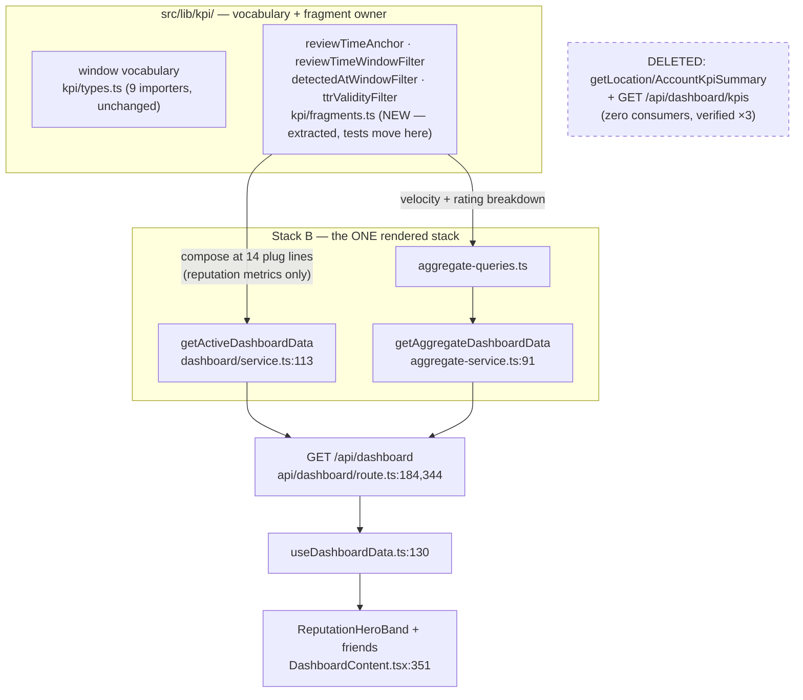

# Pathfinder 2026-08-10 — unified proposal (Phase 3, orchestrator synthesis)

Dispositions for every Phase 2 finding. Principles applied: prefer deletion over
abstraction; one owner per load-bearing spelling, many composers (the #730
`openFlagExistsSql` precedent); specialization documented as deliberate is not
duplication; no new abstraction for a single caller.

## P1 — The KPI surface: one stack, shared anchor fragments, delete the orphan

**Decision: Stack B remains the sole rendered stack. The ADR 0019 anchor
fragments become a shared owner module composed by Stack B. Stack A's service
functions and route are DELETED.**

Concretely:

1. **Extract the fragment owners** from `src/lib/kpi/service.ts` into
   `src/lib/kpi/fragments.ts`: `reviewTimeAnchor`, `reviewTimeWindowFilter`,
   `detectedAtWindowFilter`, and the TTR validity filter. Verified portable —
   they contain no FROM/JOIN and no tenant predicate, so the `ci:tenant-scope`
   constraint (fragments must not carry tenant binds) is satisfied. Widen the
   prefix union `'' | 'r.'` to cover Stack B's `rv`/`rev` aliases (or rename at
   plug sites — implementer's call, prefer widening: smaller diff).
   The anchor-pinning tests move with the fragments.
2. **Re-anchor Stack B** by composing the fragments at exactly the Phase 2b
   plug list: `dashboard/service.ts:489,:492,:495-496,:499-500,:506` (avg star),
   `:536,:542,:543` (sentiment trend), `:208,:211,:213` (velocity), `:333`
   (rating breakdown); `aggregate-queries.ts:198,:199` (velocity), `:214`
   (rating breakdown). **Do NOT touch:** response rate
   (`service.ts:451-485`, `aggregate-queries.ts:163-169` — workflow KPI, stays
   `detected_at` per ADR 0019 D2), timeSaved (`service.ts:508-525`, keys on
   `approved_at`), all-time totals, recent-review feeds, pending counts.
3. **Delete the orphan pair:** `getLocationKpiSummary` + `getAccountKpiSummary`
   (`kpi/service.ts`) and `src/app/api/dashboard/kpis/route.ts` + their tests.
   Zero consumers, verified three ways. **Keep `src/lib/kpi/types.ts`** — 9
   importers of the window vocabulary; it and `fragments.ts` become the
   directory's contents.
4. **What is lost, and why acceptable:** Stack A's calendar-month volume MoM
   and TTR duration metrics have never been rendered anywhere. When the
   deferred "KPI cards" product work ships, it extends Stack B's payload
   composing the same fragments — the semantics survive in ADR 0019 +
   CONTEXT.md + the fragment tests, which is where semantics belong. Carrying
   404 lines of dead-but-correct SQL as a "maybe later" is the anti-pattern
   ("keeping both paths just in case").
5. **Cache note:** the re-anchor rides Stack B's 45s fail-open Redis TTL —
   self-expiring, no invalidation work, same property ADR 0019 relied on.
6. ADR 0019 gets an addendum recording this consolidation; #757's "adjudicate
   the consumer-less route" question is answered: **deleted**.

This makes #757 fully mechanical: fragment extraction + 14 plug lines + 2
deletions + test moves.

## P2 — Correctness-bearing consolidations (each small, each guards an invariant)

| # | What | Single owner becomes | Old sites |
|---|---|---|---|
| C1 | **F1 dual content-hash — a live behavioral bug**, not a refactor: imported rows hash differently than live rows for identical content → spurious content-changed lane on later `review.updated` | build imported rows via `buildZernioMonitoredReview` + the shared insert; `computeContentHash` is already the owner | `zernio-ingest-shared.ts:425-453` |
| C2 | **F6 structural auto-approval candidacy ×3** — drift changes what can auto-post (invariant #3) | one `STRUCTURAL_GATES` table feeding the pre-tx boolean, the block-reason list, and the evaluator; the perf split survives | `persist.ts:105-109`; `auto-approval.ts:296-299,:334,:344-346` |
| C3 | `review_exceptions` ON CONFLICT ×2 — byte-for-byte partial-index contract with a self-declared single owner that isn't | `insertReviewExceptionIfAbsent` actually sole | `ingest-failed-hook.ts:113-128` |
| C4 | `zernio://` template ×7/5 files — format contract, one byte of drift breaks reconcile/tombstone/short-circuit silently | `zernioProviderReviewName()` in `zernio-normalize.ts` (owns the format comment today) | 5 files, list in 02 Part 2 #4 |
| C5 | The ONE JS hand-spell of the outbox in-flight set | import `OUTBOX_IN_FLIGHT_STATUSES` | `past-replies/draft-status/route.ts:100-102` |

## P3 — Mechanical debt bundle (one ticket, behaviour-preserving, #731-style)

`mapConcurrencyError` (OCC ladder ×3) · split `resolveEditReplyContext`'s first
half (preamble ×4→1) · `pendingGenerateExists` + `nextResponseVersion` (×5, and
fixes the business_id scoping drift) · `proveReviewOwnership` (whole-query
helper — fragment extraction is audit-forbidden) · `classifyOutboxStatus`
(trichotomy ×3; completed-branches stay per-surface) · `MAX_REPLY_LENGTH` (×4)
· shared `readJsonSafe` + poll constants (×2) · `postJson`/`runAction` inside
`useEditReplyDraft` (~−150 lines, answers fallow's 515-line flag) ·
`screenPhiOrOpenException` (×2) · F2 junction-proof fragments
(`junctionReachedSql`/`initialRunJoinSql` — the A4 hand-sync class) ·
`withTtlCache` (×4 cache blocks) · give past-replies draft-status
`NO_STORE_HEADERS` (deliberate decision, not drift-by-omission).

## P4 — DO-NOT-UNIFY register (specialization verified deliberate)

- `businesses` row-lock preambles (tx ownership belongs to each caller)
- Zernio pagination loops (stop conditions genuinely differ; only the catch tail is shared)
- Banner poll vs row-hook polls (cadence, state ownership, fetch stack)
- Account-scope vs cookie-location-scope tenancy (documented D-C)
- Poll `completed`-branch semantics (different sinks decide "done")
- F5's four non-consumer categories (`purge-verification.ts` counts ALL statuses)
- F7's `sql.begin` wrapper ×2 (follow-up already recorded in-code; execute at a third caller)
- PgBouncer guard asymmetry (**non-finding** — other pollers never SELECT payload)

## P5 — Doc-truth corrections (carry into the next docs sweep)

1. Spec §5.3 still says the consent guard "joins the existing pre-flight
   guards"; the shipped design (owner-decided 2026-08-07, found independently
   by two flowchart agents) runs it BEFORE the run-row claim so refusals leave
   no durable trace. The spec should say what the code does.
2. `imported_count` ≠ rows stored: a PHI-skipped *answered* review counts
   imported (exception row is the audit trail); a PHI-skipped *unanswered* one
   counts skipped. Document on the runbook/admin surface that reads counters.
3. The F4 precedence rule (delete_failed RecoveryControl outranks the hold,
   `PastReplyCard.tsx:250-263`) — shipped through #727's full review; record in
   ADR 0018's addendum as deliberate rather than leaving it code-only.
