# F1 — Business summary + At-risk list (admin business console)

Pathfinder 2026-08-15, Phase 1. Boundaries per `00-features.md` (F1 row +
orchestrator adjustments 3 and 5). `POST /api/admin/businesses` and
`/admin/businesses/new` are **F5** and are not charted here.

Every node is labelled `Name file:line`. All paths traced from source.

---

## Flowchart

```mermaid
flowchart TD

%% ─────────────────────────── LANE 1: OVERVIEW ───────────────────────────
subgraph L1["Lane 1 — /admin/overview (rank who needs a look)"]
  OVP["AdminOverviewPage RSC<br/>src/app/admin/overview/page.tsx:11"]
  OVGATE["requireAdminPage sql from=/admin/overview<br/>src/lib/auth/page-gate.ts:39"]
  OVSVC["getAdminOverview sql<br/>src/lib/admin/overview-service.ts:117"]
  OVNAV["getAdminNavCounts sql — 2 sequential COUNTs<br/>src/lib/admin/nav-counts-service.ts:18"]
  OVSHELL["AdminPage chrome + 3 action links<br/>src/app/admin/overview/page.tsx:24"]
  OVCLIENT["OverviewClient initialData + flaggedOpen<br/>src/app/admin/overview/OverviewClient.tsx:130"]
  OVPOLL["useQuery admin-overview refetchInterval 30s<br/>src/app/admin/overview/OverviewClient.tsx:137"]
  OVAPI["GET /api/admin/overview<br/>src/app/api/admin/overview/route.ts:13"]
  OVAUTH["requireRoleOr401 request admin<br/>src/lib/auth/route-helpers.ts:140"]
  OVCONTENT["OverviewContent — 5 StatTiles + needs-attention strip<br/>src/app/admin/overview/OverviewClient.tsx:14"]
  OVLIST["At-risk list render — name + HealthBadge<br/>src/app/admin/overview/OverviewClient.tsx:108"]
  OVEMPTY["EmptyState Nothing at risk<br/>src/app/admin/overview/OverviewClient.tsx:102"]
end

subgraph L1Q["Lane 1 — getAdminOverview: 5 health queries, then the shared read (STRICTLY SEQUENTIAL, #773)"]
  Q1["q1 pending outbox COUNT — job_outbox<br/>src/lib/admin/overview-service.ts:136"]
  Q2["q2 failed jobs COUNT — job_outbox<br/>src/lib/admin/overview-service.ts:140"]
  Q3["q3 today cost SUM — api_costs<br/>src/lib/admin/overview-service.ts:143"]
  Q4["q4 notif failures 24h — notification_deliveries<br/>src/lib/admin/overview-service.ts:147"]
  Q5["q5 email health aggregate — notification_deliveries<br/>src/lib/admin/overview-service.ts:150"]
  DEH["deriveEmailHealth — deliveryRate + redState<br/>src/lib/admin/overview-service.ts:89"]
  Q6["q6 getBusinessSummaries sql — UNPAGINATED<br/>src/lib/admin/overview-service.ts:166"]
  FILT["FILTER level !== healthy<br/>src/lib/admin/overview-service.ts:171"]
  SORT["SORT score, pending, name, id<br/>src/lib/admin/overview-service.ts:172"]
  CAP["CAP slice 0..OVERVIEW_AT_RISK_LIMIT=5<br/>src/lib/admin/overview-service.ts:179"]
  BUGSHAPE["known bug shape: cap-then-filter surfaces healthy rows<br/>src/lib/admin/overview-service.ts:168"]
  OVOUT["OverviewData systemHealth + totalBusinesses + atRisk<br/>src/lib/admin/overview-service.ts:181"]
end

%% ─────────────────── LANE 2: BUSINESSES INVENTORY ───────────────────
subgraph L2["Lane 2 — /admin/businesses (page the inventory)"]
  BZP["AdminBusinessesPage RSC<br/>src/app/admin/businesses/page.tsx:13"]
  BZGATE["requireAdminPage sql from=/admin/businesses<br/>src/lib/auth/page-gate.ts:39"]
  BZCALL["getBusinessSummaries sql limit=PAGE_SIZE offset=0<br/>src/app/admin/businesses/page.tsx:16"]
  BZSIZE["BUSINESSES_PAGE_SIZE = 20 (server-safe module)<br/>src/app/admin/page-sizes.ts:40"]
  BZCLIENT["BusinessesClient initialData page 0<br/>src/app/admin/businesses/BusinessesClient.tsx:125"]
  BZQ["useQuery admin-businesses,page — staleTime 30s<br/>src/app/admin/businesses/BusinessesClient.tsx:128"]
  BZAPI["GET /api/admin/businesses — clamp limit 1..100, offset >=0<br/>src/app/api/admin/businesses/route.ts:25"]
  BZAUTH["requireRoleOr401 request admin<br/>src/lib/auth/route-helpers.ts:140"]
  BZCOLS["buildColumns windowDays — 10 columns<br/>src/app/admin/businesses/BusinessesClient.tsx:47"]
  BZREL["formatRelative — local relative-age helper<br/>src/app/admin/businesses/BusinessesClient.tsx:32"]
  BZTABLE["DataTable + serverPagination totalRows=data.total<br/>src/app/admin/businesses/BusinessesClient.tsx:164"]
  BZPOST["POST /api/admin/businesses — F5, NOT CHARTED<br/>src/app/api/admin/businesses/route.ts:55"]
end

%% ─────────────── SHARED READ CORE (single owner, #833) ───────────────
subgraph CORE["Shared read core — src/lib/admin/business-summary.ts (single owner)"]
  GBS["getBusinessSummaries sql, opts?<br/>src/lib/admin/business-summary.ts:160"]
  PAGE["pageClause — sql LIMIT/OFFSET or empty fragment<br/>src/lib/admin/business-summary.ts:168"]
  BASEQ["BASE QUERY businesses x accounts x responses (30d window)<br/>src/lib/admin/business-summary.ts:191"]
  CNTQ["CONDITIONAL COUNT businesses — paginated callers only<br/>src/lib/admin/business-summary.ts:214"]
  IDS["businessIds = rows ACTUALLY returned (post-LIMIT/OFFSET)<br/>src/lib/admin/business-summary.ts:221"]
  METQ["METRICS CTE notif+resp over UNNEST(ids) — skipped when empty<br/>src/lib/admin/business-summary.ts:223"]
  BUILD["buildBusinessSummary row + metrics -> DTO<br/>src/lib/admin/business-summary.ts:110"]
  TREND["responseTimeTrend derivation<br/>src/lib/admin/business-summary.ts:116"]
  CHURN["computeChurnRiskScore — pure, TS-only<br/>src/lib/shared/churn-score.ts:108"]
  RESULT["BusinessSummariesResult businesses+total+windowDays<br/>src/lib/admin/business-summary.ts:275"]
  WINDOW["RESPONSE_METRICS_WINDOW_DAYS = 30<br/>src/lib/admin/business-summary.ts:43"]
end

%% ─────────────── LANE 3: DETAIL READ ───────────────
subgraph L3["Lane 3 — /admin/businesses/[id] read"]
  DP["AdminBusinessDetailPage RSC<br/>src/app/admin/businesses/[id]/page.tsx:13"]
  DPGATE["requireAdminPage from=/admin/businesses (no AAL2)<br/>src/lib/auth/page-gate.ts:39"]
  DGET["getBusinessDetail sql, businessId<br/>src/lib/admin/business-detail-service.ts:26"]
  DCH["getBusinessChannelEnrollments sql, businessId<br/>src/lib/admin/business-channels-service.ts:103"]
  D404["notFound() when detail is null<br/>src/app/admin/businesses/[id]/page.tsx:37"]
  DCLIENT["BusinessDetailClient initialDetail + initialChannels<br/>src/app/admin/businesses/[id]/BusinessDetailClient.tsx:162"]
  DHOOK["useBusinessDetail — 2 useQuery + invalidate + 2 actions<br/>src/app/admin/businesses/[id]/_hooks/useBusinessDetail.ts:60"]
  DAPI["GET /api/admin/businesses/[id]<br/>src/app/api/admin/businesses/[id]/route.ts:22"]
  DAPIAUTH["requireRoleOr401 admin (NO AAL2 on read)<br/>src/app/api/admin/businesses/[id]/route.ts:29"]
end

subgraph L3Q["Lane 3 — 13-query chain, batch1 then batch2, SEQUENTIAL"]
  B1["fetchBusinessDetailBatch1 — 6 queries<br/>src/lib/admin/business-detail/queries.ts:93"]
  B1A["businesses JOIN accounts<br/>src/lib/admin/business-detail/queries.ts:106"]
  B1B["reviews + LATERAL latest non-superseded response LIMIT 100<br/>src/lib/admin/business-detail/queries.ts:119"]
  B1C["reviews COUNT (true total)<br/>src/lib/admin/business-detail/queries.ts:136"]
  B1D["ranking_snapshots LIMIT 50<br/>src/lib/admin/business-detail/queries.ts:141"]
  B1E["zernio_connections latest LIMIT 1<br/>src/lib/admin/business-detail/queries.ts:153"]
  B1F["responses awaiting_owner_connect LIMIT 50<br/>src/lib/admin/business-detail/queries.ts:165"]
  B1G["zernio_finalize_incidents unresolved LIMIT 50<br/>src/lib/admin/business-detail/queries.ts:179"]
  NULLG["null guard -> route 404 / page notFound<br/>src/lib/admin/business-detail-service.ts:41"]
  TIERG["isSubscriptionTier guard (throws)<br/>src/lib/admin/business-detail-service.ts:44"]
  B2["fetchBusinessDetailBatch2 — 6 queries, needs account_id<br/>src/lib/admin/business-detail/queries.ts:209"]
  B2A["metrics CTE notif+resp for ONE business<br/>src/lib/admin/business-detail/queries.ts:218"]
  B2B["businesses by account_id (all locations)<br/>src/lib/admin/business-detail/queries.ts:263"]
  B2C["approval_audit_log by account LIMIT 50<br/>src/lib/admin/business-detail/queries.ts:272"]
  B2D["account_audit_log by account LIMIT 50<br/>src/lib/admin/business-detail/queries.ts:282"]
  B2E["auto_approval_policies persona=reply action=posting<br/>src/lib/admin/business-detail/queries.ts:292"]
  B2F["accounts tier/status/past_due/flags<br/>src/lib/admin/business-detail/queries.ts:301"]
end

subgraph L3M["Lane 3 — mapping"]
  MAP["mapBusinessDetailResponse<br/>src/lib/admin/business-detail/mappers.ts:243"]
  MTIER["isSubscriptionTier guard AGAIN (same throw)<br/>src/lib/admin/business-detail/mappers.ts:258"]
  MTREND["responseTimeTrend derivation (2nd copy)<br/>src/lib/admin/business-detail/mappers.ts:261"]
  MCHURN["computeChurnRiskScore (2nd call site)<br/>src/lib/admin/business-detail/mappers.ts:268"]
  MZERN["buildZernioPanel connection+queued+incidents<br/>src/lib/admin/business-detail/mappers.ts:63"]
  MAA["buildAutoApprovalDiagnostics<br/>src/lib/admin/business-detail/mappers.ts:146"]
  MFLAGS["flag reads: autoApprovalRuntimeEnabled / providerModeration* / isPreviewEnvironment / channels flags<br/>src/lib/admin/business-detail/mappers.ts:166"]
  MEFF["resolveEffectivePolicy account default vs override<br/>src/lib/auto-approval/policy.ts:117"]
  MREADY["buildAutoApprovalReadiness canExpand + blockReasons<br/>src/lib/auto-approval/readiness.ts:20"]
  MWRIT["assertWritableSubscriptionStatus<br/>src/lib/shared/writable-subscription.ts:50"]
  MDTO["BusinessDetailResponse DTO<br/>src/lib/admin/business-detail/mappers.ts:294"]
end

subgraph L3R["Lane 3 — panels rendered"]
  PANHEALTH["LOCAL HealthBadge copy in the detail client<br/>src/app/admin/businesses/[id]/BusinessDetailClient.tsx:45"]
  PANAA["AutoApprovalDiagnosticsPanel (read-only)<br/>src/app/admin/businesses/[id]/_components/AutoApprovalDiagnosticsPanel.tsx:28"]
  PANPROF["ProfileEditor<br/>src/app/admin/businesses/[id]/_components/ProfileEditor.tsx:154"]
  PANKW["TrackedKeywordsSection<br/>src/app/admin/businesses/[id]/_components/TrackedKeywordsSection.tsx:22"]
  PANRANK["ManualRankingSection<br/>src/app/admin/businesses/[id]/_components/ManualRankingSection.tsx:85"]
  PANZERN["ZernioConnectionPanel<br/>src/app/admin/businesses/[id]/_components/ZernioConnectionPanel.tsx:310"]
  PANPD["PastDueExtensionPanel<br/>src/app/admin/businesses/[id]/_components/PastDueExtensionPanel.tsx:90"]
  PANRES["ResendInvitePanel (pending_payment only)<br/>src/app/admin/businesses/[id]/BusinessDetailClient.tsx:68"]
  PANREV["ReviewsList + audit DataTables<br/>src/app/admin/businesses/[id]/BusinessDetailClient.tsx:350"]
end

%% ─────────────── LANE 4: DETAIL WRITE / REPAIR ───────────────
subgraph L4["Lane 4 — repair actions (all AAL2 + same-origin except the Zernio disconnect)"]
  PATCH["PATCH /api/admin/businesses/[id]<br/>src/app/api/admin/businesses/[id]/route.ts:110"]
  PGATE["requireAdminWithAal2<br/>src/lib/auth/admin-mfa-gate.ts:49"]
  PZOD["UpdateBusinessSchema safeParse<br/>src/app/api/admin/businesses/[id]/route.ts:65"]
  PCOLRE["COLUMN_RE defense-in-depth over FIELD_TO_COLUMN<br/>src/app/api/admin/businesses/[id]/route.ts:80"]
  UPD["updateBusiness sql, id, patch<br/>src/lib/admin/business-detail/update.ts:47"]
  UMAP["FIELD_TO_COLUMN whitelist (10 fields)<br/>src/lib/admin/business-detail/update.ts:22"]
  UTX["sql.begin — tx.unsafe UPDATE businesses<br/>src/lib/admin/business-detail/update.ts:82"]
  UNOTF["AdminBusinessNotFoundError -> 404<br/>src/lib/admin/business-detail/errors.ts:10"]
  UENR["same tx: UPSERT channel_enrollments email verified<br/>src/lib/admin/business-detail/update.ts:102"]
  UCACHE["post-commit safeInvalidateChannelCache<br/>src/lib/notifications/resolve-channels.ts:176"]
  U409["Postgres 23505 -> 409 Email already in use<br/>src/app/api/admin/businesses/[id]/route.ts:102"]
  RKW["PUT /keywords — UPDATE businesses.tracked_keywords<br/>src/app/api/admin/businesses/[id]/keywords/route.ts:45"]
  RRANK["POST /ranking — UPSERT ranking_snapshots source=manual<br/>src/app/api/admin/businesses/[id]/ranking/route.ts:65"]
  RZQ["POST /zernio-queue<br/>src/app/api/admin/businesses/[id]/zernio-queue/route.ts:31"]
  RZQD["force_drain: raw INSERT job_outbox DRAIN_OWNER_CONNECT + audit<br/>src/app/api/admin/businesses/[id]/zernio-queue/route.ts:116"]
  RZQX["dismiss: responses -> superseded + audit<br/>src/app/api/admin/businesses/[id]/zernio-queue/route.ts:151"]
  RDISC["POST /api/zernio/disconnect — requireRole owner OR admin, NO AAL2<br/>src/app/api/zernio/disconnect/route.ts:69"]
  RPD["POST /api/admin/billing/grant-extension — UPDATE accounts + audit<br/>src/app/api/admin/billing/grant-extension/route.ts:100"]
  RINV["POST /resend-invite — F5-owned<br/>src/app/api/admin/businesses/[id]/resend-invite/route.ts:121"]
  INVAL["invalidate() -> 2 query keys + router.refresh()<br/>src/app/admin/businesses/[id]/_hooks/useBusinessDetail.ts:110"]
end

%% ─────────────── SHARED PRESENTATION ───────────────
subgraph PRES["Shared presentation"]
  HB["HealthBadge — single owner of churn-level styling<br/>src/components/admin/ui/HealthBadge.tsx:24"]
  AATHR["autoApprovalThresholdLabel — SHARED with F3 by design<br/>src/lib/auto-approval/types.ts:31"]
end

%% ── Lane 1 edges
OVP --> OVGATE --> OVSVC
OVSVC --> Q1 --> Q2 --> Q3 --> Q4 --> Q5 --> Q6
Q5 --> DEH
Q6 --> GBS
Q6 --> FILT --> SORT --> CAP --> OVOUT
DEH --> OVOUT
CAP -. guarded against .-> BUGSHAPE
OVSVC --> OVNAV --> OVSHELL
OVOUT --> OVSHELL --> OVCLIENT --> OVCONTENT
OVCLIENT --> OVPOLL --> OVAPI --> OVAUTH --> OVSVC
OVCONTENT --> OVLIST --> HB
OVCONTENT --> OVEMPTY
OVLIST -->|row click| DP

%% ── Lane 2 edges
BZP --> BZGATE --> BZCALL --> GBS
BZSIZE --> BZCALL
BZCALL --> BZCLIENT --> BZQ --> BZAPI --> BZAUTH --> GBS
BZCLIENT --> BZCOLS --> BZREL
BZCOLS --> BZTABLE --> HB
BZTABLE -->|rowHref| DP
BZPOST -.->|out of scope: F5| BZAPI

%% ── Shared core edges
GBS --> PAGE --> BASEQ --> CNTQ --> IDS --> METQ --> BUILD
WINDOW --> BASEQ
WINDOW --> RESULT
BUILD --> TREND --> CHURN --> RESULT

%% ── Lane 3 edges
DP --> DPGATE --> DGET --> B1
B1 --> B1A --> B1B --> B1C --> B1D --> B1E --> B1F --> B1G
B1G --> NULLG --> TIERG --> B2
NULLG -->|null| D404
B2 --> B2A --> B2B --> B2C --> B2D --> B2E --> B2F --> MAP
MAP --> MTIER --> MTREND --> MCHURN
MCHURN --> CHURN
MAP --> MZERN
MAP --> MAA --> MFLAGS
MAA --> MWRIT
MAA --> MEFF
MAA --> MREADY
MCHURN --> MDTO
MZERN --> MDTO
MAA --> MDTO
MDTO --> DP
DGET --> DCH
DP --> DCLIENT --> DHOOK --> DAPI --> DAPIAUTH --> DGET
DCLIENT --> PANHEALTH
DCLIENT --> PANAA --> AATHR
DCLIENT --> PANPROF
DCLIENT --> PANKW
DCLIENT --> PANRANK
DCLIENT --> PANZERN
DCLIENT --> PANPD
DCLIENT --> PANRES
DCLIENT --> PANREV

%% ── Lane 4 edges
PANPROF --> PATCH
DHOOK -->|clearBounceFlag ownerEmailBounced=false| PATCH
PATCH --> PGATE --> PZOD --> PCOLRE --> UPD
UMAP --> PCOLRE
UPD --> UMAP
UPD --> UTX --> UENR --> UCACHE
UTX -->|count = 0| UNOTF
UENR -->|23505| U409
PANKW --> RKW
PANRANK --> RRANK
PANZERN --> RZQ --> RZQD
RZQ --> RZQX
PANZERN --> RDISC
PANPD --> RPD
PANRES --> RINV
UCACHE --> INVAL
RKW --> INVAL
RRANK --> INVAL
RZQD --> INVAL
RZQX --> INVAL
RDISC --> INVAL
RPD --> INVAL
INVAL --> DAPI
```

---

## Happy-path prose walk

**Overview.** `AdminOverviewPage` (`src/app/admin/overview/page.tsx:11`) gates on
`requireAdminPage` and then awaits `getAdminOverview(sql)`
(`src/lib/admin/overview-service.ts:117`), which issues five system-health counts
one at a time — pending outbox, failed jobs, today's `api_costs` sum, 24h
notification failures, and the email-health aggregate — before calling
`getBusinessSummaries(sql)` **unpaginated** as its sixth sequential await
(`:166`). The returned list is then **filtered** to
`churnScore.level !== 'healthy'` (`:171`), **sorted** by score → pending count →
name → id (`:172`), and only then **capped** at `OVERVIEW_AT_RISK_LIMIT = 5`
(`:179`). That order is the whole point: capping before filtering would surface
healthy rows under an "At risk" heading, and
`src/lib/admin/__tests__/overview-service.test.ts:520` pins it. The page then
awaits `getAdminNavCounts` (`src/lib/admin/nav-counts-service.ts:18`) and hands
both into `OverviewClient`, which re-fetches `GET /api/admin/overview` every 30
seconds (`OverviewClient.tsx:144`) and renders five names + `HealthBadge`s.

**Businesses inventory.** `AdminBusinessesPage`
(`src/app/admin/businesses/page.tsx:13`) calls the same
`getBusinessSummaries(sql, { limit: 20, offset: 0 })` and seeds
`BusinessesClient`; paging past page 0 goes over HTTP to
`GET /api/admin/businesses` (`src/app/api/admin/businesses/route.ts:25`, clamped
to 1..100 / offset ≥ 0), which is the **only** half of that file in F1 — its
`POST` (`:55`) is F5.

**Shared core.** `getBusinessSummaries` (`src/lib/admin/business-summary.ts:160`)
runs three queries strictly sequentially: the base
`businesses × accounts × responses` group-by with a 30-day response-metrics
window (`:191`), a **conditional** unfiltered `COUNT(*)` that runs *only* when
`opts` was supplied (`:214`), and the churn-metrics CTE keyed on
`businessRows.map(r => r.id)` — i.e. **post-LIMIT/OFFSET ids only** (`:221-223`),
so the paginated path is bounded by the page and an empty page skips the CTE
entirely. Rows are mapped by `buildBusinessSummary` (`:110`), which derives
`responseTimeTrend` and calls the pure `computeChurnRiskScore`
(`src/lib/shared/churn-score.ts:108`).

**Detail.** `AdminBusinessDetailPage` (`src/app/admin/businesses/[id]/page.tsx:13`)
gates with plain `requireAdminPage` (no AAL2 — deliberate parity with the GET
route), then runs `getBusinessDetail` (`src/lib/admin/business-detail-service.ts:26`):
batch 1 is six sequential queries (`business-detail/queries.ts:93`), a null guard
that produces `notFound()`, a tier guard, then batch 2's six more queries
(`:209`) which need `business.account_id` from batch 1 — a genuine data
dependency, so the two batches cannot be reordered. `mapBusinessDetailResponse`
(`business-detail/mappers.ts:243`) assembles the DTO, including
`buildAutoApprovalDiagnostics` (`:146`), which reads six feature flags in-process
and derives readiness. The page then awaits `getBusinessChannelEnrollments`
sequentially and hands both reads to `BusinessDetailClient` as react-query
`initialData`. Every repair action posts to its own route and finishes by calling
`invalidate()` (`useBusinessDetail.ts:110`), which invalidates two query keys and
calls `router.refresh()` because the RSC-rendered `<h1>` is not in the react-query
cache.

**#773 sequencing.** All four read paths are sequential by construction and say so
in-code: `business-summary.ts:170-190`, `overview-service.ts:118-135`,
`queries.ts:97-105` and `:214-217`, `overview/page.tsx:14-19`,
`businesses/[id]/page.tsx:25-30`. Pinned by
`src/lib/admin/__tests__/pool-fanout-sequential.test.ts` and
`admin-read-single-inflight.test.ts`. **No parallel fan-out found in this
boundary.**

---

## Side effects

### Tables READ
`businesses`, `accounts`, `responses`, `reviews`, `notification_deliveries`,
`job_outbox`, `api_costs`, `ranking_snapshots`, `zernio_connections`,
`zernio_finalize_incidents`, `approval_audit_log`, `account_audit_log`,
`auto_approval_policies`, `flagged_responses` (nav counts),
`channel_enrollments` (via `business-channels-service`).

### Tables WRITTEN
| Write | Site | Transaction |
|---|---|---|
| `UPDATE businesses` (10 whitelisted columns + `updated_at`) | `src/lib/admin/business-detail/update.ts:83` | inside `sql.begin` |
| `UPSERT channel_enrollments` (email → `verified`, clears disabled/unsubscribed) | `src/lib/admin/business-detail/update.ts:102` | **same** tx as the UPDATE |
| `UPDATE businesses.tracked_keywords` | `src/app/api/admin/businesses/[id]/keywords/route.ts:45` | single statement |
| `UPSERT ranking_snapshots` (`source='manual'`) | `src/app/api/admin/businesses/[id]/ranking/route.ts:65` | single statement |
| `INSERT job_outbox` topic `DRAIN_OWNER_CONNECT` (raw INSERT — no helper for this topic) | `src/app/api/admin/businesses/[id]/zernio-queue/route.ts:116` | inside `sql.begin` with `FOR UPDATE OF zc` |
| `UPDATE responses → 'superseded'`, `posting_error='admin_dismissed_awaiting_connect'` | `src/app/api/admin/businesses/[id]/zernio-queue/route.ts:151` | inside `sql.begin` with `FOR UPDATE OF r` |
| `INSERT account_audit_log` via `writeAccountAuditLog` (2 event types) | `zernio-queue/route.ts:120`, `:159` | same tx as the state change |
| `UPDATE accounts` past-due grace + audit | `src/app/api/admin/billing/grant-extension/route.ts:100` | external to F1 |

### Cache
- `safeInvalidateChannelCache(accountId, 'admin.business.owner-email')` —
  `src/lib/admin/business-detail/update.ts:120`, fired **after** commit (correct
  ordering; a pre-commit invalidation would race the write).
- Client-side react-query caches: `['admin-overview']` (30s poll),
  `['admin-businesses', page]`, `['admin-business', id]`,
  `['admin-business-channels', id]`, plus the shared `navCountsQueryOptions`
  entry the sidebar badge reads (`OverviewClient.tsx:155`).

### Outbox enqueues
Exactly one: `DRAIN_OWNER_CONNECT` from the Zernio force-drain
(`zernio-queue/route.ts:116`). It is a raw `INSERT INTO job_outbox` inside the
same transaction as its audit row — sanctioned under invariant #2 (topic with no
typed helper).

### External HTTP
None from F1 server code. `POST /api/zernio/disconnect` reaches Zernio's API via
`zernioClient` inside *that* route, not inside F1. The browser makes 9 distinct
same-origin calls (listed in the diagram's Lane 4).

### Error / fallback branches (charted but not dominant)
`getBusinessDetail` → `null` → route 404 / page `notFound()`; `tx.unsafe` count 0
→ `AdminBusinessNotFoundError` → 404; Postgres `23505` → 409; every other throw →
`reportCaughtError` + 500. On the client, every surface keeps last-good data on a
failed refetch rather than blanking (`OverviewClient.tsx:175`,
`BusinessesClient.tsx:155`, `BusinessDetailClient.tsx:221`).

---

## External dependencies

| Dependency | Owner | Why F1 touches it |
|---|---|---|
| `requireAdminPage`, `requireRoleOr401`, `requireAdminWithAal2`, `withSameOrigin` | **S1 auth-gate seam** (`src/lib/auth/page-gate.ts:39`, `route-helpers.ts:140`/`:57`, `admin-mfa-gate.ts:49`) | every entry point |
| `computeChurnRiskScore` / `ChurnScore` | `src/lib/shared/churn-score.ts:108` — pure, single owner | called from two places inside F1 |
| `autoApprovalThresholdLabel` | `src/lib/auto-approval/types.ts:31` — **deliberately shared with F3**, DO-NOT-UNIFY | diagnostics panel labels |
| `resolveEffectivePolicy`, `buildAutoApprovalReadiness`, `auto-approval/flags` | F3 policy modules (`policy.ts:117`, `readiness.ts:20`) | read-only diagnostics |
| `getBusinessChannelEnrollments` + `ChannelsPanel` | `src/lib/admin/business-channels-service.ts:103`; enrollment behaviour is **F4** | detail page channels slot |
| `POST /api/zernio/disconnect`, `zernio_connections`, `zernio_finalize_incidents` | Zernio connect feature (`src/app/api/zernio/disconnect/route.ts:69`) | Zernio panel |
| `POST /api/admin/billing/grant-extension` | billing/past-due (`grant-extension/route.ts:100`) | past-due grace panel |
| `POST /api/admin/businesses/[id]/resend-invite` | **F5** admin invite funnel (`resend-invite/route.ts:121`) | resend-invite panel |
| `POST /api/admin/businesses` (`route.ts:55`), `/admin/businesses/new` | **F5** | shares a file / linked from page chrome |
| `writeAccountAuditLog` | `src/lib/audit/log.ts:24` — single owner for account-status audit | zernio-queue actions |
| `job_outbox` + `QUEUE_NAMES.DRAIN_OWNER_CONNECT` | outbox seam / `DrainOwnerConnectWorker` | force-drain |
| `AdminPage`, `DataTable`, `StatTile`, `StatusBadge`, `states`, `format` | `src/components/admin/ui/**` — **external per adjustment 5**; only `HealthBadge.tsx` is F1-owned | all three pages |
| `navCountsQueryOptions` | `src/components/admin/nav-counts-query` (admin shell) | overview attention strip must agree with the sidebar badge |
| `sql` singleton | `src/lib/db/server.ts` behind the #773 admission chokepoint | supplied by the 4 composition roots only |

---

## Observations for the duplication phase

1. **Two spellings of the churn-metrics CTE.** `business-summary.ts:223-269`
   (keyed on `UNNEST(ids)`) and `business-detail/queries.ts:218-259` (keyed on one
   `business_id`) compute the *identical* `notif`/`resp` CTEs, the same
   `approval_rate` ≥3-notification rule, the same 7d/35d `avg_hours` windows and
   the same `account_age_days`. #833 removed the *base query*'s second spelling
   but not this one.
2. **`responseTimeTrend` + `computeChurnRiskScore` duplicated verbatim.**
   `business-summary.ts:116-131` vs `business-detail/mappers.ts:261-276` — same
   `1.5×` threshold, same `>7 days && pending>0 → 'stopped'`, same argument
   object.
3. **`HealthBadge` exists twice.** `src/components/admin/ui/HealthBadge.tsx:12-32`
   is documented as the single owner of churn-level presentation (#833), yet
   `BusinessDetailClient.tsx:33-51` keeps a private copy with its own
   `HEALTH_BADGE_STYLES`/`HEALTH_BADGE_LABELS`. The local copy is `Record<string,…>`
   with `?? healthy` fallbacks, so the shared version's type-safety property (a
   new level is a compile error) is lost on the detail page.
4. **`isSubscriptionTier` guard runs twice with the same throw string** —
   `business-detail-service.ts:44-46` and `mappers.ts:258-260`.
5. **`formatRelative` exists twice across features** —
   `BusinessesClient.tsx:32` (admin, null-safe, `'just now'`) and
   `ReviewFeedCard.tsx:334` (owner dashboard, F2). The admin copy's comment claims
   "the admin console has one spelling of a relative timestamp", but it lives in a
   client component rather than `src/components/admin/ui/format.ts` where the
   other three admin formatters live.
6. **AAL2 asymmetry inside one page.** Every mutation reachable from the detail
   page requires `requireAdminWithAal2` + `withSameOrigin` — PATCH (`route.ts:55`),
   keywords, ranking, zernio-queue (`:39`), grant-extension — **except** the
   Zernio disconnect button (`ZernioConnectionPanel.tsx:377`), which hits an
   owner-OR-admin route gated by `requireRole` with no AAL2
   (`src/app/api/zernio/disconnect/route.ts:69`). Documented as an intentional
   global super-role, but it is the one write on this page whose gate is weaker
   than its neighbours.
7. **Overview polls an unbounded read every 30s.** `OverviewClient.tsx:144` sets
   `refetchInterval: 30_000` on a route whose service reads **every** business row
   plus a metrics CTE over every id, to render 5 names and 5 badges
   (`OverviewClient.tsx:91`, `:108-118`). The "read every row" part is a recorded
   limitation (§5.1); the 30-second cadence multiplying it per open admin tab is
   not called out anywhere. `OverviewData` also carries the full `BusinessSummary`
   DTO (11 fields) for rows where only `id`/`name`/`churnScore` are rendered.
8. **`OVERVIEW_AT_RISK_LIMIT` is a page size that does not live with the page
   sizes.** `overview-service.ts:33` vs `src/app/admin/page-sizes.ts` — deliberate
   and documented (`page-sizes.ts:27-31`, `APP_LEAF_IMPORT_BAN`), so this is a
   *recorded* split, not a defect; noting it so the duplication phase does not
   re-raise it.
9. **`DetailData` re-derives the API DTO client-side.**
   `src/app/admin/businesses/[id]/types.ts:11-19` `Omit`s four fields off
   `BusinessDetailResponse['business']` and re-adds them with different
   nullability, and the server page casts through `as unknown as DetailData`
   (`page.tsx:52`). Two shapes for one payload, bridged by a double cast.
