# F2 — Owner dashboard portal (shell, account-state gating, KPI read stack)

Pathfinder 2026-08-15, Phase 1. Boundaries per
`docs/reviews/PATHFINDER-2026-08-15/00-features.md`.

**In scope:** the authenticated shell that resolves scope and blocks offboarded
accounts, the account-state screens that branch on subscription status, and the
one KPI payload (`GET /api/dashboard`) feeding every card on `/dashboard` and
`/dashboard/analytics`.

**Out of scope, charted elsewhere:** `dashboard/{reviews,requests}/**` and
`components/dashboard/{reviews,timeline}/**` (2026-08-10 pass F3/F4);
`src/lib/auth/**` (S1 seam); `settings/**` (F3). They appear below only as
external dependencies.

---

## Flowchart

```mermaid
flowchart TD
  %% ── Lane 1: shell gate (RSC) ─────────────────────────────────────────
  subgraph SHELL["Lane 1 — authenticated shell (server components)"]
    A["Proxy stamps x-repworth-pathname<br/>src/proxy.ts:39"]
    B["AuthenticatedLayout<br/>src/app/(authenticated)/layout.tsx:51"]
    C["supabase.auth.getUser → redirect /admin/login<br/>src/app/(authenticated)/layout.tsx:80"]
    D["SELECT users.account_id, name, email<br/>src/app/(authenticated)/layout.tsx:84"]
    E{"accountOffboardingEnabled?<br/>src/app/(authenticated)/layout.tsx:99"}
    F["getOffboardingState<br/>src/lib/account-offboarding/gate.ts:71"]
    G{"isOperationalUIBlocked?<br/>src/lib/account-offboarding/gate.ts:201"}
    H["redirect ACCOUNT_OFFBOARDING_STATUS_PATH<br/>src/app/(authenticated)/layout.tsx:103"]
    I["Bare providers shell, no Sidebar<br/>src/app/(authenticated)/layout.tsx:106"]
    J["getRequestScope — S1 seam<br/>src/lib/auth/get-request-scope.ts:57"]
    K["getPendingApprovalCount<br/>src/lib/dashboard/pending-count.ts:12"]
    L["solicitationWatchEnabled server-authoritative flag<br/>src/app/(authenticated)/layout.tsx:175"]
    M["AuthenticatedProviders + LocationProvider<br/>src/app/(authenticated)/_components/AuthenticatedProviders.tsx:26"]
    N["PendingCountProvider seeded<br/>src/contexts/PendingCountContext.tsx:30"]
    O["Sidebar<br/>src/components/dashboard/shell/Sidebar.tsx:57"]
    P["MobileTabBar<br/>src/components/dashboard/shell/MobileTabBar.tsx:16"]
    Q["deriveNavSection — single nav-highlight owner<br/>src/components/dashboard/shell/active-nav.ts:17"]
  end

  A --> B --> C --> D --> E
  E -- "flag on" --> F --> G
  G -- "blocked, wrong path" --> H
  G -- "blocked, on status path" --> I
  G -- "not blocked" --> J
  E -- "flag off" --> J
  J --> K --> L --> M --> N
  N --> O
  N --> P
  O --> Q
  P --> Q

  %% ── Lane 2: page shells + client fetch ───────────────────────────────
  subgraph PAGE["Lane 2 — page shells and the client fetch"]
    R["DashboardPage<br/>src/app/(authenticated)/dashboard/page.tsx:16"]
    S["DashboardContent — offboarding re-gate<br/>src/components/dashboard/DashboardContent.tsx:33"]
    T["GET /api/account/offboarding/status<br/>src/components/dashboard/DashboardContent.tsx:366"]
    U["DashboardOperationalContent<br/>src/components/dashboard/DashboardContent.tsx:125"]
    EA["AnalyticsPage<br/>src/app/(authenticated)/dashboard/analytics/page.tsx:5"]
    EB["AnalyticsContent<br/>src/components/dashboard/analytics/AnalyticsContent.tsx:28"]
    EC["PeriodToolbar lifts window state<br/>src/components/dashboard/analytics/PeriodToolbar.tsx:28"]
    V["useDashboardData — scope + window keyed<br/>src/hooks/useDashboardData.ts:78"]
    W["buildDashboardUrl ?scope=&window=<br/>src/hooks/useDashboardData.ts:45"]
    V2["TopBar 60s auto-refresh tick<br/>src/components/dashboard/shell/TopBar.tsx:67"]
  end

  N --> R --> S --> T
  S -- "blocked" --> H
  S -- "clear" --> U --> V
  N --> EA --> EB
  EB --> EC --> V
  V --> W
  V2 -.-> V

  %% ── Lane 3: the payload route ────────────────────────────────────────
  subgraph ROUTE["Lane 3 — GET /api/dashboard (the single payload)"]
    X["GET handler<br/>src/app/api/dashboard/route.ts:481"]
    Y["requireOwnerWithAccount — S1 seam<br/>src/lib/auth/route-helpers.ts:167"]
    Z["resolveDashboardRequest — window clamp + scope policy<br/>src/app/api/dashboard/policy.ts:42"]
    Z2["resolveDashboardWindow allowlist<br/>src/lib/kpi/types.ts:37"]
    AA{"scopePolicy.mode<br/>src/app/api/dashboard/route.ts:491"}
  end

  W --> X --> Y --> Z --> Z2 --> AA

  %% ── Lane 4a: per-location ────────────────────────────────────────────
  subgraph PERLOC["Lane 4a — per-location lane"]
    AB["handlePerLocationDashboard<br/>src/app/api/dashboard/route.ts:433"]
    AC["isValidUuid guard → 400<br/>src/app/api/dashboard/route.ts:441"]
    AD["fetchLocationAccountRow — businesses JOIN accounts<br/>src/app/api/dashboard/route.ts:89"]
    AE{"row / account match / archived?<br/>src/app/api/dashboard/route.ts:451"}
    AF["fallbackToPrimary — scopeFallback<br/>src/app/api/dashboard/route.ts:215"]
    AG["getPrimaryLocationId — businesses<br/>src/app/api/dashboard/route.ts:234"]
    AH["renderPerLocationData<br/>src/app/api/dashboard/route.ts:257"]
    AI{"subscription_status branch<br/>src/app/api/dashboard/route.ts:264"}
    AJ["pendingPaymentResponse + resolveFunnelEntry<br/>src/app/api/dashboard/route.ts:122"]
    AK["cancelledGraceResponse — accounts read, 30d grace<br/>src/app/api/dashboard/route.ts:148"]
    AL["pastDuePerLocationResponse + computePastDueRecoveryState<br/>src/app/api/dashboard/route.ts:183"]
    AM["isActivePendingBusiness → active_pending_business<br/>src/app/api/dashboard/route.ts:172"]
  end

  AA -- "location" --> AB --> AC --> AD --> AE
  AE -- "missing / archived" --> AF --> AG
  AF --> AH
  AE -- "owned + active" --> AH --> AI
  AI -- "pending_payment" --> AJ
  AI -- "cancelled" --> AK
  AI -- "past_due" --> AL
  AI -- "active, no place" --> AM

  %% ── Lane 5a: per-location KPI read stack ─────────────────────────────
  subgraph SVC["Lane 5a — getActiveDashboardData"]
    AN["getActiveDashboardData<br/>src/lib/dashboard/service.ts:115"]
    AO["withTtlCache 45s Redis read-through<br/>src/lib/db/redis-cache.ts:73"]
    AP["buildActiveDashboardData<br/>src/lib/dashboard/service.ts:129"]
    AQ["FATAL business row or opts.business reuse<br/>src/lib/dashboard/service.ts:148"]
    AR["settledInOrder — 13-member SEQUENTIAL wave<br/>src/lib/dashboard/service.ts:200"]
    AR1["velocity — Review-time anchor<br/>src/lib/dashboard/service.ts:218"]
    AR2["recentReviews LIMIT 10 ORDER BY detected_at<br/>src/lib/dashboard/service.ts:247"]
    AR3["ratingBreakdown — anchored window<br/>src/lib/dashboard/service.ts:346"]
    AR4["zernio_connections / incidents / queued<br/>src/lib/dashboard/service.ts:318"]
    AT["readPendingMarker — Redis connect marker<br/>src/lib/dashboard/service.ts:585"]
    AS["fetchReputationRows — 5 SEQUENTIAL queries<br/>src/lib/dashboard/service.ts:437"]
    AS1["rate — detected_at, prior gated on approved_at<br/>src/lib/dashboard/service.ts:465"]
    AS2["star — Review-time anchor<br/>src/lib/dashboard/service.ts:500"]
    AS3["timeSaved — approved_at<br/>src/lib/dashboard/service.ts:525"]
    AS4["sentiment trend — Review-time anchor<br/>src/lib/dashboard/service.ts:543"]
    AU["widgetOrFallback — Per-widget degradation<br/>src/lib/dashboard/service.ts:96"]
    AV["buildReputationSummary — pure mapper<br/>src/lib/dashboard/reputation-summary.ts:78"]
    AW["buildActiveDashboardResponse<br/>src/lib/dashboard/service-mappers.ts:204"]
    AX["resolveZernioConnectionState precedence<br/>src/lib/dashboard/zernio-banner.ts:11"]
  end

  AH --> AN
  AL --> AN
  AN --> AO --> AP --> AQ --> AR
  AR --> AR1
  AR --> AR2
  AR --> AR3
  AR --> AR4
  AR --> AT
  AR --> AS
  AS --> AS1
  AS --> AS2
  AS --> AS3
  AS --> AS4
  AS --> K
  AR --> AU --> AV --> AW --> AX

  %% ── Lane 4b/5b: aggregate ────────────────────────────────────────────
  subgraph AGG["Lane 4b/5b — account-aggregate lane (scope=all)"]
    BA["handleAggregateDashboard<br/>src/app/api/dashboard/route.ts:389"]
    BB["accounts LEFT JOIN primary business — archived_at IS NULL<br/>src/app/api/dashboard/route.ts:394"]
    BC["aggregateSubscriptionResponse<br/>src/app/api/dashboard/route.ts:335"]
    BD["getAggregateDashboardData<br/>src/lib/dashboard/aggregate-service.ts:91"]
    BE["withTtlCache 45s Redis<br/>src/lib/dashboard/aggregate-service.ts:97"]
    BF["buildAggregateDashboardData<br/>src/lib/dashboard/aggregate-service.ts:105"]
    BG["getLocationsForAccount — FATAL<br/>src/lib/locations/repo.ts:63"]
    BH["accounts billing read — degrades<br/>src/lib/dashboard/aggregate-service.ts:120"]
    BI["fetchPerLocationAggregateSlices<br/>src/lib/dashboard/aggregate-queries.ts:127"]
    BJ["settledInOrder — 8-member SEQUENTIAL wave<br/>src/lib/dashboard/aggregate-queries.ts:147"]
    BJ1["baseline businesses — FATAL anchor<br/>src/lib/dashboard/aggregate-queries.ts:150"]
    BJ2["counters — detected_at window<br/>src/lib/dashboard/aggregate-queries.ts:163"]
    BJ3["velocity — Review-time anchor in ON clause<br/>src/lib/dashboard/aggregate-queries.ts:197"]
    BJ4["ratingBreakdown — anchored window<br/>src/lib/dashboard/aggregate-queries.ts:217"]
    BJ5["ranking + DISTINCT ON briefs<br/>src/lib/dashboard/aggregate-queries.ts:230"]
    BK["getPendingApprovalCountsForAccount<br/>src/lib/dashboard/pending-count.ts:32"]
    BL["getAccountRecentReviews LIMIT 20<br/>src/lib/dashboard/aggregate-service.ts:360"]
    BM["roll-up: sums, weekMap, keywordMap, sumRatingBreakdowns<br/>src/lib/dashboard/aggregate-service.ts:194"]
  end

  AA -- "aggregate" --> BA --> BB --> BC
  BC -- "pending_payment / cancelled" --> AJ
  BC -- "past_due or active" --> BD --> BE --> BF
  BF --> BG
  BF --> BH
  BF --> BI --> BJ
  BJ --> BJ1
  BJ --> BJ2
  BJ --> BJ3
  BJ --> BJ4
  BJ --> BJ5
  BJ --> BK
  BF --> BL
  BI --> BM
  BL --> BM

  %% ── Anchor ownership ─────────────────────────────────────────────────
  subgraph ANCH["Review-time anchor — single owner (ADR 0019)"]
    CA["reviewTimeAnchor LEAST(review_date, detected_at)<br/>src/lib/kpi/fragments.ts:44"]
    CB["reviewTimeWindowFilter — single-sided days<br/>src/lib/kpi/fragments.ts:56"]
  end

  CA --> AR1
  CA --> AS2
  CA --> AS4
  CA --> BJ3
  CB --> AR3
  CB --> AS2
  CB --> BJ4

  %% ── Lane 6: render ───────────────────────────────────────────────────
  subgraph RENDER["Lane 6 — render"]
    DA{"isAggregate(payload)?<br/>src/lib/dashboard/scope.ts:12"}
    DK["useSyncPendingCount → authoritativePendingCount<br/>src/hooks/useSyncPendingCount.ts:13"]
    DB["AggregateDashboardContent<br/>src/components/dashboard/aggregate/AggregateDashboardContent.tsx:33"]
    DC{"account-state branch<br/>src/components/dashboard/DashboardContent.tsx:191"}
    DD["PendingPaymentScreen<br/>src/components/dashboard/account-state/PendingPaymentScreen.tsx:5"]
    DE["CancelledBanner — read-only notice<br/>src/components/dashboard/account-state/SubscriptionStatusBanner.tsx:34"]
    DF["ActivePendingBusinessScreen<br/>src/components/dashboard/account-state/AccountStateScreens.tsx:7"]
    DG["Active 4-zone landing<br/>src/components/dashboard/DashboardContent.tsx:275"]
    DG1["TrialBanner / PastDueBanner + PastDueModal<br/>src/components/dashboard/DashboardContent.tsx:279"]
    DG2["ConnectGoogleBanner<br/>src/components/dashboard/account-state/ConnectGoogleBanner.tsx:20"]
    DH["ReputationHeroBand<br/>src/components/dashboard/kpi/ReputationHeroBand.tsx:56"]
    DI["PendingApprovalsStrip<br/>src/components/dashboard/kpi/PendingApprovalsStrip.tsx:38"]
    DJ["AnalyticsLinkCard<br/>src/components/dashboard/kpi/AnalyticsLinkCard.tsx:14"]
    ED["AnalyticsPerLocationView grid<br/>src/components/dashboard/analytics/AnalyticsPerLocationView.tsx:27"]
    EE["AnalyticsAggregateView grid<br/>src/components/dashboard/analytics/AnalyticsAggregateView.tsx:27"]
    EF["renderDashboardStatePanel loading/error scaffold<br/>src/components/dashboard/shell/DashboardStatePanel.tsx:52"]
    EG["SubscriptionUnavailableCard<br/>src/components/dashboard/shell/SubscriptionUnavailableCard.tsx:12"]
    EH["perLocationActive narrowing<br/>src/lib/dashboard/scope.ts:21"]
  end

  AW --> DA
  BM --> DA
  AJ --> DA
  AK --> DA
  AM --> DA
  DA --> DK --> N
  DA -- "aggregate" --> DB
  DA -- "per-location" --> DC
  DC -- "active_pending_business" --> DF
  DC -- "pending_payment" --> DD
  DC -- "cancelled" --> DE
  DC -- "active / past_due" --> DG
  DG --> DG1
  DG --> DG2
  DG --> DH
  DG --> DI
  DG --> DJ
  EB -- "loading / error / no data" --> EF
  EB --> EH
  EH -- "null" --> EG
  EH -- "active" --> ED
  EB -- "aggregate" --> EE

  %% ── External dependencies ────────────────────────────────────────────
  subgraph EXT["External dependencies (not charted here)"]
    FA["ReviewsContent — 2026-08-10 pass<br/>src/components/dashboard/reviews/ReviewsContent.tsx:26"]
    FB["AgentTeamStrip → /api/dashboard/agent-team<br/>src/components/dashboard/AgentTeamStrip.tsx:135"]
    FC["NeedsAttentionList → /api/dashboard/escalations<br/>src/components/dashboard/NeedsAttentionList.tsx:120"]
    FD["ImportOfferBanner → /api/dashboard/import-offer<br/>src/components/dashboard/account-state/ImportOfferBanner.tsx:97"]
    FE["PastDueModal → billing portal<br/>src/components/dashboard/account-state/PastDueModal.tsx:36"]
    FF["resolveFunnelEntry — F5, pure<br/>src/lib/onboarding/funnel-entry.ts:81"]
    FG["OffboardingStatusClient page<br/>src/app/(authenticated)/account/offboarding/status/page.tsx:5"]
    FH["LocationPicker — writes rw_location_scope cookie<br/>src/contexts/LocationContext.tsx:21"]
    FI["sql singleton behind #773 admission chokepoint<br/>src/lib/db/admission.ts:329"]
  end

  DG --> FB
  DG --> FC
  DG --> FD
  DG1 --> FE
  DB --> FB
  DB --> FC
  AJ --> FF
  H --> FG
  O --> FH
  V --> FA
  AD --> FI
  AR --> FI
  BJ --> FI
```

---

## Happy-path walk

### Shell (both lanes share it)

1. `src/proxy.ts:39` stamps the raw pathname onto `x-repworth-pathname` so the
   RSC layout can read it (`layout.tsx:60`) — RSC layouts have no request URL.
2. `AuthenticatedLayout` (`layout.tsx:51`) reads cookies + headers, builds a
   Supabase SSR client (`:63`), and calls `supabase.auth.getUser()` (`:80`).
   No auth user → `redirect('/admin/login')` (`:81`).
3. One SQL read maps the auth identity to the tenant: `SELECT u.account_id,
   u.name, u.email FROM users WHERE u.auth_id = …` (`:84-93`). No `account_id`
   → redirect (`:95`). Invariant #8 in practice.
4. **Offboarding block** (`:99-121`): when `accountOffboardingEnabled()`,
   `getOffboardingState` (`gate.ts:71`) is read and `isOperationalUIBlocked`
   (`gate.ts:201`) decides. Blocked and not already on
   `/account/offboarding/status` → redirect (`:103`); blocked and on that path →
   a bare providers shell with **no Sidebar, no MobileTabBar, no pending count**
   (`:106-119`).
5. **Scope resolution** (`:129`): `getRequestScope(sql, accountId,
   cookieLocationId)` — the S1 seam — validates the `rw_location_scope` cookie
   against the account's active locations and falls back to primary. The layout
   deliberately reuses its `activeLocations` for both the current-location label
   and the multi-location list, so no second `businesses` round trip happens
   (`:143-146`).
6. `getPendingApprovalCount(sql, currentLocationId)` (`:149`,
   `pending-count.ts:12`) seeds `PendingCountProvider` (`:185`). This is the
   same helper the payload uses, so the tab badge and the approvals strip cannot
   disagree.
7. `solicitationWatchEnabled()` (`:175`) is read **server-side** and passed as a
   prop to `Sidebar` (`:192`) and `MobileTabBar` (`:196`) — invariant #13, no
   `NEXT_PUBLIC` companion. Both navs derive their highlight from the single
   owner `deriveNavSection` (`active-nav.ts:17`).

### Per-location lane (`/dashboard`, default scope)

8. `DashboardPage` (`dashboard/page.tsx:16`) renders `DashboardContent`
   (`DashboardContent.tsx:33`), which **re-gates offboarding client-side** by
   fetching `/api/account/offboarding/status` (`:366`) and redirecting again on
   `operationalUIBlocked` (`:103-114`).
9. `DashboardOperationalContent` (`:125`) reads `currentScope` from
   `LocationContext` and calls `useDashboardData(currentScope, …)`
   (`useDashboardData.ts:78`), which builds `/api/dashboard[?scope=…][&window=…]`
   (`:45`) and guards against stale responses with a monotonic request id
   (`:120-125`) plus a `(scope, window)` match check (`:161-163`).
10. `GET /api/dashboard` (`route.ts:481`) → `requireOwnerWithAccount`
    (S1 seam, `route-helpers.ts:167`) → `resolveDashboardRequest`
    (`policy.ts:42`), which clamps the untrusted `?window=` to the allowlisted
    enum (`kpi/types.ts:37`) and resolves the scope policy (`policy.ts:18`).
11. `handlePerLocationDashboard` (`route.ts:433`) validates the UUID *before*
    the DB read (`:441`, controlled 400 not a `::uuid` cast 500), then runs
    **one** preflight query `fetchLocationAccountRow` (`:89`) that joins
    `businesses × accounts` and returns both the IDOR/archived columns **and**
    every `DashboardBusinessRow` field, so the service can skip its own business
    query (`:49-55`). It selects by `b.id` only — no account filter — which is
    what keeps not-found (404/fallback) distinguishable from wrong-account (403,
    `:459-462`).
12. `renderPerLocationData` (`:257`) branches on `subscription_status`, then the
    active path calls `getActiveDashboardData(sql, locationId,
    { includeReputationMetrics: true, window, business: subRow })` (`:295`).
13. `getActiveDashboardData` (`service.ts:115`) wraps the build in a 45s Redis
    read-through cache (`redis-cache.ts:73`); the key excludes the pre-fetched
    business row on purpose (`service.ts:65-69`).
14. `buildActiveDashboardData` (`:129`) resolves the **fatal** business row alone
    first (`:148-171`), then runs a **13-member sequential wave** via
    `settledInOrder` (`:200`) — 11 SQL reads, the Redis connect marker, and the
    5-query reputation batch. Each member degrades independently through
    `widgetOrFallback` (`:96`, `:373-387`).
15. `buildReputationSummary` (`reputation-summary.ts:78`) turns the windowed rows
    into deltas + the ramping flag; `buildActiveDashboardResponse`
    (`service-mappers.ts:204`) assembles the DTO, including the Zernio banner
    precedence owned by `resolveZernioConnectionState` (`zernio-banner.ts:11`).
16. Back in the browser, `isAggregate` (`scope.ts:12`) is false, the
    account-state branch (`DashboardContent.tsx:191-243`) falls through, and the
    4-zone landing renders (`:275`): banners → `ReputationHeroBand` (`:341`) →
    `AgentTeamStrip` → `NeedsAttentionList` → `PendingApprovalsStrip` (`:355`) →
    `AnalyticsLinkCard` (`:359`). `useSyncPendingCount` (`:141`) pushes
    `authoritativePendingCount` (`scope.ts:42`) back into the layout context.

### Account-aggregate lane (`?scope=all`)

17. `resolveDashboardScopePolicy` (`policy.ts:18`) returns `aggregate` only when
    `multiLocationEnabled()` **and** `scopeParam === 'all'` — the flag gate is
    server-side.
18. `handleAggregateDashboard` (`route.ts:389`) reads `accounts LEFT JOIN
    businesses (is_primary AND archived_at IS NULL)` (`:394-414`). The
    `archived_at IS NULL` predicate is load-bearing: migration 034's partial
    uniqueness lets an account hold several `is_primary = TRUE` rows and exactly
    one live one (`:399-408`).
19. `aggregateSubscriptionResponse` (`:335`) returns early for
    `pending_payment` / `cancelled` / `past_due` / any non-full-access status;
    `null` means proceed.
20. `getAggregateDashboardData` (`aggregate-service.ts:91`) → 45s Redis cache
    (`:97`) → `buildAggregateDashboardData` (`:105`): the **fatal**
    `getLocationsForAccount` (`repo.ts:63`), a degradable `accounts` billing read
    (`:120`), then `fetchPerLocationAggregateSlices` (`aggregate-queries.ts:127`)
    plus the account-wide `getAccountRecentReviews` feed (`:360`).
21. `fetchPerLocationAggregateSlices` runs an **8-member sequential wave**
    (`aggregate-queries.ts:147`) of `GROUP BY business_id` statements — query
    count is independent of location count N. The baseline read (`:150`) is the
    fatal identity anchor (`:269`); the other seven degrade per-widget (`:272-278`).
22. Rows are bucketed by `business_id` and fed through the **same** per-location
    mappers (`buildValueSummary`, `buildRanking`, `buildRatingBreakdown`,
    `mapReviewVelocity`, `selectLatestBrief` — `:302-315`), so retained fields
    are identical by construction. `aggregate-service.ts:194-328` then rolls up
    sums, the merged `weekMap` velocity series (`:264`), the best-per-keyword
    `keywordMap` ranking (`:302`), and `sumRatingBreakdowns` (`:316`).
23. `AggregateDashboardContent` (`AggregateDashboardContent.tsx:33`) renders the
    aggregate glance; `authoritativePendingCount` sums `locationKpis[]`
    (`scope.ts:45`).

### Analytics (`/dashboard/analytics`)

24. `AnalyticsContent` (`AnalyticsContent.tsx:28`) lifts the `period` state
    (`:30`) so the `PeriodToolbar` (`PeriodToolbar.tsx:28`) survives every branch
    swap, threads it into the **same** `useDashboardData` (`:31`), and dispatches
    to `AnalyticsPerLocationView` (`:27`) or `AnalyticsAggregateView` (`:27`).
    Loading/error share `renderDashboardStatePanel` (`DashboardStatePanel.tsx:52`)
    with the (out-of-scope) reviews surface.

---

## Side effects

### Postgres reads (tables named)

| Site | Tables | Notes |
|---|---|---|
| `layout.tsx:84` | `users` | auth_id → account_id |
| `gate.ts:71` via `layout.tsx:100` | offboarding projection (S-external) | only when flag on |
| `get-request-scope.ts:63` | `businesses` | one read serves scope + label + list |
| `pending-count.ts:12` | `responses`, `flagged_responses` (via `openFlagExistsSql`) | layout seed + reputation batch |
| `route.ts:90` | `businesses`, `accounts` | single preflight row |
| `route.ts:156` | `accounts` | cancelled-grace dates |
| `route.ts:235` | `businesses` | primary fallback |
| `route.ts:394` | `accounts`, `businesses` | aggregate preflight |
| `service.ts:202-354` | `reviews`, `responses`, `ranking_snapshots`, `monthly_impact_emails`, `weekly_summaries`, `zernio_connections`, `zernio_finalize_incidents`, `review_escalations`, `flagged_responses` | 11 reads |
| `service.ts:465-563` | `reviews`, `responses` | 4 windowed reputation reads |
| `aggregate-queries.ts:150-263` | `businesses`, `reviews`, `responses`, `ranking_snapshots`, `monthly_impact_emails`, `weekly_summaries` | 7 grouped reads |
| `pending-count.ts:36` | `responses`, `businesses`, `flagged_responses` | account-wide rollup |
| `aggregate-service.ts:120` | `accounts` | billing quota for `billingPending` |
| `aggregate-service.ts:364` | `reviews`, `businesses`, `responses`, `review_escalations` | LIMIT-20 feed |
| `repo.ts:63` | `businesses` | active locations |

All reads go through the `sql` singleton (`db/server.ts:58`), which is wrapped by
the #773 admission chokepoint (`admission.ts:329`).

### Redis

- **Read/write** `dashboard:location:<id>:<window>:<rep|norep>` — 45s TTL
  (`service.ts:50`, `:65`, `redis-cache.ts:73`). Fail-open on both read and write.
- **Read/write** `dashboard:aggregate:<accountId>:<window>` — 45s TTL
  (`aggregate-service.ts:66`, `:68`).
- **Read** the Zernio connect-pending marker (`service.ts:590`,
  `pendingKey(businessId)`), wrapped in its own try/catch that reports and
  returns null (`:589-600`).

### External / network calls

- **Supabase Auth** `getUser()` in the layout (`layout.tsx:80`) and
  `signOut()` from the Sidebar (`Sidebar.tsx:76`).
- **No LLM, Stripe, Zernio, or SerpAPI calls anywhere in F2.** Invariant #1 holds:
  the whole feature is reads + cache.
- Browser-side `fetch` to sibling routes (all external deps): the payload route,
  `/api/account/offboarding/status`, `/api/dashboard/agent-team`,
  `/api/dashboard/escalations`, `/api/dashboard/import-offer`.

### Cookies / headers

- `rw_location_scope` is read in the layout (`layout.tsx:128`) and written by the
  client `LocationContext` (`LocationContext.tsx:21`).
- `x-repworth-pathname` written by the proxy (`proxy.ts:39`), read at
  `layout.tsx:61`.

---

## The Review-time anchor split (ADR 0019 — deliberate, charted as-is)

`reviewTimeAnchor` = `LEAST(review_date, detected_at)`, single owner
`src/lib/kpi/fragments.ts:44`; `reviewTimeWindowFilter` is its single-sided
days form (`:56`). `fragments.test.ts` fails if any other non-test file spells
the anchor.

**Anchored on `LEAST(review_date, detected_at)`** — reputation metrics:

| Metric | Site |
|---|---|
| Velocity (per-location) | `service.ts:227`, `:230`, `:232` |
| Rating breakdown (per-location) | `service.ts:352` |
| Avg star, current + prior | `service.ts:506`, `:509`, `:512-517`, `:523` |
| Sentiment trend | `service.ts:553`, `:559`, `:560` |
| Velocity (aggregate) | `aggregate-queries.ts:208`, `:209` |
| Rating breakdown (aggregate) | `aggregate-queries.ts:225` |

**Deliberately on `detected_at`** — workflow metrics:

| Metric | Site |
|---|---|
| Response rate current/prior windows | `service.ts:468`, `:480-481`, `:484-485`, `:498` |
| Aggregate `windowedReceived` / `windowedResponded` | `aggregate-queries.ts:171`, `:174` |
| Recent-review feed ordering (per-location) | `service.ts:293` |
| Recent-review feed ordering (aggregate) | `aggregate-service.ts:413` |

**Deliberately on `approved_at`** — action timestamps:

| Metric | Site |
|---|---|
| `timeSaved` current/prior | `service.ts:528`, `:531-532`, `:541` |
| Prior-window response-rate late-approval guard | `service.ts:491-492` |

Per ADR 0019 / `fragments.ts:38-42` this is a recorded decision, not drift:
imported unanswered reviews are *meant* to drag the response rate.

---

## Error, fallback, and degradation branches

**Per-widget degradation** (locked term). `widgetOrFallbackFor(source)`
(`service.ts:96`) is curried so each consumer reports under its own Sentry tag —
`'dashboard/service'` (`:113`), `'dashboard/aggregate'`
(`aggregate-service.ts:74`, `aggregate-queries.ts:39`). A rejected widget query
reports with `degraded: true` and renders its empty state.

Fatal-vs-degradable boundary is explicit in three places:
- per-location: the business lookup is fatal (`service.ts:169`, throws
  `BusinessNotFoundError` → route maps to 404 at `route.ts:473`);
- aggregate: the locations list is fatal (`aggregate-service.ts:114` + `:110-113`
  rationale);
- aggregate wave: the baseline read is the fatal identity anchor
  (`aggregate-queries.ts:269`).

Known trade-off: a degraded payload can be cached for one 45s TTL
(`aggregate-service.ts:61-65`).

Other branches:
- `?scope=` malformed → 400 before any DB read (`route.ts:441`).
- Location not found → `fallbackToPrimary` with
  `scopeFallback.reason = 'location_not_found'`, else 404 (`route.ts:453`).
- Foreign location → 403, never a fallback (`route.ts:459-462`).
- Archived location → fallback with `'location_archived'`, else 404 (`:466`).
- Client consumes `scopeFallback` and re-points the switcher
  (`DashboardContent.tsx:130-134`, `useDashboardData.ts:60`).
- Redis cache read/write failures fail open with a console line
  (`redis-cache.ts:82`, `:90`).
- Segment error boundaries: `dashboard/error.tsx`, `(authenticated)/error.tsx`,
  both delegating to `SegmentErrorState`.
- `loading.tsx` streaming skeleton mirrors the in-page skeleton
  (`DashboardContent.tsx:65-73`).

---

## #773 sequencing posture

Both KPI waves are **sequential by construction** and carry explicit
do-not-revert comments:

- `service.ts:173-185` — 13-member wave via `settledInOrder`
  (`shared/settled-in-order.ts:38`), thunks not promises.
- `service.ts:451-464` — the 5-query reputation batch, sequential `await`s.
- `aggregate-queries.ts:135-137` — 8-member wave via `settledInOrder`.
- Shell reads (`layout.tsx:80 → :84 → :100 → :129 → :149`) are strictly
  sequential.
- Route preflight → service (`route.ts:449 → :295`) is sequential.

**One residual 2-wide overlap in the aggregate lane**, deliberate-looking but
undocumented as such: `aggregate-service.ts:114-129` starts
`getLocationsForAccount` and the billing `Promise.allSettled` before awaiting
either, and `:177-182` does the same for `fetchPerLocationAggregateSlices` and
`getAccountRecentReviews`. Two concurrent queries against a pool of 3, so the
admission gate absorbs it — but it is the only place in F2 where the
"one query in flight" discipline is not held.

Both lanes pass the **write** singleton `sql` (`route.ts:2`, `layout.tsx:5`), not
`sqlRead` (`db/server.ts:126`, ceiling 8) — called out explicitly at
`service.ts:177-179` and `:453-455` as the reason the waves must stay sequential.

---

## External dependencies

| Dependency | Where F2 touches it | Owner |
|---|---|---|
| `getRequestScope` / `requireOwnerWithAccount` | `layout.tsx:129`, `route.ts:482` | **S1 auth seam** |
| `getOffboardingState` / `isOperationalUIBlocked` | `layout.tsx:100-101` | owner-offboarding spec |
| `/account/offboarding/status` page | redirect target, `layout.tsx:103` | offboarding |
| `resolveFunnelEntry` | `route.ts:133`, `:344` | **F5** (pure, flag passed in) |
| `computePastDueRecoveryState`, `/api/billing/portal` | `route.ts:190`, `:189` | **F6 / billing** |
| `/api/dashboard/agent-team` | `AgentTeamStrip.tsx:135` | agentic platform (WS5) |
| `/api/dashboard/escalations` | `NeedsAttentionList.tsx:120` | escalation / Guardian |
| `/api/dashboard/import-offer` | `ImportOfferBanner.tsx:97`, `:103` | consented review import |
| `ReviewsContent` (3rd `useDashboardData` consumer) | `ReviewsContent.tsx:26` | 2026-08-10 pass |
| `dashboard/connect` (4th consumer) | `connect/page.tsx:64` | Zernio connect flow |
| `openFlagExistsSql` | `pending-count.ts:18`, `service.ts:273`, `aggregate-service.ts:394` | moderation / held drafts |
| `getLocationsForAccount`, `getLocationById`, `getDisplayLabel` | `aggregate-service.ts:114`, `policy.ts:116` | locations repo |
| `withTtlCache` / `getCacheRedis` | `service.ts:121`, `aggregate-service.ts:97`, `service.ts:590` | Upstash cache |
| `sql` admission chokepoint | every read | `db/admission.ts:329` (#773) |
| `settledInOrder` | both waves | `shared/settled-in-order.ts:38` (#505) |
| `src/proxy.ts` | pathname header | edge proxy |
| `settings/**` rail | `Sidebar.tsx:136`, `MobileTabBar.tsx:60` | **F3** |

---

## Raw material for the duplication phase

Recorded without judgement; several are documented as deliberate.

1. **Two location-authorization implementations in the same directory.**
   `resolveDashboardLocation` (`policy.ts:94`) does not-found / foreign /
   archived via `getLocationById`, and is used by `agent-team/route.ts:31` and
   `contacts/location-scope.ts:37`. The main payload route instead hand-rolls the
   same three checks against its own preflight row (`route.ts:449-468`). The
   rationale is stated (`route.ts:49-55`: one round trip instead of three) and the
   exposure policies genuinely differ (`policy.ts:88-93`), but the payload route
   is the only `/api/dashboard/*` route that uses neither
   `withDashboardOwnerRead` (`policy.ts:65`) nor `resolveDashboardLocation`.

2. **The offboarding block is enforced twice**, server then client:
   `layout.tsx:99-121` and `DashboardContent.tsx:39-51`, `:103-114`. The client
   copy costs an extra `/api/account/offboarding/status` round trip on every
   dashboard mount and redirects to the same constant.

3. **The recent-reviews query is spelled twice.** `service.ts:247-295`
   (per-location, LIMIT 10) and `aggregate-service.ts:364-415` (account-wide,
   LIMIT 20) share the two LATERAL joins, the `RECENT_REVIEW_DISPLAY_STATUSES`
   filter, the held-draft exclusion, and the `e.status <> 'resolved'` literal
   verbatim. `aggregate-service.ts:352-359` acknowledges the twinning.

4. **`pendingPaymentResponse` exists twice.** The helper at `route.ts:122-140`
   and an inline re-spelling at `route.ts:340-351` build the same shape with
   different `businessName` sources.

5. **The dashboard skeleton markup exists three times**: `loading.tsx:6-14`,
   `DashboardContent.tsx:65-73`, `DashboardContent.tsx:171-179`. A fourth,
   parameterized copy lives in `DashboardStatePanel.tsx:78-82`.

6. **The error card markup exists twice inside one file**
   (`DashboardContent.tsx:88-97` and `:149-158`) plus a third time in
   `DashboardStatePanel.tsx:70-73` — the panel already exists as the "one owner"
   for analytics and reviews, but `DashboardContent` does not use it.

7. **Analytics grid layouts near-duplicate.** `AnalyticsPerLocationView.tsx:38-88`
   and `AnalyticsAggregateView.tsx:32-75` share the TopBar + `chart-row` stagger
   scaffold and the `RecentRatingBreakdown` + `RecentSentimentMix` two-up
   (`:70-75` / `:68-73`); only the middle band differs.

8. **`getPendingApprovalCount` vs `getPendingApprovalCountsForAccount`**
   (`pending-count.ts:12` and `:32`) re-spell the same predicate in scalar and
   set-based form. Documented as a deliberate sibling pair (`:23-31`).

9. **Two card families, per-location vs aggregate.** `kpi/VelocityCard.tsx:14` +
   `kpi/RankingCard.tsx:13` versus `aggregate/AggregateVelocityCard.tsx:36` +
   `aggregate/AggregateRankingCard.tsx:17`. The strongest instance is the brief
   card: `SingleLocationBrief` (`aggregate/AggregateIntelligenceBriefCard.tsx:69-104`)
   is a near-verbatim copy of `IntelligenceBriefCard` (`kpi/IntelligenceBriefCard.tsx:11-42`)
   — same `getBriefBullets`, same `brief-head` / `brief-list` markup — differing
   only by the missing `brief-agent-label` span (`kpi/IntelligenceBriefCard.tsx:22`)
   and a **declared-but-unused** `displayName` prop
   (`AggregateIntelligenceBriefCard.tsx:73`). The aggregate file does not import
   the per-location one.

10. **The aggregate payload carries per-location `subscriptionStatus` fields as
    optionals**, forcing `nullWhenUndefined` adapters at
    `AggregateDashboardContent.tsx:156` to feed banners typed for the
    per-location shape.

11. **Hardcoded "last 30 days" copy under a variable window.**
    `ReputationHeroBand.tsx:68` renders `"Your reputation · last 30 days"` and
    `:108` renders `"hrs vs prior 30 days"`, but the analytics surface renders the
    same component for `7d` / `90d` / `12w` (`AnalyticsPerLocationView.tsx:54`).
    Not duplication — a copy/param mismatch, noted so it is not lost.

12. **`route.ts` at 501 lines holds eight response-shaping helpers**
    (`:122`, `:148`, `:172`, `:183`, `:215`, `:234`, `:257`, `:335`) alongside its
    two lane handlers. Compare invariant #12: entry points orchestrate. The
    equivalent admin surface was consolidated into `business-summary.ts` by #833.
