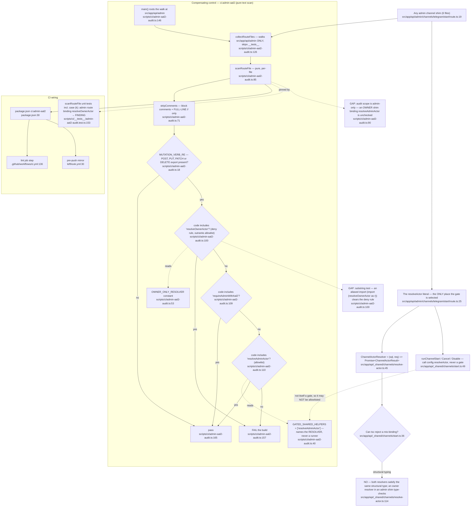

# F4 — Channel actor seam (mobile channel enrollment)

Pathfinder 2026-08-15, Phase 1 flowchart. Boundaries: `../00-features.md` row F4.

**Scope.** Enroll / cancel / disable an owner's Telegram or WhatsApp notification
channel from either portal, through **one runner per action** and **one actor
resolver per portal**. Twelve route shims
(`{admin,dashboard}/channels/{telegram,whatsapp}/{start,cancel,disable}`) bind a
4-field `ChannelRouteConfig` and call a shared runner. Also charted here: the
owner-portal read side (`settings/channels` page + `GET /api/dashboard/channels`),
per orchestrator adjustment 4.

**Binding constraint carried into this chart.** `resolveAdminActor` and
`resolveOwnerActor` are on the inherited DO-NOT-UNIFY register
(`../00-features.md` §Inherited constraints). The chart makes the *binding*
mechanism legible; it does not propose merging the resolvers.

---

## 1. Main flow — three lanes × two portals

```mermaid
flowchart TD
  %% ============ CLIENTS ============
  subgraph CLIENT["Client surfaces"]
    ADMPANEL["ChannelsPanel (admin location detail)<br/>src/app/admin/businesses/[id]/_components/ChannelsPanel.tsx:113"]
    ADMWIDGET["AdminEnrollmentWidget<br/>src/components/admin/AdminEnrollmentWidget.tsx:37"]
    ADMEP["admin endpoints + postBody businessId<br/>src/components/admin/AdminEnrollmentWidget.tsx:46"]
    OWNPAGE["settings/channels RSC page<br/>src/app/(authenticated)/settings/channels/page.tsx:42"]
    OWNWIDGET["OwnerMobileChannelWidget<br/>src/components/dashboard/channels/OwnerMobileChannelWidget.tsx:71"]
    OWNEP["owner endpoints, no postBody<br/>src/components/dashboard/channels/OwnerTelegramWidget.tsx:18"]
    HOOK["useEnrollment state machine<br/>src/lib/notifications/channels/use-enrollment.ts:64"]
  end

  ADMPANEL --> ADMWIDGET --> ADMEP --> HOOK
  OWNPAGE --> OWNWIDGET --> OWNEP --> HOOK

  %% ============ 12 ROUTE SHIMS ============
  subgraph SHIMS_A["Admin portal shims (6)"]
    AS_TG["POST admin telegram start<br/>src/app/api/admin/channels/telegram/start/route.ts:19"]
    AS_WA["POST admin whatsapp start<br/>src/app/api/admin/channels/whatsapp/start/route.ts:21"]
    AC_TG["POST admin telegram cancel<br/>src/app/api/admin/channels/telegram/cancel/route.ts:14"]
    AC_WA["POST admin whatsapp cancel<br/>src/app/api/admin/channels/whatsapp/cancel/route.ts:14"]
    AD_TG["POST admin telegram disable<br/>src/app/api/admin/channels/telegram/disable/route.ts:14"]
    AD_WA["POST admin whatsapp disable<br/>src/app/api/admin/channels/whatsapp/disable/route.ts:14"]
  end

  subgraph SHIMS_O["Owner portal shims (6)"]
    OS_TG["POST dashboard telegram start<br/>src/app/api/dashboard/channels/telegram/start/route.ts:15"]
    OS_WA["POST dashboard whatsapp start<br/>src/app/api/dashboard/channels/whatsapp/start/route.ts:15"]
    OC_TG["POST dashboard telegram cancel<br/>src/app/api/dashboard/channels/telegram/cancel/route.ts:14"]
    OC_WA["POST dashboard whatsapp cancel<br/>src/app/api/dashboard/channels/whatsapp/cancel/route.ts:14"]
    OD_TG["POST dashboard telegram disable<br/>src/app/api/dashboard/channels/telegram/disable/route.ts:14"]
    OD_WA["POST dashboard whatsapp disable<br/>src/app/api/dashboard/channels/whatsapp/disable/route.ts:14"]
  end

  HOOK -->|"POST start / cancel / disable"| SHIMS_A
  HOOK -->|"POST start / cancel / disable"| SHIMS_O

  CSRF["withSameOrigin — Origin header check, 403<br/>src/lib/auth/route-helpers.ts:57"]
  AS_TG --> CSRF
  AS_WA --> CSRF
  AC_TG --> CSRF
  AC_WA --> CSRF
  AD_TG --> CSRF
  AD_WA --> CSRF
  OS_TG --> CSRF
  OS_WA --> CSRF
  OC_TG --> CSRF
  OC_WA --> CSRF
  OD_TG --> CSRF
  OD_WA --> CSRF

  %% ============ THE BINDING DECISION ============
  subgraph BINDING["THE BINDING DECISION — one literal per shim, the only place the gate is chosen"]
    B_A_START["resolveActor := resolveAdminActor requireFullAccess:true<br/>src/app/api/admin/channels/telegram/start/route.ts:25"]
    B_A_START_WA["resolveActor := resolveAdminActor requireFullAccess:true<br/>src/app/api/admin/channels/whatsapp/start/route.ts:26"]
    B_A_TEARDOWN["resolveActor := resolveAdminActor requireFullAccess:false (cancel + disable, 4 shims)<br/>src/app/api/admin/channels/telegram/cancel/route.ts:21"]
    B_O["resolveActor := resolveOwnerActor (all 6 owner shims)<br/>src/app/api/dashboard/channels/telegram/start/route.ts:20"]
    CFG["ChannelRouteConfig — 4 fields, LOCKED<br/>src/app/api/_shared/channels/start.ts:32"]
    RESOLVERTYPE["ChannelActorResolver — structural type, portal-agnostic<br/>src/app/api/_shared/channels/resolve-actor.ts:45"]
  end

  CSRF --> B_A_START
  CSRF --> B_A_START_WA
  CSRF --> B_A_TEARDOWN
  CSRF --> B_O
  B_A_START --> CFG
  B_A_START_WA --> CFG
  B_A_TEARDOWN --> CFG
  B_O --> CFG
  CFG -. "resolveActor field is typed only as" .-> RESOLVERTYPE

  %% ============ RUNNERS ============
  subgraph RUNNERS["Shared runners — portal-agnostic by construction"]
    RSTART["runChannelStart<br/>src/app/api/_shared/channels/start.ts:39"]
    RCANCEL["runChannelCancel<br/>src/app/api/_shared/channels/action.ts:46"]
    RDISABLE["runChannelDisable<br/>src/app/api/_shared/channels/action.ts:75"]
    GATERES["gateAndResolveActor — shared preamble for cancel+disable<br/>src/app/api/_shared/channels/action.ts:21"]
  end

  CFG -->|"start lane (4 shims)"| RSTART
  CFG -->|"cancel lane (4 shims)"| RCANCEL
  CFG -->|"disable lane (4 shims)"| RDISABLE
  RCANCEL --> GATERES
  RDISABLE --> GATERES

  %% ============ GATE 1 + 2: FLAG, ENV ============
  FLAG{"config.isEnabled()<br/>src/app/api/_shared/channels/start.ts:44"}
  FLAGA{"config.isEnabled()<br/>src/app/api/_shared/channels/action.ts:26"}
  FLAGTG["channelsTelegramEnabled — CHANNELS_TELEGRAM_ENABLED<br/>src/lib/notifications/channels/flags.ts:19"]
  FLAGWA["channelsWhatsappEnabled — CHANNELS_WHATSAPP_ENABLED<br/>src/lib/notifications/channels/flags.ts:23"]
  FLAGOFF["flagOff → 404 not_found (flag-off is indistinguishable from no route)<br/>src/app/api/_shared/channels/flag-off.ts:11"]

  ENV{"config.assertEnvReady()<br/>src/app/api/_shared/channels/start.ts:46"}
  ENVA{"config.assertEnvReady()<br/>src/app/api/_shared/channels/action.ts:28"}
  ENVTG["assertTelegramEnvReady → 503 telegram_env_not_ready<br/>src/lib/notifications/channels/telegram-env.ts:24"]
  ENVWA["assertWhatsAppEnvReady → 503 whatsapp_env_not_ready<br/>src/lib/notifications/channels/whatsapp-env.ts:44"]

  RSTART --> FLAG
  GATERES --> FLAGA
  FLAG -->|false| FLAGOFF
  FLAGA -->|false| FLAGOFF
  FLAG -. "bound impl" .-> FLAGTG
  FLAG -. "bound impl" .-> FLAGWA
  FLAGA -. "bound impl" .-> FLAGTG
  FLAGA -. "bound impl" .-> FLAGWA
  FLAG -->|true| ENV
  FLAGA -->|true| ENVA
  ENV -. "bound impl" .-> ENVTG
  ENV -. "bound impl" .-> ENVWA
  ENVA -. "bound impl" .-> ENVTG
  ENVA -. "bound impl" .-> ENVWA

  %% ============ GATE 3: THE CHANNEL ACTOR ============
  DISPATCH{"config.resolveActor(sql, req) — runtime dispatch, no compile-time portal check<br/>src/app/api/_shared/channels/start.ts:49"}
  ENV -->|"null (ready)"| DISPATCH
  ENVA -->|"null (ready)"| DISPATCH

  subgraph ADMINRES["resolveAdminActor — admin portal"]
    RADMIN["resolveAdminActor<br/>src/app/api/_shared/channels/resolve-actor.ts:65"]
    AAL2["requireAdminWithAal2 — role=admin THEN MFA AAL2 step-up<br/>src/lib/auth/admin-mfa-gate.ts:49"]
    BODY["businessId read from the JSON BODY<br/>src/app/api/_shared/channels/resolve-actor.ts:74"]
    ACCTQ["SELECT accounts JOIN businesses ON b.id = body.businessId<br/>src/app/api/_shared/channels/resolve-actor.ts:84"]
    SUBA{"requireFullAccess ? subscriptionGrantsFullAccess : none<br/>src/app/api/_shared/channels/resolve-actor.ts:93"}
    ADMOPT["AdminActorOptions.requireFullAccess — start=true, cancel/disable=false<br/>src/app/api/_shared/channels/resolve-actor.ts:50"]
  end

  subgraph OWNERRES["resolveOwnerActor — owner portal"]
    ROWNER["resolveOwnerActor<br/>src/app/api/_shared/channels/resolve-actor.ts:114"]
    ROLE["requireRoleOr401(req,'owner') — NO MFA step-up<br/>src/lib/auth/route-helpers.ts:140"]
    SESS["locationId read from the SESSION, never the body<br/>src/app/api/_shared/channels/resolve-actor.ts:122"]
    WRIT["resolveWritableAccountForLocation — subscription + past-due + offboarding<br/>src/lib/shared/writable-subscription.ts:215"]
  end

  DISPATCH -->|"admin shim bound it"| RADMIN
  DISPATCH -->|"owner shim bound it"| ROWNER
  RADMIN --> AAL2 --> BODY --> ACCTQ --> SUBA
  SUBA -. "posture supplied by the shim" .-> ADMOPT
  ROWNER --> ROLE --> SESS --> WRIT

  ACTOR["ChannelActor {businessId, accountId, actorUserId, surface}<br/>src/app/api/_shared/channels/resolve-actor.ts:34"]
  SUBA -->|ok| ACTOR
  WRIT -->|"kind:'ok'"| ACTOR
  SUBA -->|"403 subscription_not_active"| ERR403["errorResponse no-store<br/>src/lib/auth/route-helpers.ts:106"]
  ACCTQ -->|"404 not_found"| ERR403
  BODY -->|"400 businessId required"| ERR403
  WRIT -->|"no_account → 404 not_found; blocked → 402 or 403 verbatim"| ERR403

  %% ============ LANE A: START ============
  subgraph LANEA["Lane A — start"]
    TOKEN["randomUUID + sha256 hash + TTL, minted OUTSIDE the tx<br/>src/app/api/_shared/channels/start.ts:55"]
    DEEP["buildMobileDeepLink — built BEFORE the write<br/>src/lib/notifications/channels/deep-links.ts:51"]
    BUILDERS["BUILDERS record — t.me/?start= and wa.me/?text=<br/>src/lib/notifications/channels/deep-links.ts:17"]
    TXA["sql.begin<br/>src/app/api/_shared/channels/start.ts:68"]
    LOCKA["pg_advisory_xact_lock('mobile_enroll:'+accountId)<br/>src/app/api/_shared/channels/start.ts:69"]
    SME["startMobileEnrollment<br/>src/lib/channels/mobile-enrollment.ts:50"]
    SELFU["SELECT ... account_id + channel + location_id IS NULL FOR UPDATE<br/>src/lib/channels/mobile-enrollment.ts:58"]
    UPSERT["UPDATE existing row, else INSERT with legacy business_id<br/>src/lib/channels/mobile-enrollment.ts:72"]
    CLASSIFY["classifyEnrollmentError — 23505 → typed error<br/>src/lib/channels/unique-violation.ts:68"]
    QR["QRCode.toDataURL — AFTER commit<br/>src/app/api/_shared/channels/start.ts:98"]
  end

  ACTOR -->|start| TOKEN --> DEEP --> TXA --> LOCKA --> SME --> SELFU --> UPSERT
  DEEP -. uses .-> BUILDERS
  UPSERT -->|"23505"| CLASSIFY
  SELFU -->|"status='verified'"| ERR409V["409 already_verified<br/>src/app/api/_shared/channels/start.ts:89"]
  CLASSIFY -->|MultipleMobileChannelsError| ERR409M["409 multiple_mobile_channels<br/>src/app/api/_shared/channels/start.ts:74"]
  CLASSIFY -->|EnrollmentDatabaseError| ERR500["500 internal + reportCaughtError (never logs the token)<br/>src/app/api/_shared/channels/start.ts:78"]

  %% ============ LANE B: CANCEL ============
  subgraph LANEB["Lane B — cancel"]
    TXB["sql.begin<br/>src/app/api/_shared/channels/action.ts:55"]
    LOCKB["pg_advisory_xact_lock — same account key as start<br/>src/app/api/_shared/channels/action.ts:56"]
    CME["cancelMobileEnrollment — pending_verification → disabled, idempotent<br/>src/lib/channels/mobile-enrollment.ts:119"]
  end
  ACTOR -->|cancel| TXB --> LOCKB --> CME

  %% ============ LANE C: DISABLE ============
  subgraph LANEC["Lane C — disable"]
    DISC["disconnectChannel — owns tx + cascade + audit + its own cache invalidate<br/>src/lib/channels/disable-enrollment.ts:32"]
    DCE["disableChannelEnrollment — org-default UPDATE then unconditional override cascade<br/>src/lib/channels/disable-enrollment.ts:76"]
    AUDIT["writeAccountAuditLog — channel_disabled / channel_override_disabled<br/>src/lib/audit/log.ts:24"]
  end
  ACTOR -->|disable| DISC --> DCE --> AUDIT
  DCE -->|"0 rows changed"| ERR404D["404 not_found<br/>src/app/api/_shared/channels/action.ts:90"]

  %% ============ PERSISTENCE + CACHE ============
  TBL[("channel_enrollments — org default keyed account_id + channel + location_id IS NULL<br/>src/lib/channels/mobile-enrollment.ts:59")]
  AUDITTBL[("account_audit_log<br/>src/lib/audit/log.ts:24")]
  UPSERT --> TBL
  CME --> TBL
  DCE --> TBL
  AUDIT --> AUDITTBL

  CACHE["safeInvalidateChannelCache — best effort, never blocks<br/>src/lib/notifications/resolve-channels.ts:176"]
  REDIS[("Upstash channel-resolution cache<br/>src/lib/notifications/resolve-channels.ts:157")]
  TBL --> CACHE
  CACHE --> REDIS
  CACHEST["start invalidate '{surface}.{channel}.start'<br/>src/app/api/_shared/channels/start.ts:96"]
  CACHECA["cancel invalidate '{surface}.{channel}.cancel'<br/>src/app/api/_shared/channels/action.ts:62"]
  CACHEDI["disable invalidate — inside disconnectChannel, post-commit<br/>src/lib/channels/disable-enrollment.ts:48"]
  CACHEST --> CACHE
  CACHECA --> CACHE
  CACHEDI --> CACHE

  %% ============ TERMINAL RESPONSES ============
  OK200["200 {deepLink, qrDataUrl, expiresAt} no-store<br/>src/app/api/_shared/channels/start.ts:100"]
  OKC["200 {ok:true} no-store<br/>src/app/api/_shared/channels/action.ts:64"]
  OKD["200 {ok:true} no-store<br/>src/app/api/_shared/channels/action.ts:93"]
  QR --> OK200
  CACHEST --> QR
  CACHECA --> OKC
  DISC --> OKD

  %% ============ PROVIDER VERIFICATION (terminal state of the start lane) ============
  subgraph PROVIDER["External verification — Railway ingress, invariant #6"]
    TGSCAN["Owner scans QR / taps t.me link → Telegram /start webhook<br/>worker/ingress/telegram/telegram-enrollment.ts:66"]
    TGUPD["SELECT FOR UPDATE by token hash → status='verified', handle=chatId<br/>worker/ingress/telegram/telegram-enrollment.ts:80"]
    WASCAN["Owner sends wa.me prefilled text → verifyEnrollmentToken<br/>worker/ingress/twilio/twilio-whatsapp-inbound.ts:368"]
    WAUPD["SELECT FOR UPDATE by token hash → status='verified', handle=sender<br/>worker/ingress/twilio/twilio-whatsapp-inbound.ts:388"]
  end
  OK200 -->|"owner scans"| TGSCAN --> TGUPD --> TBL
  OK200 -->|"owner scans"| WASCAN --> WAUPD --> TBL

  %% ============ READ SIDE ============
  subgraph READ["Read side — status polling + SSR hydration"]
    GETDASH["GET /api/dashboard/channels — owner, requireRoleOr401<br/>src/app/api/dashboard/channels/route.ts:32"]
    GETADMIN["GET /api/admin/businesses/[id]/channels — requireRoleOr401 admin, NO AAL2<br/>src/app/api/admin/businesses/[id]/channels/route.ts:23"]
    SVC["getBusinessChannelEnrollments — override beats org default<br/>src/lib/admin/business-channels-service.ts:103"]
    OVW["getChannelOverridesView — per-location override surface<br/>src/lib/channels/overrides-view.ts:51"]
    PAGEQ["settings page inline org-default SELECT (location_id IS NULL)<br/>src/app/(authenticated)/settings/channels/page.tsx:71"]
    AVAIL["telegramAvailable / whatsappAvailable — flag AND env, server-side<br/>src/app/(authenticated)/settings/channels/page.tsx:32"]
  end
  HOOK -->|"poll endpoints.status"| GETDASH
  HOOK -->|"poll endpoints.status"| GETADMIN
  GETADMIN --> SVC
  OWNPAGE --> PAGEQ
  OWNPAGE --> OVW
  OWNPAGE --> AVAIL
  TBL --> GETDASH
  TBL --> SVC
  TBL --> PAGEQ
```

---

## 2. Enforcement chain — where the gate is chosen and what checks it

---

## 3. Enforcement chain, in prose — what stops an admin route from binding the owner resolver today

Nothing in the type system. This is the whole point of the re-open.

1. **The binding is a plain object-literal field.** Every admin shim writes
   `resolveActor: (db, request) => resolveAdminActor(db, request, { requireFullAccess: … })`
   (`src/app/api/admin/channels/telegram/start/route.ts:25`,
   `.../whatsapp/start/route.ts:26`, and `:21` in each of the four
   cancel/disable shims). Every owner shim writes `resolveActor: resolveOwnerActor`
   (`src/app/api/dashboard/channels/telegram/start/route.ts:20`, `:19` in the
   other five). That single line is the entire portal decision.

2. **`tsc` cannot reject a swap.** `ChannelRouteConfig.resolveActor`
   (`src/app/api/_shared/channels/start.ts:36`) is typed only as
   `ChannelActorResolver` (`src/app/api/_shared/channels/resolve-actor.ts:45`), a
   structural `(sql, req) => Promise<ChannelActorResult>`. `resolveOwnerActor`
   (`resolve-actor.ts:114`) matches that signature exactly, so pasting it into an
   admin shim compiles clean. Before #831 the admin runner *was* the gate —
   `runAdminChannelStart` called `requireAdminWithAal2` unconditionally — so
   binding the wrong thing was not expressible. That structural guarantee is gone.

3. **The runners deliberately hold no gate.** `runChannelStart:49`,
   `runChannelCancel` / `runChannelDisable` via `gateAndResolveActor`
   (`src/app/api/_shared/channels/action.ts:31`) call `config.resolveActor` and
   nothing else. They are portal-agnostic by construction, which is exactly why
   the audit's allowlist may not name them
   (`scripts/ci/admin-aal2-audit.ts:28-39`).

4. **The only thing that stops it is `ci:admin-aal2`, a text scan.**
   `scanRouteFile` (`scripts/ci/admin-aal2-audit.ts:85`) strips comments
   (`:71` — block comments outright, `//` only when it owns the whole line),
   checks for a mutation-verb export (`:18`), then applies, in order:
   - **deny** — the file's code contains the literal string `resolveOwnerActor`
     (`:100`, constant at `:53`) → FAIL, unconditionally, even if it also names
     the admin resolver;
   - **allow** — the code contains `requireAdminWithAal2` (`:109`) or
     `resolveAdminActor` (`:110`, allowlist at `:40`) → pass;
   - otherwise FAIL (`:112`).

   It is a **substring test over comment-stripped source text**. It never parses,
   never resolves imports, and never inspects the `resolveActor` field
   specifically. Wiring: `package.json:30` → `.github/workflows/ci.yml:136` (lint
   job) and `lefthook.yml:30` (pre-push). The regression case is pinned at
   `scripts/ci/__tests__/admin-aal2-audit.test.ts:153`.

**Summary of the three layers.**

| Layer | What it covers today | Kind |
|---|---|---|
| MFA step-up itself (`requireAdminWithAal2`, `admin-mfa-gate.ts:49`) | Runs unconditionally *inside* `resolveAdminActor:70` — cannot be skipped once the admin resolver is entered | **Structural** |
| Which resolver an admin route uses | One object-literal field per shim; both resolvers satisfy one structural type | **Configuration** |
| That admin shims bind the admin resolver | `ci:admin-aal2` deny + allowlist, comment-stripped substring scan of `src/app/api/admin/**/route.ts` | **Text-scanned** |

**Two acknowledged holes in the text scan.**
- *Aliased import.* `import { resolveOwnerActor as resolveActorImpl }` never
  emits the literal `resolveOwnerActor` at the binding site; `:100`'s
  `code.includes(...)` would still see it on the import line — but
  `import * as actors from '…/resolve-actor'` + `actors.resolveOwnerActor`, or a
  re-export through a third module, would not. `.claude/CLAUDE.md` states this
  plainly ("an aliased import would still clear it").
- *Owner-side asymmetry.* The audit early-returns unless the path contains
  `src/app/api/admin/` (`:90`). An **owner** shim that bound `resolveAdminActor`
  is completely unchecked — it would grant admin-body-`businessId` tenancy to a
  dashboard route. No CI check exists for that direction; today it is prevented
  only by the six owner shims each reading `resolveActor: resolveOwnerActor`.

---

## 4. Happy-path walk — owner enrolls Telegram from `settings/channels`

1. **Page render.** `ChannelsPage` (`src/app/(authenticated)/settings/channels/page.tsx:42`)
   runs `requireOwnerAccess` (`src/lib/auth/require-owner-access.ts:42`), reads the
   per-location override view (`src/lib/channels/overrides-view.ts:51`), runs its
   own org-default `SELECT … location_id IS NULL` (`page.tsx:71`), and computes
   availability server-side from flag + env (`page.tsx:32-40`) so the Connect
   button never appears for a channel the start route would 503. Invariant #13 is
   preserved — no `NEXT_PUBLIC_*` companion; the browser learns flag state from
   props.
2. **Click Connect.** `OwnerMobileChannelWidget` (`…/OwnerMobileChannelWidget.tsx:71`)
   → `useEnrollment` (`src/lib/notifications/channels/use-enrollment.ts:64`) POSTs
   `endpoints.start` (`OwnerTelegramWidget.tsx:18`) with **no body**.
3. **Shim.** `POST /api/dashboard/channels/telegram/start`
   (`route.ts:15`) passes `withSameOrigin()` (`route-helpers.ts:57`) and calls
   `runChannelStart(sql, req, { channel:'telegram', isEnabled, assertEnvReady,
   resolveActor: resolveOwnerActor })` (`route.ts:16-21`). `sql` is the composition-root
   singleton (`route.ts:8`) — invariant #15.
4. **Flag + env.** `start.ts:44` → `channelsTelegramEnabled` (`flags.ts:19`);
   `start.ts:46` → `assertTelegramEnvReady` (`telegram-env.ts:24`).
5. **Channel actor.** `start.ts:49` → `resolveOwnerActor` (`resolve-actor.ts:114`):
   `requireRoleOr401(req,'owner')` (`route-helpers.ts:140`) → `locationId` from the
   **session** (`resolve-actor.ts:122`) → `resolveWritableAccountForLocation`
   (`writable-subscription.ts:215`) yields `accountId`. Actor is
   `{ businessId: locationId, accountId, actorUserId: user.id, surface:'dashboard' }`
   (`resolve-actor.ts:132-138`).
6. **Token + link.** `randomUUID` → SHA-256 hash → `expiresAt` outside the tx
   (`start.ts:55-57`); `buildMobileDeepLink('telegram', rawToken)`
   (`deep-links.ts:51` → builder `:18`) **before** the write, so a config gap
   cannot leave a `pending_verification` row holding the migration-027 unique
   slot (`start.ts:59-63`).
7. **Write.** `sql.begin` (`start.ts:68`) → `pg_advisory_xact_lock('mobile_enroll:'+accountId)`
   (`start.ts:69`) → `startMobileEnrollment` (`mobile-enrollment.ts:50`):
   `SELECT … account_id=… AND channel=… AND location_id IS NULL AND archived_at IS NULL FOR UPDATE`
   (`:58`), then UPDATE (`:72`) or INSERT (`:86`).
8. **Post-commit.** `safeInvalidateChannelCache(accountId, 'dashboard.telegram.start')`
   (`start.ts:96` → `resolve-channels.ts:176`), then `QRCode.toDataURL`
   (`start.ts:98`), then `200 { deepLink, qrDataUrl, expiresAt }` with no-store
   (`start.ts:100`).
9. **Verification (external, Railway).** Owner opens the `t.me` link; the
   Telegram webhook hashes the token, locks the row and flips it to `verified`
   with `handle = chatId` (`worker/ingress/telegram/telegram-enrollment.ts:66-80`),
   invalidates the channel cache, and replies. The WhatsApp twin is
   `verifyEnrollmentToken` (`worker/ingress/twilio/twilio-whatsapp-inbound.ts:368-388`).
10. **Poll.** `useEnrollment` polls `GET /api/dashboard/channels`
    (`src/app/api/dashboard/channels/route.ts:32`), which deliberately excludes
    `verification_token_hash` from the SELECT (`:57`) and masks handles (`:83`).

The admin lane differs at steps 2, 3 and 5 only: `AdminEnrollmentWidget:46` posts
`{ businessId }` (`:52`), the shim binds `resolveAdminActor` with
`requireFullAccess: true` (`admin/…/start/route.ts:25`), and the resolver runs
`requireAdminWithAal2` (`admin-mfa-gate.ts:49`) → body `businessId`
(`resolve-actor.ts:74`) → `accounts JOIN businesses` (`:84`) →
`subscriptionGrantsFullAccess` (`:93`).

---

## 5. Gate asymmetry — deliberate, per spec §4.2 / §4.3

| Portal | Action | Auth | Tenant key source | Subscription gate |
|---|---|---|---|---|
| admin | start | `requireAdminWithAal2` (`admin-mfa-gate.ts:49`) | body `businessId` (`resolve-actor.ts:74`) | `subscriptionGrantsFullAccess` (`resolve-actor.ts:93`, `requireFullAccess:true` at `admin/…/start/route.ts:25`) |
| admin | cancel | same | same | **NONE** (`requireFullAccess:false`, `admin/…/cancel/route.ts:21`) |
| admin | disable | same | same | **NONE** (`requireFullAccess:false`, `admin/…/disable/route.ts:21`) |
| owner | start | `requireRoleOr401(_,'owner')` (`route-helpers.ts:140`) | **session** `locationId` (`resolve-actor.ts:122`) | `resolveWritableAccountForLocation` (`writable-subscription.ts:215`) |
| owner | cancel | same | same | same |
| owner | disable | same | same | same |

The admin `cancel`/`disable` gap is intentional: an admin must be able to tear
down an enrollment on a lapsed account (`resolve-actor.ts:52-57`). `no_account`
maps to `404 not_found` on all three owner actions (`resolve-actor.ts:126`) —
before #831, owner `start` returned 404 while `cancel`/`disable` returned
`403 subscription_not_active` for the identical condition
(`resolve-actor.ts:106-112`). `blocked` still surfaces its own status verbatim
(`:127-129`).

The client mirrors the admin `start` gate: `ChannelsPanel.tsx:108` and `:122`
call `subscriptionGrantsFullAccess` to hide the widget, with a comment naming the
API-side owner (`ChannelsPanel.tsx:33-37`). That is presentation only — the
server gate at `resolve-actor.ts:93` is authoritative.

---

## 6. Side effects

**Tables written**

| Table | Written by | Notes |
|---|---|---|
| `channel_enrollments` | `startMobileEnrollment` INSERT (`mobile-enrollment.ts:86`) / UPDATE (`:72`) | Org default keyed **`account_id` + `channel` + `location_id IS NULL`**. `business_id` is a NOT-NULL **legacy FK written on INSERT and never used for lookup** (`mobile-enrollment.ts:48`, restated at `business-channels-service.ts:94-100`). |
| `channel_enrollments` | `cancelMobileEnrollment` (`mobile-enrollment.ts:124`) | `pending_verification → disabled`, clears hash + expiry, releases the migration-027 partial-unique slot. Idempotent, 0 rows = already done. |
| `channel_enrollments` | `disableChannelEnrollment` (`disable-enrollment.ts:82` org default, `:96` override cascade) | Cascade runs **unconditionally**, including pending clones; reconnect does not auto-revive overrides (`:64-72`). |
| `channel_enrollments` | Telegram webhook (`worker/ingress/telegram/telegram-enrollment.ts:80`), WhatsApp webhook (`worker/ingress/twilio/twilio-whatsapp-inbound.ts:388`) | `pending_verification → verified`, sets `handle`, NULLs the token hash. |
| `account_audit_log` | `writeAccountAuditLog` in the disable cascade (`disable-enrollment.ts:112` and `:123`) | `channel_disabled` (org default) and `channel_override_disabled` (per override row), in the caller's tx. Goes through the single audit writer, not a raw INSERT. |

**Locks / concurrency**
- Account-scoped advisory lock `mobile_enroll:{accountId}` inside the tx on start
  (`start.ts:69`) and cancel (`action.ts:56`) — same key, so a concurrent start
  cannot resurrect a cancel's `disabled` transition (`mobile-enrollment.ts:107-113`).
- `SELECT … FOR UPDATE` on the org-default row inside `sql.begin`
  (`mobile-enrollment.ts:62`) and on the token-hash row in both webhooks
  (`telegram-enrollment.ts:74`, `twilio-whatsapp-inbound.ts:380`) — correct per
  the PgBouncer gotcha (locks only survive inside `sql.begin`).
- `disconnectChannel` opens its own tx (`disable-enrollment.ts:38`); the disable
  lane takes **no advisory lock**.

**Cache**
- `safeInvalidateChannelCache` (`resolve-channels.ts:176` → `invalidateChannelCache:157`),
  best-effort, source-labelled `{surface}.{channel}.{action}`: start
  (`start.ts:96`), cancel (`action.ts:62`), disable **inside** `disconnectChannel`
  post-commit (`disable-enrollment.ts:48`) — which is why `runChannelDisable`
  does not invalidate (`action.ts:70-73`).

**Secrets**
- Raw enrollment token exists only in memory and in the deep link
  (`start.ts:53-57`); only the SHA-256 hash is persisted. The error path
  explicitly does not log it (`start.ts:77`). The status read route excludes the
  hash from its SELECT (`dashboard/channels/route.ts:57`). Invariant #5 applied
  to enrollment tokens.

**No outbox rows.** All three lanes are synchronous UI mutations with no
follow-up worker job, so invariant #2 does not apply; the async half of the
lifecycle is the inbound webhook, not an enqueue.

---

## 7. External dependencies

| Dependency | Where | Notes |
|---|---|---|
| **Supabase Auth (admin role + MFA/AAL2)** | `requireAdminWithAal2` (`src/lib/auth/admin-mfa-gate.ts:49`) → `requireCurrentAal2FromSupabase` (`src/lib/auth/mfa.ts`) | S1 seam. Only the admin lane. |
| **Supabase Auth (owner session)** | `requireRoleOr401` (`src/lib/auth/route-helpers.ts:140`), `requireOwnerAccess` (`src/lib/auth/require-owner-access.ts:42`), `supabase.auth.getUser()` on the settings page (`page.tsx:66`) | S1 seam. |
| **Postgres.js singleton `sql`** | Imported by each of the 12 shims (e.g. `admin/…/start/route.ts:12`) and passed down — composition-root-only, invariant #15 | Domain modules take `sql`/`tx` as parameters throughout. |
| **Upstash Redis (channel-resolution cache)** | `invalidateChannelCache` (`src/lib/notifications/resolve-channels.ts:157`) | Fail-open by design (`:181-189`). |
| **Telegram Bot API** | Deep link `https://t.me/{bot}?start={token}` (`deep-links.ts:18-23`); inbound verification on Railway (`worker/ingress/telegram/telegram-enrollment.ts:66`) | `TELEGRAM_BOT_USERNAME` (`||` fallback, `deep-links.ts:22`), `TELEGRAM_BOT_TOKEN`, `TELEGRAM_WEBHOOK_SECRET` (`telegram-env.ts:15`). |
| **Twilio WhatsApp** | Deep link `https://wa.me/{digits}?text=…` (`deep-links.ts:25-48`); inbound verification (`worker/ingress/twilio/twilio-whatsapp-inbound.ts:368`) | 5 required env vars (`whatsapp-env.ts:13-19`). `TWILIO_WHATSAPP_NUMBER` unset **throws** by design (`deep-links.ts:36`) because `MOCK_EXTERNAL_APIS=true` bypasses the env gate (`whatsapp-env.ts:33`). |
| **`qrcode` npm package** | `QRCode.toDataURL` (`start.ts:98`) | Only synchronous-ish CPU work in the lane; runs after commit. |
| **Sentry / structured error reporting** | `reportCaughtError` (`start.ts:78`, `telegram-env.ts:30`, `whatsapp-env.ts:47`) | |
| **Feature flags `CHANNELS_TELEGRAM_ENABLED` / `CHANNELS_WHATSAPP_ENABLED`** | `src/lib/notifications/channels/flags.ts:19` / `:23` | Server-authoritative (invariant #13). |
| **F3 owner-settings shell** | `settings/channels` is an F3 shell slot rendering an F4 payload (`../00-features.md` adjustment 4) | F4 owns the page; F3 references it. |
| **Multi-location flags** | `shouldUseMultiLocationSettings` (`page.tsx:51`), `multiLocationEnabled` (`page.tsx:50`) | Gates the per-location override panel only (invariant #9b). |
| **Offboarding / past-due projections** | Reached through `resolveWritableAccountForLocation` (`writable-subscription.ts:215`) | Owner lane only. |

---

## 8. Duplicated / odd, with `file:line`

1. **Three org-default enrollment SELECTs, three shapes.**
   `src/app/api/dashboard/channels/route.ts:59-79` (owner API),
   `src/app/(authenticated)/settings/channels/page.tsx:71-92` (owner RSC, same
   predicate + an extra `e.id` column), and
   `src/lib/admin/business-channels-service.ts:115-142` (admin, adds the override
   union + `last_activity_at` subquery). The first two are near-identical and
   differ mainly in masking: the API masks (`route.ts:83`), the page does not
   (`page.tsx:96`). Candidate for one owner; **not** a DO-NOT-UNIFY entry.
2. **`telegramAvailable` / `whatsappAvailable` spelled twice, byte-for-byte.**
   `src/app/api/dashboard/channels/route.ts:22-30` and
   `src/app/(authenticated)/settings/channels/page.tsx:32-40`. `whatsapp-env.ts:5-8`
   explicitly anticipates the second consumer but no shared helper was extracted.
3. **The admin channel status read has no AAL2 and no `no-store`.**
   `src/app/api/admin/businesses/[id]/channels/route.ts:30` uses
   `requireRoleOr401(request,'admin')`, not `requireAdminWithAal2`, and returns a
   bare `NextResponse.json(data)` (`:34`) — no cache headers, unlike every
   mutation path which goes through `errorResponse`/`jsonResponse`
   (`route-helpers.ts:96`/`:106`). `ci:admin-aal2` does not see it: the audit only
   fires on mutation verbs (`scripts/ci/admin-aal2-audit.ts:96`). It is a read, so
   this is defensible — but it is the one admin channel surface with a weaker gate
   than its siblings.
4. **`business_id` on `channel_enrollments` carries a meaning it is never read
   for.** Written NOT NULL on INSERT (`mobile-enrollment.ts:88`), never in a
   lookup predicate; `business-channels-service.ts:124-127` has to work *around*
   it for `last_activity_at`. Same shape as the `onboarded_by` overloading called
   out in `.claude/CLAUDE.md`.
5. **Two `surface` vocabularies collapsed on purpose.** `ChannelActor.surface` is
   `'admin' | 'dashboard'` — not `'admin' | 'owner'` — so the audit tag and cache
   label need no translation (`resolve-actor.ts:29-33`). Reads oddly next to
   `resolveOwnerActor` returning `surface:'dashboard'` (`:137`); deliberate.
6. **`gateAndResolveActor` exists only on the cancel/disable side**
   (`action.ts:21`); `runChannelStart` inlines the same three steps
   (`start.ts:44-50`). Not wrong — `runChannelStart` needs the resolved actor
   destructured differently (`start.ts:51`) — but the preamble is written twice.
7. **`ChannelRouteConfig` is 4 fields and must stay 4.** `start.ts:11-15` records
   why each candidate fifth field was rejected: `flagOff` never varied (called
   directly at `start.ts:44`/`action.ts:26`), the cache label and Sentry tag derive
   from `surface + channel`, the deep link derives from `channel`. A fifth field
   means the seam is wrong.

---

## 9. Confidence and gaps

**High confidence** on: the three lanes end-to-end, the 12 bindings (all
enumerated from source), the resolver asymmetry and its subscription postures,
the `ci:admin-aal2` algorithm (read in full, including its own unit tests), the
write set, and the org-default keying.

**Medium confidence** on: the exact Redis key/TTL of the channel cache (I read
`safeInvalidateChannelCache` and the invalidate entry point, not the fill path)
and the full `useEnrollment` polling cadence (`use-enrollment.ts:64` — I read its
endpoint wiring, not its timers).

**Gaps not chased.**
- The `unsubscribed` lifecycle (`solicitation`/RFC-8058 unsubscribe touching
  `channel_enrollments.unsubscribed_at`) is read by every read-side query but is
  written outside F4; not charted.
- `src/lib/channels/override.ts:244` `createOrReviveOverride` / `:282`
  `removeOverride` — the per-location override write path — is reachable from the
  settings page but goes through `POST /api/settings/channels/override`, an F3
  route. Charted here only as the read-side `getChannelOverridesView`.
- I did not run any test or CI script (read-only pass per Pathfinder Phase 1).
- The email channel (`enroll-email-owner.ts`, `email-channel.ts`) shares the
  `channel_enrollments` table and the read queries but has no flag gate
  (`flags.ts:37` — `email: () => true`) and no mobile enrollment lane; out of
  F4's stated surface.
