# F5 — **Funnel entry** + **Admin invite** (onboarding funnel)

Pathfinder 2026-08-15, Phase 1 flowchart. Boundaries per
`docs/reviews/PATHFINDER-2026-08-15/00-features.md` (F5 row + orchestrator
adjustments 2 and 3). Locked vocabulary per `CONTEXT.md:126-129`.

**Scope.** Get a new owner — self-serve or staff-invited — from identity to an
entitled, wizard-complete account, with ONE server-computed destination.

**Excluded by the approved boundary:**

- `src/components/auth/auth-island/**` (~3,490 LOC) — login/signup presentation
  chrome, no control flow (adjustment 2).
- `GET /api/admin/businesses` (`src/app/api/admin/businesses/route.ts:25`) — F1
  owns it. Only `POST` (`:55`) is charted here (adjustment 3).
- Stripe Session construction — **F6**. The handoff into
  `applyTierSnapshot`/`createCheckoutSession` is charted; their internals are not.
- `src/lib/auth/**` — the **S1** seam. `provisionAuthUser`, `flags`,
  `requireAdminWithAal2`, `requireAdminPage`, `route-helpers` appear as seam
  calls only.

---

## Flowchart

```mermaid
flowchart TD

  %% ══════════════════════════════════════════════════════════════
  subgraph C["(c) Admin invite lane — staff mints the Account"]
    ANEW["/admin/businesses/new page<br/>src/app/admin/businesses/new/page.tsx:8"]
    AGATE["requireAdminPage aal2:true — step up BEFORE the form<br/>src/app/admin/businesses/new/page.tsx:14"]
    AFORM["NewBusinessClient — 3 fields, POSTs then routes to detail<br/>src/app/admin/businesses/new/NewBusinessClient.tsx:29"]
    ASCHEMA["FormSchema — deliberate browser-local copy of the contract<br/>src/app/admin/businesses/new/schema.ts:18"]
    APOST["POST /api/admin/businesses — createBusiness<br/>src/app/api/admin/businesses/route.ts:55"]
    AAAL2["requireAdminWithAal2 — S1 seam<br/>src/app/api/admin/businesses/route.ts:56"]
    AZOD["OnboardBusinessSchema — name, ownerName, ownerEmail<br/>src/lib/shared/schemas.ts:172"]
    ASVC["onboardBusinessAsAdmin — 4-step orchestration<br/>src/lib/onboarding/admin-onboarding-service.ts:218"]
    AURL["buildInviteRedirectTo — fail-fast BEFORE any DB write<br/>src/lib/onboarding/admin-onboarding-service.ts:121"]
    ATXA["createBusinessTx mode=admin → runAdminTx<br/>src/lib/onboarding/create-business.ts:222"]
    AINV["supabase.auth.admin.inviteUserByEmail<br/>src/lib/onboarding/admin-onboarding-service.ts:265"]
    ALINK["UPDATE users SET auth_id — must match exactly 1 row<br/>src/lib/onboarding/admin-onboarding-service.ts:328"]
    ARB["rollbackProvisionedBusiness — 4 deletes in FK order<br/>src/lib/onboarding/admin-onboarding-service.ts:189"]
    ADEL["supabase.auth.admin.deleteUser — orphan auth user<br/>src/lib/onboarding/admin-onboarding-service.ts:368"]
    AERR["AdminOnboardingError + orphan-id rollback details<br/>src/lib/onboarding/admin-onboarding-service.ts:60"]
    A201["201 id only — no paymentUrl on the wire<br/>src/app/api/admin/businesses/route.ts:83"]

    ARESEND["POST /api/admin/businesses/:id/resend-invite<br/>src/app/api/admin/businesses/-id-/resend-invite/route.ts:121"]
    ARRL["per-Business 3/hr strict cap — spent BEFORE eligibility<br/>src/app/api/admin/businesses/-id-/resend-invite/route.ts:47"]
    ARSVC["resendOwnerInvite<br/>src/lib/onboarding/resend-invite.ts:270"]
    ARPEND["gate: subscription_status must be pending_payment<br/>src/lib/onboarding/resend-invite.ts:311"]
    ARELIG["THE eligibility signal: provider last_sign_in_at is null<br/>src/lib/onboarding/resend-invite.ts:345"]
    ARMAP["mapInviteProviderError — keyed on code/status, never text<br/>src/lib/onboarding/resend-invite.ts:187"]

    ANEW --> AGATE --> AFORM --> ASCHEMA --> APOST
    APOST --> AAAL2 --> AZOD --> ASVC
    ASVC --> AURL
    AURL -->|"ok"| ATXA
    AURL -->|"missing / malformed / bad scheme"| AERR
    ATXA -->|"DuplicateEmailError → 409"| AERR
    ATXA -->|"committed"| AINV
    AINV -->|"provider error"| ARB
    AINV -->|"ok"| ALINK
    ALINK -->|"0 rows matched"| ADEL --> ARB
    ARB --> AERR
    ALINK -->|"1 row"| A201

    ARESEND --> ARRL --> ARSVC --> ARPEND --> ARELIG
    ARELIG -->|"never signed in"| AINV
    ARELIG -->|"already signed in → 409"| ARMAP
  end

  %% ══════════════════════════════════════════════════════════════
  subgraph A["(a) Identity / auth — both lanes converge here"]
    SIGNUP["POST /api/auth/signup — password lane<br/>src/app/api/auth/signup/route.ts:19"]
    SSFLAG["selfServeSignupEnabled — S1 seam, gates ONLY stranger minting<br/>src/app/api/auth/signup/route.ts:21"]
    SBOT["botIdBlockResponse<br/>src/app/api/auth/signup/route.ts:27"]
    PROV["provisionAuthUser → supabase.auth.signUp — S1 seam<br/>src/lib/auth/provision-auth-user.ts:43"]
    IDENT["disambiguateEmptyIdentities — identities:[] is AMBIGUOUS<br/>src/lib/auth/provision-auth-user.ts:117"]
    ATXS["createBusinessTx mode=self_serve → runSelfServeTx<br/>src/lib/onboarding/create-business.ts:348"]
    SDEL["deleteProvisionedAuthUser — compensating cleanup<br/>src/app/api/auth/signup/route.ts:124"]
    CHECKMAIL["redirect /signup/check-email?email=…<br/>src/app/api/auth/signup/route.ts:134"]

    OTP["POST /api/auth/verify-otp — 6-digit code, not a link<br/>src/app/api/auth/verify-otp/route.ts:42"]
    OTPV["supabase.auth.verifyOtp — writes session cookies via setAll<br/>src/app/api/auth/verify-otp/route.ts:133"]
    OTPROLE["owner-role + primary-business lookup, one round trip<br/>src/app/api/auth/verify-otp/route.ts:161"]
    OTPENROLL["enrollOwnerEmailChannel — deferred here from createBusinessTx<br/>src/app/api/auth/verify-otp/route.ts:207"]
    OTPAN["enqueueAnalyticsEvent email_verified<br/>src/app/api/auth/verify-otp/route.ts:220"]

    CB["GET /api/auth/callback — code= or token_hash=<br/>src/app/api/auth/callback/route.ts:130"]
    CBX["exchangeForUserId — verifyOtp or exchangeCodeForSession<br/>src/app/api/auth/callback/route.ts:84"]
    CBDEST["resolveCallbackDestination — role + path allowlist<br/>src/app/api/auth/callback/route.ts:160"]

    FIN["POST /api/auth/finish-signup — Google OAuth lane<br/>src/app/api/auth/finish-signup/route.ts:27"]
    FINPRE["advisory-locked pre-check: auth_id then email<br/>src/app/api/auth/finish-signup/route.ts:115"]
    FINENROLL["enrollOwnerEmailChannel — Google already proved the address<br/>src/app/api/auth/finish-signup/route.ts:201"]
    FINDEST["PRIVATE demo branch — does NOT call resolveFunnelEntry<br/>src/app/api/auth/finish-signup/route.ts:215"]

    STATUS["GET /api/auth/signup-status — the polling surface<br/>src/app/api/auth/signup-status/route.ts:92"]
    LOGIN["applySubscriptionGuard — consumes funnelUrl, never re-decides<br/>src/components/auth/shared/loginDestination.ts:64"]

    SIGNUP --> SSFLAG --> SBOT --> PROV --> IDENT
    IDENT -->|"account_exists → 409 generic"| CHECKMAIL
    IDENT -->|"real new user"| ATXS
    ATXS -->|"any failure"| SDEL
    ATXS -->|"ok"| CHECKMAIL
    CHECKMAIL --> OTP --> OTPV --> OTPROLE --> OTPENROLL --> OTPAN

    CB --> CBX --> CBDEST
    CBDEST -->|"flow=owner next=/signup/finish"| FIN
    FIN --> FINPRE --> ATXS
    ATXS --> FINENROLL --> FINDEST
  end

  %% ══════════════════════════════════════════════════════════════
  subgraph B["(b) Funnel-entry decision — ONE owner, five ordered rows"]
    FE["resolveFunnelEntry — PURE: no DB, no env, no flag read<br/>src/lib/onboarding/funnel-entry.ts:81"]
    FEIN["FunnelOwnerState: status, demoEnabled, hasPlace, wizardCompleted<br/>src/lib/onboarding/funnel-entry.ts:53"]
    FLAG["onboardingDemoEnabled — read by the CALLER, passed in<br/>src/lib/onboarding/flags.ts:15"]
    R1["row 1 — pending_payment + demo + NO place → /onboarding/start<br/>src/lib/onboarding/funnel-entry.ts:84"]
    R2["row 2 — pending_payment + demo + place → /onboarding/demo (drop-off return)<br/>src/lib/onboarding/funnel-entry.ts:84"]
    R3["row 3 — pending_payment + demo OFF → /onboarding/pay<br/>src/lib/onboarding/funnel-entry.ts:83"]
    R4["row 4 — subscriptionGrantsFullAccess + !wizard → /onboarding/business<br/>src/lib/onboarding/funnel-entry.ts:87"]
    R5["row 5 — else → /dashboard<br/>src/lib/onboarding/funnel-entry.ts:91"]

    FLAG --> FEIN --> FE
    FE --> R1
    FE --> R2
    FE --> R3
    FE --> R4
    FE --> R5
  end

  %% ── the five call sites of the pure decider ──
  OTPAN -->|"postVerifyRedirect"| FE
  STATUS -->|"funnelUrl on the wire"| FE
  SET["GET /api/settings — pending_payment branch<br/>src/app/api/settings/route.ts:163"] --> FE
  DASHLOC["GET /api/dashboard — pendingPaymentResponse per-location<br/>src/app/api/dashboard/route.ts:133"] --> FE
  DASHAGG["GET /api/dashboard — aggregateSubscriptionResponse<br/>src/app/api/dashboard/route.ts:344"] --> FE
  STATUS --> LOGIN
  LOGIN --> FE

  %% ══════════════════════════════════════════════════════════════
  subgraph D["(d) Funnel steps + post-pay wizard"]
    START["/onboarding/start page — own guard ladder<br/>src/app/onboarding/start/page.tsx:31"]
    STARTG["notFound if demo flag off; pending_payment only; place → /demo<br/>src/app/onboarding/start/page.tsx:67"]
    STARTPOST["POST /api/onboarding/start<br/>src/app/api/onboarding/start/route.ts:189"]
    SPBOT["botIdBlockResponse AFTER auth — Deep Analysis is billed<br/>src/app/api/onboarding/start/route.ts:226"]
    SPRL["4 rate limits: auth 10/h + demo user/ip/global<br/>src/app/api/onboarding/start/route.ts:287"]
    RES["reserveOnboardingDemoBudget — 20c pessimistic reserve<br/>src/app/api/onboarding/start/route.ts:304"]
    PERSIST["persistOnboardingStart — advisory lock + FOR UPDATE re-read<br/>src/app/api/onboarding/start/route.ts:89"]
    UPDB["UPDATE businesses: name, place, category, website<br/>src/app/api/onboarding/start/route.ts:101"]
    UPDA["UPDATE accounts.display_name — widened predicate for invitees<br/>src/app/api/onboarding/start/route.ts:121"]
    ENQV["enqueueValidatePlaceId — Maps-URL path only<br/>src/app/api/onboarding/start/route.ts:132"]
    DEMOROW["INSERT onboarding_demos + job_outbox in the SAME tx<br/>src/app/api/onboarding/start/route.ts:144"]
    REL["release reservation on idempotency-loser / vanished row<br/>src/app/api/onboarding/start/route.ts:358"]

    DEMOPAGE["/onboarding/demo page — latest non-archived demo<br/>src/app/onboarding/demo/page.tsx:34"]
    SENTINEL["no-demo-sentinel paywall — breaks the /start ↔ /demo ping-pong<br/>src/app/onboarding/demo/page.tsx:91"]

    PAY["/onboarding/pay page — own guard ladder<br/>src/app/onboarding/pay/page.tsx:21"]
    SELPLAN["POST /api/onboarding/select-plan<br/>src/app/api/onboarding/select-plan/route.ts:174"]
    CTX["resolveCheckoutContext — trial eligibility from onboarded_by<br/>src/lib/payments/plan-activation.ts:763"]
    F6A["applyTierSnapshot → Checkout attempt — F6 HANDOFF<br/>src/lib/payments/plan-activation.ts:350"]
    F6B["createCheckoutSession → Stripe — F6 HANDOFF<br/>src/app/api/onboarding/select-plan/route.ts:275"]
    F6C["releaseCouponFaultedAttempt on coupon misconfig<br/>src/app/api/onboarding/select-plan/route.ts:328"]

    PS["/onboarding/payment-success — polls signup-status 2s→30s<br/>src/app/onboarding/payment-success/page.tsx:28"]

    BIZPAGE["/onboarding/business page<br/>src/app/onboarding/business/page.tsx:29"]
    SHOULD["shouldUseDemoWizard — gates on hasLocation, not the raw flag<br/>src/app/onboarding/business/guard.ts:51"]
    GUARD["resolveWizardDestination — 4 ordered redirect rules<br/>src/app/onboarding/business/guard.ts:60"]
    BIZPOST["POST /api/onboarding/business<br/>src/app/api/onboarding/business/route.ts:73"]
    BIZLOCK["advisory lock bizId:activation + FOR UPDATE<br/>src/app/api/onboarding/business/route.ts:279"]
    BIZUPD["UPDATE businesses — post-pay profile/voice vs legacy full<br/>src/app/api/onboarding/business/route.ts:305"]
    STAMP["stamp accounts.onboarding_wizard_completed_at — COALESCE<br/>src/app/api/onboarding/business/route.ts:351"]
    BIZENQ["enqueueValidatePlaceId — Maps-URL path only<br/>src/app/api/onboarding/business/route.ts:385"]
    DASH["/dashboard — funnel complete<br/>src/app/api/dashboard/route.ts:122"]

    START --> STARTG --> STARTPOST --> SPBOT --> SPRL --> RES --> PERSIST
    PERSIST --> UPDB --> UPDA --> ENQV --> DEMOROW
    PERSIST -->|"loser: place already set"| REL
    DEMOROW --> DEMOPAGE
    REL --> DEMOPAGE
    DEMOPAGE -->|"no demo row but place present"| SENTINEL
    DEMOPAGE -->|"no demo AND no place"| START
    SENTINEL --> PAY
    DEMOPAGE --> PAY
    PAY --> SELPLAN --> CTX --> F6A --> F6B
    F6B -->|"CheckoutCouponConfigurationError"| F6C
    F6B -->|"Stripe hosted checkout"| PS
    PS --> BIZPAGE --> SHOULD --> GUARD --> BIZPOST
    BIZPOST --> BIZLOCK --> BIZUPD --> STAMP --> BIZENQ --> DASH
  end

  %% ── funnel-entry rows drive the funnel steps ──
  R1 --> START
  R2 --> DEMOPAGE
  R3 --> PAY
  R4 --> BIZPAGE
  R5 --> DASH
  FINDEST -->|"demo on"| START
  FINDEST -->|"demo off"| PAY
  A201 -->|"owner clicks the emailed invite link"| CB
  CBDEST -->|"flow=owner next=/reset-password"| RESET["/reset-password then /dashboard → funnelUrl<br/>src/lib/onboarding/admin-onboarding-service.ts:161"]
  RESET --> STATUS

  %% ══════════════════════════════════════════════════════════════
  subgraph E["(e) businesses.onboarded_by — SIX readers on ONE column"]
    OB["WRITE: onboarded_by = admin.id (admin) / NULL (self-serve)<br/>src/lib/onboarding/create-business.ts:297"]
    OB1["R1 Beta comp coupon eligibility — primary_onboarded_by scalar subquery<br/>src/lib/payments/plan-activation.ts:399"]
    OB1b["resolveCheckoutCreateShape → betaCompCouponId when non-null<br/>src/lib/payments/plan-activation.ts:224"]
    OB2["R2 Trial eligibility — requires onboarded_by IS NULL<br/>src/lib/payments/plan-activation.ts:774"]
    OB3["R3 Cleanup-poller refs guard — REVERSE direction, candidate as onboarder<br/>worker/background/pollers/CleanupAbandonedSignupsPoller.ts:174"]
    OB4["R4 Drip staff sign-off name — JOIN users ON b.onboarded_by = u.id<br/>worker/jobs/OnboardingDripWorker.ts:530"]
    OB5["R5 Legacy billing checkout discriminator — SECOND spelling<br/>src/app/api/billing/checkout/route.ts:102"]
    OB6["R6 Provisioning attribution — the value itself<br/>src/lib/onboarding/admin-onboarding-service.ts:17"]

    OB --> OB1 --> OB1b
    OB --> OB2
    OB --> OB3
    OB --> OB4
    OB --> OB5
    OB --> OB6
  end

  ATXA --> OB
  ATXS --> OB
  CTX -.->|"reads"| OB2
  F6A -.->|"reads"| OB1

  %% ══════════════════════════════════════════════════════════════
  subgraph X["External dependencies (not F5-owned)"]
    POLL["CleanupAbandonedSignupsPoller — deletes 7-day-old accountless signups<br/>worker/background/pollers/CleanupAbandonedSignupsPoller.ts:52"]
    POLLLOCK["re-validates ALL predicates under FOR UPDATE + advisory lock<br/>worker/background/pollers/CleanupAbandonedSignupsPoller.ts:128"]
    POLLDEL["deleteUser — irreversible and NON-transactional<br/>worker/background/pollers/CleanupAbandonedSignupsPoller.ts:203"]
    VPW["PlaceIdValidationWorker — consumes validate_place_id<br/>src/lib/shared/job-outbox-helpers.ts"]
    DEMOW["OnboardingDemoResponseWorker — consumes onboarding_demo_response<br/>src/app/api/onboarding/start/route.ts:160"]

    POLL --> POLLLOCK --> POLLDEL
  end

  FINPRE -.->|"SAME advisory key email:signup"| POLLLOCK
  ENQV -.-> VPW
  BIZENQ -.-> VPW
  DEMOROW -.-> DEMOW
```

> Diagram note: the resend-invite route's real path is
> `src/app/api/admin/businesses/[id]/resend-invite/route.ts`. The dynamic
> segment is written `-id-` inside the two node labels above because square
> brackets terminate a Mermaid node label even inside quotes.

---

## Prose walk — the happy paths

### Lane (a): self-serve, password

1. `POST /api/auth/signup` (`src/app/api/auth/signup/route.ts:19`) checks
   `selfServeSignupEnabled()` (`:21`) — this flag now means **only** "strangers
   may mint accounts", nothing else in the funnel reads it — then BotID (`:27`),
   then a strict 5/IP/hour limit (`:34`).
2. `provisionAuthUser` (S1, `src/lib/auth/provision-auth-user.ts:43`) calls
   `supabase.auth.signUp`. The `identities: []` anti-enumeration response is
   **not** treated as a bare shape check: `disambiguateEmptyIdentities`
   (`:117`) re-reads the provider with `admin.getUserById`, because Supabase
   also returns an empty array for a genuinely new user (`:130`). Only a
   confirmed collision returns `account_exists`.
3. `createBusinessTx` in `self_serve` mode
   (`src/lib/onboarding/create-business.ts:153` → `runSelfServeTx:348`) writes
   `accounts` + `businesses` + `users` in ONE `sql.begin`. Any failure triggers
   `deleteProvisionedAuthUser` (`route.ts:124`) so the email is not permanently
   burned.
4. Owner lands on `/signup/check-email` and enters the 6-digit OTP.
   `POST /api/auth/verify-otp` (`:42`) verifies (`:133`), reads owner state in
   one join (`:161`), enrolls the email channel now that the address is proven
   (`:207`), emits `email_verified` (`:220`), and — critically — hands its state
   to `resolveFunnelEntry` (`:245`) rather than deciding for itself.

### Lane (a'): self-serve, Google OAuth

`GET /api/auth/callback` (`:130`) exchanges the code (`:84`) and
`resolveCallbackDestination` (`:160`) routes `flow=owner&next=/signup/finish`
to the finish page. `POST /api/auth/finish-signup` (`:27`) takes an
**advisory-locked pre-check** on `hashtext(email + ':signup')` (`:115`) — the
same key the cleanup poller takes — then runs the same `createBusinessTx` and
enrolls the channel as `verified` because Google already proved the address
(`:201`).

### Lane (c): admin invite

1. `/admin/businesses/new` (`page.tsx:8`) steps the admin up to AAL2 **before**
   rendering the form (`:14`), so the POST's `requireAdminWithAal2` cannot be
   the first place MFA is demanded.
2. Three fields — owner email, owner name, business name
   (`schema.ts:18`, mirroring `OnboardBusinessSchema` at `schemas.ts:172`).
3. `POST /api/admin/businesses` (`route.ts:55`) → `onboardBusinessAsAdmin`
   (`admin-onboarding-service.ts:218`), which runs a strict 4-step sequence:
   **config first** (`buildInviteRedirectTo:121` fails fast BEFORE any DB write,
   because a half-provisioned invitee is not reachable by the cleanup poller),
   then `createBusinessTx` admin mode, then `inviteUserByEmail` (`:265`), then
   the `users.auth_id` patch (`:328`).
4. Steps 3 and 4 each have a compensating rollback
   (`rollbackProvisionedBusiness:189`, plus `deleteUser:368` on the link
   failure) whose partial failures are surfaced as **orphan IDs** on the error
   body (`route.ts:92`) rather than a generic 500.
5. The owner clicks the emailed link → `/api/auth/callback` with
   `next=/reset-password` (`admin-onboarding-service.ts:161`) → sets a password
   → and from there **walks the identical funnel**, because the destination
   comes from `resolveFunnelEntry` via `signup-status`.

### Lane (b): the funnel-entry decision

`resolveFunnelEntry` (`funnel-entry.ts:81`) is pure — the caller reads
`onboardingDemoEnabled()` and passes it in (`:57`). That purity is what keeps
flag state server-side (invariant #13): the browser receives a URL, never a
flag. Five ordered rows (`:82-91`); row 2 is deliberately not folded into row 1
because it is the **drop-off return point** (`:70-74`).

Five production call sites: `verify-otp:245`, `signup-status:206`,
`settings/route.ts:163`, `dashboard/route.ts:133` (per-location) and
`dashboard/route.ts:344` (aggregate). The browser consumes the result through
`applySubscriptionGuard` (`loginDestination.ts:64`), which maps `/dashboard`
back to "no override" (`:81`) and treats an absent `funnelUrl` as no override
by design (`:54-63`).

### Lane (d): funnel steps

`/onboarding/start` captures the place and, unless blocked, queues the pre-pay
demo. `persistOnboardingStart` (`start/route.ts:89`) takes an advisory lock and
a `FOR UPDATE` re-read, writes the business + account display name, enqueues
`validate_place_id` on the Maps-URL path, and writes the demo row + its outbox
row **in the same transaction** (`:144-173`). The 20¢ reservation is released on
the idempotency-loser path (`:358`).

`/onboarding/demo` renders the demo and the paywall; a captured place with no
demo row renders a `no-demo-sentinel` paywall (`demo/page.tsx:91`) rather than
bouncing back to `/start` — that branch exists purely to break a ping-pong.

`/onboarding/pay` → `POST /api/onboarding/select-plan` (`:174`) resolves trial
eligibility (`plan-activation.ts:763`) and hands off to F6
(`applyTierSnapshot:350` → `createCheckoutSession`). **F5 stops here.**

Post-payment, `/onboarding/payment-success` polls `signup-status`, then
`/onboarding/business` runs the wizard. `shouldUseDemoWizard`
(`guard.ts:51`) gates on the location actually being present, not the raw flag —
a card-up-front trial subscribes without the pre-pay demo and must get the
location-capturing wizard, or it ping-pongs. `POST /api/onboarding/business`
(`:73`) stamps `accounts.onboarding_wizard_completed_at` (`:351`), which is the
single authoritative "wizard ran" signal read by `signup-status:197` and
`resolveFunnelEntry` row 4.

---

## Side effects

### Tables written

| Table | Where | Note |
|---|---|---|
| `accounts` | `create-business.ts:250` (admin), `:376` (self-serve) | 10 columns; `pending_payment`, Copilot snapshot, stored quota/price per invariant #9a |
| `businesses` | `create-business.ts:275` (admin), `:402` (self-serve) | **21 columns, twice** — see the duplicate-insert finding below |
| `users` | `create-business.ts:323` (admin, `auth_id` NULL), `:450` (self-serve, `auth_id` set) | admin patches `auth_id` afterwards at `admin-onboarding-service.ts:328` |
| `channel_enrollments` | `create-business.ts:336` (admin, verified at creation); `verify-otp:207` / `finish-signup:201` via `enrollOwnerEmailChannel` | self-serve defers it until the address is proven |
| `businesses` (UPDATE) | `start/route.ts:101`, `business/route.ts:305`/`:325` | place capture, then profile/voice |
| `accounts` (UPDATE) | `start/route.ts:121`, `business/route.ts:351`/`:370` | `display_name` sync + wizard stamp |
| `onboarding_demos` | `start/route.ts:144` | pre-pay demo row |
| `job_outbox` | `start/route.ts:157` (demo), `enqueueValidatePlaceId` at `start:132` and `business:385` | both inside the state-change transaction (invariant #2) |
| DELETEs | `admin-onboarding-service.ts:194-197` | `job_outbox` → `users` → `accounts` → `businesses`, FK-cascade order |

### Supabase Auth calls

- `signUp` — `provision-auth-user.ts:60` (S1)
- `admin.getUserById` — `provision-auth-user.ts:117` (disambiguation) and
  `resend-invite.ts:332` (eligibility)
- `admin.inviteUserByEmail` — `admin-onboarding-service.ts:265`,
  `resend-invite.ts:353`
- `admin.deleteUser` — `admin-onboarding-service.ts:368`,
  `provision-auth-user.ts:179`, `CleanupAbandonedSignupsPoller.ts:203`
- `verifyOtp` — `verify-otp/route.ts:133`, `callback/route.ts:93`
- `exchangeCodeForSession` — `callback/route.ts:99`
- `signOut` — `verify-otp/route.ts:181`, `callback/route.ts:168`

### Emails sent

Only via Supabase Auth templates — the signup confirmation (OTP) and the invite
link. F5 sends **no Resend mail directly**. The invite `redirectTo` has exactly
one spelling (`buildInviteRedirectTo:121`), shared by creation and resend
precisely so the resent link cannot drift.

### Outbox enqueues

- `enqueueValidatePlaceId` — `start/route.ts:132`, `business/route.ts:385`
  (Maps-URL path only; the PlaceAutocomplete-verified path enqueues nothing)
- raw `INSERT INTO job_outbox` for `ONBOARDING_DEMO_RESPONSE` —
  `start/route.ts:157` (a topic with no helper; sanctioned per invariant #2)

### Cost / budget

`reserveOnboardingDemoBudget` (`start/route.ts:304`) takes a 20¢ pessimistic
Redis reservation before the demo is queued, and releases it on the
idempotency-loser path (`:358`) and on transaction failure (`:346`).

### Analytics

`email_verified` — `verify-otp/route.ts:220` (durable, server-inserted).
The `checkout_coupon_decision` event belongs to F6.

---

## External dependencies

1. **`CleanupAbandonedSignupsPoller`**
   (`worker/background/pollers/CleanupAbandonedSignupsPoller.ts:52`). Selects
   owners with `a.id IS NULL` (no account) older than 7 days (`:108-118`), then
   re-validates **every** predicate inside `sql.begin` under
   `pg_advisory_xact_lock(hashtext(email + ':signup'))` **and**
   `SELECT … FOR UPDATE` (`:128-155`), including an identity-binding check that
   `users.auth_id` still equals the captured candidate value. `deleteUser`
   (`:203`) is irreversible and non-transactional, which is why it is bounded to
   10s and why a failure rolls the tx back. **`finish-signup:115` takes the same
   advisory key**, which is the entire serialization contract between the funnel
   and the poller.
   Note: an **Admin invite** is excluded from this poller *by construction* —
   `createBusinessTx` always creates an `accounts` row, so the candidate query
   never sees it. The `onboarded_by` refs check (`:174`) is a defensive guard
   reading the column in the **opposite** direction (is this candidate an
   *onboarder* of someone else?), not the invitee-exclusion the docs describe.
2. **`PlaceIdValidationWorker`** — consumes `validate_place_id` and later flips
   `place_id_verified`, which changes which `resolveFunnelEntry` row applies.
3. **`OnboardingDemoResponseWorker`** — consumes `onboarding_demo_response` and
   fills the demo the `/onboarding/demo` page renders.
4. **Stripe / F6** — `applyTierSnapshot` and `createCheckoutSession`. F5 hands
   off and stops.
5. **S1 auth seam** — `provisionAuthUser`, `deleteProvisionedAuthUser`,
   `selfServeSignupEnabled`, `requireAdminWithAal2`, `requireAdminPage`,
   `withSameOrigin`, `requireRoleOr401`.
6. **Vercel BotID** — `signup:27`, `onboarding/start:226` (placed after auth on
   purpose; Deep Analysis is billed per call).
7. **Upstash Redis** — every rate limit in this feature is `strict: true`
   (fails closed with 503), and the demo cost reservation lives here too.

---

## Findings

### 1. `createBusinessTx` still holds TWO near-duplicate insert paths — NOT unified

The deferral is still open. The tracking doc lives at
`docs/future-plans/2026-08-14-unify-create-business-insert-paths.md` (not
`docs/decisions/`), and its own header says **"Status: open, not scheduled"**
(`:6`).

On the current tree `src/lib/onboarding/create-business.ts` contains:

- `runAdminTx` — `:222-346` (~124 lines)
- `runSelfServeTx` — `:348-474` (~126 lines)

Each holds a 10-column `accounts` INSERT, a **21-column** `businesses` INSERT
(`:275-321` vs `:402-448`) and a 7-column `users` INSERT. The column order is
held in sync by comments only — `:273-274` says *"place_id_verified is passed as
FALSE explicitly so the column INSERT order matches the self-serve path
verbatim"*, and `:399-401` says the mirror-image thing. That is exactly the
shotgun-surgery hazard the deferral doc describes (`:19-32`).

Also still true: **D-12** — `CreateBusinessResult.paymentUrl` is hardcoded
`null` (`create-business.ts:184`, declared `:118`) with no production reader.
`POST /api/admin/businesses:80-83` explicitly notes it stopped returning it.

### 2. `businesses.onboarded_by` has SIX readers, not the three `CONTEXT.md` names

`CONTEXT.md:126` names three; the F5 brief names four. The tree has six:

| # | Meaning | Site |
|---|---|---|
| 1 | **Beta comp coupon** eligibility (primary Business, scalar subquery) | `src/lib/payments/plan-activation.ts:399-404` → `resolveCheckoutCreateShape:224` |
| 2 | **Trial eligibility** — must be NULL | `src/lib/payments/plan-activation.ts:774` (via `resolveCheckoutContext:763`) |
| 3 | **Cleanup-poller refs guard** — reverse direction | `worker/background/pollers/CleanupAbandonedSignupsPoller.ts:174` |
| 4 | **Provisioning attribution** — the stored value | `src/lib/onboarding/admin-onboarding-service.ts:17`, written `create-business.ts:297` |
| 5 | **Drip staff sign-off name** — `JOIN users ON b.onboarded_by = u.id` | `worker/jobs/OnboardingDripWorker.ts:530` |
| 6 | **Legacy billing-checkout self-serve discriminator** — a second spelling of #1/#2 | `src/app/api/billing/checkout/route.ts:102` |

Reader #1 is deliberately a scalar subquery rather than a join predicate
(`plan-activation.ts:392-398` explains that an `AND b.is_primary = TRUE` on the
`active_locations` join would collapse the location count). Reader #6 re-spells
the same primary-scoped subquery in a different file, and its comment
(`billing/checkout/route.ts:92-94`) claims *"same discriminator
dashboard/route.ts uses to suppress the self-serve CTA"* — **that comment is
stale**: `dashboard/route.ts` no longer reads `onboarded_by` at all
(`:112-115` records the removal of the `pending_payment_admin_handoff` branch).

### 3. `finish-signup` keeps a private destination branch

`src/app/api/auth/finish-signup/route.ts:215-218` computes
`onboardingDemoEnabled() ? '/onboarding/start' : '/onboarding/pay'` inline. That
is a re-spelling of `resolveFunnelEntry` rows 1 and 3
(`funnel-entry.ts:83-84`) and is structurally identical to the `verify-otp`
branch the module's own header (`funnel-entry.ts:8-10`) says it replaced. It
happens to agree today only because a freshly-created account is always
`pending_payment` with no place — i.e. the agreement is a coincidence of state,
not a shared owner.

### 4. Page-level guard ladders shadow the decider

Each funnel page re-spells its own redirect ladder against its own SQL:
`start/page.tsx:59-68`, `demo/page.tsx:62-66`, `pay/page.tsx:84-103`,
`business/page.tsx` via `guard.ts:60-79`, `payment-success/page.tsx:61-63`.
These are legitimate server-component **guards** (a page must refuse a wrong-state
visitor regardless of how they arrived), and `guard.ts` is properly extracted and
unit-tested. But `start/page.tsx:67-68` and `pay/page.tsx:90-98` encode the same
predicates as `resolveFunnelEntry` rows 1/2 and 4/5, in a second place, with no
shared owner. Worth a Phase-2 look at whether the guards can be expressed as
"is my page the funnel entry the decider names?" rather than an independent ladder.

### 5. Two spellings of the `display_name` sync predicate — deliberately

`start/route.ts:121-129` and `business/route.ts:370-378` carry byte-identical
`WHERE … (subscription_status = 'pending_payment' OR display_name = PLACEHOLDER)`
predicates. `business/route.ts:365-368` states the duplication is intentional
("divergent spellings of one rule are how the rule rots"). Recorded so Phase 2
does not read it as accidental — though "identical by comment" is the same
mechanism as finding 1.

### 6. Minor: the browser-local admin form schema

`src/app/admin/businesses/new/schema.ts:18` deliberately re-declares
`OnboardBusinessSchema` (`schemas.ts:172`) to keep the Maps-URL parser and tier
config out of the client bundle, with the server named as the authority
(`schema.ts:16-17`). Three fields; low risk; noted for completeness.

---

## Confidence + gaps

**High confidence** on: both lanes' control flow, the five `resolveFunnelEntry`
call sites, the six `onboarded_by` readers, all side effects, and the
duplicate-insert verdict (read directly, not inferred).

**Gaps:**

- `/onboarding/demo` client behaviour (`PaywallWithDemoClient.tsx`) and the
  `demo/status` + `demo/regenerate` routes were surveyed, not read line-by-line;
  they are polling/regeneration surfaces that do not affect funnel routing.
- The `(public)` reset-password page after the invite link was traced through
  `resolveCallbackDestination` but its own component was not read.
- Whether finding 3 and finding 4 are worth unifying is a Phase-2 judgement;
  both are *correct today*, and finding 4 in particular may be load-bearing
  defence-in-depth rather than duplication.
