# F6 — Checkout attempt + Beta comp coupon (subscription activation)

Pathfinder 2026-08-15, Phase 1. Boundaries per
`docs/reviews/PATHFINDER-2026-08-15/00-features.md`; locked vocabulary per
`CONTEXT.md` → **Checkout attempt** (`CONTEXT.md:127`) and **Beta comp coupon**
(`CONTEXT.md:129`).

**What this feature does.** Turns a tier choice into money: it freezes an
immutable per-attempt snapshot onto `accounts.checkout_attempt_*` under the
activation advisory lock, builds **every** Stripe Session parameter from that
snapshot under a per-attempt idempotency key, and reconciles the ambiguous
binds that a provider round-trip inside a database transaction makes possible.

**Boundaries (binding).**

- The Stripe **webhook** terminates on Railway — `processCheckoutSessionCompleted`
  (`worker/ingress/stripe/checkout-completed.ts:702`) →
  `applyStripeSubscriptionState` (`worker/ingress/stripe/apply-subscription-state.ts:205`),
  the single status applier. Charted below as an external terminal node only.
- F3's `settings/billing` reads the **stored** `accounts` quota/price per
  invariant #9a — a deliberately different read model. On the DO-NOT-UNIFY
  register (`00-features.md:90-92`). Not redrawn, not merged.
- F5 (**Funnel entry**) is the funnel that leads in; the handoff is charted and
  stops at `/onboarding/pay`.

---

## Flowchart

```mermaid
flowchart TD

  %% ───────────────── Handoff in from F5 ─────────────────
  subgraph HANDOFF["Handoff in — F5 (external)<br/>src/lib/onboarding/funnel-entry.ts:81"]
    F5ENTRY["resolveFunnelEntry pure<br/>src/lib/onboarding/funnel-entry.ts:81"]
  end

  F5ENTRY -->|"pending_payment, no demo owed → /onboarding/pay"| PAYPAGE

  %% ───────────────── Plan picker (read side) ─────────────────
  subgraph PICKER["Plan picker — read side, no attempt yet<br/>src/app/onboarding/pay/page.tsx:21"]
    PAYPAGE["OnboardingPayPage server component<br/>src/app/onboarding/pay/page.tsx:21"]
    PAYGUARD["owner + pending_payment guard SQL<br/>src/app/onboarding/pay/page.tsx:57"]
    PRESENT["buildPlanPresentation<br/>src/lib/payments/plan-presentation.ts:48"]
    PURCH1["autopilotPurchasable<br/>src/lib/payments/tier-purchasability.ts:8"]
    PLANOPTS["getOnboardingPlans<br/>src/app/onboarding/pay/plan-options.ts:64"]
    PICKCLIENT["PlanPickerClient.handleSubmit<br/>src/app/onboarding/pay/PlanPickerClient.tsx:75"]
  end

  PAYPAGE --> PAYGUARD --> PRESENT
  PURCH1 --> PRESENT
  PRESENT --> PLANOPTS --> PICKCLIENT

  %% ───────────────── Consumer A ─────────────────
  subgraph CONA["Consumer A — self-serve onboarding<br/>src/app/api/onboarding/select-plan/route.ts:174"]
    A_POST["POST /api/onboarding/select-plan<br/>src/app/api/onboarding/select-plan/route.ts:174"]
    A_GATE["validateSelectPlanRequest CSRF+auth+rate-limit<br/>src/app/api/onboarding/select-plan/route.ts:32"]
    A_LOOKUP["owner-only primary-business lookup<br/>src/app/api/onboarding/select-plan/route.ts:188"]
    A_CTX["resolveCheckoutContext trial eligibility<br/>src/lib/payments/plan-activation.ts:759"]
    A_SNAP["applyTierSnapshot call<br/>src/app/api/onboarding/select-plan/route.ts:225"]
    A_SESS["createCheckoutSession call<br/>src/app/api/onboarding/select-plan/route.ts:275"]
    A_OK["200 paymentUrl<br/>src/app/api/onboarding/select-plan/route.ts:342"]
  end

  PICKCLIENT -->|"fetch tier"| A_POST
  A_POST --> A_GATE --> A_LOOKUP --> A_CTX --> A_SNAP
  A_SNAP --> A_SESS --> A_OK

  %% ───────────────── Consumer B ─────────────────
  subgraph CONB["Consumer B — direct billing API<br/>src/app/api/billing/checkout/route.ts:272"]
    B_POST["POST /api/billing/checkout withSameOrigin<br/>src/app/api/billing/checkout/route.ts:272"]
    B_HANDLER["createBillingCheckout<br/>src/app/api/billing/checkout/route.ts:60"]
    B_OWNER["requireOwnerWithAccount + accountId match<br/>src/app/api/billing/checkout/route.ts:61"]
    B_LOOKUP["account + primary onboarded_by lookup<br/>src/app/api/billing/checkout/route.ts:95"]
    B_OFF["getOffboardingState + isCheckoutBlocked<br/>src/app/api/billing/checkout/route.ts:120"]
    B_STATUS["reject active/trialing/past_due<br/>src/app/api/billing/checkout/route.ts:133"]
    B_TRIAL["trialEligible = flags AND pending AND onboarded_by IS NULL<br/>src/app/api/billing/checkout/route.ts:156"]
    B_SNAP["applyTierSnapshot call<br/>src/app/api/billing/checkout/route.ts:171"]
    B_SESS["createCheckoutSession call<br/>src/app/api/billing/checkout/route.ts:202"]
    B_OK["200 url + sessionId<br/>src/app/api/billing/checkout/route.ts:212"]
  end

  B_POST --> B_HANDLER --> B_OWNER --> B_LOOKUP --> B_OFF --> B_STATUS --> B_TRIAL --> B_SNAP
  B_SNAP --> B_SESS --> B_OK

  %% ───────────────── Freeze the attempt ─────────────────
  subgraph FREEZE["applyTierSnapshot — one transaction, activation lock held<br/>src/lib/payments/plan-activation.ts:350"]
    TX["sql.begin<br/>src/lib/payments/plan-activation.ts:361"]
    LOCKS["acquireTierBillingActivationLocks entitlement→billing→activation<br/>src/lib/accounts/billing-locks.ts:71"]
    ROWLOCK["lockAccountBeforeOffboardingProjection<br/>src/lib/account-offboarding/gate.ts:14"]
    SEL["selection SELECT — status, variant, active_locations, lease cols, primary_onboarded_by scalar subquery<br/>src/lib/payments/plan-activation.ts:373"]
    OFFCHK["isCheckoutBlocked<br/>src/lib/account-offboarding/gate.ts:171"]
    STATCHK["require subscription_status = pending_payment<br/>src/lib/payments/plan-activation.ts:437"]
    PREP["prepareCheckoutAttempt<br/>src/lib/payments/plan-activation.ts:250"]
    SAMESEL["isSameAttemptSelection tier+variant<br/>src/lib/payments/plan-activation.ts:90"]
    PRIOR["resolvePriorOpenSession retrieve/expire<br/>src/lib/payments/plan-activation.ts:114"]
    PURCH2["assertTierPurchasable<br/>src/lib/payments/tier-purchasability.ts:22"]
    SHAPE["resolveCheckoutCreateShape — the ONLY env/flag read locus<br/>src/lib/payments/plan-activation.ts:209"]
    COUPONENV["betaCompCouponId BETA_COMP_COUPON_ID<br/>src/lib/payments/flags.ts:60"]
    TAXENV["stripeTaxEnabled STRIPE_TAX_ENABLED<br/>src/lib/payments/flags.ts:43"]
    URLENV["NEXT_PUBLIC_APP_URL → success_url / cancel_url<br/>src/lib/payments/plan-activation.ts:218"]
    PRICING["resolveNewAttemptPricing<br/>src/lib/payments/plan-activation.ts:101"]
    TIERCFG["resolveTierSnapshot TIER_CONFIG cents<br/>src/lib/accounts/tier-config.ts:102"]
    PRICEIDS["priceIdFor base + overage<br/>src/lib/payments/price-tier-map.ts:341"]
    RELOCK["re-SELECT FOR UPDATE, re-verify status + variant<br/>src/lib/payments/plan-activation.ts:468"]
    NEWID["attemptId = randomUUID<br/>src/lib/payments/plan-activation.ts:488"]
    OVQTY["computeOverageQuantity active_locations vs included<br/>src/lib/accounts/quota.ts:22"]
    WRITESNAP["writeTierSnapshot — stored accounts quota/price, inv #9a<br/>src/lib/accounts/tier-snapshot.ts:47"]
    AUDIT["writeAccountAuditLog tier_selected<br/>src/lib/audit/log.ts:24"]
    UPDATE["UPDATE accounts SET checkout_attempt_* incl. coupon_id, state='creating'<br/>src/lib/payments/plan-activation.ts:505"]
    EVENT["emitCouponDecisionEvent savepoint<br/>src/lib/payments/plan-activation.ts:610"]
    ENQ["enqueueAnalyticsEvent checkout_coupon_decision<br/>src/lib/analytics/enqueue.ts:20"]
    MIRROR["synchronizeBusinessTierMirror post-commit<br/>src/lib/accounts/tier-snapshot.ts:141"]
    LOGDEC["logCouponDecision post-commit, id never logged<br/>src/lib/payments/plan-activation.ts:657"]
  end

  A_SNAP --> TX
  B_SNAP --> TX
  TX --> LOCKS --> ROWLOCK --> SEL --> OFFCHK --> STATCHK --> PREP
  PREP --> SAMESEL
  PREP --> PRIOR
  PREP --> PURCH2 --> SHAPE
  COUPONENV --> SHAPE
  TAXENV --> SHAPE
  URLENV --> SHAPE
  PREP --> PRICING
  TIERCFG --> PRICING
  PRICEIDS --> PRICING
  SHAPE --> RELOCK
  PRICING --> RELOCK
  RELOCK --> NEWID --> OVQTY --> WRITESNAP --> AUDIT --> UPDATE --> EVENT --> ENQ
  UPDATE -->|"COMMIT"| MIRROR --> LOGDEC

  SAMESEL -->|"state=creating AND same tier+variant → REUSE attempt, no new decision"| A_SESS
  PRIOR -->|"prior open + same selection → reuse; expired → replace"| RELOCK

  %% ───────────────── Build + create the Session ─────────────────
  subgraph BUILD["createCheckoutSession — snapshot in, Stripe out<br/>src/lib/payments/create-checkout-session.ts:437"]
    CS["createCheckoutSession sql.begin<br/>src/lib/payments/create-checkout-session.ts:437"]
    CSLOCKS["acquireTierBillingActivationLocks again<br/>src/lib/payments/create-checkout-session.ts:447"]
    CSSEL["attempt SELECT — all 20 lease columns + offboarding projection<br/>src/lib/payments/create-checkout-session.ts:461"]
    MATCH["checkoutAttemptMatchesRequest — the SAME-ATTEMPT test<br/>src/lib/payments/create-checkout-session.ts:93"]
    WELLFORM["isWellFormedCouponSnapshot NULL or non-blank<br/>src/lib/payments/create-checkout-session.ts:88"]
    REUSE["reuseOpenCheckoutSession state=open<br/>src/lib/payments/create-checkout-session.ts:123"]
    PARAMS["buildCheckoutSessionParams — every param from the snapshot<br/>src/lib/payments/create-checkout-session.ts:146"]
    COUPONSW["coupon presence-exclusion switch<br/>src/lib/payments/create-checkout-session.ts:196"]
    COMPED["discounts + payment_method_collection always; allow_promotion_codes OMITTED<br/>src/lib/payments/create-checkout-session.ts:197"]
    FULLPRICE["allow_promotion_codes false, no discounts key<br/>src/lib/payments/create-checkout-session.ts:201"]
    IDKEY["idempotencyKey checkout-session-attempt:v1:attemptId<br/>src/lib/payments/create-checkout-session.ts:67"]
    STRIPECLI["getStripe pinned apiVersion 2026-05-27.dahlia, timeout 20s, retries 2<br/>src/lib/payments/stripe-client.ts:25"]
    CREATE["stripe.checkout.sessions.create<br/>src/lib/payments/create-checkout-session.ts:544"]
    BIND["bindCheckoutSessionLease creating → open<br/>src/lib/payments/create-checkout-session.ts:216"]
    RETURN["return url + sessionId<br/>src/lib/payments/create-checkout-session.ts:572"]
  end

  A_SESS --> CS
  B_SESS --> CS
  CS --> CSLOCKS --> CSSEL --> MATCH
  MATCH --> WELLFORM
  MATCH --> REUSE
  REUSE -->|"open + reusable"| RETURN
  REUSE -->|"state must be creating"| PARAMS
  PARAMS --> COUPONSW
  COUPONSW -->|"checkout_attempt_coupon_id NOT NULL"| COMPED
  COUPONSW -->|"NULL = explicit no-coupon decision"| FULLPRICE
  COMPED --> CREATE
  FULLPRICE --> CREATE
  IDKEY --> CREATE
  STRIPECLI --> CREATE
  CREATE --> BIND --> RETURN

  %% The rule the code does not make obvious, drawn explicitly.
  NOENV["FORBIDDEN — zero env, flag or config reads in the param builder<br/>src/lib/payments/create-checkout-session.ts:146"]
  COUPONENV -.->|"resolved ONCE at freeze, never re-read"| NOENV
  TAXENV -.->|"resolved ONCE at freeze, never re-read"| NOENV
  URLENV -.->|"resolved ONCE at freeze, never re-read"| NOENV
  NOENV -.->|"an ops flip between first click and retry would change price under an identical idempotency key, CONTEXT.md:127"| PARAMS
  UPDATE ==>|"SNAPSHOT, NOT ENV — the only input to every Stripe param"| PARAMS

  %% ───────────────── Owner redirect + external terminals ─────────────────
  subgraph EXT["External terminals — out of F6 scope<br/>worker/ingress/stripe/checkout-completed.ts:702"]
    HOSTED["Stripe Hosted Checkout page<br/>external: session.url"]
    SUCCESS["PaymentSuccessPage owner+role guard<br/>src/app/onboarding/payment-success/page.tsx:28"]
    SUCCLIENT["PaymentSuccessClient poll loop, 5 min cap<br/>src/app/onboarding/payment-success/PaymentSuccessClient.tsx:16"]
    STATUS["GET /api/auth/signup-status<br/>src/app/api/auth/signup-status/route.ts:92"]
    WEBHOOK["processCheckoutSessionCompleted Railway ingress<br/>worker/ingress/stripe/checkout-completed.ts:702"]
    APPLY["applyStripeSubscriptionState single status applier<br/>worker/ingress/stripe/apply-subscription-state.ts:205"]
  end

  A_OK -->|"window.location = paymentUrl"| HOSTED
  B_OK -->|"caller redirects"| HOSTED
  HOSTED -->|"success_url from the snapshot"| SUCCESS --> SUCCLIENT --> STATUS
  HOSTED -->|"cancel_url from the snapshot"| PAYPAGE
  HOSTED -.->|"checkout.session.completed"| WEBHOOK
  WEBHOOK -->|"attempt state open → completed"| APPLY
  APPLY -.->|"subscription_status active/trialing"| STATUS

  %% ───────────────── Failure + reconciliation ─────────────────
  subgraph FAIL["Failure and reconciliation lanes<br/>src/lib/payments/create-checkout-session.ts:297"]
    CONFLICT["CheckoutAttemptConflictError<br/>src/lib/payments/plan-activation.ts:70"]
    FAILBIND["resolveFailedSessionBind — ambiguous-commit recovery<br/>src/lib/payments/create-checkout-session.ts:297"]
    REMED["remediateUnboundProviderSession expire or cancel subscription<br/>src/lib/payments/create-checkout-session.ts:241"]
    COUPONERR["CheckoutCouponConfigurationError names the coupon id<br/>src/lib/payments/create-checkout-session.ts:381"]
    MAPREJ["mapCouponRejection + Sentry report<br/>src/lib/payments/create-checkout-session.ts:402"]
    ISCOUPON["isStripeCouponError param → code → message<br/>src/lib/payments/stripe-error-inspect.ts:75"]
    RELEASE["releaseCouponFaultedAttempt — NULLs all 19 columns<br/>src/lib/payments/plan-activation.ts:698"]
    R409["409 checkout_attempt_conflict<br/>src/app/api/onboarding/select-plan/route.ts:306"]
    R502["502 checkout_coupon_misconfigured<br/>src/app/api/onboarding/select-plan/route.ts:329"]
    RUNAVAIL["502 checkout_unavailable / CheckoutUnavailableError<br/>src/lib/payments/create-checkout-session.ts:353"]
    RTIER["409 tier_unavailable TierNotPurchasableError<br/>src/lib/payments/tier-purchasability.ts:15"]
    ROFF["403 account_offboarding_blocked<br/>src/lib/payments/create-checkout-session.ts:360"]
  end

  PRIOR -->|"prior session complete / unreplaceable"| CONFLICT
  PREP -->|"state=creating other selection, open w/o session id, completed"| CONFLICT
  MATCH -->|"superseded by a newer selection"| CONFLICT
  BIND -->|"lease changed under us"| CONFLICT
  CREATE -->|"throw after a Session was created"| FAILBIND
  BIND -->|"throw after a Session was created"| FAILBIND
  FAILBIND -->|"lease already bound + open"| RETURN
  FAILBIND -->|"lease bound + completed"| CONFLICT
  FAILBIND -->|"unbound"| REMED
  REMED -->|"state → remediated"| CONFLICT
  CREATE -->|"Stripe rejects the coupon"| MAPREJ
  ISCOUPON --> MAPREJ --> COUPONERR
  COUPONERR --> RELEASE
  RELEASE -->|"lease cleared → next click re-snapshots"| A_POST
  CONFLICT --> R409
  COUPONERR --> R502
  PURCH2 --> RTIER
  OFFCHK --> ROFF
  CREATE --> RUNAVAIL

  classDef snapshot fill:#0f766e,stroke:#134e4a,color:#ffffff
  classDef forbidden fill:#7f1d1d,stroke:#450a0a,color:#ffffff
  classDef external fill:#334155,stroke:#0f172a,color:#ffffff
  class UPDATE,PARAMS,IDKEY,MATCH snapshot
  class COUPONENV,TAXENV,URLENV,NOENV forbidden
  class HOSTED,WEBHOOK,APPLY,F5ENTRY external
```



---

## Happy path, in prose

1. **Handoff in (F5).** `resolveFunnelEntry` (`src/lib/onboarding/funnel-entry.ts:81`)
   routes a `pending_payment` owner with no demo owed to `/onboarding/pay`. F6
   starts there.

2. **Read side.** `OnboardingPayPage` (`src/app/onboarding/pay/page.tsx:21`)
   re-proves owner + `pending_payment` at the SQL boundary
   (`src/app/onboarding/pay/page.tsx:57`, `:103`), then renders a purely
   presentational view model — `buildPlanPresentation`
   (`src/lib/payments/plan-presentation.ts:48`) reading `TIER_CONFIG` via
   `resolveTierSnapshot`, plus `autopilotPurchasable`
   (`src/lib/payments/tier-purchasability.ts:8`). No attempt exists yet; nothing
   here is durable.

3. **Consumer picks.** `PlanPickerClient.handleSubmit`
   (`src/app/onboarding/pay/PlanPickerClient.tsx:75`) POSTs `{ tier }` to
   `/api/onboarding/select-plan` (`src/app/api/onboarding/select-plan/route.ts:174`).
   The **only** other consumer is `POST /api/billing/checkout`
   (`src/app/api/billing/checkout/route.ts:272` → handler `:60`), which reaches
   the same two module functions from an owner-authenticated body carrying
   `accountId` + `tier`.

4. **Trial decision, then the freeze.** Consumer A resolves trial eligibility
   through `resolveCheckoutContext` (`src/lib/payments/plan-activation.ts:759`,
   `trialEnabled() AND onboarded_by IS NULL`); consumer B spells its own,
   stricter variant inline (`src/app/api/billing/checkout/route.ts:156`, which
   additionally ANDs `selfServeSignupEnabled()` and `pending_payment`). Either
   way the boolean is passed *into* `applyTierSnapshot`
   (`src/lib/payments/plan-activation.ts:350`) and frozen — never re-read later.

5. **`applyTierSnapshot`, one transaction (`:361`).** It acquires the three
   account-scoped advisory locks in the fixed entitlement → billing → activation
   order (`src/lib/accounts/billing-locks.ts:71`), takes the account row lock as
   its own command (`src/lib/account-offboarding/gate.ts:14` — deliberately
   separate so the later offboarding projection reads a fresh READ COMMITTED
   snapshot), then runs one selection SELECT
   (`src/lib/payments/plan-activation.ts:373`) that returns status, variant,
   `COUNT(b.id)` active locations, all lease columns, the offboarding projection,
   and `primary_onboarded_by` **as a scalar subquery** (`:399-404`) — a comment
   there records why it may not be a predicate on the `LEFT JOIN`: that join
   feeds `active_locations`, so scoping it to `is_primary` would collapse the
   count to 1 and mis-price every multi-location attempt.

6. **Gates, then `prepareCheckoutAttempt` (`:250`).** Offboarding block (`:434`),
   `pending_payment` (`:437`), valid `price_variant` (`:443`). Then the
   attempt-reuse decision: a `creating` attempt for the same tier+variant is
   **reused** (`:260-274`); a `creating` attempt for a *different* selection is a
   conflict (`:276`); an `open` attempt resolves its prior provider Session
   through `resolvePriorOpenSession` (`:114`) — reuse when the selection matches,
   expire-and-replace when it does not, and a **completed** prior Session is
   always a conflict because creating another subscription beside it would
   double-bill.

7. **The snapshot shape is resolved exactly once.** `resolveCheckoutCreateShape`
   (`:209`) is the single locus where caller- and environment-dependent values
   enter: `customerEmail`, `successUrl`/`cancelUrl` (from `NEXT_PUBLIC_APP_URL`,
   `:218`), `trialPeriodDays`, `taxEnabled` (`stripeTaxEnabled()`,
   `src/lib/payments/flags.ts:43`) and `couponId` (`betaCompCouponId()`,
   `src/lib/payments/flags.ts:60`, gated on `primary_onboarded_by !== null`,
   `:224`). `resolveNewAttemptPricing` (`:101`) resolves the cents from
   `TIER_CONFIG` and the two Stripe Price IDs from `priceIdFor`
   (`src/lib/payments/price-tier-map.ts:341`).

8. **Commit the lease.** A second `SELECT … FOR UPDATE` re-verifies status and
   variant (`:468`), a fresh `attemptId` is minted (`:488`),
   `computeOverageQuantity` (`src/lib/accounts/quota.ts:22`) is computed from the
   live location count, `writeTierSnapshot`
   (`src/lib/accounts/tier-snapshot.ts:47`) writes the **stored** accounts
   quota/price (invariant #9a) plus a `tier_selected` audit row, and one UPDATE
   (`:505-534`) writes all nineteen `checkout_attempt_*` columns including
   `checkout_attempt_coupon_id`, with `checkout_attempt_state = 'creating'` and
   `checkout_session_id = NULL`. `emitCouponDecisionEvent` (`:610`) enqueues the
   durable `checkout_coupon_decision` analytics row **inside the transaction,
   through a savepoint** — so the event commits iff the decision does, and a
   pre-106 database rolls back only to the savepoint. After COMMIT:
   `synchronizeBusinessTierMirror` (`src/lib/accounts/tier-snapshot.ts:141`) and
   the decision log line (`:657`, which deliberately never prints the coupon id).

9. **Build and create the Session.** `createCheckoutSession`
   (`src/lib/payments/create-checkout-session.ts:437`) re-acquires the same three
   locks, re-locks the account row, re-reads all twenty lease columns (`:461`),
   and runs `checkoutAttemptMatchesRequest` (`:93`). Only then does
   `buildCheckoutSessionParams` (`:146`) assemble the Stripe params — **entirely**
   from the row — and `stripe.checkout.sessions.create` (`:544`) runs under
   `checkout-session-attempt:v1:${attemptId}` (`:67`) with the pinned client
   (`src/lib/payments/stripe-client.ts:25`). `bindCheckoutSessionLease` (`:216`)
   CASes `creating` → `open` with the session id, inside the same transaction.

10. **Redirect and terminal.** The owner lands on Stripe's hosted page, then on
    `success_url` — `/onboarding/payment-success`
    (`src/app/onboarding/payment-success/page.tsx:28`), whose client
    (`PaymentSuccessClient.tsx:16`) polls `GET /api/auth/signup-status`
    (`src/app/api/auth/signup-status/route.ts:92`) with backoff to a 5-minute cap.
    Independently and externally, `checkout.session.completed` reaches Railway at
    `processCheckoutSessionCompleted`
    (`worker/ingress/stripe/checkout-completed.ts:702`), which moves the attempt
    `open` → `completed` (`:663`) and calls `applyStripeSubscriptionState`
    (`worker/ingress/stripe/apply-subscription-state.ts:205`). **F6 stops here.**

---

## The three rules the code does not make obvious

### 1. Snapshot, not env — at *every* parameter

`buildCheckoutSessionParams` (`src/lib/payments/create-checkout-session.ts:146-213`)
reads **only** the attempt row and its two scalar arguments. Verified by
inspection and by grep: `create-checkout-session.ts` contains no
`process.env`, no `readFlag`, no `getServerConfig`, and imports no `flags`
module. Parameter-by-parameter provenance:

| Stripe param | Source | file:line |
|---|---|---|
| `mode` | literal | `create-checkout-session.ts:203` |
| `line_items[0].price` | `checkout_attempt_base_price_id` | `:152` |
| `line_items[1]` | `checkout_attempt_overage_price_id` + `_overage_quantity`, emitted only when > 0 | `:154-160` |
| `client_reference_id` | `accountId` argument | `:205` |
| `customer_email` | `checkout_attempt_customer_email` | `:206` |
| `success_url` / `cancel_url` | `checkout_attempt_success_url` / `_cancel_url` | `:207-208` |
| `metadata.checkout_attempt_id` | `attemptId` argument | `:209` |
| `subscription_data.trial_period_days` | `checkout_attempt_trial_period_days` | `:169-175` |
| `automatic_tax` / `billing_address_collection` / `tax_id_collection` | `checkout_attempt_tax_enabled` | `:162-168` |
| `discounts[0].coupon` + `payment_method_collection` | `checkout_attempt_coupon_id` | `:196-200` |
| `allow_promotion_codes` | absence of `checkout_attempt_coupon_id` | `:201` |
| `idempotencyKey` | `attemptId` only | `:67`, `:546` |

The single env read on the whole path is `NEXT_PUBLIC_APP_URL`
(`src/lib/payments/plan-activation.ts:218`) — and it is on the correct side of
the line: it runs inside `resolveCheckoutCreateShape` at **freeze** time and its
product is persisted as `checkout_attempt_success_url` / `_cancel_url`. It is
also the sanctioned raw read (`NEXT_PUBLIC_APP_URL` is allowlisted in
`scripts/ci/static-policy-audit.ts:42` and named as a retained raw read in
`scripts/ci/process-env-baseline.ts:104`).

Why it matters, in the words of the constraint: `BETA_COMP_COUPON_ID` is an env
var, and an ops flip between an owner's first click and their retry would
otherwise change the price under a key Stripe treats as identical
(`CONTEXT.md:127`; migration header `supabase/migrations/105_checkout_attempt_coupon.sql`).

### 2. The coupon / `allow_promotion_codes` presence-exclusion

`src/lib/payments/create-checkout-session.ts:196-201`:

```ts
const couponParams = attempt.checkout_attempt_coupon_id
  ? {
      discounts: [{ coupon: attempt.checkout_attempt_coupon_id }],
      payment_method_collection: 'always' as const,
    }
  : { allow_promotion_codes: false };
```

Stripe's mutual exclusion is by **parameter presence, not value** — sending
`allow_promotion_codes: false` beside `discounts` fails the whole request
("You may only specify one of these parameters"). The comment at `:184-195`
records that the plan asserted the opposite, the claim survived four adversarial
review rounds and every mocked unit test, and it was falsified only by a real
Stripe call from staging (D-16). `payment_method_collection: 'always'` rides the
same branch because a 100%-off subscription Session would otherwise skip card
collection and fail in month 4. Both keys are emitted **only** alongside a
coupon, so a full-price attempt's params stay byte-identical to the pre-comp
shape.

### 3. What makes two requests "the same attempt"

Two distinct identity tests, at two different moments:

- **At freeze time** — `isSameAttemptSelection`
  (`src/lib/payments/plan-activation.ts:90`): `checkout_attempt_tier === tier &&
  checkout_attempt_price_variant === variant`. Note the variant is read from
  `accounts.price_variant`, not from the request, so only the tier is
  caller-supplied. A `creating` attempt matching this is **reused** with its
  original `attemptId` and takes **no new coupon decision** (`:462-464` returns
  `couponDecision: null` so the funnel is not double-counted).
- **At create time** — `checkoutAttemptMatchesRequest`
  (`src/lib/payments/create-checkout-session.ts:93-121`): a 15-clause conjunction
  over `subscription_status === pending_payment`, `checkout_attempt_id ===
  attemptId`, tier, both variant spellings, non-blank price ids, positive base
  and overage cents, positive `locations_included`, `locations_paid === 0`,
  a safe non-negative integer overage quantity, `trial_period_days ∈ {null, 30}`,
  boolean `tax_enabled`, non-blank email/success/cancel URLs, and
  `isWellFormedCouponSnapshot` (`:88` — NULL or non-blank; `undefined` means the
  column was not projected, which is a malformed row, not a decision). Any
  mismatch is `CheckoutAttemptConflictError`, not a silent re-freeze.

The **Stripe idempotency key** is narrower than either: `checkout-session-attempt:v1:${attemptId}`
(`:67`), scoped to the attempt UUID alone. Two requests are the same Stripe
request iff they carry the same `attemptId` — which is exactly why every
parameter must be reproducible from the attempt row and nothing else. Three
further keys share this discipline: `checkout-attempt-expire:v1:${sessionId}`
(`plan-activation.ts:137`), `checkout-attempt-compensate-expire:v1:${sessionId}`
(`create-checkout-session.ts:251`) and
`checkout-attempt-compensate-cancel:v1:${subscriptionId}` (`:287`).

---

## Failure and reconciliation lanes

| Lane | Trigger | Behaviour |
|---|---|---|
| `CheckoutAttemptConflictError` (`plan-activation.ts:70`) | prior Session completed or unreplaceable (`:121`, `:127`, `:146`, `:156`, `:161`); a `creating` attempt for a different selection (`:277`); `open` with no session id (`:311`); `completed` (`:315`); superseded attempt (`create-checkout-session.ts:510`); lease changed before binding (`:235`); no longer open on reuse (`:134`, `:139`) | Both routes map it to **409 `checkout_attempt_conflict`** (`select-plan/route.ts:306`, `billing/checkout/route.ts:235`). Never creates a second subscription beside a completed Session. |
| `resolveFailedSessionBind` (`create-checkout-session.ts:297`) | the outer `catch` fires **after** a Session was created (`:574-575`) — the ambiguous-commit window | Re-takes the locks, re-reads the lease. Lease bound + `open` ⇒ the COMMIT succeeded and its ack was lost, so **return the Session** (`:326-334`) and never expire it. Bound + `completed` ⇒ conflict. Unbound ⇒ `remediateUnboundProviderSession` (`:241`): expire an open Session, or cancel the subscription behind a completed one (`:283`), then stamp `checkout_attempt_state = 'remediated'` (`:338-348`). |
| `CheckoutCouponConfigurationError` (`:381`) | `isStripeCouponError` (`stripe-error-inspect.ts:75`) matches on `param` → `code` → `message`, strongest signal first, and only for `StripeInvalidRequestError` | `mapCouponRejection` (`:402`) reports to Sentry and rethrows the typed error, which **names the coupon id** — the one place the raw id is written out (`:378-379`). Never swallowed: proceeding at full price is the outcome this seam exists to prevent. Both routes map it to **502 `checkout_coupon_misconfigured`**. |
| `releaseCouponFaultedAttempt` (`plan-activation.ts:698`) | called by both routes on the coupon branch (`select-plan/route.ts:328`, `billing/checkout/route.ts:257`) | NULLs **all nineteen** attempt columns in one statement, scoped to `state = 'creating' AND checkout_attempt_id = <the one that just failed>`. Without it the owner is bricked permanently: `prepareCheckoutAttempt` reuses a `creating` attempt on every retry, nothing expires or reaps an attempt, and unsetting `BETA_COMP_COUPON_ID` cannot rescue an owner whose next attempt is not a new attempt (`:673-682`). Best-effort by contract — never throws (`:730-736`). Partial clears are impossible by DB CHECK: an attempt is complete-or-cleared as a whole. |

---

## Side effects

**`accounts` columns written**

- By `writeTierSnapshot` (`src/lib/accounts/tier-snapshot.ts:47`, change-only via
  `ROW(...) IS DISTINCT FROM`): `subscription_tier`, `base_price_cents`,
  `locations_overage_price_cents`, `locations_included`, `locations_paid`,
  `updated_at`.
- By `applyTierSnapshot`'s lease UPDATE (`plan-activation.ts:505-534`):
  `checkout_attempt_id`, `checkout_session_id` (→ NULL), `checkout_attempt_state`
  (→ `'creating'`), `_tier`, `_price_variant`, `_base_price_id`,
  `_overage_price_id`, `_base_price_cents`, `_overage_price_cents`,
  `_locations_included`, `_locations_paid`, `_overage_quantity`,
  `_trial_period_days`, `_tax_enabled`, `_customer_email`, `_success_url`,
  `_cancel_url`, `_coupon_id`, `_updated_at`, `updated_at`.
- By `bindCheckoutSessionLease` (`create-checkout-session.ts:216`):
  `checkout_session_id`, `checkout_attempt_state` → `'open'`,
  `checkout_attempt_updated_at`, `updated_at`.
- By `resolveFailedSessionBind` (`:338`): `checkout_session_id`,
  `checkout_attempt_state` → `'remediated'`.
- By `releaseCouponFaultedAttempt` (`plan-activation.ts:704`): all nineteen
  attempt columns → NULL.
- Externally (out of scope, listed for completeness):
  `worker/ingress/stripe/checkout-completed.ts:663` sets
  `checkout_attempt_state = 'completed'`, and `:271`/`:475` set `'remediated'`.

**Other tables**

- `businesses.subscription_tier` — deprecated mirror, converged **after** commit
  by `synchronizeBusinessTierMirror` (`src/lib/accounts/tier-snapshot.ts:141`) in
  the publisher-compatible business → entitlement lock order.
- `account_audit_log` — one `tier_selected` row with
  `payload.source = 'checkout'`, via `writeAccountAuditLog`
  (`src/lib/audit/log.ts:24`), in the same transaction, only when the snapshot
  actually changed.
- `analytics_events` — one `checkout_coupon_decision` row per attempt, keyed
  `makeAnalyticsEventKey('checkout_coupon_decision', [attemptId])`
  (`src/lib/analytics/events.ts:99`), written through a savepoint inside the
  transaction (`plan-activation.ts:610-643`); properties `decision`, `reason`,
  `coupon_applied` — never the raw coupon id. Shipped to PostHog later by
  `AnalyticsDispatchPoller`.

**Advisory locks** — `:tier_entitlement`, `:overage_sync`, `:activation` (in that
order) via `acquireTierBillingActivationLocks`
(`src/lib/accounts/billing-locks.ts:71`), taken by **both** `applyTierSnapshot`
and `createCheckoutSession` and by `resolveFailedSessionBind`. Consumer A passes
`businessId` as the activation lock id; consumer B passes `accountId` — a real
asymmetry, preserved deliberately ("preserves the caller's established
`:activation` lock identity", `plan-activation.ts:168`).

**Stripe API calls** — all through `getStripe()`
(`src/lib/payments/stripe-client.ts:25`), pinned `apiVersion:
'2026-05-27.dahlia'`, `timeout: 20_000`, `maxNetworkRetries: 2`:
`checkout.sessions.create` (`create-checkout-session.ts:544`),
`checkout.sessions.retrieve` (`plan-activation.ts:119`, `:144`, `:154`;
`create-checkout-session.ts:129`, `:243`, `:258`), `checkout.sessions.expire`
(`plan-activation.ts:134`; `create-checkout-session.ts:247`),
`subscriptions.retrieve` (`:276`), `subscriptions.cancel` (`:283`).

**Logs / Sentry** — `logCouponDecision` post-commit
(`plan-activation.ts:657`, prefix `[checkout-attempt]`, coupon id omitted);
"Creating Checkout Session" (`create-checkout-session.ts:537`, prefix
`[checkout-session]`, logs `coupon_applied` and the effective
`payment_method_collection`); `reportCaughtError` on analytics-enqueue failure
(`plan-activation.ts:637`), on release failure (`:731`), on coupon rejection
(`create-checkout-session.ts:409`), and per-route
(`select-plan/route.ts:320`/`:334`, `billing/checkout/route.ts:250`/`:264`).

**No outbox row.** Nothing in F6 writes `job_outbox`; the follow-up work is the
Stripe webhook, which is inbound and terminates on Railway.

---

## External dependencies

| Dependency | Where | Contract |
|---|---|---|
| **Stripe API** | `getStripe()` (`src/lib/payments/stripe-client.ts:25`) | Pinned `apiVersion 2026-05-27.dahlia`, 20s timeout, 2 bounded network retries. Per-attempt idempotency key on `sessions.create`; separate keys on every expire/cancel. ADR 0001 carve-out does not apply — these are Next.js routes making user-blocking provider calls; the durable follow-up lives on Railway. |
| **Stripe webhook (Railway)** | `processCheckoutSessionCompleted` (`worker/ingress/stripe/checkout-completed.ts:702`) → `applyStripeSubscriptionState` (`worker/ingress/stripe/apply-subscription-state.ts:205`) | **Out of scope.** The single subscription-status applier (invariant #11). Transitions `checkout_attempt_state` `open` → `completed` and is the only writer of `subscription_status` from provider events. |
| **F5 — Funnel entry / Admin invite** | `resolveFunnelEntry` (`src/lib/onboarding/funnel-entry.ts:81`); `businesses.onboarded_by` set by the admin invite path | Supplies the owner at `/onboarding/pay` and the **only** Beta comp eligibility marker. Charted to the handoff and no further. |
| **F3 — `settings/billing`** | reads stored `accounts` quota/price | DO-NOT-UNIFY (`00-features.md:90-92`, invariant #9a). A deliberately different read model from the attempt snapshot. Not redrawn. |
| **Env / config** | `BETA_COMP_COUPON_ID`, `STRIPE_TAX_ENABLED`, `TRIAL_ENABLED`, `SELF_SERVE_SIGNUP_ENABLED`, `AUTOPILOT_PURCHASABLE`, `AUTO_APPROVAL_ENABLED`, `NEXT_PUBLIC_APP_URL`, `STRIPE_PRICE_*` (6), `STRIPE_SECRET_KEY`, `FOUNDING_DEADLINE` | Every one is read at **freeze** time or on the read-side picker; none is read while building Stripe params. All server-authoritative (invariant #13); `NEXT_PUBLIC_APP_URL` is the allowlisted exception (`scripts/ci/static-policy-audit.ts:42`). |
| **Supabase Auth** | `createServerClient` in both pages and in `select-plan` (`route.ts:71`); `requireOwnerWithAccount` in `billing/checkout` (`route.ts:61`) | S1 auth-gate seam; app-enforced scope per invariant #8. |
| **Redis (Upstash)** | `checkRateLimit` (`select-plan/route.ts:99`, `:114`) with `strict: true` | Deliberately **strict** here (unlike the fail-open limiters elsewhere): a limiter outage returns 503 `rate_limit_unavailable` rather than admitting the request. |
| **PostHog** | via `analytics_events` + `AnalyticsDispatchPoller` | Never called from the request path. |

### Migration dependency

- **077** (`supabase/migrations/077_copilot_autopilot_expand.sql`) created the
  `checkout_attempt_*` lease columns and the named CHECK
  `accounts_checkout_attempt_complete_check`.
- **105** (`supabase/migrations/105_checkout_attempt_coupon.sql`) added
  `accounts.checkout_attempt_coupon_id TEXT` and **rewrote** that CHECK: the
  cleared branch gains `checkout_attempt_coupon_id IS NULL` so a cleared attempt
  cannot retain a comp decision; the active branch deliberately leaves it
  unconstrained, because NULL there is the explicit *no-coupon* decision, not a
  missing value. **105 cannot be applied where 077 has not been** — it replaces a
  constraint 077 created over columns 077 added. Per `.claude/CLAUDE.md`'s
  standing exception, both 077 and 105 **are** applied in production as of
  2026-08-14; only 078 remains absent until the WS8 cutover.
- **106** (`supabase/migrations/106_checkout_coupon_analytics_event.sql`) admits
  `checkout_coupon_decision` to the `analytics_events.event_name` CHECK. It is a
  soft dependency by design: `emitCouponDecisionEvent` writes through
  `tx.savepoint` (`plan-activation.ts:616`) precisely so a pre-106 database rolls
  back the event alone and still commits the snapshot.

### Files in the F6 set that are *not* on this flow

`src/lib/payments/overage-item.ts` (238 LOC) is the "which subscription item is
the overage item?" predicate; its consumers are the billing-reconciliation
poller, the overage billing worker, and the tier-change route — neither
`plan-activation.ts` nor `create-checkout-session.ts` imports it.
`src/lib/payments/founding-window.ts` (`isFoundingWindowOpen`, `:29`) is likewise
not called anywhere on this path: its two callers are
`src/lib/onboarding/create-business.ts:169` — F5's account minting, which stamps
`accounts.price_variant` once — and the public pricing page
(`src/app/(public)/pricing/page.tsx:17`). F6 **reads** the stored
`price_variant` and never re-derives it, which is itself part of the snapshot
discipline: `applyTierSnapshot` re-checks that the variant has not changed under
it (`src/lib/payments/plan-activation.ts:484`) and throws rather than silently
re-pricing.
