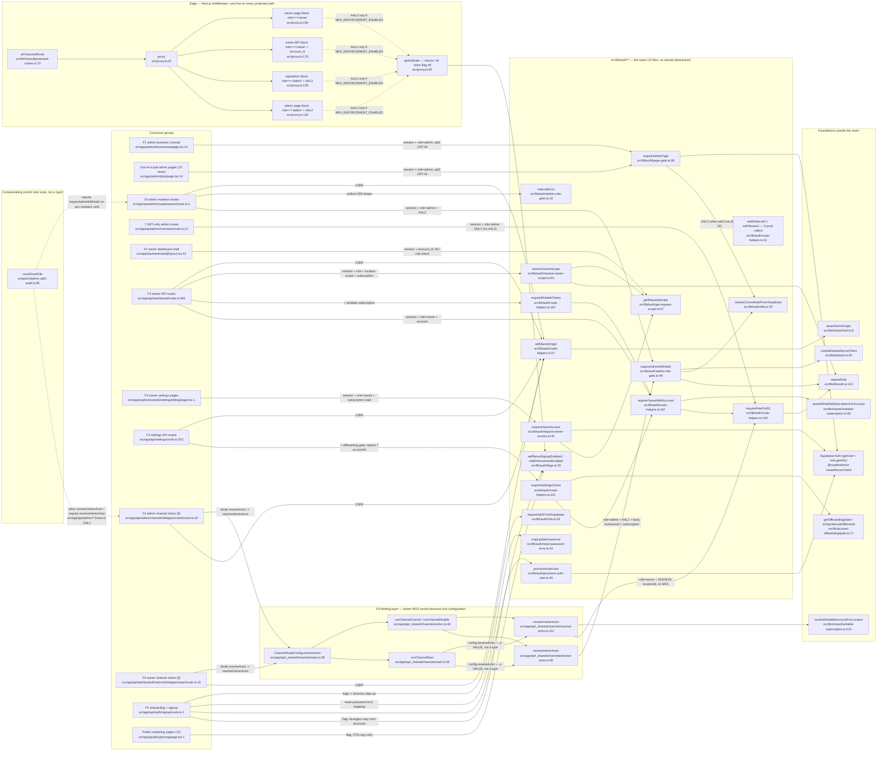

# S1 — Auth gate seam (cross-cutting; NOT a feature)

Pathfinder 2026-08-15, Phase 1. Charted per `00-features.md:20` + orchestrator
adjustment 1 (`00-features.md:24-31`): `src/lib/auth/**` gets a **seam chart**,
and **no Phase 3 unification proposal may assign it a single feature owner**.

Everything below was read at the commit on `main` at `0a379fb7`. Every claim
carries `file:line`.

---

## 0. What the seam actually is

Ten files, ~34 KB, **no shared abstraction between them**. They are not a layer
and not a module — they are the set of things every entry point must call before
it may do work, grouped by directory and nothing else. Three of them
(`page-gate`, `admin-mfa-gate`, `route-helpers`) front ~120 call sites; three
(`get-request-scope`, `resolve-owner-scope`, `require-owner-access`) belong to
the owner portal; two (`provision-auth-user`, `flags`) belong to the onboarding
funnel; two (`mfa`, `reset-password-error`) are auth-surface leaves.

There is no file in `src/lib/auth/` that imports more than two of its siblings.
The directory is a fan-out point, not a stack.

---

## 1. Fan-out diagram



---

## 2. Gate member → importers → what it enforces → structural or configuration

Importer counts are non-test, non-doc `rg -l` over `src/` + `worker/` +
`scripts/`, excluding the member's own file.

| Gate member (`src/lib/auth/`) | Importers | Enforces | Structural or configuration |
|---|---:|---|---|
| `page-gate.ts:39` `requireAdminPage` | **16** — every `src/app/admin/**/page.tsx` | session (Supabase `getUser`, `:63`) → `users.role === 'admin'` (`:70`) → **AAL2 only when `aal2: true`** (`:72`) | **Configuration.** `aal2` defaults `false` (`:41`); 8 of 16 pages opt in. Nothing forces a *new* admin page to call it at all — no CI audit covers `src/app/admin/**`. |
| `admin-mfa-gate.ts:49` `requireAdminWithAal2` | **20** — 19 `src/app/api/admin/**/route.ts` + `src/app/api/_shared/channels/resolve-actor.ts:23` | session → `requireRole(request,'admin')` (`:54`) → **AAL2 unconditionally** (`:67`) | **Configuration since #831.** Inside the function the AAL2 step is unskippable; *reaching* the function is now a per-route binding, not a call-graph fact. |
| `admin-mfa-gate.ts:16` `internalError` | **13** | nothing — the uniform admin `500 { error:'internal_error' }` + `no-store` shape | n/a (response shape, not a gate) |
| `route-helpers.ts` (whole file) | **83** — every portal API route | see per-export rows | mixed |
| └ `:57` `withSameOrigin` | **67** | CSRF via `assertSameOrigin` (`src/lib/shared/csrf.ts:8`) | **Structural at the export.** `export const POST = withSameOrigin()(handler)` — the wrapper is the exported value, so omitting it is visible at the route boundary. Documented at `admin-mfa-gate.ts:32-40` as the deliberate replacement for a forgettable `{ sameOrigin: true }` opt-in. |
| └ `:140` `requireRoleOr401` | **14** | session + `users.role === <role>`; re-throws non-auth errors (`:150`) | **Convention.** A route that just doesn't call it compiles fine. |
| └ `:167` `requireOwnerWithAccount` | **17** | `requireRoleOr401('owner')` + `accountId` present (`:171`) | Convention |
| └ `:187` `requireWritableOwner` | **9** | the above + `assertWritableSubscriptionForAccount` (`:194`) | Convention |
| └ `:221` `requireSettingsOwner` | **3** | rejects `?accountId` **first** (`:225`) + owner + `isOperationalUIBlocked` (`:233`) | Convention. The ordering at `:225` is itself the guard (`:213-215`). |
| └ `:31` `withRateLimit`, `:81` `withSession` | **0** | — | **Dead exports** (tests only). |
| `get-request-scope.ts:57` `getRequestScope` | **3** — `(authenticated)/layout.tsx:129`, `require-owner-access.ts:90`, `resolve-owner-scope.ts:132` | tenant scope: validates the `rw_location_scope` cookie belongs to the account and is not archived, else falls back to primary (`:88-105`) | **Structural.** No caller can obtain a `currentLocationId` that isn't in the account's own row set — the validation is inside the only producer. |
| `resolve-owner-scope.ts:94` `resolveOwnerScope` | **4** | role=owner (`:101`) + account (`:109`) + **subscription/past-due** (`:138`) + location scope (`:132`) | Convention to call; **structural once called** (all four checks precede the return). |
| `require-owner-access.ts:42` `requireOwnerAccess` | **10** — owner settings/dashboard pages | session (`:59`) + role routing (`:78-79`) + `subscriptionAllowsDashboardRead` (`:80`) + scope (`:90`) | Convention. Six `(authenticated)/**` pages do **not** call it and rely on `proxy.ts:194` instead. |
| `provision-auth-user.ts:43` `provisionAuthUser` | **1** — `src/app/api/auth/signup/route.ts` | not a gate — mints the Supabase Auth identity + `users` row | n/a (F5-owned) |
| `flags.ts:25` `selfServeSignupEnabled` / `:30` `mfaEnforcementEnabled` | **19** | server-authoritative flag reads (inv #13) | Configuration by definition. `mfaEnforcementEnabled` is read **only** by `proxy.ts:93`. |
| `mfa.ts:29` `requireCurrentAal2FromSupabase` | **4** | `currentLevel === 'aal2'` | Structural once called |
| `mfa.ts:16` `requireAal2FromSupabase` | **3** | `nextLevel==='aal2' && currentLevel!=='aal2'` — the *login-time* variant | Structural once called. Deliberately **not** a duplicate of `:29`: different predicate, different surfaces (login, recovery step-up, destructive offboarding auth). |
| `reset-password-error.ts:34` `mapUpdateUserError` | **1** | nothing — error-message mapping | n/a |

### The one non-`src/lib/auth/**` node that belongs on this chart

`src/proxy.ts:22` is the **only path-keyed gate in the system** and it fires
before every member above. Its `/api/admin` block (`:139-151`) enforces
`role === 'admin'` unconditionally; its AAL2 step (`:147`) delegates to
`getAalGate` (`:92`), which **returns `'ok'` immediately when
`MFA_ENFORCEMENT_ENABLED` is off** (`:93-95`). Per
`.claude/reference/env-vars.md:609` that flag is **Off**. So today:

- admin **role** on `/api/admin/**` — enforced twice (proxy + in-route)
- admin **AAL2** on `/api/admin/**` — enforced **only** by
  `requireAdminWithAal2`, i.e. only by the per-route binding

That is the precise reason `ci:admin-aal2` is load-bearing rather than
belt-and-braces.

---

## 3. Structural vs configuration — the split that matters

**Structural** (a caller cannot skip it; the type system or the only-producer
position forbids it):

1. `withSameOrigin` (`route-helpers.ts:57`) — it *is* the exported handler.
   `export const POST = withSameOrigin()(...)`. Omission is a visible edit at the
   route's export line, and the doc at `admin-mfa-gate.ts:32-40` records that
   the previous opt-in flag shipped a CSRF-vulnerable route with no type error.
2. `getRequestScope` (`get-request-scope.ts:57`) — the only producer of
   `currentLocationId`, and it validates account membership + archived state
   before returning (`:88-105`). There is no way to hold a location id that
   skipped the check.
3. The **interior** of every gate: once `requireAdminWithAal2` is entered, AAL2
   runs (`admin-mfa-gate.ts:67`); once `resolveOwnerScope` is entered, the
   subscription gate runs (`:138`). Nothing branches around them.
4. `proxy.ts:139` role check — keyed on the URL prefix, so it cannot be
   forgotten by a new file.

**Configuration / convention** (a caller can skip it and only a text scan, or
nothing at all, notices):

1. **`ChannelRouteConfig.resolveActor` (`start.ts:36`)** — the #831 conversion.
   `ChannelActorResolver` (`resolve-actor.ts:45`) is
   `(sql, req) => Promise<ChannelActorResult>`. `resolveOwnerActor` (`:114`)
   satisfies it directly; `resolveAdminActor` (`:65`) satisfies it through the
   options closure each admin route writes
   (`admin/channels/telegram/start/route.ts:25`). **Both are the same type.**
   `tsc` will accept either in either portal's route. This is the single largest
   configuration surface in the seam.
2. **`requireAdminPage`'s `aal2` flag (`page-gate.ts:41`)** — a boolean that
   defaults to *off*, set per page, audited by nothing. 8 of 16 admin pages opt
   in; `admin/overview`, `admin/businesses`, `admin/businesses/[id]`,
   `admin/costs`, `admin/jobs`, `admin/notifications`, `admin/runbook`,
   `admin/security` do not.
3. **Calling any owner gate at all.** `requireOwnerWithAccount`,
   `requireWritableOwner`, `requireSettingsOwner`, `resolveOwnerScope` are
   ordinary functions. A new owner route that forgets them gets
   `proxy.ts:176` (role + `account_id`) and **nothing else** — no subscription
   gate, no offboarding gate, no location scoping. No CI audit covers this.
4. **`MFA_ENFORCEMENT_ENABLED`** — one env var that silently converts four
   proxy AAL2 checks into no-ops (`proxy.ts:93-95`).

---

## 4. What stops a mis-binding today

Concretely: what prevents an **admin** channel route from binding
`resolveOwnerActor`?

### 4.1 `tsc` — nothing.

`ChannelRouteConfig.resolveActor: ChannelActorResolver` (`start.ts:36`) is the
same type both resolvers inhabit. This is by design (the seam is one runner per
action) and is exactly the property #831 traded away.

### 4.2 `ci:admin-aal2` — the compensating control, and its exact floor.

`scanRouteFile` (`scripts/ci/admin-aal2-audit.ts:85`) applies, in order:

- `:90` — **scope**: bail unless the path contains `src/app/api/admin/`.
- `:93` — strip comments (`:71-73`; full-line `//` + block comments).
- `:96` — bail unless `MUTATION_VERB_RE` (`:18-19`) finds *any*
  `POST|PUT|PATCH|DELETE` export in the file.
- `:100` — **deny**: `code.includes('resolveOwnerActor')` → finding.
- `:109` — clear if `code.includes('requireAdminWithAal2')`.
- `:110` — clear if `code.includes('resolveAdminActor')`.

So the audit's floor is exactly two whole-file substring conditions:

> **The comment-stripped file must not contain the literal `resolveOwnerActor`,
> and must contain the literal `requireAdminWithAal2` or `resolveAdminActor`
> somewhere.**

Nothing about *binding* is checked. Nothing about *which verb* is checked.

**Verified by executing `scanRouteFile` against constructed inputs** (probe run
from the scratchpad; no file was added to the repo):

| Constructed shape | Result |
|---|---|
| A. `import { resolveOwnerActor as pickActor }` in the admin route, bound to the runner | **FLAGGED** |
| B. re-export module renames the owner resolver; route also exports a GET that names `resolveAdminActor` | **PASSES** |
| C. re-export module renames the owner resolver; route names neither admin token | **FLAGGED** |
| D. wrapper in a sibling non-route file; `const GATE_TAG = 'resolveAdminActor'` used in the config | **PASSES** |
| E. `export async function GET` calls `requireAdminWithAal2`; `export const POST` binds the renamed owner resolver | **PASSES** |
| F. control — direct `resolveOwnerActor` binding | **FLAGGED** |

**Correction to the commonly-repeated claim, confirmed.** `.claude/CLAUDE.md`
says *"an aliased import would still clear it."* For the **same-file alias**
form that is **wrong** — case A trips `:100`, because the literal
`resolveOwnerActor` survives the rename on the left of the `as`. Case F is the
control.

**And the real hole, also confirmed.** The audit is defeated by **indirection
plus one token**, not by aliasing alone:

- The rename must happen in a file the audit never reads — anything outside
  `src/app/api/admin/**` (`:90`) or any non-`route.ts` filename (`:138`). A
  one-line `export { resolveOwnerActor as resolveChannelActor } from
  './resolve-actor';` in `src/app/api/_shared/channels/` is out of scope.
- Indirection **alone is not enough** (case C): the file still has to satisfy
  `:109`/`:110`.

**Minimal passing-but-wrong shape — yes, one exists.** The cheapest realistic
version needs no contrived string and no unused import; it is case **E**, a
mixed-verb route file:

```
src/app/api/_shared/channels/actor-alias.ts   (out of audit scope)
    export { resolveOwnerActor as resolveChannelActor } from './resolve-actor';

src/app/api/admin/<anything>/route.ts
    import { requireAdminWithAal2 } from '@/lib/auth/admin-mfa-gate';
    import { resolveChannelActor } from '@/app/api/_shared/channels/actor-alias';

    export async function GET(req)  { ... requireAdminWithAal2(req) ... }   // legit
    export const POST = withSameOrigin()((req) =>
      runChannelStart(sql, req, { ..., resolveActor: resolveChannelActor }));  // mis-bound
```

The GET's legitimate gate call clears `:109` for the **whole file**, including
the POST. Because both the deny check and the allowlist are file-level, a route
file that mixes a correctly-gated read with a mis-bound mutation is invisible to
the audit. There is no contrivance here — mixed-verb `route.ts` files are the
normal App Router shape, and this repo has them (e.g.
`src/app/api/admin/businesses/route.ts`, whose `GET` is F1 and whose `POST` is
F5 — `00-features.md:43-44`).

The audit's own test file pins cases (a)–(o)
(`scripts/ci/__tests__/admin-aal2-audit.test.ts:11-261`), including the
mention-vs-bind case (l) and the comment-stripping case (o). **No test covers
indirection or the mixed-verb file.**

### 4.3 Runtime — fails closed, but for a reason unrelated to the audit.

Even in shape E the mis-bound POST does not escalate privilege, and it is worth
recording exactly why so Phase 3 does not over-rate or under-rate the finding:

- `proxy.ts:144` rejects any caller whose `users.role !== 'admin'` on
  `/api/admin/**`, **unconditionally** (no flag). An owner therefore never
  reaches the handler.
- `resolveOwnerActor` (`resolve-actor.ts:118`) calls
  `requireRoleOr401(req, 'owner')` → `requireRole` (`src/lib/db/auth.ts:115-124`)
  → an admin's role is `'admin'`, so it throws `AuthError('Forbidden', 403)`.

Net: a mis-bound admin route is **broken (403 for everyone), not exploitable** —
*provided the path stays under `/api/admin/`*. The residual risk is availability
plus the loss of the AAL2 step for any handler that manages to satisfy both
resolvers' preconditions. **The genuinely dangerous variant is not "admin route
binds owner resolver" but "admin-privileged work moves to a non-`/api/admin`
path"**, which both the proxy's prefix gate and the audit's `:90` scope miss
entirely.

### 4.4 Scope gaps in the compensating control (all verified)

| Gap | Evidence |
|---|---|
| Only `src/app/api/admin/**` is scanned | `admin-aal2-audit.ts:90` |
| Only files named exactly `route.ts` | `:138` — the repo has 0 `route.tsx`, so no live gap, but nothing prevents one |
| File-level, not verb-level | `:96` (any mutation verb) vs `:100`/`:109`/`:110` (whole file) |
| Substring, not binding | `:100`, `:109`, `:110` — `code.includes(...)` |
| Admin **pages** are not audited at all | 16 `requireAdminPage` call sites, no `ci:*` script covers `src/app/admin/**` (`package.json:25-41`) |
| Owner routes have no equivalent audit | nothing checks that a new `/api/dashboard/**` route calls an owner gate |
| 7 GET-only admin routes carry no AAL2 | `admin/{costs,nav-counts,jobs,overview,demos,notifications}/route.ts` + `admin/businesses/[id]/channels/route.ts`; each uses `requireRoleOr401(request,'admin')` only (e.g. `src/app/api/admin/overview/route.ts:14`) — correct per the audit's mutation-only contract, but it means "admin API ⇒ AAL2" is false |

---

## 5. Non-admin surfaces importing `admin-mfa-gate.ts`

Exactly **one**: `src/app/api/_shared/channels/resolve-actor.ts:23`.

It is **deliberate and documented in three places**:

- `resolve-actor.ts:9-19` — the two resolvers are separate functions because the
  body-vs-session asymmetry is a tenant-isolation boundary (inv #8).
- `admin-aal2-audit.ts:26-40` — the allowlist deliberately names the **resolver**
  (`resolveAdminActor`), not the runners, precisely because the runners are
  portal-agnostic; naming a runner "would pass an admin route that bound
  `resolveOwnerActor`".
- `00-features.md:71-78` — the pair is on the inherited DO-NOT-UNIFY register.

`resolve-actor.ts` is not an admin surface, but it is not a *non-admin* surface
either: it is the file where both portals' preambles live side by side. The
import is the seam working as intended. The 13 importers of `internalError`
(`admin-mfa-gate.ts:16`) are all admin routes plus
`src/lib/admin/offboardings-service.ts` — a response-shape helper, not a gate,
that happens to live in the gate's file.

---

## 6. Duplicated / odd, with `file:line`

1. **Two dead exports** in the most-imported file in the seam:
   `withRateLimit` (`route-helpers.ts:31`) and `withSession` (`:81`) have **zero
   production callers** — only `src/lib/auth/__tests__/route-helpers.test.ts` and
   a prose mention at `src/lib/db/auth.ts:24`.
2. **Four hand-rolled `createServerClient` preambles.** The seam has one owner
   for the *request*-shaped client — `cookieBackedServerClient`
   (`src/lib/db/auth.ts:26`) — but server components take a cookie **store**, not
   a `NextRequest`, so three near-identical copies exist:
   `page-gate.ts:44-57`, `require-owner-access.ts:44-57`,
   `src/app/(authenticated)/layout.tsx:63-80`; plus a fourth in
   `proxy.ts:50-69`. The two in `src/lib/auth/` are byte-for-byte the same
   except the `setAll` comment.
3. **The owner shell never checks `role`.**
   `src/app/(authenticated)/layout.tsx:95` gates on `account_id` presence only —
   `role === 'owner'` for owner pages comes solely from `proxy.ts:203`. The
   sibling helper `requireOwnerAccess` (`require-owner-access.ts:78-79`) *does*
   check role, and 10 pages under the same layout call it. Two different
   postures under one shell.
4. **`admin/businesses/[id]/page.tsx:23`** passes `from: '/admin/businesses'`,
   not its own path — an admin bounced to MFA lands on the list, not the record
   they were reading. Cosmetic, but it is the only one of the 16 call sites whose
   `from` is not its own route.
5. **`mfa.ts:16` vs `:29` are near-twins but not duplicates** — `nextLevel`
   (login-time step-up) vs `currentLevel` (already-elevated). Three callers each,
   disjoint. Recording it so Phase 2 does not file it as duplication.
6. **`ChannelRouteConfig` is 4 fields and must stay 4** (`start.ts:12-15`,
   `.claude/CLAUDE.md`). `resolveActor` is one of them — meaning the mis-binding
   surface cannot be closed by adding a fifth field (e.g. a `portal` discriminant)
   without violating a stated design rule. Phase 3 must respect this.

---

## 7. External dependencies

| Dependency | Where it enters | Notes |
|---|---|---|
| **Supabase Auth** (`@supabase/ssr` `createServerClient`, `auth.getUser()`) | `db/auth.ts:26`, `page-gate.ts:44`, `require-owner-access.ts:44`, `proxy.ts:50`, `(authenticated)/layout.tsx:63` | `getUser()` (not `getSession()`) — validates the token server-side on every call (`db/auth.ts:48-51`) |
| **Supabase MFA** (`auth.mfa.getAuthenticatorAssuranceLevel`) | `mfa.ts:19`, `mfa.ts:32`, `proxy.ts:96` | Sole source of AAL. A throw is caught and mapped to fail-closed at `admin-mfa-gate.ts:70-75` and `page-gate.ts:76-82` |
| **Postgres** (`postgres` / Postgres.js) | passed in as `sql: Sql` — `page-gate.ts:40`, `get-request-scope.ts:58`, `resolve-owner-scope.ts:95`, `require-owner-access.ts:42`, `route-helpers.ts:188` | Invariant #15 respected: no member of `src/lib/auth/**` imports `@/lib/db/server`. The **exception is `src/lib/db/auth.ts:3`**, which is the owner-classified auth gate and a sanctioned composition root |
| **Upstash Redis** (`checkRateLimit`) | `route-helpers.ts:38` | Strict mode → 503 on Redis failure (`:44`). **No production caller today** |
| **Feature flags** `MFA_ENFORCEMENT_ENABLED`, `SELF_SERVE_SIGNUP_ENABLED` | `flags.ts:26`, `flags.ts:31` via `readFlag` (`src/lib/config/flags.ts`) | `MFA_ENFORCEMENT_ENABLED` is **Off** (`.claude/reference/env-vars.md:609`), which is what makes `ci:admin-aal2` load-bearing |
| **Next.js runtime** — `cookies()`, `redirect()`, `NextRequest`/`NextResponse`, middleware `matcher` | `page-gate.ts:2-3`, `require-owner-access.ts:21-22`, `proxy.ts:273-275` | `redirect()` throws; the `try/catch` at `page-gate.ts:76-82` is placed so it cannot swallow the redirect it issues at `:81` |
| **`assertSameOrigin`** | `src/lib/shared/csrf.ts:8` via `route-helpers.ts:62` | 403 on absent/mismatched `Origin` or unset `NEXT_PUBLIC_APP_URL` |
| **Subscription + offboarding gates** | `src/lib/shared/writable-subscription.ts:82` / `:215`, `src/lib/account-offboarding/gate.ts:71` / `:201` | Entitlement, not identity — consumed by `route-helpers.ts:194`/`:232` and `resolve-actor.ts:125` |
| **CI** `ci:admin-aal2` | `package.json:30`, `.github/workflows/ci.yml:136`, `lefthook.yml:30-31` | Runs in the required `lint` job and in the pre-push hook |

---

## 8. Binding constraint for Phase 3

Per `00-features.md:24-31` and `:71-78`:

- **No unification proposal may give `src/lib/auth/**` a single feature owner.**
  Its members answer to F1, F2, F3, F4, F5 and 13 out-of-window admin pages.
- **`resolveAdminActor` / `resolveOwnerActor` must stay two functions** — the
  body-vs-session asymmetry is a tenant-isolation boundary.
- A finding **may** address *how the binding between route and resolver is
  enforced* — that is the open question #831 left. Section 4 is the evidence for
  it, and section 6.6 is the constraint any such finding must respect.
