# Pathfinder 2026-08-15 — unified proposal (Phase 3)

Written by the orchestrator, not delegated.

**Framing.** Six merges, three of them structural refactors, and the health
metrics held flat or improved (duplication 1.3% → 1.1%). This window did not
produce architectural drift in the ordinary sense. What it produced is a
recurring shape: **#833 and #831 each created a correct single owner and stopped
one file short of the surfaces that needed it.** Four of the seven proposals
below are "finish the owner you already built," not "build an owner."

Anti-patterns explicitly rejected while writing this: no new abstraction layer,
no flag-guarded dual paths, no registry where a direct call suffices, no
divergent behaviour preserved "just in case."

---

## P1 — One health presentation (closes A1)

**Component:** `src/components/admin/ui/HealthBadge.tsx` — already the declared
owner. **Entry point:** `HealthBadge({ level, score })`.

| Old call site | Becomes |
|---|---|
| `BusinessDetailClient.tsx:33-51` private copy | deleted |
| `BusinessDetailClient.tsx` render site | `import { HealthBadge } from '@/components/admin/ui/HealthBadge'` |

The private copy's `Record<string, …>` keying is what permits an unknown level to
render as green "Healthy." Adopting the shared component restores
`ChurnScore['level']` keying, so a new level becomes a **compile error** at all
three health surfaces.

**Blocker to handle, not route around:** `BusinessDetailClient` receives its data
through `types.ts:11-19` bridged by `as unknown as DetailData`
(`page.tsx:52`). That cast is *why* the loose typing was tolerable. Delete the
cast or type the `level` field properly — re-casting to satisfy the shared
component would reintroduce the defect with extra steps.

**Loss of capability:** none. The fallbacks (`?? healthy`, `?? level`) only ever
masked an impossible state.

---

## P2 — Finish the #833 owner: churn math (closes A2)

**Component:** `src/lib/admin/business-summary.ts` — extend the existing owner;
do not create a second one.

Export from it: the metrics CTE fragment, and the
`responseTimeTrend` + `computeChurnRiskScore` composition.

| Old call site | Becomes |
|---|---|
| `business-detail/queries.ts:218-259` metrics CTE | consumes the exported fragment |
| `business-detail/mappers.ts:261-276` churn composition | calls the exported composition |
| `mappers.ts:258` / `business-detail-service.ts:44` twin `isSubscriptionTier` throw | one guard, one message |

**Why this and not a new `churn-metrics.ts`:** #833 already established
`business-summary.ts` as the owner of exactly this query family and the tenant-scope
allowlist is already pinned to it (396). A third module would re-open a baseline
that just closed.

**Loss of capability:** none — detail and summary compute identical values today;
that is the finding.

---

## P3 — One trial-eligibility predicate (closes B1)

**Component:** `resolveCheckoutContext` (`plan-activation.ts:759`).
**Entry point:** one exported predicate, both routes call it.

Today `billing/checkout/route.ts:156` adds `selfServeSignupEnabled()` and
`status === PENDING_PAYMENT`, and its comment reasons each term — good analysis
that never made it back into the shared function.

**The proposal is deliberately conditional, because the divergence may be real.**
`#821` re-scoped `SELF_SERVE_SIGNUP_ENABLED` to gate only anonymous
account-minting, so ANDing it could wrongly deny a trial to an admin-invited
owner walking the funnel. The implementer must determine which reading is correct
**before** collapsing.

- If the terms are universally correct → move them into
  `resolveCheckoutContext`; the billing route calls it and deletes its copy.
- If the onboarding path genuinely needs a laxer rule → that becomes a **named
  argument with a documented reason**, not a second silent spelling.

Either outcome leaves one predicate. What must not survive is two call sites
independently answering the same question.

**Loss of capability:** none in the collapse case; in the parameterized case, the
laxer path stays reachable but becomes explicit.

---

## P4 — One `onboarded_by` accessor (closes B2, A4)

**Component:** one exported SQL fragment — `primaryOnboardedBySql(accountAlias)`
— owned beside the existing decision code in `plan-activation.ts`.

| Old call site | Becomes |
|---|---|
| `plan-activation.ts:399-404` | the fragment (it *is* the correct spelling today) |
| `billing/checkout/route.ts:102-107` | consumes the fragment |
| `plan-activation.ts:765` **unscoped** | consumes the fragment — this is the fix |

Also: correct the stale comment at `billing/checkout/route.ts:92-94`, which cites
`dashboard/route.ts` as a peer reader that `dashboard/route.ts:112` records as
deleted.

**A4 is latent, not live** — the subscription gate on add-location currently
guarantees `businessId` is the primary at the only call site. P4 makes the query
correct on its own terms rather than correct by a precondition held two modules
away.

**Explicitly NOT proposed: splitting the overload.** `onboarded_by` now has 6 read
sites carrying 5 meanings. Replacing it with a dedicated entitlement was raised
during #821 and **rejected on the record** as `non_goals[2]`, with a documented
reason (migration 025 backfilled it on every pre-025 row; NULLing those rows
would grant trial eligibility and strip a `CleanupAbandonedSignupsPoller` guard).
An architecture pass is the right place to re-open that — but it is the owner's
call, with new evidence, not a refactor this proposal should smuggle in. See
"Open decision" below.

---

## P5 — Make the admin MFA control mean what it says (closes C1, C2)

This is the #831 decision the log asked this pass to re-open.

**Constraint respected:** `ChannelRouteConfig` stays 4 fields
(`start.ts:12-15`) — a `portal` discriminant is not available, and re-planning
the seam is out of scope for a review. So the fix goes to the **compensating
control**, which is where the floor actually is.

**Component:** `scripts/ci/admin-aal2-audit.ts` — convert from text scan to AST,
joining the 10 of 17 `ci:*` audits already doing so (`typescript` is a dependency;
this is pattern-alignment, not a new layer).

Three changes, each closing a verified hole:

1. **Verb-scoped, not file-scoped.** Resolve each exported handler separately, so a
   compliant `GET` cannot launder a sibling `POST`. Today both rules read the whole
   file's text.
2. **Require a call, not a mention.** `requireAdminWithAal2` appearing in an
   *unused import* currently satisfies the allow rule.
3. **Cover admin pages.** Extend scope beyond `src/app/api/admin/` (`:90`) to
   `requireAdminPage`, whose `aal2` parameter defaults to **false** with 8 of 16
   pages opting in and no audit watching either way.

**Cheap interim mitigation** if the AST conversion is not scheduled immediately:
require the call shape `requireAdminWithAal2(` rather than the bare token. That is a
one-line change killing hole 2, and it does **not** fix holes 1 or 3 — record it
as partial, do not let it close the item.

**Pin the three cases.** `admin-aal2-audit.test.ts` covers neither indirection nor
mixed-verb. Add both, plus the unused-import case.

**Honest bound on stakes:** residual exposure is availability, not privilege
escalation — `proxy.ts:144` blocks non-admins from `/api/admin/**` and
`requireRole` 403s an admin against `'owner'`. But `MFA_ENFORCEMENT_ENABLED` is
**Off**, so per-route binding is the only live AAL2 layer, and the dangerous
variant — admin mutations off the `/api/admin` prefix — is invisible to both the
proxy and the audit.

---

## P6 — Restore the invariant #9b check (closes E1)

**Component:** `shouldUseMultiLocationSettings` (`multi-location-mode.ts:8`).

`useLocationVoiceForm.ts:196` becomes: receive the server-resolved flag through the
page payload and call the owner, instead of `locations.length > 1`.

**Loss of capability:** none. This is a defect fix, not a trade.

---

## P7 — One test for the gate chain, not five (closes the guard-integrity cluster)

The five invariant-#3 instances share **one** root cause:
`auto-policy-publish.test.ts:10-17` pins every gate collaborator to its ALLOW
value and no test ever overrides them. Five separate tests would be five chances
to make the same mistake.

**Component:** one table-driven suite over the existing `LOCKED_GATE_CHECKS`
array (`auto-policy-publish.ts:512-520`) — the structure is already there.
For each gate: deny exactly that one, assert the lane terminates without a
provider call. Add the judge outcome (`:529`) and `isPublishableAutoPolicy`'s
`approval_method` conjunct (`:491`), which sit outside that array.

Separately, and not foldable into the table:

- **B1/B2** (`ResponsePublisherWorker.test.ts:239`,`:250`) — the mock `sql` return
  queue runs dry and the flow reaches the same assertions by another route. Fix
  the fixture so the guard is the only thing that can produce the outcome. These
  two are worse than untested: their titles claim the coverage.
- **E3** (`business-summary.ts:235`) — `AND nd.template = 'approval_request'`
  feeds `approval_rate`, hence every churn score and the at-risk list. A
  correctness bug if it regresses, not just a coverage gap.
- **C1** (`approval/locks.ts:87`) — pin the *producer* of
  `ResponseNotPendingError`; today only its consumer is pinned.

**Loss of capability:** none. 40 of ~55 mutations were correctly killed — the
suite is mostly sound and this closes the measured gaps.

---

## P8 — Small cleanups (A5–A8, B4–B6, C4)

Behaviour-preserving, one bundle, no design decisions:

- **A5** — sequence `aggregate-service.ts:114-129` / `:177-182` like every sibling
  (await the fatal read, then the degradable). Keeps `Promise.allSettled`'s
  **Per-widget degradation** semantics; removes the unexplained 2-wide exception.
  *If the concurrency is deliberate, say so in a comment instead — either resolves it.*
- **A6** — `SingleLocationBrief` → `IntelligenceBriefCard`; skeletons/error cards →
  `DashboardStatePanel.tsx:52`, which already owns both.
- **A7** — `buildPatch`/`dirtyCount` one owner; org-default SELECT ×3 → one;
  `telegramAvailable`/`whatsappAvailable` → one; `/settings` default → one.
- **A8** — delete `withRateLimit` (`route-helpers.ts:31`) and `withSession` (`:81`),
  zero production callers.
- **B4** — `finish-signup:215-218` and the two page guards call
  `resolveFunnelEntry`; it is pure and takes its flag as an argument, so there is
  no reason to re-spell it.
- **B5** — `(authenticated)/layout.tsx:95` should check `role`, not only
  `account_id`.
- **B6** — one `formatRelative`.
- **C4** — the four `createServerClient` preambles adopt `cookieBackedServerClient`
  (`db/auth.ts:26`). **Except `proxy.ts:50`** — middleware context, verify before
  touching; a forced consolidation there would be the "abstraction for its own
  sake" anti-pattern.

**A3** (twin voice write paths) is deliberately *not* in this bundle — two routes
with different gates writing the same four columns is a design decision, not a
cleanup. It needs its own scoping.

---

## Open decision for the owner (not a proposal)

**Does `onboarded_by`'s overload get split?** The pass's new evidence: 6 read
sites, 5 meanings — against `.claude/CLAUDE.md`'s "three" and the `#821` entry's
"fourth." CLAUDE.md calls it *"the single most likely thing to bite next,"* and
this pass found it already bit once, latently (A4).

The counter-argument is documented and strong (migration 025's backfill). P4
reduces the risk without touching the overload. Re-opening `non_goals[2]` is a
scoping decision, not a refactor — recorded here so the next pass inherits the
evidence rather than the impression.

---

## Combined unified flowchart

```mermaid
flowchart TD
  subgraph OWN["Single owners after this proposal"]
    HB["HealthBadge<br/>components/admin/ui/HealthBadge.tsx:24"]
    BS["getBusinessSummaries + churn math<br/>src/lib/admin/business-summary.ts:160"]
    TE["trial eligibility predicate<br/>src/lib/payments/plan-activation.ts:759"]
    OB["primaryOnboardedBySql<br/>src/lib/payments/plan-activation.ts:399"]
    ML["shouldUseMultiLocationSettings<br/>src/lib/locations/multi-location-mode.ts:8"]
    FE["resolveFunnelEntry (pure)<br/>src/lib/onboarding/funnel-entry.ts:81"]
  end

  OVC["Overview at-risk list<br/>src/lib/admin/overview-service.ts:117"] --> BS
  BZC["Businesses inventory<br/>src/app/api/admin/businesses/route.ts:25"] --> BS
  BDQ["business detail queries<br/>src/lib/admin/business-detail/queries.ts:218"] -->|P2| BS
  BDM["business detail mappers<br/>src/lib/admin/business-detail/mappers.ts:261"] -->|P2| BS

  OVC --> HB
  BZC --> HB
  BDC["BusinessDetailClient<br/>src/app/admin/businesses/[id]/BusinessDetailClient.tsx:33"] -->|P1 delete copy| HB

  SEL["select-plan<br/>src/app/api/onboarding/select-plan/route.ts:215"] --> TE
  BIL["billing checkout<br/>src/app/api/billing/checkout/route.ts:156"] -->|P3| TE
  TE --> OB
  BIL -->|P4| OB
  RCC["resolveCheckoutContext unscoped read<br/>src/lib/payments/plan-activation.ts:765"] -->|P4 fix| OB

  VF["useLocationVoiceForm<br/>src/hooks/useLocationVoiceForm.ts:196"] -->|P6| ML
  CHP["settings/channels page<br/>src/app/(authenticated)/settings/channels/page.tsx:51"] --> ML

  FS["finish-signup<br/>src/app/api/auth/finish-signup/route.ts:215"] -->|P8-B4| FE
  PG1["onboarding start page<br/>src/app/onboarding/start/page.tsx:67"] -->|P8-B4| FE
  PG2["onboarding pay page<br/>src/app/onboarding/pay/page.tsx:90"] -->|P8-B4| FE

  subgraph ENF["Enforcement — P5"]
    RA["resolveAdminActor (structural MFA)<br/>src/app/api/_shared/channels/resolve-actor.ts:65"]
    RO["resolveOwnerActor<br/>src/app/api/_shared/channels/resolve-actor.ts:114"]
    CFG["ChannelRouteConfig.resolveActor<br/>src/app/api/_shared/channels/start.ts:36"]
    AUD["ci:admin-aal2 — AST, verb-scoped, call-shape<br/>scripts/ci/admin-aal2-audit.ts:85"]
    PGATE["requireAdminPage aal2 (default false)<br/>src/lib/auth/page-gate.ts:41"]
  end

  CFG -.->|binds one of| RA
  CFG -.->|binds one of| RO
  AUD ==>|now verb-scoped| CFG
  AUD ==>|P5 new scope| PGATE

  subgraph TST["P7 — gate chain pinned once"]
    GT["LOCKED_GATE_CHECKS table<br/>worker/jobs/publisher/auto-policy-publish.ts:512"]
    TBL["table-driven deny-one-gate suite<br/>worker/jobs/publisher/__tests__/auto-policy-publish.test.ts"]
  end
  TBL ==>|deny each independently| GT

  classDef fix fill:#fde68a,stroke:#b45309,color:#000
  classDef own fill:#bbf7d0,stroke:#15803d,color:#000
  class HB,BS,TE,OB,ML,FE own
  class AUD,TBL,RCC fix
```

**Nothing on the DO-NOT-UNIFY register (`02-duplication-report.md` §D) is touched
by any proposal above.** The two channel actor resolvers stay two functions; P5
changes only what checks the binding between them.
