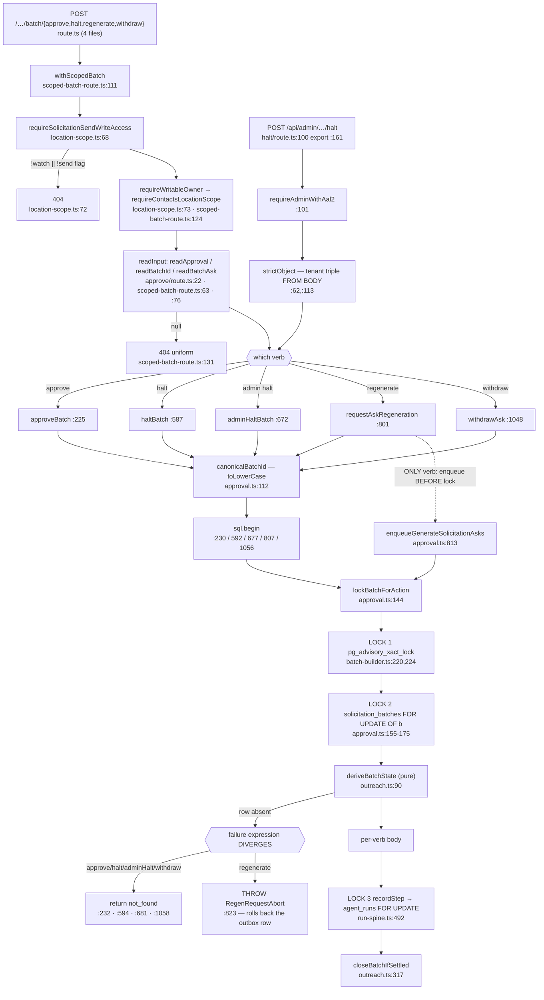
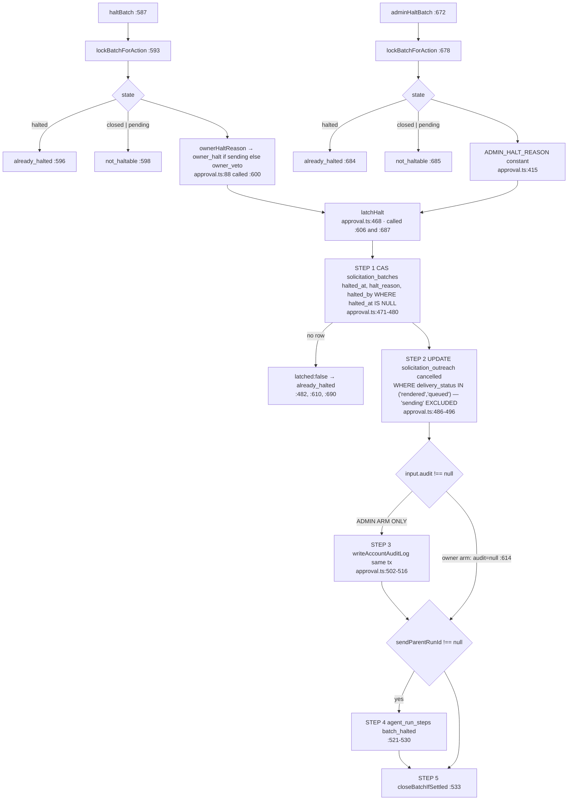
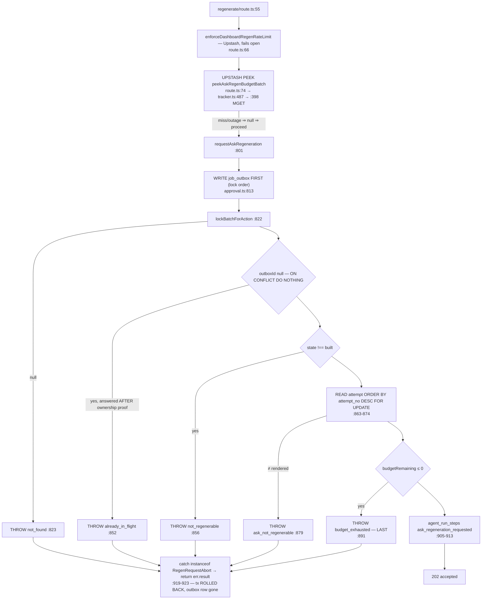
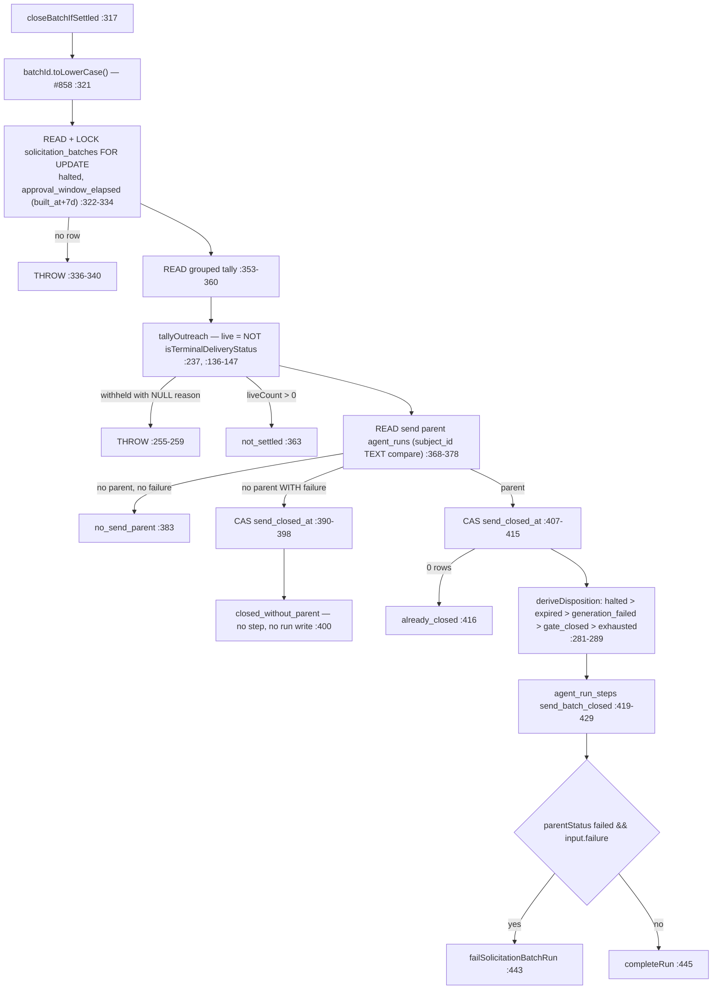

# F1 — Send batch approval lane (FULL)

The five human-triggered verbs. Window PRs: #863/#629, #873/#860, #876/#865,
#883/#872, #868/#858, #870/#859.

## The shared spine

**Lock order** (`approval.ts:34-42`): advisory batch lock → `solicitation_batches` row
→ `agent_runs`. `requestAskRegeneration` **prefixes one lock ahead** — the `job_outbox`
row at `:813` — because `regenerateAsk`'s swap takes `job_outbox` first and the reverse
is an ABBA against it (argument at `:775-785`).

## latchHalt — one body, two arms

The arms differ in exactly three places: reason (derived vs constant), the audit
argument, and the result union. **Guard lists are now identical** (`:596-598` vs `:684-685`).

## requestAskRegeneration — the only verb that throws every refusal

The only verb with **no domain write**, the only one that enqueues, the only one
touching Redis.

## closeBatchIfSettled (outreach.ts:317-449, 133 lines)

**Eight production call sites across five enclosing functions** — correcting the brief's
"five": `approval.ts:393` (`approveBatch`), `:533` (`latchHalt`, serving **both** halt
verbs), `:1170` (`withdrawAsk`), `ask-generation.ts:873` (`closeStoppedLane`), `:1005`
and `:1179` (both `generateAsksForBatch`), `:1496` (`regenerateAsk`), `:1690`
(`settleGenerationExhaustion`). It is **three** sites in `approval.ts`, not five.

## Q1 — the predicate: not four spellings, but two owners and a gap

Full repo sweep returns six SQL sites. Three are the predicate under review.

| # | Site | Predicate | Selects | Kind |
|---|---|---|---|---|
| 1 | `approval.ts:494` | `IN ('rendered','queued')` | every batch row halt may cancel | **WRITE** |
| 2 | `approval.ts:1126` | `IN ('rendered','queued')` | the one resolved row, as CAS guard | **WRITE** |
| 3 | `batch-view.ts:948` | `o.delivery_status IN ('rendered','queued')` | `cancellableCount` for the admin panel | **READ** |
| 4 | `approval.ts:1146` | `IN ('rendered','queued','sending')` | `remainingLive` after withdrawal | READ — **superset** |
| 5 | `ask-generation.ts:895` | `IN ('rendered','queued','sending','sent')` | `alive` in `readRenderTally` | READ — **wider superset** |
| 6 | `ArchivalPoller.ts:311` | `('withheld','cancelled','failed','unknown')` | archival candidates | unrelated |

**1, 2, 3 are the same concept** — the Halt latch's cancellable set. `latchHalt:485-486`
and `classifyWithdrawal:1010-1011` both name it; `withdrawAsk:1023-1032` calls itself
"the Halt latch at ask granularity". **3 exists to tell an operator, before pressing
Admin halt, exactly how many rows 1 will cancel** — `SolicitationBatchPanel.tsx:403`
renders it as "{n} rendered and queued message(s) only". If 3 drifted from 1, the admin
panel would state a false consequence for the button beside it.

**4 and 5 are deliberately different questions.** 4 is "is anything still in flight"
(adds `sending`, which halt refuses to touch). 5 is "did generation produce anything
that still counts" (adds terminal-success `sent`). Supersets by construction, not drift.

**Two more spellings the count of four misses:**
- `approval.ts:1010-1013` — the same set in **TypeScript**, inside `classifyWithdrawal`.
  Predicate 2 is the SQL re-assertion of this JS decision under the lock.
- `outreach.ts:136-147` — `TERMINAL_DELIVERY_STATUSES` / `isTerminalDeliveryStatus`, the
  **negated closed list** whose complement is exactly predicate 4's set.

**The finding is not the count.** The lane has **one named owner for the "live" set**
(`outreach.ts:136`) and **no named owner for the "cancellable" set**. That asymmetry is
the thing.

## Q2 — the failure-expression asymmetry is four/one, not two/one

Contract stated at `approval.ts:120-131`.

| Verb | Null-lock arm | Line | Why |
|---|---|---|---|
| `approveBatch` | `return not_found` | :232 | nothing written yet |
| `haltBatch` | `return not_found` | :594 | nothing written yet |
| `adminHaltBatch` | `return not_found` | :681 | nothing written yet |
| `withdrawAsk` | `return not_found` | :1058 | nothing written yet |
| `requestAskRegeneration` | **THROW** `RegenRequestAbort` | :823 | the `job_outbox` row was already INSERTed at `:813`; postgres.js commits when the callback resolves, so a `return` commits the enqueue it just refused (`:787-792`) |

It throws at **every** refusal for the same reason — `:823, :852, :856, :877, :879, :891`
— caught at `:919-923`.

Distinct from the **five hard `throw new Error`** sites, which are broken-invariant
assertions that deliberately propagate past the sentinel catch: `:362, :900, :1112,
:1135, :1153`.

Validate-first/mutate-second is enforced **by ordering, not by a helper**: `approveBatch`
validates exclusions at `:309-320` before the UPDATE at `:323`; `withdrawAsk` returns
every refusal at `:1104-1108` before the UPDATE at `:1117`.

## Q3 — approval.ts is coherent, with one narrow anomaly

21 exports, no orphan concerns: five `Input → Result → function` verb blocks in call
order, two shared helpers at the top (`canonicalBatchId:112`, `lockBatchForAction:144`),
and the halt-only private block wedged between verbs 1 and 2 (`:411-540`). Twelve private
members, all shared or verb-local. Five production importers, all route handlers, each
importing exactly one verb plus its result type.

**The anomaly**: three of the four pure exports have **no production consumer**.
`isWithdrawableState:939`, `classifyWithdrawal:995`, `CurrentAttempt:977`,
`WithdrawalDecision:989` and `ownerHaltReason:88` are referenced outside the file only by
`approval.test.ts:33-39`. `WithdrawalDecision` has **zero** references anywhere outside
its declaration. Two say so in their docstrings (`:934-938`, `:991-994`). That is
deliberate test-seam surface, and it is the file's entire "extra" export weight.

## Gaps

1. `recordStep`'s body and `writeAccountAuditLog`'s body unread; the docstring claim that
   `recordStep` does its own `SELECT … FOR UPDATE` on the send parent (`:44-48`) is taken
   at its word.
2. `requireWritableOwner` / `requireContactsLocationScope` internals unread.
3. Test suites unread — the "test-only export" claim rests on an import-graph grep.
4. Migration 091's index and halt-consistency CHECK cited from comments, not opened.
5. `ask-generation.ts:1005` and `:1179` are both inside `generateAsksForBatch` (294 lines,
   acknowledged-debt marker at `:911-913`); which arm reaches each was not charted.
