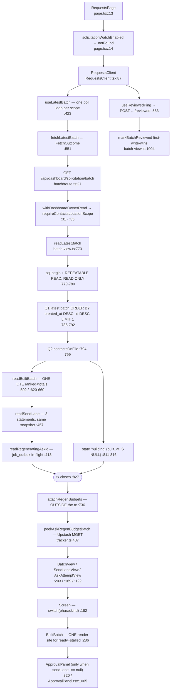
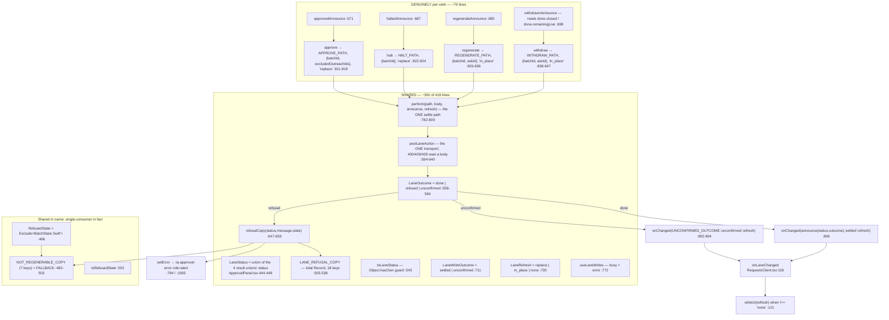

# F2 — Requests owner surface (FULL)

Window PRs: #863, #873, #883, #869.

## Read path

**The transaction boundary is explicit and load-bearing.** `readLatestBatch` returns from
`sql.begin` at `:827`, *then* calls `attachRegenBudgets` at `:831`. `readSendLane` sets
`regenBudgets: {}` inside the tx (`:587`) precisely so the empty record is also the
fail-open answer. `attachRegenBudgets:739` short-circuits when the batch is not built —
no Redis call at all — and `:744` filters to `rendered` before the peek. There is
deliberately **no catch** (`:722-731`): the peek never rejects, and an empty map means
UNKNOWN → no counter rendered, control left enabled.

## The write section — `── The write ──` is 418 lines, and ~350 of them are shared

**What the four writes share**: everything except four announce functions and four
3-to-9-line callbacks. One transport, one settle path, one busy flag, one error string,
one refusal-copy table, one status guard. `perform` differs per verb only in
`(path, requestBody, announce, refresh)`.

**Three "shared" members with exactly one consumer** — the shape any extraction must
preserve:

| Member | Declared shared at | Only consumer |
|---|---|---|
| `RefusedState` / `NOT_REGENERABLE_COPY` / `toRefusedState` / the `not_regenerable` branch at `:655` | `:466, :482, :552, :655` | **regenerate** |
| `LaneWriteInputs.excludedIds` + `.sendCount` | `:739, :741` | **approve** (`:814, :816`) |
| `LaneOutcome.done.remainingLive` | `:563` | **withdraw** (`:701-702`) |

### A factual error in a load-bearing comment

`ApprovalPanel.tsx:562-563` states `remainingLive`/`closed` are "read from the body when
present and `null` otherwise — approve, halt and regenerate do not send them."

**`closed` IS sent by two of them**: `approve/route.ts:60` (`closed: result.close !== null`)
and `halt/route.ts:45` (`closed: result.close.status !== 'not_settled'`). Inert today
because only `withdrawnAnnounce:700` reads it — but the sentence is wrong and would
mislead an extraction that trusts it. `remainingLive` alone is withdraw-exclusive.

## Settle path

Two failure surfaces that never overlap: a **refused** write stays inside the panel
(`setError:794` → `:1093`) and triggers **no** refetch; an **unconfirmed** write leaves
the panel entirely (`:802-804`) and is announced by the parent's `role="alert"` banner at
`RequestsClient.tsx:162`, because the panel holding it may be about to be replaced. The
`LiveRegion:159` deliberately withholds `laneSentence` when `laneUnsure` so the alert is
not spoken twice.

## `LaneRefresh` — altitude claim CONFIRMED, the `Exclude` tell REFUTED

Producers: `:817` approve `'replace'`, `:823` halt `'replace'`, `:833` regenerate
`'in_place'`, `:844` withdraw `'in_place'`, and `:915-919` `usePendingRegeneration`'s
settle report → `'none'` — **which has no verb behind it at all**.

**The altitude claim holds, but the real evidence is not the `Exclude`.** Three call sites
produce `RefetchMode` values with no lane verb behind them: `:213` `onReload('replace')`
(the read-failure card's retry), `:242` `onReload('in_place')` (stalled-but-built "Check
again"), `:251` `onReload('replace')` (the ghost's "Check again"). Those can spell
`replace`/`in_place` **only because the words name the parent's render mechanism**. A
verb-outcome vocabulary would be unspellable there.

**A verb-level vocabulary would NOT remove the `Exclude`.** The `Exclude` exists because
the union carries a third member that is not a refetch instruction at all — `'none'` at
`:730`, produced only at `:918`. Rename `replace`→`terminal` and `in_place`→`same_panel`
and `refetch` still cannot accept the third member; the `Exclude` survives verbatim. What
removes it is **splitting the two vocabularies** — a verb-outcome type the parent *maps*
to a render mode — which is a different change from renaming.

## `RequestsClient` cognitive complexity — NOT confirmable from the captured run

The fallow capture lists 122 above-threshold functions and 13 refactoring targets. **No
function from `dashboard/requests/` appears in either.** The only mentions are churn:
`RequestsClient.tsx` 3 commits / 743 churn / ▲ accelerating; `ApprovalPanel.tsx` 1,351
churn.

Reading the `!` breach markers, **the cognitive threshold is 16**, not 15 (`:75` shows
`15 cognitive` unmarked; `:85` shows `16 ! cognitive`). Absence from the list is
consistent with "at 15, not over" — but **does not measure it**. The arch log's "exactly
15" is neither confirmed nor contradicted. Recovering the number needs `--format json`.

## The two read models

| | `readLatestBatch:773` | `readAdminBatchSummary:929` |
|---|---|---|
| Question | "what is the **newest** batch" | "which batch is **still capable of sending**" (`:891-898`) |
| Ordering | `created_at DESC, id DESC` (`:790`) | 4 keys (`:969-973`): live-send predicate DESC, `built_at IS NOT NULL` DESC, `created_at` DESC, `id` DESC |
| Statements | 4+ | **1** (`:934-975`), correlated scalar subqueries |
| Isolation | `REPEATABLE READ, READ ONLY` (`:779-780`) | none — one statement is its own snapshot |
| Row shape | `BatchView:203` — funnel counts, withhold groups, `attempts` **with subject and body** | `AdminBatchSummary:853` — closed key set, **no message content** (`:840-845`) |
| Counts | funnel + `moderationWithheld` | three outreach counts, **never folded** (`:846-851`) |
| Cross-provider | yes — `attachRegenBudgets` after the tx | none |

The divergence is documented as **the contract** (`:891`), with two named defects behind
the two leading keys: a fresh `pending` CSV batch sorting first and hiding the dispatching
batch (`:894-898`), and the just-halted batch losing the panel to that same decoy so the
success receipt rendered over the wrong batch (`:907-916`, staging smoke 2026-08-18).

## Copy maps — same union, zero shared strings

Both import `HaltReason` from `batch-view` (`ApprovalPanel.tsx:11-15`,
`SolicitationBatchPanel.tsx:30`), so **key sets are identical and both exhaustive by
construction**. The values share not one string:

- `HALT_BODY` (`ApprovalPanel.tsx:277`) — owner-facing second person with a resumability
  promise: *"You stopped this batch before anything left. It cannot be resumed."*
- `HALT_REASON_LABELS` (`SolicitationBatchPanel.tsx:47`) — operator-facing third-person
  labels: *"Owner stopped it inside the veto window"*.

Different audiences, different trust models, different grammatical person. **What is
duplicated is the exhaustiveness *shape*** — two `Record<HaltReason, string>` tables that
must both be widened when the union grows — not the copy. Same relationship one level
down: `LANE_REFUSAL_COPY:505` and `HALT_REFUSAL_COPY:116` are both
`Record<Status, string|null>` over *different* status unions, and
`SolicitationBatchPanel.tsx:128-130` explicitly cites `ApprovalPanel.toLaneStatus` as the
precedent for its own guard.

> **Orchestrator reconciliation**: F3's agent grepped `HALT_REASON` and found it only in
> `SolicitationBatchPanel.tsx`, and flagged the twin as unconfirmed. No contradiction —
> the owner-side map is named `HALT_BODY`, not `HALT_REASON_*`. F2's quotation of both is
> the authoritative reading.

## Gaps

1. The measured cognitive complexity for `RequestsClient.tsx` is not in the captured
   output. Re-run with `--format json` to get it.
2. `AskList.tsx` bodies unread — row controls charted by name and props only.
3. `readSendLane`'s Q4/Q5 SQL read only at head and tail; the redaction `CASE` described
   from its comment.
4. `withScopedBatch` not opened — F1's agent owns the domain side.
