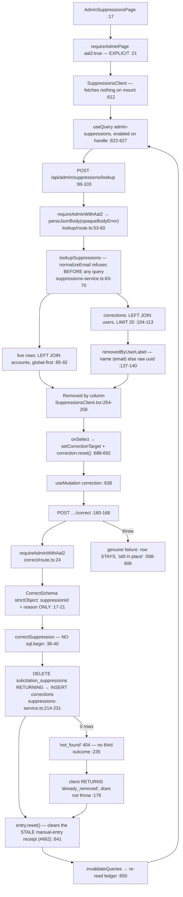

# F3 — Admin solicitation console (MEDIUM)

Window PRs: #876/#865, #882/#665+#662.

## BOUNDARY VERDICT: **SPLIT.** The join does not survive the call graph.

Phase 0 flagged F3 as contested and the orchestrator kept it under protest. The agent
computed the **full import closure of both halves and intersected them**.

**Zero domain modules in common.** The shared set is exhaustively:
`@/lib/auth/admin-mfa-gate` (21 importers), `@/lib/auth/page-gate` (16),
`@/lib/auth/route-helpers`, `@/lib/db/server`, `@/lib/shared/constants`,
`@/components/admin/ui/*` (19), and third-party. **That is the generic admin-route
chassis, imported by every admin mutation surface in the tree.**

| Question | Answer |
|---|---|
| Shared AAL2 gate? | Only the *function*, not the *posture* — **and the posture diverges at the read layer**. `page-gate.ts:41` defaults `aal2 = false`. The Send-batch panel's page calls `requireAdminPage(sql, {from:'/admin/businesses'})` — **plain admin, no AAL2** (`page.tsx:23`, comment at `:21` says so). The suppressions page passes `aal2: true` (`page.tsx:21`). They converge only on `requireAdminWithAal2` for the *write*, alongside 20 other importers. |
| Shared actor resolution? | No. Both read `gate.admin.id`; no shared resolver. `resolveAdminActor` appears in neither half. |
| Shared audit sink? | **No — the sharpest split.** Half A writes `account_audit_log` via `writeAccountAuditLog` inside `latchHalt`'s transaction (`approval.ts:502`). Half B writes `solicitation_suppression_corrections` via a single `DELETE … RETURNING → INSERT … SELECT` CTE (`suppressions-service.ts:214-231`) and **explicitly opens no transaction** (`correct/route.ts:31-32`). Different table, different durability argument. |
| Shared domain? | Both under `src/lib/solicitation/` but disjoint: A → `approval.ts`/`batch-view.ts`/`outreach.ts`; B → `suppression.ts`/`handles.ts`. **No module reachable from both.** |

**Recommendation — accepted by the orchestrator.** The Send-batch panel attaches to the
prior pass's **admin-console** feature: it is a fourth panel on `/admin/businesses/[id]`
sharing `BusinessDetailClient`'s `invalidate` with `PastDueExtensionPanel`,
`ProfileEditor`, `ZernioConnectionPanel` and `ChannelsPanel`, and its halt route shares
`adminHaltBatch`/`latchHalt` with **F1**. The suppressions correction attaches to **F5** —
`correctSuppression` removes exactly the rows `recordSuppression` writes
(`suppressions-service.ts:5`), the relationship F5's own rationale already names.

The two halves share the `/admin` URL prefix and the chassis. Nothing else.

## Flow 1 — Send batch panel

```mermaid
flowchart TD
  P["AdminBusinessDetailPage<br/>page.tsx:13"] --> G1["requireAdminPage — aal2 DEFAULTS FALSE<br/>page.tsx:23"]
  G1 --> R1["getBusinessDetail (read 1) :31"] --> R2["getBusinessChannelEnrollments (read 2) :33"]
  R2 --> R3["readAdminBatchSummary (read 3, SEQUENTIAL) :45"]
  R3 --> Q["ORDER BY live-send predicate, built_at, created_at, id<br/>batch-view.ts:969-974"]
  Q --> DS["deriveBatchState + 3 unfolded counts :979-989"]
  DS --> BDC["BusinessDetailClient initialBatchSummary<br/>BusinessDetailClient.tsx:143-156"]
  BDC --> SBP["SolicitationBatchPanel accountId=account.id :333-338"]
  SBP --> RED["useReducer halt machine<br/>SolicitationBatchPanel.tsx:270"]
  RED --> SUB["handleSubmit — note trim, batchId from summary :289-307"]
  SUB --> FET["POST /api/admin/solicitation/batch/halt :311"]
  FET --> ORG["withSameOrigin()(halt) at the export<br/>halt/route.ts:161"]
  ORG --> G2["requireAdminWithAal2 — FIRST statement :101"]
  G2 --> ZOD["AdminHaltSchema strictObject — accountId+businessId+batchId FROM BODY<br/>:62-67"]
  ZOD --> CALL["adminHaltBatch — actorUserId = gate.admin.id :122-128"]
  CALL --> LOCK["lockBatchForAction — WHERE id AND account_id AND business_id<br/>approval.ts:144"]
  LOCK -->|"no row: foreign OR unknown"| HTTP["404 — deliberately indistinguishable"]
  LOCK --> LATCH["latchHalt — CAS halted_at IS NULL :468"]
  LATCH --> AUD["writeAccountAuditLog same tx :502"] --> STEP["recordStep batch_halted :521"]
  STEP --> CLOSE["closeBatchIfSettled :533"] --> WIRE["toWire — whitelist, drops parentRunId<br/>halt/route.ts:85"]
  WIRE --> HTTP2["200 / 409 not_haltable / 404 :144-152"] --> ON["onHalted → invalidate → router.refresh()<br/>useBusinessDetail.ts:118"]
```



## Flow 2 — Suppressions correction



## `businessId` from the BODY — triple-match, NOT re-derivation

The orchestrator's hypothesis was half wrong. `AdminHaltSchema:62-67` takes **all three**
tenant ids from the body. The route does **not** re-derive the account from the business.
It pushes all three into a conjunctive WHERE in `lockBatchForAction:144`:

```
   WHERE b.id = ${batchId}::uuid
     AND b.account_id = ${tenant.accountId}::uuid
     AND b.business_id = ${tenant.businessId}::uuid
   FOR UPDATE OF b
```

A mismatched triple returns no row → `not_found` → 404, byte-identical to an unknown
batch id. The header says so at `:20-24`. The predicate is re-spelled inside `latchHalt`'s
CAS (`approval.ts:476-478`) and its outreach cancel (`:491-493`).

**Security-equivalent** (a forged `accountId` cannot select a batch it does not own), but
structurally different from re-derivation — there is no server-side lookup of
`businesses.account_id`. The happy path never carries a browser-invented value because
`accountId` comes from the server-rendered page (`BusinessDetailClient.tsx:334`).

The actor is the one field never from the body: `actorUserId: gate.admin.id` (`:126`), and
`strictObject` makes a body field naming `reason`/`halted_by` a 400 rather than a silently
ignored key.

## The `useReducer` shape — #880 claims five; the exact shape is **two**

`grep -rn useReducer src/app/admin` returns **seven** instances.

| Site | Action set | Same shape? |
|---|---|---|
| `SolicitationBatchPanel.tsx:198` | 7 actions, `note/message/error/submitting` | the subject |
| `PastDueExtensionPanel.tsx:14` | 3 setters + **the same six** non-setters | **Identical.** `SolicitationBatchPanel.tsx:4-5` says "Modelled on PastDueExtensionPanel" |
| `ImpersonationStartClient.tsx:6` | 4 setters + 3 | Similar. **No** `submitReset`, `validationError`, `submitSuccess`; no `message` |
| `ManualRankingSection.tsx:25` | 3 setters + 4 | Similar. `saving` not `submitting`; **`success: boolean` not `message: string\|null`** |
| `CsvImportClient.tsx:28` | 6 | Similar only in `submitStart`/`submitDone`; carries a structured report |
| `ZernioConnectionPanel.tsx:261` | 8, no setters, two independent in-flight lanes | **No** — correctly excluded |
| `ProfileEditor.tsx:45` | edit-mode form, no `submitting` | **No** — correctly excluded |

**The honest count of the exact shape is two.** Three more share the *silhouette* but
carry different terminal-state vocabularies, and #4's `success: boolean` vs #1/#2's
`message: string | null` is the difference between "the panel renders a fixed sentence"
and "the panel renders a server-derived one". **An extraction unifying all five must pick
one of those** — so the ticket's "extract the shared hook, migrate all five" is a larger
design decision than the ticket states.

## The read-model divergence IS now explicit — two comments, unusually specific

- `batch-view.ts:840-851`: *"Deliberately NOT `readLatestBatch` with a flag."* The reason
  is a **leak**, not ergonomics: `readLatestBatch` carries `attempts`, which serializes a
  customer's rendered subject and body; the admin key set is closed and carries none (D9).
- `batch-view.ts:891-927`: *"THE ORDERING IS THE CONTRACT, and it is deliberately NOT
  `readLatestBatch`'s."*

Both defects are written out at `:892-917`: (a) a completed CSV upload mints a fresh
`pending` batch that legally coexists with an older approved live one and **sorts first on
`created_at`**, so recency-only rendered "still building" over the batch actually
dispatching and support lost the stop control; (b) the second key exists because **halting
flips the first key** — the instant an operator stops the live batch it stops satisfying
the live-send predicate, so recency alone hands the panel back to the `pending` decoy and
the success receipt renders above a 0/0/0 batch. The first key cannot tie because
migration 091's partial unique index guarantees at most one such row per location.

Counts are scalar subqueries rather than joins **deliberately**, so the query-block-aware
audit (#859) can prove correlation directly (`:919-923`).

## AAL2 coverage — confirmed in scope

`pnpm ci:admin-aal2` → *passed (33 admin route files, 20 admin pages scanned)*, and this
route is in the list. The contract (`admin-aal2-audit.ts:13-16`) is **per-handler**, not
per-file, satisfied at `route.ts:101` inside `halt`, which the audit reaches through the
local `withSameOrigin()(halt)` delegation it explicitly follows (`_guard.ts:15-17`).
`_guard.ts:9-19` records why the AAL2 call is deliberately un-wrapped: an imported wrapper
terminates the AST walk and is a finding by design — fail-closed.

## Gaps

1. `deriveBatchState` and `closeBatchIfSettled` bodies unread — charted as nodes.
2. Migration 091's index text not verified against the comment at `:900-905`.
3. The `HALT_REASON_LABELS` twin was not chased — **resolved by F2**: the owner-side map is
   named `HALT_BODY` (`ApprovalPanel.tsx:277`), which a `HALT_REASON` grep cannot find.
4. Neither flow exercised at runtime.
