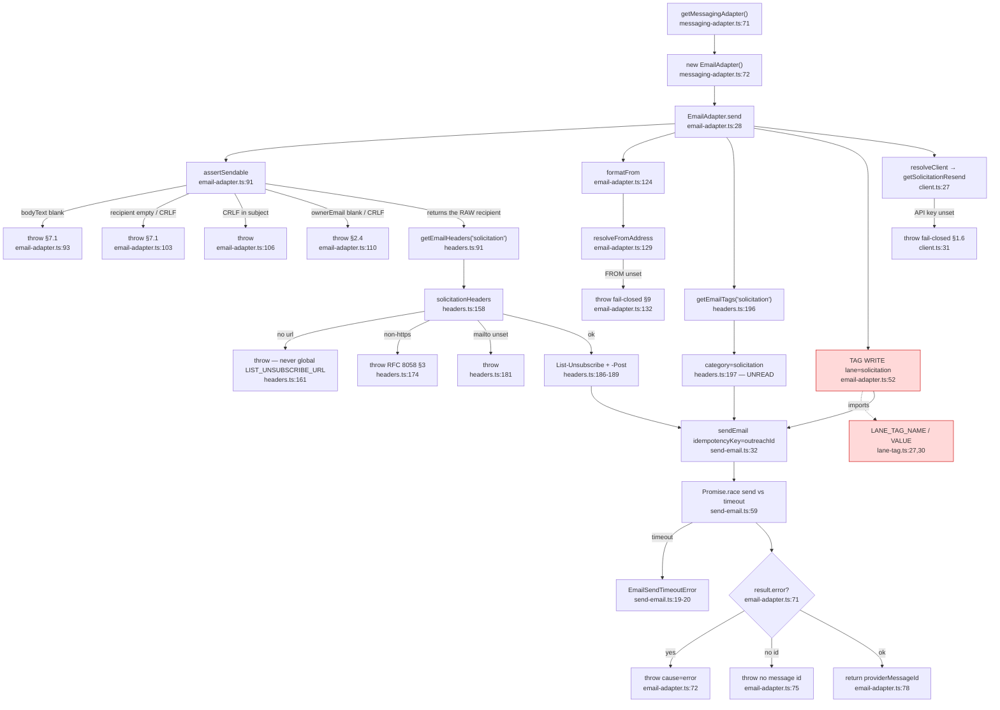
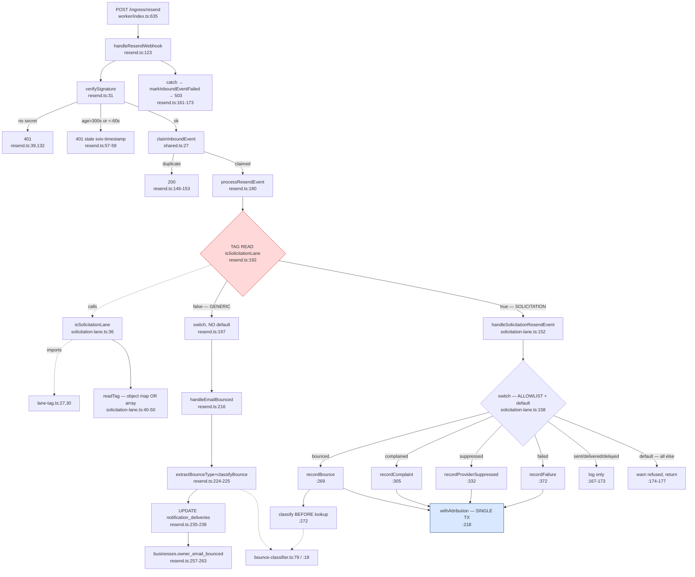
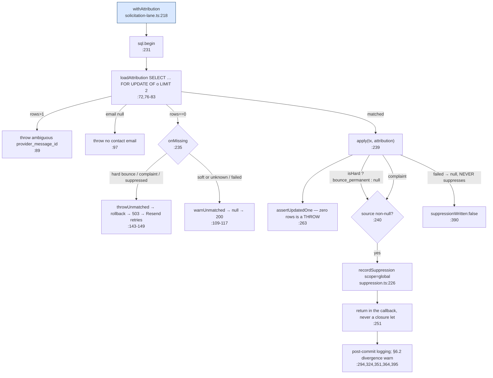
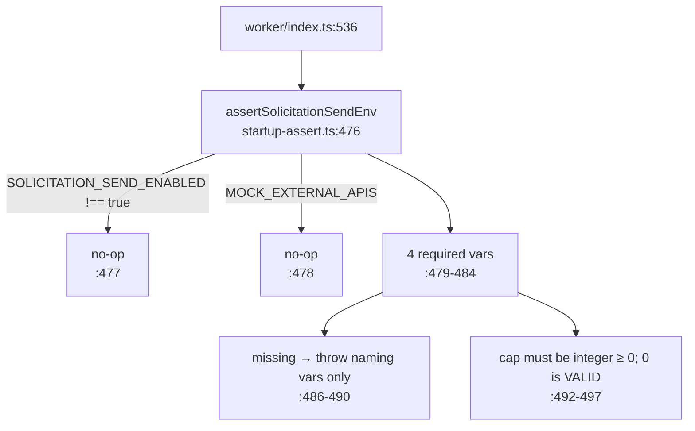

# F4 — Solicitation email lane (FULL)

Sending identity out, tag-discriminated signals back. Window PR: `ad185edb` #853 / #657.

## 1. Outbound

**Zero production callers — confirmed by repo-wide `rg`.** `getMessagingAdapter` is
referenced only at its definition and in its own test. Nothing under `worker/jobs/**`
or `src/app/**` constructs it. `messaging-adapter.ts:7-11` says so in the file.

**Consequence**: the entire left half of the tag contract is dead code today. The tag
is never emitted in prod, no `provider_message_id` is ever written, so the inbound
fork can never match in prod either.

## 2. Inbound

### withAttribution — the transaction

## 3. Boot

## Findings

### The tag contract binds the SYMBOL, not the value and not the wire

- **Written** `email-adapter.ts:52`. **Read** `solicitation-lane.ts:37` via `readTag:40-50`.
- **The one mechanical binding is a shared import** of `lane-tag.ts:27,30`. Renaming or
  deleting either export breaks both importers and fails `pnpm typecheck`.
- **Not bound**: (a) the **value** — changing `'solicitation'` to `'ask'` at `lane-tag.ts:30`
  compiles and passes every test, safe only because it moves both ends at once; (b) the
  **wire echo** — nothing asserts Resend echoes tags back, and `readTag:43-47` hedges by
  accepting *two* payload shapes, which is the shape of an unpinned contract; (c) any
  **static** check — no ESLint rule, no `ci:*` script, and nothing asserts the file stays
  import-free.
- **The only drift-catcher is a test**: `resend-solicitation-routing.test.ts:304` drives the
  real adapter into a fake Resend, captures the tags, and feeds them to the real
  `isSolicitationLane` (`:317-327`). It catches a **re-spelling** — the documented failure
  mode — but not a value change made in the owner file.

**Stale comment, real defect.** `email-adapter.ts:48-50` says both halves import the
constants **from `messaging-adapter.ts`**. They do not — both import from `./lane-tag.ts`,
and `messaging-adapter.ts:15-18` explicitly says the constants are not there. The comment
predates the extraction and points a future reader at the one file the design forbids.

**Second, unread discriminant.** `getEmailTags('solicitation')` also puts
`{category:'solicitation'}` on the wire (`headers.ts:196-197`, used at `email-adapter.ts:47`).
Nothing reads it for routing. **Two solicitation-shaped tags on every send, only one
routes** — a latent "which is the discriminant?" trap for #630.

**Import-free buys and costs.** *Buys*: the ingress reaches two string constants without
transitively pulling the Resend SDK, `sendEmail` and `getServerConfig`; it breaks a
would-be cycle; it makes "the lane works whether or not the adapter ever sends" literally
true. *Costs*: enforced only by a header comment at `lane-tag.ts:24`. Any future `import`
there silently re-couples the ingress to the SDK and nothing fails.

### The "+10 lines" claim was +10/−70

`git diff ad185edb^..ad185edb -- worker/ingress/resend.ts` → **10 insertions, 70 deletions.**

- Insertions accurate: 2 imports (`:12-13`) + an 8-line block at `:189-196` (3-line comment,
  4-line guard, blank).
- **Deletions omitted from the claim**: five functions cut out — `extractBounceType`,
  `isRecord`, `lowerNonEmptyString`, `isHardBounceType`, `classifyBounce`.
- **The behaviour claim survives.** Diffing the deleted block against the new
  `bounce-classifier.ts` shows only two non-behavioural differences: `export` added to two
  functions, and an 8-line doc paragraph. Every predicate, string and fallthrough is
  byte-identical.

### One classifier, two callers — identical, and the fail-safe is single-owner

| | generic | solicitation |
|---|---|---|
| call | `resend.ts:224-225` | `solicitation-lane.ts:272` |
| `reason` → | `notification_deliveries.failure_reason:237` | `solicitation_outreach.provider_error:283` |
| `isHard` → | `businesses.owner_email_bounced:241` | `'bounce_permanent'` ledger `:289` **and** the `onMissing` choice `:278` |

**`'unknown'` → soft holds on both sides from one place.** `extractBounceType` returns the
literal `'unknown'` (`bounce-classifier.ts:19,28`); `isHardBounceType('unknown')` matches
none of the six predicates (`:60-69`). **Neither caller re-tests the raw string**, so they
cannot disagree.

Asymmetry: the solicitation lane classifies **before** any DB lookup deliberately (`:272`,
comment `:270-271`) because `isHard` selects the unmatched-id policy. The generic lane
classifies before its lookup only incidentally.

### withAttribution — three branches, and the intake now agrees with the code

1. **Matched** — `FOR UPDATE OF o` held (`:82`); `apply` runs; `assertUpdatedOne` (`:263`)
   makes zero rows a throw, not a no-op; suppression writes in the same tx. One commit or none.
2. **Unmatched, suppression-bearing** (complaint, suppressed, hard bounce) — `throwUnmatched`
   (`:143`) logs without the recipient and throws → rollback → **503** → Resend retries into
   #630's `provider_message_id` commit window.
3. **Unmatched, otherwise** (soft/unknown bounce, failed) — `warnUnmatched` (`:109`) → `null`
   → caller short-circuits → **200**. Nothing written.

**They did not always agree.** Deviations R8 records the intake reading "warn, ack 200"
unconditionally after F1 changed only `rollback_plan`. Corrected byte-identically in both
intake copies. The rejected `onMissing`→boolean finding is recorded with churn-avoidance
reasoning, not a claim the boolean is wrong.

### Refusal is an allowlist, confirmed

`solicitation-lane.ts:158-178` — eight enumerated cases plus a `default` that warns and
returns. The four refused names in the comment at `:175` appear **only in that comment**;
`rg` finds no `'email.opened'` etc. anywhere in the lane. A new Resend event type nobody has
heard of is refused by construction.

**Contrast the generic lane** at `resend.ts:197-213`: also a switch, but with **no `default`**.
An unknown event there silently falls through and acks 200 **without a log line**. Same
outcome, different observability.

## Gaps

1. **The wire-echo assumption is the untested half of the contract.** That Resend echoes
   `tags` back — and in which of the two shapes `readTag:43-47` handles — is asserted nowhere
   in the repo and Resend's docs were not consulted. If the echo is absent or renamed, every
   solicitation event silently takes the generic lane.
2. Runtime state not queried; flag-off claims taken from CLAUDE.md and the intake.
3. `recordSuppression` read only at its signature — F5's scope.
4. The generic lane was verified unchanged **by the `ad185edb` diff only**; later window
   commits touching `resend.ts` were not swept.
5. Migration 091's ladder CHECKs taken at face value from the comment at `:7-11`.
