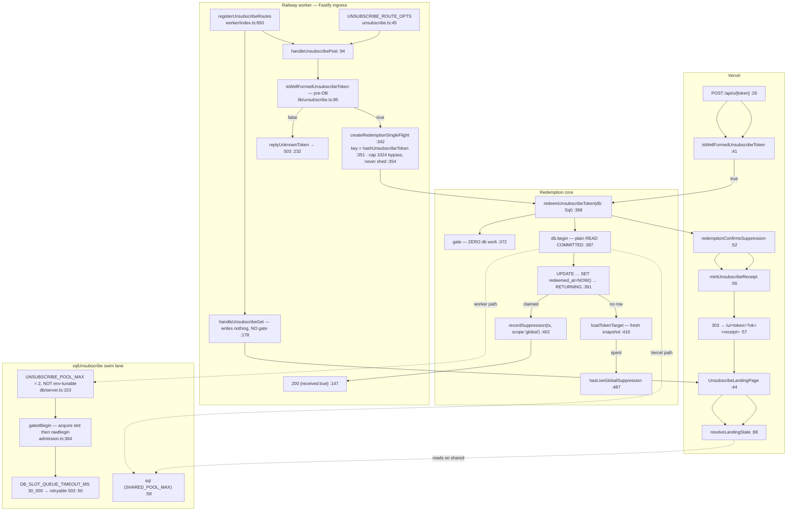

# F5 — Unsubscribe redemption (FULL)

Window PRs: #857/#651, #866/#652.

## The pool serves ONE call site

`sqlUnsubscribe` is imported only at `worker/ingress/unsubscribe.ts:22` and used only at
`:383`. **The Vercel button path redeems on the shared `sql`** (`route.ts:2, :43`), and the
landing page reads on the shared `sql` too (`page.tsx:6, :46`).

The two-slot bulkhead protects the shared write pool from RFC 8058 provider replay traffic
only. **A browser-button flood lands on `SHARED_POOL_MAX`.** `db/server.ts:149-151` states
the fact ("no Vercel composition root queries this client") but no comment explains why the
browser lane does not deserve the same bulkhead.

## #651/#652 — where the transaction boundary lives

**Before**: the signature was `redeemUnsubscribeToken(tx: TransactionSql, …)` with a
docblock headed *"⚠️ CALLER OBLIGATIONS — contracts, not preferences, and NOTHING ENFORCES
THEM"*. Two obligations: `tx` must be READ COMMITTED, and no remote call may sit between
the claim and the commit. The deleted text named the concrete trap — `batch-view.ts` opens
a REPEATABLE READ snapshot in this same domain, so **the wrong constructor was the nearest
one to hand**.

The argument, still at `:362-366`:

- `TransactionSql` is the same type at every isolation level, so obligation 1 was
  **unrepresentable in the type system**. Prose was the only guard.
- Two failure modes under REPEATABLE READ (`:363-364`): the losing claim raises `40001`
  instead of blocking — breaking the "domain outcomes are RETURNED, not thrown" contract at
  `:344-345` — **or** the pinned snapshot returns `unknown_token` for a token that *was*
  redeemed. The second shows a false "this link isn't active" to someone who successfully
  opted out.
- Taking `db: Sql` and owning `begin()` internally makes that state **unrepresentable**,
  because postgres.js declares `begin` on `Sql` and not on `TransactionSql` — a
  caller-owned transaction is now a `tsc` error, not a documented hazard.
- Invariant #15 holds either way; what changed is *which* executor type.
- A runtime isolation assertion was considered and rejected: the only zero-round-trip hook
  is `current_setting('transaction_isolation')` on a `RETURNING`/`SELECT`, and both are
  absent on exactly the no-row path where the failure lands.

**The boundary**: opens at `:387`, closes when the callback resolves. The gate at `:372` is
deliberately **outside** it — a forged token opens no connection. `recordSuppression` runs
**inside** on `tx`. Both adapters see only a post-commit value, so **a receipt cannot exist
for a write that never landed** (`route.ts:54-56`).

## The rate-limiter exemption resolves from the RESOLVED route config

`worker/ingress/rate-limit.ts:92-94` is a two-arm OR over URL shapes (`routeOptions.url`,
then `decodeIngressPath(request.url)`). The exemption at `:96` reads **only**
`request.routeOptions.config` — never the URL. The only writer of `skipIngressRateLimit` is
`unsubscribe.ts:49` (repo-wide grep: 3 hits — declaration-merge, read, write).

**An unmatched path under `/ingress/` reaches arm 2 via the decoded URL, so it IS
rate-limited, while `routeOptions.config` is `undefined` and cannot carry the exemption.**
The docblock at `:80-88` names the two historical bypasses this shape closes: absolute-form
request targets (arm 1) and `/%69ngress/resend` (arm 2's decode).

Exemption ≠ unbounded: the same options carry `bodyLimit: 1024` (`:58`) against a 5 MB
default, and `logLevel: 'silent'` (`:55`) because Fastify's `incoming request` line copies
the raw URL — and therefore the raw token — before `onRequest`. The pre-DB HMAC gate is
what substitutes for a limiter.

## The receipt rule — verified

`page.tsx:96-99` is a single `&&`: `verifyUnsubscribeReceipt(rawToken, receiptParam) &&
(await hasLiveGlobalSuppressionForToken(db, rawToken))`. The ledger read is **inside the
render**, on `db` passed at `:46`, with no cached or receipt-derived shortcut.

The receipt gates whether success **may** be shown (enumeration resistance — an unknown
token can never produce one); the live read establishes whether the claim is **true**,
because the audited Correction path can remove the row inside the receipt's 10-minute TTL.
A verified receipt with no live suppression falls through to Neutral.

Two supporting facts: `hasLiveGlobalSuppressionForToken` is deliberately **indifferent to
`redeemed_at`** (`:438-441`) — on the success page the token is spent by definition, which
is why `findRedeemableUnsubscribeToken` cannot answer it. And `hasLiveGlobalSuppression:487`
is deliberately **not** `suppressionMatchSql` (`:480-485`): the send-time gate matches
`global` OR the account's `account`-scoped row, which would let an owner's do-not-contact
row make the "every other business that uses RepWorth" sentence false.

## Indistinguishability

Both stages funnel through one responder: `replyUnknownToken(reply,'gate')` at `:108` and
`(…,'ledger')` at `:126` both reach `:232`, emitting an identical `503 {error:'unavailable'}`
at `:237`. The only difference is which in-process counter increments. 503 rather than 404
is deliberate (`:234-236`): a token minted after this transaction's snapshot surfaces as
unknown, and only a retryable status keeps that mint race recoverable.

The two causes are separated **only in the aggregated telemetry line** — one warn per 60 s
carrying `gate_count` + `ledger_count` (`:465`). `gate` = never minted / scanner noise;
`ledger` = we minted it and the ledger did not resolve it, the #630 mint race. Per-request
reporting is refused outright (`:386-403`): the route is unauthenticated and unlimited, so
per-request observability is itself an amplification vector.

Browser side: gate fail, `already_redeemed_not_suppressed` and `unknown_token` all return
the same 303 with no query string. Unknown, malformed and already-redeemed all render
`NeutralView`, which **takes no token-derived input at all** — enumeration resistance made
structural rather than remembered. The worker GET deliberately does **not** gate the token,
because 503-ing a forged token there would be the one answer that distinguishes them.

## `recordSuppression` — two callers, two readings of `null`, both right

| | F5 (`unsubscribe.ts:402`) | F4 (`solicitation-lane.ts:243`) |
|---|---|---|
| Return | **Discarded** | Captured → `suppressionWritten: written !== null` |
| Why | `:409-410`: "MUST NOT gate the outcome or the stamp — the claim already made it" | `:197-199`: distinguishes "we wrote a row" from "first-write-wins no-op'd" |
| `null` means | nothing; outcome is `'redeemed'` regardless | the two lists **agree** → suppresses the §6.2 divergence warning |

F5 asks "is this handle globally suppressed?" — a pre-existing row makes the answer yes.
F4 asks "did Resend's list diverge from ours?" — a pre-existing row is exactly the case
where it did not. `suppression.ts:221-225` records that the function shipped ahead of its
production callers so the byte-for-byte `ON CONFLICT` predicates were proven against the
real partial indexes.

## The purge race

Both writers take a row lock on the same `solicitation_unsubscribe_tokens` row, so they
serialize. Purge first → the claim's `RETURNING` yields `account_id = NULL` and the ledger
row is written with NULL provenance, which §5.2 requires. Claim first → the purge scrubs
afterwards and the ledger row keeps provenance it legitimately had.

The failure mode the comment forecloses is **reading provenance before the claim**:
`:347-352` says suppressing first "would let a concurrent offboarding purge produce a ledger
row carrying stale non-null provenance where §5.2 requires NULL." The `RETURNING` clause is
the mechanism; migration 096's implication CHECK (`:144`) is why the purge cannot scrub
`account_id` alone and leave a half-scrubbed row the claim could read.

## Shutdown close order

`db/server.ts:215-228`: dedicated clients close **first**, bounded, in parallel via
`allSettled` so a TCP-wedged pool cannot skip or stall the shared close; `sql.end()` alone
is awaited directly so its rejection still propagates. The telemetry window is flushed
before any pool close (`worker/index.ts:818-821`).

## Gaps

1. No test files read. `unsubscribe-rate-limit.test.ts` is named at `rate-limit.ts:77` as the
   real-socket proof that arm 1 is load-bearing — code shape confirmed, test existence not.
2. `find-my-way` config-population semantics inferred from the docblock and type shape.
3. The purge-race serialization is reasoned from two row-locking `UPDATE`s plus two
   docblocks; no integration test found or run.
4. Spec §-numbers quoted as they appear in code comments; the spec was not opened.
5. `withAdmissionControl`'s acquire/queue internals skimmed.
6. Not verified that the Vercel path's use of the shared `sql` is intentional rather than an
   oversight of #651.
