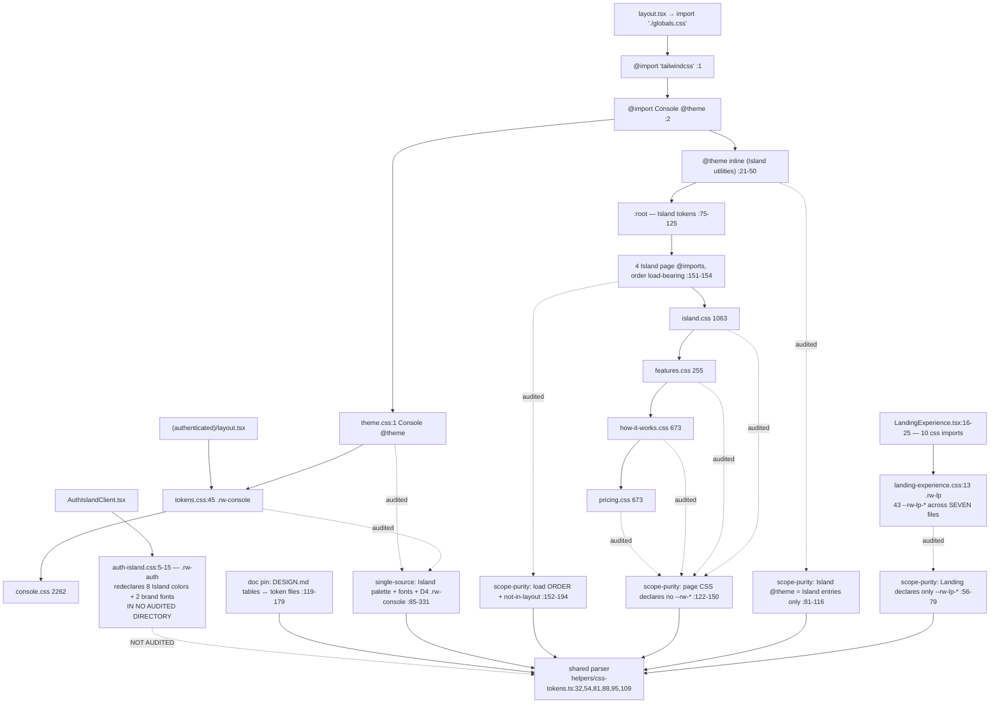
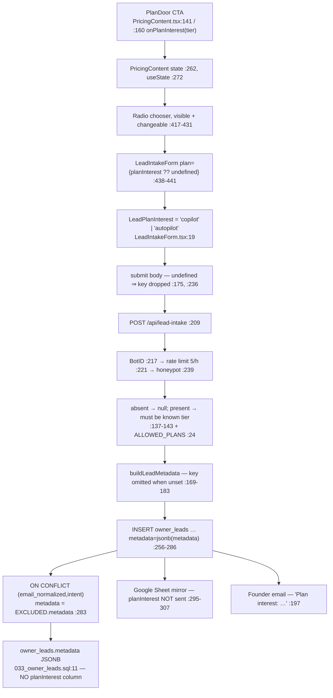

# F6 + F7 — Design system and public marketing (LIGHT)

Both were **uncounted by the product counter**. The pass includes them to test whether
"uncounted" and "unimportant" are the same thing.

## F6 — three-tier design system

**Token owners**: Island = `globals.css:75-125` (`:root`, every route). Console =
`(authenticated)/_styles/tokens.css:45` (`.rw-console`, D4-scoped) + `theme.css`. Landing =
**no single file** — 43 `--rw-lp-*` across 7 files. For Landing the invariant is *namespace
purity*, not single-file ownership, and `cssFilesUnder` walks dynamically so a new landing
file is auto-audited.

### Enforced, or asserted? Enforced — within a scope narrower than the invariant

The guards are real parses, and vacuity is itself guarded (`:59-65`, `:125-134` assert the
file lists before using them). `css-tokens.ts:24-27` records that the older line-anchored
matcher silently missed six spacing tokens. Above-average rigour.

**What it misses — and one instance exists today:**

1. **`src/components/auth/auth-island/auth-island.css:5-15` declares `--rw-sage`,
   `--rw-teal`, `--rw-peach`, `--rw-pink`, `--rw-beige`, `--rw-cream`, `--rw-ink`,
   `--rw-ink-soft`, `--rw-font-display`, `--rw-font-body` under `.rw-auth`.** It sits under
   neither `LANDING_DIR` nor `ISLAND_PAGE_DIR` nor the Console pair, so **nothing audits
   it**. The 8 colors currently match `globals.css:76-90`; **the two font families do
   not** — `:14-15` drops the `'Plus Jakarta Sans'`/`'DM Sans'` named fallbacks and the
   `-apple-system`/`Segoe UI`/`Roboto` chain that `globals.css:121-122` carries. This is the
   exact `--rw-sage` collision class the single-source guard exists for, one directory
   outside its reach.
2. A new file under a *watched* dir is caught (`:128-133` hard-lists the four Island pages);
   **a new watched dir is not**.
3. A Console token *referenced* from Island page CSS is unchecked — the leak guard reads only
   the `@theme` block; `:136-149` checks page CSS for *declarations*, never references.
4. Raw hex bypassing tokens is unguarded on the public side: 14 in `island.css`, 4 in
   `pricing.css`, 3 in `how-it-works.css`, **65 across Landing**. Hex guards exist only as
   negative allow-lists on the *authenticated* files.

### Import order — both properties tested, and the tests are good

`:155-166` asserts all four `@import`s present and in ascending source position; `:168-178`
each sits after `:root {`; `:180-194` `layout.tsx` does not import `(public)/_styles`
instead. Order runs on `stripCssComments` output so the strings quoted in the header comment
cannot satisfy it.

Per `globals.css:127-150`: moving the imports to `layout.tsx` takes those files outside the
Tailwind entry, so **47** `@supports (color: color-mix(…))` fallbacks stop being emitted;
hoisting them above `:root` moves ~2,400 lines ahead of the token and `@theme` blocks.
Measured claims, both pinned.

### The doc↔code pin — and eight ways it can drift

Pinned: every `--rw-*` in a **backticked code span** in a **markdown table row** must be
declared in that system's token files, and where the table has both `Value` and `Token`
columns, the value must match.

Misses: **one-directional** (a declared-but-undocumented token passes); **prose is
invisible** (only `|`-delimited rows are collected, fenced blocks skipped); **no backticks →
no check**; **existence-only tables** return early when a column is missing; **`startsWith`
(`:167`) accepts prefixes**, so `#D2E0D3` documented against `#D2E0D3AA` passes;
**`tokens.some(…)`** passes a multi-token row if *any one* matches; **Landing merges all 7
files**, so a row is satisfied by a declaration anywhere; **the row-count floor is `> 15`**
while actuals are 22 / 77 / 97 — a doc could lose ~60 rows and stay green.

## F7 — the lead-intake path

### `planInterest` in metadata, never a column — deliberate, thinly reasoned

Written twice (`route.ts:22-23`, `:159-160`): "tier-less leads keep the historical shape."
That is the entire reasoning in the repo — no spec, plan or ADR. Two tests pin the shape.

What breaks when it must be queried:

- **No index.** `033:25-29` indexes only `(status, created_at)` and `(source, created_at)`.
  A GIN index is a new migration anyway — **the migration was deferred, not avoided**.
- **The value is not durable.** `:283` sets `metadata = EXCLUDED.metadata` wholesale, and
  `buildLeadMetadata:181` omits the key when unset. A visitor who used a tier door and later
  resubmits through a tier-less door (same email + intent) has their recorded tier
  **silently erased**. A column with `COALESCE` would not.
- **It never reaches the analytics sink.** `appendOwnerLeadToSheet:295-307` passes intent and
  source but **not** `planInterest`. The place a founder would aggregate leads is the one
  place the field is missing.
- No DB-level vocabulary — `intent` and `status` have CHECK constraints; the tier set lives
  only in TypeScript.

### `trialPeriodDays()` — an extraction *at* the second and third use, not a de-duplication

Three call sites: `(public)/page.tsx:25`, `features/page.tsx:17`, `how-it-works/page.tsx:19`.
`git log -S` returns exactly one commit, `6038642b` (#852). At `6038642b~1` the only reader
was a **local inline helper** in `page.tsx:16`. #852 added the two new CTAs and hoisted the
single existing spelling in the same commit.

**Non-obvious adjacent fact**: `trialPeriodDays()` is **copy-only**. The actual Stripe trial
is a hard-coded literal — `plan-activation.ts:285` types it `30 | null`, `:340` writes
`trial ? 30 : null`. The divergence is locked by a test that stubs `TRIAL_PERIOD_DAYS='14'`
and asserts `30` (`create-checkout-session.test.ts:526-528`) and documented at
`env-vars.md:642`. **Setting a non-30 value moves the marketing label but not the trial** —
a live footgun on a page whose whole PR was a *truth* pass, documented rather than hidden.

### The scroll deletion is clean — with one correction

`git show ecd4924d --numstat`: **five** files deleted (not four), exactly **720** lines —
`ChapterRail.tsx` 111, `SectionTransition.tsx` 125, `SmoothScroll.tsx` 138,
`scroll-experience.css` 300, `section-map.ts` 46. The `scroll/` directory is gone.

Residue: **no Lenis dependency** — the commit shows `package.json` −1 and `pnpm-lock.yaml`
−21; `grep -i lenis` matches neither. No dead imports. No orphaned CSS (zero `chapter`,
`scroll-snap`, `snap-align`, `dissolve`, `data-lenis` matches). The three remaining Lenis
mentions are deliberate tombstone comments explaining why current code looks as it does.

## Uncounted vs unimportant — the answer

**They are not the same thing, and the tell is whether the merge shipped an enforcement
surface.**

**F6 is a genuine feature the counter was wrong to skip.** It shipped an *enforced*
invariant with 500+ lines of guard and a shared parser whose own docstring records a prior
guard that could not see what it claimed to check. Skipping it had a concrete cost: nobody
looked at `auth-island.css:5-15`, which re-declares the whole Island palette and two brand
fonts outside every audited directory, **with the font values already diverged**. That is
the exact collision class the merge exists to close, sitting one directory outside the
fence — and a counted merge would have had a reviewer asking "which directories does this
actually watch?"

**F7 is closer to genuinely minor.** A copy pass plus one optional string threaded into a
JSONB blob. The two things worth knowing are both already written at their call sites. The
one real finding — `metadata = EXCLUDED.metadata` silently erasing a recorded tier on a
tier-less resubmission — is small and would surface the first time someone counted tier
interest.

So: the counter's blindness to **design-system** merges lost something real; its blindness
to **marketing-copy** merges did not. Merges that ship an enforcement surface need someone
asking what the fence encloses, and a merge nobody counts is a merge nobody asks that about.

## Gaps

(a) The three design suites were not run — "the guard passes today" is inferred from code.
(b) The three `DESIGN.md` files were not read, so the doc-pin misses are derived from the
parser's shape, not from a drifted row found. (c) `measurements.md §2` not read. (d) Whether
`auth-island.css`'s scoped re-declaration is sanctioned under the design README's rule 2 was
not assessed. (e) `island.css`'s hexes counted and spot-matched, not individually diffed.
