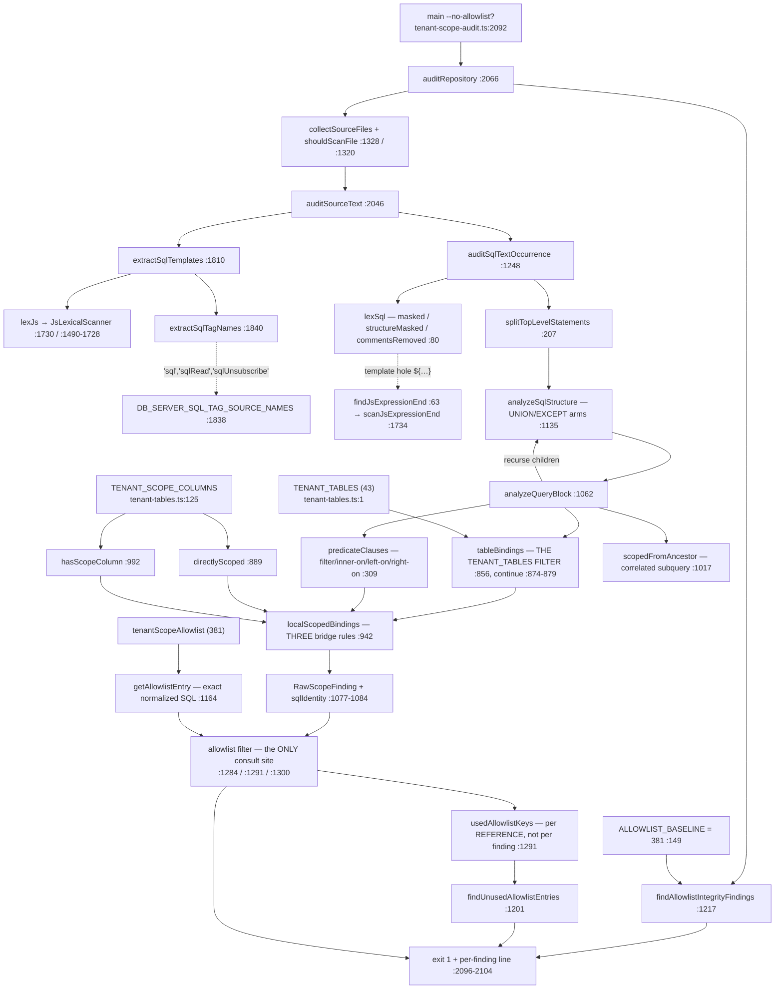

# F8 — CI enforcement surface (MEDIUM)

Window PRs: #847, #848, #870/#859, #875/#867, #850, #849, #854.

**Correction to the brief**: `tenant-scope-audit.ts` is **2,115 lines**, not 2,181
(`wc -l` at HEAD `dd868c92`). Every other cited line verified.

## ci:tenant-scope — data flow

`TENANT_TABLES` enters at exactly **one** point (`:877`); `TENANT_SCOPE_COLUMNS` at three.
The allowlist is consulted **only** inside `auditSqlTextOccurrence` — **the analyzer is
allowlist-blind**. `usedAllowlistKeys` is added per *reference*, not per suppressed
*finding*, which is why an entry that suppresses nothing still reads as "used".

## Seed 9 — the blast radius. **Listing the tables would produce 63 red lines and 0 security fixes.**

**Method (executed, reproducible):** the agent copied the audit to scratchpad with
`TENANT_TABLES` extended by the four tables, patched `analyzeQueryBlock:1077` to emit
*scoped* bindings too, and ran with `--no-allowlist`. No repo file was modified.

Note `users.business_id` was **DROPPED** at `034_multi_location_schema.sql:404`, so `users`
carries `account_id` only.

**Result: 77 production relation bindings — 14 provably scoped, 63 would emit a finding,
and none of the 63 is a live tenant leak.**

| Table | Bindings | (a) proven scoped | (b) deliberate / unprovable-in-isolation | (c) **real leak** |
|---|---|---|---|---|
| `analytics_events` | 12 | 2 | 10 — `AnalyticsDispatchPoller` ×6, `ArchivalPoller:185-194` ×2 (global sweeps), `backlog-depth.ts:35` (ops gauge), `purge-stages.ts:545-557` (scoped by an **OR**-chain; `completeProofConjunct:419` only accepts conjuncts) | **0** |
| `flagged_responses` | 8 | 1 | 7 — admin-after-`requireRole` ×5, worker global `health-alert/checks.ts:142`, and **`held-draft.ts:62-65`** `openFlagExistsSql`, a composable fragment scoped by caller correlation and unprovable in isolation | **0** |
| `impersonation_sessions` | 6 | 0 | 6 — `admin/impersonation/session.ts` ×4 keyed on `actor_user_id` (**the tenant boundary is the admin actor, not an account**), `purge-stages.ts` ×2 | **0** |
| `users` | 51 | 11 | 40 — two shapes: **(i)** `auth_id`-keyed identity lookups (the existing `supabase-auth-id` allowlist category); **(ii)** `owner_user_id` joins off an already-bound account/business | **0** |

### The structural finding is the bridge vocabulary, not the table list

`localScopedBindings:942` knows exactly **three** bridges: `x.account_id = accounts.id`,
`x.business_id = businesses.id`, and the `account_offboarding_tokens` link. `users` reaches
its tenant by a **fourth** shape (`accounts.owner_user_id = users.id` — an inbound FK on the
*parent*) and a **fifth** (`users.account_id = businesses.account_id`, sibling-through-account,
`summary-report-helpers.ts:241-242`).

**Adding tables without adding bridges converts silence into 40 suppressions.** That is
seed 9's real content, and it inverts the naive fix.

## Seed 8 — the 66 is real, reproduces exactly, and is unmaintained

- `pnpm ci:tenant-scope` → `passed — entries: 381 (baseline: 381)`, **zero** unused-entry
  findings. The unused check cannot see provable-but-retained entries because
  `usedAllowlistKeys` counts references, not suppressions.
- `--no-allowlist` → **342 findings** across **222 distinct (file, table) pairs**. A naive
  pair-granularity join gives 61 — a lower bound, not 66.
- Exact derivation needs the unexported `templateFingerprint:1042`. Joining allowlist
  snippet-hashes against `--no-allowlist` finding hashes yields **exactly 66 / 381**:
  `tenant-root-lookup` 27, `worker-job-scoped` 20, `background-global-scan` 8,
  `provider-ingress` 6, `admin-after-require-role` 3, `pre-auth-token` 2.

This matches the prose at `tenant-scope-allowlist.ts:146-147`. **Two things block a
maintainer from re-deriving it**: `auditSqlTextOccurrence:1301` strips `allowlistSqlText`
from every finding before returning, and `getAllowlistEntry:1170` reads the module-level
allowlist directly with no injection point. The number is verifiable but **nothing fails
when it drifts**.

## Seed 7 — a split is available, and the seam is already pre-cut

| # | Concern | Lines | Size |
|---|---|---|---|
| 1 | PostgreSQL lexer + SQL text utilities | 49–490 | ~440 |
| 2 | Query-block analyzer | 492–1158 | ~665 |
| 3 | Allowlist layer | 1160–1247 | ~90 |
| 4 | Per-template audit seam + file walk | 1248–1342 | ~95 |
| 5 | JS/TS lexer + SQL-template extraction | 1344–2044 | ~700 |
| 6 | Entry points | 2046–2115 | ~70 |

**What crosses:**
- **1 → 5, the one real interleave**: `findJsExpressionEnd:63` is a forward-declared shim
  whose entire body is `return scanJsExpressionEnd(...)` (`:1734`). `lexSql:161` calls it to
  mask `${…}` holes. **The SQL lexer cannot be extracted without the JS scanner** unless the
  expression-end scan becomes an injected parameter.
- 5 → 1: `escapeRegExp:332` at `:2006`. 6 → 2: `auditSourceText:2054` calls
  `templateFingerprint:1042`.
- Clean one-directional: 2 → 1, 4 → 2+3, 2 → `tenant-tables.ts` only.
- **Zero edges**: 2 ↔ 3 (the analyzer never sees the allowlist), 2 ↔ 5, 3 ↔ 5.

Concerns 2, 3 and 5 are separable as-is. Concern 1 is interleaved with 5 by exactly one
edge — **which the file already isolates behind a one-line shim**. The seam is pre-cut and
the shim marks where it goes.

## The CI_ONLY_BY_DESIGN carve-out

One key, `'ci:fallow:coverage'`. It exempts that script from "every `ci:*` in `ci.yml` also
appears in `lefthook.yml`" (`:87-95`) because its input is a full `vitest run --coverage`.
**The exemption is self-enforcing in both directions** (`:97-105`): it asserts
`inCi.has(script) === true` **and** `inLefthook.has(script) === false`, so it goes stale-red
if the script leaves `ci.yml` or is later mirrored into lefthook.

The sibling `UNGATED_BY_DESIGN:24` (`'ci:fallow'`) is a different exemption — it excuses a
script from running in *any* workflow. Deliberately distinct.

## Gaps

1. **(b)-vs-(c) classification is a reading of intent**, not machine-derived. Every distinct
   query shape was read for the three small tables; ~14 of 35 distinct `users` sites were
   sampled and the rest classified by the established pattern. A (c) hiding among the
   unsampled `users` sites is the residual risk.
2. The extended-table run used `TENANT_SCOPE_COLUMNS` derived from migrations, not
   `information_schema`. The live-DB conformance suite is the real oracle and was not run.
3. The 66 derivation is at whole-template granularity; an entry whose snippet is one
   statement of a multi-statement template would be miscounted.
4. `lib/ratchet-harness.ts` (`walk`) not read — directory-map's symlink/ignore semantics
   taken from the call signature.
