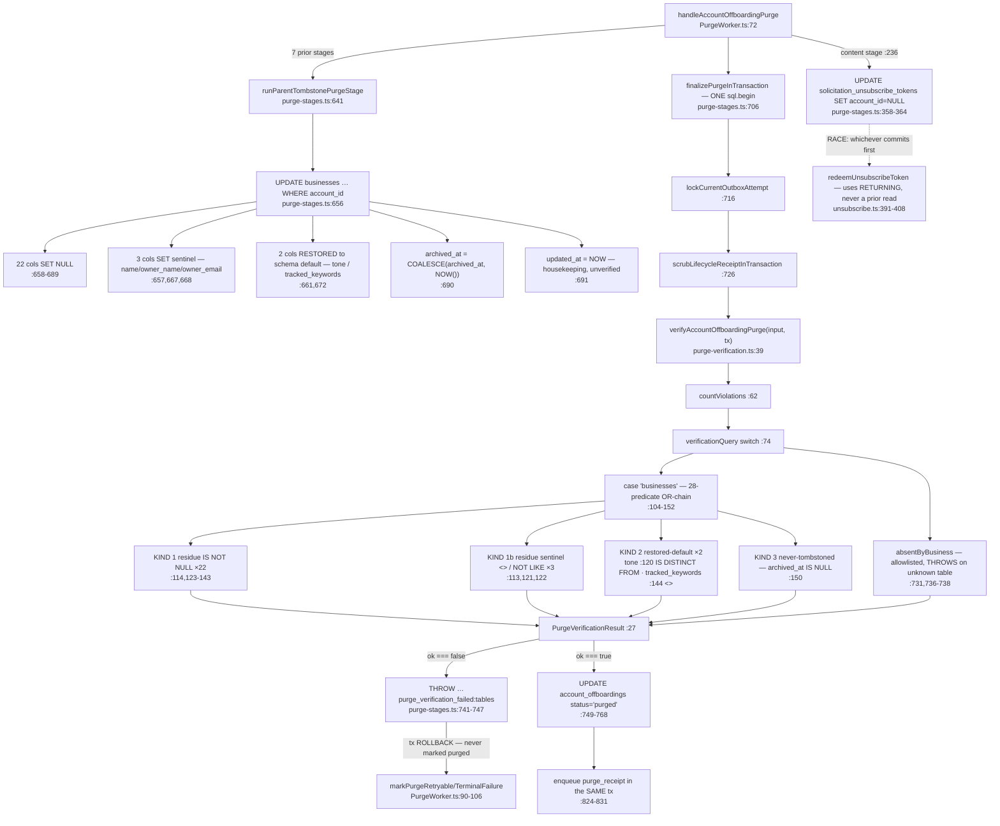

# F9 — Account purge verifier: tombstone completeness (MEDIUM)

Window PR: `fe21d02d` #882 / #665+#662.

## The classification — 28 predicates, not 27

Counted mechanically over `purge-verification.ts:113-150`.

**Kind 1 — residue (25).** 22 `IS NOT NULL`: `category:114`, `owner_phone:123`,
`stripe_customer_id:124`, `stripe_subscription_id:125`, `google_place_id:126`,
`google_maps_url:127`, `products_services:128`, `staff_names:129`, `highlight_facts:130`,
`avoid_facts:131`, `sample_responses:132`, `google_place_address:133`,
`solicitation_postal_address:134`, `…_attested_at:135`, `…_attested_by_user_id:136`,
`…_attestation_version:137`, `…_attested_digest:138`, `google_place_lat:139`,
`google_place_lng:140`, `ranking_search_location:141`, `website:142`, `display_label:143`.
Plus 3 sentinel comparisons: `name:113` (`<>`), `owner_name:121` (`<>`),
`owner_email:122` (`NOT LIKE`).

**Kind 2 — restored-to-default (2).** `tone:120` via `IS DISTINCT FROM`, and
`tracked_keywords:144` via `<>`.

**Kind 3 — never-tombstoned (1).** `archived_at:150` — `IS NULL`.

**The arch log's trigger is met, and understated.** The log's condition was "a third kind
is the signal it wants a declarative column→expectation table". The third kind exists at
`:150` and is self-documented as such (`:145`). But the chain carries **four distinct
predicate shapes** across the three kinds, and **the code's own comment at `:115-116` is
now inaccurate**: it claims `tone` is "the **one** column the tombstone RESTORES to its
schema default", while `tracked_keywords` (`:144`, written `'[]'::jsonb` at `:672`,
schema default `'[]'::jsonb` at `014_retention_expansion.sql:74`) is the same kind.

Two members of one kind, disagreeing on operator, with a comment asserting the kind has
one member. **That is the concrete defect a declarative table would have prevented** —
not a stylistic preference.

## Is the write/read pair closed? Yes, exactly — verified independently

Mechanical set-diff of the `SET` list at `purge-stages.ts:657-691` against the `b.<col>`
predicates at `purge-verification.ts:113-150`:

- written but not verified: **none** (excluding `updated_at:691` — a timestamp, correctly
  unverified, `NOW()` cannot be residue)
- verified but not written: **none**
- **28 = 28, symmetric difference empty.**

Two caveats on the *scope* of that closure:

1. **Closure is over columns the tombstone touches, not over the table.** `businesses`
   carries others the tombstone deliberately leaves alone — `subscription_tier`,
   `subscription_status`, `is_primary`, `place_id_verified`, `owner_email_bounced`,
   `onboarded_by`, `notification_preference`, `last_sync_at`, `initial_review_count`,
   `initial_responded_count`, `baseline_captured_at`. **Nothing in either file records
   that they were considered and exempted** — the same "a green audit is not a review"
   shape as seed 9. `onboarded_by` is a `users(id)` FK that survives as a pointer into
   the tombstoned `users` rows.
2. **#882 added 10 predicates, not six** (`git show fe21d02d`): `category`, `tone`,
   `stripe_customer_id`, `stripe_subscription_id`, the five postal-attestation columns,
   and `archived_at`.

**Documentation drift**: `docs/directory.md:1176` and the feature brief both say "27
columns". The chain has 28. Stated in prose in two places, enforced nowhere.

## The operator hazard — and a second instance with the wrong operator

`tone` is `VARCHAR(100) DEFAULT 'professional and friendly'` with **no `NOT NULL`**
(`001_initial_schema.sql:70`). The reasoning at `:117-119` is correct: `NULL <> 'x'`
evaluates to `NULL`, and a `NULL` disjunct contributes nothing to an `OR`-chain, so a
nulled `tone` would pass a `<>` predicate written to catch exactly that.

**`:144 b.tracked_keywords <> '[]'::jsonb` has the identical hazard and uses the wrong
operator.** `tracked_keywords JSONB DEFAULT '[]'::jsonb` (`014:74`) is likewise nullable
and likewise *restored* rather than nulled (`purge-stages.ts:672`). A row with
`tracked_keywords IS NULL` yields `NULL` at `:144` and does not trip the chain. Same
column class, same nullability, same three-valued-logic hole — with `<>` where `:120` has
`IS DISTINCT FROM`, and no comment.

Severity today is low: `:150 archived_at IS NULL` catches the never-tombstoned row that
is the only way to reach a post-tombstone state with a NULL `tracked_keywords`. But that
same argument would make `:120`'s `IS DISTINCT FROM` redundant too, **and the codebase
chose not to rely on it there**. The asymmetry, not the exposure, is the finding.

Every other `<>`/`NOT LIKE` in the chain is on a `NOT NULL` column and is safe.

## Gate, not report

`verifyAccountOffboardingPurge` runs at `purge-stages.ts:728`, **inside** the single
`sql.begin` opened at `:707`, with `tx` as the executor, after the lock and the receipt
scrub, and **before** the `status='purged'` write at `:751`. A non-empty `issues` array
throws at `:741-747`, rolling the whole finalize transaction back: never marked `purged`,
`terminal_at` never stamped, the durable `purge_receipt` email at `:824-831` never
enqueued. Fail-closed a second way — an inventoried table with no `switch` branch throws
rather than returning zero (`:736-738`).

## Gaps

1. Migrations read as the schema source; no live introspection. A column altered by a
   migration outside the greps could change a nullability verdict — most plausibly
   `tracked_keywords`.
2. ~20 other `switch` branches unread; a same-class operator hazard could exist outside F9.
3. `__tests__/` unread. Whether any test pins the 28-column count, or would catch the
   `tracked_keywords` asymmetry, is unverified.
4. The exempt-column list is derived from migrations read, not an exhaustive enumeration.
