# Pathfinder 2026-08-18 — unified proposal

Written by the orchestrator. Phases 0–2 describe what IS; this describes what SHOULD BE.

## The shape of this window's entropy

The code held for a fourth pass — health 77 B, maintainability 92.2, duplication 1.1%, zero
churn hotspots, across a window that added an entire send lane, five approval verbs, two
migrations and a three-tier design system.

**What this pass found is not sprawl. It is a specific, repeated shape:**

> **A fact with two or more spellings, coupled by prose, mechanical on no side — and a guard
> whose scope is an enumeration that the fact has already stepped outside of.**

Six of the seven proposals below are that one shape. The seventh is process.

Three of this pass's findings would have been *wrong* if reasoned instead of measured — F8's
blast radius, F3's boundary, W4's "five verbs share a body". Each proposal below therefore
names what it would cost as well as what it buys.

## What is deliberately NOT proposed

- **No shared `toWire` projector** (W6). The hand-written whitelist *is* the safety property.
  A generic projector would need a parameter meaning "this is actually a different result
  union" — the `held-draft.ts:17-30` failure mode — and `close` carries `parentRunId`, which
  ADR 0012 bans from the Requests surface.
- **No unified `useReducer` hook** (X7). Two exact instances and three that differ in
  terminal-state vocabulary. #880's "migrate all five" hides a design decision
  (`success: boolean` vs `message: string | null`) that must be made first.
- **No `scripts/ci/lib/` split of the tenant audit** (seed 7). The two lexers are different
  grammars, not duplication; the seam is real but the payoff is file size alone.
- **No shared row component in `AskList`** (refuted). *"The read-only list is structurally
  unable to offer a control, and it must stay that way."*
- **No merging of `readLatestBatch` and `readAdminBatchSummary`.** Content leak plus a 4-key
  ordering contract with two named staging defects behind it.
- **Nothing behind a feature flag, no registry, no factory.** Every proposal below is a
  deletion, a constant, a one-line guard, or a test.

---

## U1 — One owner for the **cancellable set**

**The trigger has already fired, by the codebase's own rule.** `CONTEXT.md:75` (LOCKED):
*"a THIRD caller is the signal to extract rather than a second."* Three SQL callers exist.

**Six spellings**: `approval.ts:494`, `approval.ts:1126`, `batch-view.ts:948` (SQL) ·
`approval.ts:1010-1011`, `ApprovalPanel.tsx:973`, `AskList.tsx:306` (TS).

**Consolidated component**: `src/lib/solicitation/delivery-status.ts` — a dependency-free
leaf.

```ts
export const CANCELLABLE_DELIVERY_STATUSES = ['rendered', 'queued'] as const;
export function isCancellableDeliveryStatus(s: string): boolean
```

It must **not** live in `outreach.ts` (runtime-imports `@/lib/agents/run-spine`) or
`approval.ts` — both client consumers import from `@/lib/solicitation/*` type-only today,
which is what invariant #1 permits.

| Old site | Becomes |
|---|---|
| `approval.ts:1010-1011` | `isCancellableDeliveryStatus(attempt.deliveryStatus)` |
| `ApprovalPanel.tsx:973` | same call |
| `AskList.tsx:306` | same call |
| `approval.ts:494`, `:1126`, `batch-view.ts:948` | **unchanged** — see below |
| `approval.ts:939-941` + `ApprovalPanel.tsx:144-146` (W3) | `WITHDRAWABLE_BATCH_STATES` beside it; the panel derives `Extract<…, typeof WITHDRAWABLE_BATCH_STATES[number]>` |

**The SQL stays literal, and this is the non-obvious part.** `approval.ts:1119-1120`: *"The
status literals are PARAMETERS so the query-shape pin can assert them by value; the IN list
stays literal."* Two tests depend on it (`approval.test.ts:302`, `:570`). Parameterizing loses
them for nothing.

**So the coupling becomes mechanical a different way — one test, ~15 lines:** assert that each
of the three query texts contains the IN-list rendered from
`CANCELLABLE_DELIVERY_STATUSES`. That converts "prose on three sides, mechanical on none" into
a tripwire, without touching a single query.

**What this costs**: one new file, therefore one `docs/directory.md` row (`ci:directory-map`).

**Loss of capability**: none. **Do not** derive the set as the complement of
`TERMINAL_DELIVERY_STATUSES` — `approval.ts:1146` (`+'sending'`) is the actual complement and
answers a different question. One constant must not answer three.

## U2 — One predicate for **"the close settled the batch"**

Four sites, **two different forms**: `halt/route.ts:45`, `withdraw/route.ts:43`,
`admin/…/halt/route.ts:91` use `result.close.status !== 'not_settled'`; `approval.ts:404`
pre-narrows to `null` and `approve/route.ts:60` reads `result.close !== null`.

**That split already produced a defect.** `ApprovalPanel.tsx:562-563` asserts *"approve, halt
and regenerate do not send them"* — false for `closed`, because two routes compute it by two
different routes and nobody reconciled them.

**Consolidated component**: `batchDidClose(close: CloseBatchIfSettledResult): boolean` in
`src/lib/solicitation/outreach.ts`, beside the union it discriminates. Three sites become
`batchDidClose(result.close)`; the false comment gets corrected in the same change.

**Optional second step, with a real deletion**: drop `approval.ts:404`'s ternary so
`ApproveBatchResult.close` is non-nullable like the other three. All four then read
identically. **This changes a public domain union — it is a choice, not a cleanup**, and it
should be made explicitly or not at all.

## U3 — One owner for the **purge tombstone sentinels**, plus two truth fixes

Writer and verifier must agree **by construction** — that is the entire point of a purge
verifier. Today they agree because two humans typed the same string, **seven times**.

**Consolidated component**: `PURGE_TOMBSTONE_SENTINELS` in a leaf under
`src/lib/account-offboarding/` (the verifier's root; the worker already imports from
`src/lib/`).

**Do not** point the `tone` sentinel at `prompt-builder.ts:31` `DEFAULT_TONE`. That is a
prompt fallback; the authority here is the schema default at `001_initial_schema.sql:71`.
**Same value, different fact** — and conflating them is how the next drift happens.

Two adjacent truth fixes ride along, because they are the same file and the same class:

1. **`purge-verification.ts:144` uses `<>` where `:120` uses `IS DISTINCT FROM`.**
   `tracked_keywords` is nullable and restored-to-default, exactly like `tone`. `NULL <> '[]'`
   is `NULL`, contributing nothing to an OR-chain. Low exposure today (`archived_at IS NULL`
   catches the row), **but the codebase chose not to rely on that argument for `tone`.**
2. **The comment at `:115-116` claims the restored-default kind has one member. It has two.**
   And the chain is **28** predicates; `docs/directory.md:1176` says 27, enforced nowhere.

**Explicitly not proposed**: the declarative column→expectation table. That is F9's seed-10
design change, it is now justified (three kinds, four shapes), and it deserves its own
decision — not a ride-along.

## U4 — Bound the admin read fan-out, and stop enumerating the guard's subjects

`suppressions-service.ts:72` runs `await Promise.all([sql\`…\`, sql\`…\`])` on the singleton
`sql` against `DB_POOL_MAX=3`, contradicting `admission.ts:26-31` — which names this exact
shape as the thing that wedged `/api/admin/flagged` — while the sibling route carries the
opposite instruction in code (`admin/costs/route.ts:20-26`).

**Two parts, and the second is the point:**

1. Sequence the two reads. Bounded by admission today (cap == pool ⇒ queue, not pipeline), so
   this is latency and contention, not the old wedge — but the doctrine is explicit that
   admission **is not a substitute** for bounding fan-out.
2. **The guard is four hand-written pins with enumerated import lists, and
   `lookupSuppressions` is in none of them.** Replace the enumeration with a rule that cannot
   miss a subject: an AST audit over `src/lib/{admin,dashboard,locations}/**` failing any
   `Promise.all` whose elements are ≥2 tagged-template calls on a `Sql` parameter.

Part 2 is what stops the next instance. Part 1 alone repeats the pattern that let this one
through.

## U5 — Make "outside the audit's scope" a **stated fact at the call site** — ordered, three steps

**This proposal was rewritten after F8 measured the blast radius.** The naive fix — add the
four tables to `TENANT_TABLES` — produces **63 red lines and 0 security fixes**.

The convention that closes this already exists, **written once, by one author**:
`batch-view.ts:389-400` — *"`job_outbox` is absent from `scripts/ci/tenant-tables.ts`, so a
statement referencing only that table is not audited … Do NOT 'fix' this by joining
`solicitation_batches` to make it look scoped."* It is the only such marker in `src` + `worker`.

**Step 1 — cheapest, no engine work.** Make that marker a convention. Every query touching a
relation outside `TENANT_TABLES` carries one line saying so and why. Start with the sites this
pass found: `suppressions-service.ts:110`, `lead-intake/route.ts:256-286`,
`pending-count.ts:29-30` (**whose current comment states a falsehood about what the audit
requires — this is the fix that matters most**), and the 15 `flagged_responses` sites.

**Step 2 — teach the analyzer the missing bridges.** `localScopedBindings:942` knows three
shapes. `users` reaches its tenant by a fourth (`accounts.owner_user_id = users.id`, an
inbound FK on the *parent*) and a fifth (`users.account_id = businesses.account_id`).

**Step 3 — only then invert the completeness query.** `tenant-tables.integration.test.ts:52-58`
asks "do the listed tables have these columns"; it must also ask "does any `public` table carry
`account_id` or `business_id` and appear on neither `TENANT_TABLES` nor a named
`REVIEWED_NOT_TENANT_SCOPED` list with a reason string".

**Doing 3 before 2 converts silence into 40 suppressions.** The order is the proposal.

## U6 — The truth-and-tripwire bundle

Six independent one-to-few-line fixes, each with a test. Bundled because each is too small to
justify a branch and they share a shape: **something true is written down wrongly, or
something load-bearing has no tripwire.**

| # | Fix | Evidence |
|---|---|---|
| a | Guard `HALT_REASON_LABELS[summary.haltReason]` | `SolicitationBatchPanel.tsx:369` is bare while `ApprovalPanel.tsx:294-297` guards, **and the same file uses the idiom twice** (`:130`, `:138`) and reasons about "a server deployed ahead of the browser" at `:110-112` |
| b | Pin `latchHalt`'s CAS | `approval.ts:479` — deleting `AND halted_at IS NULL` leaves 12,705 tests green; three tests credit it in their comments and none reach it. Needs a concurrency case or a direct `latchHalt` test over a row already carrying `halted_at` |
| c | Correct the stale purge contract | `purge-stages.ts:781-795` says its callers do not exist; two now do. **Adjacent gap**: a suppression-bearing event for a purged account throws → 503 → Resend retries forever, and the global opt-out the purge deliberately preserves is never written |
| d | One sentence on the purge's lock order | `purge-stages.ts:396` — the batch→run order three files depend on is documented only in `approval.ts:35-41`; every comment on the purge side is about foreign keys |
| e | Add `business_id` to `recordFailure`'s log | `solicitation-lane.ts:390-396`; the four sibling blocks all have it |
| f | Bring `auth-island.css` inside a guard | `auth-island.css:5-15` redeclares the Island palette in a directory no guard watches, **with the two font families already diverged** from `globals.css:121-122` |

**(b) is the only one that is not cosmetic.** `LatchHaltReason:411` already reserves
`send_window_elapsed` and `batch_expired` for writers #630 has not built, and the arch log says
a third halt writer "has one obvious place to land." One that lands without routing through
`lockBatchForAction` finds the CAS silently absent — and the damage is a second audit receipt
and a second spine step, i.e. **an audit trail that lies about who halted and when.**

## U7 — Process: count the governance surface, and stop the hook from eating the measurement

**P1 + P2.** The counter reads 8; its own rule ("has production lines") yields 11. #857, #866
and #875 got no sweep at all. Nine further merges rewrote the enforcement surface — including
one that **deleted a workflow file and rewrote the test that exists to stop that drift** — with
zero trace in 628 lines of arch log.

The 2026-08-15 pass framed PR #803 as an anomaly. **It is the norm.**

**One audit, two triggers, run on the merging PR** (not the post-merge sweep, which is the
step that did not happen): fail any PR whose diff has non-test lines, or touches the
**governance path set** — `.agents/skills/**`, `.claude/skills/**`, `.claude/hooks/**`,
`scripts/verify-gate.sh`, `scripts/feature-*.sh`, `lefthook.yml`, `.github/workflows/**`,
`scripts/ci/**`, `package.json` — and adds no line to `arch-review-log.md`.

The path list catches #803's class **with no line-counting judgement at all**.

**P6 — found by this pass, on this pass.** While the mutation census held invariant #3's
auto-policy conjunct deleted, the Stop hook reported the orphaned import as an eslint error and
demanded a fix. **The mechanically obvious fix permanently removes a posting precondition.** A
lint-on-stop hook cannot distinguish a measurement from a mistake. Cheapest fix: a mutation
sentinel file the hook skips on, created by any mutation-running agent.

**Not proposed here**: P3 (`ci:agent-config` has no self-test and its size check is a ceiling,
not a floor) and P5 (#877's filed diagnosis is wrong; the real cause is one shared test-DB
container with no lock, already recorded at `lab-notes.md:19`). Both are real; both are
better as their own tickets than as a ride-along.

---

## The proposed system

```mermaid
flowchart TD
  subgraph OWNED["Facts that gain a named owner"]
    DS["CANCELLABLE_DELIVERY_STATUSES<br/>src/lib/solicitation/delivery-status.ts (NEW)"]
    WS["WITHDRAWABLE_BATCH_STATES<br/>same leaf"]
    BDC["batchDidClose()<br/>src/lib/solicitation/outreach.ts"]
    PTS["PURGE_TOMBSTONE_SENTINELS<br/>src/lib/account-offboarding/ (NEW leaf)"]
  end
  subgraph TS["TypeScript consumers — import the owner"]
    CW["classifyWithdrawal<br/>approval.ts:1010-1011"]
    AP["useArmedWithdrawal<br/>ApprovalPanel.tsx:973"]
    AL["withdraw control gate<br/>AskList.tsx:306"]
    HS["HaltableState<br/>ApprovalPanel.tsx:144-146"]
  end
  subgraph SQL["SQL sites — literals UNCHANGED, coupled by a test"]
    S1["latchHalt cancel<br/>approval.ts:494"]
    S2["withdrawAsk CAS<br/>approval.ts:1126"]
    S3["cancellableCount<br/>batch-view.ts:948"]
    PIN["NEW test: each query text contains<br/>the IN-list rendered from the constant"]
  end
  subgraph ROUTES["Close predicate — 4 sites, 1 form"]
    R1["halt/route.ts:45"]
    R2["withdraw/route.ts:43"]
    R3["admin/…/halt/route.ts:91"]
    R4["approve/route.ts:60"]
  end
  subgraph PURGE["Purge write/read pair"]
    PW["tombstone UPDATE<br/>purge-stages.ts:657-691"]
    PR["28-predicate OR-chain<br/>purge-verification.ts:113-150"]
    OPFIX["tracked_keywords:144<br/>&lt;&gt; → IS DISTINCT FROM"]
  end
  subgraph GUARDS["Guards whose scope stops being an enumeration"]
    FAN["NEW ci: Promise.all of ≥2 sql calls<br/>replaces 4 enumerated pins"]
    MARK["Step 1 — call-site marker<br/>convention (batch-view.ts:389-400 is the model)"]
    BRIDGE["Step 2 — 4th + 5th bridge shapes<br/>localScopedBindings:942"]
    COMPL["Step 3 — invert the completeness query<br/>tenant-tables.integration.test.ts:52-58"]
    CAS["NEW test: latchHalt CAS<br/>approval.ts:479"]
    CSS["auth-island.css into a watched dir"]
  end
  subgraph PROC["Governance"]
    LEDGER["NEW ci:merge-ledger<br/>production lines OR governance path set<br/>⇒ arch-review-log row, on the MERGING PR"]
    SENT["mutation sentinel<br/>Stop hook skips on it"]
  end
  DS --> CW & AP & AL
  WS --> HS
  DS --> PIN
  PIN -.asserts.-> S1 & S2 & S3
  BDC --> R1 & R2 & R3 & R4
  PTS --> PW & PR
  PR --> OPFIX
  FAN -.covers.-> SUP["suppressions-service.ts:72<br/>sequence the 2 reads"]
  MARK --> BRIDGE --> COMPL
  MARK -.first fix.-> PC["pending-count.ts:29-30<br/>comment states a FALSEHOOD"]
  style DS fill:#d9f0d9,stroke:#2a6
  style PTS fill:#d9f0d9,stroke:#2a6
  style BDC fill:#d9f0d9,stroke:#2a6
  style PIN fill:#ffe9c7,stroke:#b80
  style CAS fill:#ffe9c7,stroke:#b80
  style FAN fill:#ffe9c7,stroke:#b80
  style LEDGER fill:#ffd9d9,stroke:#c00
```



Green = a fact gains one owner. Amber = a tripwire that does not exist today. Red = the
governance gap that let nine architecture-changing merges land untracked.

## Net effect

Three new leaf files, three new tests, one new CI audit, one sequenced read, six one-line
truth fixes, and one process audit. **Two deletions available**: `approval.ts:404`'s ternary
(U2, optional) and the four enumerated fan-out pins (U4, replaced by a rule).

Nothing behind a flag. No new abstraction layer. No registry, no factory. Every unification
below has a second use today, and the one that did not — the tenant-table completeness fix —
was demoted to step 3 of an ordered sequence because measuring it showed the naive version
costs 63 red lines and buys nothing.
