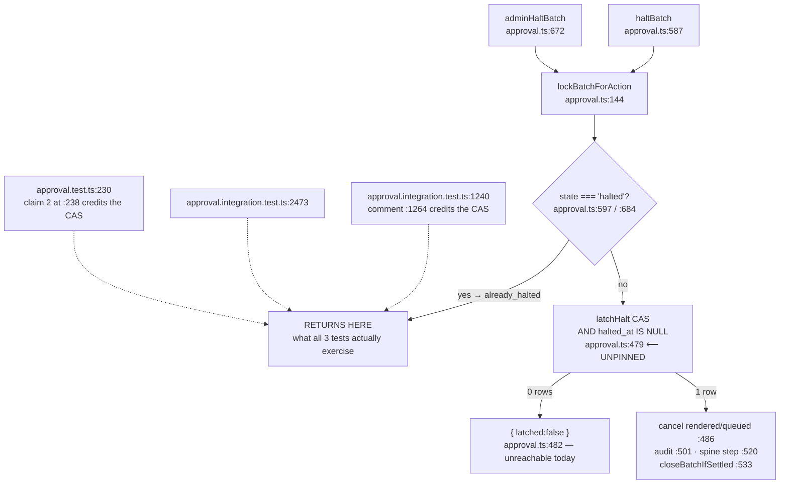

# Pathfinder 2026-08-18 — guard-integrity census

Answers two questions the 2026-08-15 pass left open: did PR #836 actually fix the
15 guards that passed for the wrong reason, and does the entropy window's new
code carry the same shape.

**42 mutations. 40 killed. 1 blind by design and compensated. 1 genuinely blind.**

## Method

Mutation, not reading. Identify the production line a test claims to guard →
break it → run the **full suite** → diff the failure set against a captured
baseline → revert and prove clean. Same method as the prior census.

**Live-DB lane confirmed executing, not skipping.** Both `TEST_DATABASE_POOL_URL`
and `DATABASE_POOL_URL` exported from `.env.local` (50 tables, migrations head
109). An isolated `--project integration` run executed **95 suite files: 93
passed / 1 failed / 1 skipped, 860 tests of which 854 ran**. The skipped file is
the live-Stripe abstainer. Every verdict is measured against the full **974-file /
12,705-test** run across both projects.

Baseline carried one pre-existing failure —
`autopilot-entitlement-concurrency.integration.test.ts`, 30 s timeout — red at
baseline in **this pass and 2026-08-15 both**. It passed spontaneously in one of
~43 runs, so it is flaky rather than broken. **Still unowned; worth a ticket.**

**Working tree verified clean by the orchestrator**, independently of the agent's
own claim: `git diff --stat` shows only the pre-existing zero-line
`scripts/new-worktree.sh` mode change. `auto-policy-publish.ts:490` and
`approval.ts:1011` were both re-read and are byte-identical to HEAD.

## Q1 — the 15 prior findings: 14 HELD, 0 REGRESSED

| ID | Guard | Verdict | Killed by |
|---|---|---|---|
| A1 | `auto-policy-publish.ts:490` `approval_method` conjunct | **HELD** | *"isPublishableAutoPolicy.approval_method alone terminates the lane…"* |
| A2 | `:624` `evaluateModerationGate` | **HELD** | *"evaluateModerationGate alone terminates the lane…"* |
| A3 | `:560` `evaluateRuntimeGate` | **HELD** | *"evaluateRuntimeGate alone terminates…"* |
| A4 | `:529` judge verdict | **HELD** | *"applyJudgeGateInTx alone terminates…"* |
| A5 | `:570` `evaluateVetoGate` | **HELD** | *"evaluateVetoGate alone terminates…"* |
| B1 | `ResponsePublisherWorker.ts:143` `!subCheck.allowed` | **HELD** | `:267` cancelled-subscription case |
| B2 | `:127` `archived_at !== null` | **HELD** | `:287` archived-location case |
| B3 | `:224-227` auto_policy edit-lane invariant throw | **STILL-BLIND — by design, compensated** | removing the throw stays green, exactly as #836's commit message states. **Compensating control verified live**: breaking the *routing* branch at `:111` fails 3 tests incl. `:359` |
| C1 | `src/lib/approval/locks.ts:87` status check | **HELD** | 5 parametrised cases, `service.test.ts:301` |
| D1 | `named-rival.ts:167-169` rank tier | **HELD** | `named-rival.test.ts:51` |
| D2 | `overview-service.ts:177` id tie-break | **HELD** | `overview-service.test.ts:520` |
| E1 | `business-summary.ts:153` CTE predicate | **HELD** | `business-summary.test.ts:151` |
| E2 | `:170` CTE predicate | **HELD** | same |
| E3 | `:154` `template = 'approval_request'` | **HELD** | same |
| F1 | `mobile-enrollment.ts:82` `AND account_id` | **HELD** | 6 cases via `mobile-enrollment.test.ts:74` |

**The five that sat on invariant #3's auto-policy gate chain are now each pinned
by a named test whose title matches the guard.** That was the prior pass's
largest single finding, and it is closed.

## Q2 — the window's new guards: 25 of 26 killed

### N1. `latchHalt`'s monotone CAS is unpinned — shape A. The only survivor.

**Production line** — `src/lib/solicitation/approval.ts:479`, last predicate of
the Halt latch's opening CAS:

```sql
UPDATE solicitation_batches SET halted_at = NOW(), halt_reason = …, halted_by = …
 WHERE id = … AND account_id = … AND business_id = …
   AND halted_at IS NULL
RETURNING id
```

**Mutation**: deleted `AND halted_at IS NULL`, making it an unconditional UPDATE.
**Result**: 974 files / 12,705 tests **green**. Nothing failed in either project.

**Three tests claim it, and all three name it in their own comments**:

- `approval.integration.test.ts:1240` *"halt latches once and a second halt writes
  nothing"* — comment at `:1264`: *"Monotone: the CAS on `halted_at IS NULL` is
  what makes the second call inert."*
- `:2473` *"adminHaltBatch is monotone…"*
- `approval.test.ts:230`, property claim 2 at `:238`: *"A second halt is a FIXED
  POINT — the CAS on `halted_at IS NULL` makes it add no audit row…"*

**Why they pass anyway**: the second halt never enters `latchHalt`. Both arms
refuse first — `haltBatch:597` and `adminHaltBatch:684` each run
`if (state === 'halted') return { status: 'already_halted' }` against the state
`lockBatchForAction` derived from the row it just read `FOR UPDATE`. So
`latchHalt`'s `{ latched: false }` branch at `:482` and both callers'
`if (!outcome.latched)` at `:617`/`:700` are unreachable through either public
arm. The unit property test reproduces the same short-circuit with a mocked row.

**Monotonicity is delivered today by the caller's state guard, not by the CAS the
tests credit.**



**Severity — tripwire only today, and it expires.** `lockBatchForAction` takes the
advisory batch lock plus `FOR UPDATE OF b`, so two concurrent halts serialize and
the loser refuses at the guard. But `LatchHaltReason` at `:411` already reserves
`send_window_elapsed` and `batch_expired` for writers **#630 has not written yet**
— and the arch log's #876 entry says exactly this: *"a third halt writer … has one
obvious place to land."* A writer that lands there without routing through
`lockBatchForAction` finds the CAS silently absent. Observable damage: a restamped
`halted_at`/`halt_reason`/`halted_by`, a **second `account_audit_log` receipt** and
a **second `batch_halted` spine step** — an audit trail that lies about who halted
and when.

**Missing assertion**: a concurrency case — two halts in overlapping transactions,
or a direct `latchHalt` test over a row already carrying `halted_at`.

### N2. A weaker pin worth knowing about before someone tidies it

`withdrawAsk:1126`'s `delivery_status IN ('rendered','queued')` is pinned **only by
a query-text assertion** (`approval.test.ts:523`), because `classifyWithdrawal`
already refuses non-live rows before the UPDATE runs. The SQL predicate is
behaviourally unreachable there. It is pinned by shape, not by behaviour, and will
not survive a refactor that changes the SQL's spelling without changing its meaning.

Contrast `latchHalt:490`'s copy of the same predicate, which is pinned
behaviourally by 4 failures. **Same predicate, two call sites, two very different
pin qualities** — relevant to Phase 2's four-way duplication finding.

### Everything else the brief flagged as at-risk was genuinely pinned

- **Both halt arms refuse `pending`** — pinned *independently per arm*:
  `haltBatch:600` → `approval.integration.test.ts:1401`; `adminHaltBatch:685` →
  `:2780`. Two arms, two tests, no shared fixture.
- **ADR 0020's double enforcement is real** — breaking **only the locked re-check**
  at `ask-generation.ts:1428` fails `ask-generation.test.ts:1110` *"aborts the swap
  when the batch is approved between the pre-check and the locked re-check"* plus
  the live-DB race suite. The pre-check at `:1360` is separately pinned. Two pins
  for two lines.
- **Exclusions validate before any write** — moving the `unknown_exclusion` refusal
  after the cancelling UPDATE fails `approval.integration.test.ts:1135`, which
  asserts the excluded row is still `rendered`. It tests the **ordering**, not just
  the return value.

## Mutations correctly killed — 40 of 42

Q1 (15, incl. B3's routing compensator). Q2 (25): `latchHalt` cancel predicate ·
`withdrawAsk` cancel predicate · `classifyWithdrawal` live predicate · owner-arm
`pending` · admin-arm `pending` · regeneration built-only pre-check · the **locked**
re-check · exclusion validate-before-write ordering · exclusion `rendered` scope ·
`closeBatchIfSettled` canonicalisation (kills 4, incl. two mixed-case live-DB
tests) · `closeBatchIfSettled` `not_settled` short-circuit (kills 8) · EmailAdapter
raw-vs-trimmed recipient (**the documented CRLF bypass**) · subject CRLF ·
Reply-To CRLF · `formatFrom` CRLF strip · idempotency key = outreach row id ·
`solicitationHeaders` missing-URL throw (kills 3) · non-HTTPS throw ·
missing-mailbox throw · `classifyBounce` hard/soft split (kills 5 — soft and
unknown bounces provably never suppress) · `isSolicitationLane` tag-first selection
(**kills 14**) · purge verifier residue column · purge verifier non-residue
`archived_at IS NULL` · `assertSolicitationSendEnv` missing-env throw.

## Reading

**The window's new guards are markedly better pinned than the pre-#836 baseline.**
One survivor in 26 against fifteen in the prior census. The lane's authors are
writing behavioural pins, not coverage.

The one survivor is instructive rather than alarming: it is not a hole, it is a
**defence-in-depth layer credited by three test comments that do not reach it**.
The tests are not wrong about what the CAS does. They are wrong that they test it.

## Two process notes from the census itself

1. **The census's own harness had a defect that contaminated five runs.** Its first
   revert routine compared string counts, which is meaningless when the replacement
   is the empty string (`str.count("") == len+1`). Two mutations stayed applied.
   Caught, drivers killed, reverted via `git checkout`, revert rewritten to prove
   itself with `git diff --name-only`, a refuse-to-start-dirty precondition added,
   contaminated logs quarantined, and **six verdicts re-run from a verified-clean
   tree**. Only clean runs are reported. This is the correct handling and it is
   recorded because a silently contaminated census is worse than no census.
2. **The test DB needed repair mid-run.** Killing vitest mid-integration left
   `test_ws4` unable to re-apply migration 074 (an `agent_outcomes` check-constraint
   violation), reproducible on a clean tree. `pnpm test:db:setup` restored it to
   head. This is the same shared-container fragility the process axis records as P5.

## Gaps

- **42 mutations is a sample, not a proof of absence.** Prioritised by safety
  invariant and legal obligation. **Not swept**: `sqlUnsubscribe`'s fixed-two pool
  (#651), `redeemUnsubscribeToken`'s plain transaction (#652), `batch-view.ts`'s two
  read models, `restraint-policy.ts`, the 12 mobile-channel routes, the four
  design-system PRs, and `tenant-scope-audit.ts` itself.
- `e2e/` Playwright specs not run. None of these guards is UI-reachable, but they
  are not formally excluded.
- The unreachability claims for B3 and N1 are **static-reasoning claims**. No
  concurrency harness was built to attempt a real second-writer race against
  `latchHalt`.
