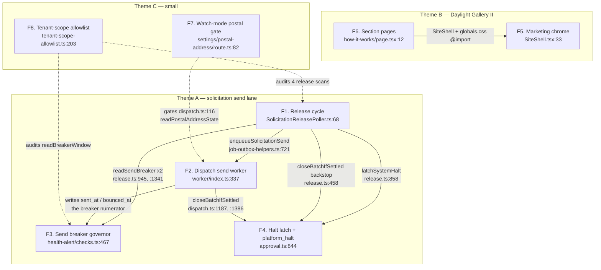

# Pathfinder 2026-08-22 — Phase 0: feature boundaries (windowed)

Eight features over the window's **77 production files**. Every file has exactly
one owner; four files carry content that spans two features and are flagged.

Discovery subagent proposed these boundaries. Orchestrator adjustments are in
§2. Read `SCOPE.md` first.

## 1. The map

## 2. Orchestrator adjustments to the discovery proposal

**Accepted unchanged:** the four Theme A boundaries. Each rests on a distinct
process entry point read in full, plus a module-header contract stating why the
file is one unit. The decisive evidence is that **`release.ts` and `dispatch.ts`
do not import each other** — they meet through a `job_outbox` row and a column.
Both import blocks were read to confirm it.

**Accepted:** the F5 / F6 split of Theme B. The two file sets are disjoint. Nine
of the ~50 rebrand files changed by ≤ 6 lines each and every one of those diffs
is the *same* edit — thread `trialEnabled` into `SiteNav`. That is one
cross-cutting flow, not a page rebuild, and its consumers include surfaces
outside Theme B entirely (auth island, approval page, legal).

**Rejected: halving F6.** Discovery offered `sections/how-it-works/` (13 files)
vs `sections/features/ + pricing/` (16), and argued against its own option. The
argument holds: the finding is that two sibling directories built in ONE merge
grew **two spellings of one concern** (a `Reveal` component and a `useReveal`
hook), and that finding needs both on one chart to be stated at all. F6 stays
heavy. Its agent is told to chart three parallel happy paths, not one.

**Merged for execution, not for charting: F7 + F8 → one subagent.** Two files
and one file respectively, unrelated to each other, both trivially small. They
get one agent and two separate flowchart sections. Seven Phase 1 agents, eight
features.

**One correction to the arch log, recorded here.** The log's #920 entry says
`tenant-scope-allowlist` gained *"+4 platform-wide predicates under a standing
sign-off"*. The real move is `ALLOWLIST_BASELINE` **381 → 390 — nine entries**
(`scripts/ci/tenant-scope-allowlist.ts:203`), from four new constant pairs plus
two module-category additions. The log undercounts by five. This is the second
counting error found in this file in two days.

## 3. The features

### F1. Solicitation release cycle — the drip, three sweeps, four governors  *(heavy)*

**Purpose:** once a minute, sweep wedged and overdue send state, then release at
most two approved `rendered` attempts platform-wide into the `solicitation_send`
queue under four governors in a fixed order.

**Entry point:** `worker/index.ts:732` `startSolicitationReleasePoller()` →
`worker/background/pollers/SolicitationReleasePoller.ts:68` → `:56`
`runSolicitationReleaseCycle` → `src/lib/solicitation/release.ts:349`
`runReleaseCycle`.

**Core files** (★ = changed in window)
- ★ `worker/background/pollers/SolicitationReleasePoller.ts` (74, **new**) —
  deliberately shallow; `:37` `CYCLE_TIMEOUT_MS = 45_000` below the interval;
  `:38` rejects a configured interval ≤ timeout
- ★ `src/lib/solicitation/release.ts` (1,885, **new**) — `:349` `runReleaseCycle`
  (the single export beyond vocabulary) · `:447` `runBackstopJoin` · `:543`
  `sweepUnknownOutreach` · `:839` `sweepSystemHalt` · `:943`
  `resolveWindowHaltReason` · `:972` `sweepSendWindowElapsed` · `:1030`
  `sweepBatchExpired` · `:1171` `capacityStop` · `:1325` `runReleasePhase` ·
  `:1520` `selectReleaseCandidates` · `:1689` `applyJudgeSplit` · `:1822`
  `releaseOutreachRow`
- ★ `src/lib/solicitation/send-caps.ts` (94, **new**)
- ★ `src/lib/solicitation/outreach.ts` — `:64` `UNKNOWN_GRACE_MINUTES = 60`, the
  only window change; the third clock, added for P1
- ★ `src/lib/shared/job-outbox-helpers.ts:721` `enqueueSolicitationSend`
- ★ `src/lib/config/worker.ts` — `SOLICITATION_RELEASE_POLL_INTERVAL_MS`,
  `SOLICITATION_PLATFORM_DAILY_CAP`

**Terminal states:** a `job_outbox` row at `pending` for topic
`solicitation_send` + `solicitation_outreach.queued_at` stamped; or a latched
halt (delegated to F4); or `send_closed_at` via the backstop; or a
`ReleaseCycleReport` log line with `releasePhaseStoppedBy` set.

**Calls into:** F2 (outbox row, no import), F3 (`readSendBreaker` ×2), F4
(`latchSystemHalt` at `:858`, `closeBatchIfSettled` at `:458`/`:708`).

**Why this boundary:** one process entry, one timer, one report object.
`release.ts:46-58` states all caps are enforced *here only*, as a single choke
point replacing atomic-reservation machinery — a serialisation argument the
whole file rests on. The single export is deliberate (`:344-347`: *"a caller
that could run the phases separately could run them wrongly"*).

### F2. Solicitation dispatch — gate, token mint, provider send, terminal tx  *(heavy)*

**Purpose:** take one `queued` Outreach row to a terminal fact — `sent`,
`withheld`, `failed`, `unknown`, or a defer — through two transactions with
exactly one provider call between them.

**Entry point:** `worker/index.ts:337`
`new Worker<SolicitationSendPayload>(QUEUE_NAMES.SOLICITATION_SEND, …, { concurrency: 1 })`
→ `worker/jobs/solicitation-send.ts:25` `handleSolicitationSend` →
`src/lib/solicitation/dispatch.ts:1859` `dispatchOutreach`. Failure arm:
`worker/index.ts:352` → `worker/jobs/solicitation-send/failed-hook.ts:284`.

**Core files**
- ★ `src/lib/solicitation/dispatch.ts` (2,001, **new**) — `:237`
  `applyDispatchGate` (pure, B6's seven-item order) · `:438`
  `completeOutboxNoop` · `:908` `assembleOutboundMessage` · `:1011`
  `sendWithBoundedRetry` · `:1018` **the first production
  `getMessagingAdapter().send` call in the repo** · `:1103` `commitSendTerminal`
  · `:1328` `commitWithhold` · `:1439` `lockAndTriageOutreach` · `:1553`
  `runDispatchTx`
- ★ `src/lib/solicitation/send-retry.ts` (181, **new**) — `:175`
  `classifySendFailure` (D12c, pure and total)
- ★ `src/lib/solicitation/ask-compliance-lint.ts:246` `lintInputFromSnapshot`
- ★ `src/lib/solicitation/ask-generation.ts` — window change is *only* becoming
  a consumer of that extraction (`:567`)
- ★ `worker/jobs/solicitation-send.ts` (41, **new**) ·
  ★ `worker/jobs/solicitation-send/failed-hook.ts` (346, **new**) — sole writer
  of `send_exhausted`
- ★ `worker/index.ts` · ★ `worker/queues.ts:89` ·
  ★ `src/lib/shared/queue-names.ts:24` · ★ `src/lib/shared/worker-types.ts:366`
- ★ `src/lib/agents/run-spine.ts:71-74` — three new step keys +
  `findActiveSolicitationSendBatchRun`

**Terminal states:** `delivery_status` ∈ {`sent`,`withheld`,`failed`,`unknown`}
with `provider_message_id` on the terminal CAS; an `agent_outcomes`
`solicitation_sent` row; `job_outbox` completed; `closeBatchIfSettled` join. On
a defer: outbox completed + a `dispatch_gate_evaluated` step, Outreach untouched.

**Calls into:** F4 (`closeBatchIfSettled` ×2), F3 (data edge, no import).

**Why this boundary:** own queue, own boot assertion
(`assertSingleConcurrencyWorker`, `worker/index.ts:350`), own failed-hook, own
payload type. `dispatch.ts:18-31` makes the tx1/provider/tx2 shape and the
token-mint pairing load-bearing — unchartable if the file is split.

### F3. Send breaker — the platform reputation governor and its console  *(medium)*

**Purpose:** detect a 7-day hard-bounce or complaint-rate breach, latch one
platform-wide open trip, halt every send while it is open, and give an AAL2
operator a page to see and clear it.

**Entry points (three, different processes):**
- write — `worker/background/pollers/health-alert/checks.ts:467` → `:351`
  `checkSolicitationSendBreaker` → `send-breaker.ts:111` `evaluateSendBreaker`
- numerator feed — `worker/index.ts:635` `/ingress/resend` →
  `worker/ingress/resend/solicitation-lane.ts:318` `recordBounce` → `:309`
  `resolveBounceKind`
- read/admin — `src/app/admin/solicitation/page.tsx:47` ·
  `api/admin/solicitation/breaker/route.ts:23` · `.../reset/route.ts:88`

**Core files**
- ★ `src/lib/solicitation/send-breaker.ts` (506, **new**) — `:111`
  `evaluateSendBreaker` · `:177` `readSendBreaker` (fail-closed) · `:232`
  `resetSendBreaker` · `:326` `readBreakerWindow` (the seq-scan of #908) ·
  `:409` `classifyBreach`
- ★ `supabase/migrations/110_solicitation_send_governors.sql` parts **(b)**
  `bounce_kind` + CHECK pairing and **(c)** `solicitation_send_breaker` with
  `solicitation_send_breaker_one_open` and deny-all RLS
- ★ `worker/background/pollers/health-alert/checks.ts` — `:1-13` the read-only
  contract now carries a named exception; `:463-476` isolates the one writer
- ★ `worker/ingress/resend/solicitation-lane.ts:286,:309,:333`
- ★ `src/app/admin/solicitation/{page.tsx,SendBreakerClient.tsx}` (81 + 356)
- ★ `src/app/api/admin/solicitation/breaker/{route.ts,reset/route.ts}` (38 + 90)
- ★ `src/components/admin/nav-config.ts:39`

**Terminal states:** an inserted `solicitation_send_breaker` row (**the table IS
its own audit record** — no `account_id`, not a `TENANT_TABLES` member); a
`HealthFinding` every tick a trip is open; `reset_at`/`reset_by`/`reset_note`
set atomically by the `reset_consistency` CHECK; or `409 not_tripped`.

**Calls into:** nothing. F1 and F2 call it.

**Why this boundary:** one table with one open row by unique index, four
threshold constants with one owner, and a fail-closed contract that only makes
sense charted end-to-end. The webhook arm folds in because `bounce_kind` has
exactly one consumer and `solicitation-lane.ts:288-300` argues its existence
entirely in breaker terms.

### F4. Halt latch — three arms, one CAS, `platform_halt` end to end  *(medium)*

**Purpose:** terminalize a send batch monotonically from any of three actors
(owner, operator, clock) through one private body, and present the six-member
reason vocabulary honestly on both read surfaces.

**Entry points:** `src/lib/solicitation/approval.ts:844` `latchSystemHalt`
(system arm; only caller is `release.ts:858`) · `:662` `haltBatch` · `:747`
`adminHaltBatch` · `batch-view.ts:165` `HaltReason` (read side) ·
`outreach.ts:330` `closeBatchIfSettled` (shared terminalizer).

**Core files**
- ★ `src/lib/solicitation/approval.ts` (1,352, +210) — `:119` `SystemHaltReason`
  now three members · `:543` private `latchHalt` shared by all three arms ·
  `:785-882` `latchSystemHalt`
- ★ `supabase/migrations/111_platform_halt_reason.sql` (**new**) — widens
  `solicitation_batches_halt_consistency`'s reason list **and not** its actor
  list, plus 110's cancelled arm; strict supersets, no backfill
- ★ `src/lib/solicitation/batch-view.ts:165` `HaltReason` — six members
- ★ `ApprovalPanel.tsx:292` `HALT_BODY.platform_halt`
- ★ `SolicitationBatchPanel.tsx:58` `HALT_REASON_LABELS.platform_halt`

**Terminal states:** `solicitation_batches.halted_at` + `halt_reason` (with
`halted_by IS NULL` for all three system reasons); N `solicitation_outreach` rows
`cancelled` carrying the same reason as `disposition_reason`; a `batch_halted`
spine step; possibly `send_closed_at`. Read side: a halt card in one of two
vocabularies.

**Calls into:** nothing outward this window.

**Why this boundary:** the transaction boundary IS the boundary. Migration 111's
header states the two CHECKs must widen together because `latchHalt` writes the
batch reason through to every cancelled Outreach row in one transaction — one
migration, one write body, two read surfaces that must stay exhaustive over one
union.

**Discovery settled SCOPE.md seed 3.** The halt lane is split across two files,
but it is a **caller/callee split, not a duplication**: the halt WRITE has one
owner (`approval.ts`), the halt REASON SELECTION has another (`release.ts:943`).
Legitimate parameterisation. The boundary runs between them.

### F5. Marketing chrome — the Daylight shell and the trial-aware CTA  *(light)*

**Purpose:** render the shared marketing chrome (marquee, island, nav pill,
footer) and make the signup CTA label follow the server-authoritative trial flag
on every public surface.

**Entry points:** `src/components/ui/SiteShell.tsx:33` · `SiteNav.tsx:47`
(rendered directly by six pages that do not use `SiteShell`) · nine page
composition roots reading `trialEnabled()`.

**Core files:** ★ `SiteShell.tsx` · ★ `SiteNav.tsx:48` `signupLabel` ·
★ `SiteFooter.tsx:38` · ★ `src/app/globals.css` (**the single `--rw-*` token
owner**; `:130-150` five new Daylight bar tokens; `:186-189` four load-bearing
page-CSS `@import`s) · ★ `(public)/_styles/island.css` (1,591, +568) ·
★ `security/page.tsx`, `LegalPage.tsx`, `help/contact/*`, `book-a-demo/*`,
`demo/[slug]/*`.

**Terminal state:** a rendered `<header>`/`<footer>` pair as island siblings
(landmark roles preserved, `SiteShell.tsx:47-49`), nav pill reading
`"Start free trial"` or `"Create account"`.

**Why this boundary:** nine files changed by ≤ 6 lines and every diff is the
same edit. One cross-cutting flow, one terminal state — not the section rebuild.

**Discovery confirmed SCOPE.md seed 21.** `globals.css:88-160` is the sole
`--rw-*` declaration site. The only token-shaped declaration in the four page
CSS files is `island.css:117 --rw-marquee-speed`, a scoped animation dial.

### F6. Daylight Gallery II section pages — how-it-works, features, pricing  *(heavy)*

**Purpose:** render three marketing pages as flag-parameterised section
compositions over the Daylight token set.

**Entry points:** `(public)/how-it-works/page.tsx:12` → `HowItWorksContent.tsx:172`
· `(public)/features/page.tsx:13` → `FeaturesContent.tsx:210` ·
`(public)/pricing/page.tsx:14` → `PricingContent.tsx:247`.

> **CORRECTED by F6's agent.** This row originally said *"All three read
> `selfServeSignupEnabled()` + `trialEnabled()` + `trialPeriodDays()` and derive
> one `signupCtaLabel`."* **False for `/pricing`**, which does not import
> `trialPeriodDays` and derives no `signupCtaLabel` — `PricingContent.tsx:405`
> hardcodes `"Create account"`, so its primary CTA never carries the trial label
> even when the trial is on. **Only two of the three follow that flow.**

**Core files** (all ★ except `useReveal.ts`)
- how-it-works (13): `page.tsx`, `HowItWorksContent.tsx` (441; a `STEPS` table
  drives six `Artifact` component refs), `Reveal.tsx` (34), `HeroWash.tsx`
  (**new**), `StatCards.tsx` (**new**),
  `{Watch,Triage,Draft,Gate,Post,Judge}Artifact.tsx`, `CopilotGateCard.tsx`
  (**deleted**, −136 → folded into `GateArtifact.tsx` +181),
  `_styles/how-it-works.css` (390)
- features (14): `page.tsx`, `FeaturesContent.tsx` (326), `FeatIntro.tsx`
  (**new**), `Feat{Reply,Guardian,Insights,Gate,Autopilot,Watchdogs,Lang,Voice,Roi}.tsx`,
  `RoadmapBand.tsx`, `_styles/features.css` (515)
- pricing (2): `PricingContent.tsx` (446), `_styles/pricing.css` (332)
- *unchanged but load-bearing:* `features/useReveal.ts` (33 LOC, 12 dependents —
  **all twelve changed this window**)

**Terminal state:** a rendered page inside `SiteShell`, with a `LeadIntakeForm`
or a `/signup` link as the only outbound action.

**Discovery resolved SCOPE.md seed 19: there are THREE reveal implementations,
two of them named `Reveal`.** `how-it-works/Reveal.tsx:6` (component, changed
this window), `landing/reveal.tsx:48` (component, unchanged),
`features/useReveal.ts:4` (hook, unchanged). Seed 18's fallow signal is
therefore about a hook whose *dependents* all churned, not about the hook.

### F7. Watch-mode gate on the Attested postal-address surface  *(light)*

**Purpose:** make the postal-address panel and its writer appear and disappear
together with `SOLICITATION_WATCH_ENABLED`.

**Entry points:** `src/app/api/settings/postal-address/route.ts:82` (the gate,
*before* auth and before the offboarding read) · `(authenticated)/settings/profile/page.tsx:29`
(the paired read skip).

**Terminal states:** `404 not_found` with no auth signal leaked, or
`postalAddress = null` so the panel does not render.

**Why this boundary:** two files, one flag, one paired invariant (#13). The
property it establishes — *the UI can never offer a control the route refuses* —
belongs to the pair, not to either half. Its output is F2's input
(`dispatch.ts:116` `readPostalAddressState`).

### F8. Tenant-scope allowlist expansion under the standing sign-off  *(light)*

**Purpose:** record why five new cross-account statements in the release and
breaker lanes are structurally unscopeable, and move the CI baseline in lockstep.

**Entry point:** `scripts/ci/tenant-scope-allowlist.ts:203`
`ALLOWLIST_BASELINE = 390`.

**Core file:** ★ `scripts/ci/tenant-scope-allowlist.ts` (3,291, +214).

> **CORRECTED by F8's agent, twice.** (a) There are **FIVE** new constant pairs,
> not four — `BACKSTOP_SCAN_SQL`/`_REASON` (`:458`, `:461`) is the fifth, and it
> was missed here because it is the only pair that does not follow the
> `*_SWEEP_SCAN_*` / `*_CANDIDATE_SCAN_*` naming shape. (b) The terminal state is
> **zero findings**, not "390 findings" — findings are failures. It passes
> printing `entries: 390 (baseline: 390)`.
> Also: the move is split across **two** merges — `b873a9a5` (#904) 381→383, and
> `a321634a` (#920) 383→390 — and the nine entries encode **seven** statements,
> because the audit attributes one statement per table it binds.

**Why this boundary:** no runtime path, but a real deliverable with a checkable
terminal state. SCOPE.md seed 9 asks whether the "scope is an ENUMERATION"
meta-class has become a rule; that cannot be answered from inside F1's or F3's
chart, because the count and the shape of the reason strings are the evidence.

## 4. Boundaries rejected

| Candidate | Why not |
|---|---|
| "The solicitation subsystem" (10 changed files as one) | Four distinct process entries; no import between `release.ts` and `dispatch.ts` |
| `applyDispatchGate` alone | Pure, one caller; its value is the ordering it imposes on evidence its caller gathers |
| "Bounce discrimination" (`solicitation-lane.ts` + 110b) | 69 lines, exactly one consumer — the breaker numerator |
| A `send_exhausted` failure lane (`failed-hook.ts`, 346) | Registered on F2's worker; shares `send_indeterminate` with F1's D12d sweep |
| `closeBatchIfSettled` as a feature | One function, **13 call sites across 5 files** — F4's terminalizer, belongs on F4's chart with every arrow pointing at it |
| `send-caps.ts` as a feature | 94 lines, all four exports consumed only by `release.ts` |
| `resolveWindowHaltReason` as a feature | 15 lines; living in `release.ts` while writing F4's vocabulary is the *interesting fact* — a third feature would hide the edge |
| Splitting `dispatch.ts` at the tx1/tx2 seam | The provider call sits *between* the transactions holding the raw unsubscribe token in memory (`:33-46`); cutting there splits invariant #5's only structural guarantee |
| Splitting `release.ts` per phase | `:344-347` — the phase order is a domain rule; five phase charts would chart an ordering with no owner |
| Theme B as one feature | Two disjoint file sets; nine ≤6-line diffs are one prop, not a rebuild |
| The reveal triplication as a feature | Two of the three files did not change this window — a Phase 2 lead, not a boundary |
| `worker/index.ts` / `queues.ts` as a composition-root feature | Registration only |
| A "run spine extension" feature | Three step keys + one query, all serving F1 and F2 |

## 5. Coverage check — changed non-test files owned by no feature

**None.** F1 = 6, F2 = 11, F3 = 9, F4 = 5, F5 = 14, F6 = 29, F7 = 2, F8 = 1 →
**77**.

Four files carry content spanning two features. Each Phase 1 agent is told:

| File | Owner | The other feature's share |
|---|---|---|
| `supabase/migrations/110_…sql` | **F3** (parts b + c) | Part **(a)** — the `no_postal_address` / `postal_address_mismatch` withhold vocabulary — is **F2's** Dispatch-gate write vocabulary |
| `worker/index.ts` | **F2** (`:337`, `:350`, `:352`, `:563`) | `:732` / `:845` are **F1's** only registration |
| `src/lib/agents/run-spine.ts` | **F2** (`dispatch_gate_evaluated`, `ask_sent`) | `approval_downgraded` is written only by **F1** |
| `src/lib/solicitation/outreach.ts` | **F1** (`UNKNOWN_GRACE_MINUTES`) | `closeBatchIfSettled:330` is **F4's** terminalizer |

## 6. Findings already banked in Phase 0

These are confirmed, and Phase 1 does not need to re-derive them.

1. **`closeBatchIfSettled` has 13 call sites across 5 files**, not the "second
   caller" the arch log records. Definition `outreach.ts:330`. Callers:
   `approval.ts:455/:608/:1344`, `ask-generation.ts:865/:997/:1171/:1488/:1682`,
   `dispatch.ts:1187/:1386`, `release.ts:458/:708`, `failed-hook.ts:266`.
   **SCOPE.md seed 6 understates it by four.**
2. **`completeOutboxNoop` is still at exactly TWO copies** (`dispatch.ts:438`,
   `ask-generation.ts:791`). Seed 7's hoist threshold is **not** met.
3. **`SendBreakerClient.tsx` is NOT a sixth `useReducer` instance** — it uses
   `@tanstack/react-query` + three `useState` (`:150`, `:307`, `:308`).
   **Seed 16 refuted.**
4. **`ALLOWLIST_BASELINE` moved 381 → 390, nine entries**, not four. The arch
   log undercounts.
5. **`docs/directory.md:934` is stale and contradicts the code.** It asserts
   `readSendBreaker` has *"no try/catch and no `unknown` verdict"*.
   `release.ts:944-956` wraps it in one. The seed-8 carve-out is guarded by three
   prose statements and **the code map contradicts one of them.**
6. **Seed 15 holds.** `ApprovalPanel.tsx` grew +7 lines this window
   (1,109 → 1,116). It did not accelerate.

## 7. Known gaps carried into Phase 1

Each is assigned to the agent that must close it.

| Gap | Assigned |
|---|---|
| `release.ts:1150-1885` read only as a function index. The governor-order claim comes from the module header, not the loop. `release.ts:34` says a wrong order is **silent**. | **F1 — must verify against `runReleasePhase` directly** |
| `dispatch.ts:135-1859` read only as a function index. `runDispatchTx` (~227 lines) and `commitSendTerminal` (~101) unread. **Seed 4 unresolved** — why does fallow flag nothing in a 2,001-line file? | **F2 — must read both and answer seed 4** |
| ~13,000 lines of new tests unread. No boundary checked against its test surface. Same gap the prior pass carried. | **Phase 2 guard-integrity** |
| `island.css` (+568) and the three page CSS files unread beyond a token grep. | **F6** |
| `SendBreakerClient.tsx` read only to `:60`. | **F3** |
| Seeds untestable in Phase 0: #908 (needs `EXPLAIN`), #914, seed 23 (`verify-gate.sh` vs the fallow gate), seed 24 (a ninth false-rationale instance). | **Phase 2 / process** |
