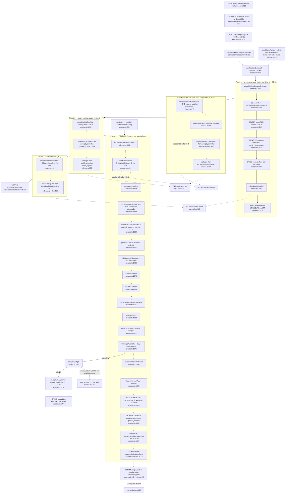

# F1 — Solicitation release cycle

Phase 1 flowchart. Window: `54e4d374..74aee92a`. Weight: heavy.

## Headline — the assigned gap is CLOSED, and the header's claim SURVIVES

`release.ts:34` warns that a wrong phase/governor order is **silent**. Both
orders were verified against the actual control flow, with `release.ts` read in
full (1,885 lines, four passes). **The header and the loop agree.**

**Phase order** — header `:3-21` vs `runReleaseCycle` `:374-407`:

| Header | Code | |
|---|---|---|
| 1. `unknown` sweep | `:376` `alertPhaseFailure('unknown_sweep', … sweepUnknownOutreach)` | OK |
| 2. `send_window_elapsed` / `platform_halt` | `:388` `resolveWindowHaltReason`, `:391` `sweepSendWindowElapsed` | OK |
| 3. `batch_expired` | `:399` `sweepBatchExpired` | OK |
| 4. RELEASE | `:401` `runReleasePhase` | OK |
| 5. backstop join | `:406` `runBackstopJoin` | OK |

Straight-line, non-conditional, one function body.

**Governor order** — header `:30-33` vs three functions:

| Header | Code | |
|---|---|---|
| circuit breaker | `:1341` `readSendBreaker(sql)` → `releasePhaseStoppedBy='breaker_open'` | OK |
| platform ceiling | `:1349-1356` | OK |
| account cap | `:1283-1290` in `runAccountArm` | OK |
| `subscriptionGrantsFullAccess` | `:1295-1299` | OK |
| then the Judge split | `:1232` in `runBatchArm` | OK |

**Not merely convention — pinned by two live-DB differential tests.**
`release.integration.test.ts:1130-1187` seeds a state where *every* remaining
gate would fire and asserts the first one is the one reported; round 3 asserts
`withheldByReason.subscription` is `undefined` while `account_cap` fires, which
pins the B6 closing-paragraph order **against** B6's per-child numbering.
`:1444-1472` pins the Judge last.

## But the header's governor list is INCOMPLETE, and one docstring miscounts

`ReleaseWithheldReason` (`:132-139`) has **seven** members. The header names
**five**. The two omitted are both real and both in `runReleasePhase`:

1. **`flag_off` (`:1332`) runs BEFORE the breaker** and is absent from the
   governor list a reader consults for order.
2. **`per_tick_budget <= 0` (`:1358-1361`) sits BETWEEN the platform ceiling and
   the account cap** and is in neither list.

`runReleasePhase`'s own docstring (`:1318-1319`) says *"`releasePhaseStoppedBy`
names a PHASE-level stop — **the three checks below** run once and refuse every
account."* **There are four** (`:1332`, `:1341`, `:1353`, `:1358`). The fourth
returns from the phase, refuses every account, and **never sets
`releasePhaseStoppedBy`** — it only calls `withhold(report,'per_tick_budget')`.
That is the same asymmetry the `account_cap` counter at `:1385-1394` was added
to remove.

**That branch is also dead.** The poller calls `runReleaseCycle(exec)` with no
options (`SolicitationReleasePoller.ts:57`); the default is
`RELEASE_PER_TICK_BUDGET = 2` (`:213`, `:353`). No test passes a zero or
negative budget — the property test bounds it at `fc.integer({min:1,max:4})`
(`release.test.ts:250`). **`release.ts:1358-1361` is unreachable in production
and untested.**

## The happy path



## Q1 — The governors, their order, and what each stop does

Seven withhold reasons (`:132-139`), not four. By actual evaluation order:

| # | Governor | Enforced at | Sets `releasePhaseStoppedBy`? | Effect |
|---|---|---|---|---|
| 1 | `flag_off` | `:1332` | yes | returns from phase; P1/P2/P3/P5 still run |
| 2 | `breaker_open` | `:1341` | yes | returns. A **throw** here is NOT caught — propagates through `alertPhaseFailure('release')` `:401` and aborts P5 for the tick |
| 3 | `platform_ceiling` | `:1349-1356` | yes | returns |
| — | `per_tick_budget` (static) | `:1358-1361` | **NO** — `withhold()` only | returns silently in that field. **Dead branch** |
| 4 | `account_cap` | `:1283-1290` | no (per-account) | `return` from `runAccountArm`; siblings still release |
| 5 | `subscription` | `:1295-1299` | no (per-account) | `return` from `runAccountArm` |
| 6 | `judge_unhealthy` | `:1232` via `:1375` | no (per-batch) | `withhold` + `applyJudgeSplit`, then `return 'next'` |
| — | running form of 3 gates | `capacityStop:1171` via `applyStop:1420` | no | `applyStop` sets `stopPhase` for the two tick-wide ones; `account_cap` deliberately does not (`:1424`) |

**Fixed by code and pinned by test.** The order is statement order across three
functions, so nothing structural prevents a reorder — which is exactly why
`:34` calls a wrong order silent. **Untested edges:** `flag_off` before
`breaker_open` (the flag-off test at `:1976` seeds no trip), and every ordering
involving `per_tick_budget`.

## Q2 — "Three sweeps", four names; the clocks; the #926 seed

**The discrepancy resolves: `sweepSystemHalt` is not a sweep.** `:818-838` says
so — *"The shared body of the two system-halt sweeps, phases 2 and 3."* It takes
a `spec: {label, reason, select}` and has exactly two one-line wrappers,
`sweepSendWindowElapsed` (`:972-982`) and `sweepBatchExpired` (`:1030-1036`).

| Sweep | Clock | Anchor | Owner |
|---|---|---|---|
| `sweepUnknownOutreach:543` | `sending_at <= NOW() - make_interval(mins => 60)`, plus a second belt: no `job_outbox` row in the in-flight triple | `solicitation_outreach.sending_at` | `outreach.ts:64` |
| `sweepSendWindowElapsed:972` | `approved_at <= NOW() - make_interval(hours => 72)` (`:1007`) | `solicitation_batches.approved_at` | `outreach.ts:51` |
| `sweepBatchExpired:1030` | `built_at <= NOW() - make_interval(days => 7)` (`:1071`) | `solicitation_batches.built_at` | `outreach.ts:43` |

All three run on the **database** clock (`NOW()`), never a JS `Date` —
consistent with the #520 microsecond gotcha.

**Seed VERIFIED — the 72h window and the ≤10-day bound are untouched by #926.**
`git show --stat 2c7bb615` shows `outreach.ts` is **not in the diff**, so both
constants are unchanged. `selectSendWindowElapsedBatches` (now `:999`) is
outside every hunk. Migration 111 is two CHECK widenings, no data change, strict
supersets. #926 changed the **reason parameter only**. `STALLED_THRESHOLD_SEND_BATCH_DAYS = 11`
(`src/lib/agents/read.ts:29`) is still above 7 + 3 = 10.

## Q3 — The three clocks, and a FOURTH that is unowned

`UNKNOWN_GRACE_MINUTES = 60` (`outreach.ts:64`) is the third of three declared
12 lines apart in one file. `outreach.ts:57-58` states the intent: *"the third
and last clock the send lane runs on, and one home keeps them comparable."*

**They can disagree, and the disagreement is contained by phase order, not by
the clocks.** A batch approved >72h ago with a row wedged in `sending` >60min is
selected by BOTH P1 (the row) and P2 (the batch) in one tick. P2's latch cancels
only `rendered`/`queued` and **never `sending`** (`approval.ts:559-571`), so P2
alone cannot settle that batch. P1 runs first (`:376` before `:391`),
terminalizes the row `unknown`, and P2's `closeBatchIfSettled` then succeeds. If
P1's item throws, `isolateItem` isolates it, P2 latches halted, and P5's
backstop closes the batch afterwards. **Reconcilable — but only because of phase
order and the backstop, not because the clocks are related.**

**There is a FOURTH clock, and it is unowned and unguarded.** `:573-575` states
`UNKNOWN_GRACE_MINUTES` *"must exceed"* the outbox watchdog's 15-minute re-pend
window. That window lives at `worker/background/pollers/OutboxPoller.ts:64-68`:
default `900_000` ms, **env-tunable via `OUTBOX_WATCHDOG_STALE_MS` with a floor
of 60_000 and no upper bound**. Nothing links the two — no constant reference,
no assertion, no test. Setting it above 3,600,000 silently inverts the invariant
and lets P1 write `unknown` over a row the watchdog is about to recover. The
inner-CAS belt (`:687-692`) narrows the race but does not close it, because it
re-asserts the same predicate at the same instant.

## Q4 — `runBackstopJoin:447`

**It is the backstop for a LOST `closeBatchIfSettled` call from the dispatch
worker's terminal transaction** (`:414-421`). F2 calls the same function inline
as it terminalizes the last live Outreach row — `dispatch.ts:1187` and `:1386`.
If that transaction dies after the Outreach terminal but before the join, the
batch keeps `send_closed_at IS NULL` while satisfying migration 091's
`solicitation_batches_one_active_send_per_business` predicate — permanently
occupying that location's one active-send slot. **That is issue #915's wedge.**

**If both reach the same batch, nothing breaks and nothing double-writes.**
`closeBatchIfSettled` opens with `SELECT … FOR UPDATE` on the batch row
(`outreach.ts:335-348`), so the two serialize. The `send_closed_at IS NULL` CAS
(`outreach.ts:417-425`) gates everything after: the loser returns
`{status:'already_closed'}` at `outreach.ts:426`, writing **no**
`send_batch_closed` step and **no** `completeRun`. `runBackstopJoin` counts only
`status === 'closed'` (`:465`).

**One benign asymmetry:** the backstop passes **no `failure`** (`:458-462`), so
it can never reach `closed_without_parent`. Both F2 call sites also pass no
failure, so for the batch class the backstop exists to rescue, the two callers
are behaviourally identical.

It **re-scans** rather than replaying phase 1–4 ids, and `selectOpenSendBatches`
(`:492-505`) is migration 091's index predicate byte-for-byte.

## Q5 — `applyJudgeSplit` + `downgradeApproval` → the run spine

**Confirmed: it goes through the single writer.**

`applyJudgeSplit:1689` → hold at `:1693` (no lock, no write) or
`sql.begin(tx => downgradeApproval(tx, batch))` at `:1695` → `downgradeApproval:1752`:
`SELECT … FOR UPDATE OF b` with a correlated send-parent subquery
(`:1756-1773`) → CAS all four approval columns to NULL together, with
`halted_at IS NULL`, `send_closed_at IS NULL`, `sending_started_at IS NULL` and
the `built_at` window re-asserted (`:1776-1791`) → **`recordStep(tx, {runId,
stepKey:'approval_downgraded', detail:{reason:'judge_unavailable'}})` at
`:1798-1802`**, imported from `@/lib/agents/run-spine` at `:70`.

`recordStep` (`run-spine.ts:550`) delegates to the private `appendRunStep`
(`:527`) — the sole INSERT into `agent_run_steps`. `approval_downgraded:
'solicitation'` is registered at `run-spine.ts:86`. No raw
`INSERT INTO agent_run_steps` exists in F1.

**Correction to the brief:** `approval_downgraded` is not F1's only run-spine
write. F1 makes **two direct** calls: this `recordStep`, and **`completeRun(tx,
child, 'failed', {code:'send_indeterminate', outreach_id})` at `:702`**. It also
drives indirect spine writes through `closeBatchIfSettled` and through
`latchSystemHalt` → `latchHalt`. What `00-features.md` §5 says is narrower and
correct: the *step key* `approval_downgraded` is written only by F1.

## Q6 — `enqueueSolicitationSend` and invariant #2

**Byte-for-byte contract: VERIFIED.** `job-outbox-helpers.ts:745-748`:

```
    ON CONFLICT (topic, aggregate_id)
    WHERE topic = 'solicitation_send' -- topic-audit-ignore: partial-index inference needs a literal
      AND status IN ('pending', 'dispatching', 'dispatched')
    DO NOTHING
```

Members and order match `OUTBOX_IN_FLIGHT_STATUSES` exactly and are identical to
the other eight `ON CONFLICT` sites in the same file. `aggregate_id` is the
**outreach** id, not the batch id (`:735`).

**Single owner: VERIFIED.** Exactly one production caller — `release.ts:1868`.
No raw `INSERT INTO job_outbox` for this topic exists.

**Same transaction as the `queued_at` stamp: VERIFIED.** `releaseOutreachRow`
(`:1822-1885`) opens `sql.begin` at `:1827`; every statement runs on that `tx`:
the `FOR UPDATE OF b` lock with all four terminal arms re-asserted (`:1828-1839`),
the `rendered → queued` CAS with `queued_at = NOW()` (`:1842-1852`), the
`sending_started_at` CAS (`:1859-1866`), and the enqueue (`:1868-1872`).
`:1878-1882` asserts rather than branches on a null return. **Invariant #2
satisfied.**

## Q7 — `capacityStop:1171` — three gates?

**Yes, literally three** (`:1176-1178`): `per_tick_budget`, `platform_ceiling`,
`account_cap`. The docstring's "re-asks them at three nesting depths" also
checks out: before an account (`:1448`), before a batch (`:1227`), before a row
(`:1242`).

**One caveat the docstring does not state:** at the outermost depth only **two**
of the three are live. `tickCapacityExhausted` (`:1430-1431`) passes
`Number.POSITIVE_INFINITY` for the account counter because `counters.account`
still holds the *previous* account's remainder.

## Q8 — Cognitive load: measured, not eyeballed

- **1,885 lines total: 881 code, 907 comment (48.1%), 98 blank.**
- **31 top-level functions**, ~28 code lines each.
- Largest by code lines: `runReleasePhase` **84**, `selectReleaseCandidates`
  **65**, `releaseOutreachRow` **52**, `terminalizeWedgedOutreach` **49**,
  `downgradeApproval` **49**, `runReleaseCycle` **45**. Nothing above 100.
- Six exported symbols; **one exported function**.

**Verdict: the single-export argument holds. Do not split this file.**

1. **The 1,885 number measures prose, not code.** An 881-line module with 31
   functions and no body over 84 code lines is not a cognitive-load problem by
   any metric fallow or a reviewer applies. The 146-line post-sign-off growth is
   #926, and it is overwhelmingly docstring: the *executable* additions are the
   `WindowHaltReason` `Extract` type (`:876`), `resolveWindowHaltReason`
   (`:943-957`, 8 code lines), one reason parameter, and two report counters.
   **The file grew ~25 code lines and ~120 comment lines.** Re-testing
   "1,739 → 1,885 after sign-off" as a size regression measures the wrong thing.
2. **The phases are already decomposed; what is centralized is the ORDER, and
   the order is the domain rule.** The argument is stronger than the file states,
   because the ordering is already split across three functions. Moving any
   phase to its own module makes the sequence a cross-module contract with no
   single reader — exactly the failure `:34` names.
3. **Every seam fails CLAUDE.md's own rules.** `release-sweeps.ts` would have
   three entry points, not one, and the sweeps do not share a transaction shape
   (`:531-537` argues that difference correctly). `release-phase.ts` is the only
   candidate with a genuine single entry point, and it fails on **one caller**
   (`:401`) — "no abstractions for a single caller" verbatim — and on
   `ReleaseCycleReport`, which the phase mutates by reference. `release-report.ts`
   is ~30 code lines of vocabulary; #919 already carries it as an open follow-up.

**What to flag instead is not size — it is three accuracy defects the size
argument distracted from:** the dead `per_tick_budget` branch, the "three checks"
undercount at `:1318`, and the unguarded fourth clock (Q3).

## External dependencies

| Target | Call site in F1 | Nature |
|---|---|---|
| **F2** | `:1868` `enqueueSolicitationSend` | **No import.** They meet through a `job_outbox` row + the `queued_at` column. `QUEUE_NAMES.SOLICITATION_SEND` also read at `:614`, `:689` |
| **F3** | `:945` (label-only, **in try/catch**) and `:1341` (gate, **no try/catch**) | Two reads, deliberately different failure semantics |
| **F4 latch** | `:858` `latchSystemHalt` | One call site, reached by P2 and P3 through `sweepSystemHalt` |
| **F4 terminalizer** | `:458` (backstop), `:708` (P1) | Two of the 13 repo-wide call sites |
| **Run spine** | `:702` `completeRun`, `:1798` `recordStep` | |
| **`send-caps.ts`** | `:1283`, `:1286`, `:1349`, `:1352`, `:1530` | All four exports consumed only by `release.ts` |
| **Reply-lane Judge** | `judgeEnabled()` and `isJudgeHealthy(sql)` at `:1379` | Cross-lane reuse — see Additional findings |
| **`sql` singleton** | `SolicitationReleasePoller.ts:25`/`:61` only | `release.ts` never imports `@/lib/db/server` — **invariant #15 satisfied** |

## Duplication leads (locations only — Phase 2 judges)

1. **UTC-day boundary expression** `date_trunc('day', NOW() AT TIME ZONE 'UTC') AT TIME ZONE 'UTC'`
   — `release.ts:1528`, `send-caps.ts:74`, `send-caps.ts:91`, and outside F1
   `worker/jobs/response-generation/auto-approval.ts:231`. **Four spellings.**
   `send-caps.ts:52-61` says the trailing conversion is load-bearing and that a
   fixture using the same expression made every test pass either way.
2. **Batch tenant-triple lock** — `release.ts:643-650`, `:1756-1773`,
   `:1828-1839`; plus `approval.ts:242`, `outreach.ts:335-348`. **Five, three
   inside F1.**
3. **Migration 091's one-active-send predicate** — `release.ts:499-501`,
   `:1006-1009`, `:1540-1542`, `:1834-1836`, `:1785-1788` (negated). **Five.**
4. **Send-window boundary complementarity** — `<=` at `:1007` vs `>` at `:1545`
   and `:1837`. `:988-989` asserts the two are exact complements; **nothing
   enforces it.** **Three.**
5. **Approval-window boundary** — `:1071` (`<=`), `:1534` (`>`), `:1789` (`>`),
   `outreach.ts:341` (`<=`). **Four.**
6. **In-flight outbox `NOT EXISTS`** — `:612-617`, `:687-692`, plus
   `job-outbox-helpers.ts:747`. Deliberate, documented at `:673-677`. **Three.**
7. **Send-parent run lookup** by `(kind='solicitation_send_batch', subject_type='solicitation_batch', subject_id)`
   — `release.ts:1074-1081`, `:1757-1767`, `outreach.ts:380`, `approval.ts:230`,
   `ask-generation.ts:1432`, `:1630`, `run-spine.ts:483`. **Seven, two in F1.**
8. **Sentry-then-logger-fallback block** — `:278-288`, `:320-329`, `:776-789`,
   `:1700-1721`. **Four in one file**, each with a near-identical comment.
9. **Lazy-child lookup by ask subject** — `:746-757`; the dispatch lane has its
   own owner.
10. **`PhaseTally` fold** — `tallyPhase:336` used by four phases, but the release
    phase folds `isolated.failed` by hand at `:1458`. **Two spellings.**

## Additional findings

1. **`docs/directory.md:931` is STALE and contradicts migration 111.** The
   `approval.ts` row asserts 091's halt-consistency CHECK *"REQUIRES `halted_by
   IS NULL` for exactly the **two** system reasons"*. 111 made it **three**;
   `approval.ts:119` already says three. **This is the SECOND directory.md
   staleness in this window** — Phase 0 banked `:934` contradicting
   `release.ts:944-956`.
2. **`judge-health.ts:23` is now false.** *"Fleet-wide Judge health used only by
   the auto-policy publisher gate."* Since #920 there are two consumers:
   `worker/jobs/publisher/judge-gate.ts:30`/`:54` and `release.ts:1379`. **A
   single-consumer rationale that a second consumer invalidated — the shape
   SCOPE.md seed 24 asks about.**
3. **`judgeAvailable`'s "read ONCE per tick" is true only on success.** `:1375-1382`
   assigns from the `await`; `isJudgeHealthy` deliberately propagates DB errors
   (`judge-health.ts:24-26`). A throw leaves it `undefined`, `isolateItem`
   isolates it to that batch, and **the next batch re-probes**. A DB-sick Judge
   probe costs one probe per candidate batch, up to `scanLimit = 50`.
4. **The `readSendBreaker` carve-out has exactly ONE label-only reader today** —
   `release.ts:943-957`. The other read (`:1341`) is the gate and has no catch,
   exactly as `send-breaker.ts:167-171` requires. **SCOPE.md seed 8 answers NO
   for F1.**

## Confidence and gaps

**High confidence:** phase order, governor order and its two pinning tests, the
three-sweeps/four-names resolution, `capacityStop`, the `enqueueSolicitationSend`
verification, the spine trace, the dead branch, the comment-vs-code measurement.
`release.ts` was read in full.

**Medium confidence** on the backstop-vs-dispatch collision: `closeBatchIfSettled`
and both F2 call sites were read, but not `dispatch.ts`'s surrounding transaction
structure — F2's agent owns that.

**Gaps not closed:** the test surface is unmeasured (~150 of ~2,300 lines of
`release.integration.test.ts` read); `release.test.ts` read only via grep; no
`EXPLAIN` run on `selectReleaseCandidates`'s three-CTE + `LEFT JOIN` shape (the
heaviest statement in F1, adjacent to #908); `SOLICITATION_PLATFORM_DAILY_CAP`'s
staging/prod value not read — the fail-closed-to-0 resolver means the release
phase may be a no-op today regardless of everything charted above;
`worker/config/startup-assert.ts` not read, so neither new env var's boot
assertion is confirmed.
