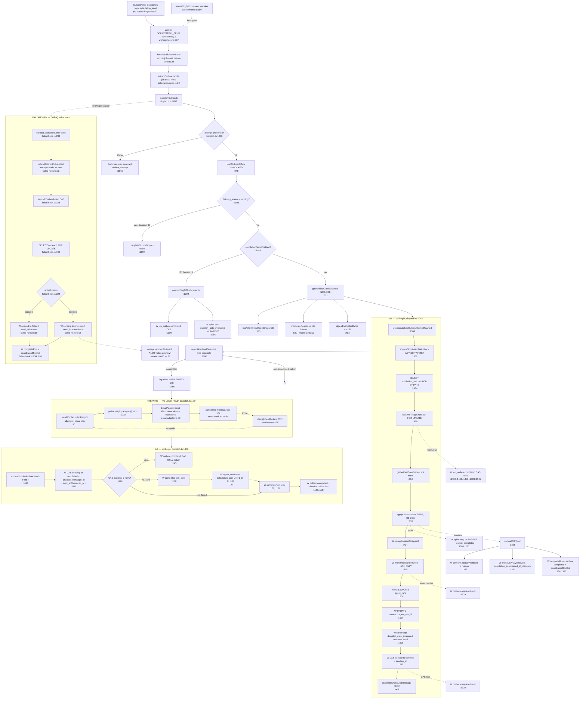

# F2 — Solicitation dispatch: gate, token mint, provider send, terminal tx

Phase 1 flowchart. Window: `54e4d374..74aee92a`. Weight: heavy.
Assigned gap CLOSED — `dispatch.ts` read in full (1–2001).

Measurements run: `fallow inspect --file src/lib/solicitation/dispatch.ts`;
`fallow health --format json`; two AST-free LOC scripts (span, code-vs-comment,
indentation histogram); `git log --follow`.

## The happy path



Nodes prefixed **W** are durable side effects.

## SEED-4 VERDICT — the premise is FALSE as stated

> *"`dispatch.ts` appears in NONE of fallow's large-function, high-complexity or refactoring-target lists."*

**Reading (a) "genuinely well decomposed" is FALSE. Reading (b) "the churn
window cannot see it" is TRUE but explains only one of three lists. There is a
third cause the seed does not name, and it is the important one.**

### The premise is wrong on the first list

`dispatch.ts` **does** appear in `large_functions[]` — six times:

| function | line | `line_count` |
|---|---|---|
| `runDispatchTx` | 1553 | **202** |
| `dispatchOutreach` | 1859 | **143** |
| `lockAndTriageOutreach` | 1439 | 93 |
| `commitSendTerminal` | 1103 | 90 |
| `reportNonSendOutcome` | 1780 | 78 |
| `commitWithhold` | 1328 | 64 |

The list is **461 entries** and the terminal renderer prints ten
(`● Large functions (10 shown, 463 total)`); `--top 463` does not expand it.
**"Appears in none" was a reading error against a truncated view, not a tool
blind spot.** `runDispatchTx` at 202 lines ranks **25th repo-wide**.
*(Orchestrator independently re-ran `fallow health --format json` and confirmed
all six, plus five more in `release.ts`. `00-health-baseline.md` has been
corrected.)*

### Reading (a) is FALSE, by measurement

Code lines only, comments and blanks stripped:

| function | span | total | **code** | comment | blank |
|---|---|---|---|---|---|
| `runDispatchTx` | :1553-1754 | 202 | **135** | 49 | 18 |
| `dispatchOutreach` | :1859-2001 | 143 | **90** | 41 | 12 |
| `commitSendTerminal` | :1103-1192 | 90 | **67** | 18 | 5 |
| `reportNonSendOutcome` | :1780-1857 | 78 | **57** | 13 | 8 |
| `commitWithhold` | :1328-1391 | 64 | **48** | 12 | 4 |
| `lockAndTriageOutreach` | :1439-1531 | 93 | **46** | **43** | 4 |

Three functions exceed 60 **code** LOC; `runDispatchTx` more than doubles it. The
other 27 functions are small (median ~14 code LOC; 24 of 33 under 25). **So the
file is mostly well decomposed with a long tail of three large orchestrators** —
exactly the shape the #912 merge record predicted.

**854 comment lines against 1,014 code lines — 45.7% of the file is prose.** The
"2,001-line file" framing overstates the code by roughly 2×.

### Reading (b) is TRUE, and explains exactly one list

`git log --follow` gives `dispatch.ts` **one** commit. `hotspots[]` is `[]`. A
hotspot score is `commits × churn × density`, so a 1-commit file cannot enter a
6-month window. Confirmed by contrast: `release.ts` has three commits and does
appear, at 3.0.

### The third cause — and the one that matters

`findings[]` for `dispatch.ts` is **empty** (0 of 121). `fallow inspect` reports
`complexity: ok (matches: 0)`. **Not suppressed** — no solicitation path appears
in `.fallowrc.jsonc`'s `health.ignore`.

The mechanism: across all findings the `exceeded` field takes only these values —

```
crap: 66 · cognitive: 32 · cognitive_crap: 11 · all: 8 · both: 3 · cyclomatic: 1
```

**`line_count` never appears.** A function can be 202 lines and produce zero
findings provided cyclomatic, cognitive and CRAP are each under threshold.
`dispatch.ts` clears all three: `total_cognitive: 89` across 38 functions
(threshold is 30 *per function*); `crap_max: 12`, `crap_above_threshold: 0`
against a default of 30, because the file has **3,139 lines of tests** for 1,014
code lines; `maintainability_index: 85.5`.

**Why cognitive stays low despite 135 code lines is structural, not accidental:
`runDispatchTx` is a flat sequence of guard clauses with essentially no
nesting.** Its indentation histogram over non-comment lines is
`{1: 46, 2: 55, 3: 25, 4: 5, 5: 1}`, and depths 2+ are almost entirely SQL
template continuation lines, not control flow. **Cognitive complexity penalises
nesting; a straight run of `if (x) return y;` scores nearly nothing regardless of
length.** Contrast `generateAsksForBatch` (294 lines, cognitive **43**, fallow's
#1 target) — 294 lines *with loops and nested branches*.

`targets[]` is `[]` because `extract_complex_functions` requires a cognitive
finding to point at. `dispatch.ts` also sits at `fan_in: 5`, exactly on
`fan_in_p75 = 5`.

### The answer, plainly

**This is a 2,001-line file that static analysis is correct to leave alone on
complexity, correct to omit from hotspots, and was wrongly reported as absent
from the large-function list.**

**The real finding for Phase 2 is not "fallow missed it". It is: fallow's
complexity gate cannot see unit size at all.** `functions_over_60_loc_per_k: 77.8`
and `unit_size_profile.very_high_risk: 7.8%` are reported as *vital signs* —
narrative metrics with no gate behind them — while `ci:fallow:coverage` gates on
CRAP. **A 202-line flat orchestrator with 90% test coverage is invisible to the
PR gate by construction, in any file, forever.** That is a property of the gate
configuration, not of `dispatch.ts`.

## Q1 — The two-transaction shape and invariant #5

**tx1 (`runDispatchTx:1553-1754`, opened `:1945`) commits six writes** — consent
snapshot (`:704`), unsubscribe token **hash** (`:815`), lazy child `agent_runs`
(`:1204`), `agent_run_id` (`:1685`), spine step `dispatch_gate_evaluated`
(`:1695`), CAS `queued → sending` + `sending_at` (`:1715`) — after three locks in
a fixed order: outbox `FOR UPDATE` (`:1559`), **advisory batch lock** (`:1562`),
batch row (`:1564`), outreach row (`:1448`). `assembleOutboundMessage` (`:1734`)
is pure.

**Held in memory across the provider call:** the `OutboundMessage` (whose body
contains the raw unsubscribe URL), `tokenLogPrefix` — which is
`logPrefix(sha256(raw))` (`unsubscribe.ts:293-295`), **a prefix of the HASH**,
never the raw token — and `childRunId`. `minted.rawToken` goes out of scope when
`runDispatchTx` returns.

**tx2 (`commitSendTerminal:1103-1192`, opened `:1970`) commits five facts as one
unit:** the terminal CAS with `provider_message_id`/`sent_at`/`bounced_at`
(`:1115`), `ask_sent` step (`:1150`), `recordOutcome solicitation_sent` on the
**child** not the parent (`:1162` — `agent_outcomes_once_per_run_kind` would
collapse 25 sends into one row on the parent), `completeRun` (`:1178`/`:1180`),
outbox completion + `closeBatchIfSettled` (`:1186`/`:1187`). Advisory lock is the
**first** statement (`:1110`).

**Invariant #5 — VERIFIED, structurally.** `mintUnsubscribeRawToken`
(`unsubscribe.ts:65-72`) produces `<nonce>.<HMAC>`; the INSERT at
`dispatch.ts:823-834` writes `${tokenHash}` and nothing else. Raw token reaches
Postgres nowhere; outbox payloads are three ids (`worker-types.ts:366-370`); the
only token-shaped log field is a hash prefix (`:1958`), and the two
`sending`-resume paths deliberately log **no** prefix because that process never
held the raw token.

**The load-bearing pairing is real:** the mint (`:1662`) and the `queued →
sending` CAS (`:1715`) are in the **same transaction**, 53 lines apart.
`mintUnsubscribeToken` returns `null` on conflict, which is **the only possible
answer since a hash cannot yield its raw token** — so a caller has nothing it
could re-send *with*. **That is what makes decision 9's refusal structural rather
than a rule.**

## Q2 — `applyDispatchGate:237-257` — seven items, eight ifs

| B6 # | Item | Line | Outcome | Withheld reason |
|---|---|---|---|---|
| 1 | `batch_open` | `:241` | **defer** | — |
| 2 | `send_flag` | `:242` | **defer** | — (091/110 carry no `flag_off` reason) |
| 4 | `suppression` | `:243` | withhold | `suppressed` |
| 5 | `consent` | `:244-249` | withhold | `no_consent` |
| 6 | `postal_address` absent | `:250` | withhold | `no_postal_address` |
| 6 | `postal_address` mismatch | `:251-253` | withhold | `postal_address_mismatch` |
| 8 | `lint` | `:254` | withhold | `lint_failed` |
| 9 | `moderation` | `:255` | withhold | `moderation_high` |

**B6 numbers 3 and 7 are deliberately absent** — subscription and daily caps are
release-level (amendments `:150-162`); migration 110's header repeats it.

**Pure?** Yes. No I/O, no clock, no config read, no `Date`. Its only free variable
is the module constant `ELIGIBLE_ATTESTATION_VERSIONS` (`:211`). The one config
read is in `gatherFastGateEvidence:684`, **outside** the pure function.

**Total?** Yes. The fall-through `return { pass: true }` (`:256`) makes it total
over the full evidence product; the return type admits no `undefined`.

**Is the order enforced or just the order somebody typed the ifs?** It is the
order somebody typed the ifs — **but it is mechanically pinned twice**:
`dispatch-gate.test.ts:84` repairs each item one at a time and asserts the
reported item walks the whole order; `:237` is a **fast-check property** that,
for the reported item, asserts every earlier item in an independently-spelled
`GATE_ORDER` array already passes, and that the defer/withhold split is exactly
the first two items.

## Q3 — `classifySendFailure` (`send-retry.ts:175-181`)

**Total over `unknown`: provably.** Three predicates, each safe on non-objects
(`causeOf:111` guards `!err || typeof err !== 'object'`; `readProviderSignal:121`
returns `{}` when neither `name` nor `statusCode` is present).

**An unclassifiable failure falls to `terminal_other`** (`:180`) — the module's
stated safe direction (`:52-53`): terminal, but it neither re-sends nor
suppresses. Handled identically to an exhausted retry budget in tx2, so **no
class is left without a terminal.**

The bounce class is a three-way conjunction (`:165-168`): 4xx AND a
recipient-scoped Resend code AND `RECIPIENT_FIELD_SIGNAL` matching the message.
`408`/`429` are explicitly excluded. **It is the only class that stamps
`bounced_at`, which feeds F3's breaker numerator.**

The module never throws — a stated contract (`:8-10`): *"a classifier that throws
inside a catch block loses the original failure."*

## Q4 — Timeout, jitter, idempotency

**Explicit timeout — YES, and real.** `:1018` → `EmailAdapter.send`
(`email-adapter.ts:28`) → `sendEmail` → `send-email.ts:54-59`:
`Promise.race([resend.emails.send(...), timeout])` with
`DEFAULT_EMAIL_SEND_TIMEOUT_MS = 10_000`, overridable by `EMAIL_SEND_TIMEOUT_MS`.
Timeout throws `EmailSendTimeoutError`, mapped to `retryable`
(`send-retry.ts:138`). **The Resend SDK exposes no `AbortSignal`**, which
`send-email.ts:5` states. The lane's other outbound call, `moderateResponse`, has
its own 10s timeout (`moderate.ts:12`).

**Bounded, jittered retries — YES.** `SEND_MAX_ATTEMPTS = 3` (`:962`), base 200ms
(`:963`), max 2s (`:964`). `sendRetryDelayMs:972-979` is **equal jitter** — half
the exponential ceiling fixed, half `randomInt(0, fixed+1)`, node's own crypto per
invariant #10. Only `retryable` retries.

**Idempotency key — CORRECT, and it IS the deterministic outbox key.**
`email-adapter.ts:58` passes `{ idempotencyKey: message.outreachId }`, which is
also `job_outbox.aggregate_id` for this topic (`job-outbox-helpers.ts:735-737`).
**Not the BullMQ job id.** `messaging-adapter.ts:25-30` records why §7.1's
original `solicitation-ask/<ask_id>` was superseded — it collides across attempts.
`sendWithBoundedRetry` hands **the same `message` object** to every attempt
(`:996-999`) — a rebuilt body under the same key would be worse than sending
twice. And `dispatchOutreach:1868` **throws** if `attempt === undefined`, so this
topic cannot silently take `extractOutboxHandle`'s `job.id` fallback.

## Q5 — The CAS, monotonicity, duplicate delivery

**The CAS is `commitSendTerminal:1115-1128`**; its guard is `AND delivery_status
= 'sending'` (`:1126`). `sending` is written exactly once, in tx1 (`:1715`,
predicate `AND delivery_status = 'queued'`). Every terminal writer CASes *out of*
`sending` and none CASes *into* it twice. The three competitors are mutually
exclusive by their own predicates — `commitSendTerminal:1126`,
`terminalizeWedgedOutreach` (`release.ts:678-688`, plus a repeated `NOT EXISTS`),
and `failed-hook.ts:234` (`= ${row.delivery_status}`, **the exact value read under
`FOR UPDATE`, deliberately not a two-member `IN`**).

**On a zero-row CAS, `commitSendTerminal` commits NOTHING about the send**
(`:1129-1147`) — no outcome, no step, no child terminal, no batch join, only the
outbox completion. Reasoning at `:1084-1095`: `provider_message_id` did not
persist, so an outcome would be a value-ledger row with no join key.

**`commitWithhold:1328` has NO status predicate** — safe *only* because
`lockAndTriageOutreach:1502-1505` refuses anything but `queued` **before any
write**. `:1482-1501` names this as the root cause of three HIGH round-1 findings.

**Duplicate delivery: four independent stops.** Unlocked read (`:1896`, racy by
design) → locked repeat (`:1472`) → token conflict on
`solicitation_unsubscribe_tokens_outreach_uniq` returning `in_flight_elsewhere`
(the mint runs **before** `startLazyChild` precisely so a conflict leaves no run
behind, `:1675-1678`) → the `queued` CAS itself (`:1726`, `cas_lost`). **In every
case the provider is never reached and no re-gate happens.**

## Q6 — The `unknown` state

`failed-hook.ts:67-80` is a **lookup table keyed by arrival status**, read under
`FOR UPDATE`:

| Arrival | `delivery_status` | `disposition_reason` | `childStatus` |
|---|---|---|---|
| `queued` | `failed` | `send_exhausted` | `failed` |
| `sending` | `unknown` | `send_indeterminate` | `failed` |

`rendered` is deliberately excluded (`:84-88`) — 091's CHECK would record a
dispatch that never happened. `childStatus` is `failed` on both arms because
`agent_runs` carries no `unknown`. **The split's justification is the restraint
policy:** `over_contacted` counts prior sends, so writing `failed` for a possibly
delivered message re-batches that customer and emails them twice (`:24-27`).

**`failed-hook.ts` is the sole writer of `send_exhausted`** — confirmed by grep.

**Two corrections to the assigned question:**
- `sweepUnknownOutreach` is **not** the only *writer* of `unknown`. There are
  exactly **two** repo-wide: `release.ts:680` and `failed-hook.ts:75`.
- What it uniquely is: **the only resolver of a wedged `sending` row that has no
  BullMQ job left to fire the failed-hook.** `release.ts:594-597` says so.
- Nothing reads an `unknown` row to move it further. It is terminal.

**One asymmetry worth flagging:** on the sweep path the child gets
`completeRun(… { code: 'send_indeterminate' })` (`release.ts:702-705`); on the
failed-hook path it gets `{ failure_class: 'send_indeterminate', error_class }`
(`failed-hook.ts:254-257`). **Two different JSON keys for the same fact on the
same table.**

## Q7 — `lintInputFromSnapshot` — one corpus, two lanes

**Both callers verified; they read the same thing.** Exactly two production sites:
generation `ask-generation.ts:570` (passes `assembled.inputs` — the snapshot it is
*about to persist*) and dispatch `dispatch.ts:535` (passes
`parseOutreachInterpolationInputs(row.interpolation_inputs, …)` — the §5.3
snapshot *already persisted*). Same function, same shape, same order.

**Does it fix the byte-for-byte break? Yes** — the previously-broken behaviour
re-derived the corpus from a live ask row and visit that can move after the
render. `ask-compliance-lint.ts:232-237` names it.

**Two things the extraction does NOT fix, which the merge record does not
mention:**
- **The dispatch lane discards `verdict.matches`** (`:535` reads `.blockedReason`
  only) whereas generation persists them into `lint_detail`. A dispatch-time
  re-lint failure records `lint_failed` with **no class breakdown** — the tuning
  data the generation lane deliberately keeps.
- **The byte-for-byte guarantee at dispatch actually rests on a SECOND mechanism
  the merge record does not name:** `evaluatedBytesDigest` (`:483-487`, checked
  `:1520-1529`), which proves the locked bytes are the ones the *unlocked* gather
  linted. Without it the snapshot-replay is still correct about the corpus but
  the *bytes* could have moved under decision 3's unlocked read. `:180-193`
  records this as round-1 adversarial finding A4. **The extraction alone would not
  have been sufficient.**

**Documentation gap:** `docs/directory.md:939`'s row lists `assessNoteAdmissibility`
and `lintAsk` and **does not mention `lintInputFromSnapshot`**. `ci:directory-map`
enforces one row per production *file*, not per export, so **a new export that is
the single owner of a cross-lane contract landed with no code-map entry.**

## Q8 — `completeOutboxNoop`: **DRIFTED**

Not identical. The drift is in the interface, not the body.

| | `dispatch.ts:438-446` | `ask-generation.ts:791-799` |
|---|---|---|
| Signature | `(sql, handle: OutboxHandle)` | `(sql, outboxId, attempt)` |
| Attempt guard | **folded in** (`:439-442`, throws) | **separate helper** `requireAttempt` (`:779-784`) |
| Error string | a **literal** | **parameterised** by `door` |
| Body | byte-identical modulo variable names | " |
| Call sites | 2 | 3 |

The divergence is **deliberate and documented** (`dispatch.ts:420-424`).

**But the fold-in did not eliminate the second spelling.** `dispatch.ts:1868-1870`
re-spells the same guard and the same literal inline, immediately under a comment
at `:1865-1866` claiming *"the exact-attempt guard now lives in
`completeOutboxNoop`"*. **The literal appears twice in one file (`:440`, `:1869`).
The comment describes a consolidation that is one-half done.**

Named eventual owner unchanged: hoist to `src/lib/shared/outbox.ts` (`:430-432`);
**never** as an `ask-generation.ts` export (`:433-436` — a value import would drag
the LLM task seam, cost guard and Redis tracker into this lane's module graph).

## Q9 — Invariants #2 and #15: both CLEAN

**#15.** `dispatch.ts` imports no `@/lib/db/server` (the string appears only in a
docstring at `:74`). Every helper takes `sql: Sql` or `tx: TransactionSql`.
`send-retry.ts` and `ask-compliance-lint.ts` touch no DB. The two worker files are
composition roots registered in `worker/index.ts`. **`jsonb(x)` is not used
anywhere in F2.**

**#2.** F2 is a **consumer**, not a producer — **no `INSERT INTO job_outbox`
anywhere**. Every outbox transition is inside the transaction carrying the domain
write it accompanies. The one durable non-outbox enqueue is `enqueueAnalyticsEvent`
(`:1371`), inserted in the **same tx** as the withhold — the sanctioned
durable-analytics shape.

**D12a is the invariant working, not an exemption:** tx2 failing commits *neither*
the terminal facts *nor* the outbox completion, so the watchdog still owns the
work and this lane needs no orphan sweeper (`:23-25`, `:1966-1969`).

The two stale-attempt paths are correctly asymmetric: `{ kind: 'stale' }` at
`:1560` deliberately completes **nothing** (`:1791-1792`: *"a newer attempt owns
this outbox row and completing it here would strand that attempt"*).

## Q10 — Migration 110 part (a)

**The gate's writes are an exact subset of the CHECK, with no orphan arm in either
direction.** `110:47-51`'s `withheld` arm admits **eight** reasons;
`OutreachWithheldReason` (`dispatch.ts:149-155`) declares **six** — the eight minus
`render_failed` and `unsubscribed`, and `:144-148` states why (*"written by other
lanes, and re-spelling them here would invite a gate arm that has no item"*).
Every one of the six is produced by exactly one gate arm and every gate arm
produces exactly one of the six.

**The migration's negative claim also holds in code:** item 3 gets no member, and
`applyDispatchGate` has no subscription arm. The `COMMENT ON CONSTRAINT` at
`:65-66` records the reasoning at the DB.

## External dependencies (selected)

`closeBatchIfSettled` → **F4** at `dispatch.ts:1187`, `:1386`, `failed-hook.ts:266`
— **three sites, not the two the map records** · `readPostalAddressState` →
**F7's output is F2's input** (`:672`) · `getMessagingAdapter().send` (`:1018`) —
**first production caller in the repo** · `sent_at`/`bounced_at` (`:1119`,
`:1121`) → **F3's breaker numerator, data edge, no import** ·
`enqueueSolicitationSend` ← **F1, producer edge, no import** ·
`send_indeterminate` ← shared terminal with **F1**'s sweep ·
`type OutboxHandle` from `ask-generation.ts` — **type-only by design**
(`:124-128`) · `boundedErrorClass` from `worker/jobs/solicitation-batch/failed-hook-shared.ts`
— cross-lane import, justified at `:44-48`.

**Confirmed: `dispatch.ts` and `release.ts` do not import each other.** Their only
edges are a `job_outbox` row, a column, and a shared disposition string.

## Duplication leads

1. **`markOutboxCompletedIfOwned` — 13 call sites in one file** (`:444, 1145,
   1186, 1300, 1385, 1460, 1468, 1478, 1503, 1527, 1611, 1679, 1730`). **Nine are
   the identical two-line shape** "complete the attempt and return a refusal."
2. **`completeOutboxNoop` — two copies, drifted** (see Q8).
3. **The literal `'solicitation_send requires an exact outbox_attempt'` — twice in
   one file** (`:440`, `:1869`), the second under a comment asserting the guard
   now lives in the first. Third spelling: `worker/jobs/solicitation-batch/index.ts:22`;
   parameterised fourth: `ask-generation.ts:781`.
4. **`stepKey: 'dispatch_gate_evaluated'` — three sites** (`:1270` defer/parent,
   `:1349` withhold/child, `:1697` send/child), **three different `detail` shapes
   for one step key**.
5. **The comment "ids and closed enum values only — never the handle, the subject
   or the body." — three verbatim copies** (`:1254`, `:1346`, `:1694`).
6. **`AND account_id = ${scope.accountId}::uuid` — 8 copies**;
   `business_id` — 9. Invariant #8 requires it; whether it wants a fragment owner
   is Phase 2's.
7. **`acquireSolicitationBatchLock` first-statement idiom — 4 sites in F2**, each
   with its own 4–8 line ABBA comment.
8. **`findActiveSolicitationSendBatchRun` — two callers with OPPOSITE failure
   policies.** `startLazyChild:1214` **throws**; `recordDeferStepOnParent:1266`
   **returns false**. Documented (`:1247-1252`), but **the same read with two
   contracts**.
9. **The `sending`-resume check — three spellings** (`:1896`, `:1472`, `:1666`).
   Deliberate defence in depth.
10. **The gate order — two spellings**: the `if`-chain (`:241-256`) and
    `GATE_ORDER` in `dispatch-gate.test.ts:237-266`. **The test copy is the pin,
    so this may be irreducible.**
11. **`digestEvaluatedBytes` called twice with a full re-hash** (`:546`, `:1524`) —
    **intentional (that IS the A4 check)**; noted so Phase 2 does not mistake it
    for waste.
12. **Terminal-attempt predicates — THREE deliberately non-unified copies.**
    `failed-hook.ts:93-106` (the `'failed'`-EVENT form) vs `isTerminalAttempt` in
    `shared/outbox.ts` (the catch-block form) vs `worker/jobs/judge/failed-hook.ts`.
    `failed-hook.ts:98-104` explicitly says "do not unify them".
13. **`send_indeterminate` child-run detail — two different JSON keys** (see Q6).
14. **Filename collision: SIX files named `dispatch.ts`.** Only one is F2's; the
    other five are per-channel notification loops. `docs/directory.md` carries five
    `| dispatch.ts |` rows in different sections.
15. **`SLOW_GATE_UNEVALUABLE` (`:473-476`) and the never-ran moderation fill in
    `ask-generation.ts:552-560`** encode the same "no bytes to vouch for" fact in
    two shapes.

## Confidence and gaps

**High confidence (read in full, line-cited):** both transactions and every write;
`applyDispatchGate`'s order, purity, totality; `classifySendFailure`'s totality;
the timeout/jitter/idempotency chain; all CAS locations and the four
duplicate-delivery stops; the arrival split; the two-caller lint equivalence; the
`completeOutboxNoop` drift; invariants #2/#5/#15; migration 110(a).

**High confidence, tool-verified:** the seed-4 verdict — every claim is a direct
read of `fallow health --format json` at `74aee92a`, independently reconfirmed by
the orchestrator.

**Medium confidence:** `runDispatchTx`'s exact per-function cognitive score.
Fallow reports no finding, so the number could not be read; "well under 30" is
inferred from `total_cognitive: 89 / 38 functions`, the empty findings array, and
the measured indentation histogram. **The direction is certain; the exact value is
not.**

**Gaps:** ~3,139 lines of dispatch tests read only in slices —
`dispatch.integration.test.ts` (1,874) and `dispatch.test.ts` (859) unread; the
coverage is high (CRAP 12) but whether it pins the *right* things is Phase 2's.
The LOC measurements are regex-based, not AST-based (they agree with fallow's own
`line_count` for all six functions). `agent_outcomes` schema not read. **#914 note:
`buildReviewLink:759-771` THROWS on a business with no canonical place id rather
than withholding — directly adjacent to #914's ask and may already be the de-facto
answer.**
