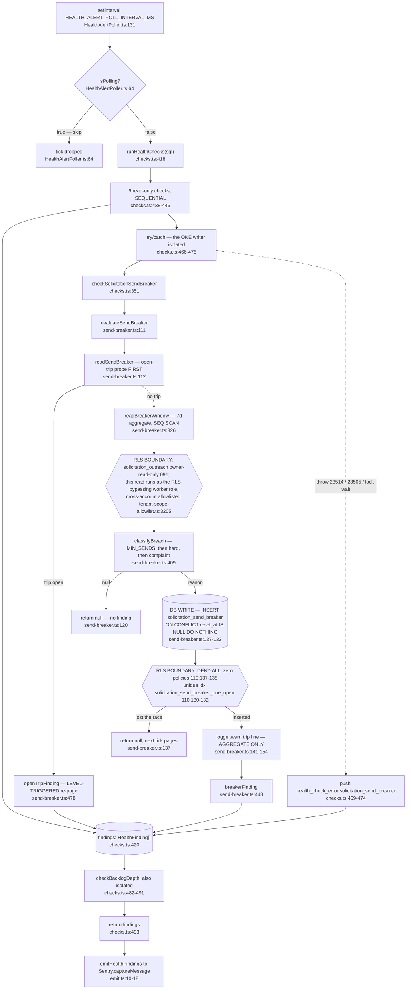
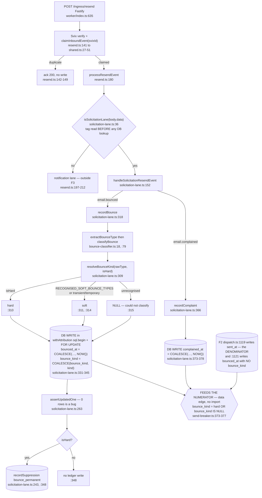
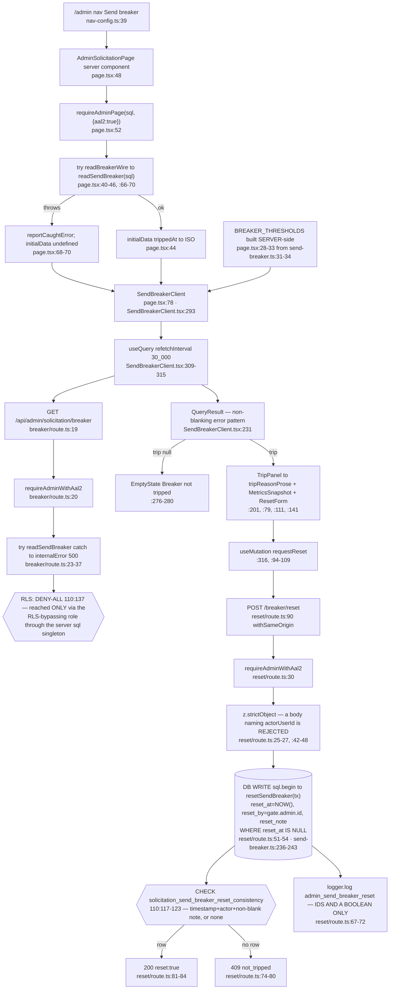

# F3 — Send breaker: the platform reputation governor and its console

Phase 1 flowchart. Window: `54e4d374..74aee92a`. Weight: medium.
Assigned gap CLOSED — `SendBreakerClient.tsx` read in full (1–356).

Commands run: `pnpm ci:admin-aal2` (passed: 35 route files, 21 pages); a scratch
reachability walk over all 228 `'use client'` files.

## Headline results

1. **SCOPE.md seed 8 is REFUTED.** There are **three** non-gate reads that catch,
   not one — and **#926 was not the first**. #904 landed two, a day earlier.
2. **`ci:rls-audit` does not guard `solicitation_send_breaker`'s deny-all RLS**,
   and four other platform-scoped tables have the same hole.
3. **The `/admin/solicitation` page's AAL2 gate is unenforced by CI** — a live
   hole, not bookkeeping.
4. **Seed 10's "first platform-scoped table with no `account_id`" is REFUTED** —
   four predate it. What IS novel is narrower and worth promoting.
5. **#908 CONFIRMED** from index definitions; migration 110's bitmap-scan comment
   is wrong, exactly as filed.
6. **The `node:async_hooks` rationale is REAL** — verified three ways. Not a
   ninth false-rationale instance.

## 2a. Write arm — the trip



## 2b. Numerator feed — the bounce webhook



## 2c. Read/admin arm



## Q1 — the `readSendBreaker` carve-out. **Seed 8 REFUTED; the count is 3, not 1.**

| # | Site | Class | try/catch? | Landed in |
|---|---|---|---|---|
| 1 | `release.ts:1341` (`runReleasePhase` step 2) | **gate-read — must throw** | **No**, and `:1337-1340` says so | #920 |
| 2 | `send-breaker.ts:112` (inside `evaluateSendBreaker`) | evaluate-read | Not here; the **caller** isolates it, `checks.ts:466-475` | #904 |
| 3 | `release.ts:945` (`resolveWindowHaltReason`) | **label-read** | **Yes**, `:944-956` → warn + fall back | **#926** |
| 4 | `api/admin/solicitation/breaker/route.ts:24` | **display-read** | **Yes**, `:32-37` → `internalError` 500 | **#904** |
| 5 | `admin/solicitation/page.tsx:41` | **display-read** | **Yes**, `:66-70` → drop `initialData` | **#904** |

**Gate-reads: 1. Non-gate reads that catch: 3** (4 counting the poller's
caller-level isolation).

**Two corrections to the record:**
- **SCOPE.md line 38 and the arch log say #926 "introduces the FIRST sanctioned
  `try/catch` around `readSendBreaker`". FALSE.** `git log -S` puts both admin
  catches in `b873a9a5` (#904, 2026-08-21); `2c7bb615` (#926) is 2026-08-22 and
  is the **third**. **The carve-out was already precedent when #926 wrote the
  prose defending it as novel.**
- The docstring's criterion — *"a caller that wraps this in try/catch **and
  proceeds to send**"* (`send-breaker.ts:169-170`) — is not machine-checkable,
  and **4 of 5 call sites now sit on the permissive side of it.**

**Proposed guard — (a) preferred, (b) if CI teeth are wanted:**

**(a) Structural split, no CI script.** Replace one export with two:
- `assertSendAllowed(sql): Promise<void>` — throws on an open trip *and* a DB
  failure. The **only** function `runReleasePhase` may call. Wrapping the gate
  becomes visibly absurd at the call site.
- `readSendBreakerState(sql): Promise<SendBreakerState>` — for the label and the
  two display reads, which may catch freely.

Both share one private query body, so no second spelling. **This converts three
prose statements into one type-level fact** — the CLAUDE.md-preferred move.

**(b) `ci:breaker-gate-read`** — an AST audit modelled on `ci:admin-aal2`'s
fail-closed allowlist (`admin-aal2-audit.ts:53-59`): a `readSendBreaker` call
whose enclosing function transitively reaches `enqueueSolicitationSend` must not
sit inside a `TryStatement`; an unrecognised shape is a finding, not a pass.

**Two stale `docs/directory.md` rows, quoted exactly.** `:934`:

> `readSendBreaker` has **no try/catch and no `unknown` verdict** — the throw IS the halt signal, so wrapping it and sending breaks the invariant

Half is still true; **"no try/catch" is now false in three places.** And `:919`
(the `release.ts` row):

> `readSendBreaker` gets no try/catch — the throw IS the halt

That row owns *both* release-lane call sites, one of which does catch. **Both
need the label-read/gate-read distinction in the same edit. This is the third
and fourth stale directory.md row this pass has found.**

## Q2 — trip-once / page-forever idempotence

Three mechanisms, in firing order:

1. **The open-trip probe runs FIRST and returns early** — `:112` → `:116`
   `if (state.trip) return openTripFinding(state.trip)`. This is the half the
   seed asks for, and it also skips the expensive aggregate while sending is
   halted (`:106-109`).
2. **The partial unique index** `solicitation_send_breaker_one_open` —
   `110:130-132`.
3. **`ON CONFLICT … DO NOTHING` + `if (!inserted) return null`** — `:130`,
   `:137`. Without `DO NOTHING`, mechanism 2 would raise a `23505` that
   `checks.ts:468` converts into a warning rather than a trip.

**Two overlapping health ticks cannot happen** — `HealthAlertPoller.ts:64-65` is
single-flight, with `withTimeout(…, 30_000)` at `:74-78` and
`finally { isPolling = false }` at `:122` so a hang cannot wedge the latch. Across
processes it also cannot: the worker is single-replica by invariant. The residual
probe→insert race is unreachable, and `:133-137` says so; exposure if it ever
fired is bounded to **one poll interval**. **Correct on all three legs.**

## Q3 — does `checks.ts`'s writer isolation work? **Yes, confirmed**

- `findings` is a plain array (`:420`), mutated by `collect` (`:421-424`). The
  nine read-only checks push at `:438-446` **before** the breaker.
- The breaker call is wrapped at `:466-475`. A `23514`, a `23505`, an
  `ON CONFLICT` inference error or a lock wait all land in the catch.
  `findings` is never reassigned; `return findings` at `:493` returns the nine
  plus the warning.
- **No enclosing transaction exists to roll back** — `evaluateSendBreaker` gets
  the plain `Sql` bulkhead client (`HealthAlertPoller.ts:75`), so the INSERT is
  its own implicit transaction.
- A broken connection is covered too: `checkBacklogDepth` is separately wrapped
  (`:482-491`) and a client wedge is recycled at `HealthAlertPoller.ts:118`.

**CLAUDE.md's "best-effort work needs its own try/catch" gotcha is honoured**,
and `checks.ts:454-465` records the reasoning ("a rethrow here is SILENT about
the breaker"). One pre-existing caveat by design: the nine checks at `:438-446`
are **not** isolated from each other — `:432-435` argues that as shared fate. So
the file has two isolation postures and the reader learns which by position.

## Q4 — #908 `readBreakerWindow` seq-scan. **CONFIRMED from the SQL alone**

No live DB was used, deliberately: staging and prod have never sent a
solicitation (`110:18-20` proves it), so `solicitation_outreach` is empty and an
`EXPLAIN` there would show a seq scan for a reason unrelated to the query.

The top-level `WHERE` (`send-breaker.ts:384-386`) is a **disjunction over three
different columns**:

```
WHERE o.sent_at      >= GREATEST(b.signal_floor, b.reset_floor)
   OR (o.sent_at     >= b.reset_floor
        AND (o.bounced_at >= b.signal_floor OR o.complained_at >= b.signal_floor))
```

Every index on `solicitation_outreach` at head was enumerated. Only
`idx_solicitation_outreach_sent_at` (`110:92-94`) serves **arm 1**;
`bounced_at` and `complained_at` have **no index at all**, and `110:86-91` says
that is deliberate.

**Postgres builds a `BitmapOr` only when EVERY arm of a top-level disjunction is
independently index-supported.** A single un-indexable arm forces a full relation
scan. Arm 2 has no access path, so the planner has no choice but
`Seq Scan on solicitation_outreach`. **The `sent_at` index is dead weight for
this query. #908 is correct.**

**Migration 110's own comment is wrong, exactly as #908 says.** `110:86-91`:

> "The `bounced_at` / `complained_at` numerators are DELIBERATELY unindexed: … so a bitmap scan is cheaper than two more indexes to maintain on every send."

**There is no bitmap scan to be cheaper than** — omitting those two indexes is
what *removes* the bitmap path, not what selects it. `send-breaker.ts:318-324`
already records the correction and notes 110 is immutable at head.

## Q5 — `classifyBreach` and the four thresholds. **No threshold spelled twice in code**

| Threshold | Value | Single owner | Used at |
|---|---|---|---|
| `BREAKER_WINDOW_DAYS` | `7` | `send-breaker.ts:31` | `:353`, `:451`, `:452`, `:504` |
| `BREAKER_MIN_SENDS` | `100` | `:32` | `:410` (the floor), `:152`, `:503` |
| `BREAKER_HARD_BOUNCE_RATE` | `0.02` | `:33` | `:411`, `:150`, `:451`, `:501` |
| `BREAKER_COMPLAINT_RATE` | `0.003` | `:34` | `:412`, `:151`, `:452`, `:502` |

`SendBreakerClient.tsx:41-46` declares the *interface* only and carries **no
values** — `:33-39` states this correctly. Both comparisons are strict `>`
(`:411`, `:412`), matching "a window sitting exactly on the bar does not trip"
(`:28-30`); the client's badges at `:129`/`:135` use the same strict `>`, so
panel and governor agree at the boundary.

**Second spellings exist only in prose:**
`docs/runbooks/solicitation-sending-domain.md:219, :228, :334, :335, :336` write
out 2%, 0.3%, 7 days and 100 sends by hand.

## Q6 — platform-scoped, no `account_id`. **Seed 10's "first" REFUTED; a real RLS-coverage gap found**

**Documented in:** `110:96-101` (*"This table IS the audit record"*), `110:134-135`
`COMMENT ON TABLE` (durable in the database itself),
`tenant-scope-allowlist.ts:162-164`.

**NOT documented in:** the module — `send-breaker.ts:1-16` explains the
*singleton* rationale but never says no-`account_id` / not-a-tenant-table /
is-its-own-audit-record. And `docs/directory.md:934`, the row for this exact
file, says nothing about scoping or RLS at all.

**Not a `TENANT_TABLES` member, not in `TABLE_DISPOSITIONS`.** Both omissions are
*consistent with each registry's own rule*, so nothing fails and **nothing
notices**.

**The gap this opens.** `scripts/ci/rls-audit.ts:12` is
`export const REQUIRED_RLS_TABLES = TENANT_TABLES`. **Not being a member means
`ci:rls-audit` does not guard this table's deny-all RLS** — neither the live
`relrowsecurity` check nor the DB-free migration-coverage check (`:52-58`). That
matters because `tenant-tables.ts:76-83` puts `inbound_events`, `prospect_demos`
and `google_connections` in `TENANT_TABLES` for **exactly this reason** —
*"These are NOT account/business-scoped … Listed here rather than named around
the detector … so `ci:rls-audit` guards them."* **`solicitation_send_breaker` is
the same shape and did not get the same treatment.**

**A second such table? At least four, all predating it** — computed by diffing
every `CREATE TABLE` in `supabase/migrations/` against both registries:

| Table | Migration | `account_id`? | RLS | In `TENANT_TABLES`? |
|---|---|---|---|---|
| `sms_sender_opt_outs` | `022:25-32` | none | enabled, no policies (`022:49`) | no |
| `sms_sender_opt_out_events` | `022:36-45` | none | enabled, no policies (`022:50`) | no |
| `owner_leads` | `033:1-22` | none | enabled (`033:23`) | no |
| `poller_cursors` | `081:21-26` | none — comment says *"Holds no tenant data"* (`:29`) | deny-all (`:35`) | no |
| **`solicitation_send_breaker`** | `110:102-124` | none | deny-all (`110:137`) | no |

`sms_sender_opt_outs` is the **closest structural precedent and was never
cited**: sender-level opt-out state keyed by a shared `messaging_service_sid` —
a shared sending identity's platform-wide reputation state, exactly the argument
`send-breaker.ts:2-5` makes.

**What genuinely IS novel** is narrower than the seed claims: not
"platform-scoped with no `account_id`", but **"platform-scoped AND its own audit
record"** — the first table where the durable audit of an operator action
(`reset_by`/`reset_note`, enforced together by
`solicitation_send_breaker_reset_consistency`) lives on the domain row instead of
in `account_audit_log`, because **CLAUDE.md's "audit writes go through
`writeAccountAuditLog`" rule has no platform-scoped arm.** That is the fact worth
promoting; the "first with no `account_id`" framing should be retired.

**Actionable:** add `solicitation_send_breaker` to `TENANT_TABLES` under the
`inbound_events` precedent comment (cheapest, restores `ci:rls-audit`), or give
`rls-audit.ts` a second `PLATFORM_TABLES` list — and if the latter, the four
tables above belong in it too.

## Q7 — `bounce_kind`. **Errs SAFE on the main path; one reachable branch errs OPEN**

**Main path.** `resolveBounceKind` (`:309-316`) returns `'hard'`, `'soft'`, or
**`NULL`** — "we could not classify this", never "not a hard bounce" (`:298`).
The breaker counts `(bounce_kind = 'hard' OR bounce_kind IS NULL)`
(`send-breaker.ts:376`). **So an unrecognised bounce type INFLATES the numerator
and trips the breaker SOONER — fail-closed.**

That is the whole reason `RECOGNISED_SOFT_BOUNCE_TYPES` exists: `classifyBounce`
defaults unknown→soft (`bounce-classifier.ts:43`, tuned for business flagging),
which would be fail-**open** here (`solicitation-lane.ts:278-284`). Suppression is
untouched — `isHard` still gates the ledger write (`:348`), so an ambiguous
bounce never suppresses a real customer.

**(a) The `COALESCE` is not first-write-wins for the state the design needs
sticky.** `:336-340` claims *"a redelivered webhook must not reclassify a bounce
we already recorded."* True when the first write produced a non-NULL kind. **Not
true for the NULL case:** `COALESCE(NULL,'soft') = 'soft'`, so a first
unrecognised bounce (counted as hard) followed by a recognised-soft bounce
**downgrades the row out of the numerator** — the fail-**open** direction.
Reachable: `claimInboundEvent` dedups on the Svix message id, not on `email_id`,
so two distinct bounce events for one row both process. **The comment asserts a
property the SQL does not have.**

**(b) `bounced_at` has TWO writers; `bounce_kind` has one.** `dispatch.ts:1121`
(F2) writes `bounced_at = NOW()` on a `terminal_bounce` and **no** `bounce_kind`.
By `:376` that would count as hard — **except** the same row has `sent_at = NULL`
(`dispatch.ts:1119`), so the numerator's `AND o.sent_at >= b.reset_floor`
conjunct evaluates to NULL and the row drops out of numerator, denominator and
scan alike. Correct outcome — a `terminal_bounce` is a provider *refusal* before
send, so no reputation was spent. **But the exclusion rests entirely on a NULL
comparison in a conjunct added for an unrelated reason** (the round-2 reset floor)
and is documented nowhere. Anyone "simplifying" the numerator by dropping
`sent_at >= b.reset_floor` as reset-only bookkeeping starts counting rows the
denominator never saw. **Worth one sentence at `send-breaker.ts:373`.**

## Q8 — AAL2 verified on all three; the `node:async_hooks` rationale is REAL; but the page gate is **unenforced by CI**

| Surface | Gate | Line |
|---|---|---|
| Page | `requireAdminPage(sql, { aal2: true })` | `page.tsx:52` |
| GET route | `requireAdminWithAal2(request)` | `breaker/route.ts:20-21` |
| Reset route | `requireAdminWithAal2` + `withSameOrigin()` | `reset/route.ts:30-31`, `:90` |

`pnpm ci:admin-aal2` passes. Two supporting details are right: the reset route's
`z.strictObject` **rejects** a body carrying `actorUserId` rather than overriding
it (`:17-27`), and the actor comes from `gate.admin.id` (`:52`).

**But the page's `aal2: true` is not held by anything.** `ci:admin-aal2`'s P2
parity rule anchors on `siblingRouteFile()` = `src/app/api` + page path +
`/route.ts` (`admin-aal2-audit.ts:529-532`), i.e.
`src/app/api/admin/solicitation/route.ts` — **which does not exist**; the routes
live one segment deeper. So `/admin/solicitation` falls into the audit's own
"RECORDED LIMITATION (P2)" bucket (`:130-136`) — **and that list names five pages
and does not include it.** All 21 were enumerated: the P1-only set is now
`/admin/autonomy`, `/admin/businesses/new`, `/admin/impersonate`,
`/admin/runbook`, `/admin/security`, **`/admin/solicitation`**. **Six, not five.**

**This is a live hole, not bookkeeping.** `page.tsx:41` reads
`solicitation_send_breaker` **directly via `sql`** — the exact "parallel read
path around the API" P2 exists to close (`:117-121`). Flipping `aal2: true` →
`false` at `page.tsx:52` **would pass CI** while `breaker/route.ts:20` stays
AAL2 — an AAL1 admin refused by the API and served by the page. The GET route's
own gate is also unenforced independently, since `MUTATION_VERBS` (`:139`) is
POST/PUT/PATCH/DELETE only.

**Fix:** extend `siblingRouteFile` to fall back on the deepest single `route.ts`
under the page's API subtree (restores the guarantee), or add
`/admin/solicitation` to the header's limitation list (bookkeeping only).

**The `node:async_hooks` rationale — verified REAL, three ways:**

1. **The chain exists, three hops, all static:** `send-breaker.ts:19` →
   `src/lib/shared/logger.ts:3` → `src/lib/shared/log-context.ts:1`
   `import { AsyncLocalStorage } from 'node:async_hooks'`.
2. **Tree-shaking cannot remove it:** `send-breaker.ts:25`
   `const logger = createWorkerLogger('[SendBreaker]')` is a module-scope call the
   bundler must preserve as a side effect, so importing *any* runtime value keeps
   the module and evaluates its imports.
3. **No counterexample exists.** A transitive-import walk (skipping
   `import type`) over all **228** `'use client'` files found **zero** reaching
   `node:async_hooks` at runtime.

**Not a false rationale.** One precision note: the *mechanism* is slightly
mis-stated in all three copies — the static `import` is what pulls the builtin
in; the module-scope call is only what defeats tree-shaking. The conclusion is
sound either way.

## Q9 — issue #895 item (a)

**Still unguarded at runtime; the line number drifted +6** (#926 added
`platform_halt` to the map). Now `SolicitationBatchPanel.tsx:375`, not `:369`:

```tsx
{summary.haltReason && ` — ${HALT_REASON_LABELS[summary.haltReason]}`}
```

Type-side it is total: `Record<HaltReason, string>` at `:52-60` is exhaustive
over all six members, and `summary.haltReason &&` narrows away `null`. A seventh
reason is a compile error, not an `undefined`. **Residual exposure is a database
value outside the union reaching the client — unreachable today thanks to the
CHECK at `111:67-70`. Type-guarded, runtime-unguarded, currently harmless.**

## External dependencies

**Into F3:** F1 (`release.ts:87` import; calls at `:945` label and `:1341` gate)
· F3's own poller arm (`checks.ts:26` import, call `:352`, invoked `:467`) ·
admin (`page.tsx:6-11`, `breaker/route.ts:5`, `reset/route.ts:8`) · client
(`SendBreakerClient.tsx:17` **type-only**) · F2 data edge, **no import**
(`dispatch.ts:1119` `sent_at`, `:1121` `bounced_at`) · webhook (`resend.ts:13`,
routed `:192-194`) · CI (`tenant-scope-allowlist.ts:3205` pins
`readBreakerWindow`'s SQL byte-for-byte).

**Out of F3:** `createWorkerLogger` · **type-only** `HealthFinding` from
`worker/background/pollers/health-alert/checks.ts:28` — **a `src/lib/**` →
`worker/**` edge**; erased at build and documented at `:20-22`, but it inverts
ownership: `worker/` owns the shape `src/lib/` produces · `classifyBounce` ·
`recordSuppression` · the admin gates · `sql` at three composition roots (all
valid under invariant #15; **`send-breaker.ts` itself never imports the
singleton**).

**F3 calls into no other feature.** F1 and F2 call it.

## Duplication leads

| # | Concern | Locations | Note |
|---|---|---|---|
| D1 | `formatRate` | `send-breaker.ts:438` · `SendBreakerClient.tsx:30` | Byte-identical, acknowledged both ways. **The deferral rationale is now weak** — both comments say the honest fix "needs a surface amendment this branch has not spent", but `src/components/admin/ui/format.ts` already exists and `SendBreakerClient.tsx:6` already imports from it. The amendment is one export on a module the client already consumes. |
| **D2** | **`reset_at IS NULL` byte-for-byte contract** | `110:131` (index expr) · `110:132` (index WHERE) · `send-breaker.ts:130` (**twice on one line**) · `:183` · `:241` | **Five spellings, no mechanical guard.** Exactly the class `job_outbox`'s in-flight set has (`ci:outbox-status`, invariant #2). `:122-126` says a mismatch fails "on the SECOND breach, which is the worst possible moment" — **and nothing catches it. Strongest duplication lead in F3.** |
| D3 | Finding key literal | `send-breaker.ts:454` · `:480` (bare string, twice) · `checks.ts:470` | No constant. The key is the Sentry alert-routing tag (`emit.ts:14`); a typo is a silently unrouted re-page. |
| D4 | Trip-reason rendering | `breakerFinding:449-452` (**ternary — NOT exhaustiveness-checked**) · `openTripFinding:482` (raw reason) · `tripReasonProse:81-84` (`Record`, **is** exhaustive) | Asymmetric: `:37-39` argues the union makes a third reason "a compile error there" — **true for the client's `Record`, false for `:450`'s ternary**, which would silently render a third reason as the complaint title. |
| D5 | The four thresholds in prose | code single-owner `:31-34`; second spelling in `solicitation-sending-domain.md:219,:228,:334,:335,:336` | |
| D6 | Provider-type vocabularies | `bounce-classifier.ts:60-70` · `solicitation-lane.ts:286-293` · `:314` | **Deliberate and argued (`:270-284`): two different questions. Legitimate specialization, not duplication.** |
| — | `breakerDetail` `:493` | single owner, both findings | Counter-example: the shared body correctly hoisted. |

## Confidence and gaps

**High confidence** — Q1 (every call site grepped; merge order confirmed by
`git log -S`), Q2, Q3, Q5, Q6 (registries diffed mechanically against every
`CREATE TABLE`), Q7, Q8 (audit executed; P1-only set enumerated across all 21
pages; reachability walk over all 228 client files), Q9.

**Medium confidence** — Q4. The seq-scan conclusion follows from index
definitions and Postgres's `BitmapOr` requirement, **not from a plan**. To settle
it empirically someone must seed ~35k rows in a scratch DB and
`EXPLAIN (ANALYZE, BUFFERS)`.

**Gaps not closed:** F3's six test files were located by grep but **not read** —
whether the level-triggered re-page, the reset half-open probe, the Q7(a)
downgrade and the Q7(b) exclusion have guards is unverified (Phase 2
guard-integrity). `solicitation-lane.ts:60-140` and `:400-472` read only in part.
Whether the runbook's §8 operator procedure matches the reset semantics was not
verified end to end.
