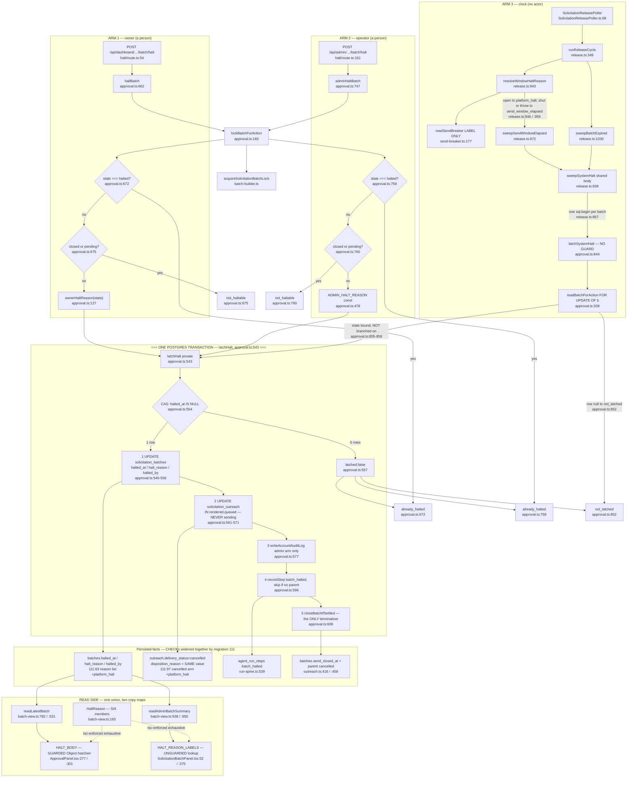

# F4 — Halt latch: three arms, one CAS, `platform_halt` end to end

Phase 1 flowchart. Window: `54e4d374..74aee92a`. Weight: medium.

Live DB used for verification: `postgresql://test@localhost:5499/test_ws4`
(container `repworth-testdb`), at migrations head —
`solicitation_batches_halt_consistency` contains `platform_halt` in the reason
list and not in the actor list.

## HEADLINE — #895 item (b) re-verification

**VERDICT: the CAS is now LOAD-BEARING and TESTED. Issue #895 item (b) is
CLOSED by the code. Its three false-attribution comments are still in the tree.**

### Current location

`AND halted_at IS NULL` now lives at **`src/lib/solicitation/approval.ts:554`**,
inside private `latchHalt` (`:543`). **Not `:479`** — the file grew +210 lines
and `:479` is now the `ADMIN_HALT_REASON` constant.

```
546  const [latched] = await tx<{ id: string }[]>`
547    UPDATE solicitation_batches
548    SET halted_at = NOW(), halt_reason = ${input.reason}, halted_by = ${input.actorUserId}::uuid
551    WHERE id = ${input.batchId}::uuid
552      AND account_id = ${input.accountId}::uuid
553      AND business_id = ${input.businessId}::uuid
554      AND halted_at IS NULL          <-- the CAS
555    RETURNING id`
557  if (latched === undefined) return { latched: false };
```

### Does `latchSystemHalt` reach `{latched:false}`? — YES

`latchSystemHalt` (`:844`) calls `readBatchForAction` (`:849`) — the row read
**with** `FOR UPDATE OF b` but **without** the advisory lock — then goes straight
to `latchHalt` (`:859`). The only branch between them is `locked === null`
(`:852`). The derived `state` is bound at `:853` and, per `:855-858`, **"is NOT
a guard — nothing below branches on it."** There is no `state === 'halted'`
refusal. A second sweep tick over an already-halted batch reaches `:554`, the
UPDATE returns zero rows, and `{latched:false}` → `{status:'not_latched'}`
(`:875`).

### The mutation experiment (actually run)

Deleted the `AND halted_at IS NULL` conjunct at `:554`; ran the five
halt-relevant suites against the live DB.

**Baseline (unmutated): 5 files, 133 tests passed.**

**Mutated: 2 failed / 131 passed — both in `approval-system-halt.integration.test.ts`:**

1. `:363` *"a second system halt on an already halted batch writes nothing"* —
   `AssertionError: expected { status: 'latched', cancelledCount: 0, close: { status: 'already_closed' } } to deeply equal { status: 'not_latched' }` at `:377`.
2. `:433` *"property: the Halt latch is monotone under arbitrary halt orderings"* —
   `Counterexample: [["owner","send_window_elapsed"]]` → `expected 'send_window_elapsed' to be 'owner_halt'` at `:478`. **The system arm overwrote the owner's halt reason.**

**Everything else stayed green under the mutation** — `approval.test.ts`,
`approval.integration.test.ts`, `release.integration.test.ts`,
`outreach-close.integration.test.ts`: 131 passed. That is the decisive
confirmation that the three CAS-crediting comments are still false attributions:

| Site | Comment | Reality |
|---|---|---|
| `approval.integration.test.ts:1264-1267` | *"Monotone: the CAS on `halted_at IS NULL` is what makes the second call inert."* | `haltBatch` refuses at `approval.ts:672` — the CAS is unreachable. **Green with the CAS deleted.** |
| `approval.integration.test.ts:2471-2475` | *"The CAS … is what makes the second call inert."* | `adminHaltBatch` refuses at `:759`. **Green.** |
| `approval.test.ts:238-240` | *"A second halt is a FIXED POINT — the CAS … makes it add no audit row and no `batch_halted` spine step."* | `mockSql` (`:273-277`) primes the second read with `halted_at: new Date()`, so the guard refuses. **The mock never models the CAS.** Green. |

**File restored and verified.** `git checkout -- src/lib/solicitation/approval.ts`,
re-ran `approval-system-halt.integration.test.ts` → 4 passed. Orchestrator
independently confirmed: `git status --porcelain` shows only the pre-existing
`.gitignore` modification and untracked paths; `approval.ts` is absent from the
modified list and `:554` reads `AND halted_at IS NULL` byte-for-byte.

### Verdict, precisely stated

- **Load-bearing:** yes, since `a321634a` (#920) landed `latchSystemHalt`. It is
  the sole monotonicity defense for the clock arm.
- **Dead:** no longer. #895(b)'s "the CAS is unreachable" finding is **stale as
  of #920** — the third arm is exactly the "one that lands without routing
  through `lockBatchForAction`" scenario #895 warned about, and it landed.
- **Untested:** no. Two tests go RED. The docstring at `approval.ts:518-524`
  already names `approval-system-halt.integration.test.ts` as the tripwire, and
  **that prediction is accurate** — verified by mutation, not by reading.
- **Residual finding (demoted, not closed):** three test comments still credit
  the CAS for behaviour their own guard produces. This is now a
  **comment-accuracy defect**, not a coverage gap: a reader deleting the CAS and
  running `approval.integration.test.ts` alone sees green and concludes it is
  dead. Fix is three comment edits plus the `approval.test.ts:238` claim,
  pointing at `approval-system-halt.integration.test.ts:363`/`:433` as the real
  owner.

## The three arms



## Q2 — The three-arm monotonicity invariant

| Arm | Entry | Guard | Belt-and-braces |
|---|---|---|---|
| **owner** | `:662` | `:672` `if (state === 'halted') return already_halted` over a row read `FOR UPDATE OF b` at `:242` under the advisory lock (`:188`); `:675` refuses `closed`/`pending` | `:692` the CAS result — unreachable in practice |
| **operator** | `:747` | `:759` identical; `:760` refuses `closed`/`pending`. Same lock chain | `:775` same |
| **clock** | `:844` | **NONE.** `:852` is the only branch. Docstring `:828-832`: *"It applies NO guard list, deliberately… `latchHalt`'s `halted_at IS NULL` CAS is the only thing standing between two ticks and a second receipt."* | The scan predicates at `release.ts:1008`/`:1072` filter **outside** the transaction (`release.ts:848` precedes `sql.begin` at `:857`), so they narrow the race window but do not close it |

**There is no database-level monotonicity constraint.** 091's
`solicitation_batches_halt_consistency` (as widened by 111) ties
`halted_at ↔ halt_reason ↔ halted_by` presence, not ordering. **`approval.ts:554`
is the only thing making `halted_at` monotone.**

## Q3 — Migration 111

**(a) Both widenings are strict supersets — verified mechanically, not by
reading prose.** Both constraint bodies extracted and diffed:

- `091:128-140` vs `111:63-75` → **one line differs**:
  `'send_window_elapsed', 'batch_expired'` → `+ 'platform_halt'`. Actor arm
  (`091:137-138` / `111:72-73`) and the `IS TRUE` wrapper byte-identical.
- `110:42-60` vs `111:88-106` → **one line differs**: the cancelled arm's
  `…'superseded'` → `+ 'platform_halt'`. Withheld, failed and unknown arms,
  member order and wrapper byte-identical.

**(b) `platform_halt` requires `halted_by IS NULL` structurally.** `111:72-73`:

```sql
AND (halted_by IS NOT NULL)
    = ((halt_reason IN ('owner_veto', 'owner_halt', 'admin_halt')) IS TRUE)
```

`platform_halt` is absent from that list, so `halted_by IS NOT NULL` must equal
FALSE. **Enforced by the DB, not the caller.** `latchSystemHalt:869` passes
`actorUserId: null`. Live test: `release.integration.test.ts:1659` asserts
`actorArm?.[0] ?? '').not.toContain('platform_halt')` at `:1686`.

**(c) The two CHECKs genuinely must widen together.** `latchHalt` writes
`input.reason` to **two tables in one transaction** — `:549` `halt_reason` on
`solicitation_batches` (CHECK a) and `:564` `disposition_reason` on every
`rendered`/`queued` outreach row (CHECK b) — both inside the same `tx` between
`:546` and `:571`. Widening only (a) would let the batch UPDATE succeed and the
outreach UPDATE raise 23514, rolling back the whole latch. `111:81-83` states
exactly this. **The coupling is structural, not stylistic.**

## Q4 — `resolveWindowHaltReason`: caller/callee split. **Claim holds.**

Type-level: `release.ts:876`
`type WindowHaltReason = Extract<SystemHaltReason, 'send_window_elapsed' | 'platform_halt'>`.
`SystemHaltReason` has one definition (`approval.ts:119`), imported as a type at
`release.ts:79`. `Extract` is derived, so **it cannot drift**; `batch_expired` is
a type error inside phase 2 by construction.

Flow: `:943` → `runReleaseCycle:388` binds `windowHaltReason` **once per tick** →
`sweepSendWindowElapsed(sql, scanLimit, reason)` (`:972`) → `sweepSystemHalt`'s
`spec.reason: SystemHaltReason` (`:844`) → `latchSystemHalt(tx, {…, reason})`
(`:862`). `sweepBatchExpired:1033` passes the literal. **No dynamic string
anywhere on the path.**

- *Can `release.ts` pass a reason `latchSystemHalt` does not accept?* **No** —
  statically impossible.
- *Can the two disagree?* **No** — one decision site (`:946`
  `breaker.open ? 'platform_halt' : 'send_window_elapsed'`); `latchSystemHalt`
  never re-derives, it writes `input.reason` verbatim.

**"Same 72h window, only the label differs" — verified from code.**
`selectSendWindowElapsedBatches` (`:999-1013`) is the **single** candidate query
for both labels, on one constant with one owner (`outreach.ts:51 = 72`). No
second predicate, no second clock, no second scan. The report split at
`release.ts:395-396` assigns the phase count to `platformHalted` **or**
`sendWindowElapsed`, never both.

## Q5 — The six-member union and its two copy maps

| Map | File:line | Exhaustive? | Enforced by |
|---|---|---|---|
| `HaltReason` (source of truth) | `batch-view.ts:165-171` | — | mirror of the DB CHECK, **hand-maintained** |
| `HALT_BODY` | `ApprovalPanel.tsx:277-296` | yes, 6/6 | **the type system** |
| `HALT_REASON_LABELS` | `SolicitationBatchPanel.tsx:52-59` | yes, 6/6 | **the type system** |

**X2's finding is confirmed and now WORSE:**

- **#895 item (a) is still true.** `SolicitationBatchPanel.tsx:375` is an
  **unguarded** `HALT_REASON_LABELS[summary.haltReason]`. `ApprovalPanel.tsx:301-305`
  guards the equivalent with `Object.hasOwn` and a fallback (`:299`). Both read
  models **assert** rather than validate (`batch-view.ts:140-143` says so), so a
  DB value outside the union is possible in principle — one surface renders
  `— undefined`, the other a safe sentence.
- **NEW this window: the runtime coverage did NOT follow the sixth member.**
  `approval-panel.test.tsx:555-559` enumerates **five** cases; `platform_halt` is
  absent, and the header at `:551` still reads *"One latch, five reasons."*
  Neither panel test file mentions `platform_halt` anywhere. **The longest and
  most consequential copy string in F4 — the "this was our doing" apology at
  `ApprovalPanel.tsx:292-298` — is type-checked but never rendered by a test.**
- **Stale prose in the owner map's docstring:** `ApprovalPanel.tsx:270` *"names
  all five writers"* and `:273` *"no writer yet (#630's `send_window_elapsed`,
  `batch_expired`)"*. Both writers now exist. The admin map's docstring **was**
  updated to say six — so the two copies are now out of step in their
  *documentation* as well as their guard.

**Nothing pins `HaltReason` to the DB CHECK.** `approval.test.ts:398-439` pins
`OwnerHaltReason` (2) and `SystemHaltReason` (3); `release.integration.test.ts:1659`
pins CHECK membership. **No test asserts that the CHECK's reason list and
`batch-view.ts:165` have the same cardinality** — a migration 112 adding a
seventh reason leaves both maps type-clean and the admin panel rendering
`undefined`.

## Q6 — `closeBatchIfSettled` vs its 13 callers

Read in full (`outreach.ts:330-462`). Contract: `:335-348` takes the batch lock
itself · `:349-353` **THROWS** when the row is absent · `:363-372` settledness
before the parent lookup · `:377-414` parent lookup, `no_send_parent` unless
`input.failure` is declared · `:416-425` `send_closed_at` CAS on NULL gates every
write below · `:427-459` disposition precedence
`halted > expired > generation_failed > gate_closed > exhausted`, branching on
the **resolved disposition**, never on `input.failure` presence.

**Holds for all 13, with one caller where a documented-but-nontrivial arm is
live.**

- **The throw at `:350` is unreachable for 12 of 13** — each locked or wrote the
  batch row earlier in the same transaction. **`release.ts:458` is the
  exception**: its batch id comes from `selectOpenSendBatches` run *outside* the
  transaction (`:448`), so a batch purged between scan and call throws. Contained
  by `isolateItem` (`:250-262`), but it is the one caller where "not found" is
  genuinely live. Documented in spirit at `:441-445`, not by name.
- **`platform_halt` needs no new disposition member.** `deriveDisposition:298`
  reads `batch.halted` (`halted_at IS NOT NULL`), not the reason — all six
  reasons map to `halted` → `'cancelled'`. #917 required zero change here.
  **That is the contract holding, not a gap.**
- **No caller's behaviour is wrong or accidental.** The three non-obvious ones
  match their glossary term exactly: `approveBatch:455` (Ask exclusion),
  `withdrawAsk:1344` (Ask withdrawal), `latchHalt:608` (always `halted`).
- The function is 133 lines at cyclomatic 9 because it carries **four** terminal
  shapes, and the parentless arm at `:399-413` genuinely cannot reuse the path
  below (stated at `:396-398`). **No split is available that does not create a
  second definition of *Settled batch*.**

## Q7 — #891 (H2): **five sites, three forms.** More than four.

| # | Site | Form | Question it asks |
|---|---|---|---|
| 1 | `api/admin/solicitation/batch/halt/route.ts:91` | `result.close.status !== 'not_settled'` | did the close settle it |
| 2 | `api/dashboard/solicitation/batch/halt/route.ts:45` | same | same |
| 3 | `api/dashboard/solicitation/batch/withdraw/route.ts:43` | same | same |
| 4 | `api/dashboard/solicitation/batch/approve/route.ts:60` | `result.close !== null` | same — **only** because `approval.ts:466` pre-narrows |
| 5 | `release.ts:465` | `result?.status === 'closed'` | **a different question**: did *this call* do the closing (excludes `already_closed`, `no_send_parent`) — a tally, not a receipt |

**The dispatch lane does not ask at all.** `dispatch.ts:1187`/`:1386` call for
effect and discard. Same for `release.ts:708`, `failed-hook.ts:266`,
`ask-generation.ts:865`/`:997`/`:1488`. `ask-generation.ts:1171`/`:1682` retain
the result but pass `close.status` into a **log line only**.

The asymmetry is still entirely caused by `approval.ts:466` —
`ApproveBatchResult.close` is nullable while `HaltBatchResult.close` (`:629`),
`AdminHaltBatchResult.close` (`:722`), `WithdrawAskResult.close` (`:1132`) and
`LatchSystemHaltResult.close` (`:805`) are not.

## Q8 — Reserved members: **nothing is reserved any more**

`LatchHaltReason` (`:474`) = six members, every one with a live writer:
`owner_veto`/`owner_halt` (`:127` → `:677`), `admin_halt` (`:478` → `:767`),
`send_window_elapsed` (`release.ts:955`/`:946` else-arm → `:972`),
`platform_halt` (`release.ts:946` then-arm → same sweep), `batch_expired`
(`release.ts:1033` literal).

**The clock arm is unconditionally live in production.**
`SolicitationReleasePoller.ts:1-21` deliberately does **not** read
`SOLICITATION_SEND_ENABLED` — the flag gates phase 4 only, because gating the
whole cycle would strand phase 2 and re-open the #915 wedge.

**#895's "reserved-with-no-writer" observation is fully retired.** The residue is
prose: `ApprovalPanel.tsx:273` still says those two have "no writer yet", and
`approval.ts:15-16` still says 091's CHECK requires `halted_by IS NULL` "for
exactly its **two** reasons" (it is three since 111 — correct text at `:100`).

## Q9 — Invariants: **both hold**

- **Audit write.** `:577` `await writeAccountAuditLog(tx, {…})` imported from
  `@/lib/audit/log` at `:66`, running on `tx` inside the same `sql.begin` that
  owns the CAS and the cancellations. `:531` explains the placement. **CLAUDE.md
  "Audit writes" satisfied.**
  *(Out of F4 scope but noted: eight other production sites raw-INSERT into
  `account_audit_log` — `admin/csv-import.ts:381`, five `locations/*` sites,
  `CancellationGracePoller.ts:100`. None is a halt path.)*
- **Spine step.** `:596` `await recordStep(tx, {…, stepKey:'batch_halted'})`.
  `INSERT INTO agent_run_steps` exists at exactly three lines, all in
  `run-spine.ts` (`:319`, `:401`, `:539`) — **single writer confirmed.** Persona
  registered at `run-spine.ts:72`. The step is skipped when
  `sendParentRunId === null` (`:595`) and the join still runs (`:608`).

## External dependencies

**Inbound (writes):** `api/dashboard/solicitation/batch/halt/route.ts:54` →
`haltBatch` at `:65` · `api/admin/solicitation/batch/halt/route.ts:161` →
`adminHaltBatch` at `:122` · `release.ts:858` → `latchSystemHalt`, **the only
caller**.

**Inbound (`closeBatchIfSettled`, 13 sites, 5 files):** `approval.ts:455/:608/:1344`
· `ask-generation.ts:865/:997/:1171/:1488/:1682` · `dispatch.ts:1187/:1386` (F2)
· `release.ts:458/:708` (F1) · `failed-hook.ts:266` (F2).

**Inbound (reads):** `batch-view.ts:782` (owner) and `:938` (operator), both
projecting `b.halt_reason AS "haltReason"` typed by **assertion** (`:531`, `:950`).

**Outbound:** `recordStep`, `writeAccountAuditLog`, `closeBatchIfSettled`,
`acquireSolicitationBatchLock`, `deriveBatchState`. Nothing else —
00-features.md's "Calls into: nothing outward this window" is accurate for *new*
edges.

**Cross-feature edge worth naming:** `resolveWindowHaltReason` (`release.ts:943`)
calls `readSendBreaker` (F3) inside the repo's **one sanctioned `try/catch`**
around it (`:944-956`). F4 consumes the label; F3 owns the read. An F1↔F3 edge
that *writes* F4's vocabulary.

## Duplication leads (locations only)

1. **Two guard ladders, byte-identical:** `approval.ts:672`/`:675` and
   `:759`/`:760`. Same three states, same two outcomes, different result unions.
2. **Two halt-copy maps over one union** with **different guard discipline** —
   `Object.hasOwn` at `ApprovalPanel.tsx:301` vs bare index at
   `SolicitationBatchPanel.tsx:375`.
3. **The `('rendered','queued')` row predicate three times:** `approval.ts:569`
   (`latchHalt`), `:1300` (`withdrawAsk`), `:1185` (`classifyWithdrawal`, in TS).
   CONTEXT.md **Ask withdrawal** records "a THIRD caller is the signal to
   extract" — **by that rule the count is now at the threshold.**
4. **The halt reason union spelled five times:** `approval.ts:88` + `:119` +
   `:474`, `batch-view.ts:165`, `111_platform_halt_reason.sql:67-70`, plus a
   hand-spelled copy in `release.integration.test.ts:264`.
5. **`send_closed_at` CAS-on-NULL twice inside `closeBatchIfSettled` itself** —
   `outreach.ts:399-407` and `:416-424`. Documented at `:396-398` as unavoidable.
6. **The "did the close settle" predicate in three spellings** — Q7 table.
7. **`halted_at IS NULL`** at `approval.ts:554` (the CAS), `release.ts:1008`
   (P2 scan), `:1072` (P3 scan), `:500` (P5 scan, 091's index predicate). **Four
   sites, three different jobs.**
8. **`sweepSystemHalt`'s three-value parameterisation** (`release.ts:839-869`) is
   itself the *result* of de-duplicating two byte-identical sweep bodies — the
   docstring at `:822-826` records the argument used to keep them apart and why
   it was wrong. **Worth carrying forward as precedent.**

## Confidence and gaps

**High confidence:** Q1 (mutation-verified against live Postgres, both
directions, file restored and independently re-verified), Q3 (mechanical diff of
extracted constraint bodies plus DB introspection), Q4, Q5, Q7, Q8, Q9.

**Medium confidence:** Q6's "no caller for which behaviour is wrong". Every call
site's immediate context (±16 lines) was read, but **not** the full enclosing
transactions of `dispatch.ts:1187`/`:1386` — F2's assigned gap. If either holds
an `agent_runs` row lock before calling in, that violates the batch→run contract
at `outreach.ts:312-316`. The docstrings at `dispatch.ts:1065` and `:1322` claim
they do not.

**Gaps carried out of F4:**
1. **`send-breaker.ts` internals unread.** If `readSendBreaker` can return
   `{open:false}` on a *degraded* read rather than throwing,
   `resolveWindowHaltReason`'s `catch` is not the whole fallback surface.
   **Assigned to F3.**
2. **Concurrency between the clock arm and the human arms is proven only by the
   property test's serial orderings** (`approval-system-halt.integration.test.ts:433-501`,
   `numRuns: 12`). No test runs two arms genuinely concurrently. The advisory-lock
   asymmetry (`latchSystemHalt` skips it) is argued in prose at `approval.ts:822-827`
   and untested.
3. ~13,000 lines of new tests unread beyond the halt suites.
4. `docs/directory.md` rows for the F4 files not audited — Phase 0 and F1 have
   already banked two stale rows in this neighbourhood (`:934`, `:931`).
