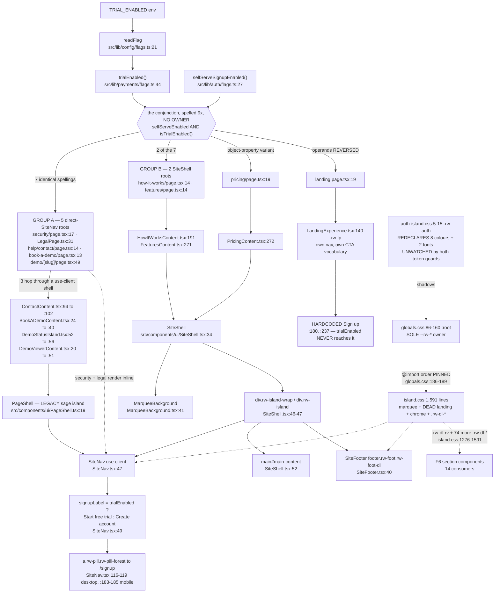

# F5 — Marketing chrome: the Daylight shell and the trial-aware CTA

Phase 1 flowchart. Window: `54e4d374..74aee92a`. Weight: light.

## The chrome and the `trialEnabled` flow



## Q1 — Invariant #13 holds, with one structural gap

Single owner `payments/flags.ts:44`; single env reader `config/flags.ts:21`.
**All nine reads are server-side.** `security/page.tsx` and `LegalPage.tsx` are
server components rendering `SiteNav` inline; the other three roots read the flag
and pass it as a prop into a `'use client'` shell which forwards it. **No client
component reads a flag itself** — `SiteNav.tsx:47` defaults it to `false`,
fail-closed to the non-claiming label. **No new `NEXT_PUBLIC_*`:**
`ALLOWED_NEXT_PUBLIC` still holds exactly six entries, none flag-shaped.

**One structural gap the invariant does not cover:** nothing asserts that a *new*
public surface rendering `SiteNav` threads the flag. `SiteNav.test.tsx:64-68`
tests the label mapping in isolation; no test walks the nine call sites. **A tenth
surface added tomorrow silently renders "Create account" while the other nine say
"Start free trial", and no gate fires.**

## Q2 — The prop-threading shape. **Hoist the READ, not the RENDER.**

**Correction to the brief:** the nine ≤6-line files are **not** the same nine as
"nine composition roots reading `trialEnabled()`". The ≤6-line set contains only
**five** reads; the other four are in `how-it-works`, `features`, `pricing`,
`(public)/page.tsx` — F6 and Landing files. **Two disjoint nines that the F5 brief
conflates.**

**(a) The flag READ — a seam exists, and it is not exotic.** The duplicated unit
is not the prop, it is the **conjunction, spelled nine times with no owner**:

```
security/page.tsx:17          const trialOn = selfServeEnabled && isTrialEnabled();
LegalPage.tsx:31              (identical)
help/contact/page.tsx:14      (identical)
book-a-demo/page.tsx:13       (identical)
demo/[slug]/page.tsx:49       (identical)
how-it-works/page.tsx:14      (identical)
features/page.tsx:14          (identical)
pricing/page.tsx:19           trialEnabled: selfServeEnabled && isTrialEnabled(),
(public)/page.tsx:19          const trialEnabled = isTrialEnabled() && selfServeEnabled;   <-- REVERSED
```

Seven byte-identical, one object-property variant, **one with operands reversed**.
The reversal is semantically identical but **proves nobody owns the rule**; the
rule itself ("the chrome may only claim a trial when there is a signup door to
start it from") is stated in prose at `(public)/page.tsx:16-18` and
`how-it-works/page.tsx:15-17` and **nowhere in code**. A single exported server
helper returning `{ selfServeEnabled, trialEnabled }` collapses nine spellings
into one. **Nine callers is well past CLAUDE.md's "no abstraction before the
second use", and this is a function that already exists conceptually.**

**(b) The chrome RENDER — cannot be hoisted, and the reason is structural.**
`src/app/(public)/layout.tsx` **exists** (30 lines, a server component). It was
not used because **a Next.js layout renders `{children}` as an opaque node — it
cannot inject props into it**, and there is no server-side React context to
substitute.

More decisively, **the nine sites have genuinely different render trees**: three
F6 pages use `SiteShell` (bone `.rw-island` + marquee, nav/main/footer siblings);
six use `PageShell` (sage parallax + white `rounded-[3rem]` Tailwind island, with
nav/main/footer as *children* of the island `m.div`), and **two of those render no
footer at all**; `/` uses neither. `(public)/layout.tsx:9-16` documents this
deliberately: *"Landmark contract (owned by each page, not this layout) … We
intentionally do NOT wrap `{children}` in a layout-level `<main>`."*

**Verdict for Phase 2: hoist the READ, not the RENDER.** The nine prop-threading
edits are an unavoidable consequence of two different islands plus RSC's
no-props-into-children rule; the nine conjunction spellings are not.

*(Also noted: `demo/[slug]/page.tsx:110` carries a 2-space indentation defect from
the mechanical edit — 8 spaces where sibling props at `:106-109` use 6. No
Prettier config exists in the repo. Cosmetic, but it is the fingerprint of nine
hand-edits.)*

## Q3 — Seed 21 confirmed, and three things beyond it

**(a) The four `@import`s at `globals.css:186-189` — documented in three places,
all consistent.** `globals.css:162-185` gives two independently load-bearing
properties:

1. **They must be CSS `@import`s, not `layout.tsx` imports** (`:168-178`).
   Tailwind v4 bundles local `@import`s itself, keeping the files inside the
   Lightning CSS pass. Imported from `layout.tsx` they become separate stylesheets
   `@tailwindcss/postcss` skips — and, **measured on this tree, 47 of the
   `@supports (color: color-mix(…))` fallbacks stop being emitted**, silently
   dropping the flat-colour fallback for browsers without `color-mix()`.
2. **They must sit at the BOTTOM, after `:root`** (`:179-182`) — hoisting them
   moves ~2,400 lines of page CSS ahead of the token and `@theme` blocks.

The order among the four is a **preservation** constraint (the order the blocks
had before PR 3b split them out), not a derived one. **Guarded** by
`design-scope-purity.test.ts:152-194`, three assertions: presence + ascending
order, position after `:root {`, and `layout.tsx` must not contain
`(public)/_styles`. **This is the best-documented seam in F5.**

**(b) `island.css` (1,591) holds FOUR concerns, and the largest is not F5's.**

| Block | Lines | Selectors | Owner |
|---|---|---|---|
| Marquee background | `:38-110` | `.rw-marquee-*` (7), `.rw-bg-*` (9) | **F5** |
| **Legacy landing chrome** | `:112-1049` | `.rw-tk-*` (22), `.rw-hero-*` (9), `.rw-voice-*` (~15), `.rw-ticker*`, `.rw-feat-card`, `.rw-demo-act`, `.rw-dot-nav`, `.rw-float-stat`, `.rw-clock-legend`, `.rw-btn-pill` | **mostly NOBODY** |
| Daylight site chrome | `:1067-1274` | `.rw-nav-*` (22), `.rw-pill-*` (15), `.rw-foot-*` (16) | **F5** |
| Daylight shared primitives | `:1276-1591` | **`.rw-dl-*` (75 — the single largest family in the file)** | **F6** |

The file's own header admits the second block (`:8-13`): *"the live `/` renders
`src/components/sections/landing/**` with its own CSS instead, so many of those
selectors have no consumer today … PR 3b is a move, not a cleanup."* Spot-checked:
`rw-tk-`, `rw-ticker`, `rw-feat-card`, `rw-demo-act`, `rw-float-stat`,
`rw-clock-legend`, `rw-btn-pill` have **zero** `.tsx` consumers.

**Related dead-rule finding: `.rw-landing` has zero production consumers.**
`SiteShell.tsx:8` cites `'rw-landing'` as its example `scope` value, but the three
live callers pass `hiw-page`, `rw-feat-page`, `pr-page` and `/` uses `.rw-lp`. So
`island.css:116-123 .rw-landing { --rw-marquee-speed: 1; … }` is dead — **and
`design-scope-purity.test.ts:52`'s `PAGE_LOCAL_PROPERTIES` allowlist exists solely
to permit a property on a dead selector.** The live dial is the inline style at
`MarqueeBackground.tsx:53` plus the `var(--rw-marquee-speed, 1)` fallbacks.

**The seam, stated precisely.** `island.css` is the *declared* owner of
`.rw-dl-rv` (`:1567-1572` + reduced-motion `:1587`), and `.rw-dl-rv` has
**fourteen consumers, none of them F5** — `Reveal.tsx:30` plus twelve `Feat*`/
`RoadmapBand` sites — **plus four cross-file descendant selectors in F6's own page
CSS** (`how-it-works.css:300`, `features.css:283`, `:353`, `:428`, `:514`). So a
stylesheet whose stated job is "shared island chrome + the marquee atmosphere"
also owns the marketing reveal primitive that only the section pages use, and F6's
page CSS reaches back **up** into it. **The seam runs at `island.css:1276`** —
above it is chrome/legacy (F5), below is the shared marketing primitive layer
(F6's dependency). **Today one file, one `@import` slot and one cascade position
serve both, which is why F5 and F6 cannot be redesigned independently.**

**(c) The guards' scope, and the precise hole.**

| Test | Watches | Does NOT watch |
|---|---|---|
| `design-scope-purity.test.ts` | `sections/landing/**/*.css` (`--rw-lp-*` only); `globals.css` `@theme inline`; the four `(public)/_styles/` files; the `@import` order | **any CSS under `src/components/` other than `sections/landing/`** |
| `design-token-single-source.test.ts` | `globals.css` vs `(authenticated)/_styles/tokens.css` — 24 Island colour tokens + 5 brand fonts; Console `:root`-ban; Console AA contrast | **`src/components/auth/auth-island/auth-island.css`** and every other `src/components/` stylesheet outside `sections/landing/` |
| `focus-visible-marketing.test.ts` | 12 Landing rules + **exactly two** Island rules (both in `pricing.css`) | **`island.css`'s own chrome focus rings** — `.rw-navwrap :focus-visible` / `.rw-foot-dl :focus-visible` (`:1123-1128`) and `.rw-pill:focus-visible` (`:1197`) are unguarded |

**The hole is precise: the guards are anchored on two directory roots plus two
named files. A stylesheet under any other `src/components/` path is invisible to
both. Exactly one such file exists today — `auth-island.css` — and it is the one
that violates the rule.**

## Q4 — Issue #895 (f): all three claims CONFIRMED

**Claim 1 — 8 Island colours + 2 brand fonts under `.rw-auth`.** Confirmed at
`auth-island.css:5-15`: exactly 8 colours + 2 fonts, all ten names on the guard's
own lists. **A repo-wide sweep for `^\s*--rw-` under `src/components/` outside
`sections/landing/` returns these ten lines and nothing else.**

**Claim 2 — unwatched directory.** Confirmed. Three *other* tests read the file
(`island-overflow.test.ts:21`, `auth-island-mobile.test.ts:10`,
`no-yellow-star-colors.test.ts:46-47`) but **none asserts anything about token
ownership**. The file is read three times and its token block is checked zero
times.

**Claim 3 — the two font families HAVE diverged.** Confirmed, exactly as
described. Both declarations:

`globals.css:156-157` (the owner):
```css
  --rw-font-display: var(--font-plus-jakarta), 'Plus Jakarta Sans', ui-sans-serif, system-ui, -apple-system, 'Segoe UI', Roboto, sans-serif;
  --rw-font-body: var(--font-dm-sans), 'DM Sans', ui-sans-serif, system-ui, -apple-system, 'Segoe UI', Roboto, sans-serif;
```

`auth-island.css:14-15` (the shadow):
```css
  --rw-font-display: var(--font-plus-jakarta), ui-sans-serif, system-ui, sans-serif;
  --rw-font-body: var(--font-dm-sans), ui-sans-serif, system-ui, sans-serif;
```

The shadow drops **the named family fallback** (the one that would pick up a
locally-installed copy if the self-hosted `.woff2` fails) **and the three-name
platform chain**. Net effect on `/login`, `/signup`, `/forgot-password`,
`/reset-password`: if the `next/font/local` variable is unset, the auth island
falls straight to generic `sans-serif` while every other Island surface still
tries the real brand family.

**One refinement to the finding.** The eight **colour values are still
byte-identical** (case-only difference; all eight compared). **So the divergence is
font-only today. That makes the finding sharper, not weaker:** the file has been
drifting for one round, and the colours are the eight tokens most likely to move
next, since the whole Daylight rebrand happened one directory over and never
touched `.rw-auth`. Note `.rw-auth` does **not** redeclare the Daylight tokens, so
**if the auth island ever adopts `SiteFooter`'s `.rw-foot-dl` it would get Daylight
surfaces sitting on shadowed legacy text colours.**

**Adjacent, same file:** `AuthIslandClient.tsx:31,40,52` renders `.rw-island` and
`.rw-foot` — classes owned by `island.css`. **`island.css:971-977` already carries
a scoping workaround for exactly this collision.** So `.rw-foot` is a shared class
name across two unrelated components, **already patched once by selector surgery.**

## Q5 — Landmarks correct; two a11y findings the claim does not cover

**Landmark claim: correct.** `SiteNav.tsx:81` `<header aria-label="Primary">` is a
direct child of a plain `div` → real `banner`; `SiteShell.tsx:52` `<main
id="main-content">` is a sibling (`SiteShell.test.tsx:37` asserts exactly one
`<main>`); `SiteFooter.tsx:40` `<footer>` → real `contentinfo`. Skip-link target
matches (`(public)/layout.tsx:21-26`). `SiteFooter.tsx:53` gives each link column
its own named `<nav>`.

**(i) The navigation landmark is unnamed; the banner carries the name instead.**
`aria-label="Primary"` sits on the `<header>` (`:81`) and `<nav className="rw-nav">`
(`:83`) has no accessible name. A screen-reader landmark list shows "Primary
banner" and an anonymous "navigation" — while the *footer's* three navs are all
named and the *landing* nav puts the label in the conventional place
(`LandingExperience.tsx:141`). **Two navs, two different conventions, in one
product.**

**(ii) WCAG 2.2.2 (Pause, Stop, Hide) is satisfied on `/` and NOT on the
`SiteShell` pages.** The marquee auto-starts, runs 90–120s per cycle and loops
forever, plus a 6–8s float on every card. Handled correctly for: decorative
(`aria-hidden` + `pointer-events: none`) and reduced motion (**twice** — JS via
`usePrefersReducedMotion` → per-row `animation: 'none'`, and CSS via
`island.css:107-110`). **But there is no pause control on any `SiteShell` page.**
`.rw-lp-motion-toggle` exists only at `sections/landing/ambient-motion.tsx:167` —
Landing-only. **`prefers-reduced-motion` is an OS setting, not the on-page
mechanism 2.2.2 requires, so `/how-it-works`, `/features` and `/pricing` regressed
relative to `/` when they adopted `SiteShell`.**

Minor: the JS `frozen` path only nulls the **row** animation; the per-card float
is killed only by the CSS media query. Harmless today — `MarqueeBackground`'s
`speed` prop has **no production caller** (`SiteShell.tsx:44` renders it bare). **A
dead parameter.**

*On `--rw-marquee-speed` being "the dial": the seed's `island.css:117` location is
the dead one (`.rw-landing`, zero consumers). The live dial is the inline style at
`MarqueeBackground.tsx:53`.*

## Q6 — `SiteNav`: **one shape, no per-surface branches**

**Churn correction: 13 commits, not 14**, spanning 2026-05-04 → 2026-08-21. The
window's contribution is 167 changed lines in one commit — a full markup
replacement (Tailwind utilities → `.rw-nav*` classes). **"Cooling" is the wrong
read: it went from a slow trickle straight to a rewrite.**

**Fan-in, exactly: seven production importers** — six direct renderers plus
`SiteShell`. `SiteShell` has three consumers, so **nine rendering surfaces**; the
tenth in the brief's count is the test file.

**All ten get the same component. There are no per-surface branches.** Read in
full: the only conditionals are `showOwnerAuth` (`:48`), `signupLabel` (`:49`),
pathname-derived `isActivePath`, and mobile open/close state. **Nothing keys on
route, surface, or caller identity — the strong finding, since it means the ten
consumers are genuinely served by one component.**

Two asymmetries in how the booleans are *supplied*: `comingSoon` is passed by
**only two** of the nine surfaces; the other seven silently take `false`. And the
footer pairing is inconsistent — seven surfaces render nav + footer, **the two demo
surfaces render nav with no footer.** Neither is checked anywhere.

## Q7 — No Landing↔Island↔Console crossing exists

Verified by three sweeps. **Daylight tokens** appear only in `globals.css`,
`(public)/_styles/*`, `PricingContent.tsx`, `sections/{features,how-it-works}/*`
and three test files — **zero** under `(authenticated)/`, `components/dashboard/`
or `sections/landing/`. **`--rw-lp-*`** appears outside `sections/landing/` only in
three test files. **Console tokens** appear nowhere in `(public)/_styles/`,
`components/ui/` or `components/auth/`.

**The `-bar` suffix on the five accents is a deliberate collision guard**,
documented at `design-token-single-source.test.ts:83-85` (*"so they can never
collide with the Console's own `--rw-blush` family the way bare `--rw-sage` once
collided"*). **It works.**

**The one crossing is intra-Island, and it is #895(f).** Per the router, auth **is**
Island, so this is a single-source violation rather than a system-boundary breach
— **but it is the mechanism the router exists to prevent, and it sits in the one
directory neither guard watches.**

**Two secondary crossings for Phase 2:** `.rw-island` and `.rw-foot` are shared
class names across `SiteShell`/`SiteFooter` and `AuthIslandClient`, already patched
once by selector surgery. And **raw literals inside `island.css`'s legacy block**
(`:93` `#97B3AE` = `--rw-teal`; `:97`, `:100` `rgba(42,42,42,…)` = `--rw-ink`;
`:87`, `:962`, `:994`, `:1000`) violate the skill's "tokens, never literals" rule
— **all predate the window, and the Daylight block `:1067-1591` is token-clean
throughout.**

## Duplication leads

1. **The `selfServe && trial` conjunction — 9 spellings, 0 owners** (Q2).
2. **The `signupCtaLabel` derivation, byte-identical** — `how-it-works/page.tsx:18-22`
   and `features/page.tsx:16-20`, 5 lines each. `features/page.tsx:15` even says
   *"Same door as the landing page and /pricing (see how-it-works/page.tsx)"*.
3. **Three competing signup-CTA label vocabularies for ONE destination
   (`/signup`)**: `SiteNav.tsx:49` `'Start free trial'`/`'Create account'`; the two
   section pages `` `Start your ${trialPeriodDays()}-day free trial` ``/`'Create account'`;
   `(public)/page.tsx:25-26` `` `Start your ${N}-day free trial` ``/`'Get early access'`;
   `LandingExperience.tsx:180,237` hardcoded `'Sign up'`.
4. **Four `'use client'` pass-through shells that only forward the prop.**
5. **Two island implementations** — `SiteShell.tsx:46-47` vs `PageShell.tsx:82-90`.
   `SiteShell.tsx:31-32` explicitly names the distinction.
6. **Three reveal implementations** (F6-adjacent; F5 owns the CSS).
7. **Token/literal shadowing** — `auth-island.css:6-15` vs `globals.css:87-101,156-157`.
8. **Raw hex/rgba for existing tokens inside `island.css`** — `:87`, `:93`, `:97`,
   `:100`, `:962`, `:994`, `:1000`.
9. **Legal cross-links declared twice** — `LegalPage.tsx:9-16` `CROSS_LINKS` and
   `marketing-links.ts:23-30` `LEGAL_LINKS`: same six labels, hrefs and order, two
   arrays. **`marketing-links.ts:1-3` claims to be "Single owner of the public
   marketing pages' link facts".**
10. **Reduced motion handled in two layers for the same elements.**
11. **`(public)/layout.tsx:14` documents a `SiteShell islandAs="main"` prop that
    does not exist.** Stale doc.
12. **`SiteShell.tsx:8` cites `'rw-landing'` as an example scope; no page passes
    it** — and a guard-test allowlist entry hangs off that dead selector.
13. **`MarqueeBackground`'s `speed` prop has no caller.**

## Confidence and gaps

**High confidence** — every claim is a direct read at `74aee92a` plus
`git diff 9e60617c^1 9e60617c`. The `trialEnabled` trace is exhaustive: a
repo-wide `rg -n "trialEnabled"` over `src` + `worker` returned 54 hits and every
public-surface one is accounted for. **The two guard tests were read end to end,
so their scope boundaries are asserted from their own constants, not inferred.**

**Gaps:** the test suite was not executed — all guard-coverage claims come from
reading assertions and file constants. **Not verified in a browser** — the WCAG
2.2.2 finding is from source. `island.css` read in four chunks plus a selector
census, not linearly (~130–955 and ~1300–1530 surveyed), so a fifth small concern
could exist. The 14-vs-13 commit and 10-vs-7 fan-in discrepancies with the brief's
fallow figures may reflect a different counting method. **Not measured:** whether
`island.css`'s dead landing block still ships to production bundles — Tailwind
does not tree-shake hand-written CSS, so **3,017 lines of Island page CSS almost
certainly load on every Console and admin route via `globals.css`**, but the built
chunk was not inspected.
