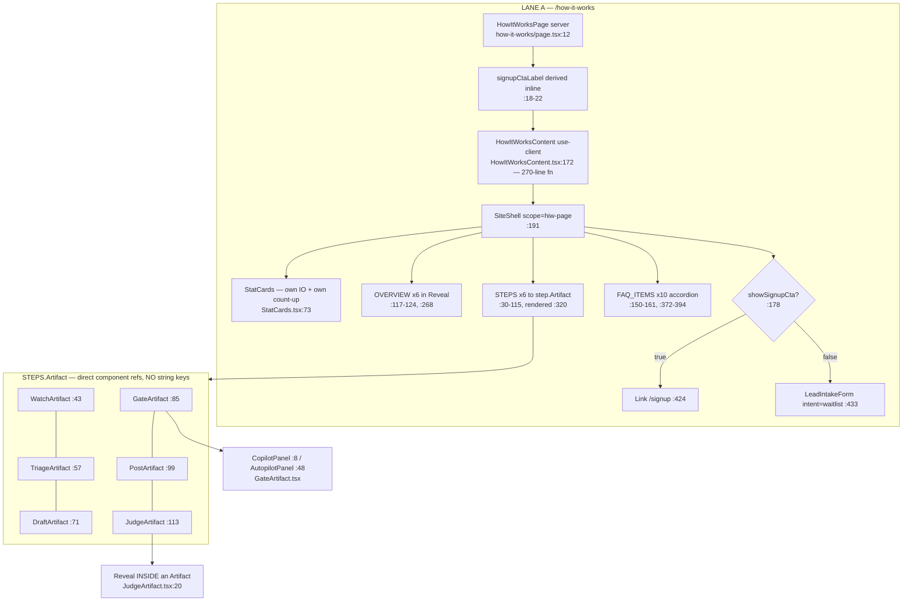
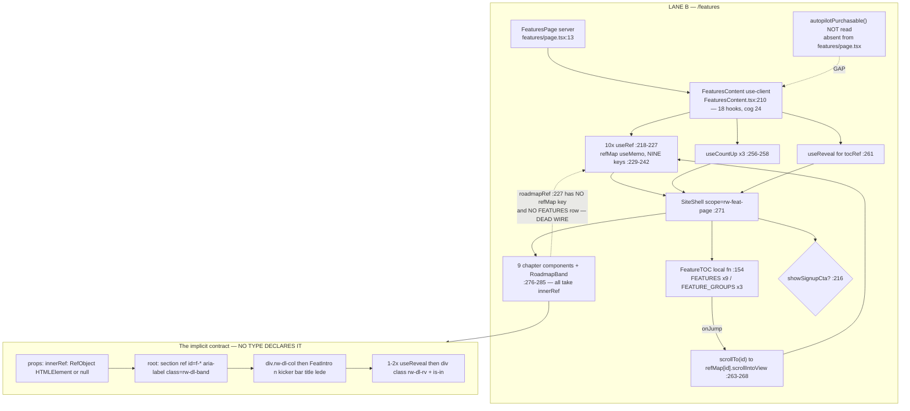
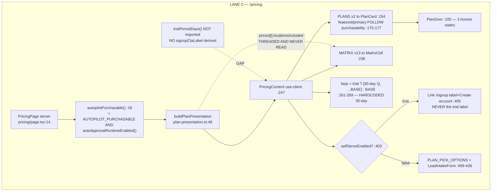

# F6 — Daylight Gallery II section pages: how-it-works, features, pricing

Phase 1 flowchart. Window: `54e4d374..74aee92a`. Weight: heavy (29 files).

> ## ⚠ THE TREE MOVED UNDER THIS CHART — read before acting on it
>
> **At 22:30 on 2026-08-22, while this pass was running, a concurrent session
> began editing F6's exact surface.** `HEAD` is unchanged at `74aee92a`, so every
> claim below is still a true statement about the merged code — but it is no
> longer a true statement about the working tree.
>
> **Uncommitted at the time of writing (21 modified + 1 STAGED rename):**
> `src/components/sections/how-it-works/Reveal.tsx` → **`src/components/ui/Reveal.tsx`**
> (staged via `git mv`), plus modifications to `JudgeArtifact.tsx`,
> `HowItWorksContent.tsx`, `PricingContent.tsx`, ten `Feat*.tsx`,
> `RoadmapBand.tsx`, `FeaturesContent.tsx`, `FeaturesContent.test.tsx`,
> `focus-visible-marketing.test.ts`, `features.css`, `pricing.css`,
> `docs/brand-asset-library/design-systems/island/DESIGN.md`.
>
> **That rename is D1's consolidation** — the reveal primitive moving to a shared
> owner. So the finding below was, apparently independently, already being acted
> on. **Re-anchor this chart against the tree before using D1, D2 or Q1 as a
> handoff.** In particular the `HowItWorksContent.client.test.tsx:96-97` pin
> (`thresholds === [0.05]`, `rootMargin === '-50px'`) is the cost this chart
> flagged, and whoever is doing the move will hit it.
>
> **Theme A is unaffected.** Every `src/lib/solicitation/`, `worker/`,
> `supabase/`, `scripts/ci/`, `src/lib/shared/`, `src/lib/agents/`, `src/app/admin/`
> and `src/app/api/` file was verified clean at 22:30. F1–F4, F7 and F8 stand
> exactly as measured.

## Three lanes

## Q1 — Are the three reveals the same thing? **Two are. One is not.**

**`landing/reveal.tsx` is legitimately different.** `:56-65` is a `motion/react`
`m.div` with `whileInView`, opacity-only, 200ms, index-staggered. Its 27-line
docstring records why: it must not put a transform on an ancestor (a
`background-attachment: fixed` glow depends on that, `:14-15`) and must use `m`
not `motion` under `LazyMotion … strict`. **It also belongs to a different design
system** — Landing (`.rw-lp`). It shares only the word "Reveal". **Leave it.**

**`how-it-works/Reveal.tsx` vs `features/useReveal.ts` is duplication.** Both are
IntersectionObserver + CSS-class reveals, in the same design system, in the same
merge, and — decisively — **on the same CSS contract**. `Reveal.tsx`'s *only*
change in `9e60617c` was `hiw-reveal` → `rw-dl-rv`. **That merge is the moment the
two spellings converged on one class without converging on one implementation.**

| | `Reveal.tsx` | `useReveal.ts` | Must it differ? |
|---|---|---|---|
| `threshold` | `0.05` `:24` | `0.08` `:26` | **No.** Undocumented tuning drift. |
| `rootMargin` | `-50px` | `-80px` | **No.** |
| once-vs-repeat | `io.disconnect()` `:21` | `seen` guard `:9` + dep re-run | **No.** Same outcome, two mechanisms. |
| already-in-viewport | `:12-16` (honours `delay`) | `:19-22` (immediate) | **No.** |
| `delay` | prop + `setTimeout` `:14,:20` | absent | **The only real gap.** Used once (`HowItWorksContent.tsx:349`). Additive option. |
| **reduced motion** | **JS: none.** CSS-only | **JS branch `:14-17`** | **The one property that genuinely differs — and `useReveal` is right.** |

**That last row is the argument, and it is empirical.** `useReveal`'s docstring
says the JS branch exists because *"children gated on `.rw-reveal.in` … become
visible"* only if the class actually flips. `Reveal` never flips the class under
reduced motion, so **every child gated on `.is-in` needs its own compensating
override — and one already exists**: `how-it-works.css:300` gates
`JudgeArtifact`'s verdict dot on `.rw-dl-rv.is-in`, forcing the compensating rule
at `how-it-works.css:387`. **One compensating rule per gated child, forever,
versus one JS branch.**

**Verdict: duplication. Single owner = `features/useReveal.ts`.** Consolidation
shape (Phase 2 input): `useReveal` gains optional `{ delayMs }`; `Reveal` becomes
a ~6-line wrapper over it, its 8 call sites untouched; the 15 open-coded sites
(D2) collapse to `<Reveal>`; `how-it-works.css:387` can then be deleted.

**Cost to budget:** `HowItWorksContent.client.test.tsx:96-97` **pins**
`thresholds === [0.05]` and `rootMargin === '0px 0px -50px 0px'`. **A
consolidation must pick one pair and update that test. The pin is why the drift is
now load-bearing.** Also fold in the fourth implementation, `StatCards.tsx:79-93`.

## Q2 — Seed 18: fallow found the right file for the wrong reason

**The number is correctly computed.** ROI is impact ÷ effort. Effort ≈ 0 (33 LOC).
Impact = 12 dependents × churn, and all 12 changed in one commit. **"Split
high-impact file" is the generic prescription fallow attaches to any high-ROI
file — it has one verb for that measurement, and here it is the wrong one.** A
33-line hook with a single 6-line effect has nothing to split.

**But dismissing it as co-churn understates it.** The co-churn *is* the signal,
read correctly: 12 dependents all changed while the hook's contract stayed frozen,
and **15 of 16 call sites hand-write the same wrapper**. That is the shape of an
**under-powered abstraction** — the hook returns a signal and every consumer
independently re-derives the markup it should have owned. **Cost of change scales
with 15, not with 33 lines.** One directory over, `Reveal.tsx:30` already *is* that
wrapper, on the same class.

**Reading: the correct action is CONSOLIDATE, not split. The finding survives; the
prescription does not.**

## Q3 — Seed 20: one page's length is fine; the other's hook count is a smell

**`HowItWorksContent` — 270 lines, and the length is not the function.** Of 441
file lines, **145 are frozen data tables**. The function body is seven `<section>`s,
each a `.map()` plus one ternary. Cyclomatic load is low; **it is long because it
is a page.** The real observation is that **six FAQ items and three of the six
`STEPS.bullets` restate the same four facts** (Judge coverage,
negative-never-auto-posted, veto window, approval TTL) in four different tables —
**that is the copy-maintenance surface four truth-pass commits kept re-editing.**

**`FeaturesContent` — the 18 hooks are NOT 15 `useReveal` calls.** The actual list:

| Kind | n | Sites |
|---|---|---|
| `useState` | 1 | `heroIn` `:249` |
| `useEffect` | 1 | hero entry timer `:250-253` |
| `useMemo` | 1 | `refMap` `:229-242` |
| **"custom"** | **15** | **10 × `useRef`** `:218-227` · 1 × `usePrefersReducedMotion` · **3 × `useCountUp`** · **1 × `useReveal`** |

Fallow counts `useRef` as "custom". **So the hook count is dominated by ten refs —
neither the designed section pattern nor 15 concerns, but one concern spelled ten
times.** Ten sibling `useRef<HTMLElement>(null)` declarations feed a **nine**-key
`useMemo` whose only consumer is `scrollTo`, whose only caller is `FeatureTOC`'s
`onJump`. **The whole apparatus exists to scroll to an `id` that is already on the
DOM element** (`FeatReply.tsx:39 id="f-reply"`). It reduces to
`document.getElementById(id)?.scrollIntoView(...)` — one hook, not ten.

**Concrete defect it hides:** `roadmapRef` (`:227`) is created and threaded to
`RoadmapBand` (`:285`) but has **no `refMap` key** (nine, not ten) and **no
`FEATURES` row** (nine, not ten). `RoadmapBand.tsx:23` renders `id="f-roadmap"`
that nothing links to. **A dead wire, invisible precisely because the refs are ten
separate declarations rather than a keyed structure.**

## Q4 — The section contract: complete, exact, and entirely UN-TYPED

All ten section components share four layers, **verified across every file**:

1. **Props** — byte-identical inline literal in all ten:
   `{ innerRef }: { innerRef: RefObject<HTMLElement | null> }`. **Ten copies of one
   type literal, zero declarations.**
2. **Root** — `<section ref={innerRef} id="f-*" aria-label="…" className="rw-dl-band[ is-paper]">`,
   alternating paper/bone down the page.
3. **First child** — `
` then `<FeatIntro n kicker bar
   title lede? />` in **9 of 10** (`RoadmapBand` is the exception, and it is a
   roadmap band, not a chapter).
4. **Reveal** — 1–2 `useReveal<HTMLDivElement>()` calls wrapped as D2.

`FeatIntro` is the *only* part of this contract with a declared shape — and it is
an inline literal too.

**Where the missing type would be declared:** a sibling —
`src/components/sections/features/chapter.ts` — exporting
`export interface FeatureChapterProps { innerRef: RefObject<HTMLElement | null> }`
which all ten import. **Ten identical inline literals is the definition of "second
use reached".**

**On the ▲ accelerating churn — and this REFUTES a claim in `00-features.md`.**
`git log --follow` shows these files are **not new**: `FeatWatchdogs.tsx` and
`RoadmapBand.tsx` each trace back six commits to `c8fd0b05` (#527), **four of them
copy-correction passes** (*"correct false and unverifiable claims across marketing
pages"*, *"truth pass — copy matched to the shipped code"*, *"deslop"*, *"critique
P0s"*). `git show 9e60617c --stat -M` confirms zero renames: **they were rewritten
in place, not created.** Only `FeatIntro.tsx`, `HeroWash.tsx` and `StatCards.tsx`
are genuine additions. **So "accelerating despite being new" resolves to: they are
not new, they are long-lived marketing copy that has needed four truthfulness
passes, and the acceleration is that cadence** — which is exactly why Q8 matters.
(Post-merge churn is zero.)

## Q5 — The `CopilotGateCard` → `GateArtifact` fold

**Lost three things; two deliberate, one a small regression. `GateArtifact` is
doing ONE job.**

1. **The 4-state machine** → a boolean. **Deliberate** — no timers means nothing to
   accommodate, which is why `CopilotPanel` correctly drops
   `usePrefersReducedMotion` entirely.
2. **A working Regenerate button** (old `:119-126`) → inert
   `` (`:33-34`). **Minor regression:** they render as
   buttons and are not focusable or announced as anything. **`PricingContent.tsx:101-104`
   states the house rule for exactly this situation** (*"Never a disabled fake
   button"*).
3. **The email mock** — **not lost, relocated** to the hero card at
   `HowItWorksContent.tsx:223-242`, and better placed there.

Kept and improved: the `aria-live="polite"` status region survives (`:41-43`,
`:101-103`), and `AutopilotPanel:49,52-58` correctly guards its 1s interval.

**Two jobs?** No. `STEPS[3]` is *"Copilot asks you. Autopilot asks your policy."* —
**the fork IS the step**, so one artifact showing both sides is the right unit.

**One defect worth logging:** `GateArtifact.tsx:117-137` declares `role="tablist"`
/ `role="tab"` / `aria-selected` / `aria-controls` but implements **no roving
`tabIndex` and no Arrow key handling.** Under the ARIA tab pattern that is an
incomplete widget — either add key handling or drop to plain buttons with
`aria-pressed`, **which is what `FeatReply.tsx:51-64` does correctly for the same
interaction.**

## Q6 — The `STEPS` mapping is fully type-safe

`:43,:57,:71,:85,:99,:113` are `Artifact: WatchArtifact` etc. — **direct identifier
references** to the six imports at `:11-16`, rendered `<step.Artifact />` (`:320`).
A step naming a component that does not exist is **impossible**: an unresolved
identifier, caught by TypeScript and ESLint. **No string registry, no
`COMPONENTS[name]` lookup, no `as` cast.**

**Two secondary notes.** `STEPS` has **no explicit type annotation** — safe for the
component slot, but a typo'd or missing field is only caught where it is *used*.
**`PricingContent.tsx:21` and `:52` DO annotate their tables and
`HowItWorksContent` does not — an inconsistency between two files in one feature.**
And the parallel tables (`STEPS`, `OVERVIEW`, `HOOD`, six rows each) independently
restate the same six step numbers, titles and `bar` tokens; **nothing ties row 4 of
one to row 4 of another.**

## Q7 — CSS ownership: token ownership holds; three OUTWARD problems

**Token ownership holds.** `grep -nE '^\s*--[a-z]'` across all four
`(public)/_styles/*.css` returns exactly three hits, **all in `island.css`**:
`:117 --rw-marquee-speed` and two inside comments (`:1064` explicitly reads *"This
file declares none"*). **`how-it-works.css` and `features.css` declare zero custom
properties.** `--bar` is set per-instance via inline `style` — a dial, not a
declaration site. **Seed 21 confirmed; nothing new crosses.**

**Rule duplication between the two page files: none of substance.** Class
namespaces disjoint (`hiw-` vs `feat-`), `@keyframes` names disjoint, same
breakpoints as `island.css` (consistency, not duplication). The only shared thing
is the reduced-motion recipe, where the selector lists genuinely differ.

**Three real ownership problems, all outward:**
1. **`how-it-works.css:353 .rw-pill.is-disabled`** is a modifier on an
   `island.css` primitive, declared in a page file, **and consumed by a different
   page** (`FeaturesContent.tsx:305`). It belongs in `island.css`.
2. **`pricing.css:231-277` is a 47-line near-byte-identical fork of the
   `island.css:1485-1531` FAQ primitive.** `/pricing` re-implemented a shared
   component. **The largest single mechanical duplication in F6.**
3. **`features.css` declares five generically-named `rw-`-prefixed classes** that
   read as shared primitives but are page-local; `how-it-works.css:300` extends
   `.rw-dl-rv.is-in` from outside its owner.

Also: `island.css:980-1032 .rw-dot-nav` (~35 lines) has **no TSX consumer anywhere
in the repo** — F5's surface, found from here.

## Q8 — Truth-matched copy: **every mechanical claim checked is TRUE**

Verified TRUE directly: the daily limit (1–50, default 10) and 15/30-minute veto
window against `auto-approval/types.ts:41,:47`, `policy.ts:25` and migration
`074:56,:59` — **exact**; "Judge unavailable → auto-posting halts" and "100% of
auto-posted replies are reviewed" against invariant #3 — **verbatim**; "One
location included" against `tier-config.ts:78,:84`.

Verified TRUE by delegated check, with `file:line`: **48-hour approval link**
(`create-link.ts:88`) · **3 regenerations/day/review** (`costs/tracker.ts:38`,
enforced only when `version > 1`, so first draft free — **exactly what the copy
says**) · **100 reviews / 12 months / 7 days** (`ZernioBackfillWorker.ts:58,:59`,
`import-consent.ts:149`) · **five edited-and-posted replies for voice**
(`voice-learning.ts:5`, corpus predicate `status='posted' AND edited_text IS NOT
NULL` — **literally "edited and posted"**) · **~3 days quiet → reminder with a
fresh link** (`EngagementMonitorPoller.ts:60`; `EngagementAlertWorker.ts:176` mints
a new link per draft, so "fresh link" is literal) · **weekly brief on Mondays**
(`WeeklySummaryScheduler.ts:43`, started unconditionally, gated only by a
per-account preference defaulting TRUE — **not** a feature flag).

**T1 — FINDING: two of three pages describe Autopilot in the present tense while
the third says it is not open.** `pricing/page.tsx:18` reads
`autopilotPurchasable()`. With all autonomy flags OFF in prod, `/pricing` renders
`"Opening soon"` and *"Not open yet: we are finishing its safety checks"*.
**Neither `features/page.tsx` nor `how-it-works/page.tsx` imports it.** So on the
same visit: `/features` ships a full chapter `05 Autopilot` with present-tense
capability copy and a TOC reading `"3 agents · 2 watchdogs · 2 modes"`;
`/how-it-works` ships `STEPS[3]` and `GateArtifact`'s working Autopilot tab with a
live countdown; `/pricing` says you cannot buy it.

**What sharpens this into a finding is that the team already decided the rule and
implemented it on one page only.** `PricingContent.tsx:171-174` documents
*"Emphasis follows purchasability, never a hardcoded favourite … the ribboned,
tinted card used to be the one you could not buy."* **The principle exists; two of
three pages do not apply it.** Fix is one flag read + one badge, symmetric with
`/pricing`.

**T2 — FINDING: `trialPeriodDays()` is a marketing-only dial with no billing
counterpart, and it can only ever be wrong.** `payments/flags.ts:71-72` reads
`TRIAL_PERIOD_DAYS` from env with a ≥1-else-30 fallback, and two pages print it.
But the actual Stripe trial is **type-level 30**: `plan-activation.ts:284
trialPeriodDays: 30 | null`, `:340 trial ? 30 : null`, and
`checkout-completed.ts:93 const TRIAL_PERIOD_DAYS = 30` with
`:110 if (Number(leasedDays) !== TRIAL_PERIOD_DAYS) return false`.
**Set `TRIAL_PERIOD_DAYS=14` and two marketing pages promise 14 days that the
checkout validator will reject.** Meanwhile `/pricing` hardcodes `"30-day trial"`
and would stay correct. **Three surfaces, two answers, and the configurable one is
the one that cannot be true.** Either `trialPeriodDays()` returns the same constant
the billing path uses, or the env var goes.

**T3 — FINDING (latent): a computed truth is threaded to the UI and then ignored
in favour of a literal.** `plan-presentation.ts:17 locationsIncluded` is populated
per tier from `snapshot.included` and reaches `PricingContent` inside
`viewModel.prices[tier]`. **`PricingContent` never reads it** — grep returns only
tests and `BillingPanel.tsx:410`. Instead `:66` hardcodes `values: ['1','1']` and
`:208` hardcodes `"One location included"`. **Correct today, silently wrong the
moment either tier's `included` changes — the same class as invariant #9a.**

**T4 — refutes a claim in `00-features.md` §3/F6.** *"All three read
`selfServeSignupEnabled()` + `trialEnabled()` + `trialPeriodDays()` and derive one
`signupCtaLabel`"* is **false for `/pricing`**: it does not import
`trialPeriodDays` and derives **no** `signupCtaLabel`; `PricingContent.tsx:405`
hardcodes `"Create account"`, so **`/pricing`'s primary CTA never carries the trial
label even when the trial is on.** Only two of the three follow that flow.

## Duplication leads

**D1 — The reveal family: not three implementations, FOUR.** `Reveal.tsx:6`
(component) · `useReveal.ts:4` (hook) · **`StatCards.tsx:79-93` (inline, unnamed,
`rootMargin '-60px 0px'`, no threshold)** · `landing/reveal.tsx:48` (`motion/react`).

**D2 — 15 open-coded instantiations of `Reveal` inside `sections/features/`.**
Every one is `
` — the exact
body of `Reveal.tsx:30`. Sites: `FeatIntro.tsx:26` (template-literal spelling,
byte-identical), `FeatReply.tsx:49`, `FeatRoi.tsx:36`, `FeatLang.tsx:31,:46`,
`FeatAutopilot.tsx:37`, `FeatGuardian.tsx:43`, `RoadmapBand.tsx:29,:44`,
`FeatGate.tsx:37,:52`, `FeatWatchdogs.tsx:35`, `FeatVoice.tsx:33`,
`FeatInsights.tsx:43,:56`. **Of 16 `useReveal` call sites, 15 reproduce `Reveal`;
exactly one uses the hook as a raw visibility signal.**

**D3 — `.rw-pill.is-disabled` declared on the wrong page** (Q7).

**D4 — The FAQ accordion, twice, in CSS and in JSX.** CSS: `pricing.css:231-277`
vs `island.css:1485-1531` — the same 47 lines with the prefix changed. Identical
`padding: 22px 0`, `gap: 24px`, `font-size: 19px`, 28px circle, `rotate(45deg)`,
`grid-template-rows: 0fr→1fr` at `0.35s cubic-bezier(0.22,0.61,0.36,1)`,
`max-width: 64ch`. Only delta: `.pr-faq-icon` drops `font-size: 15px` (it wraps an
SVG). JSX: `HowItWorksContent.tsx:372-394` vs `PricingContent.tsx:351-377` — same
`useState(0)` + `useId()` base, same panel/button id scheme, same toggle.

**D5 — Count-up re-inlined against a documented consolidation.** `useCountUp`'s
docstring (`src/hooks/useCountUp.ts:21-24`) says it *"consolidates the dashboard
KPI counter with the marketing-section counters … a sub-frame difference from the
former inline copies."* **`StatCards.tsx:27 useCountTo` is a new inline copy in
this window** — same cubic ease, same rounding, same reduced→target. Reduces to
`useCountUp(target, { active, duration: 1400, round: true })`.

**D6 — Two `setInterval(…, 1000)` countdown tickers, identical body** —
`WatchArtifact.tsx:31-34` and `GateArtifact.tsx:54-57`.

**D7 — The "Coming soon" CTA panel** — `HowItWorksContent.tsx:418-421` ≡
`FeaturesContent.tsx:303-306`, verbatim.

**D8 — The reduced-motion recipe** repeated at `how-it-works.css:378-384`,
`features.css:502-508`, `island.css:1587`. Selector lists genuinely differ; the
recipe does not.

**D9 — Dead surface found from F6's side, owned by F5.** `SiteShell.tsx:24
overlay?: ReactNode` has **zero production consumers** repo-wide. Its docstring
names three: landing `rw-dot-nav`, how-it-works `hiw-dotnav`, features `<DotNav>`.
**`DotNav` does not exist; `hiw-dotnav` does not exist; `.rw-dot-nav` survives as
~35 dead lines.** Only a test mock still renders it.

**D10 — Shared-namespace classes declared in page-scoped files** (Q7).

## Confidence and gaps

**High confidence** — Q1–Q6, D1–D8, T1, T2, T4. All rest on files read end-to-end
plus mechanical greps whose full output was inspected; **the contract in Q4 was
verified across all ten components, not extrapolated from the four read in full.**

**Medium-high** — Q7. Token ownership and cross-file rule duplication established
by exhaustive greps and by reading the four `@media` bodies and both FAQ blocks in
full. **905 lines of `how-it-works.css` + `features.css` were not read linearly**,
so a *within-file* duplicate could exist; the one that would matter most (a second
`.rw-dl-rv`-style primitive) was ruled out by grep.

**Gaps:** not rendered — no browser or Playwright run; every visual claim is from
source. **Seven chapter components skimmed, not read** — contract conformance
mechanically verified, **copy not individually truth-checked**; residual risk rated
low given six-for-six on the claims checked, **but T1's framing problem is exactly
the class four prior truth passes would not catch, so a dedicated copy sweep of
those seven is the obvious follow-up.** `features.css:171-482` and
`pricing.css:37-226` unread, so a second fork of an `island.css` primitive in the
plan-card region is possible and unchecked. `FeaturesContent.test.tsx` (233) and
`PricingContent.test.tsx` (131) unread — **they may pin more of the drift than the
one pin found, which would raise the D1 cost estimate.** Fallow not re-run for Q2.
