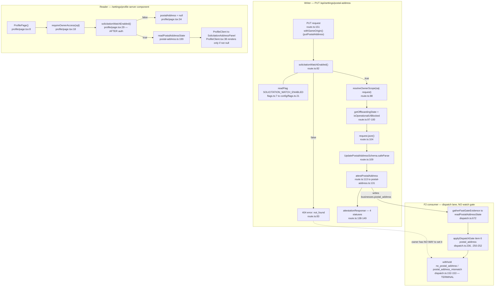
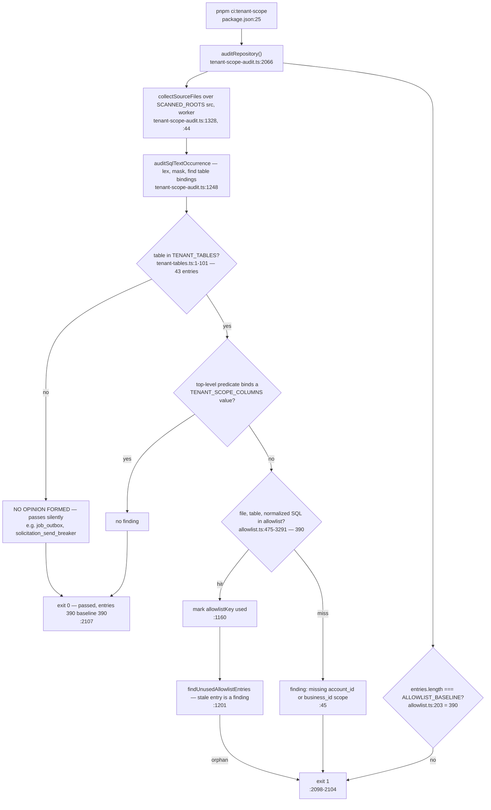

# F7 + F8 — Watch-mode postal gate · Tenant-scope allowlist

Phase 1. Two unrelated small features sharing one agent. Two separate charts.

---

# F7 — Watch-mode gate on the Attested postal-address surface  *(light)*



## Q1 — Ordering verified, and it matters

`route.ts:82` is the **first statement** of `putPostalAddress`, before
`resolveOwnerScope` (`:88`), before `getOffboardingState` (`:97`), before
`request.json()` (`:104`). Confirmed by reading the whole handler.

**Why it matters concretely.** With the gate *after* auth, an unauthenticated
caller gets `401`, an authenticated non-owner gets `403`, and an authenticated
owner gets `404`. **Those three responses are an oracle**: they tell an anonymous
prober whether a session cookie is valid and whether the identity behind it holds
the owner role on an existing account — on a surface that is supposed not to
exist at all. Gate-first collapses all three onto one response.

**The 404 shape leaks nothing:** a fixed object literal, no `scope`, no
`locationId`, no branch. `NO_STORE_HEADERS` is applied uniformly by
`jsonResponse` (`route-helpers.ts:43`).

**One caveat worth recording:** the *other* 404 the enabled route can produce is
`{ error: 'business_not_found' }` (`:147`). Harmless — only reachable after auth
— but it means "404 on this path" is not a single body, and **a future refactor
that unified the two codes would silently re-open the oracle.**

## Q2 — Invariant #13 holds

Both surfaces call the same function object (`route.ts:43`, `profile/page.tsx:3`),
a one-line wrapper over `readFlag('SOLICITATION_WATCH_ENABLED')` (`flags.ts:7`),
which reads `process.env` directly and is deliberately not memoized. **No
`NEXT_PUBLIC_SOLICITATION_WATCH_ENABLED` exists anywhere** — a repo-wide grep
returns only the accessor, tests, docs and evidence files. `ALLOWED_NEXT_PUBLIC`
is 6 entries, none a flag. The flag reaches the browser only as a derived boolean
prop, never the flag name.

## Q3 — The paired invariant is NOT enforced. **This is the finding.**

Nothing ties `route.ts:82` to `profile/page.tsx:29`:
- **No shared preamble** — the route does not use `requireContactsWriteAccess`;
  the page has no gate helper at all.
- **No cross-file test** — `route.test.ts` and `page.test.ts` mock disjoint
  module sets and never import each other's subject.
- **No CI audit covers it.** `ci:static-policy` checks *where* a flag may be
  read, never that two surfaces read the *same* flag.

So *"the UI can never offer a control the route refuses"* is held by **two
comments and two developers remembering to edit two files together.** Delete
`profile/page.tsx:29` and both test files pass, both audits pass, and the panel
renders a POST button against a 404 route.

**A tripwire, ~12 lines**, belongs next to the page test (the half that regresses
silently). Textual, like `outcome-anchor-pairing.test.ts` and
`cost-guard-contract.test.ts` — the repo already has this genre:

```ts
const PAIR = [
  'src/app/api/settings/postal-address/route.ts',
  'src/app/(authenticated)/settings/profile/page.tsx',
] as const;

it.each(PAIR)('%s gates on solicitationWatchEnabled()', (file) => {
  const src = readFileSync(file, 'utf8');
  expect(src).toContain("from '@/lib/solicitation/flags'");
  expect(src).toContain('solicitationWatchEnabled()');
});
```

## Q4 — With watch-mode OFF the withhold is UNFIXABLE. Operator consequence

`dispatch.ts:672` → `:687-689` → `applyDispatchGate:236` item 6 →
`withhold('postal_address','no_postal_address')` (`:250`) or
`'postal_address_mismatch'` (`:252`). **Both are TERMINAL, not deferrals** —
`applyDispatchGate`'s docstring (`:229-230`) says only the first two items defer
and "everything after them is terminal."

**The critical fact: the send lane never checks watch-mode.** A repo-wide grep
for `solicitationWatchEnabled` returns **zero hits under `worker/`** and zero in
`release.ts` or `dispatch.ts`. Both check `solicitationSendEnabled()` only. Watch
mode gates *creation* (`batch-builder.ts:154`) and the owner surfaces; **it does
not gate the drip.**

So `SOLICITATION_WATCH_ENABLED=false, SOLICITATION_SEND_ENABLED=true` — which
nothing forbids; the containment "send ⊂ watch" is asserted only in one docstring
at `location-scope.ts:60-62` and enforced only on the two route helpers there —
produces this:

- An approved batch built while watch was on **keeps dripping**.
- Every attempt whose location has no attested address **terminalizes**
  `no_postal_address`.
- **The owner cannot set one** — the PUT 404s at `:82` and the panel is not
  rendered.
- **The owner cannot even see the reason** — `/dashboard/requests` calls
  `notFound()` at `page.tsx:14`.

**The send withholds terminally for a reason the owner has no surface to read and
no surface to fix.** Nothing corrupts and nothing sends unsafely — the failure is
fail-closed — but the batch burns down to terminal, `closeBatchIfSettled` settles
it, and the owner's only signal is that the requests never went out. Recovery
requires an operator to flip the flag back on, **and the flip does not resurrect
the terminalized attempts.**

Small today only because both flags are off in prod. **It becomes live the moment
the go-live order flips SEND before or without WATCH.**

**Recommendation: make `solicitationSendEnabled()` return false unless
`solicitationWatchEnabled()` is also true** — one line in `flags.ts:15-17`, which
makes the containment the two route helpers already assume true everywhere,
including the worker.

## Q5 — The tests pin the route's order positively; the page's only as an outcome

`route.test.ts:486-494` asserts `expect(mockRequireRole).not.toHaveBeenCalled()` —
a genuine positional pin, since `resolveOwnerScope` runs for real. Because the
offboarding read sits after auth, "before auth" transitively pins "before the
offboarding read" — **but that step is not asserted independently**, so a
refactor hoisting `getOffboardingState` above the gate would pass.

`:496-508` drives 401 and 403 with the flag off and asserts the identical
`not_found` body — **the leak property itself, tested.** `:510-518` pins "before
the body is read". `:520-529` pins `readFlag`'s exact-`'true'` semantics.

`page.test.ts` pins **outcome only**, and says so. `:100-112` also asserts
`readPostalAddressState` was not called — real (it stops a read-then-discard
implementation) but a data-flow claim, not an ordering one.

**Net: the route's ordering is pinned; the *pairing* is pinned by neither.**

## F7 duplication leads

1. **Two spellings of the watch-mode 404 body.** `route.ts:83` returns
   `{ error: 'not_found' }`; every other watch-mode gate returns
   `{ error: 'Not found' }` (`contacts/route.ts:17`, `uploads/[id]/route.ts:20`,
   `location-scope.ts:55`/`:71`, `batch/route.ts:29`). The route header at `:75`
   claims it "Mirrors `requireContactsWriteAccess`" — **the ordering mirrors; the
   body does not.**
2. **The flag-gate preamble is written inline at 9 sites**, factored into a helper
   at exactly one place (`location-scope.ts:50-72`).
3. **`readPostalAddressState` has three consumers with three different scoping
   stories** — `profile/page.tsx:30` (cookie-resolved), `dispatch.ts:672`
   (queue-payload, inside `tx`), `postal-address.ts:252` (a separate read;
   `dispatch.ts:337` notes the deliberate split).
4. **Two null semantics on one value.** `readPostalAddressState` returns `null`
   for a missing business row; `profile/page.tsx:34` returns `null` for a disabled
   feature. `ProfileClient.tsx:38` cannot tell them apart. **The page comment at
   `:23-26` records that this ambiguity is exactly what #901 fixed on the *page* —
   it is not fixed in the *value*.**
5. **Gate-order asymmetry:** route = gate-before-auth; page = auth-before-gate.
   Both correct for their surface, but **the pair has no one ordering rule.**

---

# F8 — Tenant-scope allowlist expansion  *(light)*



## Q1 — The arithmetic, derived

**The move is split across TWO merges, not one:**

| Commit | PR | Baseline | Δ |
|---|---|---|---|
| `b873a9a5` | #904 / #898 send governors | 381 → **383** | +2 |
| `a321634a` | #920 / #900 release poller | 383 → **390** | +7 |

**Nine entries from SEVEN statements**, because the audit attributes one statement
to one entry *per table it binds*:

| # | File | Table(s) | Statement | Entries |
|---|---|---|---|---|
| 1 | `send-caps.ts` | `solicitation_outreach` | `countPlatformDispatchAttemptsToday` (`:88-92`) | 1 |
| 2 | `send-breaker.ts` | `solicitation_outreach` | `readBreakerWindow` | 1 |
| 3 | `release.ts` | `solicitation_batches` **+** `solicitation_outreach` | P4 release-candidate scan (`:1525-1569`) | **2** |
| 4 | `release.ts` | `solicitation_batches` | P2 send-window sweep (`:1003-1012`) | 1 |
| 5 | `release.ts` | `solicitation_batches` **+** `agent_runs` | P3 batch-expired sweep (`:1066-1084`) | **2** |
| 6 | `release.ts` | `solicitation_outreach` | P1 unknown sweep (`:607-620`) | 1 |
| 7 | `release.ts` | `solicitation_batches` | P5 backstop join (`:496-504`) | 1 |
| | | | **total** | **9** |

**Three corrections, all evidenced:**

- **The arch log's "#920 gained +4 platform-wide predicates" is wrong on the count
  AND the category.** #920 added **seven**, and all seven are category
  `background-global-scan`, **not** `platform-cross-account`. Only #904's two
  entries carry `platform-cross-account`. The log's phrase describes the merge it
  does not name and miscounts the one it does.
- **00-features.md §3 undercounts the constant pairs: there are FIVE, not four.**
  `BACKSTOP_SCAN_SQL`/`_REASON` (`allowlist.ts:458`, `:461`) is a fifth. **The
  reason the pass missed it is instructive: it is the only pair that does not
  follow the `*_SWEEP_SCAN_*` / `*_CANDIDATE_SCAN_*` naming shape.**
- **Nothing "moved for a reason nobody wrote down."** The header narrative
  (`allowlist.ts:150-202`) records every one of the nine steps individually, with
  its predicate id and ticket, and explains why the two-table entries are two.
  **The arch log is the artefact that is wrong, not the allowlist.**

**One correction to 00-features.md's terminal state:** `pnpm ci:tenant-scope` does
**not** pass "at exactly 390 findings." Findings are failures. It passes at **zero
findings** and prints `entries: 390 (baseline: 390)`.

## Q2 — Sign-off or rubber stamp? **Sign-off.**

All nine reason strings read in full and each underlying query re-read. **Eight
are genuine structural claims; one entry is honest but derivative; and every
reason string states its own counter-argument.**

Highlights: `send-caps` is definitionally global (a platform ceiling *is* the sum
over accounts). `send-breaker` is stronger — the measured asset is one mailbox,
so a per-tenant bounce rate measures something else. P2/P3 carry an independent
argument: *"a reclaimer handed a tenant id cannot find the locations it exists to
unwedge"* — correct, because nobody reports a wedge. P1 is the strongest: the
entry point is the Outreach row, not the batch, because a wedge is a fact about
one dispatch attempt. P5's three arms are 091's partial-unique-index predicate
byte for byte.

**Two structural findings that outrank the individual verdicts:**

- **The baseline counts table-bindings, not decisions.** Nine entries encode
  **seven** decisions. Four of the nine are second-table attributions of a
  statement already exempted, and two of those describe **correlated subqueries
  that are not cross-account in themselves** (`agent_runs`; half of the P4
  `solicitation_outreach` entry — its `EXISTS` at `:1547-1552` is correlated on
  BOTH tenant columns). **A reviewer asked to sign off "nine new exemptions" is
  shown a unit that does not match the unit they reason about. This is the
  mechanism by which the arch log's counter drifted from four to nine.**
- **Every reason string states its own counter-argument, and that is the quality
  signal.** Each release reason contains a literal "SAME CLASS AS ITS PEERS"
  paragraph naming `judge-store.ts`, `judge-health.ts`, `auto-approval/governor.ts`,
  plus a "THE SCAN IS GLOBAL; EVERY WRITE IS NOT" paragraph enumerating which
  follow-on writes are deliberately **not** allowlisted. **Falsifiable — and
  spot-checked:** P4's list against `release.ts:1828-1850` and P3's against
  `:1768-1790`; both spell `account_id` AND `business_id` in top-level predicates
  under `FOR UPDATE OF b`, exactly as claimed, and neither is in the allowlist.
  **The claims check out.**

## Q3 — X10: the census, and **yes, it is now a rule**

**Method.** X10 is not "a guard with an allowlist" — almost every good guard here
has one. X10 is the narrower shape: **a guard whose SUBJECT SET is a hand-written
list.** An exemption list inside a derived scan is a ratchet; an enumerated
subject set is a blind spot. One classifier: *when a new, correct, unlisted
subject appears, does the guard fail loudly or say nothing?*

### Class A — SILENT on a new subject (the defect)

| # | Instance | Size | What a new unlisted subject does |
|---|---|---|---|
| **A1** | `TENANT_TABLES` (`tenant-tables.ts:1-101`) | **43** | **Passes silently.** The live-DB conformance test iterates `for (const table of TENANT_TABLES)` (`tenant-tables.integration.test.ts:68`) — one direction only. **One list blinds TWO guards**, because `rls-audit.ts:12` defines `REQUIRED_RLS_TABLES = TENANT_TABLES`, so an unlisted table has no RLS requirement in either the DB-free coverage gate or the live check. |
| **A2–A5** | the four fan-out pin files (#893) | 4 + 5 + 2 + 1 subjects | Pass silently. |
| **A6** | `REQUIRED_VAR_DECLARATIONS` + `CONFIG_COVERAGE_BASELINE` | 7 | Loud on drift *between two hand-written lists*; silent on a var boot-required in fact and asserted in neither. **Mutual enumeration, not derivation.** |
| **A7** | `linkedColumnPattern` inside `table-disposition.test.ts:57-58` | 12 column names + 2 tenant roots | **Passes silently — and this window produced its first miss.** |

**A1 and A7 are demonstrated, not hypothetical, and the demonstration is the same
table.** `solicitation_send_breaker` entered the schema this window and appears in
**no** enumeration: not `TENANT_TABLES`, not `REQUIRED_RLS_TABLES`, not
`TABLE_DISPOSITIONS`. Its RLS is proved by exactly one hand-written integration
test someone chose to write; had they not, nothing would have noticed.

**A7 is the sharper find.** `table-disposition.test.ts:111-120` is the repo's
*best* ratchet — it derives account-linked tables from migration SQL rather than
trusting a list, and its comment at `:56-58` says the structural catch exists so
*"a future `org_id REFERENCES accounts(...)` cannot silently drift out of the
inventory"*. **But the catch is itself two enumerations.**
`solicitation_send_breaker` carries `reset_by UUID REFERENCES users(id)`
(`110:108`). Running the test's own two regexes against migration 110's
`CREATE TABLE` body: **`linkedCol=False, refRoot=False`.** A table storing a
`users(id)` FK is outside the offboarding inventory and the ratchet is silent.
Severity is low (the actor is staff, not a customer), but **the class is exactly
the one the comment claims to have closed — an enumeration nested inside a
derivation, with a live miss produced by this window's own merge.**

### Class B — LOUD on a new subject (healthy ratchets)

`tenantScopeAllowlist` + `ALLOWLIST_BASELINE` (390; deny-by-default scan of all
`src`+`worker` SQL, exact-count gate both directions, stale-entry killer — **the
allowlist is an EXEMPTION list, not a subject set**) · `outcome-anchor-pairing.test.ts`
`CALLER_ALLOWLIST` (21; fails on any unlisted caller AND any stale entry — *the
arch log's "fifth spine caller" is `release.ts`, present at `:36`*) ·
`cost-guard-contract.test.ts` ("this is an allowlist, not folklore") ·
**`STEP_PERSONA`** (22 keys; `AgentStepKey = keyof typeof STEP_PERSONA`, and
`run-spine.ts` is the **only** file containing `INSERT INTO agent_run_steps` — a
new key is a typecheck failure; **type system as derivation**) ·
`TABLE_DISPOSITIONS` (48, modulo A7) · `ALLOWED_NEXT_PUBLIC` (6) ·
`PROCESS_ENV_BASELINE` · the nine filesystem-derived `ci:*` audits ·
`ci-audit-wiring.test.ts`.

### Class C — the one that was A and became B. **This is the answer.**

`SQL_TAG_NAMES` (`scripts/ci/lib/sql-tag-scan.ts:39`) is a 4-element set
(`sql`, `tx`, `db`, `exec`) defining the subject set for **eight** audits. Its own
header states the X10 failure mode better than the prior pass did:

> "SQL_TAG_NAMES is a PRECONDITION, not a preference: a SQL template tagged with a name outside it is invisible to every one of those audits, **and invisible silently — the scan simply finds nothing and reports success.** `exec` was missing for exactly that reason (#592); by the time it was noticed, 12 call sites … were unscanned."

And then it closes itself:

> "So the set is kept honest from the other side too: static-policy-audit.ts's `sql-executor-tag-name` rule fails when a SqlExecutor-typed parameter in src/ or worker/ is used as a template tag under a name this set does not contain."

Verified at `static-policy-audit.ts:727-737`. **The enumeration survives; what
changed is that a second-side derivation now produces its subjects. That is the
general fix, already implemented once in this repo, on the largest-blast-radius
instance.**

*(Incidental stale-doc finding: `outbox-topics-audit.ts:20-22` still says "The
`exec`-named SqlExecutor spelling is NOT scanned". It imports `isSqlTaggedTemplate`,
and `SQL_TAG_NAMES` has contained `exec` since #592. **The comment contradicts the
code it sits on.**)*

### Verdict

**Seven silent instances against ten-plus loud ones — and, decisively, one
instance that made the transition and is documented in-repo as having made it.**
A pattern is a shape you notice twice. **A rule is a shape with a stated failure
mode, a stated fix, and a worked example of the fix.** All three exist.

**The rule, in one sentence:**

> An enumeration that defines a guard's SUBJECT SET must be derived from — or continuously cross-checked against — the artefact that produces subjects (the schema, the filesystem, or the type system); an enumeration that lists only EXEMPTIONS inside an already-derived scan is legitimate and needs no such backing.

**The mechanical check, cheapest first:**

1. **A1 + its RLS twin, one test (~25 lines).** A live-DB sibling of
   `tenant-tables.integration.test.ts` reading `information_schema.tables WHERE
   table_schema='public'` and failing on any table in **neither** `TENANT_TABLES`
   **nor** a new exported `PLATFORM_TABLES` list carrying a one-line reason.
   `solicitation_send_breaker` would land in `PLATFORM_TABLES` with the rationale
   that today lives only in a SQL comment, and **this test would have failed at
   migration-110 merge time.** Converts the repo's highest-blast-radius blind spot
   and closes seed 10 permanently.
2. **A2–A5, one audit** (#893's Part 2, restated as a derivation): every exported
   async function under `src/lib/**` issuing ≥2 `sql`-tagged templates must be
   named by one of the four pin files, with a `// pool-fanout-ignore: <reason>`
   pragma matching the escape-hatch idiom three audits already share.
3. **A7, one regex.** Add `\breset_by\b` and the other bare `*_by` spellings to
   `linkedColumnPattern`, and widen `referencesTenantRootPattern` to include
   `users`. **Two-line change; it would have caught this window's miss.**
4. **The general form, only if the class recurs a ninth time** — a `ci:guard-scope`
   audit over exported readonly arrays matching `/_TABLES$|_NAMES$|_KINDS$|_ROOTS$/`
   imported by a `scripts/ci/**` audit. Worth building only *after* 1–3, because
   three targeted derivations are cheaper and more legible than one meta-audit.

## Q4 — The baseline IS asserted where it fails on drift, in two places

- **In the audit.** `findAllowlistIntegrityFindings` (`tenant-scope-audit.ts:1217-1244`)
  fails when `entries.length !== baseline` **in either direction**. Composed into
  `auditRepository` at `:2084`, ahead of the SQL findings.
- **In the test suite.** `tenant-scope-audit.test.ts:1712-1714` asserts it against
  the real objects, so drift also fails `pnpm test`. Four sibling cases at
  `:1669-1682` pin both directions, including a shrink case labelled "no
  shrink-then-regrow masking."

**CI wiring confirmed end to end:** `package.json:25` → `ci.yml:173` (required
`lint` job) → `lefthook.yml:20-21`, held in lockstep by `ci-audit-wiring.test.ts`.

**The one thing not asserted:** neither site pins the literal `390`. The
`CONFIG_COVERAGE_BASELINE` sibling makes the opposite choice and says why. Here
the gate *is* trippable because the two numbers live in different files, so this
is defensible — **but it means the only durable record of the reasoning is the
narrative comment at `allowlist.ts:150-202`, which no test reads. That is the
whole load-bearing surface of "the standing sign-off."**

## Q5 — #894 Step 1: still exactly ONE instance

Two grep formulations over `src` + `worker` (excluding `__tests__`, `*.md`) for
the exemplar's phrasing and every near-miss phrasing. **`batch-view.ts:397-402`
is still the only instance. Count: 1.**

The other 15 hits are a different convention — notes about *allowlisted*
statements or about the audit's subquery-stripping behaviour.

**One nuance worth reporting, because it points at where the convention went.**
Three more instances of the *reasoning* exist — but **all three are inside
`scripts/ci/tenant-scope-allowlist.ts` itself**: `:194` and `:443` (both #900,
about `job_outbox`), and `:367-368` (#662, the `users` join, ending *"Do not read
this audit's silence as a review of the join."*).

So the idea is alive and this window added two more expressions of it. **But they
were written in the allowlist, where only someone auditing the allowlist will
read them — not at the query, where the next person to edit `release.ts:607-620`
would.** #894 Step 1 has not been adopted; the convention has drifted into the one
file that already knows about the blind spot. **That is arguably worse than
non-adoption, because it makes the class *look* documented while leaving every
production call site unannotated.**

## F8 duplication leads

1. `RELEASE_CANDIDATE_SCAN_SQL` and `BATCH_EXPIRED_SWEEP_SCAN_SQL` each back two
   entries — hoisted constants exist precisely so the SQL text is not
   copy-pasted. **Eight such hoisted constants now exist.**
2. **Every allowlisted SQL string is a verbatim second copy of a production
   query.** 390 entries; drift is caught only by `findUnusedAllowlistEntries`
   *after* the edit lands.
3. **The same "this table isn't in TENANT_TABLES" note is written in three places,
   none of which is the query** (`allowlist.ts:163`, `:194`, `:367-368`, `:443`).
4. `countAccountDispatchAttemptsToday` (`send-caps.ts:70-75`) and the
   `capped_accounts` CTE (`release.ts:1525-1531`) count the same rows over the
   same UTC-day boundary, one scoped and one not — **a deliberate second
   computation with a stated asymmetry** (`allowlist.ts:409`).
5. **`TENANT_TABLES` is read by three independent guards. One list, three blind
   spots.**

## Confidence and gaps

**High confidence:** both F7 files end to end including both test files' gate
blocks; the F8 arithmetic (baseline confirmed by `git show` on both merge
commits, all nine entries read, all seven statements matched byte-for-byte); the
baseline assertion sites and CI wiring; #894 Step 1 count = 1; **A1 and A7's
silence demonstrated by running `table-disposition.test.ts`'s own two regexes
against migration 110.**

**Medium confidence:** the X10 census is thorough over `scripts/ci/**` and
`src/__tests__/**`, but "anything else with the same shape" is open-ended. ~20
candidates classified. **The count of seven silent instances should be read as a
floor.** `readBreakerWindow`'s body read only as the allowlisted snippet.

**Gaps:** **F7 Q4's operator consequence is a source-derived trace, not a
reproduction** — the two-flag configuration was not run; the claim rests on three
verified facts. No `ci:tenant-scope`, `pnpm test` or fallow run.
`release.ts:1150-1885` read only around the five scan functions plus two
follow-on write sites, so the reason strings' claims about *every* follow-on write
are verified for two of roughly a dozen — **that belongs to F1's gap, not F8's.**
The suggested tripwires are sketches, not tested code.
