# Pathfinder 2026-08-22 — unified proposal

Phase 3. Written by the orchestrator; synthesis is not delegated.

Phase 2 returned **eleven UNIFY verdicts, four LEAVE/LEGITIMATE, and ten refuted
or corrected leads**. Guard integrity returned **six unpinned guards**. This
document collapses the UNIFY set into **five systems**, not eleven tickets,
because eleven of them are three recurrences of one shape.

## The shape underneath

Across F1–F8, one sentence explains most of what this pass found:

> **A fact that has exactly one correct value is spelled at N sites, and the
> reason it stays correct is written in prose at one of them.**

It recurs at four altitudes, and the recurrence is what makes it architectural
rather than a list of chores:

| Altitude | Instances | The prose that holds it |
|---|---|---|
| A **value** in SQL | UTC-day boundary ×4, delivery-status subsets ×7 | `send-caps.ts:52-61` |
| A **predicate** in TypeScript | close-settled ×5, terminal-attempt ×5, `selfServe && trial` ×10 | `job-failure-sink.ts:24-26` |
| A **primitive** in CSS | reveal ×4, FAQ controller ×2 | `island.css:1276` section comment |
| A **guard's subject set** | X10's seven Class-A enumerations | `sql-tag-scan.ts:1-40` |

**In three of the four rows the repo has already solved one instance and written
down why.** `isTrialEligible` (X23), `fragments.ts` (X17), `failed-hook-shared.ts`
(X15), `sql-tag-scan.ts` (X10) are four worked examples of the exact fix, each
carrying a docstring explaining the failure it prevents — and each unknown to the
next person who hit the same class. **The unification opportunity is not to invent
a pattern; it is to make four existing owners findable.**

## S1 — The send lane's state vocabulary  *(X13 + X14)*

**Concern.** Two facts about send state — *"may an owner cancel this row?"* and
*"did that close settle the batch?"* — have no owner, and one of the spellings is
now wrong on the wire.

**Component.** `src/lib/solicitation/delivery-status.ts` (new leaf,
dependency-free) plus one function in the existing `outreach.ts`.

**Single entry points.**
```ts
// src/lib/solicitation/delivery-status.ts
export const CANCELLABLE_DELIVERY_STATUSES  // 'rendered' | 'queued'      — may an owner cancel it?
export const LIVE_DELIVERY_STATUSES         // + 'sending'                 — is anything still live?
export const DISPATCHED_ARRIVAL_STATUSES    // 'queued' | 'sending'        — what did a dead job leave?
export function isCancellableDeliveryStatus(s: string): boolean
export function isTerminalizableArrival(s: string): boolean

// src/lib/solicitation/outreach.ts, beside the union it discriminates
export function batchDidClose(close: CloseBatchIfSettledResult): boolean
```

**What each call site becomes.**

| Site | Now | Becomes |
|---|---|---|
| `approval.ts:1185` `classifyWithdrawal` | inline `\|\|` | `isCancellableDeliveryStatus(s)` |
| `ApprovalPanel.tsx:980`, `AskList.tsx:306` | inline `\|\|` | same (type-only import — invariant #1) |
| `failed-hook.ts:90` | inline `\|\|` | `isTerminalizableArrival(s)` |
| `approval.ts:569`, `:1300`, `batch-view.ts:957` | literal SQL `IN` | **unchanged** — query-shape pins assert the list by value (`:1289-1290`) |
| `halt/route.ts:45`, `admin/halt:91`, `withdraw:43` | `!== 'not_settled'` | `batchDidClose(result.close)` |
| `approve/route.ts:60` | `!== null` | `batchDidClose(result.close)` once `approval.ts:466`'s ternary is dropped |
| `release.ts:465` | `=== 'closed'` | **unchanged**, plus one comment naming it a *tally, not a receipt* |

**Capability loss: none.** `batchDidClose` is a **positive enumeration**
(`closed \|\| closed_without_parent \|\| already_closed`), which is strictly more
correct than today — it fixes the wire defect where halting an all-withheld
`built` batch reports `closed: true` against `send_closed_at IS NULL`.

**Anti-patterns rejected.** No single constant answering three questions — three
named exports, because three genuinely different questions exist and anonymity is
what made them indistinguishable. No derivation from `TERMINAL_DELIVERY_STATUSES`
— its complement is the *live* set, and `failed-hook.ts:84-88` gives a domain
reason `rendered` must be excluded from *arrival* that no set algebra expresses.
No shared predicate for `release.ts:465` — it is a tally, and folding it in
re-creates the bug X13 exists to fix.

**Supersedes #890 (H1) and #891 (H2).** Both ticket texts are now wrong: H1
proposes one constant where three are needed; H2 proposes one predicate for five
sites where the right shape is four plus an explicit non-adoption note.

## S2 — The worker failure-handling layer  *(X15 + X16 + X19)*

**Concern.** Four worker failure hooks and the global sink each re-implemented the
same two helpers. **An exported owner already exists and nobody imports it — one
consumer imports its sibling function from the same module, in the same import
statement, and then re-implements the other 44 lines later.**

**Component.** Promote `worker/jobs/solicitation-batch/failed-hook-shared.ts` to
**`worker/job-failure-helpers.ts`** — at `worker/` root, beside
`job-failure-sink.ts`, which is one of the four consumers. No new directory; the
root already holds `emitter-errors.ts`, `job-failure-sink.ts`, `sentry.ts`.

**Single entry points.**
```ts
export function isExhaustedJob(job, maxAttempts): boolean   // the 'failed'-EVENT form ONLY
export function boundedErrorClass(err: unknown): string      // Body B — constructor.name + shape regex
```

**What each call site becomes.**

| Site | Now | Becomes |
|---|---|---|
| `solicitation-batch/failed-hook-shared.ts` | the owner | **moves**, keeps its docstrings |
| `judge/failed-hook.ts:44-57` | `isJudgeAttemptExhausted` | `isExhaustedJob` |
| `solicitation-send/failed-hook.ts:93-106` | `isSendAttemptExhausted` | `isExhaustedJob` (widens an import it already has) |
| `job-failure-sink.ts:38-44` | `isFailedEventTerminal` | `isExhaustedJob` |
| `csv-ingest`, `judge`, `job-failure-sink` `boundedErrorClass` | **Body A** — `err.name.slice(0,100)` | **Body B** |
| `shared/outbox.ts:215` | `a >= m \|\| a+1 >= m` | `a + 1 >= m` — **the first disjunct is dead** |

**Capability loss: none, and one behaviour change that is the point.** Body A and
Body B compute different things: `err.name` is writable, `err.constructor.name` is
the class. Adopting Body B at the three Body-A sites changes what they log for any
error class that sets `name` — **which is the fix**, because
`job-failure-sink.ts:55-56` states the threat (*"`Error.name` is
attacker-influenceable on a custom class"*) and then does nothing about it, while
the hardened version sits three directories away.

**Anti-patterns rejected.** The catch-form / event-form distinction **stays** —
this unifies the four *event-form* copies only, and `isTerminalAttempt` is
untouched. No parameter to switch between forms. No new `worker/jobs/_shared/`
directory when the root already serves this role.

**X19 rides along, locally.** `dispatch.ts` gains a private
`requireExactAttempt(handle)` called from both `:439-441` and `:1868-1870`, killing
the second in-file spelling of the literal and making
`dispatch.ts:1865-1866`'s comment true. **The cross-module hoist of
`completeOutboxNoop` still waits for a third copy, exactly as `:430-432` says.**

## S3 — The load-bearing SQL fragment layer  *(X17 + X18)*

**Concern.** A UTC-day boundary expression whose trailing `AT TIME ZONE 'UTC'` is
load-bearing is spelled four times across two lanes, **and the tests provably
cannot catch the drift** — the fixture re-spells the production expression, so it
is symmetric with it under any mutation. Separately, a batch id that must be
lowercased before it can find its run parent is bound raw at two sites, **in a
file that contains zero calls to the canonicaliser written for this exact bug.**

**Component.** `src/lib/shared/utc-day.ts` (new leaf, dependency-free) modelled
byte-for-byte on the `src/lib/kpi/fragments.ts` precedent — **including its pin
test**, which is the half that makes it stick.

**Single entry points.**
```ts
// src/lib/shared/utc-day.ts
export const utcDayStartSql   // date_trunc('day', NOW() AT TIME ZONE 'UTC') AT TIME ZONE 'UTC'

// src/lib/solicitation/approval.ts — already exists, just export it
export function canonicalBatchId(id: string): string
```

**What each call site becomes.** `send-caps.ts:74`, `:91`, `release.ts:1528` and
**`worker/jobs/response-generation/auto-approval.ts:231`** interpolate
`${utcDayStartSql}` in place of the expression. `ask-generation.ts` calls
`canonicalBatchId` at its two entry points (`regenerateAsk`,
`settleGenerationExhaustion`). **Two lines for the second half.**

**Capability loss: none.** The fragment spells no `FROM`, no `JOIN` and no tenant
predicate, so `ci:tenant-scope` — which reads raw, un-evaluated template text —
still sees every caller's `account_id =` / `business_id =` written out literally.
`fragments.ts:11-16` states this constraint and this case satisfies it.
`auto-approval.ts:225-227`'s "keep the `business_id` scope visible here" note is
untouched.

**Ship the pin test with the fragment.** `fragments.test.ts`'s shape — *fail if any
non-test source file outside the owner spells the anchor* — is the only thing that
survives the fixture blind spot. **Without it this is a rename, not a fix.**

**Anti-pattern rejected.** Not added to `kpi/fragments.ts` — a send cap is not a
KPI, and putting it there would make the module's name a lie. Not put in
`send-caps.ts` with the reply lane importing from it — that is a cross-lane import
from solicitation into reply generation.

## S4 — The Daylight primitive layer  *(X20 + X21 + X22)*

**Concern.** `island.css` declares a complete 43-class marketing primitive family
that **no F5 chrome component consumes and 12 F6 files do**, and two of those
primitives (`.rw-dl-rv`, `.rw-dl-faq*`) have **no React counterpart**, so every
consumer re-implements the controller — 15 open-coded reveals and two FAQ
accordions.

**Component.** Split the stylesheet at its own section comment; give the two
controller-bearing primitives a React owner at the address `Reveal` already
occupies.

**Single entry points.**
```
src/app/(public)/_styles/daylight-primitives.css   // island.css:1276-1591 moves here
src/components/ui/Reveal.tsx                        // already exists — becomes a wrapper over useReveal
src/components/ui/Faq.tsx                           // new: items: {q, a}[]
src/components/sections/features/useReveal.ts       // the reveal OWNER, gains { delayMs }
```

**What each call site becomes.** The 15 open-coded
`<div className={cn('rw-dl-rv', seen && 'is-in')}>` sites in `sections/features/`
become `<Reveal>`; `FeaturesContent.tsx:261` keeps the bare hook (it is the one
genuine raw-signal consumer); `StatCards.tsx:79-93` drops its inline observer;
`HowItWorksContent.tsx:370-396` and `PricingContent.tsx:483-509` become `<Faq
items={…} />`. `globals.css` gains **one appended `@import`** — appended, not
inserted, because `design-scope-purity.test.ts:152-194` pins presence, ascending
order and position-after-`:root`.

**Capability loss: one, and it is the point.** `Reveal` currently has **no JS
reduced-motion branch**, so `.is-in` never flips for a reduced-motion visitor and
**every child gated on it needs a compensating CSS rule** — `how-it-works.css:389`
is one, and without it `JudgeArtifact`'s verdict dot is permanently `scale(0)` and
never appears at all. Adopting `useReveal`'s JS branch removes that class of
compensating rule permanently. **One JS branch versus one rule per gated child,
forever.**

**Budget the pin.** `HowItWorksContent.client.test.tsx:96-97` asserts
`thresholds === [0.05]` and `rootMargin === '0px 0px -50px 0px'`. The
consolidation must pick one pair and update that test. **That pin is why the
undocumented tuning drift is now load-bearing.**

**Anti-patterns rejected.** `landing/reveal.tsx` stays — different design system,
`motion/react` under `LazyMotion strict`, and a stated constraint that it must not
put a transform on an ancestor. No flag keeping both reveal paths. No registry of
primitives — two components, named.

> **⚠ A concurrent session began implementing exactly this on 2026-08-22 at
> ~22:10**, including a staged `git mv` of `Reveal.tsx` into `components/ui/`.
> **Re-anchor S4 against the working tree before acting on it.**

## S5 — The public signup posture  *(X23)*

**Concern.** *"May the chrome claim a free trial?"* is spelled ten times — seven
identical, one as an object property, one with **reversed operands**, and one
surface that **does not compute it at all and is wrong today**.

**Component.** One exported server function, modelled on the in-repo precedent
that already burned on this exact bug.

**Single entry point.**
```ts
// src/lib/payments/flags.ts, beside trialEnabled()
export function publicSignupPosture(): {
  selfServeEnabled: boolean;
  trialEnabled: boolean;
  signupCtaLabel: string | null;
}
```

**What each call site becomes.** Ten server components replace two flag reads and
a conjunction with one call. **Zero render changes.**

**Capability loss: none. One live defect fixed on adoption.**
`(public)/demo/[slug]/not-found.tsx:4-6` reads `selfServeSignupEnabled()` and
computes no conjunction, so `DemoStatusIsland.tsx:52`'s `trialEnabled = false`
default forwards through — **an expired demo link renders "Create account" while
every other public surface renders "Start free trial", from the same component in
the same route segment.**

**Precedent, not invention.** `plan-activation.ts:150-160` `isTrialEligible` is the
single owner of trial *eligibility*, and its docstring records the identical
failure: *"The two checkout entry points … spelled this independently and
DISAGREED."* Its first two conjuncts are the same two flags. `:146-148` also
pre-answers the shape question — **read the flags, do not take them as arguments**,
because they are server-authoritative and this is policy, not a pure mapping.

**Anti-pattern rejected.** The chrome **render** is not hoisted. An App-Router
layout receives `children` as an already-materialised node across the RSC boundary
— no props injection, no server-side context — and the ten surfaces use three
different islands, two of which render no footer. `(public)/layout.tsx:9-16`
documents this deliberately. **Hoist the read; leave the render.**

## The proposed unified system

```mermaid
flowchart TD
    subgraph S1["S1 — send-lane state vocabulary"]
        DS["delivery-status.ts<br/>3 named constants + 2 predicates"]
        BDC["batchDidClose<br/>outreach.ts, positive enumeration"]
    end
    subgraph S2["S2 — worker failure layer"]
        JFH["worker/job-failure-helpers.ts<br/>isExhaustedJob + boundedErrorClass Body B"]
    end
    subgraph S3["S3 — load-bearing SQL fragments"]
        UTC["src/lib/shared/utc-day.ts<br/>utcDayStartSql + pin test"]
        CBI["canonicalBatchId<br/>approval.ts — exported"]
    end
    subgraph S4["S4 — Daylight primitive layer"]
        CSS["_styles/daylight-primitives.css<br/>island.css:1276-1591"]
        RV["components/ui/Reveal.tsx<br/>wrapper over useReveal"]
        UR["sections/features/useReveal.ts<br/>the OWNER, gains delayMs"]
        FAQ["components/ui/Faq.tsx<br/>new"]
    end
    subgraph S5["S5 — signup posture"]
        PSP["publicSignupPosture()<br/>payments/flags.ts"]
    end

    DS --> C1["approval.ts:1185 · ApprovalPanel:980 · AskList:306<br/>failed-hook.ts:90"]
    DS -.->|"SQL stays literal<br/>query-shape pins"| C1b["approval.ts:569,:1300 · batch-view.ts:957"]
    BDC --> C2["3 halt/withdraw routes + approve route"]
    BDC -.->|"NOT adopted — a tally<br/>release.ts:442-445"| C2b["release.ts:465"]

    JFH --> C3["judge/failed-hook · solicitation-send/failed-hook<br/>job-failure-sink · csv-ingest"]
    JFH -.->|"catch form UNTOUCHED"| C3b["shared/outbox.ts isTerminalAttempt"]

    UTC --> C4["send-caps.ts:74,:91 · release.ts:1528<br/>auto-approval.ts:231"]
    CBI --> C5["ask-generation.ts regenerateAsk + settleGenerationExhaustion"]

    UR --> RV --> C6["15 open-coded sites in sections/features/<br/>+ StatCards.tsx"]
    UR -.->|"raw signal — keeps the hook"| C6b["FeaturesContent.tsx:261"]
    FAQ --> C7["HowItWorksContent:370 · PricingContent:483"]
    CSS -.->|"one APPENDED @import"| C8["globals.css:186-189"]
    RV -.->|"different design system — LEAVE"| C8b["sections/landing/reveal.tsx"]

    PSP --> C9["10 public composition roots<br/>incl. demo/[slug]/not-found.tsx — wrong today"]
```



## What this proposal deliberately does NOT do

- **No abstraction over the five batch tenant-triple locks** (X24). Four different
  projections, four different not-found policies. A shared helper needs a
  parameter meaning "which not-found contract am I under" — the failure mode the
  prior pass's W6 already rejected.
- **No de-duplication of migration 091's predicate onto its four supersets**
  (X25). One predicate plus four supersets is not five copies.
- **No content-checking audit for `docs/directory.md`** (X26). Coverage and
  staleness are path-level by design. **The four stale rows get fixed by hand, and
  the three `readSendBreaker` rows become unwritable-wrongly via S6 below** —
  which is the better fix than prose that will go stale again.
- **No unification of `closeBatchIfSettled`** (X12). Thirteen callers converging on
  one implementation is the healthy outcome, not the finding.
- **No feature flag keeping any old path alive.** Every item above is a
  replacement, not an addition.

## S6 — the two structural guards this pass earned

Not duplication fixes; both fall out of findings that recur across features.

**S6a — split `readSendBreaker` into two exports.** `assertSendAllowed(sql)` (the
gate; throws, and the *only* function the release phase may call) and
`readSendBreakerState(sql)` (the label and the two display reads, which may catch).
One private query body, no second spelling. **This converts three prose statements
into one type-level fact**, retires the "is there a second label-only read yet?"
question permanently, and makes two of the four stale `docs/directory.md` rows
impossible to write wrongly. Preferred over the CI-audit alternative.

**S6b — apply X10's rule to its two cheapest instances.** X10 has graduated from
pattern to rule with a worked in-repo example (`SQL_TAG_NAMES` →
`static-policy-audit.ts:727-737`). The two highest-yield applications:
- **`TENANT_TABLES` + `PLATFORM_TABLES`, one live-DB test (~25 lines)** reading
  `information_schema.tables` and failing on any `public` table in neither list.
  **This would have failed at migration-110 merge time**, and it restores
  `ci:rls-audit` coverage for `solicitation_send_breaker` and four older
  platform-scoped tables.
- **`linkedColumnPattern`, two lines** — add `\breset_by\b` and widen
  `referencesTenantRootPattern` to include `users`. **Phase 2 raised this item's
  rank**, because it is the input every purge-side derivation inherits its blind
  spot from.
