# F1 — Auto-approval lane for Solicitation

Merge `0278366c` (PR #950 / issue #631), 2026-08-24. 48 production files,
migration 113. Traced at HEAD; every node cites `file:line`.

**The happy path:** an Autopilot account's solicitation batch reaches an
approved, sent state without an owner touching it.

## Flowchart

```mermaid
flowchart TD
  OPTIN["Owner opt-in, one-time<br/>solicitation-settings.ts:72"] --> UPSERT["upsertSolicitationAccountDefault<br/>solicitation-settings.ts:292"]
  UPSERT -.->|policy row exists| G6

  subgraph APPROVE["Approval time — ONE finale transaction"]
    ENTRY["handleGenerateSolicitationAsks<br/>generate.ts:19"] --> FIN["finale sql.begin<br/>ask-generation.ts:1132"]
    FIN --> LOCKB["advisory + batch FOR UPDATE<br/>ask-generation.ts:1140"]
    LOCKB --> CLOSE["closeBatchIfSettled<br/>ask-generation.ts:1173"]
    CLOSE --> G0{"alive rows AND not_settled?<br/>ask-generation.ts:1195"}
    G0 -->|no| NOTEVAL["log auto_approval='not_evaluated'<br/>ask-generation.ts:1226"]
    G0 -->|yes| HOOK["runFinaleAutoApproval<br/>auto-approval.ts:445"]
    HOOK --> G1{"G1 SOLICITATION_SEND_ENABLED<br/>auto-approval.ts:87"}
    G1 -->|off| DECL["DECLINE — log line only, no spine step<br/>auto-approval.ts:456"]
    G1 -->|on| G2{"G2 SOLICITATION_AUTO_APPROVAL_ENABLED<br/>auto-approval.ts:88"}
    G2 -->|off| DECL
    G2 -->|on| ALOCK["lockAutonomyAccount<br/>account-lock.ts:15"]
    ALOCK --> READ["readAutoApprovalConditions<br/>auto-approval.ts:143"]
    READ --> G3{"G3 subscriptionGrantsFullAccess<br/>auto-approval.ts:106"}
    G3 -->|no| DECL
    G3 -->|yes| G4{"G4 tierGrantsAutopilot<br/>auto-approval.ts:109"}
    G4 -->|no| DECL
    G4 -->|yes| G5{"G5 account-wide suspension<br/>auto-approval.ts:112"}
    G5 -->|suspended| DECL
    G5 -->|clear| G6{"G6 solicitation policy row<br/>auto-approval.ts:113"}
    G6 -->|null| DECL
    G6 -->|present| CAS["autoApproveBatch CAS in savepoint<br/>auto-approval.ts:352"]
    CAS -->|23505 one_active_send| SLOT["slot_held — owner review<br/>auto-approval.ts:366"]
    CAS -->|miss + approved_at set| OWNW["owner_won<br/>auto-approval.ts:379"]
    CAS -->|miss + no approval| THROW["throw — asserted corruption<br/>auto-approval.ts:380"]
    CAS -->|1 row| STEP["recordStep batch_approved<br/>auto-approval.ts:397"]
    STEP --> ENQ["enqueueSolicitationVetoNotice, same tx<br/>auto-approval.ts:410"]
  end

  DECL --> OWNERQ["batch stays 'built' — owner approval lane"]

  subgraph NOTICE["Veto notice — the transparency half"]
    ENQ --> VW["handleSolicitationVetoNotice<br/>SolicitationVetoNoticeWorker.ts:39"]
    VW --> VCTX["loadContext<br/>context.ts:92"]
    VCTX -->|business/batch missing| VFAIL["markOutboxFailed<br/>Worker.ts:51"]
    VCTX -->|archived, offboarding, not auto_policy,<br/>halted, closed| VSKIP["quiet skip, outbox completed<br/>Worker.ts:59"]
    VCTX -->|ok| VELIG{"resolveEligibleChannels<br/>Worker.ts:63"}
    VELIG -->|zero enrolled| VSYS["systemic-failure warn<br/>Worker.ts:75"]
    VELIG -->|n>0| VCLAIM["claimSolicitationVetoNoticeDelivery<br/>delivery.ts:278"]
    VCLAIM --> VSEND["getChannel().sendSolicitationVetoNotice<br/>dispatch.ts:140"]
    VSEND --> VSENT["finalizeDeliverySent<br/>dispatch.ts:150"]
  end

  subgraph RELEASE["SolicitationReleasePoller — every 60s"]
    POLL["runReleaseCycle<br/>release.ts:273"] --> P1["P1 unknown sweep<br/>release.ts:300"]
    P1 --> P2["P2 send_window_elapsed / platform_halt<br/>release.ts:315"]
    P2 --> P3["P3 batch_expired<br/>release.ts:323"]
    P3 --> P35["P3.5 anchorVetoDeadlines<br/>auto-approval.ts:657"]
    VSENT -.->|MIN sent_at WHERE failed_at IS NULL| P35
    P35 --> ACAS["CAS veto_deadline_at = MIN(sent_at)+window<br/>auto-approval.ts:608"]
    ACAS --> ASTEP["recordStep veto_window_granted<br/>auto-approval.ts:633"]
    ASTEP --> P4["P4 runReleasePhase<br/>release.ts:1325"]
    P4 --> R1{"R1 SOLICITATION_SEND_ENABLED<br/>release.ts:1332"}
    R1 -->|off| STOP1["phase STOP flag_off"]
    R1 -->|on| R2{"R2 Send breaker<br/>release.ts:1341"}
    R2 -->|open| STOP2["phase STOP breaker_open"]
    R2 -->|closed| R3{"R3 platform ceiling<br/>release.ts:1352"}
    R3 -->|exhausted| STOP3["phase STOP platform_ceiling"]
    R3 -->|ok| SCAN["selectReleaseCandidates<br/>release.ts:1520<br/>needs veto_deadline_at NOT NULL AND NOW()>=it"]
    SCAN --> R5{"R5 account cap<br/>release.ts:1283"}
    R5 -->|exhausted| WH1["WITHHOLD account_cap"]
    R5 -->|ok| R6{"R6 subscription<br/>release.ts:1296"}
    R6 -->|no| WH2["WITHHOLD subscription — recoverable"]
    R6 -->|yes| R8{"R8 auto re-check, auto_policy only<br/>auto-approval.ts:269"}
    R8 -->|reason| DG["applyAutoDowngrade<br/>release.ts:1776"]
    R8 -->|null| R9{"R9 Judge available<br/>release.ts:1379"}
    R9 -->|no| JS["applyJudgeSplit<br/>release.ts:1691"]
    R9 -->|yes| ROWS["releaseBatchRows<br/>release.ts:1227"]
    ROWS --> R10{"R10 locked batch re-read<br/>release.ts:1925"}
    R10 -->|no match| SK["skipped — lost race"]
    R10 -->|ok| R11{"R11 in-tx auto re-check<br/>release.ts:1939"}
    R11 -->|reason| WH3["WITHHOLD auto_conditions<br/>release.ts:1242"]
    R11 -->|null| QCAS["rendered → queued<br/>release.ts:1946"]
    QCAS --> SSTAMP["sending_started_at CAS on NULL<br/>release.ts:1963"]
    SSTAMP --> ESEND["enqueueSolicitationSend<br/>release.ts:1972"]
    P4 --> P5["P5 backstop join<br/>release.ts:383"]
  end

  DG --> DGH{"mid-drip OR window shut?<br/>release.ts:1722"}
  DGH -->|yes| HOLD["HOLD — nothing written, no lock"]
  DGH -->|no| CONF{"confirmReason under both locks<br/>release.ts:1849"}
  CONF -->|healthy again| SKIP2["SKIPPED — nothing written"]
  CONF -->|still failing| DGCAS["NULL the 4 approval columns<br/>release.ts:1854"]
  DGCAS --> DGSTEP["recordStep approval_downgraded<br/>release.ts:1877"]
  DGSTEP --> OWNERQ

  ESEND --> SENDW["handleSolicitationSend<br/>solicitation-send.ts:25"]
  SENDW --> TERM["outreach → sent + provider_message_id<br/>dispatch.ts:1120"]
  TERM --> OUT["recordOutcome solicitation_sent, CHILD run<br/>dispatch.ts:1165"]
  OUT --> CLOSEB["closeBatchIfSettled → send_closed_at<br/>outreach.ts:471"]
  CLOSEB --> DONE(["TERMINAL — batch closed, parent completed"])

  VSENT -.->|CTA /dashboard/requests| VETO["Owner clicks Stop → haltBatch<br/>approval.ts:644"]
  VETO --> LATCH["latchHalt — cancel rendered/queued<br/>approval.ts:525"]
  LATCH --> DONE2(["TERMINAL — halted, no un-halt"])
```

## The gate ladder

Gates A1–A6 are the only ordered union: `decideAutoApproval`
(`auto-approval.ts:101-115`) returns the **first** failing reason, and that order
**is** the precedence (documented `:92-99`; `policy_suspended` deliberately
outranks `no_policy_row`).

**A0. Live-rows precondition** — `ask-generation.ts:1195`. Fail → the hook never
runs; logged `not_evaluated`. Not a decline — the lane was never consulted.

1. `send_flag_off` — `SOLICITATION_SEND_ENABLED`, checked **before** the account
   lock. → DECLINE
2. `auto_flag_off` — `SOLICITATION_AUTO_APPROVAL_ENABLED`. → DECLINE
   *(then `lockAutonomyAccount`; lock order is batch → account)*
3. `subscription` — `subscriptionGrantsFullAccess`. → DECLINE
4. `tier` — `tierGrantsAutopilot`. → DECLINE
5. `policy_suspended` — account-wide, **any persona** (D19). → DECLINE
6. `no_policy_row` — `persona='solicitation' AND action_class='sending' AND
   location_id IS NULL`. A Reply row never satisfies it. → DECLINE

Then `autoApproveBatch` with three non-approval exits: `slot_held` (23505 on the
one-active-send index, absorbed by savepoint), `owner_won` (CAS miss with
`approved_at` set), and a **throw** on CAS miss with `approved_at IS NULL` —
asserted corruption.

**Release-time** (D): `flag_off`, `breaker_open`, `platform_ceiling` stop the
whole phase; `per_tick_budget`, `account_cap`, `subscription` withhold;
the auto re-check and Judge availability each split into downgrade-or-hold; then
a locked per-row re-read and a second in-transaction auto re-check before the
`rendered → queued` CAS.

## The four outcomes are genuinely distinct

| Outcome | Where | Written | Recoverable |
|---|---|---|---|
| **DECLINE** | approval, `auto-approval.ts:456` | nothing; one log field | no — decided once, never re-evaluated |
| **WITHHOLD** | release, `release.ts:1100` | nothing; a counter | yes — next tick re-scans |
| **HOLD** | `release.ts:1723` | nothing; **no lock taken** | only via P2/P3 terminalization |
| **DOWNGRADE** | `release.ts:1854` | 4 columns NULLed + step + Sentry | yes — owner can re-approve |

## Side effects

Writes `solicitation_batches` (approval, anchor, sending stamp, downgrade, halt,
close), `solicitation_outreach` (queued/sent/cancelled/unknown), `job_outbox`
(`solicitation_veto_notice`, `solicitation_send`), `notification_deliveries`,
`auto_approval_policies`, `account_audit_log`.

Spine: `batch_approved`, **`veto_window_granted`** (new step key,
`run-spine.ts:89`), `approval_downgraded`, `ask_sent`, `batch_halted`,
`send_batch_closed`. `agent_outcomes.solicitation_sent` on the **CHILD** run only
— the once-per-run-kind index would collapse 25 sends into 1 on the parent.
**No** outcome row for the approval itself, and **no** spine step for a decline.

**No LLM calls anywhere in this lane.**

## Relationship to the pre-existing runtime — TWO implementations

See `02-duplication-report.md` "The two auto-approval runtimes". Summary: the
Reply lane and the Solicitation lane share vocabulary, one table and one lock —
not a decision engine, not a flag, not a veto-window enforcer. Four divergences
are flagged as unprincipled, the most consequential being that the two lanes have
**separate kill switches and no document names both**.

## Gaps

Behavioural claims are from production source, not test assertions — the
1,174-line `auto-approval.integration.test.ts` was not read. Channel adapter body
copy unverified. `resolveEligibleChannels` internals treated as a black box.
Concurrency under a timed-out detached cycle (`release.ts:55-66`) reasoned from
comments, not tests.
