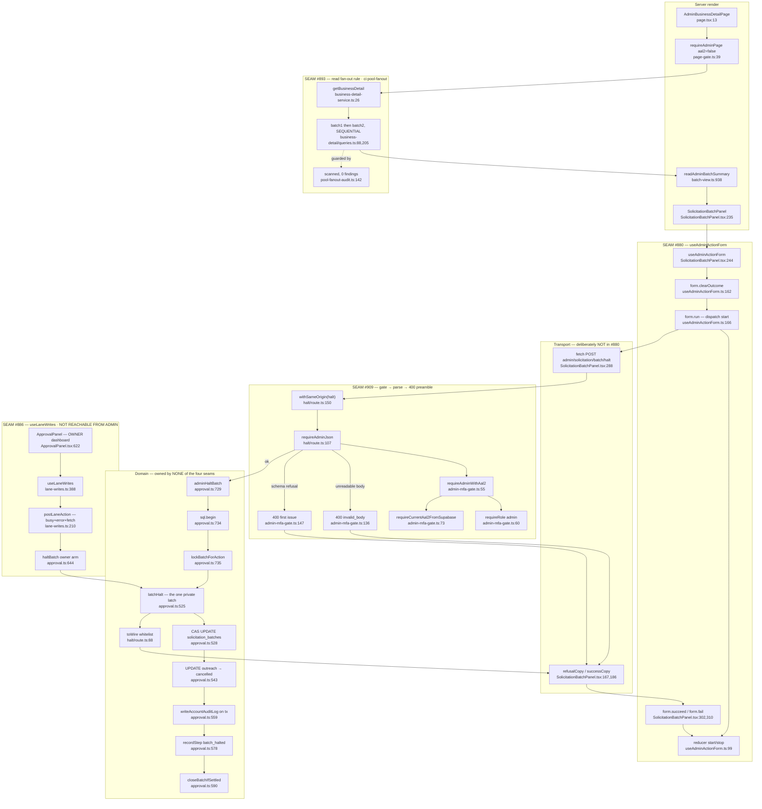

# F2 — The admin action surface, after four consolidations

Merges `757bf639` (#880), `2a9ede74` (#886), `1e407fee` (#909), `efd2145d`
(#893) — all 2026-08-23, within 15 minutes of one another.

**Representative action: the admin Halt latch.** An operator on
`/admin/businesses/[id]` types a note and stops a customer's solicitation send
batch. It is the only mutating admin action that crosses more than one seam and
reaches a DB write, an audit-log write and AAL2.

## Flowchart

**The only place the admin lane and the `#886` lane meet is `latchHalt`
(`approval.ts:525`) — inside the domain, below all four seams.**

## The four seams

| Seam | Owns | Entry point | CI audit |
|---|---|---|---|
| **#880** `useAdminActionForm` | one submit form's client state + transition ordering; **refuses** the fetch (`:40-44`) | `src/hooks/useAdminActionForm.ts:137` | **none** |
| **#886** `useLaneWrites` | four owner lane verbs, transport, refusal-copy tables, own busy/error | `dashboard/requests/lane-writes.ts:388` | **none** |
| **#893** fan-out rule | "no `Promise` combinator with ≥2 DB-issuing elements" over `src/lib/{admin,dashboard,locations}` | `scripts/ci/pool-fanout-audit.ts:142` (a rule, not an import) | itself |
| **#909** `requireAdminJson` | gate + `request.json()` + `safeParse` + both 400 shapes, all with `NO_STORE_HEADERS` | `src/lib/auth/admin-mfa-gate.ts:124` | `ci:admin-aal2` |

`#909` did **not** land in `src/app/api/_shared/` — no new file was created; the
composition was added beside the gate it composes. `ci:admin-aal2` gained
`GATE_JSON_FN` (`admin-aal2-audit.ts:181`), which is the half that made the
extraction legal: the identical helper was built and reverted during #898 for
want of it (`admin-mfa-gate.ts:99-101`).

## Convergence verdict — seed 3 REFUTED

**They compose cleanly. The seed's premise is measurably wrong: the four merges
are not four consolidations of one surface.** No admin route crosses four
abstractions. **No file in the repo imports from more than one of the four
seams.**

| Seam | Importers | Directory |
|---|---|---|
| `useAdminActionForm` | 5 | `src/app/admin/**` |
| `requireAdminJson` | 3 | `src/app/api/admin/**` |
| `useLaneWrites` | 2 | `dashboard/requests/` — **owner, not admin** |
| `ci:pool-fanout` | 0 — a rule | `src/lib/{admin,dashboard,locations}` |

Three stack in strictly disjoint layers of one request: client submit state →
route preamble → data access. Each layer's seam hands a value to the next
layer's *entry point*, never to another seam. The fourth is on a different
surface with a different trust model and is unreachable from any admin route.

Two seams meeting at the `fetch` boundary is the maximum crossing that exists in
this codebase today.

## Layering findings

1. **Two owners for one client submit concern.** `#880` owns state and refuses
   transport; `#886` owns transport **and** state. Authored eight minutes apart,
   neither references the other, **neither is CI-guarded**. Plausibly legitimate
   specialization — but nobody recorded the decision.
2. **`#909` migrated 3 of 25 admin mutation routes.** Byte-shape-identical
   duplicates at `grant-extension/route.ts:41-58` and
   `impersonation/start/route.ts:26-49`; a **divergent** third at
   `ranking/route.ts:24-43` (different strings, no `NO_STORE_HEADERS`). Eight
   more call `request.json()` raw. `ci:admin-aal2` accepts all — it checks a gate
   is *reached*, never that the preamble is the shared one.
3. **No unstated ordering between seams.** The one intra-seam ordering (the
   double clear at `SolicitationBatchPanel.tsx:268` plus the `start` reducer arm)
   is redundant but harmless, and its reason is written at
   `useAdminActionForm.ts:55-61`.
4. **No leaks.** `useAdminActionForm.ts` imports only `react`;
   `admin-mfa-gate.ts` only auth + zod + constants; `pool-fanout-audit.ts` names
   no seam; `lane-writes.ts` only solicitation types.
5. **One untyped cross-seam coupling at the wire.**
   `SolicitationBatchPanel.tsx:177` branches on `httpStatus === 401 || 403`,
   encoding knowledge of `requireAdminJson`'s gate arms as raw numbers.
   Documented at `:111-114`, correct today, typed nowhere.

## Side effects

All DB writes inside one `sql.begin` (`approval.ts:734`): the batch CAS
(monotone, no un-halt), outreach → `cancelled` for `rendered`/`queued` only
(`sending` deliberately excluded), `recordStep`, and the settlement join.

`writeAccountAuditLog` runs **on `tx`** in the same transaction
(`approval.ts:559`) through the single owner — invariant satisfied.
`actorUserId` comes from `gate.admin.id`, never the body; `z.strictObject`
rejects extra fields, so a caller cannot name its own `halted_by`. The operator's
note is omitted from the log line (`halt/route.ts:119-124`).

**Worth stating plainly:** the page rendering the panel is **AAL1**
(`page.tsx:23`). An admin without step-up can **read** a customer's batch state,
counts and halt history; only the stop requires AAL2. This is correct under
`ci:admin-aal2`'s parity rule, since the sibling GET uses `requireRoleOr401`.

## Gaps

`getBusinessChannelEnrollments`, `mapBusinessDetailResponse` and
`closeBatchIfSettled` internals not read — off the seam question. The other four
`#880` surfaces were verified by their hook line and fetch URL, not read in full.
`ci:pool-fanout`'s deferred-await blind spot (`pool-fanout-audit.ts:113-127`)
means no combinator form exists, but a hand-scan for the deferred form was not
done.
