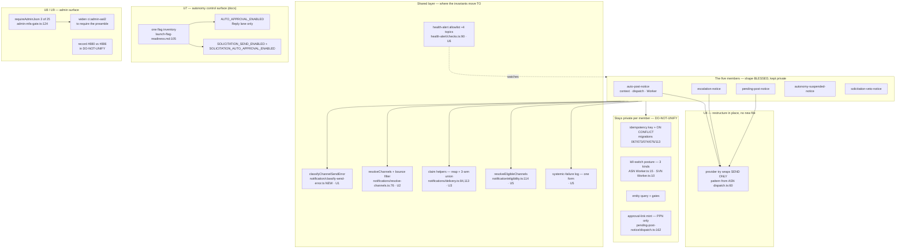

# Unified proposal — Pathfinder 2026-08-24

Orchestrator synthesis. Not delegated.

---

## The notice family: **bless the shape, extract the invariants, fix the bugs**

### The decision

**Do NOT build `runNoticeJob(sql, job, spec)`.** Bless the four-file
`{Name}Worker.ts` + `context.ts` + `dispatch.ts` + `errors.ts` shape as the
family's unit of specialization. Extract only the three things that are provably
invariant across every member — and they are, not coincidentally, exactly where
all three bugs live.

### Why not the full owner

The evidence for a shared owner is real: 47 lines identical across four
`Worker.ts` files, 78–97 pairwise in `dispatch.ts`, and a clean discoverable
shape. Five passes' worth of instinct says extract.

**The steelman defeats it, and it deserves to.** A sixth member is already
plausible — the Insights persona and the Governor both have owner-facing
surfaces — and the one thing such a member needs is the one thing all five
current members lack: **account-scoped fan-in over multiple locations.** Every
existing member resolves exactly one `businessId` and passes one `locationLabel`
(`APN dispatch.ts:59`, `ESC :81`, `PPN :91`, `SVN :75`). Even ASN, which is
account-scoped, borrows a single primary business (`Worker.ts:43,80-84`) and
works around location scoping with an org-default filter.

A shared owner built today from these five would encode the single-location
assumption into its signature and need reopening for the first member that
matters. **Extracting now means encoding the wrong axis.** That is a worse
outcome than five files that rhyme.

Two further constraints, both already on the DO-NOT-UNIFY register: the
idempotency keys cannot be parameterised without defeating partial-index
inference, and the three kill-switch postures each carry a written safety
rationale that a "which posture am I under" parameter would flatten.

### What this means about the bugs

**The three bugs are not caused by the duplication. They are caused by three
shared concerns living in five private copies.** Fix the concerns, not the
shape. Each extraction below is zero-parameter or one-parameter, has no
discriminator, and makes the corresponding bug unwritable.

---

### U1 — `classifyChannelSendError` — one owner, five deletions

**Consolidated component:** `worker/jobs/notification/classify-send-error.ts`
**Entry point:** `classifyChannelSendError(err: unknown): { retryable: boolean; reason: string }`

All five `errors.ts` files reduce to the same two lines delegating to the same
single-owner predicate. Zero behavioural variance, zero parameters, no
counter-argument.

| Old call site | Becomes |
|---|---|
| `auto-post-notice/errors.ts:24-27` | deleted; import the owner |
| `escalation-notice/errors.ts:22-25` | deleted; import the owner |
| `pending-post-notice/errors.ts:25-28` | deleted; import the owner |
| `solicitation-veto-notice/errors.ts:21-26` | deleted; import the owner |
| `autonomy-suspended-notice/errors.ts:8-15` | deleted; import the owner |

**Loss of capability: none.** The five headers restating the same rationale
collapse into one. ~121 lines of file removed.

### U2 — the bounce skip becomes structural — closes BUG 1

**The fix is not "add the check to `auto-post-notice`."** That is what was
skipped for six weeks and it would be skipped again. Move the precondition to the
layer every member already crosses.

`resolveChannels` (`src/lib/notifications/resolve-channels.ts:76-96`) already
filters `businesses.archived_at` and channel enrolments. **Add the
`owner_email_bounced` → drop-email filter there**, and delete the five private
copies at `ESC dispatch.ts:91-97`, `PPN :101-107`, `SVN :85-91`, `ASN :49-53`,
`notification/dispatch.ts:197`.

`auto-post-notice/context.ts:106` must also select `b.owner_email_bounced`
alongside `b.google_maps_url` — it is the only member whose projection omits it,
which is why the value never reaches its dispatcher.

**Loss of capability: none, and one gained.** A future seventh member cannot
forget the skip, because it will never see a bounced email channel.

**Two documents must be corrected in the same PR** (they are false today):
`docs/superpowers/specs/2026-07-07-ws4-trust-dial-veto-window-design.md:258-262`
and `worker/jobs/solicitation-veto-notice/dispatch.ts:83`.

### U3 — one claim contract — closes BUG 2

**Two halves, both in the shared layer already.**

*Reap.* `claimAutoPostNoticeDelivery` (`delivery.ts:84`) and
`claimEscalationNoticeDelivery` (`:113`) gain the same 15-minute stale-claim
`DELETE` the other three already have (`:143`, `:194`, `:278`). The `ON CONFLICT`
predicates stay hand-spelled per template — that is the DO-NOT-UNIFY constraint
and it is untouched by this.

*Contract.* Both return the discriminated
`'claimed' | 'settled' | 'pending'` union instead of `string | null`, matching
`:273-276` and `:189-192`. Their dispatchers (`APN dispatch.ts:101-107`,
`ESC :137-143`) then **throw** on `pending` like SVN and ASN, leaving the outbox
row incomplete.

**Loss of capability: none.** A `pending` conflict stops being silently
reclassified as a successful dedup. The Guardian escalation notice stops being
losable.

### U4 — DB lifecycle outside the provider catch — closes BUG 3

Restructure `APN dispatch.ts:92-146`, `ESC :128-183`, `PPN :126-235` to the shape
ASN and SVN already use: the provider `try` wraps **only** the send; claim,
finalize, release and fail sit outside and rethrow unchanged.

The target shape and its rationale are already written, verbatim, at
`autonomy-suspended-notice/dispatch.ts:60-63` and
`solicitation-veto-notice/dispatch.ts:104-108`. **This is not a design decision —
it is propagating a decision the codebase already made twice.**

**Loss of capability: none.** A notice the provider accepted stops being
recordable as failed.

### U5 — the two drifts, deleted

- **`APN Worker.ts:54-64`** adopts `resolveEligibleChannels` like its three
  siblings. Its context already exposes the four required fields; behaviour is
  unchanged. (ASN keeps its inline form — its split shape genuinely does not fit,
  and that is not drift.)
- **One systemic-failure helper.** Four spellings across five members, split
  `.error`/`.warn` on the same condition, one of them in a different file. Adopt
  the newer form — `.warn`, denominator `skipped + failed`, in the Worker — and
  adopt SVN's zero-enrolled systemic-failure `.warn`, whose argument
  (`Worker.ts:70-74`) is equally true of all four siblings.

### U6 — open the health-alert allowlist to the family — closes BUG 4

`health-alert/checks.ts:90-97` gains `AUTO_POST_NOTICE`, `ESCALATION_NOTICE`,
`PENDING_POST_NOTICE`, `AUTONOMY_SUSPENDED_NOTICE`. The file's own comment
`:76-80` already names this failure class and cites a prior instance of it.

---

## U7 — Name the autonomy control surface

**Not a code change. A control-surface inventory.**

There are now two independent autonomy kill-switch families, and no operational
document names both. `env-vars.md:661` is correct and thorough per-flag; what is
missing is the *composite* view an operator needs during an incident.

- `docs/runbooks/launch-flag-readiness.md:105` and the "all six autonomy flags →
  false" baseline at `agentic-staging-copilot-autopilot-e2e.md:250` predate the
  Solicitation lane and must list `SOLICITATION_SEND_ENABLED` and
  `SOLICITATION_AUTO_APPROVAL_ENABLED`.
- One table, one owner: every flag that can cause the platform to act without an
  owner, and what flipping it off does and does not stop.

**This must land before #633 flips anything.** Production currently has none of
the three flags set, so there is no live hazard — which is exactly why this is
cheap to fix now and expensive to discover later.

Two related asymmetries belong in the same record, as **decisions** rather than
silent divergences:

- The Governor cannot suspend Solicitation on its own terms (writer filters
  `persona = 'reply'`; reader is account-wide). Either widen the writer or write
  down that Reply is deliberately the only trip wire.
- "Owner never got the notice" downgrades in the Reply lane and silently ages out
  the batch in the Solicitation lane. D9 says fail-closed is intended; the record
  should say that losing the batch is the accepted cost, or the anchor should
  gain a downgrade path.

---

## U8 — Finish `#909`, or bound it

`requireAdminJson` owns 3 of 25 admin mutation routes. Two byte-shape-identical
duplicates (`grant-extension/route.ts:41-58`,
`impersonation/start/route.ts:26-49`) and one **divergent** third shape
(`ranking/route.ts:24-43`, different strings, no `NO_STORE_HEADERS`) survive.

`ci:admin-aal2` cannot see this — it checks that a gate is reached, never that the
preamble is the shared one.

Migrate the two identical ones, normalise the divergent one, and **widen
`ci:admin-aal2` to require the shared preamble** — otherwise route 26 will spell
it by hand again. If the remaining eight raw `request.json()` routes are
deliberately out of scope, say which and why.

## U9 — Record the `#880` / `#886` decision

Two owners for one client submit concern, authored eight minutes apart, neither
referencing the other, **neither guarded by any CI audit**. The surfaces
genuinely differ — AAL2 operator control plane versus tenant-scoped owner lane —
so this is plausibly legitimate specialization.

**The finding is not that it is wrong. It is that nobody decided.** Write the
decision down in the DO-NOT-UNIFY register with its reason, or unify. Either
outcome is fine; the current state — two undocumented answers to one question,
invisible to the build — is not.

---

## What this pass deliberately does NOT propose

- **No `runNoticeJob` owner.** See the steelman above.
- **No extraction of the 21-line offboarding SELECT into the notice family.** It
  appears in 18 files repo-wide; a family-scoped owner fixes 4 of 18 and creates
  a second owner. If it is extracted, it belongs at
  `src/lib/account-offboarding/gate.ts`.
- **No split of `src/lib/solicitation/`.** It is several subsystems sharing a
  prefix, and that is now confirmed twice. But renaming directories moves every
  import in the repo to buy a clearer `ls`, and nothing in this window was made
  worse by the current layout. Revisit when a file needs to move for its own
  reasons.
- **No unification of the two auto-approval runtimes.** The decision engines
  genuinely differ (22-member collect-all vs 6-member first-fail), and the veto
  anchors are a locked decision. U7 asks for the control surface to be *named*,
  not merged.
- **No cycle audit script.** Seven type-only cycles exist repo-wide and zero
  runtime cycles; `fallow --circular-deps` already covers the class that can
  actually break. Adding a checker for the erased class would fail on the house
  pattern.

---

## The proposed shape

## Ranked backlog

Rank is consequence × cheapness, with "already caused a wrong outcome" beating
"could".

| # | Item | Why here |
|---|---|---|
| 1 | **U2** bounce skip structural | Live defect on the highest-volume notice; known and untracked for six weeks |
| 2 | **U3** claim reap + contract | Silently loses the Guardian persona's only owner-facing output |
| 3 | **U7** autonomy control surface | Must precede #633's flag flip; zero hazard now, expensive later |
| 4 | **U4** DB lifecycle outside catch | Can mark a delivered notice failed; the fix is already written twice |
| 5 | **U1** `classifyChannelSendError` | Indefensible, zero-parameter, no counter-argument |
| 6 | **U6** health-alert allowlist | Four owner-impacting topics unwatched at the aggregate level |
| 7 | **U5** the two drifts | Cheap; removes a false `.error`/`.warn` split |
| 8 | **U8** finish `#909` | 22 routes still hand-spell it; the audit cannot see it |
| 9 | **#891** approve-path predicate | Latent only — correct by distance, zero test coverage |
| 10 | **U9** record `#880`/`#886` | A decision nobody made |
| 11 | **D1/D2/D4** #950 duplication | Small, self-declared, low risk |
| 12 | **#892 / #894 / #895** | Three prior handoffs, untouched across two windows |
