# F1 — Landing Experience: composition root and chrome

**Window** `72dc58ac..1d9b251c` · **Merges** #953, #968 · **Entry point**
`src/components/sections/landing/LandingExperience.tsx:110`

## Purpose

`/` is a `force-dynamic` server component that resolves two server-authoritative
flags into three plain props and hands them to one client component. That client
component, `LandingExperience`, is the whole marketing page's composition root:
it wraps the tree in exactly one `LazyMotion` feature bundle and one
`AmbientMotionProvider`, then `LandingChrome` renders the page root `div.rw-lp`
(which carries the ambient-motion pause state as a data attribute), the primary
nav with its mobile disclosure, the single `<main id="main-content">` landmark
the public layout's skip link targets, the eight narrative sections in fixed
order, and the footer. It owns no section content and no data access — its one
piece of runtime state is `menuOpen`. Its second, larger responsibility is
invisible in JSX: the 13-line CSS import block at lines 18–34 is the **only**
cascade-ordering authority for the entire landing stylesheet set, and two of the
subsystem's three unguarded order dependencies are settled there and only there.

## Diagram

```mermaid
flowchart TD

  subgraph SERVER["Server tier — Vercel RSC · invariant 1, UI only"]
    RL["Root layout · imports globals.css<br/>src/app/layout.tsx:3"]
    PL["PublicLayout · skip-to-content anchor<br/>src/app/(public)/layout.tsx:18"]
    SKIP["a href to main-content<br/>src/app/(public)/layout.tsx:22"]
    PAGE["LandingPage · force-dynamic RSC<br/>src/app/(public)/page.tsx:14"]
    F1["selfServeSignupEnabled<br/>src/lib/auth/flags.ts:28"]
    F2["trialEnabled<br/>src/lib/payments/flags.ts:44"]
    F3["trialPeriodDays<br/>src/lib/payments/flags.ts:71"]
    RF["readFlag · process.env read<br/>src/lib/config/flags.ts:21"]
    PROPS["primaryCtaHref / primaryCtaLabel / selfServeEnabled<br/>src/app/(public)/page.tsx:23"]
  end

  RL --> PL
  PL --> SKIP
  PL --> PAGE
  PAGE --> F1
  PAGE --> F2
  PAGE --> F3
  F1 --> RF
  F2 --> RF
  F3 --> RF
  F1 --> PROPS
  F2 --> PROPS
  F3 --> PROPS
  PROPS --> ROOT

  subgraph CLIENT["Client tier — 'use client' boundary"]
    ROOT["LandingExperience · composition root<br/>src/components/sections/landing/LandingExperience.tsx:110"]
    LM["LazyMotion features=domAnimation strict<br/>LandingExperience.tsx:118"]
    AMP["AmbientMotionProvider · paused + toggle context<br/>ambient-motion.tsx:78"]
    CHROME["LandingChrome<br/>LandingExperience.tsx:126"]
    HOOK["useAmbientMotionPaused · context read<br/>ambient-motion.tsx:61"]
    STATE["menuOpen useState · useId · menuButtonRef<br/>LandingExperience.tsx:132"]
    CLOSE["closeMenu · setState false then ref focus<br/>LandingExperience.tsx:136"]
    ESC["useEffect · window keydown Escape, bound only while open<br/>LandingExperience.tsx:143"]
  end

  ROOT --> LM --> AMP --> CHROME
  CHROME --> HOOK
  CHROME --> STATE
  STATE --> ESC
  ESC --> CLOSE
  CLOSE --> STATE

  CHROME --> DIV

  subgraph LANDMARKS["Landmark structure rendered by LandingChrome"]
    DIV["div.rw-lp data-ambient-motion paused or running<br/>LandingExperience.tsx:156"]
    NAV["nav aria-label=Primary<br/>LandingExperience.tsx:157"]
    MAIN["main id main-content · the ONE skip-link target<br/>LandingExperience.tsx:268"]
    FOOT["LandingFooter · footer landmark<br/>footer/LandingFooter.tsx:186"]
  end

  DIV --> NAV
  DIV --> MAIN
  DIV --> FOOT
  SKIP -. "fragment target" .-> MAIN
  HOOK -. "data attribute drives CSS pause" .-> DIV

  subgraph CHROMENAV["Nav subtree"]
    WM["Link / · BrandLogo + wordmark text<br/>LandingExperience.tsx:161"]
    LOGO["BrandLogo · sole owner of public/logo.svg<br/>src/components/ui/BrandLogo.tsx:23"]
    NL["NAV_LINKS.map · desktop ul<br/>LandingExperience.tsx:166"]
    LINKS["NAV_LINKS · Features / How it works / Pricing<br/>src/components/ui/marketing-links.ts:15"]
    AUTH["div.rw-lp-nav-auth · selfServe on = Log in + Sign up, off = CTA pill<br/>LandingExperience.tsx:189"]
    BTN["button.rw-lp-menu-button · aria-expanded + aria-controls<br/>LandingExperience.tsx:206"]
    BARS["span.rw-lp-menu-bars data-open · CSS-consumed<br/>LandingExperience.tsx:217"]
    PANEL["div.rw-lp-menu-panel · hidden when closed, data-open UNUSED<br/>LandingExperience.tsx:225"]
    PNL_LINKS["NAV_LINKS.map · panel ul, onClick=closeMenu<br/>LandingExperience.tsx:231"]
    PNL_AUTH["panel auth branch · SECOND copy of the selfServe fork<br/>LandingExperience.tsx:244"]
  end

  NAV --> WM --> LOGO
  NAV --> NL --> LINKS
  NAV --> AUTH
  NAV --> BTN --> BARS
  BTN -- "onClick toggles" --> STATE
  NAV --> PANEL
  PANEL --> PNL_LINKS --> LINKS
  PANEL --> PNL_AUTH
  PNL_LINKS -- "onClick" --> CLOSE
  PNL_AUTH -- "onClick" --> CLOSE
  PROPS -. "primaryCtaHref / primaryCtaLabel" .-> AUTH
  PROPS -. "primaryCtaHref / primaryCtaLabel" .-> PNL_AUTH

  subgraph SECTIONS["Section map — fixed order inside main · F3 territory"]
    S1["HeroSection · primaryCtaHref+Label<br/>LandingExperience.tsx:273"]
    S2["ProblemSection<br/>LandingExperience.tsx:275"]
    S3["FleetSection · videoSrc, poster, title literals<br/>LandingExperience.tsx:277"]
    S4["PersonasSection<br/>LandingExperience.tsx:283"]
    S5["WatchdogsSection<br/>LandingExperience.tsx:285"]
    S6["TiersSection<br/>LandingExperience.tsx:287"]
    S7["FutureSection<br/>LandingExperience.tsx:289"]
    S8["CtaSection · primaryCtaHref+Label<br/>LandingExperience.tsx:291"]
  end

  MAIN --> S1 --> S2 --> S3 --> S4 --> S5 --> S6 --> S7 --> S8

  subgraph FOOTER["Footer subtree"]
    FCOL["FOOTER_COLUMNS · Product + Company, composed here<br/>footer/LandingFooter.tsx:53"]
    FCOPY["footer-copy · BLURB / SUPPORT_EMAIL / WORDMARK<br/>footer/footer-copy.ts:19"]
    FMAP["column map · nav aria-label + h2 + ul<br/>footer/LandingFooter.tsx:206"]
    FWM["WordmarkReveal · SVG mask + m.radialGradient<br/>footer/LandingFooter.tsx:71"]
    FPTR["useEffect matchMedia hover:hover + pointer:fine<br/>footer/LandingFooter.tsx:86"]
    FPRM["usePrefersReducedMotion<br/>src/hooks/usePrefersReducedMotion.ts:43"]
    FTOG["AmbientMotionToggle · WCAG 2.2.2 control, throws without provider<br/>ambient-motion.tsx:161"]
    FYEAR["copyright year · new Date getFullYear + suppressHydrationWarning<br/>footer/LandingFooter.tsx:240"]
    FLEG["nav aria-label=Legal · LEGAL_LINKS row<br/>footer/LandingFooter.tsx:247"]
    MLEG["LEGAL_LINKS + COMPANY_LINKS + MARKETING_LINKS<br/>src/components/ui/marketing-links.ts:23"]
  end

  FOOT --> FCOL --> FMAP
  FCOL --> MLEG
  FOOT --> FCOPY
  FOOT --> FWM
  FWM --> FPTR
  FWM --> FPRM
  FOOT --> FTOG
  FTOG -. "useAmbientMotion context" .-> AMP
  FOOT --> FYEAR
  FOOT --> FLEG --> MLEG

  subgraph CASCADE["CSS cascade — the ONLY ordering authority, LandingExperience.tsx:18-34"]
    C0["globals.css + 4 Island sheets · pinned by design-scope-purity.test.ts:39<br/>src/app/globals.css:186"]
    C1["1. agent-flip-card.css<br/>LandingExperience.tsx:18"]
    C2["2. cta/cta.css<br/>LandingExperience.tsx:19"]
    C3["3. footer/footer.css<br/>LandingExperience.tsx:20"]
    C4["4. fleet/fleet.css<br/>LandingExperience.tsx:21"]
    C5["5. fleet/video-lightbox.css<br/>LandingExperience.tsx:22"]
    C6["6. future/future.css<br/>LandingExperience.tsx:23"]
    C7["7. hero/hero.css<br/>LandingExperience.tsx:24"]
    C8["8. personas/personas.css<br/>LandingExperience.tsx:25"]
    C9["9. problem/problem.css<br/>LandingExperience.tsx:26"]
    C10["10. tiers/tiers.css<br/>LandingExperience.tsx:27"]
    C11["11. watchdogs/watchdogs.css<br/>LandingExperience.tsx:28"]
    C12["12. carousel.css — after EVERY section sheet<br/>LandingExperience.tsx:33"]
    C13["13. landing-experience.css — chrome, last<br/>LandingExperience.tsx:34"]
  end

  C0 --> C1 --> C2 --> C3 --> C4 --> C5 --> C6 --> C7 --> C8 --> C9 --> C10 --> C11 --> C12 --> C13
  C13 -. "styles div.rw-lp + pause rule" .-> DIV
  C3 -. "styles .rw-lp-foot-*" .-> FOOT

  subgraph TIES["Order dependencies settled by that sequence — none mechanically guarded"]
    T1["DEP 1 · carousel.css 0,2,0 must beat .rw-lp-fleet-tier data-tier=watchdog<br/>carousel.css:18"]
    T2["DEP 2 · watchdogs.css 0,2,0 must beat agent-flip-card.css 0,2,0<br/>watchdogs/watchdogs.css:195"]
    T3["NON-DEP · .rw-lp-flip .rw-lp-flip-face out-specifies .rw-lp-glass on purpose<br/>agent-flip-card.css:67"]
    T4["No test reads the import block — LandingExperience.test.tsx asserts behaviour only<br/>__tests__/LandingExperience.test.tsx:41"]
  end

  C12 -. "position 12 of 13 is what settles it" .-> T1
  C11 -. "position 11 must stay after position 1" .-> T2
  C1 -. "deliberately order-independent" .-> T3
  C13 -. "unguarded" .-> T4
  C12 -. "unguarded" .-> T4
```

## Side effects

Cross-boundary reads and effects on this path, in order of execution:

1. **Server flag reads (the only data access in F1).** `selfServeSignupEnabled()`
   (`src/lib/auth/flags.ts:28`) and `trialEnabled()` / `trialPeriodDays()`
   (`src/lib/payments/flags.ts:44`, `:71`) go through `readFlag`
   (`src/lib/config/flags.ts:21`) → `process.env`. Resolved server-side and
   passed as three plain props (`src/app/(public)/page.tsx:23-33`) — invariant
   #13 honoured, no `NEXT_PUBLIC_*` companion anywhere in the subtree.
   `export const dynamic = 'force-dynamic'` (`page.tsx:6`) is what stops the flag
   value being baked into a static shell.
2. **No API, no database, no analytics.** Nothing under `LandingExperience.tsx`
   or `footer/` fetches, posts, or emits a PostHog event. The composition root is
   render-only; every CTA is an ordinary `next/link` navigation.
3. **Client state — one piece.** `menuOpen` (`LandingExperience.tsx:132`), plus
   `useId` for the `aria-controls` pairing and a ref to the trigger.
4. **Global keydown listener, scoped to open state.** `window.addEventListener('keydown')`
   at `LandingExperience.tsx:148`, mounted only while `menuOpen` is true and torn
   down in the effect's cleanup (`:149`) — the page adds no idle key listener.
5. **Imperative focus move.** `menuButtonRef.current?.focus()`
   (`LandingExperience.tsx:138`) on Escape and on every panel-link click.
6. **Ambient-motion context → DOM attribute → CSS.** `useAmbientMotionPaused()`
   (`ambient-motion.tsx:61`) is read in `LandingChrome` and written as
   `data-ambient-motion` on the page root (`LandingExperience.tsx:156`); the
   universal rule at `landing-experience.css:494-497` freezes every keyframe
   animation under `.rw-lp` with `animation-play-state: paused !important`.
   Verified at HEAD: all three keyframe animations under `sections/landing/` are
   `infinite` (`fleet/fleet.css:169`, `:179`, `tiers/tiers.css:164`), so the
   comment's "nothing finite to strand" claim still holds.
7. **Provider contract enforced by throw.** `AmbientMotionToggle`
   (`ambient-motion.tsx:161`) calls `useAmbientMotion()`, which throws outside a
   provider (`ambient-motion.tsx:73`). Reachable only via `LandingFooter`
   (`footer/LandingFooter.tsx:235`), which has exactly one call site, inside the
   provider (`LandingExperience.tsx:294`). Contract currently holds.
8. **Two browser media-query subscriptions in the footer.**
   `matchMedia('(hover: hover) and (pointer: fine)')` with a `change` listener
   (`footer/LandingFooter.tsx:86-92`), and `usePrefersReducedMotion()`
   (`src/hooks/usePrefersReducedMotion.ts:43`).
9. **Pointer-position state at 60Hz.** `onMouseMove` → `getBoundingClientRect()` +
   `setMaskPosition` (`footer/LandingFooter.tsx:94-102`), attached only when the
   pointer is fine (`:126-128`).
10. **Hydration-boundary hazard, handled.** `new Date().getFullYear()`
    (`footer/LandingFooter.tsx:187`) rendered under `suppressHydrationWarning`
    (`:240`).

### Error / fallback branches (not dominant)

- `useAmbientMotionPaused` returns `false` outside a provider rather than
  throwing (`ambient-motion.tsx:62`) so a section can mount standalone in a test.
- `WordmarkReveal`'s `handleMove` returns early when the ref is null
  (`footer/LandingFooter.tsx:96`).
- Under reduced motion the wordmark's draw-on is skipped and the layer simply
  renders (`footer/LandingFooter.tsx:175-176`).
- Flag-off fallback: `/signup` 404s when self-serve is off, so both CTA branches
  fall back to `/book-a-demo` (`src/app/(public)/page.tsx:23`).
- Resize fallback: `@media (min-width: 901px) { .rw-lp-menu-panel { display: none } }`
  (`landing-experience.css:412-417`) hides the panel if the open state survives a
  widen; the React state is not reset.

## External dependencies

Features and shared modules F1 calls into:

| Dependency | Where F1 touches it |
|---|---|
| **F3 — Landing sections** (all eight) | `LandingExperience.tsx:273-291`; F1 supplies `primaryCtaHref`/`primaryCtaLabel` to Hero and Cta only |
| **F2 — Landing motion primitives** | `LazyMotion features={domAnimation} strict` (`LandingExperience.tsx:118`) is the single feature bundle every `m.*` in F2/F3 depends on; `AmbientMotionProvider` (`ambient-motion.tsx:78`) |
| **Marketing link facts** (shared with F6/F7) | `src/components/ui/marketing-links.ts:15`, `:23`, `:33` |
| **Brand mark** | `src/components/ui/BrandLogo.tsx:23` |
| **Reduced-motion hook** (shared) | `src/hooks/usePrefersReducedMotion.ts:43` |
| **Auth / payments flag modules** | `src/lib/auth/flags.ts:28`, `src/lib/payments/flags.ts:44`, `:71` → `src/lib/config/flags.ts:21` |
| **Public layout skip-link contract** | `src/app/(public)/layout.tsx:22` targets `LandingExperience.tsx:268` |
| **Island cascade base** | `src/app/globals.css:186-189` (pinned by `src/__tests__/design-scope-purity.test.ts:39-45`) |
| **F6 — Island design system** (sibling, not called) | `SiteNav.tsx:47` / `SiteFooter.tsx` render the same link facts on every other public page; see duplication notes |

## Sources consulted

| File | Lines read |
|---|---|
| `src/components/sections/landing/LandingExperience.tsx` | 1–297 (full) |
| `src/components/sections/landing/landing-experience.css` | 1–30, 293–440, 485–528; selector index across 1–528 |
| `src/components/sections/landing/footer/LandingFooter.tsx` | 1–262 (full) |
| `src/components/sections/landing/footer/footer-copy.ts` | 1–37 (full) |
| `src/components/sections/landing/ambient-motion.tsx` | 1–180 (full) |
| `src/components/sections/landing/carousel.css` | 1–30 |
| `src/components/sections/landing/watchdogs/watchdogs.css` | 190–205 |
| `src/components/sections/landing/agent-flip-card.css` | 60–80 |
| `src/components/sections/landing/fleet/fleet.css` | 169, 179, 187, 194, 204, 241, 684 (animation/keyframe grep) |
| `src/components/sections/landing/tiers/tiers.css` | 164, 172, 184 (animation/keyframe grep) |
| `src/app/(public)/page.tsx` | 1–35 (full) |
| `src/app/(public)/layout.tsx` | 1–35 (full) |
| `src/app/layout.tsx` | 3 |
| `src/app/globals.css` | 180–189 |
| `src/components/ui/marketing-links.ts` | 1–33 (full) |
| `src/components/ui/BrandLogo.tsx` | 1–33 (full) |
| `src/components/ui/SiteNav.tsx` | 40–90, 105–205 |
| `src/components/ui/SiteFooter.tsx` | 1–75 (grep index: 4, 19–35, 44, 53–57, 70) |
| `src/lib/auth/flags.ts` | 1–34 |
| `src/lib/payments/flags.ts` | 7–71 (grep) |
| `src/lib/config/flags.ts` | 21, 28 (grep) |
| `src/hooks/usePrefersReducedMotion.ts` | 43 (grep) |
| `src/components/sections/landing/__tests__/LandingExperience.test.tsx` | 1–117 (structure grep + wc) |
| `src/__tests__/focus-visible-marketing.test.ts` | 25–60 |
| `docs/reviews/PATHFINDER-2026-08-26/SCOPE.md` | 1–239 (full) |
| `docs/reviews/PATHFINDER-2026-08-26/00-features.md` | 1–154 (full) |
