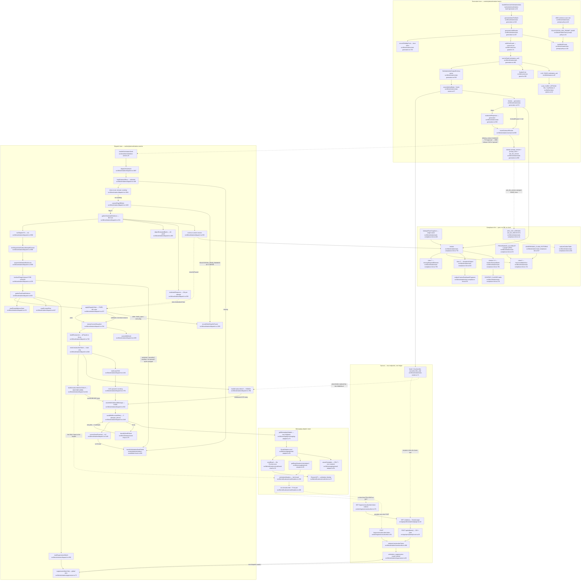

# F10 — Ask composition, compliance lint and dispatch

Pathfinder 2026-08-26 · window `72dc58ac..1d9b251c` · merge **#964** (`b9e7f36b`)

## Purpose

One **Ask** travels from an LLM prompt to a recipient's inbox through two
worker jobs and four gates. This chart is the whole path:

`buildAskPrompt` → cost reservation → `runLlmTask` → structured parse → footer
assembly → **lint** → moderation → persist (`rendered` / `withheld`) → [owner
approval, F12] → release (#900) → **dispatch gate** → token mint → outbound
envelope → adapter → Resend → terminal transaction.

The two lanes are deliberately separated: generation LINTS bytes it is about to
persist; dispatch RE-LINTS the bytes the owner approved, replaying the same
`interpolation_inputs` snapshot through the same single owner
(`lintInputFromSnapshot`, `ask-compliance-lint.ts:246`). #964 changed both ends
of the path — the lint's provenance allowlist at the top, and the
List-Unsubscribe header at the bottom.

Charted at HEAD `1d9b251c`. **78 nodes**, every one carrying `file:line`.

---

## Diagram

---

## The two unsubscribe URLs

#964's change, end to end. Before it, `assembleOutboundMessage` carried ONE url
and `EmailAdapter` fed that same string to both the body and the RFC 8058
header — so the header advertised the Next.js human page, whose POST renders a
confirm button and writes nothing. Every provider-automated one-click (Gmail
chip, Yahoo, Apple Mail) was a silent 200 no-op. Found live at #633's staging
flip.

| | **`unsubscribeUrl` — HUMAN** | **`unsubscribeOneClickUrl` — MACHINE** |
|---|---|---|
| **Mint site** | `buildUnsubscribeUrl` `dispatch.ts:786-794` | `buildUnsubscribeOneClickUrl` `dispatch.ts:814-822` (**new in #964**) |
| **Origin var** | `NEXT_PUBLIC_APP_URL` (`dispatch.ts:787`) | `WORKER_PUBLIC_URL` (`dispatch.ts:815`) |
| **Shape** | `<app>/u/<token>` | `<worker>/ingress/unsubscribe/<token>` |
| **Fail posture** | throw when unset (`dispatch.ts:789`) | throw when unset (`dispatch.ts:817`) |
| **Handed to** | `OutboundMessageInput.unsubscribeUrl` (`dispatch.ts:1781`) | `…unsubscribeOneClickUrl` (`dispatch.ts:1782`) |
| **Consumer** | `assembleOutboundMessage` `replaceAll` into `bodyText` (`dispatch.ts:945`), then escaped + anchored into `bodyHtml` (`dispatch.ts:948-952`) | `EmailAdapter.send` → `getEmailHeaders('solicitation', { unsubscribeUrl: message.unsubscribeOneClickUrl })` (`email-adapter.ts:36-38`) |
| **Reaches the wire as** | the `Unsubscribe: <url>` footer line (`ask-render.ts:71`) in both MIME parts | the HTTPS member of `List-Unsubscribe`, paired with `List-Unsubscribe-Post` (`headers.ts:186-189`) |
| **Destination** | Next.js page `src/app/(public)/u/[token]/page.tsx:44` → form POST → `src/app/api/u/[token]/route.ts:26` → `redeemUnsubscribeToken` → 303 + receipt | Fastify `POST /ingress/unsubscribe/:token` (`worker/ingress/unsubscribe.ts:94`) → `redeemUnsubscribeToken` (`:383`) → 200 after commit (`:147`) |
| **Writes the ledger?** | Only via the **button** (`/api/u/…`). A bare POST to `/u/<token>` renders the page and writes nothing — the defect. | Yes, directly and idempotently (`unsubscribe.ts:5-8`) |

### Verification — the machine URL never enters the body

`assembleOutboundMessage` (`dispatch.ts:943-989`) touches the machine url in
exactly one place:

- `bodyText` = `storedBody.replaceAll(UNSUBSCRIBE_URL_PLACEHOLDER, input.unsubscribeUrl)` — `dispatch.ts:945`. **Footer url only.**
- `bodyHtml` = `escapeHtml(bodyText)` with anchors inserted for `escapedUnsubscribe` (`= escapeHtml(input.unsubscribeUrl)`, `:948`) and `escapedReview` — `dispatch.ts:950-953`. **Footer url only.**
- `subject` = `input.subject`, untouched.
- The machine url is assigned once, on the returned object: `unsubscribeOneClickUrl: input.unsubscribeOneClickUrl` — `dispatch.ts:987`.

There is no other read of `input.unsubscribeOneClickUrl` in the function, and
`ask-render.ts` emits exactly one placeholder (`UNSUBSCRIBE_URL_PLACEHOLDER`,
`ask-render.ts:71`) which lint class 7 pins to exactly one occurrence
(`ask-compliance-lint.ts:758`). **Verified: the machine URL cannot reach the
body.** Pinned by test at
`src/lib/solicitation/__tests__/dispatch.test.ts:652-654` (the
`for (const part of [bodyText, bodyHtml, subject])` assertion added by #964),
and the inverse — the footer url must NOT appear in the header — at
`src/lib/messaging/__tests__/email-adapter.test.ts:262-263`.

> **Brief correction.** The task brief cites the seam owner as
> `headers.ts:114-132`. At HEAD that range is the **marketing** branch (the
> HTTPS detection at `:117-127` and the marketing pair at `:129-134`). The pair
> F10 actually ships is `solicitationHeaders`' own, at `headers.ts:186-189` —
> a separate, fail-closed branch that `headers.ts:61-63` states may never share
> the marketing fallbacks. Both are unchanged by #964; only the *input* changed.

### Why the pre-#964 shape passed every test

`solicitationHeaders` (`headers.ts:158-190`) validates that the url parses and
is HTTPS. `https://app.example/u/<token>` satisfies both. The only thing that
distinguishes a working one-click endpoint from a broken one is *which handler
answers a POST* — a fact no unit test in this repo could observe, and the
adapter's own fail-closed test asserted on the footer url, which is precisely
how the wrong endpoint shipped (stated in #964's commit body).

---

## Lint classes

`lintAsk` (`ask-compliance-lint.ts:776-804`) runs all seven classes, records
every match in `matches`, and returns the FIRST as `blockedReason`
(first-hit-wins, §2.3).

| # | Reason | Scope | Exemption | Owner |
|---|---|---|---|---|
| 1 | `incentive_language` | subject + body | §2.5 interpolated-value spans | `:283-337` |
| 2 | `review_steering` | subject + body | §2.5 | `:342-354` |
| 3 | `gating_funnel` | subject + body | §2.5 | `:360-363` |
| 4 | `pressure` | subject + body | §2.5 | `:369-377` |
| 5 | `deceptive_subject` | **subject only** | none | `deceptiveSubject` `:615-636` + `subjectCarriesDisallowedFragment` `:678-698` |
| 6 | `unverifiable_fact` | subject + model-authored body, **footer excluded** (`FOOTER_ANCHOR`, `:562`, `:789`) | none (claim-pattern arm takes §2.5 spans, `:796`) | `hasUnverifiableFact` `:721-736` + `UNVERIFIABLE_CLAIM_PATTERNS` `:537-551` |
| 7 | `missing_required_element` | **body only** | none | `missingRequiredElement` `:756-770` |

`moderation_high` is a member of `ASK_BLOCK_REASONS` (`:57`) but is **never**
assigned by the lint — it belongs to the moderation stage.

### #964's change to class 6

Class 6's structural arm (`hasUnverifiableFact`, `:721`) walks every token
matched by `TOKEN_PATTERN` (`:643`) and blocks any **capitalized,
non-sentence-initial** token that appears neither in an interpolation value nor
in `PROVENANCE_ALLOWLIST` (`:472-523`). Two things collided at #633's staging
flip — the first live generation this lane ever ran:

1. **`SOLICITATION_ASK_PROMPT_BASE` line 1 instructs the model to ask for a
   "Google review"** (`ask-prompt-policy.ts:35`). "Google" is prompt-asserted,
   not model-invented, but it is in no interpolation value and was not
   allowlisted. Every ask carrying the product's own vocabulary was withheld
   `unverifiable_fact`. **Fix:** `'google'` added at
   `ask-compliance-lint.ts:522`.
2. **Even with (1) fixed, Title-Case subjects still failed.** The model writes
   `"We'd Love Your Feedback!"`; every capitalized mid-sentence token reads as
   an invented fact. **Fix in the PROMPT, not the lint:** the sentence-case
   style rule at `ask-prompt-policy.ts:46`, with
   `SOLICITATION_ASK_PROMPT_VERSION → '2026-08-25.1'` (`:25`). The lint was
   deliberately left alone — the commit records that weakening subject
   provenance coverage stays a spec-owner decision.

Together: **4/4 asks deterministically withheld** before, clean after.

### Where the version hash is recorded

| Fact | Constant | Recorded at | Column |
|---|---|---|---|
| Lint ruleset | `ASK_LINT_VERSION` (`ask-compliance-lint.ts:41`) | `toInsertInput` → `insertOutreachRender` (`ask-generation.ts:658` → `outreach.ts:589`) | `solicitation_outreach.ask_lint_version` (migration `091:214`, `NOT NULL`) |
| Prompt text version | `SOLICITATION_ASK_PROMPT_VERSION` (`ask-prompt-policy.ts:25`) | `ask-generation.ts:656`, `:767`, `:1689` | render row + `api_costs.prompt_version` |
| Prompt bytes | `solicitationAskPromptHash()` (`ask-prompt-policy.ts:57`) | `ask-generation.ts:657`, `:766` | render row + `api_costs.system_prompt_hash` |
| Rule table | `askLintGoldenTable()` (`ask-compliance-lint.ts:816`) | golden file `__tests__/ask-lint-classes.golden.json` (regenerated by #964) | — |

**All four writers are in the GENERATION lane.** The dispatch-time re-lint
(`dispatch.ts:535`) writes none of them — see FINDING 1.

---

## Invariant compliance

| Invariant | Verdict | Evidence |
|---|---|---|
| **Cost guard — Redis reservation precedes every LLM call** | **PASS** | `buildAskPrompt` is called at `ask-generation.ts:461`; the LLM call is *inside* the `withCostGuard` closure at `:483`, and `withCostGuard` issues `reserveCost` at `cost-guard.ts:74` before invoking it. `finalizeCost` at `:100`, `releaseCost` at `:122`. `onFinalizeError: 'log-and-return-value'` (`ask-generation.ts:478`) matches the repo's fail-open/retry matrix. The `LLMStructuredOutputError` arm returns *through* the guard (`:493-518`) so billed attempts are finalized rather than released. |
| **Cost guard — dispatch lane** | **PASS (N/A by design)** | `dispatch.ts` makes **no LLM call**. `send-retry.ts:12-19` states the rule explicitly: *"THIS WORKER MAKES NO LLM CALL … Do not add a cost guard here."* Its only outbound calls are the free moderation endpoint and the Resend send. |
| **LLM task seam — all calls through `runLlmTask`** | **PASS** | `ask-generation.ts:483` calls `runLlmTask('solicitation_ask', prompt)`. `rg 'new OpenAI\|new Anthropic'` over `src/lib` returns three sites: the two seam adapters (`llm/openai-provider.ts:7`, `llm/anthropic-provider.ts:7`) and `moderation/moderate.ts:16` (moderation, not a completion). No completion call exists outside the seam. |
| **Pinned model, never a bare alias** | **PASS** | `LLM_TASKS.solicitation_ask` (`llm/tasks.ts:45-55`) pins `primary: OPENAI_MODEL` = `'gpt-4o-mini-2024-07-18'` (`:10`) and `fallback: ANTHROPIC_MODEL` = `'claude-haiku-4-5-20251001'` (`:11`). Guarded by `model-pinning.test.ts`. `temperature: 0.6` documented as deliberate (`:51-52`). |
| **Timeouts + bounded retries — LLM** | **PASS** | `LLM_CLIENT_OPTIONS = { timeout: 30_000, maxRetries: 0 }` (`llm/client-options.ts:10`), applied at both provider constructors. Failover is the seam's, not the SDK's. |
| **Timeouts + bounded retries — Resend send** | **PASS** | `sendEmail` bounds with a 10s `Promise.race` (`send-email.ts:16`, `:54-59`) — the SDK exposes no `AbortSignal` on `emails.send`. `sendWithBoundedRetry` (`dispatch.ts:1048-1074`) caps at `SEND_MAX_ATTEMPTS = 3` (`:999`) with **equal-jitter** backoff (`sendRetryDelayMs`, `:1009-1016`, base 200 ms, ceiling 2 s, `randomInt` per invariant #10). Only `retryable` is retried; the same `message` object is reused so the provider idempotency key (`message.outreachId`, `email-adapter.ts:61`) covers a re-issue. |
| **Timeouts + bounded retries — moderation** | **PASS, with a documentation defect** | Explicit per-request `{ timeout: 10_000 }` (`moderate.ts:47`), never throws (`:70-77`). But `moderate.ts:16` builds `new OpenAI()` **without** `LLM_CLIENT_OPTIONS`, so the SDK default `maxRetries: 2` applies and the real worst-case bound is ~30 s, not the "~10s timeout" that `dispatch.ts:494-497` cites as its reason for gathering above tx1. The reasoning still holds (the call is unlocked); the stated number is wrong by 3×. |
| **Invariant #5 — approval tokens never stored raw** | **PASS** | `mintUnsubscribeToken` (`dispatch.ts:846-868`) inserts `token_hash` only. The raw token lives in `MintedUnsubscribeToken.rawToken` in memory and in the two URLs. Only `unsubscribeTokenLogPrefix(minted.rawToken)` reaches a log (`dispatch.ts:1789`, `:1996`). The `sending`-row short-circuit deliberately logs no prefix because that process never held the token (`:1931-1933`). |
| **Invariant #6 — third-party ingress terminates on Railway** | **PASS, and strengthened by #964** | The RFC 8058 POST now lands on `worker/ingress/unsubscribe.ts:94`, which `dispatch.ts:807-808` names as the point: *"a mail provider is not a browser."* The human button stays on Vercel and `src/app/api/u/[token]/route.ts:13-16` records why that is not a violation. |
| **Invariant #12 — entry points orchestrate** | **PASS** | `worker/jobs/solicitation-send.ts` is 41 lines and calls one function. `worker/jobs/solicitation-batch/generate.ts:36` likewise. Retry classification is a named module with focused tests (`send-retry.ts`), which the file's own header cites as invariant #12's reading. |
| **Invariant #15 — explicit DB client** | **PASS** | `dispatch.ts:1897` takes `sql: Sql`; `ask-generation.ts:915` likewise. Neither imports `@/lib/db/server`. `ask-compliance-lint.ts` and `ask-prompt-policy.ts` are pure (no DB, no clock, no I/O). |
| **Suppression precedence (SCOPE seed 6)** | **PASS — the locked precedence is respected** | See below. |

### SCOPE seed 6 — do the new suppression writers respect the locked precedence?

Two locked rules, checked against the F10 path:

1. **"Attestation never overrides suppression."** `applyDispatchGate`
   (`dispatch.ts:237-257`) walks B6's order and returns the FIRST failure.
   `suppression` is item 4 at `:243`; `consent` (which is where the
   attestation-version membership test lives, `:244-249`) is item 5. A
   suppressed contact therefore withholds `suppressed`, and the attestation
   check is never reached. **Structural, not conventional** — the gate is pure
   and its order is the module's stated single owner (`dispatch.ts:6-8`).
2. **"Global wins a double match."** The gate does not re-spell the §1.2
   predicate. `readSuppressionMatch` (`dispatch.ts:592-604`) composes
   `suppressionMatchSql` (`suppression.ts:75-93`), whose
   `ORDER BY (s.scope = 'global') DESC, s.suppressed_at ASC LIMIT 1` (`:90`) is
   the ordering. **No new writer in this window bypasses it.** #964 adds a
   suppression *writer* path (`worker/ingress/unsubscribe.ts:383` →
   `redeemUnsubscribeToken` with `source: 'unsubscribe_one_click'`) that writes
   `scope='global'` — the strongest scope, so it can only strengthen a match,
   never weaken one. §7.4's no-provenance-leak rule is also honoured: `scope` is
   selected but never surfaced (`dispatch.ts:590-591`), and only `source`
   reaches the analytics event (`:1415`), never `account_id`.

**Verdict: seed 6 is refuted for F10.** The three-writers-in-nine-days concern
does not produce a precedence violation on this lane.

---

## Side effects

Ordered by lane.

**Generation (per child):**
- Redis `INCRBY` cost reservation, then finalize or release (`cost-guard.ts:74`, `:100`, `:122`)
- 1–2 LLM completions (primary + fallback), billed
- 1 OpenAI moderation call, free, only if the lint passed (`ask-generation.ts:593`)
- INSERT `solicitation_outreach` — the render row, with the three version stamps (`outreach.ts:589`)
- INSERT `api_costs` per billed attempt, **best-effort / log-and-swallow** (`ask-generation.ts:749-777`)

**Dispatch, above tx1:**
- 1 OpenAI moderation call over `subject\nbody` (`dispatch.ts:539`) — **outside any transaction, by design** (decision 3)
- On a flag-off defer: outbox completion + one `dispatch_gate_evaluated` spine step on the **parent** (`dispatch.ts:1329-1345`)

**tx1 (`runDispatchTx`, `dispatch.ts:1590`):**
- Advisory lock on the business (`:1599`) — always FIRST after the ownership CAS, global lock order
- `FOR UPDATE` on `solicitation_batches` (`:1608`) and `solicitation_outreach` (`:1492`)
- UPDATE consent snapshot triple (`stampConsentSnapshot`, `:704-719`) — written even for a withhold
- **Withhold path:** child run + `delivery_status='withheld'` + spine step + (suppression only) an `enqueueAnalyticsEvent` row + child terminal + outbox completion + `closeBatchIfSettled` (`:1365-1428`)
- **Send path:** INSERT `solicitation_unsubscribe_tokens` (hash only, `:846`) → `startOrGetSolicitationAskRun` → UPDATE `agent_run_id` → spine step → CAS `queued → sending` + `sending_at` (`:1752`)

**The wire (no lock held):**
- 1–3 Resend `emails.send` calls under one idempotency key (`email-adapter.ts:61`)

**tx2 (`commitSendTerminal`, `dispatch.ts:1140`):**
- Advisory lock again (ABBA-order contract, `:1147`)
- CAS `sending → sent | failed` with `sent_at` / `provider_message_id` / `bounced_at` (`:1152-1165`)
- `ask_sent` spine step + `solicitation_sent` outcome on the CHILD (`:1187-1206`)
- Child run terminal (`:1214-1221`), outbox completion (`:1223`), `closeBatchIfSettled` (`:1224`)
- **All five are conditional on the CAS** — `:1166-1184` refuses to record a send the row cannot carry a `provider_message_id` for.

**Recipient-initiated, later:**
- INSERT `solicitation_suppressions` `scope='global'` via either opt-out endpoint (`unsubscribe.ts:368`)

---

## External dependencies

| Dependency | Where | Bound |
|---|---|---|
| **OpenAI Chat Completions** (primary LLM) | `llm/openai-provider.ts:7` via `runLlmTask` | 30 s, `maxRetries: 0`, circuit breaker |
| **Anthropic Messages** (fallback LLM) | `llm/anthropic-provider.ts:7` | 30 s, `maxRetries: 0`, circuit breaker |
| **OpenAI Moderation** (`omni-moderation-latest`) | `moderation/moderate.ts:47` — called by BOTH lanes (`ask-generation.ts:593`, `dispatch.ts:539`) | 10 s per attempt; SDK default `maxRetries: 2` (not overridden) |
| **Resend** (solicitation sending identity — a **separate** client from transactional) | `email/client.ts:27` → `send-email.ts:59` | 10 s `Promise.race`; 3 in-process attempts, equal jitter |
| **Redis (Upstash)** — cost reservation | `costs/tracker.ts` via `cost-guard.ts:74` | fail-open limiter, reservation precedes spend |
| **Postgres (Supabase)** | `sql` / `sqlUnsubscribe` (dedicated 2-slot pool for opt-out) | `#773` admission chokepoint |
| **Google** (`search.google.com/local/writereview`) | `GOOGLE_WRITE_REVIEW_URL_PREFIX`, `dispatch.ts:740` | not called — link only, validated by `isPlaceId` |
| **Mail providers** (Gmail / Yahoo / Apple) | POST the `List-Unsubscribe` HTTPS member into `worker/ingress/unsubscribe.ts:94` | unauthenticated, deliberately **exempt from the ingress rate limiter** (`:49`), 1 KB body cap (`:58`), per-token single-flight (`:342`) |
| **Env** | `NEXT_PUBLIC_APP_URL`, `WORKER_PUBLIC_URL`, `SOLICITATION_SEND_FROM_ADDRESS`, `SOLICITATION_UNSUBSCRIBE_MAILTO`, `SOLICITATION_RESEND_API_KEY`, `SOLICITATION_PLATFORM_DAILY_CAP`, `SOLICITATION_SEND_ENABLED`, `OPENAI_MODERATION_ENABLED` | see FINDING 2 |

---

## Findings

### FINDING 1 — the dispatch-time re-lint verdict is stored with no ruleset version. **Reachable.**

**Is it wrong?** Yes. `ask-compliance-lint.ts:8-11` states the module's own
contract: *"`ASK_LINT_VERSION` is stored on every render so a verdict stays
attributable to the ruleset that produced it."* `commitWithhold`
(`dispatch.ts:1372-1381`) writes only `delivery_status`, `disposition_reason`,
`agent_run_id`, `updated_at`. It does **not** touch `ask_lint_version`
(`migration 091:214`) or `lint_detail` — both of which were stamped once, at
generation, by `toInsertInput` (`ask-generation.ts:658-659`). So a row withheld
`lint_failed` **at dispatch** carries:

- `ask_lint_version` naming the ruleset that produced the *generation* verdict, and
- `lint_detail = []`, the record of a run that came back **clean**.

**Is it reachable?** Yes, and it was reached by this very window. The dispatch
re-lint (`dispatch.ts:535`) calls the *current* `lintAsk`, and gate item 8
(`dispatch.ts:254`) maps a fail to `withhold('lint', 'lint_failed')` →
`commitWithhold`. The two lanes can only disagree when the ruleset changes
between render and dispatch — which is exactly what #964 did
(`ask_lint_2026-07-31.4 → ask_lint_2026-08-25.1`). Any row rendered under `.4`
and still awaiting dispatch at the #964 deploy is re-linted under `.1`. Note the
version bump this time *loosened* the lint, so the practical fallout is small;
the structural gap is that a tightening bump would produce a `lint_failed` row
that is un-attributable and whose `lint_detail` actively lies about a clean run.

**Severity:** MEDIUM. It is an auditability defect, not a send-safety hole — the
withhold itself is correct and fail-closed.

**Smallest fix:** add `ask_lint_version = ${ASK_LINT_VERSION}` and
`lint_detail = ${…verdict.matches}` to `commitWithhold`'s UPDATE for the
`item === 'lint'` arm. This requires `gatherSlowGateEvidence` to carry the
verdict's `matches` forward rather than collapsing to
`blockedReason === null` at `dispatch.ts:535` — a two-field widening of
`SlowGateEvidence`.

---

### FINDING 2 — #964 made `WORKER_PUBLIC_URL` a hard send precondition; no boot assertion owns it for this lane. **Structurally confirmed; live-lane instance LATENT.**

**Is it wrong?** Yes, and the asymmetry is self-evident:

- The **footer** url's precondition (`NEXT_PUBLIC_APP_URL`) **is** boot-asserted
  on any deployed lane — `assertUnsubscribeIngressConfigured`
  (`worker/ingress/unsubscribe.ts:217-230`), wired at `worker/index.ts:596`,
  with a docstring explaining exactly why a per-request throw on this surface is
  unacceptable.
- The **header** url's precondition (`WORKER_PUBLIC_URL`) is **not**.
  `assertSolicitationSendEnv` (`startup-assert.ts:476-498`) requires four vars —
  `SOLICITATION_RESEND_API_KEY`, `SOLICITATION_SEND_FROM_ADDRESS`,
  `SOLICITATION_PLATFORM_DAILY_CAP`, `SOLICITATION_UNSUBSCRIBE_MAILTO` — and
  #964 did not add a fifth.

`WORKER_PUBLIC_URL` is asserted only under two *unrelated* flags:
`CHANNELS_WHATSAPP_ENABLED` (`startup-assert.ts:392`) and
`ZERNIO_PUBLISHING_ENABLED` (`:427`). The solicitation lane borrows their
coverage by coincidence.

**Is it reachable?** Two separate answers, deliberately kept apart:

- **Structurally: yes, confirmed.** A lane with `SOLICITATION_SEND_ENABLED=true`
  and both `CHANNELS_WHATSAPP_ENABLED` and `ZERNIO_PUBLISHING_ENABLED` false
  boots clean and then throws at `dispatch.ts:817` on every gate-passing
  dispatch. Nothing in the repo forbids that configuration.
- **On the live staging/prod lanes: LATENT.** I did not introspect the deployed
  Railway variables, so I cannot claim the throw is live today. One command
  settles it: `railway variables --service <worker> | grep WORKER_PUBLIC_URL`
  on each environment.

**Failure shape if reached:** `buildUnsubscribeOneClickUrl` throws *inside* tx1
(`dispatch.ts:1782`, within the `sql.begin` callback at `:1983`), so the whole
transaction rolls back — the token mint included. That is the safe direction (no
burned token), but the outbox attempt is never completed, so BullMQ retries the
full ladder and the exhaustion hook (`worker/jobs/solicitation-send/failed-hook.ts:289`)
terminalizes the row `failed` / `send_exhausted`. **Every ask on the lane, one
at a time, with no boot signal** — the same failure *class* as the defect #964
was written to fix, which was itself found only at a staging flip.

**Compounding:** `docs/eservices-variables.md:184` still describes
`WORKER_PUBLIC_URL` as *"public worker origin (webhook signature base)"*. The
new solicitation dependency is invisible to `ci:env-registry`, so nothing
mechanical will notice.

**Smallest fix:** add `'WORKER_PUBLIC_URL'` to `assertSolicitationSendEnv`'s
required list and call `assertWorkerPublicUrlFormat()` from it (the private
helper at `startup-assert.ts:337` is already reached from two callers and needs
no change), plus a registry-row edit.

---

## Duplication candidates

| # | Concern | Sites | Assessment |
|---|---|---|---|
| **D1** | The human `/u/<token>` URL mint | `buildUnsubscribeUrl` `dispatch.ts:786-794` · `landingPageUrl` `worker/ingress/unsubscribe.ts:199-208` | **Genuine.** Both read `getWorkerConfig().NEXT_PUBLIC_APP_URL?.trim()`, strip trailing slashes, and emit `${appUrl}/u/${encodeURIComponent(rawToken)}`; both throw when unset. Byte-identical construction, two owners, and #964 added a **third** mint beside the first (`buildUnsubscribeOneClickUrl`, `:814`) — so this family is now 3 mints of 2 endpoints across 3 files with no single owner. Proposed owner: `src/lib/solicitation/unsubscribe.ts`, which already owns mint / hash / log-prefix / redeem. **Excluded from any unification:** `src/app/api/u/[token]/route.ts:37`, whose `/u/${encodeURIComponent(token)}` is deliberately **relative** to avoid trusting the Host header (`:31-36`). |
| **D2** | `completeOutboxNoop` | `dispatch.ts:438-446` · `ask-generation.ts:793-801` | **Genuine, and self-declared.** Same body: `sql.begin(tx => markOutboxCompletedIfOwned(tx, outboxId, attempt))`. `dispatch.ts:433-436` already names the destination — *"The eventual owner of this is `src/lib/shared/outbox.ts`, beside `markOutboxCompletedIfOwned` — hoist it there the next time that file is open"* — and explicitly forbids making it an export of `ask-generation.ts` (a value import would drag the LLM seam and cost guard into the dispatch module graph). The two differ only in that dispatch's folds the exact-attempt guard in. |
| **D3** | `moderateResponse(\`${subject}\n${body}\`)` — one call over subject + body | `ask-generation.ts:593` · `dispatch.ts:539` | **Rhymes, do not unify the verdict.** Each site restates the same rule in its own comment (`ask-generation.ts:590-591`, `dispatch.ts:537-538`), but the *fail postures are inverses*: generation vetoes on `severity === 'high'` (`:596`) and otherwise proceeds; dispatch requires `providerStatus === 'clean' && !decision.flagged` (`:544`) so `OPENAI_MODERATION_ENABLED=false` blocks the send. `dispatch.ts:506-513` documents that inversion as spec §3.4. At most the concatenation is shareable; the verdict mapping must not be. |
| **D4** | HTTPS-URL validation for `List-Unsubscribe` | `headers.ts:117-127` (marketing) · `headers.ts:166-177` (solicitation) | **Recommend DO-NOT-UNIFY.** Same `new URL` + `protocol === 'https:'` + catch, but marketing **degrades** to mailto-only and solicitation **throws**; `headers.ts:148-150` states the asymmetry as the point (*"the degraded form is a compliance violation that fails silently"*). Unifying needs a "which posture am I under" parameter — the shape prior passes have already ruled against. |

None of these appears on the DO-NOT-UNIFY registers in
`PATHFINDER-2026-08-22/02-duplication-report.md:409` or
`PATHFINDER-2026-08-24/02-duplication-report.md:454`.

---

## Sources consulted

**Read in full:** `src/lib/solicitation/dispatch.ts` (2,039) ·
`src/lib/solicitation/ask-compliance-lint.ts` (865) ·
`src/lib/solicitation/ask-prompt-policy.ts` (145) ·
`src/lib/solicitation/ask-render.ts` (73) ·
`src/lib/messaging/messaging-adapter.ts` (78) ·
`src/lib/messaging/email-adapter.ts` (140) ·
`src/lib/notifications/email/headers.ts` (198) ·
`worker/ingress/unsubscribe.ts` (529) · `worker/jobs/solicitation-send.ts` (41) ·
`src/app/api/u/[token]/route.ts` (67) · `src/lib/llm/tasks.ts` (62) ·
`src/lib/moderation/moderate.ts` (77)

**Read in part:** `src/lib/solicitation/ask-generation.ts` (400-800) ·
`src/lib/solicitation/send-retry.ts` (1-120) ·
`src/lib/solicitation/suppression.ts` (75-135) ·
`src/lib/costs/cost-guard.ts` · `src/lib/llm/client-options.ts` ·
`worker/config/startup-assert.ts` (320-499) · `worker/index.ts` (580-600) ·
`src/lib/notifications/email/send-email.ts` ·
`src/app/(public)/u/[token]/page.tsx`

**Diffs:** `git show b9e7f36b` (full, incl. tests and `vitest.setup.ts`)

**Docs:** `docs/reviews/PATHFINDER-2026-08-26/SCOPE.md` ·
`docs/reviews/PATHFINDER-2026-08-26/00-features.md` ·
`docs/reviews/PATHFINDER-2026-08-22/02-duplication-report.md` (DO-NOT-UNIFY register) ·
`docs/reviews/PATHFINDER-2026-08-24/02-duplication-report.md` (DO-NOT-UNIFY register) ·
`docs/eservices-variables.md` · `.claude/reference/env-vars.md` ·
`supabase/migrations/091_send_mode_spine_lifecycle.sql:214`
