# F11 — Owner offboarding purge and verification

Pathfinder 2026-08-26 · window `72dc58ac..1d9b251c` · merges #972, #970, #975.

## Purpose

The `delete_data` arm of owner offboarding. A `purge_scheduled` offboarding row
is dispatched through `job_outbox` to `PurgeWorker`, which runs **eight** ordered
stage runners — each its own Postgres transaction — then a ninth transaction that
**verifies** the result and only then stamps `status='purged'`.

The verifier is a **gate, not a report**: it runs *inside* the finalize
transaction (`purge-stages.ts:758`) and throws on any violation, so a blind
predicate is an open compliance gate and a false-positive one blocks a legitimate
purge.

> **Correction to the brief.** The task names *seven* stage runners
> (`:111/171/237/445/567/591/635`). There are **eight**: the list omits
> `runParentTombstonePurgeStage` at `purge-stages.ts:671`, which is the runner
> that writes every tombstone sentinel and is therefore the whole subject of
> §"Sentinel ownership". `PurgeWorker.ts:77-84` awaits eight, not seven.

Files (4, 2,267 lines at HEAD):

| File | Lines | Role |
|---|---:|---|
| `worker/jobs/account-offboarding/purge-stages.ts` | 1,012 | the WRITER — eight stages + finalize |
| `src/lib/account-offboarding/purge-verification.ts` | 763 | the VERIFIER — 48 per-table branches |
| `src/lib/account-offboarding/table-disposition.ts` | 422 | the INVENTORY — 48 `TABLE_DISPOSITIONS` |
| `src/lib/account-offboarding/purge-sentinels.ts` | 70 | the SENTINEL OWNER — 9 values (**new**, #972) |

---

## Diagram

```mermaid
flowchart TD
  OUTBOX["job_outbox ACCOUNT_OFFBOARDING_PURGE<br/>worker/index.ts:475"]
  ENTRY["handleAccountOffboardingPurge<br/>worker/jobs/account-offboarding/PurgeWorker.ts:32"]
  LOAD["loadPurgeOffboarding<br/>worker/jobs/account-offboarding/purge-stages.ts:61"]
  TERM{"already purged or terminal?<br/>PurgeWorker.ts:54"}
  ACK["markOutboxCompleted — no-op<br/>PurgeWorker.ts:55"]
  VALID["validatePurgeableOffboarding<br/>purge-stages.ts:80"]
  FORCED{"teardown_completed_at NULL?<br/>purge-stages.ts:90"}
  DISPO["hasConcreteAdminProviderDisposition +<br/>unresolvedApplicableTeardownProviders<br/>purge-stages.ts:97,100"]
  FAIL["markPurgeRetryableFailure / markPurgeTerminalFailure<br/>purge-stages.ts:963, :980"]

  OUTBOX --> ENTRY --> LOAD --> TERM
  TERM -- yes --> ACK
  TERM -- no --> VALID
  VALID --> FORCED
  FORCED -- yes --> DISPO
  DISPO -- unresolved --> FAIL
  FORCED -- no --> S1
  DISPO -- covered --> S1

  subgraph STAGES["eight ordered stages — each its own transaction"]
    direction TB
    S1["1 runAuthBindingPurgeStage<br/>purge-stages.ts:111"]
    S1A["revalidateAuthBinding — can_delete / already_detached<br/>purge-stages.ts:138"]
    S1B["supabaseServer.auth.admin.deleteUser — IRREVERSIBLE, OUTSIDE any tx<br/>purge-stages.ts:122"]
    S1C["UPDATE users SET auth_id = NULL<br/>purge-stages.ts:127"]

    S2["2 runDependentReferencePurgeStage<br/>purge-stages.ts:171"]
    S2A["DELETE account_offboarding_tokens · DELETE notification_deliveries<br/>purge-stages.ts:177, :195"]
    S2B["scrub approval_audit_log · api_costs x2 · review_exceptions<br/>purge-stages.ts:183, :202, :212, :225"]

    S3["3 runRawPayloadPurgeStage<br/>purge-stages.ts:445"]
    S3A["scrub inbound_events by substring offboarding_scope<br/>purge-stages.ts:487"]
    S3B["record job_outbox_scrub_scope in provider_dispositions<br/>purge-stages.ts:540 + purge-helpers.ts:29"]
    S3C["scrub + terminalize scoped job_outbox rows, excluding own row<br/>purge-stages.ts:548"]

    S4["4 runContentPurgeStage<br/>purge-stages.ts:237"]
    S4L["per-business advisory locks, ORDER BY id: csv_ingest then solicitation_batch<br/>purge-stages.ts:283-286"]
    S4A["DELETE flagged_responses · DELETE contact_csv_uploads<br/>purge-stages.ts:294, :311"]
    S4CAS["CASCADE: contacts, visits, batches, asks, outreach<br/>purge-stages.ts:298-310 comment"]
    S4B["deleteByBusiness solicitation_consent — ONLY deleter<br/>purge-stages.ts:324"]
    S4S["DELETE solicitation_suppressions WHERE scope='account'<br/>purge-stages.ts:333"]
    S4T["scrub solicitation_unsubscribe_tokens account/business/ask in ONE stmt<br/>purge-stages.ts:362"]
    S4C["deleteByBusiness x11 + review_escalations + prospect_demos<br/>purge-stages.ts:369-394 · purge-helpers.ts:77"]
    S4D["DELETE agent_outcomes then agent_runs — steps cascade<br/>purge-stages.ts:426, :430"]

    S5["5 runAnalyticsPurgeStage — NO sql.begin<br/>purge-stages.ts:567"]
    S6["6 runProviderIdentifierPurgeStage<br/>purge-stages.ts:591"]
    S7["7 runAuditAndCostPayloadPurgeStage<br/>purge-stages.ts:635"]
    S8["8 runParentTombstonePurgeStage<br/>purge-stages.ts:671"]
    S8A["tombstone users · businesses 28 cols · accounts<br/>purge-stages.ts:676, :685, :724"]
  end

  S1 --> S1A --> S1B --> S1C --> S2 --> S2A --> S2B --> S3
  S3 --> S3A --> S3B --> S3C --> S4
  S4 --> S4L --> S4A --> S4CAS --> S4B --> S4S --> S4T --> S4C --> S4D --> S5
  S5 --> S6 --> S7 --> S8 --> S8A --> FIN

  SENT["PURGE_TOMBSTONE_SENTINELS — 9 frozen values<br/>src/lib/account-offboarding/purge-sentinels.ts:51"]
  SENT -. "writer binds =" .-> S8A
  SENT -. "verifier binds IS DISTINCT FROM" .-> VBUS

  subgraph FINAL["finalizePurgeInTransaction — ONE transaction<br/>purge-stages.ts:736"]
    direction TB
    FIN["lockCurrentOutboxAttempt — SELECT … FOR UPDATE inside tx<br/>purge-stages.ts:887, :899"]
    FIN2["scrub own job_outbox row<br/>purge-stages.ts:748"]
    FIN3["scrubLifecycleReceiptInTransaction<br/>purge-stages.ts:914"]
    VER["verifyAccountOffboardingPurge(input, tx)<br/>src/lib/account-offboarding/purge-verification.ts:40"]
    THROW["throw account_offboarding_purge_verification_failed<br/>purge-stages.ts:772"]
    FIN4["UPDATE account_offboardings → 'purged', 8 preconditions<br/>purge-stages.ts:779"]
    FIN5["COUNT retained global suppressions for the receipt<br/>purge-stages.ts:845"]
    FIN6["enqueueOffboardingPurged + enqueueAccountOffboardingEmail purge_receipt<br/>purge-stages.ts:852, :873"]
    FIN7["completeCurrentOutboxAttempt<br/>purge-stages.ts:934"]
  end

  FIN --> FIN2 --> FIN3 --> VER
  VER -- "issues.length > 0" --> THROW
  THROW --> FAIL
  VER -- ok --> FIN4 --> FIN5 --> FIN6 --> FIN7

  subgraph VERIF["verifier — 48 branches, one per PURGE_VERIFICATION_TABLES entry"]
    direction TB
    VLOOP["for each entry: countViolations<br/>purge-verification.ts:46, :64"]
    VQ["verificationQuery switch — 48 cases<br/>purge-verification.ts:75"]
    VBUS["businesses branch: 28-predicate OR-chain<br/>purge-verification.ts:106-165"]
    VABS["absentByBusiness — 11-table allowlist<br/>purge-verification.ts:733, :747"]
    VDEF["default: throw missing_purge_verification_sql<br/>purge-verification.ts:727"]
  end

  VER --> VLOOP --> VQ
  VQ --> VBUS
  VQ --> VABS
  VQ --> VDEF

  DISP["TABLE_DISPOSITIONS — 48 entries<br/>src/lib/account-offboarding/table-disposition.ts:72"]
  PVT["PURGE_VERIFICATION_TABLES = filter(purgeVerification !== 'not_checked')<br/>table-disposition.ts:419"]
  GUARD["completeness guard: accountLinkedTablesFromMigrations<br/>src/lib/account-offboarding/__tests__/table-disposition.test.ts:55, :112"]
  DISP --> PVT --> VLOOP
  GUARD -. "asserts missing == []" .-> DISP

  subgraph CONTRACT["suppression contract — what the purge must PRESERVE"]
    direction TB
    C1["global solicitation_suppressions rows survive with account_id intact<br/>purge-stages.ts:326-332 comment"]
    C2["writer rule: no scope='account' write during active teardown;<br/>a post-boundary global row MUST carry accountId null<br/>purge-stages.ts:810-824"]
    C3["recordSuppression — single owner of every suppression write<br/>src/lib/solicitation/suppression.ts"]
    C4["loadAttribution JOINs solicitation_contacts — DELETED by stage 4<br/>worker/ingress/resend/solicitation-lane.ts:82, :89"]
    C5["suppressWithoutAttribution — global row from SIGNED payload, accountId null<br/>solicitation-lane.ts:233, :245"]
    C6["extractSoleRecipient — exactly one recipient or throw<br/>solicitation-lane.ts:184"]
    C7["reportUnattributedSuppression — post-commit Sentry pager<br/>solicitation-lane.ts:274"]
  end

  S4A -. "deletes the row loadAttribution needs" .-> C4
  C4 -- "attribution null + suppress policy" --> C5
  C5 --> C6
  C5 --> C3
  C5 --> C7
  C2 -. governs .-> C5
  C1 -. counted by .-> FIN5
```

**Node count: 52** (46 process/decision nodes + 6 in the contract subgraph
overlap counted once each; every node carries `file:line`).

---

## Sentinel ownership

`PURGE_TOMBSTONE_SENTINELS` (`purge-sentinels.ts:51`) is `Object.freeze`d at every
level — the two container values are frozen individually (`:63`, `:65`) because
`as const` freezes nothing at runtime.

**Nine members, eight pairs** (the email is one pair carried by two fragments).
The 08-18 pass counted SEVEN; #972 found two more — `accounts.flags` (the pair
the issue's own table omitted) and the prefix/suffix split.

| # | Sentinel | Value | Writer site | Verifier site | Single owner? |
|---|---|---|---|---|:-:|
| 1 | `businessName` | `Deleted location` | `purge-stages.ts:687` | `purge-verification.ts:114` | ✅ |
| 2 | `tone` | `professional and friendly` | `purge-stages.ts:691` | `purge-verification.ts:130` | ✅ |
| 3 | `ownerName` | `Deleted owner` | `purge-stages.ts:697` | `purge-verification.ts:131` | ✅ |
| 4 | `accountName` | `Deleted account` | `purge-stages.ts:726` | `purge-verification.ts:98` | ✅ |
| 5 | `userName` | `Deleted user` | `purge-stages.ts:678` | `purge-verification.ts:174` | ✅ |
| 6 | `trackedKeywords` | `[]` via `tx.json` | `purge-stages.ts:702` | `purge-verification.ts:154` | ✅ |
| 7 | `accountFlags` | `{}` via `tx.json` | `purge-stages.ts:729` | `purge-verification.ts:101` | ✅ |
| 8 | `emailPrefix` | `deleted-` | `purge-stages.ts:679`, `:698` | `purge-verification.ts:132`, `:175` | ✅ |
| 9 | `emailSuffix` | `@repworth.invalid` | `purge-stages.ts:679`, `:698` | `purge-verification.ts:132`, `:175` | ✅ |

**Straggler grep — clean for all nine.** `rg "Deleted location|Deleted owner|Deleted
account|Deleted user|@repworth.invalid|'deleted-'"` over `src/` + `worker/`
returns exactly two production files: `purge-sentinels.ts` itself and the two
consumers, both binding from the module. Every other hit is a test or a doc.

The residual `'professional and friendly'` hits (`prompt-builder.ts:31`,
`onboarding/create-business.ts:307,434`, `locations/add-location-tx.ts:134,158`,
`shared/schemas.ts:242,388`) are **not** stragglers: the file header (`:28-31`)
authorises `tone` from the *schema default* `001_initial_schema.sql:71`, and
explicitly says it is NOT `DEFAULT_TONE`. Same string, different fact.

### What #972 did NOT bring under an owner

Two shared-literal chains between the same writer and the same verifier remain
hand-typed on both sides:

| Literal | Writer | Verifier | Owner? |
|---|---|---|:-:|
| `'account purged'` | `purge-stages.ts:661` | `purge-verification.ts:535` | ❌ none |
| `'scrubbed:'` prefix | `purge-stages.ts:206, 217, 488, 583, 599, 611, 660` | `purge-verification.ts:283, 284, 300, 301, 354, 360, 390, 402, 534` | ❌ none — 22 production sites |

`'account purged'` is the closer analogue: it is written by the scrub stage and
compared by the verifier, exactly the writer/verifier-must-agree shape #892
existed to fix. It is also the **one comparison left using `<>`** against a value
the purge writes (`purge-verification.ts:535`), against a file-level comment at
`:116-118` asserting that *every* tombstone-sentinel comparison uses
`IS DISTINCT FROM`. #972's commit message draws the line at "scrub checks … are a
different class", which is defensible for the `NOT LIKE 'scrubbed:%'` sites (real
`%` wildcard) but not obviously for a bare `<>` against a fixed string.

---

## The suppression contract

**What the purge promises.** A recipient's **global** opt-out is *their*
revocation against RepWorth's one shared sending identity, not the account's data.
It survives the purge with `account_id` intact — migration 096 gives that FK no
`ON DELETE` action on purpose (`purge-stages.ts:326-332`). Account-scoped
(`owner_manual`) rows are the account's own preference and ARE deleted
(`purge-stages.ts:333`).

**What the purge deletes that the suppression path depends on.** Stage 4
(`runContentPurgeStage`) `DELETE FROM contact_csv_uploads` at `purge-stages.ts:311`,
which cascades: uploads → `solicitation_contacts` → `solicitation_visits`, and
uploads → `solicitation_batches` → `solicitation_asks` → `solicitation_outreach`
(migrations 086/088/091, documented at `:298-310`).

`loadAttribution` (`worker/ingress/resend/solicitation-lane.ts:82`) resolves the
bounce recipient by `JOIN solicitation_contacts c ON c.id = o.contact_id`
(`:89`) — **both** sides of that join are removed by the cascade above.

**The #975 defect, and how it is now honoured.** Before #975 an unmatched
suppression-bearing event threw and left `inbound_events.status='failed'` with the
opt-out unwritten — the purge's one promise, broken by the purge's own delete.
The lane now splits by policy (`UnmatchedPolicy`, `solicitation-lane.ts:139`):

| Event | Policy | Site |
|---|---|---|
| soft bounce, `email.failed` | `ignore` → warn and ack | `:517` (soft arm), `:649` |
| permanent bounce | `suppress` / `bounce_permanent` | `:517` |
| complaint | `suppress` / `complaint` | `:564` |
| `email.suppressed` | `suppress` / `provider_suppressed` | `:597` |

`suppressWithoutAttribution` (`:233`) reads the recipient from the **signed
payload** via `extractSoleRecipient` (`:184`, exactly one address or throw — a
global row blocks the person for every tenant, so the lane refuses to guess) and
calls `recordSuppression` with `accountId: null` (`:245`). That value is the
purge contract's boundary rule stated verbatim: a global row written after the
boundary must not re-introduce the provenance the purge just removed.

**"KNOWN GAP" → "CLOSED" — verified.** `purge-stages.ts:835` now reads
`CLOSED (#967)` and names the mechanism, the file, and the function. `rg "KNOWN
GAP"` returns nothing in the purge path. The block also records the two
consequences correctly: the fallback row is absent from the receipt's
`retainedSuppressionCount` (`:845-849`) because it carries no `account_id` to
count by, and it lands after the finalize transaction anyway.

**Accepted costs, both recorded in-source** (`:220-228`): the seconds-wide #630
race now loses the outreach `bounced_at` stamp so the Send breaker undercounts one
bounce; and acking leaves a recipient address in `inbound_events.payload`, bounded
by `ArchivalPoller`'s 30-day sweep of processed rows — which the old `failed` rows
escaped entirely. The retired 503-retry pager is replaced at source by
`reportUnattributedSuppression` (`:274`), a real Sentry issue in its own
try/catch.

**Locked-precedence check (scope seed 6).** The new writer uses `scope: 'global'`
and never touches attestation, so "attestation never overrides suppression" and
"global wins a double match" are untouched — both still resolve inside
`recordSuppression`, the single owner.

---

## Table dispositions — 48, and how a table gets classified

`TABLE_DISPOSITIONS` (`table-disposition.ts:72`) is 48 frozen entries. Each row
carries four axes:

- **disposition** — one of 5 (`table-disposition.ts:1`): `hard_delete`,
  `scrub_in_place`, `retain_deidentified`, `retain_compliance_limited_pii`,
  `not_applicable`.
- **scopeEvidence** — one of 8 (`:12`), *human-readable only*; the file says
  explicitly it must never be treated as executable SQL (`:49-52`).
- **purgeVerification** — one of 4 (`:26`), constrained per disposition by
  `ALLOWED_PURGE_VERIFICATION_BY_DISPOSITION` (`:35`) with
  `satisfies Record<...>` so an illegal pairing is a type error.
- **reason** — prose.

`PURGE_VERIFICATION_TABLES` (`:419`) is `TABLE_DISPOSITIONS` filtered to
`purgeVerification !== 'not_checked'`. **All 48 pass the filter** — no entry uses
`not_applicable`/`not_checked` today, so the verifier loop runs all 48 and the
switch has exactly 48 cases. Confirmed by count: 48 `table:` keys, 48
`case '…':` labels.

### Is every live table covered?

Measured: **51 live tables** across `supabase/migrations/*.sql` (CREATE minus
DROP). **48 have a disposition. Three do not:**

| Table | Migration | Carries owner PII? | Verdict |
|---|---|---|---|
| `poller_cursors` | 081 | no — worker bookkeeping | correctly out of scope |
| `solicitation_send_breaker` | 110 | no tenant column; `reset_by` is an **admin** actor | correctly out of scope |
| `owner_leads` | 033 | **YES** — `name`, `email`, `email_normalized`, `business_name`, `google_maps_url` | **FINDING**, see below |

**The completeness guard exists and is mechanical** —
`accountLinkedTablesFromMigrations()` (`table-disposition.test.ts:55`) parses every
migration for tables whose body carries a tenant-ish column name *or* a
`REFERENCES accounts|businesses`, and asserts `missing == []` (`:112`). It has an
explicit structural catch (M6) for a future `org_id REFERENCES accounts(...)`.

**But it is structurally unable to demand `owner_leads`.** That table has no
`account_id`, no `business_id`, no `user_id`, and no FK to a tenant root — by
design: `scripts/ci/tenant-tables.ts:211` lists it as a deliberate non-tenant
table, reason *"Pre-signup marketing intake: no account exists yet, so there is no
tenant to scope by."* That reason is true at **write** time and silent about
**purge** time. A guard keyed on tenant columns cannot see a PII table that has
none.

---

## Invariant compliance

| Invariant | Status | Evidence |
|---|:-:|---|
| **#15** domain modules take `sql`/`tx` explicitly | ✅ | Zero `@/lib/db/server` imports across all four files. `verifyAccountOffboardingPurge(input, exec)` `purge-verification.ts:40`; `absentByBusiness(table, accountId, exec)` `:747`; every stage runner takes `sql: postgres.Sql` as parameter 1. `PurgeWorker` is the composition root, registered at `worker/index.ts:475` and handed `sql` at `:480`. |
| **`FOR UPDATE` no-op outside `sql.begin()`** | ✅ | The purge path has exactly two `FOR UPDATE` statements, `purge-stages.ts:899` and `:906`, both inside `lockCurrentOutboxAttempt(tx, …)` which is only ever called from `finalizePurgeInTransaction`'s `sql.begin` at `:746`. No unlocked-outside-tx site. |
| **`deleteUser()` predicates re-validated inside the tx** | ⚠️ **partial** | `revalidateAuthBinding` (`:138`) *does* re-read both predicates (`can_delete`, `already_detached`) and *does* wrap them in `sql.begin` (`:143`) — but with **no `FOR UPDATE`**, and that transaction **commits before** `deleteUser()` runs at `:122`. See finding B. |
| **#2 transactional outbox** | ✅ | `enqueueOffboardingPurged` (`:852`) and `enqueueAccountOffboardingEmail` (`:873`) both take `tx` and ride the finalize transaction. The receipt was moved *into* the tx precisely so a post-commit crash cannot lose it (`:856-861`). |
| **outbox in-flight status vocabulary** | ✅ | `('pending', 'dispatching', 'dispatched')` re-spelled by hand in member-and-order at `:554` and `:558`, as `ci:outbox-status` requires. |
| **JSONB via `tx.json`** | ✅ | `tx.json(SENTINELS.trackedKeywords)` `:702`, `tx.json(SENTINELS.accountFlags)` `:729`, `exec.json(...)` `purge-verification.ts:101`, `:154`. No `::jsonb` string interpolation on a sentinel. |
| **no `any`** | ✅ | Two `as never` casts at `:542` and `:652` for the `tx.json` JSONB carve-out; `unknown` for `provider_dispositions` (`:33`). |
| **dynamic table identifiers allowlisted** | ✅ | `DELETABLE_BY_BUSINESS` `purge-helpers.ts:61` (13 tables) and `ABSENT_BY_BUSINESS_TABLES` `purge-verification.ts:733` (11 tables) both throw on a non-member. |
| **fail-closed verifier** | ✅ | `default: throw missing_purge_verification_sql` `purge-verification.ts:727`; the whole check throws inside the finalize tx `purge-stages.ts:771`. |
| **lock ordering** | ✅ | Advisory-first (csv_ingest → solicitation_batch, `ORDER BY id`) at `:275-286`, with the ABBA argument documented at `:270-274` and the `agent_runs` DELETE deliberately kept below the loop (`:412-421`). |

### The verifier's OR-chain

The `businesses` branch (`purge-verification.ts:106-165`) is a **28-predicate**
OR-chain. The writer's `SET` clause (`:685-722`) makes **29** assignments — 28
tombstone columns plus the deliberately-excluded bookkeeping `updated_at`. Both
counts re-derived by hand here; both match #972's claim and `docs/directory.md:1223`.

Composition of the 28: **24** residue checks (`IS NOT NULL`), **3** restored-default
checks (`tone`, `tracked_keywords` here; `accounts.flags` in the `accounts`
branch), and **1** presence check (`archived_at IS NULL` — the only violation that
fires when the row was never tombstoned at all).

**The `tracked_keywords` operator inconsistency IS fixed.** The prior pass found
`tracked_keywords <> '[]'::jsonb`; at HEAD `purge-verification.ts:154` reads
`b.tracked_keywords IS DISTINCT FROM ${exec.json(SENTINELS.trackedKeywords)}`.
`git show 62cc98df` confirms the conversion, along with seven others including two
`NOT LIKE` sites (`owner_email`, `users.email`) that were equality checks written
as pattern matches. Two emitted-SQL property tests pin it
(`purge-verification.test.ts:407`, `:430`), both mutation-verified RED — necessary,
because every column but `tone` is `NOT NULL` so a live DB cannot distinguish the
operators.

**One `<>` remains against a purge-written value**: `reason <> 'account purged'`
at `purge-verification.ts:535`. `impersonation_sessions.reason` is `TEXT NOT NULL`
(`048_impersonation_sessions.sql:12`) and migration 057 does not drop that
constraint (`057:30-32` drops it only on `account_id` and
`impersonated_user_id`) — so the predicate is two-valued today and the gate is
not open. It becomes three-valued the day anyone writes `ALTER TABLE
impersonation_sessions ALTER COLUMN reason DROP NOT NULL`, which is precisely the
future-proofing argument the file's own comment at `:120-124` makes for every
other site.

---

## Side effects

| Effect | Reversible? | Site |
|---|---|---|
| Supabase Auth identity deleted | **NO** | `purge-stages.ts:122` |
| ~20 tables hard-deleted (plus 5 cascade tiers) | **NO** | stages 2, 4, 6 |
| 10 tables scrubbed in place | **NO** | stages 2, 3, 5, 6, 7 |
| 3 parent tables tombstoned | **NO** | stage 8, `:676`, `:685`, `:724` |
| Scoped `job_outbox` rows terminalized to `completed` | no | `:548` |
| `account_offboardings` → `status='purged'` | no | `:779` |
| Purge-receipt email enqueued with raw owner address in payload | yes, on send | `:873` — **accepted residual M4**, documented `:864-870` |
| Analytics scrub runs **outside a transaction** | n/a | `:574` — single statement, no atomicity partner |
| Sentry warning on unattributed suppression | n/a | `solicitation-lane.ts:274` |
| Sentry message on purge failure | n/a | `PurgeWorker.ts:114` |

---

## External dependencies

1. **Supabase Auth admin API** — `supabaseServer.auth.admin.deleteUser`
   (`purge-stages.ts:122`). The only non-Postgres external call in the purge.
   Irreversible, non-transactional, 404 tolerated via `isSupabaseAuthNotFound`
   (`purge-helpers.ts:52`).
2. **Postgres (Postgres.js) via PgBouncer** — every stage; `sql.begin`
   transaction boundaries carry the row-lock semantics.
3. **BullMQ / `job_outbox`** — inbound dispatch (`worker/index.ts:475`) and
   outbound `enqueueOffboardingPurged` / `enqueueAccountOffboardingEmail`.
4. **Postgres advisory locks** — `acquireCsvIngestLock`
   (`src/lib/solicitation/ingest.ts`) and `acquireSolicitationBatchLock`
   (`src/lib/solicitation/batch-builder.ts`), both per-business.
5. **Sentry** — `@sentry/node` `captureMessage` (`PurgeWorker.ts:114`).
6. **Resend webhook ingress** — indirect, and the reason the suppression contract
   exists: `worker/ingress/resend/solicitation-lane.ts`.

*No LLM call, no Stripe call, no Zernio call in the purge path — those all
terminate in the earlier `TeardownWorker` stage.*

---

## Findings

### A — `owner_leads` holds owner PII through a `delete_data` purge

**Is it wrong?** Yes. `owner_leads` (migration 033) stores `name`, `email`,
`email_normalized`, `business_name` and `google_maps_url` — the same owner's real
identity. It has no `TABLE_DISPOSITIONS` entry, no purge sweep, and no
verification branch. A `delete_data` purge leaves the row intact.

**Is it reachable?** **Yes, conditionally.** Reachable iff the owner submitted the
public lead form (`src/app/api/lead-intake/route.ts:261`) before signing up —
the intended funnel for waitlist/demo intake. `owner_leads.email_normalized` then
matches the address the purge scrubs from `businesses.owner_email` and
`account_offboardings.recipient_email` in the same run. No code path deletes it.

**Why nothing catches it.** The one guard that could
(`table-disposition.test.ts:112`) keys on tenant *columns* and FKs to
`accounts`/`businesses`; `owner_leads` has neither, by design. Its explicit
non-tenant registration (`scripts/ci/tenant-tables.ts:211`) answers the *scoping*
question and is silent on the *retention* question — the F14 sentence from this
same window applies verbatim: *"Silence means 'not audited', never 'reviewed'."*

**Framing.** This is a spec-scope question, not a code bug: the offboarding spec
may deliberately scope the purge to post-signup data. But the inventory has a
`not_applicable` / `not_checked` disposition pair (`table-disposition.ts:6`, `:30`)
that **zero of 48 rows use** — it exists exactly to record a table as
consciously-excluded, and using it here would turn silence into a decision.

### B — `deleteUser()` predicates are re-read in a transaction, but unlocked, and the tx commits before the call

**Is it wrong?** Against the CLAUDE.md rule as literally written, yes:
"re-validate ALL predicates inside the tx with `SELECT FOR UPDATE`."
`revalidateAuthBinding` (`purge-stages.ts:138`) re-reads both predicates inside
`sql.begin` (`:143`) but takes **no** row lock, and the transaction commits at
`:163` — three statements before the irreversible `deleteUser()` at `:122`. The
`future_binding` sub-check (`:150-155`), which exists precisely to stop deleting an
auth identity another account has claimed, is therefore evaluated against a
snapshot that is stale by the time it is acted on.

**Is it reachable?** **LATENT — unproven, and structurally very hard.**
`users.auth_id` is `VARCHAR(255) UNIQUE` (`001_initial_schema.sql:53`), so two
rows cannot hold the same `auth_id` simultaneously. Exploiting the window needs
the purged account's own row to release the `auth_id` and a different account's
row to claim it, entirely between `:163` and `:122`. I found no writer that does
this. Recording it as latent, not as a live defect.

### C — two shared literals between writer and verifier still have no owner

`'account purged'` (`purge-stages.ts:661` ↔ `purge-verification.ts:535`) and the
`'scrubbed:'` prefix (7 writer sites ↔ 9 verifier sites, 22 production
occurrences). Same failure mode #892 was filed for. `'account purged'`
additionally carries the file's last `<>` against a purge-written value — see the
OR-chain section for why it is currently harmless and why it will not stay that
way.

---

## Sources consulted

- `worker/jobs/account-offboarding/purge-stages.ts` (full, 1,012 lines)
- `src/lib/account-offboarding/purge-verification.ts` (full, 763 lines)
- `src/lib/account-offboarding/purge-sentinels.ts` (full, 70 lines)
- `src/lib/account-offboarding/table-disposition.ts` (full, 422 lines)
- `worker/jobs/account-offboarding/PurgeWorker.ts`, `purge-helpers.ts`
- `worker/ingress/resend/solicitation-lane.ts` (§ attribution, unmatched policy,
  fallback, reporting)
- `src/lib/account-offboarding/__tests__/table-disposition.test.ts` (the
  completeness guard), `__tests__/purge-verification.test.ts` (sentinel-binding
  properties)
- `git show 62cc98df` (#972 full diff), `git show --stat ade1e6cc` (#975)
- `supabase/migrations/`: `001`, `033`, `048`, `057`, `110`, `114`; whole-tree
  CREATE/DROP TABLE census (51 live tables)
- `scripts/ci/tenant-tables.ts`, `src/app/api/lead-intake/route.ts`
- `docs/directory.md:1222-1223`, `docs/reviews/PATHFINDER-2026-08-26/SCOPE.md`,
  `00-features.md`
