# F2 — Landing motion and interaction primitives

**Window** `72dc58ac..1d9b251c` · **Merges** #955, #959, #968 · **7 files / 1,204 lines**
All under `src/components/sections/landing/` unless noted.

## Purpose

F2 is the set of shared, section-agnostic behaviours the eight landing sections
compose against: `Staged`/`StagedLine` (scroll-triggered arrival beats),
`useCarousel`/`CarouselDots` (the sub-767px scroll-snap rail and its position
indicator), `AgentFlipCard` (the three-input-method agent card), and the
`AmbientMotion*` family (the page's single WCAG 2.2.2 pause control plus the
`<video>` element that obeys it). Four primitives, four independent state
machines, no shared store between them — the only things they hold in common are
the two media-query hooks in `src/hooks/` and the CSS cascade they all land in.
`reveal.tsx` is the fifth file and is dead: **zero importers at HEAD**, verified
below. The primitives are deliberately un-owned by any section, which is what
makes their contracts — the `rw-lp-carousel` class the hook does not supply, the
`agent-flip-card.css` ↔ `watchdogs.css` specificity tie, the `carousel.css`
import position — enforceable only by comment.

---

## Diagram

**81 nodes.** Every node carries `file:line`.

```mermaid
flowchart TD

  %% ============================================================
  subgraph SG_STAGED["1 · Staged / StagedLine — staged.tsx"]
    ST1["Element reaches 30 pct in viewport<br/>staged.tsx:46"]
    ST2["usePrefersReducedMotion via useSyncExternalStore<br/>src/hooks/usePrefersReducedMotion.ts:43"]
    ST3["useStagedMotionProps - the ONE beat contract<br/>staged.tsx:52"]
    ST4{"prefersReducedMotion<br/>staged.tsx:54"}
    ST5["initial=false - final frame, same element type<br/>staged.tsx:55"]
    ST6{"rise === 0<br/>staged.tsx:57"}
    ST7["initial opacity 0 - NO transform written<br/>staged.tsx:58"]
    ST8["initial opacity 0 plus y=rise<br/>staged.tsx:59"]
    ST9["transition 0.65s, EASE bezier .22 .61 .36 1, delay beat x 110ms<br/>staged.tsx:62"]
    ST10["Staged renders m.div - inline style written by motion<br/>staged.tsx:68"]
    ST11["StagedLine renders m.span - same contract<br/>staged.tsx:81"]
    ST12["TEARDOWN - viewport once:true, motion drops its own observer<br/>staged.tsx:46"]

    ST1 --> ST3
    ST2 --> ST3
    ST3 --> ST4
    ST4 -- yes --> ST5
    ST4 -- no --> ST6
    ST6 -- yes --> ST7
    ST6 -- no --> ST8
    ST5 --> ST9
    ST7 --> ST9
    ST8 --> ST9
    ST9 --> ST10
    ST9 --> ST11
    ST10 --> ST12
    ST11 --> ST12
  end

  %% ============================================================
  subgraph SG_CAROUSEL["2 · useCarousel / CarouselDots — carousel.tsx"]
    CA1["useCarousel<br/>carousel.tsx:116"]
    CA2["setTrack callback ref - existing container becomes the track<br/>carousel.tsx:168"]
    CA3["EFFECT ResizeObserver, deps empty<br/>carousel.tsx:122"]
    CA4["overflows - first-to-last span vs clientWidth, NOT scrollWidth<br/>carousel.tsx:77"]
    CA5["setOverflowing<br/>carousel.tsx:129"]
    CA6["EFFECT scroll listener, passive true<br/>carousel.tsx:135"]
    CA7["rAF coalesce - one frame per scroll burst<br/>carousel.tsx:143"]
    CA8["activeIndexOf - getBoundingClientRect, not offsetLeft<br/>carousel.tsx:46"]
    CA9["setActive<br/>carousel.tsx:145"]
    CA10["CarouselDots - rendered only when overflowing<br/>carousel.tsx:193"]
    CA15["aria-current true on active dot, role=group plus aria-label<br/>carousel.tsx:195"]
    CA11["dot button onClick<br/>carousel.tsx:203"]
    CA12["goTo<br/>carousel.tsx:155"]
    CA18["GUARD track null or scrollTo undefined in jsdom - no-op<br/>carousel.tsx:160"]
    CA13["offsetOf - distance from first slide IS the scrollLeft<br/>carousel.tsx:93"]
    CA14["track.scrollTo behavior auto when reduced, else smooth<br/>carousel.tsx:163"]
    CA16["TEARDOWN observer.disconnect<br/>carousel.tsx:132"]
    CA17["TEARDOWN removeEventListener plus cancelAnimationFrame<br/>carousel.tsx:149"]

    CA1 --> CA2
    CA2 --> CA3
    CA2 --> CA6
    CA3 --> CA4
    CA4 --> CA5
    CA5 --> CA10
    CA6 --> CA7
    CA7 --> CA8
    CA8 --> CA9
    CA9 --> CA15
    CA10 --> CA15
    CA10 --> CA11
    CA11 --> CA12
    CA12 --> CA18
    CA18 --> CA13
    CA13 --> CA14
    CA14 --> CA6
    CA3 --> CA16
    CA6 --> CA17
  end

  %% ============================================================
  subgraph SG_FLIP["3 · AgentFlipCard — agent-flip-card.tsx"]
    FC1["AgentFlipCard renders a real button<br/>agent-flip-card.tsx:129"]
    FC2["useMediaQuery hover:hover and pointer:fine - SSR snapshot false<br/>agent-flip-card.tsx:146"]
    FC3["useState flipped<br/>agent-flip-card.tsx:147"]
    FC4{"canHover - THE 955 PREDICATE<br/>agent-flip-card.tsx:159"}
    FC5["onClick undefined - click must NOT latch on pointer devices<br/>agent-flip-card.tsx:159"]
    FC6["onClick toggle - touch path<br/>agent-flip-card.tsx:149"]
    FC7["data-flipped plus aria-pressed on the button<br/>agent-flip-card.tsx:155"]
    FC8["FlipAvatar - aria-hidden on the WRAPPER<br/>agent-flip-card.tsx:74"]
    FC9{"prefersReducedMotion<br/>agent-flip-card.tsx:78"}
    FC10["next/image still poster - card never animates<br/>agent-flip-card.tsx:79"]
    FC11["AmbientVideo preload=none tabIndex=-1<br/>agent-flip-card.tsx:87"]
    FC12["Both faces in DOM, neither aria-hidden - SR reads name then duties<br/>agent-flip-card.tsx:172"]

    FC1 --> FC2
    FC1 --> FC3
    FC2 --> FC4
    FC4 -- true --> FC5
    FC4 -- false --> FC6
    FC6 --> FC3
    FC3 --> FC7
    FC1 --> FC8
    FC8 --> FC9
    FC9 -- yes --> FC10
    FC9 -- no --> FC11
    FC1 --> FC12
  end

  %% ============================================================
  subgraph SG_AMBIENT["4 · Ambient motion — ambient-motion.tsx"]
    AM1["AmbientMotionProvider<br/>ambient-motion.tsx:78"]
    AM2["useState paused<br/>ambient-motion.tsx:79"]
    AM3["toggle<br/>ambient-motion.tsx:80"]
    AM4["Context.Provider, value memoised<br/>ambient-motion.tsx:83"]
    AM5["AmbientMotionToggle - the WCAG 2.2.2 mechanism<br/>ambient-motion.tsx:161"]
    AM6["useAmbientMotion - THROWS outside a provider<br/>ambient-motion.tsx:70"]
    AM7["Accessible name flips, sr-only span, deliberately no aria-pressed<br/>ambient-motion.tsx:163"]
    AM8["useAmbientMotionPaused - returns false outside a provider<br/>ambient-motion.tsx:61"]
    AM9["AmbientVideo - four category attrs baked in, not passable<br/>ambient-motion.tsx:100"]
    AM10["EFFECT on paused<br/>ambient-motion.tsx:104"]
    AM11["video.pause<br/>ambient-motion.tsx:109"]
    AM12["video.play then catch noop - decorative rejection swallowed<br/>ambient-motion.tsx:118"]
    AM13["autoPlay mirrors NOT paused - late mount never gets one frame<br/>ambient-motion.tsx:128"]
    AM14["LandingChrome reads paused one level in<br/>LandingExperience.tsx:131"]
    AM15["data-ambient-motion on .rw-lp root<br/>LandingExperience.tsx:156"]
    AM16["animation-play-state paused important, universal selector<br/>landing-experience.css:494"]
    AM17["3 infinite keyframes frozen - fleet pulse, fleet flow, tiers breathe<br/>fleet.css:169"]

    AM1 --> AM2
    AM2 --> AM3
    AM3 --> AM2
    AM2 --> AM4
    AM4 --> AM8
    AM4 --> AM6
    AM6 --> AM5
    AM5 --> AM3
    AM5 --> AM7
    AM8 --> AM9
    AM8 --> AM14
    AM9 --> AM10
    AM10 -- paused --> AM11
    AM10 -- running --> AM12
    AM9 --> AM13
    AM14 --> AM15
    AM15 --> AM16
    AM16 --> AM17
  end

  %% ============================================================
  subgraph SG_DEAD["5 · DEAD — reveal.tsx"]
    RV1["Reveal - 0 importers at HEAD, 3 at 72dc58ac<br/>reveal.tsx:48"]
    RV2["STALE DOC ROW - still called the one arrival motion<br/>docs/directory.md:103"]
    RV1 -.-> RV2
  end

  %% ============================================================
  subgraph SG_SIBLINGS["6 · Sibling arrivals that are NOT Staged"]
    HE1["useHeroEntrance - trigger is LOAD, not whileInView<br/>hero/HeroSection.tsx:203"]
    HE2["animate opacity/y, 0.65s, ease easeOut, delay 0.15 plus step x 0.11<br/>hero/HeroSection.tsx:210"]
    HE3["enter 0..4 - five beats on the copy column<br/>hero/HeroSection.tsx:216"]
    DP1["armedFadeProps - useInView gate, 0.6s easeOut, OPACITY ONLY<br/>fleet/FleetSection.tsx:99"]
    DP2["FutureCard inline - whileInView, 0.65s easeOut, delay 0.22 plus i x 0.11<br/>future/FutureSection.tsx:56"]

    HE1 --> HE2
    HE2 --> HE3
  end

  %% ============================================================
  subgraph SG_CSS["7 · CSS ownership and import order — LandingExperience.tsx:18-34"]
    CS1["The import block - 12 stylesheets, order load-bearing<br/>LandingExperience.tsx:18-34"]
    CS2["agent-flip-card.css imported FIRST<br/>LandingExperience.tsx:18"]
    CS3["watchdogs.css imported 11th<br/>LandingExperience.tsx:28"]
    CS4["carousel.css imported AFTER every section sheet<br/>LandingExperience.tsx:33"]
    CS5["landing-experience.css imported LAST<br/>LandingExperience.tsx:34"]
    CS6["TIE 0,2,0 - .rw-lp-carousel data-carousel vs .rw-lp-fleet-tier data-tier watchdog<br/>carousel.css:28"]
    CS7["TIE 0,2,0 - .rw-lp-watch-grid .rw-lp-flip-back vs .rw-lp-flip .rw-lp-flip-back<br/>watchdogs.css:311"]
    CS8["NOT a tie by design - .rw-lp-flip .rw-lp-flip-face out-specifies .rw-lp-glass<br/>agent-flip-card.css:73"]
    CS9["Rail neutralises Staged - opacity 1 and transform none, both important<br/>carousel.css:112"]
    CS10["Hover arm gated to hover:hover and pointer:fine<br/>agent-flip-card.css:61"]
    CS11["Reduced-motion cross-fade branch replaces the rotateY<br/>agent-flip-card.css:241"]
    CS12["Reduced-motion hover arm DOUBLE gated<br/>agent-flip-card.css:272"]
    CS13["watchdogs teal hover deepen - gated the same way<br/>watchdogs.css:325"]
    CS14["Dot mark transition none under reduced motion<br/>carousel.css:188"]
    CS15["UNGUARDED - no test pins the import order; this file only reads carousel.css<br/>src/__tests__/focus-visible-marketing.test.ts:56"]

    CS1 --> CS2
    CS1 --> CS3
    CS1 --> CS4
    CS1 --> CS5
    CS4 --> CS6
    CS2 --> CS7
    CS3 --> CS7
    CS2 --> CS8
    CS5 --> CS8
    CS4 --> CS9
    CS2 --> CS10
    CS2 --> CS11
    CS11 --> CS12
    CS3 --> CS13
    CS4 --> CS14
    CS6 --> CS15
    CS7 --> CS15
  end

  %% ============================================================
  %% cross-primitive edges
  ST2 --- CA1
  CA1 -.->|"reads the same hook for scroll behavior"| ST2
  FC2 -.->|"sibling hook, same useSyncExternalStore shape"| ST2
  FC11 --> AM9
  ST10 -.->|"inline opacity/y is what carousel.css must beat"| CS9
  CS9 -.-> DP1
  FC4 -.->|"JS half mirrors the CSS gate"| CS10
  FC7 -.->|"third arm - touch"| CS10
  AM16 -.->|"cannot freeze motion-driven finite beats"| ST9
  AM16 -.->|"cannot freeze the hero load beats"| HE2
  RV1 -.->|"replaced by, 959 and 968"| ST10
  HE2 -.->|"claimed as the same ease - IT IS NOT"| ST9
  DP2 -.->|"hand-rolled Staged rise=0"| ST7
```

---

## Accessibility paths

| Path | Where it is decided | Behaviour |
|---|---|---|
| `prefers-reduced-motion` — JS half | `src/hooks/usePrefersReducedMotion.ts:43` (`useSyncExternalStore`, server snapshot `false`) | **16 call sites** under `sections/landing/`. In F2: `staged.tsx:53`, `carousel.tsx:120`, `agent-flip-card.tsx:75`, `reveal.tsx:49`. |
| …in `Staged` | `staged.tsx:54-64` | `initial={false}` renders the final frame on the **same element type** — never a `div`-vs-`m.div` branch. `transition: {duration: 0}`. |
| …in `useCarousel` | `carousel.tsx:163` | `scrollTo` behavior drops from `'smooth'` to `'auto'`. The only thing the preference changes in the rail. |
| …in `AgentFlipCard` | `agent-flip-card.tsx:78` | Swaps `AmbientVideo` for a still `next/image`. The 3D rotation is replaced by a cross-fade in CSS (`agent-flip-card.css:241-267`). |
| …in `AmbientVideo` | **nowhere** | `ambient-motion.tsx:100` has **no** reduced-motion branch. All four consumers re-implement the guard themselves — see Defect D2. |
| …CSS half | `agent-flip-card.css:241`, `carousel.css:188`, `landing-experience.css:520` | Cross-fade instead of `rotateY`; dot-mark transition removed; toggle/nav transitions removed. |
| **WCAG 2.2.2 pause** | `AmbientMotionToggle` `ambient-motion.tsx:161`, rendered in flow at `footer/LandingFooter.tsx:235` | Toggles `paused` in `AmbientMotionProvider` (`:78`). Two sinks: (a) imperative — every `AmbientVideo` calls `video.pause()`/`video.play()` in its effect (`:104-119`); (b) declarative — `LandingChrome` writes `data-ambient-motion` on `.rw-lp` (`LandingExperience.tsx:156`) and one universal-selector rule freezes every keyframe animation (`landing-experience.css:494-497`). Covers the 3 infinite keyframes (`fleet.css:169`, `:179`, `tiers.css:164`) and the 9 clips. 44px target (`landing-experience.css:441-448`), name flips with state, **deliberately no `aria-pressed`** (`ambient-motion.tsx:170-174`). |
| …scope boundary | `ambient-motion.tsx:39-44` | The fleet lightbox film is explicitly out of scope — click-gated, native `controls`. |
| …what the pause CANNOT reach | `staged.tsx:16-18`, `HeroSection.tsx:194-196` | `animation-play-state` governs CSS keyframes only. Every motion-driven beat is **finite** (0.6–0.65s), so 2.2.2's >5s threshold never applies. Verified: `rg 'repeat:|Infinity'` under `sections/landing/` returns **zero** matches; the only rAF loops are pointer-driven (`FutureSection.tsx:138`) or scroll-driven (`carousel.tsx:143`), i.e. not automatic motion. |
| **Pointer-capability gate (#955)** | **JS predicate: `useMediaQuery('(hover: hover) and (pointer: fine)')` — `agent-flip-card.tsx:146`**, consumed at `:159` as `onClick={canHover ? undefined : toggle}` | SSR snapshot is `false` (`src/hooks/useMediaQuery.ts:44`), so the toggle is enabled during hydration and only post-hydration clicks exist. Three CSS arms, one per input class: `:hover` gated by `@media (hover: hover) and (pointer: fine)` (`agent-flip-card.css:61`), `:focus-visible` ungated (`:54`), `[data-flipped='true']` ungated (`:55`). The reduced-motion cross-fade repeats the gate at `agent-flip-card.css:272`; `watchdogs.css:325` repeats it a third time for the teal hover deepen. Contract pinned by `__tests__/agent-flip-card.test.tsx:63-71`. |
| Dots as an affordance | `carousel.tsx:193-209`, `carousel.css:150-161` | Real `<button>`s in a `role="group"` with `aria-label`; `aria-current` marks the active one; the mark **changes shape** (6px dot → 20px bar, `carousel.css:177-180`) so state does not rely on colour. 28×36px clears WCAG 2.5.8. Gated on `overflowing` so a dot is never a control that does nothing. |
| Flip card SR contract | `agent-flip-card.tsx:25-31`, `:172-181` | Both faces stay in the DOM, neither `aria-hidden`; the flip is purely visual. `aria-hidden` sits on the avatar **wrapper** (`:77`) so it covers the reduced-motion still with the same declaration. |
| `@media (scripting: enabled)` | **Not present in F2** | Verified by `rg -n "scripting" src/`. All 12 occurrences are on the **Daylight/Island** pages (`_styles/features.css`, `how-it-works.css`, `pricing.css`, `island.css:1733`) — F6/F7 territory. The landing surface uses `initial={false}` on the same element type instead, which is a different no-JS posture: no JS means motion never mounts and the content renders in its natural state. |

---

## CSS order dependencies

The import block is `LandingExperience.tsx:18-34` — `agent-flip-card.css` **first** (`:18`), the nine section sheets, then `carousel.css` (`:33`), then `landing-experience.css` (`:34`).

### Dependency 1 — `carousel.css` must stay after every section sheet

- **Declared:** `LandingExperience.tsx:29-33` (an inline comment) and `carousel.css:18-25`.
- **Tie:** `.rw-lp-carousel[data-carousel='true']` (`carousel.css:28`) is **0,2,0**; `.rw-lp-fleet-tier[data-tier='watchdog']` (`fleet.css`, sets `flex-direction` + `gap` in the same `max-width: 767px` band) is also **0,2,0**.
- **Ties with:** the fleet's watchdog tier. Move the import up and that tier silently stays a stacked column while the other three rails still work.
- **Guarded?** **NO.** Nothing pins the import order. `src/__tests__/focus-visible-marketing.test.ts:56` reads `carousel.css` but only for focus rings.

### Dependency 2 — `watchdogs.css` must stay after `agent-flip-card.css`

- **Declared:** `watchdogs.css:195-198` ("these are 0,2,0 selectors matching agent-flip-card.css's own 0,2,0 rules, and this file is imported AFTER it, so they win on order alone").
- **Tie:** `.rw-lp-watch-grid .rw-lp-flip-back` (`watchdogs.css:311`, sets `gap` + `padding` + the teal gradient) vs `.rw-lp-flip .rw-lp-flip-back` (`agent-flip-card.css:179`, sets `gap: 1rem` + `padding: clamp(...)`). Both **0,2,0**. Nine such selectors in `watchdogs.css` (`:219, :229, :244, :259, :266, :278, :292, :312, :326`).
- **Ties with:** the watchdog **row form** — the whole landscape card layout, including the fix for the Governor's clipped rule chip.
- **Guarded?** **NO.** This is the dependency the arch log never mentions. Confirms 00-features.md §3 item 2.

### Dependency 3 (anti-dependency) — `landing-experience.css` after `agent-flip-card.css` is DELIBERATELY not load-bearing

- `agent-flip-card.css:67-72`: the faces are scoped `.rw-lp-flip .rw-lp-flip-face` (0,2,0) precisely so they out-specify `.rw-lp-glass` (0,1,0, declared in `landing-experience.css`, imported later). Flattening to `.rw-lp-flip-face` would *create* a fourth order dependency. Correct as written; deserves credit, gets none in the arch log.

### Not an order dependency, but a live cross-file coupling

- `carousel.css:112-113` writes `opacity: 1 !important; transform: none !important` on `.rw-lp-carousel[data-carousel='true'] > *`. It exists to beat motion's **inline** styles — the only declaration `!important` can reach. It therefore neutralises `Staged` (`staged.tsx:60`), `armedFadeProps` (`FleetSection.tsx:99`) **and** `FutureCard`'s inline props (`FutureSection.tsx:56`) inside the rail. Three motion spellings, one CSS neutraliser. Adding a fourth spelling that writes a property other than `opacity`/`transform` escapes it silently.
- The `rw-lp-carousel` **class** is not supplied by the hook. `useCarousel` returns only `{ref, 'data-carousel': 'true'}` (`carousel.tsx:172`) while `carousel.css:28` keys on `.rw-lp-carousel[data-carousel='true']`. All four consumers pair them correctly today — `fleet/FleetSection.tsx:264`, `personas/PersonasSection.tsx:60`, `watchdogs/WatchdogsSection.tsx:79`, `future/FutureSection.tsx:189` — but nothing enforces it.

---

## Side effects

| Primitive | Effect | Teardown |
|---|---|---|
| `Staged`/`StagedLine` | Motion writes inline `opacity`/`transform` on the `m.div`/`m.span`; an internal IntersectionObserver for `whileInView`. | `viewport={{once: true}}` (`staged.tsx:46`) — motion disconnects after the first intersection. No app-owned teardown. |
| `useCarousel` | `ResizeObserver` on the track (`carousel.tsx:128-131`); `scroll` listener, `passive: true` (`:148`); one in-flight `requestAnimationFrame` (`:143`); imperative `track.scrollTo` (`:163`). | `observer.disconnect()` (`:132`); `removeEventListener` + `cancelAnimationFrame` (`:149-152`). Both effects have `[]` deps and read `trackRef.current` — safe because a callback ref runs during commit, before passive effects, and all four tracks are unconditionally rendered. |
| `AgentFlipCard` | `matchMedia` subscription via `useMediaQuery` (`useMediaQuery.ts:33`); one `useState`; DOM attributes `data-flipped`/`data-status`/`data-tier`/`aria-pressed`. | `mql.removeEventListener` (`useMediaQuery.ts:34`). |
| `AmbientVideo` | Imperative `video.pause()` / `video.play()` on a real media element (`ambient-motion.tsx:109`, `:118`). Network: `preload` is per-call-site — `auto` (hero), `metadata` (cta), `none` (problem, flip cards). | None — the effect has no cleanup; the rejection is swallowed with `.catch(() => {})`. Correct: unmount ends the element. |
| `AmbientMotionProvider` | React context only. No DOM writes; the consumer `LandingChrome` writes `data-ambient-motion` (`LandingExperience.tsx:156`). | n/a |
| `AmbientMotionToggle` | Calls `toggle`, which re-renders every `AmbientVideo` and the root. | n/a |
| `usePrefersReducedMotion` | One `matchMedia` subscription **per call site** — 16 under `sections/landing/`, so ~16 live listeners on a full page. Not a defect; noted for cost. | `mql.removeEventListener` (`usePrefersReducedMotion.ts:13`). |

---

## External dependencies

| Dependency | Where | Note |
|---|---|---|
| `motion/react` (Motion v12) — `m` | `staged.tsx:3`, `reveal.tsx:3` | `m`, never `motion.*`. Features supplied by `LazyMotion features={domAnimation} strict` at `LandingExperience.tsx:118`. `strict` makes a `motion.*` component throw rather than re-inflate the bundle. |
| `react` — `useSyncExternalStore` | via `src/hooks/usePrefersReducedMotion.ts:3`, `src/hooks/useMediaQuery.ts:3` | SSR-safe server snapshot `false`, never `null`. |
| `react` — `useCallback`/`useEffect`/`useRef`/`useState` | `carousel.tsx:3`, `ambient-motion.tsx:3-12` | |
| `next/image` | `agent-flip-card.tsx:3` | Reduced-motion still poster only. |
| Browser `ResizeObserver` | `carousel.tsx:124` | Feature-detected (`typeof ResizeObserver === 'undefined'` bails). |
| Browser `matchMedia` | both hooks | Defensively detected. |
| Browser `Element.scrollTo` | `carousel.tsx:160` | Explicitly guarded for jsdom. |
| Browser `HTMLMediaElement.play/pause` | `ambient-motion.tsx:109`, `:118` | |
| CSS custom properties from sections | `--rw-lp-gutter`, `--rw-lp-carousel-slide`, `--rw-lp-carousel-gap`, `--rw-lp-carousel-pad`, `--rw-lp-accent-rgb`, `--rw-lp-watch-accent-rgb`, `--rw-lp-text-rgb` | `carousel.css:39-72`, `:131-145`. Every one carries a literal fallback — an unresolved channel invalidates the whole declaration at computed-value time. |
| **No** feature flags, **no** server data, **no** network calls | — | F2 is entirely client-side presentation. Invariant #1 and #13 are not in play. |

---

## Sources consulted

| Path | Lines |
|---|---|
| `src/components/sections/landing/staged.tsx` | 1–87 (whole) |
| `src/components/sections/landing/carousel.tsx` | 1–210 (whole) |
| `src/components/sections/landing/agent-flip-card.tsx` | 1–185 (whole) |
| `src/components/sections/landing/ambient-motion.tsx` | 1–180 (whole) |
| `src/components/sections/landing/reveal.tsx` | 1–70 (whole) |
| `src/components/sections/landing/carousel.css` | 1–192 (whole) |
| `src/components/sections/landing/agent-flip-card.css` | 1–280 (whole) |
| `src/components/sections/landing/LandingExperience.tsx` | 1–297 (whole) |
| `src/components/sections/landing/landing-experience.css` | 425–540 |
| `src/components/sections/landing/watchdogs/watchdogs.css` | 170–345 |
| `src/components/sections/landing/watchdogs/WatchdogsSection.tsx` | 76–108 |
| `src/components/sections/landing/personas/PersonasSection.tsx` | 57–88 |
| `src/components/sections/landing/future/FutureSection.tsx` | 40–205 |
| `src/components/sections/landing/fleet/FleetSection.tsx` | 40–110, 225–300, 425–520 |
| `src/components/sections/landing/fleet/fleet.css` | 660–690 |
| `src/components/sections/landing/hero/HeroSection.tsx` | 110–260 |
| `src/components/sections/landing/cta/CtaSection.tsx` | 100–130 |
| `src/components/sections/landing/problem/ProblemSection.tsx` | 78–110 |
| `src/hooks/usePrefersReducedMotion.ts` | 1–45 (whole) |
| `src/hooks/useMediaQuery.ts` | 1–45 (whole) |
| `src/components/sections/landing/__tests__/agent-flip-card.test.tsx` | 1–100 (whole) |
| `src/components/sections/landing/__tests__/` | directory listing (5 suites) |
| `src/__tests__/design-scope-purity.test.ts` | 25–60 |
| `src/__tests__/focus-visible-marketing.test.ts` | 56 |
| `docs/reviews/PATHFINDER-2026-08-26/SCOPE.md` · `00-features.md` | whole |

**Commands run:** `git grep -n "Reveal" -- src/components/sections/landing` at `1d9b251c` and at `72dc58ac`; `rg -n "scripting" src/ docs/`; `rg -n "useCarousel\|CarouselDots\|Staged\|AgentFlipCard\|AmbientVideo" src/`; `rg -n "repeat:\|Infinity\|requestAnimationFrame" src/components/sections/landing/`; `rg -n "animation:.*infinite" src/components/sections/landing/`; `rg -n "rw-lp-flip:hover" src/`.

---

## Findings recorded here for the duplication and defect phases

### `reveal.tsx` is dead — VERIFIED

`git grep -n "Reveal" -- src/components/sections/landing` at **`72dc58ac`** returns three importers (`future/FutureSection.tsx:5`, `personas/PersonasSection.tsx:4`, `watchdogs/WatchdogsSection.tsx:4`) and 14 JSX uses. At **`1d9b251c` (HEAD)** it returns only `reveal.tsx:35`/`:48` (the file itself) and four prose mentions (`LandingExperience.tsx:72`, `hero/HeroSection.tsx:199`, `staged.tsx:8`, `:10`) — plus the unrelated `footer/LandingFooter.tsx:71` `WordmarkReveal`. **Zero importers.** 00-features.md §3 is confirmed exactly. Charted as a dead node; `docs/directory.md:103` still calls it "the one arrival motion" and no audit catches it (`ci:directory-map` is scoped to `worker/` + `src/lib/`).

### `Staged` vs the hero private variant — TWO concepts sharing one cadence, and one wrong comment

They are **not** one concept and should not be unified: the trigger differs and it is the trigger that defines them.

|  | `Staged` | `useHeroEntrance` |
|---|---|---|
| Trigger | `whileInView`, `amount: 0.3`, `once` — `staged.tsx:46`, `:60` | `animate` on mount — `HeroSection.tsx:209` |
| Duration | `0.65` — `staged.tsx:43` | `0.65` — `HeroSection.tsx:210` |
| Rise | `y: 14` default — `staged.tsx:68` | `y: 14` — `HeroSection.tsx:208` |
| Cadence | `beat * 110ms` — `staged.tsx:42` | `step * 0.11` **plus a 0.15s lead-in** — `HeroSection.tsx:210` |
| Ease | `[0.22, 0.61, 0.36, 1]` — `staged.tsx:45` | `'easeOut'` — `HeroSection.tsx:210` |
| Reduced motion | `initial={false}` + `duration: 0` — `staged.tsx:55`, `:63` | `initial: false` — `HeroSection.tsx:207` |

The hero is above the fold: `whileInView` on a hero fires at mount anyway, but with a jitter dependent on scroll restoration, and the 0.15s lead-in has to run after the poster paints. Specialization is legitimate. **But the two ease curves genuinely differ**, and `staged.tsx:44` documents its bezier as *"The hero entrance's ease"* — see D1.

### D1 — `Staged`'s EASE is documented as the hero's and is not

- **Is it wrong?** Yes. `staged.tsx:44-45` asserts `[0.22, 0.61, 0.36, 1]` is "the hero entrance's ease"; `HeroSection.tsx:210` uses Motion's `'easeOut'` (`[0, 0, 0.58, 1]`). Two different curves for two arrivals the docs claim share one grammar.
- **Is it reachable?** **Yes — reachable on every page load.** Both run unconditionally: the hero beats on mount, `Staged` on the first scroll into any of six sections. No guard upstream. Severity is cosmetic (a visual inconsistency plus a false comment that will mislead the next person who "aligns" them), not functional.

### D2 — `AmbientVideo` owns the pause contract but not the reduced-motion contract

- **Is it wrong?** Design smell, not a bug. `ambient-motion.tsx:95-98` deliberately bakes in `autoPlay`/`loop`/`muted`/`playsInline` "so a call site cannot create an ambient video that is silently exempt from the pause control" — but it takes no position on `prefers-reduced-motion`, so all four call sites re-implement that guard privately: `hero/HeroSection.tsx:110-114` (`videoSrc = null`), `cta/CtaSection.tsx:104-105` (same shape), `problem/ProblemSection.tsx:87-101` (ternary to `next/image`), `agent-flip-card.tsx:78-94` (ternary to `next/image`). The module's own doc at `ambient-motion.tsx:29` claims *"`prefers-reduced-motion` is already handled thoroughly across this page"* — true today, and true only because four separate authors remembered.
- **Is it reachable?** The current behaviour is correct at all four sites, so **no live defect is reachable**. Label **LATENT**: a fifth `AmbientVideo` that forgets the guard autoplays under `prefers-reduced-motion` and nothing — no test, no audit, no type — says so. Exactly the failure mode the four baked-in attributes exist to prevent, left open one axis over.

### D3 — the `rw-lp-carousel` class is a hand-carried half of the hook's contract

- **Is it wrong?** Structurally, yes: `useCarousel` returns `data-carousel` (`carousel.tsx:172`) but `carousel.css:28` needs `.rw-lp-carousel[data-carousel='true']`. Spreading `carousel.track` without also writing the class yields dots that render (`overflowing` still measures true) over a container that never became a rail.
- **Is it reachable?** **No.** All four consumers pair them — `FleetSection.tsx:264`, `PersonasSection.tsx:60`, `WatchdogsSection.tsx:79`, `FutureSection.tsx:189`. **LATENT.** The fix is one line: return the class from the hook.

### Not defects — checked and cleared

- **Fleet watchdog dots are gold, not teal.** `FleetSection.tsx:287-292` omits `tone`. Deliberate and documented at `FleetSection.tsx:234-239` ("Teal belongs to the watchdogs SECTION, not to the fleet's oversight row"). Not a defect. Side-effect: the literal fallback `169 198 192` at `carousel.css:145` now has no live caller, since the one `tone="teal"` site (`WatchdogsSection.tsx:106`) sits inside `.rw-lp-watch` where `--rw-lp-watch-accent-rgb` does resolve (`watchdogs.css:21`).
- **`watchdogs.css:325` re-declares a `:hover` arm on the flip card** — but inside `@media (hover: hover) and (pointer: fine)` (`:324`). #955's gate is not regressed by section CSS. Verified by `rg -n "rw-lp-flip:hover" src/`: four hits, every one inside a pointer-gated block.
- **`useCarousel`'s `[]`-dep effects reading `trackRef.current`.** Callback refs run during commit, before passive effects, and all four tracks render unconditionally, so no missed subscription is reachable.
