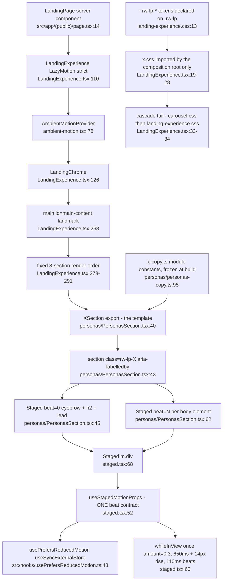
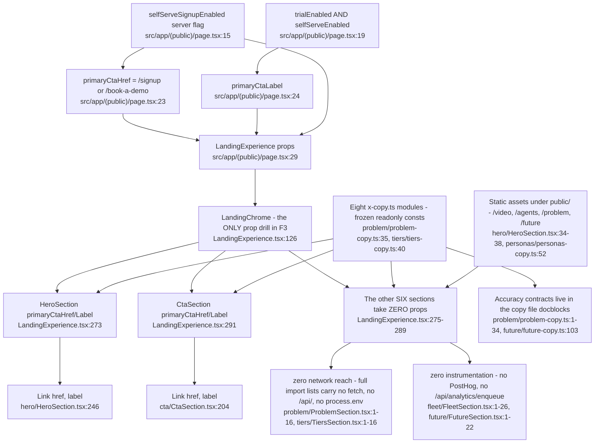
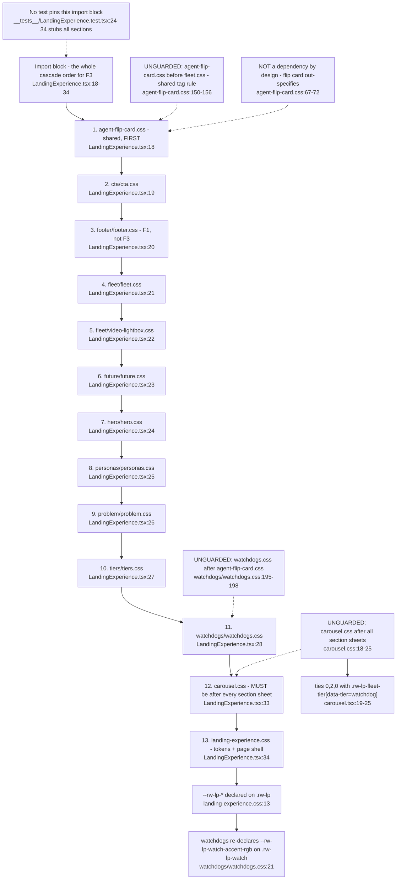

# F3 — Landing sections (bookends + carousel band + argument)

Window `72dc58ac..1d9b251c`. Merges `5d680643` #953, `ef9e9ac5` #959,
`a9d3309d` #968. **26 production files, 5,605 lines**, all under
`src/components/sections/landing/<section>/`.

Absorbs what discovery split as F3 (bookends: hero, cta), F4 (carousel band:
fleet, personas, watchdogs, future) and F5 (argument: problem, tiers). The
`footer/` folder in the same tier is **F1**, not this feature.

Traced at HEAD. Every node cites `file:line`.

## Purpose

Eight narrative sections composed in a fixed order by one client composition
root. Each section is a self-contained folder that renders module-constant copy
through shared motion primitives; none reads a datastore, calls an API, or emits
an analytics event. The only values that cross the boundary into F3 are two
server-resolved strings threaded to the two bookends.

---

## 1. The shared shape — one template, seven wearers

Seven of the nine section folders are exactly three files:
`XSection.tsx` + `x-copy.ts` + `x.css`. `personas/` is the purest instance and
is cited below as the canonical wearer. `fleet/` is the one folder with more
than three files.

**18 nodes.** The template holds for `problem/`, `personas/`, `watchdogs/`,
`future/`, `tiers/`, `hero/`, `cta/` at the file level; `hero/` and `cta/`
deviate at the *motion* level (section 2).

---

## 2. The deviations — what each section does that the template does not

```mermaid
flowchart TD
  ROOTSLOT["LandingChrome section order<br/>LandingExperience.tsx:273-291"]

  subgraph SHARED["Shared primitives (F2) — targets, not owned here"]
    SSTAGED["Staged / StagedLine<br/>staged.tsx:68, :81"]
    SCAR["useCarousel<br/>carousel.tsx:116"]
    SDOTS["CarouselDots<br/>carousel.tsx:193"]
    SAMB["AmbientVideo autoplay+loop+muted baked in<br/>ambient-motion.tsx:100"]
    SFLIP["AgentFlipCard<br/>agent-flip-card.tsx:129"]
    SPRM["usePrefersReducedMotion<br/>src/hooks/usePrefersReducedMotion.ts:43"]
    SMQ["useMediaQuery<br/>src/hooks/useMediaQuery.ts:26"]
  end

  subgraph HERO["hero/ — DEVIATION: private arrival, no Staged"]
    H0["HeroSection<br/>hero/HeroSection.tsx:216"]
    H1["useHeroEntrance - PRIVATE Staged variant<br/>hero/HeroSection.tsx:204"]
    H2["delay 0.15 + step*0.11 ON LOAD, not whileInView<br/>hero/HeroSection.tsx:212"]
    H3["HeroBackdrop<br/>hero/HeroSection.tsx:82"]
    H4["useHasMounted SSR gate - private copy #1<br/>hero/HeroSection.tsx:57"]
    H5["useScroll push-in 1 -> 1.045 on exit<br/>hero/HeroSection.tsx:102"]
    H6["AmbientVideo hero backdrop, preload=auto<br/>hero/HeroSection.tsx:133"]
    H7["BrokenLines - private copy #1<br/>hero/HeroSection.tsx:157"]
    H8["ArrowGlyph - private copy #1<br/>hero/HeroSection.tsx:171"]
    H0 --> H1 --> H2
    H0 --> H3 --> H4
    H3 --> H5
    H3 --> H6
    H0 --> H7
    H0 --> H8
  end

  subgraph CTA["cta/ — DEVIATION: no Staged at all, mirrored bookend"]
    C0["CtaSection - NO Staged, NO carousel<br/>cta/CtaSection.tsx:180"]
    C1["CtaBackdrop<br/>cta/CtaSection.tsx:81"]
    C2["useHasMounted - private copy #2<br/>cta/CtaSection.tsx:70"]
    C3["useScroll settle 1.045 -> 1 on arrival<br/>cta/CtaSection.tsx:97"]
    C4["AmbientVideo cta backdrop, preload=metadata<br/>cta/CtaSection.tsx:117"]
    C5["BrokenLines - private copy #2<br/>cta/CtaSection.tsx:138"]
    C6["ArrowGlyph - private copy #2<br/>cta/CtaSection.tsx:151"]
    C7["self-declared near-copy of HeroBackdrop<br/>cta/CtaSection.tsx:39-46"]
    C0 --> C1 --> C2
    C1 --> C3
    C1 --> C4
    C0 --> C5
    C0 --> C6
    C1 -.-> C7
  end

  subgraph PROB["problem/ — NEW in window. DEVIATION: only non-bookend AmbientVideo"]
    P0["ProblemSection<br/>problem/ProblemSection.tsx:46"]
    P1["usePrefersReducedMotion read at RENDER, no mount gate<br/>problem/ProblemSection.tsx:47"]
    P2["Staged beats 0,3..4 + StagedLine beats 1,2,5,6<br/>problem/ProblemSection.tsx:53"]
    P3["reduced -> next/image still<br/>problem/ProblemSection.tsx:87"]
    P4["default -> AmbientVideo diagram, preload=none<br/>problem/ProblemSection.tsx:95"]
    P5["m.span pivot rule scaleX 0 -> 1 whileInView<br/>problem/ProblemSection.tsx:108"]
    P6["figure slot Staged beat=2 collides with heading beat=2<br/>problem/ProblemSection.tsx:84"]
    P0 --> P1
    P1 -->|true| P3
    P1 -->|false| P4
    P0 --> P2
    P0 --> P5
    P0 --> P6
  end

  subgraph FLEET["fleet/ — DEVIATION: 5 files, +VideoLightbox.tsx +video-lightbox.css"]
    F0["FleetSection<br/>fleet/FleetSection.tsx:415"]
    F1["useInView once amount=0.2 - ONE arming signal<br/>fleet/FleetSection.tsx:425"]
    F2["useMediaQuery min-width 901px - constellation gate<br/>fleet/FleetSection.tsx:431"]
    F3["useConnectorPaths ResizeObserver + getBoundingClientRect<br/>fleet/FleetSection.tsx:118"]
    F4["FleetWires m.path pathLength draw-in<br/>fleet/FleetSection.tsx:305"]
    F5["FleetTier x2 - watchdog then persona<br/>fleet/FleetSection.tsx:241"]
    F6["useCarousel per tier - TWO tracks in one section<br/>fleet/FleetSection.tsx:260"]
    F7["AgentCard m.article, measured node<br/>fleet/FleetSection.tsx:195"]
    F8["armedFadeProps - OPACITY ONLY, transforms banned<br/>fleet/FleetSection.tsx:99"]
    F9["FleetCentre play button<br/>fleet/FleetSection.tsx:365"]
    F10["VideoLightbox - 4th file, section-private<br/>fleet/VideoLightbox.tsx:34"]
    F11["native dialog showModal driven from effect<br/>fleet/VideoLightbox.tsx:41"]
    F12["narrated 25MB video, NO caption track<br/>fleet/VideoLightbox.tsx:96"]
    F13["video-lightbox.css - 5th file<br/>LandingExperience.tsx:22"]
    F0 --> F1
    F0 --> F2 --> F3 --> F4
    F0 --> F5 --> F6
    F5 --> F7 --> F8
    F0 --> F9 --> F10 --> F11
    F10 --> F12
    F10 -.-> F13
  end

  subgraph PERS["personas/ — the canonical 3-file wearer"]
    N0["PersonasSection<br/>personas/PersonasSection.tsx:40"]
    N1["useCarousel - one track<br/>personas/PersonasSection.tsx:41"]
    N2["AgentFlipCard x4, chipTone gold/teal by publishes<br/>personas/PersonasSection.tsx:63"]
    N3["avatarFor - id becomes /agents/ID.mp4 + .jpg<br/>personas/personas-copy.ts:52"]
    N4["CarouselDots gated on overflowing<br/>personas/PersonasSection.tsx:81"]
    N0 --> N1 --> N4
    N0 --> N2 --> N3
  end

  subgraph WD["watchdogs/ — 3-file wearer + one outbound link"]
    W0["WatchdogsSection<br/>watchdogs/WatchdogsSection.tsx:42"]
    W1["useCarousel - one track<br/>watchdogs/WatchdogsSection.tsx:43"]
    W2["AgentFlipCard x2, tier=watchdog teal<br/>watchdogs/WatchdogsSection.tsx:82"]
    W3["CarouselDots tone=teal - only teal caller<br/>watchdogs/WatchdogsSection.tsx:106"]
    W4["Link MARKETING_LINKS.howItWorks - only cross-page link in F3<br/>watchdogs/WatchdogsSection.tsx:115"]
    W5["beat=4 reused by footnote and tier label<br/>watchdogs/WatchdogsSection.tsx:68, :75"]
    W0 --> W1 --> W3
    W0 --> W2
    W0 --> W4
    W0 -.-> W5
  end

  subgraph FUT["future/ — 3-file wearer + the fixed-glow constraint"]
    U0["FutureSection<br/>future/FutureSection.tsx:90"]
    U1["useCarousel on the ul<br/>future/FutureSection.tsx:93"]
    U2["pointermove rAF-coalesced glow, ONE window listener<br/>future/FutureSection.tsx:119"]
    U3["Staged rise=0 - transform banned above a card<br/>future/FutureSection.tsx:178"]
    U4["FutureCard m.li, opacity only<br/>future/FutureSection.tsx:50"]
    U5["CarouselDots gold<br/>future/FutureSection.tsx:198"]
    U0 --> U1 --> U5
    U0 --> U2
    U0 --> U3
    U0 --> U4
  end

  subgraph TIER["tiers/ — NEW in window. DEVIATION: the only stateful control"]
    T0["TiersSection<br/>tiers/TiersSection.tsx:73"]
    T1["useState mode, default copilot<br/>tiers/TiersSection.tsx:77"]
    T2["POSITION map copilot 0.12 / autopilot 0.88<br/>tiers/TiersSection.tsx:51"]
    T3["pointAt semicircle geometry, viewBox 220x132<br/>tiers/TiersSection.tsx:62"]
    T4["useSpring needleAngle + useEffect set/jump<br/>tiers/TiersSection.tsx:92"]
    T5["useTransform tipX/tipY/tailX/tailY -> SVG attrs<br/>tiers/TiersSection.tsx:100"]
    T6["m.path gauge fill strokeDashoffset<br/>tiers/TiersSection.tsx:139"]
    T7["two aria-pressed buttons, gauge aria-hidden<br/>tiers/TiersSection.tsx:194"]
    T8["NO carousel, NO AmbientVideo, NO AgentFlipCard<br/>tiers/TiersSection.tsx:106"]
    T0 --> T1 --> T2 --> T4 --> T5
    T0 --> T3
    T1 --> T6
    T0 --> T7
    T0 -.-> T8
  end

  ROOTSLOT --> H0
  ROOTSLOT --> P0
  ROOTSLOT --> F0
  ROOTSLOT --> N0
  ROOTSLOT --> W0
  ROOTSLOT --> T0
  ROOTSLOT --> U0
  ROOTSLOT --> C0

  H6 --> SAMB
  C4 --> SAMB
  P4 --> SAMB
  P2 --> SSTAGED
  F5 --> SSTAGED
  F6 --> SCAR
  N1 --> SCAR
  W1 --> SCAR
  U1 --> SCAR
  T0 --> SSTAGED
  N4 --> SDOTS
  W3 --> SDOTS
  U5 --> SDOTS
  N2 --> SFLIP
  W2 --> SFLIP
  H1 --> SPRM
  P1 --> SPRM
  F2 --> SMQ
```

**72 nodes.**

### Primitive-usage table — §3 of `00-features.md` verified against source

| Section | `Staged` | `useCarousel` | `AmbientVideo` | `AgentFlipCard` | Verdict |
|---|---|---|---|---|---|
| hero | **no** — private variant `HeroSection.tsx:204`, delay at `:212` | — | ✓ `HeroSection.tsx:133` | — | matches |
| cta | **no** — no `Staged` import at all, `CtaSection.tsx:1-17` | — | ✓ `CtaSection.tsx:117` | — | matches |
| problem | ✓ import `ProblemSection.tsx:7`, first use `:53` | — | ✓ `ProblemSection.tsx:95` | — | matches |
| fleet | ✓ import `FleetSection.tsx:10`, use `:451` | ✓ `FleetSection.tsx:260` (**two** tracks) | — | via `fleet.css` only — no import | matches |
| personas | ✓ import `PersonasSection.tsx:5`, use `:45` | ✓ `PersonasSection.tsx:41` | — | ✓ `PersonasSection.tsx:63` | matches |
| watchdogs | ✓ import `WatchdogsSection.tsx:7`, use `:47` | ✓ `WatchdogsSection.tsx:43` | — | ✓ `WatchdogsSection.tsx:82` | matches |
| future | ✓ import `FutureSection.tsx:8`, use `:153` | ✓ `FutureSection.tsx:93` | — | — | matches |
| tiers | ✓ import `TiersSection.tsx:6`, use `:108` | — | — | — | matches |

The §3 table is **confirmed correct** on all four columns. Two refinements it
did not state:

- `fleet/` calls `useCarousel` **twice per render** — once per `FleetTier`
  instance (`FleetSection.tsx:260`, instantiated at `:472` and `:491`). It is
  five tracks across four sections, not four.
- `fleet/`'s `AgentFlipCard` entry is styling-only. `FleetSection.tsx` never
  imports the component; `agent-flip-card.css:154-156` groups
  `.rw-lp-flip-tag, .rw-lp-fleet-tag` as one owner for both wearers.

### Deviation register, by file:line

| # | Deviation | Where | Notes |
|---|---|---|---|
| D1 | 4th + 5th files in a 3-file pattern | `fleet/VideoLightbox.tsx:34` + `fleet/video-lightbox.css` imported at `LandingExperience.tsx:22` | The only section-private component in F3 |
| D2 | Private arrival variant instead of `Staged` | `hero/HeroSection.tsx:204`, cadence at `:212` | Trigger differs: on load vs `whileInView` (`staged.tsx:60`) |
| D3 | No arrival motion at all | `cta/CtaSection.tsx:180-216` | Only section with neither `Staged` nor a private variant |
| D4 | Only non-bookend `AmbientVideo` consumer | `problem/ProblemSection.tsx:95` | The other two are the full-bleed bookends |
| D5 | Two `useCarousel` instances in one section | `fleet/FleetSection.tsx:260` via `:472` and `:491` | Watchdog rail often does not overflow — dots absent by design (`:291`) |
| D6 | `rise={0}` transform ban | `future/FutureSection.tsx:178`, contract at `staged.tsx:60` | `background-attachment: fixed` glow breaks under a transformed ancestor |
| D7 | Opacity-only fade contract, separate from `Staged` | `fleet/FleetSection.tsx:99` | Measured nodes cannot carry an entrance transform |
| D8 | Only stateful, operable illustration | `tiers/TiersSection.tsx:77`, buttons at `:194` | `aria-pressed` pair, not a slider; changes nothing but the page |
| D9 | Only outbound cross-page link | `watchdogs/WatchdogsSection.tsx:115` | `MARKETING_LINKS.howItWorks` |
| D10 | `CarouselDots tone="teal"` — sole caller | `watchdogs/WatchdogsSection.tsx:106`, default at `carousel.tsx:193` | Every other call takes the gold default |
| D11 | Beat-index collisions | `problem/ProblemSection.tsx:67` and `:84` both `beat={2}`; `watchdogs/WatchdogsSection.tsx:68` and `:75` both `beat={4}` | Cosmetic, not a fault — noted so a future beat renumber does not read them as intentional |

---

## 3. Data flow — where section copy comes from

**16 nodes.** Findings:

- **Server-authoritative surface is exactly two strings and one boolean.**
  `primaryCtaHref` / `primaryCtaLabel` reach only `hero/` and `cta/`;
  `selfServeEnabled` never leaves `LandingChrome`. Invariant #13 holds — there is
  no `NEXT_PUBLIC_*` companion anywhere in F3.
- **Six of eight sections take no props.** All their content is module-constant.
- **Zero network reach.** `rg` for `fetch(`, `/api/`, `posthog`, `analytics`,
  `process.env` over `src/components/sections/landing/` returns nothing. No
  section is a client of any route, and no landing interaction (the tiers dial,
  the carousel dots, the lightbox open) is instrumented.
- Copy files also carry the *accuracy contracts* — the problem section's
  no-capability-claim rule (`problem/problem-copy.ts:1-34`), the future
  section's `Planned` tag rule (`future/future-copy.ts:103`), the personas
  publish-scope vocabulary (`personas/personas-copy.ts:23`). Those are prose,
  enforced by nothing.

---

## 4. CSS — where it lives and how it enters the cascade

Every section stylesheet is imported **exactly once**, by the composition root.
No section component imports its own CSS; no F3 stylesheet is referenced from
`globals.css` or `src/app/(public)/_styles/`.

**22 nodes.** Findings:

- The `00-features.md` §3 register lists two unguarded order dependencies inside
  F3's blast radius. **There is a third**: `agent-flip-card.css:150-156` groups
  `.rw-lp-flip-tag, .rw-lp-fleet-tag` and states in its own comment that it
  "loads before fleet.css, so the grouped rule reaches both; fleet.css
  deliberately declares no copy". Move `agent-flip-card.css` below
  `fleet.css` and the fleet's `Next` tag loses its styling entirely. That
  dependency appears in neither the arch log nor `00-features.md` §3.
- Nothing pins the block. `LandingExperience.test.tsx` mocks all eight sections
  (`:24-34`), so the suite that renders the composition root never exercises a
  single section stylesheet. `design-scope-purity.test.ts:39-45` pins the four
  **Island** sheets in `globals.css` — that guard does not extend here.

---

## Side effects

F3 has no server, database, queue or network side effects. Its side effects are
all browser-local:

| Effect | Owner | Cleanup |
|---|---|---|
| `ResizeObserver` on the fleet stage, media card and every agent node | `fleet/FleetSection.tsx:175-179` | `observer.disconnect()` + `removeEventListener` at `:182-185` |
| `window resize` listener (fleet connectors) | `fleet/FleetSection.tsx:181` | `:184` |
| `window pointermove` listener, rAF-coalesced, writes 3 custom properties | `future/FutureSection.tsx:141` | `:142-145`, incl. `cancelAnimationFrame` |
| Imperative `dialog.showModal()` / `dialog.close()` | `fleet/VideoLightbox.tsx:44-45` | driven by `open` prop; `<video>` unmounted at `:73` |
| `video.play()` / `video.pause()` on the ambient clips | `ambient-motion.tsx:104-119` (F2, called from `hero:133`, `cta:117`, `problem:95`) | rejection swallowed at `:118` |
| Inline CSS custom-property writes on the section element | `future/FutureSection.tsx:130-132` | none needed — element-scoped |
| `motion` springs holding a live value across renders | `tiers/TiersSection.tsx:92`, `:100-103` | motion-owned |
| Scroll-linked `useScroll` subscriptions on the two bookends | `hero/HeroSection.tsx:102`, `cta/CtaSection.tsx:97` | motion-owned |
| `track.scrollTo` on dot press | `carousel.tsx:163` (F2) via `personas:83`, `watchdogs:104`, `future:200`, `fleet:288` | n/a |

No F3 file writes `localStorage`, a cookie, or `document.title`.

## External dependencies

| Dependency | Kind | Entered at |
|---|---|---|
| `motion/react` — `m`, `useScroll`, `useTransform`, `useSpring`, `useInView` | npm | `hero/HeroSection.tsx:5`, `cta/CtaSection.tsx:5`, `problem/ProblemSection.tsx:4`, `fleet/FleetSection.tsx:4`, `future/FutureSection.tsx:4`, `tiers/TiersSection.tsx:3` |
| `next/image` | framework | `hero/HeroSection.tsx:3`, `cta/CtaSection.tsx:3`, `problem/ProblemSection.tsx:3`, `fleet/FleetSection.tsx:3`, `future/FutureSection.tsx:3` |
| `next/link` | framework | `hero/HeroSection.tsx:4`, `cta/CtaSection.tsx:4`, `watchdogs/WatchdogsSection.tsx:3` |
| `react` — `useSyncExternalStore`, `useId`, `useRef`, `useState`, `useEffect`, `useCallback` | framework | `hero/HeroSection.tsx:6`, `cta/CtaSection.tsx:6`, `fleet/FleetSection.tsx:5`, `fleet/VideoLightbox.tsx:3`, `tiers/TiersSection.tsx:4`, `future/FutureSection.tsx:5` |
| `@/hooks/usePrefersReducedMotion` | in-repo | 6 of 8 sections; not `personas/`, not `watchdogs/` |
| `@/hooks/useMediaQuery` | in-repo | `hero/HeroSection.tsx:7`, `cta/CtaSection.tsx:7`, `fleet/FleetSection.tsx:7` |
| `@/components/ui/marketing-links` | in-repo (shared with F6/F7 navs) | `watchdogs/WatchdogsSection.tsx:4` |
| F2 primitives — `staged`, `carousel`, `ambient-motion`, `agent-flip-card` | in-repo | see the deviation diagram |
| Browser platform — `ResizeObserver`, `<dialog>.showModal`, `matchMedia`, `requestAnimationFrame`, CSS scroll-snap | runtime | `fleet/FleetSection.tsx:173`, `fleet/VideoLightbox.tsx:44`, `usePrefersReducedMotion.ts:11`, `future/FutureSection.tsx:138`, `carousel.css:27` |
| Static assets under `public/` — `/video/*`, `/agents/*.mp4|.jpg`, `/problem/problem-diagram.mp4|.jpg`, `/future/off-crt.jpg` | deploy artefact | `hero/HeroSection.tsx:34-38`, `cta/CtaSection.tsx:54-58`, `problem/ProblemSection.tsx:43-44`, `future/FutureSection.tsx:75`, `personas/personas-copy.ts:52`, `watchdogs/WatchdogsSection.tsx:90-91` |

**Zero** dependency on `@/lib/**`, on any API route, on Supabase, on the worker,
or on any feature flag read inside F3.

---

## Defects

### DEF-1 — `problem/` reintroduces the SSR video-download bug the bookends were built to avoid. **Reachable.**

`ProblemSection` branches its figure on `usePrefersReducedMotion()` read
directly at render (`problem/ProblemSection.tsx:47`, branch at `:86-102`). That
hook's server snapshot is hard-coded `false`
(`src/hooks/usePrefersReducedMotion.ts:23-25`), so the server always emits the
`<AmbientVideo>` branch — an `autoPlay loop muted` `<video>`
(`ambient-motion.tsx:122-132`) — including for a reduced-motion visitor. It is
replaced by the still only after hydration re-reads the client snapshot.

Both bookends solved exactly this, with a comment naming the failure:
`hero/HeroSection.tsx:48-59` ("Without it the server would render the wide video
for everyone, including reduced-motion users, who would then download it before
hydration could take it away"), mount gate used at `:83` and `:110-115`;
`cta/CtaSection.tsx:67-72`, used at `:82` and `:103-104`. `useHasMounted` exists
in exactly two files — verified by `rg` — and `problem/` is not one of them.

**Is it wrong?** Yes. `preload="none"` does not save it: `autoplay` starts the
load regardless, and the element is live in the parsed HTML before React runs.

**Is it reachable?** Yes, and the reachability is unconditional on the server
side. `src/app/(public)/page.tsx:6` sets `dynamic = 'force-dynamic'`, so the
page is server-rendered on every request; `LandingExperience.tsx:275` renders
`<ProblemSection />` with no gate. The only condition is the visitor's OS
setting. Impact is bounded — a wasted fetch and a brief pre-hydration frame of
motion for reduced-motion visitors — but it is a live behaviour, not latent.

### DEF-2 — the narrated film has no captions. **Reachable.**

`fleet/VideoLightbox.tsx:96-104` mounts a `controls autoPlay` `<video>` with no
`<track kind="captions">`. The file's own comment at `:91-95` records this as a
known gap. Reachability: `LandingExperience.tsx:277-281` passes a real
`videoSrc` **and** `videoPoster`, so `FleetSection.tsx:386` renders the play
button and `:518` mounts the lightbox — no flag, no condition. A narrated
2m26s film on the public landing page with no captions is a WCAG 1.2.2 (Level A)
failure. Self-documented, so this is a *tracking* finding rather than a
discovery.

### DEF-3 — a test comment asserts coverage that does not exist. **Not reachable (documentation).**

`__tests__/LandingExperience.test.tsx:8-9` says the eight sections are stubbed
because "each is covered by its own suite". Measured: the only per-section suite
in the folder is `__tests__/FleetSection.test.tsx`. `hero/`, `cta/`, `problem/`,
`personas/`, `watchdogs/`, `future/`, `tiers/` have none — including both
sections that are **new in this window**. The comment is the reason the stubs
look safe, and it is false for 7 of 8.

---

## Sources consulted

| Path | Lines read |
|---|---|
| `src/app/(public)/page.tsx` | 1-35 (full) |
| `src/components/sections/landing/LandingExperience.tsx` | 1-297 (full) |
| `src/components/sections/landing/hero/HeroSection.tsx` | 1-259 (full) |
| `src/components/sections/landing/cta/CtaSection.tsx` | 1-216 (full) |
| `src/components/sections/landing/problem/ProblemSection.tsx` | 1-128 (full) |
| `src/components/sections/landing/problem/problem-copy.ts` | 1-34, exports 35-50 |
| `src/components/sections/landing/tiers/TiersSection.tsx` | 1-219 (full) |
| `src/components/sections/landing/tiers/tiers-copy.ts` | exports 22-57 |
| `src/components/sections/landing/fleet/FleetSection.tsx` | 1-529 (full) |
| `src/components/sections/landing/fleet/VideoLightbox.tsx` | 1-109 (full) |
| `src/components/sections/landing/fleet/fleet.css` | 211, 274, 282, 351, 654 (flip-card refs) |
| `src/components/sections/landing/personas/PersonasSection.tsx` | 1-91 (full) |
| `src/components/sections/landing/personas/personas-copy.ts` | exports 23-105 |
| `src/components/sections/landing/watchdogs/WatchdogsSection.tsx` | 1-126 (full) |
| `src/components/sections/landing/watchdogs/watchdogs.css` | 14-21, 190-205 |
| `src/components/sections/landing/future/FutureSection.tsx` | 1-210 (full) |
| `src/components/sections/landing/future/future-copy.ts` | exports 48-113 |
| `src/components/sections/landing/staged.tsx` | 1-87 (full) |
| `src/components/sections/landing/carousel.tsx` | 1-210 (full) |
| `src/components/sections/landing/carousel.css` | 1-40 |
| `src/components/sections/landing/ambient-motion.tsx` | 1-180 (full) |
| `src/components/sections/landing/agent-flip-card.css` | 60-80, 140-175 |
| `src/components/sections/landing/landing-experience.css` | 4-55 (token block + comments) |
| `src/components/sections/landing/fleet/video-lightbox.css` | 1-12 |
| `src/components/sections/landing/__tests__/LandingExperience.test.tsx` | 1-117 (full) |
| `src/hooks/usePrefersReducedMotion.ts` | 1-45 (full) |
| `src/hooks/useMediaQuery.ts` | 1-44 |
| `src/__tests__/focus-visible-marketing.test.ts` | 80, 84 |
| `src/components/ui/marketing-links.ts` | 5-33 |
| `docs/reviews/PATHFINDER-2026-08-26/SCOPE.md` | 1-239 (full) |
| `docs/reviews/PATHFINDER-2026-08-26/00-features.md` | 1-154 (full) |

Commands: `git log --oneline 72dc58ac..1d9b251c -- src/components/sections/landing/`
(4 merges: #968, #959, #955, #953); `rg` sweeps for `fetch(`, `/api/`,
`posthog`, `analytics`, `process.env`, `useHasMounted`, `useSyncExternalStore`,
`rw-lp-carousel` over `src/components/sections/landing/`.

**Total nodes across the four diagrams: 128** (18 + 72 + 16 + 22). Every node
carries `file:line`.
