# F6 — Island design system: chrome, tokens and arrival motion

Window `72dc58ac..1d9b251c`. Merges `145c3329` (#976, chrome + `useReveal`
consolidation) and `13a11e4d` (#970 (f), auth-island token de-duplication).
14 files / 2,990 lines.

## Purpose

F6 is the shared layer beneath F7's three Daylight pages. It owns three
distinct things that happen to ship together:

1. **Chrome composition** — one component (`SiteShell`) that assembles the
   marquee atmosphere, the bone island, the sticky nav pill, the `<main>`
   landmark and the footer, so a marketing page supplies only a scope class
   and its content.
2. **Token flow** — `globals.css` is the sole declaration site for the Island
   palette and the brand fonts; four page stylesheets consume them through a
   load order that is the cascade. This is the **one mechanically guarded CSS
   order dependency in the repo**.
3. **Arrival motion** — one IntersectionObserver hook (`useReveal`) and one
   CSS primitive (`.rw-dl-rv`) with a four-layer fallback stack, consumed
   either through the `Reveal` wrapper or directly by the twelve `Feat*`
   chapter components.

The boundary: F6 is everything under `src/components/ui/`, `src/hooks/` and
`src/app/(public)/_styles/island.css` that the three Daylight pages share.
The per-page deltas (`features.css`, `how-it-works.css`, `pricing.css` bodies
and the page components) are F7. `SiteNav`, `marketing-links.ts`,
`PageShell.tsx` and the two guard tests are seam owners — unchanged in this
window, charted because F6's contract terminates on them.

## Diagram

```mermaid
flowchart TD

  %% ─────────────── 1. CHROME COMPOSITION ───────────────
  subgraph CHROME["1 · Chrome composition"]
    LAYOUT["PublicLayout skip link<br/>src/app/(public)/layout.tsx:18"]

    F7FEAT["FeaturesContent<br/>src/components/sections/features/FeaturesContent.tsx:348"]
    F7HIW["HowItWorksContent<br/>src/components/sections/how-it-works/HowItWorksContent.tsx:192"]
    F7PRICE["PricingContent<br/>src/app/(public)/pricing/PricingContent.tsx:595"]

    SHELL["SiteShell scope+overlay props<br/>src/components/ui/SiteShell.tsx:34"]
    MARQ["MarqueeBackground decorative<br/>src/components/ui/MarqueeBackground.tsx:41"]
    OVERLAY["overlay slot dot-nav<br/>src/components/ui/SiteShell.tsx:45"]
    WRAP["div.rw-island-wrap / div.rw-island<br/>src/components/ui/SiteShell.tsx:46"]
    OCCL["div.rw-nav-occluder aria-hidden ADDED #976<br/>src/components/ui/SiteShell.tsx:54"]
    NAV["SiteNav sticky pill seam owner<br/>src/components/ui/SiteNav.tsx:47"]
    MAIN["main#main-content single landmark<br/>src/components/ui/SiteShell.tsx:59"]
    FOOT["SiteFooter rw-foot rw-foot-dl<br/>src/components/ui/SiteFooter.tsx:38"]

    LINKS["MARKETING_LINKS single owner<br/>src/components/ui/marketing-links.ts:5"]
    NAVLINKS["NAV_LINKS header order<br/>src/components/ui/marketing-links.ts:15"]
    LEGALLINKS["LEGAL_LINKS + COMPANY_LINKS<br/>src/components/ui/marketing-links.ts:23"]

    DIRECT["Direct-chrome islands legal/security/help/demo<br/>src/components/legal/LegalPage.tsx:170"]
    PAGESHELL["PageShell unrelated Tailwind island<br/>src/components/ui/PageShell.tsx:19"]

    WASH["HeroWash client canplay + visibilitychange<br/>src/components/ui/HeroWash.tsx:22"]
    WASHHOST["hero .rw-dl-wash-host -92px contract<br/>src/components/sections/features/FeaturesContent.tsx:105"]
    WASHCSS["z-stack occluder 1 wash 2 scrim 2 content 3 pill 50<br/>src/app/(public)/_styles/island.css:1619"]
    PRM["usePrefersReducedMotion useSyncExternalStore<br/>src/hooks/usePrefersReducedMotion.ts:43"]
  end

  LAYOUT --> F7FEAT
  LAYOUT --> F7HIW
  LAYOUT --> F7PRICE
  F7FEAT --> SHELL
  F7HIW --> SHELL
  F7PRICE --> SHELL
  SHELL --> MARQ
  SHELL --> OVERLAY
  SHELL --> WRAP
  WRAP --> OCCL
  WRAP --> NAV
  WRAP --> MAIN
  WRAP --> FOOT
  NAV --> NAVLINKS
  FOOT --> LINKS
  FOOT --> LEGALLINKS
  NAVLINKS --> LINKS
  DIRECT --> NAV
  DIRECT --> FOOT
  MARQ --> PRM
  WASH --> PRM
  F7FEAT --> WASHHOST
  F7HIW --> WASHHOST
  F7PRICE --> WASHHOST
  WASHHOST --> WASH
  WASH --> WASHCSS
  OCCL -. "occluder must stay under wash" .-> WASHCSS
  PAGESHELL -. "NOT this shell — separate island" .-> SHELL

  %% ─────────────── 2. TOKEN FLOW ───────────────
  subgraph TOKENS["2 · Token flow — one declaration site"]
    TWIND["@import tailwindcss<br/>src/app/globals.css:1"]
    CTHEME["@import Console @theme file<br/>src/app/globals.css:2"]
    ITHEME["@theme inline Island utilities only<br/>src/app/globals.css:21"]
    IROOT[":root Island palette + brand fonts SOLE OWNER<br/>src/app/globals.css:86"]
    FONTS["--rw-font-display/body/serif/mono<br/>src/app/globals.css:156"]
    IMPORTS["four @imports — the cascade<br/>src/app/globals.css:186"]

    CSSISLAND["island.css shared chrome + .rw-dl-* primitives<br/>src/app/(public)/_styles/island.css:1"]
    CSSFEAT["features.css page delta<br/>src/app/(public)/_styles/features.css:1"]
    CSSHIW["how-it-works.css page delta<br/>src/app/(public)/_styles/how-it-works.css:1"]
    CSSPRICE["pricing.css page delta<br/>src/app/(public)/_styles/pricing.css:1"]
    LOCAL["--rw-marquee-speed allowlisted local<br/>src/app/(public)/_styles/island.css:117"]

    CONSOLETOK["Console tokens.css .rw-console scope<br/>src/app/(authenticated)/_styles/tokens.css:237"]
    AUTHCSS["auth-island.css consumer only since #970<br/>src/components/auth/auth-island/auth-island.css:12"]
    LANDCSS["Landing CSS --rw-lp-* namespace only<br/>src/components/sections/landing/landing-experience.css:1"]

    GUARDORDER["design-scope-purity ISLAND_PAGE_IMPORTS<br/>src/__tests__/design-scope-purity.test.ts:40"]
    GUARDORDER2["order + after-:root + not-from-layout<br/>src/__tests__/design-scope-purity.test.ts:152"]
    GUARDPAGE["page CSS declares no --rw-* + 4-file census<br/>src/__tests__/design-scope-purity.test.ts:122"]
    GUARDLAND["Landing declares only --rw-lp-*<br/>src/__tests__/design-scope-purity.test.ts:56"]
    GUARDAUTH["walks src/components/auth dynamically #970<br/>src/__tests__/design-token-single-source.test.ts:351"]
    GUARDTOK["Console must not re-declare Island names<br/>src/__tests__/design-token-single-source.test.ts:117"]
  end

  TWIND --> ITHEME
  CTHEME --> ITHEME
  ITHEME --> IROOT
  IROOT --> FONTS
  IROOT --> IMPORTS
  IMPORTS --> CSSISLAND
  CSSISLAND --> CSSFEAT
  CSSFEAT --> CSSHIW
  CSSHIW --> CSSPRICE
  CSSISLAND --> LOCAL
  IROOT --> AUTHCSS
  IROOT --> CONSOLETOK
  IROOT --> LANDCSS
  GUARDORDER --> IMPORTS
  GUARDORDER2 --> IMPORTS
  GUARDPAGE --> CSSISLAND
  GUARDPAGE --> LOCAL
  GUARDLAND --> LANDCSS
  GUARDAUTH --> AUTHCSS
  GUARDTOK --> CONSOLETOK
  CSSISLAND -. "consumes var(--rw-*)" .-> IROOT

  %% ─────────────── 3. ARRIVAL MOTION ───────────────
  subgraph MOTION["3 · Arrival motion — one trigger since #976"]
    DELETED["DELETED by #976 — features hook 0.08 / -80px<br/>72dc58ac:src/components/sections/features/useReveal.ts:26"]
    OLDREVEAL["REWRITTEN by #976 — inline observer 0.05 / -50px, no PRM<br/>72dc58ac:src/components/ui/Reveal.tsx:24"]
    HOOK["useReveal THE ONE trigger<br/>src/hooks/useReveal.ts:24"]
    THRESH["REVEAL_THRESHOLD 0.08 + rootMargin -80px<br/>src/hooks/useReveal.ts:20"]
    PRMBRANCH["reduced-motion: skip IO, setSeen next tick, delay ignored<br/>src/hooks/useReveal.ts:38"]
    ONSCREEN["already-on-screen-at-mount short circuit<br/>src/hooks/useReveal.ts:48"]
    IO["IntersectionObserver + delay timer<br/>src/hooks/useReveal.ts:55"]

    REVEALC["Reveal wrapper owns .rw-dl-rv + is-scrub<br/>src/components/ui/Reveal.tsx:12"]
    DIRECT12["12 Feat* callers apply rw-dl-rv themselves<br/>src/components/sections/features/FeatIntro.tsx:35"]

    L0["Layer 0 no-JS: opacity:0 inside @media scripting:enabled<br/>src/app/(public)/_styles/island.css:1733"]
    L1["Layer 1 one-shot .is-in 0.6s/0.7s ease 0.22,0.61,0.36,1<br/>src/app/(public)/_styles/island.css:1730"]
    L2["Layer 2 .is-scrub animation-timeline view() cover 12%<br/>src/app/(public)/_styles/island.css:1754"]
    L3["Layer 3 reduce: final frame, kills loops<br/>src/app/(public)/_styles/island.css:1788"]
    F7SCRUB["F7 opt-ins: 2 Reveal scrub + features.css chapter artifacts<br/>src/app/(public)/_styles/features.css:689"]
  end

  DELETED -. "#976 consolidation" .-> HOOK
  OLDREVEAL -. "#976 consolidation" .-> HOOK
  HOOK --> THRESH
  HOOK --> PRMBRANCH
  HOOK --> ONSCREEN
  HOOK --> IO
  PRMBRANCH --> PRM
  REVEALC --> HOOK
  DIRECT12 --> HOOK
  REVEALC --> L1
  DIRECT12 --> L1
  L1 --> L0
  L1 --> L2
  L2 --> L3
  L1 --> L3
  REVEALC --> L2
  F7SCRUB --> L2
  IMPORTS --> L1

  %% ─────────────── 4. CROSS-SYSTEM (Landing = F1/F2) ───────────────
  subgraph LANDING["4 · Landing system (F1/F2) — separate arrival grammar"]
    STAGED["Staged whileInView amount 0.3, 110ms beats<br/>src/components/sections/landing/staged.tsx:68"]
    STEASE["EASE 0.22,0.61,0.36,1 — same curve, JS spelling<br/>src/components/sections/landing/staged.tsx:45"]
    PROBEASE["EASE 0.22,0.61,0.36,1 — second JS copy<br/>src/components/sections/landing/problem/ProblemSection.tsx:41"]
    DEADREVEAL["landing reveal.tsx — 0 importers, DEAD<br/>src/components/sections/landing/reveal.tsx:48"]
  end

  STAGED --> STEASE
  STAGED --> PRM
  DEADREVEAL --> PRM
  STEASE -. "same 4 numbers, 29 CSS literals in Island" .-> L1
  PROBEASE -. "duplicate of staged EASE" .-> STEASE
  DEADREVEAL -. "name collision with ui/Reveal.tsx" .-> REVEALC
```

**Node count: 59** — 21 chrome, 20 token-flow, 14 motion, 4 cross-system.

## Token ownership

**One declaration site, three consumer scopes.**

| Concern | Declared at | Consumed by | Guard |
|---|---|---|---|
| Island palette (23 colour tokens) | `src/app/globals.css:86-155` (`:root`) | `(public)/_styles/*.css`, `auth-island.css`, Landing (`var()` only), Console by fall-through | `design-token-single-source.test.ts:113` (globals owns) + `:117` (Console must not re-declare) + `:351` (auth dir must not re-declare) |
| Brand fonts (4) | `src/app/globals.css:156-159` | same | `design-token-single-source.test.ts:140/148/351` |
| Tailwind utility export | `src/app/globals.css:21` (`@theme inline`) — emits `var(--rw-*)`, never a copied hex | `bg-rw-*`/`text-rw-*` classes | `design-scope-purity.test.ts:81-116` (Island entries only; names no Console token) |
| Console palette | `(authenticated)/_styles/tokens.css`, on `.rw-console`, never `:root` | Console only | `design-token-single-source.test.ts:177` (D4) |
| Landing palette | `sections/landing/**.css`, `--rw-lp-*` prefix only | Landing only | `design-scope-purity.test.ts:67` |
| Page-local knobs | `island.css:117` (`--rw-marquee-speed`), `pricing.css` (`--rw-vh-night`) | their own scope | closed allowlist `design-scope-purity.test.ts:51-54` |

**Verified by measurement, not by comment:** a repo-wide scan for a
line-start declaration of any of the 14 headline Island colour/font tokens
returns **exactly one file** — `src/app/globals.css` — plus the single
sanctioned scoped override `--rw-font-mono` at
`src/app/(authenticated)/_styles/console.css:22`, which
`design-token-single-source.test.ts:157` pins by name. `auth-island.css`
declares **zero** `--rw-*` today.

**#970 (f) is genuinely closed.** The prior pass's finding — auth-island.css
redeclaring the Island palette outside every watched directory *with the fonts
already diverged* — is fixed at both halves: the ten declarations were deleted
(`13a11e4d`, `auth-island.css` now opens `.rw-auth` at line 12 consuming
`var(--rw-font-body)` / `var(--rw-sage)` / `var(--rw-ink)`), and
`design-token-single-source.test.ts:31` added `AUTH_DIR` with a **dynamic walk**
(`cssFilesUnder`) plus a non-empty census assertion at `:345`, so a new CSS file
in that tree is covered the day it lands. Note the shape of what drifted: the
*colours* still matched after months; the *fonts* had silently lost their named
fallbacks. That is the argument for the guard, and it held.

## What the guarded order pins

`src/app/globals.css:186-189` is the only CSS import order in this repo with a
mechanical guard. `src/__tests__/design-scope-purity.test.ts:39-45` declares
`ISLAND_PAGE_IMPORTS` as four byte-exact `@import` strings; the `describe` at
`:152` runs four assertions over them.

**It DOES guarantee:**

1. All four `@import` lines are **present** in `globals.css`, byte-for-byte,
   with comments stripped (`:156-159`). Dropping one fails.
2. Their positions are **strictly ascending** — island → features →
   how-it-works → pricing (`:160-165`, comparing the position array against a
   sorted copy of itself). Reordering two fails.
3. Each sits **after the first `:root {`** (`:168-178`). Hoisting the block
   above the token/`@theme` region fails. (The first `:root {` in the file is
   the Island token block at `:86`, so the anchor resolves correctly today.)
4. `src/app/layout.tsx` contains no `(public)/_styles` reference (`:180-194`) —
   the measured reason being that a `layout.tsx` import leaves the files outside
   the `@tailwindcss/postcss` Lightning CSS pass and silently drops 47
   `@supports (color: color-mix(…))` fallbacks.
5. Separately (`:122-150`): the directory holds **exactly four** `.css` files,
   and none of them declares a `--rw-*` token outside the two-entry allowlist.
   A fifth Island page sheet therefore cannot be added silently.

**It does NOT guarantee:**

- **That the four imports are last in the file.** `globals.css`'s own comment
  at `:179-182` says *"They sit at the BOTTOM, after `:root`"*, but the
  assertion only checks `> rootAt`. Any rule appended after line 189 would
  inline *after* ~2,400 lines of page CSS and win every equal-specificity tie,
  with the guard green. The file is 189 lines today, so nothing sits there —
  the gap is coverage, not a live break.
- **That no fifth stylesheet joins the block.** The census closes
  `(public)/_styles`, but an `@import` of a stylesheet from any *other*
  directory, inserted between or after the four, keeps the four ascending and
  passes.
- **The position of `@import 'tailwindcss'` (`:1`) or the Console `@theme`
  import (`:2`) relative to the four.** `design-scope-purity.test.ts:88-95`
  asserts the Console theme line *exists*, never where.
- **Anything about the Landing system's CSS import order.** The three unguarded
  order dependencies recorded in `00-features.md` §3 (`carousel.css` last,
  `watchdogs.css` after `agent-flip-card.css`, `how-it-works.css` intra-file)
  are `import` statements in `LandingExperience.tsx` and intra-file sequencing —
  a different mechanism entirely. This guard covers neither.
- **Intra-file ordering inside `island.css`.** `.rw-dl-rv.is-in` (island.css:1735)
  and `.rw-dl-rv.is-scrub` (:1756) tie at specificity 0,2,0 and are resolved by
  source order alone. Nothing pins that.

In short: the guard makes the **four-way sequence** and the **mechanism**
(CSS `@import`, not a JS import) tamper-evident. It does not make the
**cascade position of the block within the file** tamper-evident, which is the
half `globals.css`'s comment actually leans on.

## Side effects

- **DOM / landmarks.** `SiteShell` renders `<main id="main-content">`
  unconditionally as a sibling of header and footer, so each keeps its landmark
  role. `SiteShell.test.tsx:37` pins *exactly one* `<main>`. The three Daylight
  pages render no `<main>` of their own (verified), so the skip-link target in
  `(public)/layout.tsx:22` never dangles or doubles.
- **New DOM node from #976.** `.rw-nav-occluder` (`SiteShell.tsx:54`) is now
  emitted on every `SiteShell` page. It is `aria-hidden`, `pointer-events: none`,
  and `height: 92px` cancelled by `margin-bottom: -92px` — zero net flow height
  (`island.css:1090-1099`). It is a separate element *because* `position: sticky`
  makes the nav a stacking context. It participates in a four-way z-order
  contract with the wash: occluder 1 → wash 2 → scrim 2 → hero content 3 →
  nav pill 50 (`island.css:1615-1673`).
- **Media playback.** `HeroWash` calls `video.load()` and `video.play()` inside
  an effect, listens for `canplay` (`once`) and adds a **document-level**
  `visibilitychange` listener to replay a loop paused by a background tab
  (`HeroWash.tsx:44-46`). Both are removed on cleanup. Under reduced motion the
  `<video>` is not rendered at all (`:63`) and the effect returns before
  attaching anything (`:29`); the blurred poster `` is the fallback. CSS at
  `island.css:1712-1715` kills the drift keyframes as belt-and-braces.
- **Timers.** `useReveal` owns three exit paths that each schedule a
  `window.setTimeout` and clear it on cleanup (`useReveal.ts:39/50/59`). The
  observer is `disconnect()`ed on first intersection and again on unmount.
- **Caller `delay` is deliberately dropped under reduced motion**
  (`useReveal.ts:36-40`): *"a stagger the user asked not to see is just a wait."*
- **Hydration.** `SiteFooter.tsx:70` marks the copyright year
  `suppressHydrationWarning` — the only SSR/client divergence in the chrome.
- **No network, no DB, no flags.** F6 reads three booleans threaded from F7
  (`selfServeEnabled`, `comingSoon`, `trialEnabled`) and forwards them to
  `SiteNav`; it resolves none of them itself. Invariant #13 holds — no
  `NEXT_PUBLIC_*` companion anywhere in this feature.

## External dependencies

**Consumed by F6 (inbound):**

| Dependency | Where | Nature |
|---|---|---|
| `usePrefersReducedMotion` | `src/hooks/usePrefersReducedMotion.ts:43` | The one shared cross-system hook. `MarqueeBackground:42`, `HeroWash:23`, `useReveal:27` and Landing's `staged.tsx:53` / `reveal.tsx:49` all consume it. Correctly one owner. |
| `marketing-links.ts` | `src/components/ui/marketing-links.ts:5` | Seam owner, unchanged. `SiteNav:8`, `SiteFooter:4` and `LandingExperience` compose their own ordering from one label/href declaration. |
| `motion/react` (`m`, `LazyMotion`, `domAnimation`) | `src/components/ui/SiteNav.tsx:7` | Only the nav's mobile disclosure. `Reveal`/`useReveal` use no motion library at all — CSS + IntersectionObserver. |
| `next/image`, `next/link` | `SiteFooter.tsx:1-2`, `SiteNav.tsx:3-4` | Framework. `HeroWash.tsx:58` deliberately uses a plain `` with an eslint-disable, because the poster must paint before hydration. |

**Consuming F6 (outbound):**

| Consumer | Entry | Notes |
|---|---|---|
| F7 `/features` | `FeaturesContent.tsx:348` (`SiteShell`), `:105-106` (`rw-dl-wash-host` + `HeroWash`) | Plus **12** files importing `useReveal` directly. |
| F7 `/how-it-works` | `HowItWorksContent.tsx:192/194-195`, `Reveal` at `:322/:333` (both `scrub`), `JudgeArtifact.tsx:3` | |
| F7 `/pricing` | `PricingContent.tsx:595/309-310`, `Reveal` at `:413` (`scrub`) | |
| Non-Daylight islands | `LegalPage.tsx:170`, `security/page.tsx:95`, `BookADemoContent.tsx:119`, `ContactContent.tsx:203` | Render `SiteNav`/`SiteFooter` **directly**, bypassing `SiteShell` — so they never get a `.rw-nav-occluder`, which matches the comment at `island.css:1088-1089`. |

**Reach into F1/F2 (the Landing system): none in code.** `SiteShell`,
`SiteFooter`, `HeroWash`, `Reveal` and `useReveal` have zero importers under
`src/components/sections/landing/`, and no Landing CSS file declares a
non-`--rw-lp-*` property (guarded, `design-scope-purity.test.ts:67`). The
`.rw-landing` scope block that lives inside `island.css:116` is a legacy
co-location, not a cross-import — it consumes only `var(--rw-*)`.

**The cross-system contact is by copied VALUE, not by import** — see the
duplication candidates below.

## Duplication candidates

Evidence for the duplication phase. Each is a value or concept spelled in 2+
places with `file:line`.

**DC-1 — the arrival ease `cubic-bezier(0.22, 0.61, 0.36, 1)` has no owner:
29 CSS literals + 2 JS copies, across two visual systems.**

| System | Where | Count |
|---|---|---|
| Island | `(public)/_styles/how-it-works.css` | 9 |
| Island | `(public)/_styles/features.css` | 10 |
| Island | `(public)/_styles/island.css` (incl. the `.rw-dl-rv` transition at `:1731`) | 6 |
| Island | `(public)/_styles/pricing.css` | 4 |
| Landing | `sections/landing/staged.tsx:45` (`const EASE`) | 1 |
| Landing | `sections/landing/problem/ProblemSection.tsx:41` (`const EASE`) | 1 |

The Island declares **zero motion tokens**. The Console declares the whole
family — `--rw-ease` / `--rw-ease-inout` / `--rw-ease-decelerate` /
`--rw-dur-fast|base|slow` at `(authenticated)/_styles/tokens.css:237-242` —
and consumes them ~70 times. **Do NOT unify across systems:** the Console's
`--rw-ease` is a *different* curve (`0.25, 0.46, 0.45, 0.94`). The unification
is *within* the Island, and `design-scope-purity.test.ts:136-149` already
forces the only legal home for it: a `:root` declaration in `globals.css`,
because page CSS may not declare `--rw-*`.

**DC-2 — `cubic-bezier(0.25, 0.46, 0.45, 0.94)` (the Console's `--rw-ease`
VALUE) is spelled literally four more times outside the Console**, and the
whitespace has already drifted: `(public)/_styles/island.css:145` and `:220`
write it spaced; `auth-island/auth-island.css:70` and `:119` write it
**unspaced** (`cubic-bezier(0.25,0.46,0.45,0.94)`), so a naive literal-string
audit would miss those two. Same mechanism #970 (f) just closed for colours,
one layer down.

**DC-3 — two exported components named `Reveal`, in two systems, with
different triggers.** `src/components/ui/Reveal.tsx:12` (Island: CSS
`.rw-dl-rv` + IntersectionObserver at 0.08 / -80px) and
`src/components/sections/landing/reveal.tsx:48` (Landing: `motion/react`
`whileInView`, `amount: 0.25`, opacity-only, 200ms). The Landing one has
**zero importers** (proven: `git grep` for `landing/reveal` returns nothing at
HEAD) — F1/F2's dead-code finding, restated here because the *name* collision
is what makes the two easy to confuse in review. A third grammar,
`Staged` (`sections/landing/staged.tsx:68`, `amount: 0.3`, 110ms beats), is
live. **#976 collapsed two thresholds into one inside the Island; across the
marketing surface there are still three** (0.08/-80px, 0.3, 0.25-dead).

**DC-4 — `EASE` declared twice inside the Landing system:**
`staged.tsx:45` and `problem/ProblemSection.tsx:41`, identical tuples.

**DC-5 — the 12px rise is spelled twice inside `island.css` and must match:**
Layer 1 at `:1734` (`transform: translateY(12px)`) and the Layer 2 keyframe
`rw-dl-scrub-in` at `:1751`. Intentional coupling, unguarded — changing one
silently desynchronises the scrubbed entrance from the one-shot.

**DC-6 — the island chrome itself is spelled twice, and the copy has already
drifted.** `(public)/_styles/island.css:134-150` (`.rw-island`) and
`auth-island/auth-island.css:70-71` (`.rw-auth .rw-island`) share
`border-radius: 48px`, the same `box-shadow: 0 25px 50px -12px …25%` shape,
and the same `cubic-bezier(0.25, 0.46, 0.45, 0.94)` rise-and-scale entrance
(900ms `rw-island-in` vs 800ms `rwIntro`).

**Read this one carefully before proposing anything.** The divergence is
partly deliberate and documented: `auth-island.css:62-64` explains the
`.rw-auth`-scoped selector exists precisely because a bare `.rw-island` would
override the marketing chunk that survives a client navigation off `/login`,
and the geometry is genuinely different (1080px two-pane grid vs 1440px block).
That half is **specialization, not duplication**. The half that is duplication
is the copied VALUES, which have already started to drift the way #970 (f)
predicted: the shadow ink is `color-mix(in srgb, var(--rw-ink) 25%, …)`
(i.e. `#2a2a2a`) in one and literal `rgba(0,0,0,0.25)` (pure black) in the
other, and the surface is `var(--rw-bone)` vs literal `#fff`. `--rw-ink` and
`--rw-bone` are both inherited in that scope — the same argument #970 used to
delete the ten token declarations applies unchanged to these four literals.

## Defects

**BUG-1 — the #970 auth-directory token guard only sees declarations written
one-per-line at line start.** `design-token-single-source.test.ts:351-362`
uses the line-anchored `declares()` helper (`:35-36`,
`` new RegExp(`^\\s*${token}\\s*:`, 'm') ``), not the `cssDeclarations` parser
the same file imports and uses for the globals font half at `:138`/`:143`.
`src/__tests__/helpers/css-tokens.ts:24-27` documents this matcher by name as
one that "silently misses" multi-per-line declarations.

*Is it wrong?* Yes. Executed against the real regex:

| Form | `--rw-sage` seen | `--rw-teal` seen |
|---|---|---|
| one-per-line (the form #970 deleted) | ✅ true | ✅ true |
| two-per-line | ✅ true | ❌ **false** |
| compact `.rw-auth { --rw-sage: …; --rw-teal: …; }` | ❌ **false** | ❌ **false** |

*Is it reachable?* **Yes, by construction** — a re-declaration written in a
compact or two-per-line form passes the guard silently, and `tokens.css`
already writes six spacing tokens three-per-line, so the style exists in this
repo. **But it is not currently triggered:** `auth-island.css` declares zero
`--rw-*` at HEAD, and a repo-wide scan finds exactly one declaration site for
every Island colour/font token. **LATENT.** Fix is a one-call swap to
`cssDeclarations`, which also closes the identical exposure in the
`ISLAND_COLOR_TOKENS` / `BRAND_FONT_TOKENS` checks at `:113`/`:117`/`:221`.

**BUG-2 — `src/app/(public)/layout.tsx:14` documents a `SiteShell` prop that
does not exist.** The landmark contract comment cites *"Features via
`SiteShell islandAs="main"`"*. `grep -rn 'islandAs' src/` returns that one
comment line and nothing else; `SiteShell.tsx:59` renders
`<main id="main-content">` unconditionally with no such escape hatch.

*Is it reachable?* **No** — comment-only, zero runtime effect, and the contract
it describes is in fact satisfied (`FeaturesContent` renders no `<main>` of its
own; `SiteShell.test.tsx:37` pins exactly one). Documentation defect.
**LATENT.**

**BUG-3 — the guarded import order pins "after `:root`", not "at the bottom".**
`design-scope-purity.test.ts:168-178` asserts only `indexOf(line) > rootAt`,
while `globals.css:179-182` leans on the stronger claim. A rule appended after
line 189 would inline after ~2,400 lines of page CSS and win every
equal-specificity tie with the guard green.

*Is it reachable?* **Not today** — `globals.css` is exactly 189 lines and the
four imports are the last four. This is a guard-coverage gap, not a live
break. **LATENT.** One extra assertion (`globals.trimEnd().endsWith(last)`, or
"no non-comment content after the block") closes it.

**BUG-4 — `docs/directory.md:72` describes `island.css` as it was before the
Daylight Gallery II rebrand.** The row lists `.rw-island`, `.rw-foot`,
`.rw-dot-nav`, the marquee and "the original landing chrome" — it never
mentions the `§1051+` block (site chrome `.rw-nav*`/`.rw-pill*`/`.rw-foot-dl*`
plus the shared `.rw-dl-*` marketing primitives), which is now ~740 of the
file's 1,793 lines and is the half F7 actually composes against. Same class as
the `reveal.tsx` row at `:103` that `00-features.md` §3 already found.
`ci:directory-map` is scoped to `worker/` + `src/lib/`, so neither row fails
any audit.

*Is it reachable?* **No** — documentation only. **LATENT.**

## Sources consulted

- `src/components/ui/SiteShell.tsx`, `SiteFooter.tsx`, `HeroWash.tsx`,
  `Reveal.tsx`, `SiteNav.tsx`, `MarqueeBackground.tsx`, `marketing-links.ts`
- `src/hooks/useReveal.ts`, `src/hooks/usePrefersReducedMotion.ts`
- `src/app/globals.css` (all 189 lines), `src/app/(public)/layout.tsx`
- `src/app/(public)/_styles/island.css` (chrome §1051-1300, wash §1615-1715,
  reveal §1717-1793), `features.css`, `how-it-works.css`, `pricing.css` heads
- `src/app/(authenticated)/_styles/tokens.css:237-242`, `theme.css`,
  `console.css:22`
- `src/components/auth/auth-island/auth-island.css`
- `src/components/sections/landing/staged.tsx`, `reveal.tsx`,
  `problem/ProblemSection.tsx:41`
- `src/__tests__/design-scope-purity.test.ts`,
  `src/__tests__/design-token-single-source.test.ts`,
  `src/__tests__/helpers/css-tokens.ts`,
  `src/components/ui/__tests__/SiteShell.test.tsx`
- `git show 145c3329` (#976), `git show 13a11e4d` (#970),
  `git diff --name-status 72dc58ac..1d9b251c`,
  `git show 72dc58ac:src/components/sections/features/useReveal.ts`
- `docs/directory.md:71,72,103,106`
