# F7 — Daylight marketing pages: Features · How It Works · Pricing

Pathfinder 2026-08-26 · window `72dc58ac..1d9b251c` · merge `145c3329` (#976)
25 files / 4,851 lines · entry points `FeaturesContent.tsx:312`,
`HowItWorksContent.tsx:173`, `PricingContent.tsx:573`.

## Purpose

Three public marketing pages that share one chrome (`SiteShell`), one arrival
motion system (`src/hooks/useReveal.ts` + island.css Layer 1/2), one CSS cascade
(the four `@import`s at `src/app/globals.css:186-189`), and one server-side flag
layer — but **three different prop contracts** at the route boundary. This chart
maps the shared spine, the point where Pricing leaves it, and where the flag
values are actually resolved (build time, not request time).

Nothing on these three pages touches Postgres, the worker, the outbox, or any
LLM. The only server work is reading `process.env` and, on Pricing, a pure
lookup into the in-process `TIER_CONFIG` constant.

---

## Diagram

**58 nodes.**

```mermaid
flowchart TD

  subgraph FLAGS["Server flag layer — invariant #13, no NEXT_PUBLIC_* companion"]
    ENV["process.env snapshot<br/>src/lib/config/flags.ts:22"]
    RF["readFlag<br/>src/lib/config/flags.ts:21"]
    GSC["getServerConfig<br/>src/lib/config/server.ts:282"]
    SSF["selfServeSignupEnabled — SELF_SERVE_SIGNUP_ENABLED<br/>src/lib/auth/flags.ts:27"]
    TEF["trialEnabled — TRIAL_ENABLED<br/>src/lib/payments/flags.ts:44"]
    TPD["trialPeriodDays — TRIAL_PERIOD_DAYS<br/>src/lib/payments/flags.ts:71"]
    APF["autopilotPurchasable — AUTOPILOT_PURCHASABLE<br/>src/lib/payments/tier-purchasability.ts:8"]
    FWF["isFoundingWindowOpen — FOUNDING_DEADLINE + new Date()<br/>src/lib/payments/founding-window.ts:29"]
    ENV --> RF --> SSF
    RF --> TEF
    ENV --> GSC --> TPD
    GSC --> APF
    GSC --> FWF
  end

  subgraph BUILD["Render-time boundary — MEASURED"]
    PM["prerender-manifest: /features /how-it-works /pricing = compute:'static', initialRevalidateSeconds:false<br/>.next/prerender-manifest.json"]
    LANDREF["/ opts out and is absent from the manifest<br/>src/app/(public)/page.tsx:6"]
  end
  FLAGS --> PM
  LANDREF -. "contrast — same two flags, force-dynamic" .-> PM

  subgraph FEAT["/features"]
    FR["FeaturesPage route<br/>src/app/(public)/features/page.tsx:12"]
    FTRIPLE["prop triple: selfServeEnabled + trialEnabled + signupCtaLabel<br/>src/app/(public)/features/page.tsx:13-21"]
    FC["FeaturesContent<br/>src/components/sections/features/FeaturesContent.tsx:312"]
    FHERO["HeroSection — masked HERO_LINES + 3 stat cards<br/>src/components/sections/features/FeaturesContent.tsx:97"]
    FIDX["FeatureIndex — ledger jump table<br/>src/components/sections/features/FeaturesContent.tsx:175"]
    FGRP["ChapterGroup x3 — sticky header + scroll-linked ribbon<br/>src/components/sections/features/FeaturesContent.tsx:227"]
    FRPL["FeatReply — chapter 01, useReveal on .feat-ch-ar<br/>src/components/sections/features/FeatReply.tsx:33"]
    FSIB["8 sibling chapters FeatGuardian..FeatRoi, same useReveal shape<br/>src/components/sections/features/FeaturesContent.tsx:353-365"]
    FINTRO["FeatIntro — shared chapter header<br/>src/components/sections/features/FeatIntro.tsx:15"]
    FPRIM["FeatPrimitives — FeatSteps / ReviewStars / FeatReceipt<br/>src/components/sections/features/FeatPrimitives.tsx:40"]
    FROAD["RoadmapBand<br/>src/components/sections/features/RoadmapBand.tsx:19"]
    FCTA["FeaturesCta — re-gates label on selfServeEnabled<br/>src/components/sections/features/FeaturesContent.tsx:369"]
    FR --> FTRIPLE --> FC
    FC --> FHERO
    FC --> FIDX
    FC --> FGRP --> FRPL
    FGRP --> FSIB
    FRPL --> FINTRO
    FRPL --> FPRIM
    FC --> FROAD
    FC --> FCTA
  end
  SSF --> FR
  TEF --> FR
  TPD --> FR

  subgraph HIW["/how-it-works"]
    HR["HowItWorksPage route<br/>src/app/(public)/how-it-works/page.tsx:12"]
    HTRIPLE["prop triple: selfServeEnabled + trialEnabled + signupCtaLabel<br/>src/app/(public)/how-it-works/page.tsx:13-22"]
    HC["HowItWorksContent — showSignupCta derived once<br/>src/components/sections/how-it-works/HowItWorksContent.tsx:179"]
    HHERO["Hero — masked HERO_LINES + hiw-fade d1..d3<br/>src/components/sections/how-it-works/HowItWorksContent.tsx:194"]
    HFLOW["HeroFlowArtifact — NEW, server component, private hiw-flow-* namespace<br/>src/components/sections/how-it-works/HeroFlowArtifact.tsx:22"]
    HSTAT["StatCards — private useCountTo, no rw-dl-card<br/>src/components/sections/how-it-works/StatCards.tsx:73"]
    HSTACK["Sticky dossier stack — 6 STEPS, --top staggered<br/>src/components/sections/how-it-works/HowItWorksContent.tsx:277"]
    HW["WatchArtifact<br/>src/components/sections/how-it-works/WatchArtifact.tsx:26"]
    HT["TriageArtifact<br/>src/components/sections/how-it-works/TriageArtifact.tsx:3"]
    HD["DraftArtifact<br/>src/components/sections/how-it-works/DraftArtifact.tsx:9"]
    HG["GateArtifact<br/>src/components/sections/how-it-works/GateArtifact.tsx:113"]
    HP["PostArtifact<br/>src/components/sections/how-it-works/PostArtifact.tsx:3"]
    HJ["JudgeArtifact — only artifact that nests Reveal<br/>src/components/sections/how-it-works/JudgeArtifact.tsx:20"]
    HHOOD["Pipeline panel + guarantees — Reveal scrub<br/>src/components/sections/how-it-works/HowItWorksContent.tsx:322"]
    HFAQ["FAQ accordion — 10 items, useId<br/>src/components/sections/how-it-works/HowItWorksContent.tsx:355"]
    HCTA["CTA band — showSignupCta<br/>src/components/sections/how-it-works/HowItWorksContent.tsx:385"]
    HR --> HTRIPLE --> HC
    HC --> HHERO --> HFLOW
    HC --> HSTAT
    HC --> HSTACK
    HSTACK --> HW
    HSTACK --> HT
    HSTACK --> HD
    HSTACK --> HG
    HSTACK --> HP
    HSTACK --> HJ
    HC --> HHOOD
    HC --> HFAQ
    HC --> HCTA
  end
  SSF --> HR
  TEF --> HR
  TPD --> HR

  subgraph PRICE["/pricing — DIVERGES: viewModel, not the triple"]
    PR["PricingPage route<br/>src/app/(public)/pricing/page.tsx:14"]
    BPP["buildPlanPresentation<br/>src/lib/payments/plan-presentation.ts:48"]
    PPFV["planPricesForVariant<br/>src/lib/payments/plan-presentation.ts:30"]
    RTS["resolveTierSnapshot — LIVE lookup, no accounts read<br/>src/lib/accounts/tier-config.ts:102"]
    TCONST["TIER_CONFIG constant<br/>src/lib/accounts/tier-config.ts:75"]
    PVM["PlanPresentationViewModel: purchasable + prices + priceVariant + trialEnabled<br/>src/lib/payments/plan-presentation.ts:23"]
    PC["PricingContent — 2 props only, NO signupCtaLabel<br/>src/app/(public)/pricing/PricingContent.tsx:573"]
    PHERO["PricingHero + GATE_ROWS artifact<br/>src/app/(public)/pricing/PricingContent.tsx:307"]
    PCARD["PlanCard x2 — featured follows purchasability<br/>src/app/(public)/pricing/PricingContent.tsx:223"]
    PDOOR["PlanDoor — three honest states<br/>src/app/(public)/pricing/PricingContent.tsx:174"]
    PMAT["ComparisonMatrix — Reveal scrub<br/>src/app/(public)/pricing/PricingContent.tsx:397"]
    PFAQ["PricingFaq — TRIAL_FAQ prepended when viewModel.trialEnabled<br/>src/app/(public)/pricing/PricingContent.tsx:446"]
    PPICK["PlanPicker — waitlist posture only<br/>src/app/(public)/pricing/PricingContent.tsx:496"]
    PCTA["PricingCta — HARDCODED 'Create account'<br/>src/app/(public)/pricing/PricingContent.tsx:554"]
    PR --> BPP --> PPFV --> RTS --> TCONST
    BPP --> PVM --> PC
    PC --> PHERO
    PC --> PCARD --> PDOOR
    PC --> PMAT
    PC --> PFAQ
    PC --> PPICK
    PC --> PCTA
  end
  SSF --> PR
  TEF --> PR
  APF --> PR
  FWF --> PR

  subgraph CHROME["Shared chrome — F6 seam"]
    SHELL["SiteShell — scope + comingSoon + selfServeEnabled + trialEnabled + overlay<br/>src/components/ui/SiteShell.tsx:34"]
    NAV["SiteNav — signupLabel = trialEnabled ? 'Start free trial' : 'Create account'<br/>src/components/ui/SiteNav.tsx:49"]
    MQ["MarqueeBackground<br/>src/components/ui/MarqueeBackground.tsx:41"]
    FOOT["SiteFooter<br/>src/components/ui/SiteFooter.tsx:38"]
    WASH["HeroWash — poster img + canplay video + visibilitychange<br/>src/components/ui/HeroWash.tsx:22"]
    LEAD["LeadIntakeForm — waitlist posture on all three<br/>src/components/sections/lead-intake/LeadIntakeForm.tsx:172"]
    SHELL --> MQ
    SHELL --> NAV
    SHELL --> FOOT
  end
  FC --> SHELL
  HC --> SHELL
  PC --> SHELL
  FHERO --> WASH
  HHERO --> WASH
  PHERO --> WASH
  FCTA --> LEAD
  HCTA --> LEAD
  PPICK --> LEAD

  subgraph MOTION["Arrival motion — F6, NOT the Landing Staged"]
    UR["useReveal — the ONE trigger, 0.08 / -80px<br/>src/hooks/useReveal.ts:24"]
    RVC["Reveal wrapper — owns .rw-dl-rv + scrub opt-in<br/>src/components/ui/Reveal.tsx:12"]
    PRM["usePrefersReducedMotion<br/>src/hooks/usePrefersReducedMotion.ts:43"]
    CU["useCountUp — shared counter<br/>src/hooks/useCountUp.ts:26"]
    CTO["useCountTo — PRIVATE duplicate of useCountUp<br/>src/components/sections/how-it-works/StatCards.tsx:27"]
    UR --> PRM
    RVC --> UR
  end
  FRPL --> UR
  FSIB --> UR
  FIDX --> UR
  FROAD --> UR
  HHOOD --> RVC
  HJ --> RVC
  PMAT --> RVC
  PFAQ --> RVC
  FHERO --> CU
  HSTAT --> CTO
  FC --> PRM
  HC --> PRM
  PC --> PRM
  WASH --> PRM

  subgraph CSS["CSS cascade — order pinned at globals.css:186-189"]
    ISL["island.css — .rw-dl-card:1345 .rw-dl-cap:1351 .rw-dl-wash:1619<br/>src/app/(public)/_styles/island.css:1345"]
    L1["Layer 1 one-shot: opacity:0 inside @media (scripting: enabled)<br/>src/app/(public)/_styles/island.css:1733"]
    L2["Layer 2 scrub: @supports (animation-timeline: view()) + no-preference<br/>src/app/(public)/_styles/island.css:1754"]
    FCSS["features.css — .feat-hero:44 .feat-grp-hd sticky:266<br/>src/app/(public)/_styles/features.css:44"]
    FSUP1["@supports ribbon fill — timeline from .feat-grp-body, NOT the sticky header<br/>src/app/(public)/_styles/features.css:329"]
    FSUP2["@supports chapter artifacts — .feat-ch-ar.rw-dl-rv only, text excluded<br/>src/app/(public)/_styles/features.css:699"]
    HCSS["how-it-works.css — .hiw-step sticky:343 .hiw-flow private ns:108<br/>src/app/(public)/_styles/how-it-works.css:343"]
    HSUP["@supports step ribbon — timeline-scope --hiw-stack from the non-sticky stack<br/>src/app/(public)/_styles/how-it-works.css:376"]
    HRESP["@media max-width 1040px kills the fill AFTER the @supports block, by source order<br/>src/app/(public)/_styles/how-it-works.css:556"]
    PCSS["pricing.css — ZERO @supports, ZERO animation-timeline; borrows Layer 2 via Reveal scrub<br/>src/app/(public)/_styles/pricing.css:47"]
    PIN["design-scope-purity pins the four @import strings IN ORDER<br/>src/__tests__/design-scope-purity.test.ts:40-45"]
    ISL --> L1 --> L2
    FCSS --> FSUP1
    FCSS --> FSUP2
    HCSS --> HSUP --> HRESP
    PIN --> ISL
  end
  FGRP --> FCSS
  FRPL --> FSUP2
  HSTACK --> HCSS
  PCARD --> PCSS
  L2 --> FSUP2
  L2 --> PCSS
```



---

## Flag flow

### The spine, verified at all three routes

| Step | /features | /how-it-works | /pricing |
|---|---|---|---|
| Route file | `features/page.tsx:12` | `how-it-works/page.tsx:12` | `pricing/page.tsx:14` |
| `selfServeEnabled` | `:13` | `:13` | `:15` |
| `trialEnabled` prop | `:14` (`selfServe && trial`) | `:14` (`selfServe && trial`) | **not passed** — `viewModel.trialEnabled` at `:19`, unwrapped at `PricingContent.tsx:595` |
| `signupCtaLabel` prop | `:16-20` | `:18-22` | **absent** |
| Content receives | 4 props (`:312-317`) | 4 props (`:173-178`) | **2 props** (`:573-579`) |
| Re-gate inside Content | `selfServeEnabled ? signupCtaLabel : null` (`:369`) | `selfServeEnabled && signupCtaLabel !== null` (`:179`) | n/a |

**The triple holds at two of three routes.** Pricing carries the same two
underlying flags but routes them through `PlanPresentationViewModel`
(`plan-presentation.ts:23`) instead of the triple, and never computes a
`signupCtaLabel`.

### Invariant #13 — server-authoritative, no `NEXT_PUBLIC_*`

**Clean on the letter of the rule.** `rg NEXT_PUBLIC` over
`src/components/sections/{features,how-it-works}`, `src/app/(public)/pricing`,
`src/app/(public)/{features,how-it-works}` and `src/app/(public)/_styles`
returns **zero hits**. Every flag is read by a server component through the
single sanctioned reader `readFlag` (`src/lib/config/flags.ts:21`) or
`getServerConfig` (`src/lib/config/server.ts:282`), and the browser learns
state only through props. `SiteNav.tsx:49` derives its own label from the
`trialEnabled` boolean it is handed — no second env read on the client.

**But see DEFECT 1 below** for what "server-authoritative" actually resolves to
at these three URLs.

### Where the label is decided (four places, three answers)

1. `features/page.tsx:16-20` → `Start your ${trialPeriodDays()}-day free trial`
2. `how-it-works/page.tsx:18-22` → identical expression, byte-for-byte
3. `SiteNav.tsx:49` → `Start free trial` (no day count) — the chrome pill on all three
4. `PricingContent.tsx:554` → **hardcoded `Create account`**, plus a hardcoded
   `30-day` in `TRIAL_FAQ` (`:89`) and the guarantee strip (`:633`)

### Pricing's data source — invariant #9a

`buildPlanPresentation` (`plan-presentation.ts:48`) →
`planPricesForVariant` (`:30`) → `resolveTierSnapshot`
(`tier-config.ts:102`) → **`TIER_CONFIG`, the live in-process constant**
(`tier-config.ts:75`). No `accounts` row is read; no DB client is imported
anywhere on this path.

**This is correct for a marketing page and is not a #9a violation.** #9a governs
the *billing snapshot* for an existing account — a point-in-time, grandfathered
read of `locations_included` / `locations_overage_price_cents` /
`base_price_cents` off `accounts` (migration 054). `/pricing` advertises what a
*new* buyer would pay today, which is by definition the live catalogue. The two
readers are correctly separate: an existing founding-rate account keeps its
stored price while `/pricing` shows current list, and neither can drift the
other. The `founding` vs `list` choice is made once at
`pricing/page.tsx:17` from `isFoundingWindowOpen()`.

---

## Side effects

All side effects are browser-local. **No DB write, no outbox row, no queue
enqueue, no LLM call, no external HTTP request originates from any of the 25
files.** The only network egress is a lead POST from `LeadIntakeForm`
(`:172`) in the waitlist posture, which is F-external to this feature.

| Effect | Owner | Cleanup |
|---|---|---|
| `setTimeout` hero-entrance tick (80ms, 0 under reduced motion) — three identical copies | `FeaturesContent.tsx:330`, `HowItWorksContent.tsx:186`, `PricingContent.tsx:589` | `clearTimeout` in all three |
| `IntersectionObserver` reveal + stagger timer | `useReveal.ts:55` | `io.disconnect()` + `clearTimeout` (`:64-67`) |
| `requestAnimationFrame` count-up loop | `useCountUp.ts:46`; duplicate at `StatCards.tsx:36` | `cancelAnimationFrame` in both |
| `<video>` `canplay` listener + `video.play()` + document `visibilitychange` | `HeroWash.tsx:44-46` | both listeners removed (`:47-50`) |
| `setInterval` typewriter (22ms, infinite loop) | `DraftArtifact.tsx:20` | cleared on unmount |
| Countdown intervals (`299s`, `872s` demo clocks) | `WatchArtifact.tsx:29`, `GateArtifact.tsx:6` | cleared on unmount |
| `document` keydown (Escape) for the mobile menu | `SiteNav.tsx:68` | removed (`:70`) |
| `scrollIntoView` from the feature index | `FeaturesContent.tsx:341` | n/a |
| Local `useState`: `openFaq`, `planInterest`, `tab`, `approved`, `heroIn` | per-component | n/a |

Every timer-driven effect checks `usePrefersReducedMotion`
(`src/hooks/usePrefersReducedMotion.ts:43`) first. Verified in all seven
timer sites.

---

## External dependencies

**Runtime npm** (this feature's own imports only):

- `next` — `Link`, `Image`, `usePathname`, `Metadata`
- `react` — hooks
- `motion/react` — `LazyMotion` / `AnimatePresence` / `m` / `domAnimation`, in
  `SiteNav.tsx:7` only. The three page trees themselves use **zero** JS
  animation library; all motion is CSS + one class flip.

**Static assets** (`HeroWash.tsx:59,71,73`): `/images/hero-wash-poster.jpg`,
`/video/hero-wash-loop.mp4` — paid Higgsfield renders, flagged do-not-regenerate.

**Internal seam owners consumed, unchanged in this window**:
`FeatPrimitives.tsx:40`, the seven pre-existing `*Artifact.tsx`,
`StatCards.tsx:73`, `plan-presentation.ts:48`, `tier-config.ts:75`,
`LeadIntakeForm.tsx:172`, `SiteShell.tsx:34`, `SiteNav.tsx:47`.

**Browser platform features**, each with a verified fallback:
`IntersectionObserver`, `matchMedia`, `@supports (animation-timeline: view())`,
`@media (scripting: enabled)`, `position: sticky`, CSS `timeline-scope` /
`view-timeline-name`.

**Zero** dependency on: Postgres, Supabase, Redis, BullMQ, Stripe SDK, OpenAI,
Anthropic, Zernio, PostHog, Sentry (beyond the global init).

---

## Scroll-linked motion and its `@supports` gate — verified

Three independent `@supports (animation-timeline: view())` blocks, each also
nested inside `@media (prefers-reduced-motion: no-preference)`:

1. `island.css:1754` — Layer 2 `.rw-dl-rv.is-scrub`, the shared scrub. Reached
   by `<Reveal scrub>` at `HowItWorksContent.tsx:322,333` and
   `PricingContent.tsx:413`.
2. `features.css:329` — the group ribbon fill.
3. `features.css:699` — `.feat-ch-ar.rw-dl-rv` only. `.feat-ch-tx` is
   deliberately excluded (scrubbing prose opacity leaves it half-legible).
4. `how-it-works.css:376` — the six-step ribbon fill.

**`pricing.css` declares no `@supports` and no `animation-timeline` at all**
(`rg` over the whole file returns only one `prefers-reduced-motion` block at
`:412`). It inherits Layer 2 purely through `Reveal scrub`.

**The sticky-subject rule is respected in both places, and both are documented
in-file with the measurement:**

- `how-it-works.css:360-367` — "a pinned sticky element does not move in the
  scrollport … Measured: step 1 held a constant fill across 2,900px of
  scrolling." The timeline is taken from `.hiw-stack` (non-sticky) and published
  to the sticky `.hiw-step` via `timeline-scope: --hiw-stack` (`:378-379`).
- `features.css:311-317` — same rule, same fix: `view-timeline-name` on
  `.feat-grp-body` (non-sticky), `timeline-scope` on `.feat-grp`, never on the
  pinned `.feat-grp-hd` (`:331-332`). The component even carries the matching
  comment at `FeaturesContent.tsx:249-251`.

One **intra-file order dependency**, unguarded and self-declared:
`how-it-works.css:556-560` says the `@media (max-width: 1040px)` reset must sit
*later in the file* than the `@supports` block because both are 0,2,0 and source
order is what wins. This is the arch log's item #5 and remains mechanically
unguarded — but it is intra-file, not import order, so no CI audit could see it
anyway.

---

## Findings

### DEFECT 1 — the three pages are STATICALLY PRERENDERED; flag reads freeze at build time. **REACHABLE — measured, currently live.**

**Is it wrong?** Yes. `src/app/(public)/page.tsx:6` declares
`export const dynamic = 'force-dynamic'` with an inline comment at `:16`
explicitly citing invariant #13 and server-authoritative flags. The three F7
routes read the *same two flags* through the *same accessors* and declare
**nothing**. `rg 'export const dynamic'` over `src/app/(public)/**/page.tsx`
returns exactly four hits — `page.tsx`, `u/[token]`, `demo/[slug]`,
`approve/[token]`. None of the three F7 routes is among them.

`process.env` is not a Next dynamic API, so nothing forces these pages out of
the static path.

**Is it reachable?** Yes, and it is not a prediction — it is measured from the
committed build output:

```
.next/prerender-manifest.json
  /features       "compute": "static", "initialRevalidateSeconds": false
  /how-it-works   "compute": "static", "initialRevalidateSeconds": false
  /pricing        "compute": "static", "initialRevalidateSeconds": false
  /               ABSENT from .routes  (force-dynamic)
```

Consequences, in ascending severity:

1. A `flag-flip` of `SELF_SERVE_SIGNUP_ENABLED` or `TRIAL_ENABLED` on Vercel
   updates `/` on the next request and leaves `/features`, `/how-it-works` and
   `/pricing` on the previous build's HTML until a rebuild. The three pages
   would disagree with the landing page and with each other's chrome.
2. `AUTOPILOT_PURCHASABLE` is baked in, so the "Opening soon" ribbon
   (`PricingContent.tsx:258`) and the whole `PlanDoor` posture
   (`:174-221`) freeze at build.
3. **Worst:** `isFoundingWindowOpen()` (`founding-window.ts:29`) defaults its
   `now` parameter to `new Date()` — evaluated during the build. The
   founding-vs-list price variant is therefore decided *at deploy time and never
   re-decided*. Past `FOUNDING_DEADLINE`, `/pricing` keeps advertising founding
   pricing, with the "Founding rate locked for the account's life" footnote
   (`PricingContent.tsx:271`), until someone happens to redeploy. Checkout,
   which reads the flag at request time, would charge list. That is a
   price-advertised/price-charged mismatch.

**Pre-existing, not introduced by #976.** `git log -S 'force-dynamic'` shows
`17039b2f` added `force-dynamic` to `features/page.tsx` and `a457c237` (#19,
"Remove public launch gate", 2026-05-05) removed it. #976 did not touch the
route files. It is charted here because it is the invariant-#13 answer for this
feature and nothing else in the pass owns it.

**Nothing guards it.** `src/app/(public)/__tests__/db-backed-pages-force-dynamic.test.ts:29`
discovers pages by a literal `@/lib/db/server` import. These pages read env, not
the DB, so the guard is silent on them by construction — the F14 sentence
applies verbatim: *"Silence means 'not audited', never 'reviewed'."*

### DEFECT 2 — `/pricing` never shows the trial CTA label the other two pages show. **REACHABLE.**

**Is it wrong?** Yes. With `SELF_SERVE_SIGNUP_ENABLED=true` and
`TRIAL_ENABLED=true`:

- `/features` CTA → `Start your 30-day free trial` (`FeaturesContent.tsx:286`)
- `/how-it-works` CTA → `Start your 30-day free trial` (`HowItWorksContent.tsx:409`)
- `/pricing` CTA → **`Create account`**, hardcoded at `PricingContent.tsx:554`

The route never computes `signupCtaLabel` (`pricing/page.tsx:14-26`), and
`PricingContent` never accepts one (`:573-579`). Pricing *does* know the trial
is on — it renders the trial FAQ (`:585`) and the guarantee strip (`:627`) — so
the page contradicts itself: it says "30-day trial · Card required up front"
three inches above a button that offers no trial.

Sub-defect: the day count is hardcoded `30` at `PricingContent.tsx:89` and
`:633`, while the other two pages read `trialPeriodDays()`
(`payments/flags.ts:71`, `TRIAL_PERIOD_DAYS`). Setting `TRIAL_PERIOD_DAYS=14`
makes `/features` say 14 and `/pricing` say 30 on the same site.
`.claude/reference/env-vars.md:659` already flags this var as marketing-copy-only
and says "keep it at 30 or change both" — the pricing page is a third site it
does not name.

**Is it reachable?** Yes for the label divergence: both flags are ordinary
booleans, `TRIAL_ENABLED` is registered (`docs/eservices-variables.md:139`) and
default-off, and the trial FAQ/guarantee already render on this exact posture —
pinned by `PricingContent.test.tsx:57-60`. Reaching it costs one flag flip.
The `TRIAL_PERIOD_DAYS ≠ 30` half is **LATENT**: the registry documents the
default as 30 and no environment is known to override it, so the drift is
unproven in any live config.

**Not guarded.** `PricingContent.test.tsx:60` asserts the hardcoded
`'30-day trial · Card required up front · Explicit plan selection'` string, so
the test *pins the divergence in place*. `FeaturesContent.test.tsx:118` and
`HowItWorksContent.test.tsx:107` pin the other spelling. Three tests, two
truths, no test compares them.

### DEFECT 3 — `SiteShell.overlay` has zero production consumers and its doc names three. **LATENT (dead code + stale doc, no runtime effect).**

`SiteShell.tsx:19-24` documents `overlay` as "used for a page's section dot-nav
(landing `rw-dot-nav`, how-it-works `hiw-dotnav`, features `<DotNav>`). Omitted
on pages without one (pricing)."

`rg 'overlay'` over all of `src/` returns **no production call site** — only the
prop declaration (`:24,39,45`) and two tests
(`SiteShell.test.tsx:41-51`, `HowItWorksContent.client.test.tsx:14-16`).
There is no `DotNav` component anywhere; `rg 'DotNav|dotnav'` matches only that
comment. The three landing/HIW/features dot-navs the comment describes are gone.

**Is it reachable?** No — it is unreachable by definition (nothing passes it).
The harm is documentary: the prop's own doc block is the primary evidence a
future agent would use to decide these pages *have* a dot-nav. Same class as the
`reveal.tsx` / `docs/directory.md:103` stale row that §3 of `00-features.md`
already records, and same reason nothing catches it —`ci:directory-map` is
scoped to `worker/` + `src/lib/`.

A second stale comment in the same neighbourhood:
`src/app/(public)/layout.tsx:14` says "Features via `SiteShell islandAs="main"`".
`SiteShell` has no `islandAs` prop (`:6-26`); `<main id="main-content">` is
unconditional at `:59`.

---

## Duplication candidates

### D1 — the route prop-triple expression, verbatim twice

`src/app/(public)/features/page.tsx:13-20` and
`src/app/(public)/how-it-works/page.tsx:13-22` are the **same six lines**
(differing only in the trailing comment), computing `selfServeEnabled`,
`trialOn`, and the nested-ternary `signupCtaLabel`. The features file's comment
at `:15` even points at the other file — "Same door as the landing page and
/pricing (see how-it-works/page.tsx)" — which is a copy citing its own source,
and it names `/pricing` as a participant when `/pricing` does not implement it.
`src/app/(public)/page.tsx:19,24-26` is a third, deliberately different variant
(`Get early access` fallback instead of `Create account`, and no null).

**Unification candidate**: one exported `resolveSignupCta()` in
`src/lib/payments/flags.ts` or a sibling, returning the triple. Would also fix
DEFECT 2 by construction — `/pricing` would have to opt *out* rather than
silently never opt in.

### D2 — the hero-entrance effect, verbatim three times

`FeaturesContent.tsx:329-333`, `HowItWorksContent.tsx:185-189`,
`PricingContent.tsx:588-592`. Identical: `useState(false)`,
`setTimeout(…, prefersReducedMotion ? 0 : 80)`, `clearTimeout`. All three pair
with a per-page CSS `.is-in` cascade (`features.css:44`, `how-it-works.css`
hero block, `pricing.css:88-90`) that is also three near-copies of the same
`d1/d2/d3` delay ladder.

### D3 — `useCountTo` is a private re-implementation of `useCountUp`

`src/components/sections/how-it-works/StatCards.tsx:27` vs
`src/hooks/useCountUp.ts:26`. Same rAF loop, same cubic ease-out
(`1 - (1 - p) ** 3` vs `1 - Math.pow(1 - progress, 3)`), same
reduced-motion-derives-the-target return. `FeaturesContent.tsx:336-338` already
uses the shared hook on the same page family. The shared hook's own docblock
(`useCountUp.ts:21`) claims it "Consolidates the dashboard KPI counter with the
marketing-section counters" — `StatCards` is the marketing-section counter it
did not consolidate. `StatCards.tsx` is listed as an unchanged seam owner, which
is exactly why it was missed.

### D4 — the FAQ accordion, twice

`HowItWorksContent.tsx:355-379` and `PricingContent.tsx:462-486`. Same
`useId`-scoped `panelId`/`buttonId`, same `openFaq === i ? -1 : i` toggle, same
`.rw-dl-faq*` class contract, same `aria-expanded`/`aria-controls` pairing, same
`<span className="rw-dl-faq-toggle" aria-hidden>+</span>`. Two ~24-line copies
of one a11y contract. Only the item arrays differ.

### D5 — the dark CTA band, three times

`FeaturesContent.tsx:258-301`, `HowItWorksContent.tsx:385-422`,
`PricingContent.tsx:528-571`. All three: `<section className="rw-dl-cta">` →
`rw-dl-col` → heading + `rw-dl-cta-sub` + two `rw-dl-cta-more` links →
`rw-dl-cta-panel` branching on `comingSoon` / signup / `LeadIntakeForm`. Two of
the three share the exact string `'Start with Copilot today.'`
(`FeaturesContent.tsx:271`, `HowItWorksContent.tsx:389`) and the exact fine
print `'Card required up front. Explicit plan selection. Cancel anytime.'`
(`:290`, `:412`). Pricing's variant is genuinely different (three-way copy table
at `:139-152`, a `PlanPicker`), so this is a two-copy duplication with one
specialization, not three.

### D6 — the eight `*Artifact.tsx` siblings: seven share a shape, one does not

Measured across all eight (plus `StatCards`):

| Artifact | `'use client'` | `.rw-dl-card` | `.rw-dl-cap` | Slot | Hooks |
|---|:-:|:-:|:-:|---|---|
| `WatchArtifact.tsx:26` | ✓ | 1 | 3 | step | timer + PRM |
| `TriageArtifact.tsx:3` | ✓ | 1 | 2 | step | none |
| `DraftArtifact.tsx:9` | ✓ | 1 | 2 | step | timer + PRM |
| `GateArtifact.tsx:113` | ✓ | 2 | 6 | step | timer + PRM |
| `PostArtifact.tsx:3` | ✓ | 1 | 3 | step | none |
| `JudgeArtifact.tsx:20` | ✓ | 1 | 3 | step | `Reveal` |
| **`HeroFlowArtifact.tsx:22`** | **✗** | **0** | **0** | **hero** | **none** |
| `StatCards.tsx:73` | ✓ | 0 | 0 | band | timer + PRM |

**`HeroFlowArtifact` is a NEW PATTERN, not the eighth of a set.** Three
independent differences: it is the only artifact that is *not* a client
component (no `'use client'` at `:1`); the only one that uses `<figure>` /
`<figcaption>` instead of the shared `.rw-dl-card` / `.rw-dl-cap` primitives; and
the only one rendered in the hero (`HowItWorksContent.tsx:225`) rather than a
`.hiw-step-ar` slot. It brings a wholly private CSS namespace —
`how-it-works.css:108-230`, ~28 `.hiw-flow-*` classes — that re-implements what
`.rw-dl-cap` / `.rw-dl-cap-dot` / `.rw-dl-cap-tail`
(`island.css:1351-1364`) already provide: compare `.hiw-flow-cap` (`:131`),
`.hiw-flow-cap-dot` (`:140`) and `.hiw-flow-cap-tail` (`:147`, byte-identical
declaration to `island.css:1364`) against their island counterparts.

**Verdict for the duplication phase: the split is defensible on two of the three
axes and NOT on the third.** Server-component and hero-slot are legitimate
specialization — the hero artifact needs no interactivity and lives outside the
step deck. The private caption trio is not: three classes reproducing three
shared primitives, one of them byte-identical. That is the narrow, safe
unification here — adopt `.rw-dl-cap*` for the caption row and keep the rest of
`hiw-flow-*` private. Do **not** propose collapsing the seven step artifacts
into one component; they differ in interactivity model and each is a distinct
illustration, which is specialization, not duplication.

### D7 — `Reveal` reaches `useReveal` two ways on the same three pages

`src/components/ui/Reveal.tsx:31` wraps the hook for `/how-it-works` and
`/pricing` (3 importers). The twelve `Feat*` files call `useReveal` directly
(`FeatReply.tsx:35`, and the same two-line `const [ref, seen]` + `cn('… rw-dl-rv',
seen && 'is-in')` shape in eleven siblings). This is why `features.css:699`
exists at all — a second `@supports` block re-spelling `island.css:1754` because
the direct callers cannot pass a `scrub` prop. **This is the *residue* of the
de-duplication #976 landed** (two hooks → one, per `00-features.md` §3), not a
new one: the hook is now single-owner, only its *wrapper* is not. A `scrub`
option on `useReveal` would delete `features.css:699-711` outright.

---

## Sources consulted

**Read in full:** `src/app/(public)/{features,how-it-works,pricing}/page.tsx` ·
`src/app/(public)/page.tsx` · `src/app/(public)/layout.tsx` ·
`src/components/sections/features/FeaturesContent.tsx` ·
`src/components/sections/features/FeatPrimitives.tsx` ·
`src/components/sections/how-it-works/HowItWorksContent.tsx` ·
`src/components/sections/how-it-works/HeroFlowArtifact.tsx` ·
`src/components/sections/how-it-works/{JudgeArtifact,TriageArtifact}.tsx` ·
`src/app/(public)/pricing/PricingContent.tsx` ·
`src/components/ui/{SiteShell,SiteNav,Reveal,HeroWash}.tsx` ·
`src/hooks/{useReveal,useCountUp}.ts` ·
`src/lib/auth/flags.ts` · `src/lib/payments/{flags,plan-presentation,tier-purchasability,founding-window}.ts` ·
`src/lib/config/flags.ts` · `src/app/(public)/__tests__/db-backed-pages-force-dynamic.test.ts` ·
`next.config.ts`

**Read in part:** `src/lib/accounts/tier-config.ts:1-130` ·
`src/components/sections/features/FeatReply.tsx:1-60` ·
`src/components/sections/how-it-works/{WatchArtifact,DraftArtifact,GateArtifact,PostArtifact,StatCards}.tsx` (heads + shape scan) ·
`src/app/(public)/_styles/island.css:1619-1794` ·
`src/app/(public)/_styles/features.css:255-345,685-730` ·
`src/app/(public)/_styles/how-it-works.css:330-400,545-575` ·
`src/app/(public)/_styles/pricing.css` (grep only — no `@supports`) ·
`src/app/globals.css:184-192` · `src/__tests__/design-scope-purity.test.ts:30-50`

**Measured, not read:** `.next/prerender-manifest.json` (`jq` on `/features`,
`/how-it-works`, `/pricing`, `/`) · `git log -S 'force-dynamic'` on the three
route files · `rg NEXT_PUBLIC` over the five F7 roots · `rg overlay|DotNav` over
`src/` · per-artifact `'use client'` / `.rw-dl-card` / `.rw-dl-cap` counts

**Docs:** `docs/reviews/PATHFINDER-2026-08-26/SCOPE.md` ·
`docs/reviews/PATHFINDER-2026-08-26/00-features.md` §3 ·
`.claude/reference/arch-review-log.md:1380` (the #976 entry — its
`@supports` / sticky-timeline claims are **confirmed** against source) ·
`.claude/reference/env-vars.md:658-659` ·
`docs/eservices-variables.md:139-140,212,229` · `.claude/CLAUDE.md`
(invariants #1, #9a, #13)
