# F8 — Solicitation attribution (`review_attributed`, #632)

Pathfinder 2026-08-26 · charted at HEAD `1d9b251c` · landed by merge `2019f01b`
(PR #954) with **migration 114**.

## Purpose

When a review is **newly ingested on the live lane**, look back over the
Outreach rows this location sent in the last 14 days and decide whether one of
them plausibly caused it. On a single unambiguous name match, stamp the Outreach
row with the review id and emit one `review_attributed` outcome on that row's
**Lazy child** run.

It is a **shadow** lane end to end. It never posts, never sends, never bills,
never suppresses, never gates anything, and no other subsystem reads its output.
The only consumers are one owner-facing evidence list and one worker log line.

Reachability at HEAD: `SOLICITATION_SEND_ENABLED` is **ON in staging** (#633's
flip, 2026-08-24) and **unset in prod** (`.claude/reference/env-vars.md:663`),
so the whole write path is live on staging and dark in production.

---

## Diagram

```mermaid
flowchart TD
  %% ── INGEST ────────────────────────────────────────────────
  POLL["ZernioRecentReviewPoller<br/>worker/background/pollers/ZernioRecentReviewPoller.ts:1"]
  PR["processReview<br/>src/lib/reviews/process-review.ts:40"]
  TX1["sql.begin — review-ingest tx<br/>src/lib/reviews/process-review.ts:54"]
  LOCK1["reviews FOR UPDATE (canonical lock order)<br/>src/lib/reviews/process-review.ts:56"]
  INS["insertNewReviewRow — ON CONFLICT DO NOTHING<br/>src/lib/reviews/process-review.ts:191"]
  RUN["startReviewRun — review_ingested step<br/>src/lib/reviews/process-review.ts:219"]
  GEN["enqueueGenerateResponse (sibling lane)<br/>src/lib/reviews/process-review.ts:82"]
  FIRST["maybeEnqueueFirstReviewIngested<br/>src/lib/reviews/process-review.ts:248"]
  FLAG["solicitationSendEnabled() TS gate<br/>src/lib/reviews/process-review.ts:125"]
  FLAGDEF["readFlag('SOLICITATION_SEND_ENABLED')<br/>src/lib/solicitation/flags.ts:15"]
  ENQ["enqueueSolicitationAttribution<br/>src/lib/shared/job-outbox-helpers.ts:855"]
  GUARD["WHERE EXISTS — any sent+unattributed outreach<br/>src/lib/shared/job-outbox-helpers.ts:877"]
  CONF["ON CONFLICT (topic, aggregate_id) WHERE …<br/>src/lib/shared/job-outbox-helpers.ts:884"]
  IDX3["job_outbox_solicitation_attribution_inflight<br/>supabase/migrations/114_solicitation_attribution.sql:102"]
  ROW["job_outbox row 'pending' — aggregate_id = review_id<br/>src/lib/shared/job-outbox-helpers.ts:869"]
  COMMIT["COMMIT — review + outbox row atomic<br/>src/lib/reviews/process-review.ts:172"]
  SKIP["no row written — returns null<br/>src/lib/shared/job-outbox-helpers.ts:891"]

  %% ── DISPATCH ──────────────────────────────────────────────
  OP["OutboxPoller — CTE claim → topicToQueue<br/>worker/background/pollers/OutboxPoller.ts:236"]
  Q["Queue solicitationAttribution (defaultJobOptions)<br/>worker/queues.ts:96"]
  MAP["topicToQueue registration<br/>worker/queues.ts:148"]
  REG["Worker registration + withJobLogContext<br/>worker/index.ts:374"]
  SINK["attachJobFailureSink — Sentry on terminal attempt<br/>worker/index.ts:545"]

  %% ── HANDLER ───────────────────────────────────────────────
  H["handleSolicitationAttribution<br/>worker/jobs/solicitation-attribution/SolicitationAttributionWorker.ts:139"]
  EX["extractOutboxHandle → outboxId + attempt<br/>src/lib/shared/outbox.ts:56"]
  ALLOW["attributionAllowed<br/>worker/jobs/solicitation-attribution/SolicitationAttributionWorker.ts:111"]
  SUBCTX["loadAttributionSubscriptionContext (businesses ⋈ accounts)<br/>worker/jobs/solicitation-attribution/SolicitationAttributionWorker.ts:44"]
  CHECK["checkSubscription workerType:'summary'<br/>worker/jobs/solicitation-attribution/SolicitationAttributionWorker.ts:125"]
  DENYB["settle outbox — reason business_missing<br/>worker/jobs/solicitation-attribution/SolicitationAttributionWorker.ts:122"]
  DENYS["settle outbox — reason = guard.reason<br/>worker/jobs/solicitation-attribution/SolicitationAttributionWorker.ts:133"]
  TX2["sql.begin — the ONE attribution tx<br/>worker/jobs/solicitation-attribution/SolicitationAttributionWorker.ts:166"]
  CLAIM["markOutboxCompletedIfOwned — attempt CAS<br/>src/lib/shared/outbox.ts:101"]
  STALE["log attribution_stale_attempt — no mutation<br/>worker/jobs/solicitation-attribution/SolicitationAttributionWorker.ts:173"]

  %% ── DOMAIN ────────────────────────────────────────────────
  AR["attributeReview(tx, {reviewId, businessId})<br/>src/lib/solicitation/attribution.ts:256"]
  ADV["acquireSolicitationBatchLock (pg_advisory_xact_lock)<br/>src/lib/solicitation/batch-builder.ts:220"]
  ACC["resolve account_id from businesses FK<br/>src/lib/solicitation/attribution.ts:277"]
  ANCH["reviews FOR UPDATE — lock-order anchor<br/>src/lib/solicitation/attribution.ts:295"]
  CAND["loadCandidates — 14d lookback<br/>src/lib/solicitation/attribution.ts:202"]
  RTA["reviewTimeAnchor LEAST(review_date, detected_at)<br/>src/lib/kpi/fragments.ts:44"]
  IDX2["solicitation_outreach_attribution_candidates<br/>supabase/migrations/114_solicitation_attribution.sql:81"]
  MATCH["matchAttribution — PURE<br/>src/lib/solicitation/attribution.ts:136"]
  RULE["ruleFor — both sides ≥2 tokens, first+last compatible, ≥1 exact<br/>src/lib/solicitation/attribution.ts:114"]
  NORM["normalizePersonName — NFD, strip marks, lower, punct→space<br/>src/lib/solicitation/attribution.ts:80"]
  COMPAT["compatible — equal, or initial-prefix<br/>src/lib/solicitation/attribution.ts:98"]
  NC["resolution no_candidates<br/>src/lib/solicitation/attribution.ts:140"]
  NM["resolution no_match<br/>src/lib/solicitation/attribution.ts:152"]
  AMB["resolution ambiguous — 2+ hits ABSTAIN<br/>src/lib/solicitation/attribution.ts:153"]
  ATTR["resolution attributed + rule + candidateCount<br/>src/lib/solicitation/attribution.ts:154"]
  DETAIL["build attribution_detail JSONB — NO PII<br/>src/lib/solicitation/attribution.ts:314"]
  CAS["CAS UPDATE solicitation_outreach — 6 predicates<br/>src/lib/solicitation/attribution.ts:322"]
  IDX1["solicitation_outreach_attributed_review_uniq<br/>supabase/migrations/114_solicitation_attribution.sql:66"]
  CHK["solicitation_outreach_attribution_consistency CHECK<br/>supabase/migrations/114_solicitation_attribution.sql:51"]
  ZERO["updated.count === 0 → return match, no outcome<br/>src/lib/solicitation/attribution.ts:354"]
  OUT["recordOutcome review_attributed on the Lazy child<br/>src/lib/solicitation/attribution.ts:357"]
  EMIT["emitRunOutcome ON CONFLICT (agent_run_id, outcome_kind)<br/>src/lib/agents/run-spine.ts:578"]
  NORUN{"agentRunId !== null ?<br/>src/lib/solicitation/attribution.ts:356"}

  %% ── LOG ───────────────────────────────────────────────────
  DESC["describeResolution — per-arm candidateCount<br/>worker/jobs/solicitation-attribution/SolicitationAttributionWorker.ts:73"]
  LOG["logger.log attribution_resolved — the ONLY signal<br/>worker/jobs/solicitation-attribution/SolicitationAttributionWorker.ts:187"]

  %% ── OWNER READ ────────────────────────────────────────────
  GET["GET /api/dashboard/solicitation/attributed<br/>src/app/api/dashboard/solicitation/attributed/route.ts:25"]
  WATCH["solicitationWatchEnabled() → 404<br/>src/app/api/dashboard/solicitation/attributed/route.ts:30"]
  AUTH["withDashboardOwnerRead<br/>src/app/api/dashboard/solicitation/attributed/route.ts:32"]
  SCOPE["requireContactsLocationScope<br/>src/app/api/dashboard/solicitation/attributed/route.ts:36"]
  SEND2["solicitationSendEnabled() read ONCE<br/>src/app/api/dashboard/solicitation/attributed/route.ts:44"]
  LIST["listAttributedReviews(sql, {accountId, businessId, sendEnabled})<br/>src/lib/solicitation/attribution.ts:416"]
  EARLY["!sendEnabled → return []<br/>src/lib/solicitation/attribution.ts:420"]
  JOIN["JOIN reviews ON id AND business_id; status ≠ deleted; 30d<br/>src/lib/solicitation/attribution.ts:435"]
  JSON["jsonResponse {enabled, attributed}<br/>src/app/api/dashboard/solicitation/attributed/route.ts:51"]

  %% ── UI ────────────────────────────────────────────────────
  HOOK["useAttributedReviews — one read per scope, NOT on the 2s poll<br/>src/app/(authenticated)/dashboard/requests/RequestsClient.tsx:617"]
  FETCH["fetchAttributed — 404/401 ⇒ enabled:false<br/>src/app/(authenticated)/dashboard/requests/RequestsClient.tsx:653"]
  MOUNT["AttributedReviews view={attributed}<br/>src/app/(authenticated)/dashboard/requests/RequestsClient.tsx:206"]
  SECT["AttributedReviews — null when !enabled<br/>src/app/(authenticated)/dashboard/requests/AttributedReviews.tsx:61"]
  BODY["Body — loading / error / empty / list<br/>src/app/(authenticated)/dashboard/requests/AttributedReviews.tsx:90"]
  ROW2["MatchRow<br/>src/app/(authenticated)/dashboard/requests/AttributedReviews.tsx:144"]
  STARS["Stars — sentiment-blind star run<br/>src/app/(authenticated)/dashboard/requests/AttributedReviews.tsx:166"]
  FMT["formatDay — ::text end to end<br/>src/app/(authenticated)/dashboard/requests/AttributedReviews.tsx:210"]
  CSS["requests.css .rq-attributed-*<br/>src/app/(authenticated)/dashboard/requests/requests.css:536"]

  POLL --> PR --> TX1 --> LOCK1 --> INS
  INS -->|"count > 0 (NEW only)"| RUN --> GEN --> FIRST --> FLAG
  INS -->|"count = 0 → processExistingReview"| COMMIT
  FLAGDEF -.-> FLAG
  FLAG -->|"false (prod today)"| COMMIT
  FLAG -->|true| ENQ --> GUARD
  GUARD -->|"no sent+unattributed ask"| SKIP --> COMMIT
  GUARD -->|exists| CONF
  IDX3 -.->|"predicate inferred byte-for-byte"| CONF
  CONF -->|"already in flight → DO NOTHING"| SKIP
  CONF --> ROW --> COMMIT
  COMMIT --> OP
  MAP -.-> OP
  OP --> Q --> REG --> H
  SINK -.->|"terminal attempt only"| REG
  H --> EX --> ALLOW --> SUBCTX --> CHECK
  ALLOW -->|"context === null"| DENYB
  CHECK -->|"!allowed"| DENYS
  CHECK -->|allowed| TX2 --> CLAIM
  CLAIM -->|"false — stale/lost attempt"| STALE
  CLAIM -->|true| AR --> ADV --> ACC --> ANCH --> CAND
  RTA -.-> CAND
  IDX2 -.->|"partial predicate matched"| CAND
  CAND --> MATCH
  NORM -.-> RULE
  COMPAT -.-> RULE
  RULE -.-> MATCH
  MATCH --> NC
  MATCH --> NM
  MATCH --> AMB
  MATCH --> ATTR --> DETAIL --> CAS
  IDX1 -.->|"one review ⇒ one outreach row"| CAS
  CHK -.->|"id ⇒ at+rule+detail"| CAS
  CAS -->|"0 rows"| ZERO
  CAS -->|"1 row — columns written"| NORUN
  NORUN -->|yes| OUT --> EMIT
  NORUN -->|"no — Lazy child never minted"| DESC
  NC --> DESC
  NM --> DESC
  AMB --> DESC
  ZERO --> DESC
  EMIT --> DESC
  DESC --> LOG

  GET --> WATCH --> AUTH --> SCOPE --> SEND2 --> LIST
  LIST --> EARLY
  LIST --> JOIN --> JSON
  EARLY --> JSON
  JSON --> FETCH
  HOOK --> FETCH --> MOUNT --> SECT --> BODY --> ROW2 --> STARS
  ROW2 --> FMT
  CSS -.-> SECT
```



**Node count: 75** — 70 flow nodes plus 5 schema objects (`IDX1`, `IDX2`,
`IDX3`, `CHK`, and the `topicToQueue` registration) charted as dotted-edge
constraints so the migration-114 predicate matches are visible on the path they
govern. Every node carries `file:line`.

---

## Invariant compliance

| Invariant | Verdict | Evidence |
|---|---|---|
| **#1** Vercel = UI only | **PASS** | The route makes one tenant-scoped DB read and no LLM/provider call. All matching, writing and locking is on Railway (`worker/index.ts:374`). Route body is 20 lines of orchestration: `src/app/api/dashboard/solicitation/attributed/route.ts:25-52`. |
| **#2** Transactional outbox | **PASS** | The enqueue is inside the review-ingest `sql.begin` opened at `src/lib/reviews/process-review.ts:54` and called at `:126` — same transaction as the `INSERT INTO reviews` at `:191`. No separate BullMQ enqueue exists anywhere in the lane. |
| **#2** Typed helper, not raw INSERT | **PASS** | `enqueueSolicitationAttribution` (`src/lib/shared/job-outbox-helpers.ts:855`) is the sole writer; `rg 'solicitation_attribution'` finds no other `INSERT INTO job_outbox`. `pnpm ci:outbox-seam` passes (18 helper-owned topics, zero bypasses); `pnpm ci:outbox-topics` passes. |
| **#2** In-flight status vocabulary | **PASS** | `('pending', 'dispatching', 'dispatched')` re-spelled by hand, members and order, at `job-outbox-helpers.ts:885` and `114_solicitation_attribution.sql:105`. `pnpm ci:outbox-status` passes (1154 TS + 114 migration files). |
| **#8** Tenant scope | **PASS** | Candidate query carries `o.account_id` + `o.business_id` + `c.business_id` (`attribution.ts:221-228`); CAS carries both (`:330-331`); read model carries `o.account_id`, `o.business_id`, `r.business_id` (`:438-443`); `recordOutcome` receives both (`:358-360`). `pnpm ci:tenant-scope` passes at baseline 369 with **zero new allowlist entries**. The enqueue guard (`job-outbox-helpers.ts:879`) carries `business_id` only — compliant: `TENANT_SCOPE_COLUMNS` is an *any-of* set (`scripts/ci/tenant-tables.ts:156`) and `business_id` is the narrower proof. |
| **#11** Subscription guard early | **PASS** | `attributionAllowed` runs before the transaction opens and before any contact or review content is read (`SolicitationAttributionWorker.ts:151`). `workerType: 'summary'` is the correct choice — `pending_payment` is exempt for `generator` alone. |
| **#12** Entry points orchestrate | **PASS** | The worker file is 194 lines, all of it guard + transaction + log; the >30-line guard branch is extracted into a named function (`:111`). Every rule lives in `src/lib/solicitation/attribution.ts`. The route is a 4-step shim. |
| **#13** Server-authoritative flags | **PASS** | `sendEnabled` is read once in the route (`route.ts:44`) and passed *into* `listAttributedReviews` (`attribution.ts:418`), never read there. `enabled` is carried explicitly in the body (`route.ts:51`) and the component renders `null` on `false` (`AttributedReviews.tsx:65`). No `NEXT_PUBLIC_*` companion. |
| **#15** Explicit DB client | **PASS** | `attribution.ts` imports `type { Sql, TransactionSql } from 'postgres'` only (`:19`) and never `@/lib/db/server`. `pnpm ci:db-imports` passes strict. The singleton is imported only at the route composition root (`route.ts:16`) and `worker/index.ts`. `tx.json(...)` is used, not `jsonb(...)` (`attribution.ts:327`). |
| **Idempotency keyed on outbox id** | **PASS** | `extractOutboxHandle` (`outbox.ts:56`) reads `outbox_id`/`outbox_attempt` from the payload; `markOutboxCompletedIfOwned` (`outbox.ts:101`) is the attempt-guarded CAS, taken as statement #1 inside the transaction (`SolicitationAttributionWorker.ts:167`) so completion and the domain write roll back together. The BullMQ job id is a *fallback only* (`outbox.ts:61`). Additional layers: the in-flight partial unique index, the CAS's `attributed_at IS NULL`, and `emitRunOutcome`'s `ON CONFLICT (agent_run_id, outcome_kind)`. |
| **Lock-order contract** | **PASS** | Advisory lock first (`attribution.ts:275`), then row locks — matching `purge-stages.ts:270`'s global contract, so the account purge (which takes the same key, then deletes outreach before reviews) cannot ABBA against this function (which locks reviews then updates outreach). The file is registered in `src/lib/approval/__tests__/outcome-anchor-pairing.test.ts:34`. |
| **PgBouncer JSONB parse-site allowlist** | **PASS — N/A, no read site** | `attribution_detail` has **zero production readers**. `rg attribution_detail` over `src/` + `worker/` returns only the write at `attribution.ts:327`, the detail construction at `:314`, and comments. `listAttributedReviews` deliberately does not select it. Nothing to allowlist. |
| **µs truncation (#520)** | **PASS** | Every timestamp crosses the boundary as `::text`: `o.sent_at::text` (`:216`), `r.review_date::text` / `o.sent_at::text` / `o.attributed_at::text` (`:425-426`). `formatDay` parses the Postgres text form (`AttributedReviews.tsx:212-214`). |
| **`ci:directory-map`** | **PASS** | Both new production files have rows: `docs/directory.md:941` (`attribution.ts`) and `:1438` (`SolicitationAttributionWorker.ts`). `pnpm ci:directory-map` passes. |

**No invariant violation found.** For a subsystem this new that is a genuine
result, not a null one — every audit that can see this lane sees it and passes.

---

## Migration 114 objects

`supabase/migrations/114_solicitation_attribution.sql` — additive, re-runnable,
one transaction with `SET LOCAL lock_timeout = '10s'` (`:33`).

### Four columns on `solicitation_outreach` (`:35-40`)

| Column | Type | Written by | Read by |
|---|---|---|---|
| `attributed_review_id` | `UUID REFERENCES reviews(id) ON DELETE SET NULL` | CAS `attribution.ts:324` | read model `:436`, `:444` |
| `attributed_at` | `TIMESTAMPTZ` | CAS `:325` | candidate query `:230`, enqueue guard `job-outbox-helpers.ts:881`, index predicate `114:84`, CAS `attribution.ts:338`, read model `:459` |
| `attribution_rule` | `TEXT` | CAS `:326` | read model `:427` |
| `attribution_detail` | `JSONB` | CAS `:327` | **nothing** |

`ON DELETE SET NULL`, never `CASCADE` (`:37`): deleting a review must not delete
the Outreach row recording a real send to a real person. That FK is the reason
the marker is `attributed_at` and never `attributed_review_id` — all four
key sites agree, verified above.

### `solicitation_outreach_attribution_consistency` CHECK (`:51-60`)

One-directional: a review id **requires** `attributed_at` + a legal
`attribution_rule` + a non-null `attribution_detail`; a timestamp may outlive
its review id (what `SET NULL` leaves behind). The trailing `IS TRUE` (`:59`) is
load-bearing — a bare disjunction evaluates to `NULL` when `attribution_rule` is
`NULL`, and `FALSE OR NULL` is `NULL`, which a CHECK **admits**.

Downstream type consequence: `listAttributedReviews` types
`attribution_rule` as the non-nullable `AttributionRule` (`attribution.ts:390`)
and is safe *only* because the query filters `attributed_review_id IS NOT NULL`
(`:444`) and this CHECK then guarantees the rule. That is an implicit
type-safety dependency on a DB constraint; it holds, but it is not obvious from
the TypeScript.

The rule union is **derived, not hand-typed**:
`migration-114-solicitation-attribution.integration.test.ts:414` builds the
expected CHECK text from `ATTRIBUTION_RULES` (`attribution.ts:50`), so adding a
rule to the union without adding it to the migration turns that suite red.

### Three indexes

| Index | Definition | Prevents / enables |
|---|---|---|
| `solicitation_outreach_attributed_review_uniq` (`:66-68`) | `UNIQUE (attributed_review_id) WHERE attributed_review_id IS NOT NULL` | **One review attributes to at most one Outreach row GLOBALLY.** Keyed on the review id alone, not `(business_id, attributed_review_id)` — review ids are globally unique, and the composite form would have permitted the same review once per business (round-1 A4). It is the last-line guard behind the CAS's `attributed_at IS NULL`: if that CAS were ever weakened, this index turns a double-attribution into a `23505` abort rather than a silent duplicate. |
| `solicitation_outreach_attribution_candidates` (`:81-86`) | `(business_id, sent_at DESC) WHERE delivery_status='sent' AND attributed_at IS NULL AND bounced_at IS NULL AND complained_at IS NULL` | The 14-day window scan. Every arm is IMMUTABLE (constant comparisons and `IS NULL` only) — an index predicate rejects STABLE. |
| `job_outbox_solicitation_attribution_inflight` (`:102-105`) | `UNIQUE (topic, aggregate_id) WHERE topic='solicitation_attribution' AND status IN ('pending','dispatching','dispatched')` | The per-topic in-flight dedup, **and** the inference target for the helper's `ON CONFLICT`. |

### Byte-for-byte predicate verification

**1. `ON CONFLICT` vs the in-flight index — MATCHES.**

```
helper    job-outbox-helpers.ts:884-886   ON CONFLICT (topic, aggregate_id)
                                          WHERE topic = 'solicitation_attribution'
                                            AND status IN ('pending', 'dispatching', 'dispatched')
migration 114:103-105                     ON job_outbox (topic, aggregate_id)
                                          WHERE topic = 'solicitation_attribution'
                                            AND status IN ('pending', 'dispatching', 'dispatched')
```

Identical column list, identical predicate, identical literal order. The status
set is spelled by hand at both sites because a bind parameter inside
`ON CONFLICT … WHERE` defeats partial-index inference. Confirmed live by
`pnpm ci:outbox-status`. **Consequence of a mismatch, avoided here:** Postgres
would infer no constraint and the `INSERT` would raise `42P10` **inside the
review-ingest transaction** — aborting new-review ingestion for every account on
the platform, including accounts that have never touched solicitation.

**2. Candidate query vs the candidate index — the query IMPLIES the predicate.**

```
attribution.ts:229-232   AND o.delivery_status = 'sent'
                         AND o.attributed_at IS NULL
                         AND o.bounced_at    IS NULL
                         AND o.complained_at IS NULL
migration 114:83-86      WHERE delivery_status = 'sent'
                           AND attributed_at IS NULL
                           AND bounced_at IS NULL
                           AND complained_at IS NULL
```

Same four arms, same order. The query adds `o.sent_at IS NOT NULL` (`:233`),
which is **provably redundant**: migration `091_send_mode_spine_lifecycle.sql:343`
carries the biconditional CHECK `(delivery_status = 'sent') = (sent_at IS NOT NULL)`.
Harmless, and it does not break index usability (the query's arms are a superset
of the index predicate, which is the direction that matters).

**3. Enqueue guard vs the candidate query — deliberate, provable SUPERSET.**

The guard (`job-outbox-helpers.ts:877-882`) keeps `business_id`,
`delivery_status = 'sent'` and `attributed_at IS NULL`; it drops the
bounce/complaint arms and — critically — carries **no time bound**. The docstring
at `:830-838` proves why the bound must never be added: the candidate window is
anchored on `LEAST(review_date, detected_at)`, not `NOW()`, so a review posted 13
days ago but detected today anchors 13 days back and legitimately matches an ask
sent 20 days ago. A `sent_at > NOW() - 14 days` guard would be `FALSE` for that
row and the match would be lost with no trace.

**4. CAS vs the candidate query — the three eligibility arms are re-asserted.**

`attribution.ts:347-349` repeats `delivery_status = 'sent'`, `bounced_at IS NULL`,
`complained_at IS NULL` because `loadCandidates` runs **without a row lock**, so
a Resend bounce or complaint can stamp the row between the read and the write.
Correct and necessary — see the defect below for its one consequence.

---

## Side effects

**Writes**

1. `job_outbox` — one `pending` row per newly ingested review, in the
   review-ingest transaction (`job-outbox-helpers.ts:869`). Suppressed to zero
   rows when the business has never sent an ask, or a lookback is already in
   flight.
2. `job_outbox` status transitions — `dispatched → completed` at
   `outbox.ts:101` (in-tx) or `:86` (denials, out-of-tx).
3. `solicitation_outreach` — four columns plus `updated_at`, on the single
   `attributed` arm only (`attribution.ts:322-350`).
4. `agent_outcomes` — one `review_attributed` row on the Outreach row's Lazy
   child (`attribution.ts:357`, `run-spine.ts:578`). Skipped when
   `agent_run_id IS NULL` (the child was never minted). The outcome kind was
   pre-provisioned by `091_send_mode_spine_lifecycle.sql:70`; **114 adds no
   vocabulary**.
5. **One log line** — `attribution_resolved` (`SolicitationAttributionWorker.ts:187`)
   carrying `resolution`, `candidateCount`, `rule`, ids. Never the reviewer name
   or review text.

**Does NOT write / does NOT do** — the shadow contract, charted explicitly:

- No post to Google, no Zernio call, no publisher seam touch.
- No email, SMS, Telegram or WhatsApp; no `notification_deliveries` row.
- No suppression or consent write — `solicitation_suppressions`,
  `solicitation_consent` and `solicitation_unsubscribe_tokens` are untouched.
  **F8 is not a fourth writer on the suppression surface** (SCOPE seed 6, refuted
  for this feature).
- No billing effect. `release.ts:640` states the value ledger must stay silent
  about `review_attributed`.
- No `api_costs` row, no LLM call, no external provider call of any kind.
- No batch state change — `closeBatchIfSettled` is never called; a batch's
  terminal state is unaffected by attribution.
- No `agent_runs` transition: it emits an outcome on an existing child run but
  never creates, completes or fails one.
- No `analytics_events` row (`rg attribut src/lib/analytics/events.ts` → empty).
- No re-evaluation: attribution is enqueued only on the **new-review** path
  (`process-review.ts:126`), never on update (`processExistingReview`) and never
  on import (`importReview:552` — asserted by
  `process-review-attribution.integration.test.ts:418`).
- **No durable record for the three abstaining arms.** `no_candidates`,
  `no_match` and `ambiguous` produce zero rows anywhere — see Observation O1.

**Failure behaviour**

- No `'failed'` exhaustion hook, by design (`SolicitationAttributionWorker.ts:9-12`).
  An exhausted job costs one uncounted review. The generic
  `attachJobFailureSink` (`worker/index.ts:545`) still raises the Sentry issue on
  the terminal attempt.
- A thrown matcher rolls back the outbox completion with it, so the entry stays
  redispatchable (`SolicitationAttributionWorker.ts:164-165`).
- The two denial arms settle their own outbox row rather than leaving it
  `dispatched` for the watchdog to redispatch to exhaustion (`:122`, `:133`).

---

## External dependencies

**None.** This is the only feature in the pass with an empty row here.

| Category | Dependency |
|---|---|
| Third-party HTTP APIs | none — no OpenAI, Anthropic, Zernio, Resend, Twilio, Stripe, SerpAPI, Google |
| LLM | none — the matcher is deterministic string comparison (`attribution.ts:114-129`); the queue deliberately uses `defaultJobOptions`, not `llmJobOptions` (`worker/queues.ts:96`) |
| Redis | BullMQ queue transport only (Railway Redis via `worker/redis-connection.ts`); no cache read, no cost reservation |
| Postgres | `reviews`, `businesses`, `accounts`, `solicitation_outreach`, `solicitation_contacts`, `agent_outcomes`, `job_outbox` |
| Feature flags | `SOLICITATION_SEND_ENABLED` (write path + read model), `SOLICITATION_WATCH_ENABLED` (route existence) |
| Cross-module | `run-spine.ts` (outcome), `kpi/fragments.ts` (Review-time anchor), `batch-builder.ts` (advisory lock), `shared/outbox.ts` (claim CAS), `shared/subscription-guard.ts`, `reviews/status.ts` |

---

## Defects and observations

### D1 [LOW · REACHABLE] — the log reports `attributed` when the CAS wrote nothing

**Is it wrong?** Yes. `attributeReview` returns the full `attributed` match arm
on the zero-row path (`attribution.ts:354`), so `describeResolution`
(`SolicitationAttributionWorker.ts:79`) reports `resolution: 'attributed'` with a
`rule` for a run that wrote no row and emitted no outcome.

**Is it reachable?** **Yes, and not only by replay.** The in-code comment at
`:352-353` — *"Zero rows means a concurrent run already attributed it — a replay,
not a failure"* — predates its own predicates. Branch-review C2 added
`delivery_status = 'sent' AND bounced_at IS NULL AND complained_at IS NULL` to
the CAS (`:347-349`) precisely because `loadCandidates` holds no row lock. The
Resend solicitation-lane bounce handler updates
`solicitation_outreach SET bounced_at = COALESCE(bounced_at, NOW())` inside
`withAttribution`'s `sql.begin` + `FOR UPDATE OF o`
(`worker/ingress/resend/solicitation-lane.ts:519-533`) and takes **no** advisory
lock — `rg 'acquireSolicitationBatchLock|pg_advisory' worker/ingress/resend/solicitation-lane.ts`
returns nothing. `recordComplaint` (`:557`) is the same shape. So under READ
COMMITTED either can commit between the candidate read and the CAS in the
attribution transaction. That is a second, non-replay route to zero rows, and the
comment does not describe it.

The pure-replay route is separately *unreachable* — `markOutboxCompletedIfOwned`
serialises same-row replays (`SolicitationAttributionWorker.ts:167`) and the
advisory lock serialises same-business runs — so the bounce race is in practice
the **only** live path here, and the comment names the wrong one.

**Impact:** observability only. The DB stays correct and the refusal to attribute
a bounced row is the *right* behaviour. But the log line is documented as *"the
direct input to May §6.4's M3 precision bar"* (`:184-185`), and this inflates the
`attributed` numerator of exactly that metric. Window is milliseconds; frequency
is low.

**Fix shape (not applied):** have `attributeReview` return a distinct resolution
on the zero-row path — e.g. `{ resolution: 'lost_race', candidateCount }` — and
give `describeResolution` a fourth arm. One-line union change, one switch arm,
and it deletes a stale comment.

### D2 [LOW · DOC] — a stale flag docstring contradicts the flag registry

`src/lib/solicitation/flags.ts:11-12` still reads *"Default off; the flag exists
in no environment yet, so the generation lane lands inert."*
`.claude/reference/env-vars.md:663` records `SOLICITATION_SEND_ENABLED` as
**ON in staging since #633's flip (2026-08-24)**, and `1d9b251c` declares
send-mode live on staging. The accessor's own docstring is the first thing a
reader hits before deciding whether this lane is inert. Reachable in the only
sense a doc defect can be: it is what the next reader reads.

### O1 [OBSERVATION] — the metric that justifies the lane is not durable

The abstention rate is named three times in this subsystem as the evidence input
to the M3 precision bar (`attribution.ts:135-136`, `:63-65`,
`SolicitationAttributionWorker.ts:182-185`). `candidate_count` is durable in
`attribution_detail` — but **only on the `attributed` arm**, the arm that needs it
least, as the code itself notes (`SolicitationAttributionWorker.ts:70-71`). The
three abstaining arms exist **only** in Railway worker logs. The repo already has
a durable, idempotent sink for exactly this shape (`enqueueAnalyticsEvent` +
`AnalyticsDispatchPoller`, keyed by `event_key`), and this lane does not use it.
Not a bug — a design gap in a feature whose entire stated purpose is producing
evidence about itself.

### O2 [OBSERVATION] — `attribution_detail` is write-only

Four columns shipped; three have readers. `attribution_detail` (`114:40`) has
zero production readers at HEAD. This is *why* the PgBouncer JSONB gotcha does
not apply — but it also means the JSONB shape at `attribution.ts:314-320` is
unversioned-in-practice and untested against any parse. If a reader is ever
added, it becomes a new parse site requiring a lab-notes allowlist entry.

### O3 [NIT] — `rule` labels a two-initial first-name match as `full_name`

`ruleFor` (`:124-128`) derives the rule from *exactness*, not token length, so
`"d rodriguez"` vs `"d rodriguez"` scores `firstExact && lastExact` and records
`full_name`. Precision is unaffected (the surname is a full exact token, which is
the evidence the rule requires) but the stored rule name slightly overstates the
match, and `attribution_rule` is the column M3 slices its precision bar by
(`114:114`).

---

## Duplication candidates

| # | Concern | Locations | Note |
|---|---|---|---|
| DUP-1 | `NUMBER_FORMAT` + `DAY_FORMAT` + the Postgres-`::text` timestamp parser + `formatDay` | `AttributedReviews.tsx:189-217` · `BatchReport.tsx:216-244` | **Strongest candidate.** Same directory, same constant names, same regex (`/^\d{4}-\d{2}-\d{2}$/`), same `.replace(' ','T').replace(/([+-]\d{2})$/,'$1:00')`. Only delta: AttributedReviews folds the null case in; BatchReport splits `parseTimestamp` out. Both cite `ContactList.tsx` as the precedent they follow, so there is a third partial copy at `ContactList.tsx:757`. |
| DUP-2 | Person-name normaliser (NFD → strip combining marks → lowercase → collapse) | `attribution.ts:80-88` · `place-id-resolver.ts:161-168` | The new one's own docstring says *"Follows `normalizeName`"* (`:78`). Delta is one line: attribution adds `.replace(/[.,]/g,' ')`. An acknowledged fork. |
| DUP-3 | The `businesses ⋈ accounts` subscription-guard context read (`a.subscription_status, a.past_due_at AS account_past_due_at, a.flags AS account_flags`) | `SolicitationAttributionWorker.ts:48-56` · `autonomy-suspended-notice/context.ts:62-63` · `solicitation-veto-notice/context.ts:103-104` · `OnboardingDripWorker.ts:120-121` · `summary-report-helpers.ts:130-131` | Five+ private copies of the same three-column projection feeding the same `checkSubscription`. F8 adds the sixth. Family-wide, not F8-specific — the right owner is `shared/subscription-guard.ts`, not this lane. |
| DUP-4 | Clamped 5-star run with `role="img"` / `aria-label="N out of 5 stars"` | `AttributedReviews.tsx:166-183` · `approval-client.tsx:162-166,576-578` | Both Console-family, both clamp to `[0,5]`, both repeat a glyph. **Visually different** (muted `★` remainder vs `☆`), and one is a component while the other is a string helper — flagging as a candidate, not asserting they should merge. |

**Not duplication (specialization).** The `AttributedReviews` list is
deliberately not folded into `BatchView` (`attribution.ts:394-397`): that
contract is "the most recent batch" and attribution lands days later. And the
`ATTRIBUTION_WINDOW_DAYS` (14) / `ATTRIBUTION_DISPLAY_WINDOW_DAYS` (30) pair is
two different facts, each with one owner — do not collapse them.

---

## Sources consulted

- `docs/reviews/PATHFINDER-2026-08-26/SCOPE.md`
- `docs/reviews/PATHFINDER-2026-08-26/00-features.md`
- `docs/reviews/PATHFINDER-2026-08-24/02-duplication-report.md` (DO-NOT-UNIFY register)
- `docs/reviews/PATHFINDER-2026-08-22/02-duplication-report.md` (DO-NOT-UNIFY register)
- `.claude/CLAUDE.md` (invariants #1, #2, #8, #11, #12, #13, #15; gotchas)
- `.claude/reference/env-vars.md:663-664`
- `CONTEXT.md` (**Attributed review**, **Lazy child**)
- `docs/directory.md:941`, `:1438`
- `src/lib/solicitation/attribution.ts`
- `worker/jobs/solicitation-attribution/SolicitationAttributionWorker.ts`
- `src/lib/shared/job-outbox-helpers.ts:174-181`, `:816-891`
- `src/lib/reviews/process-review.ts`
- `src/app/api/dashboard/solicitation/attributed/route.ts`
- `src/app/(authenticated)/dashboard/requests/AttributedReviews.tsx`
- `src/app/(authenticated)/dashboard/requests/RequestsClient.tsx:130-210`, `:595-680`
- `src/app/(authenticated)/dashboard/requests/BatchReport.tsx:205-245`
- `src/app/(authenticated)/dashboard/requests/requests.css:536-620`
- `supabase/migrations/114_solicitation_attribution.sql`
- `supabase/migrations/091_send_mode_spine_lifecycle.sql:70`, `:343`
- `src/lib/shared/outbox.ts:56-115`
- `src/lib/shared/worker-types.ts:386-402`
- `src/lib/shared/queue-names.ts:37`
- `src/lib/agents/run-spine.ts:557-594`
- `src/lib/kpi/fragments.ts:44-48`
- `src/lib/solicitation/batch-builder.ts:220-225`
- `src/lib/solicitation/flags.ts`
- `src/lib/config/flags.ts:21-23`
- `worker/queues.ts:85-96`, `:148`
- `worker/index.ts:38`, `:374-377`, `:506`, `:535-545`
- `worker/background/pollers/OutboxPoller.ts:236`
- `scripts/ci/tenant-tables.ts:130-168`
- `scripts/ci/tenant-scope-audit.ts:900-975`
- `scripts/ci/tenant-scope-allowlist.ts:1037-1065`
- `src/lib/approval/__tests__/outcome-anchor-pairing.test.ts:22-43`
- `src/lib/shared/__tests__/migration-114-solicitation-attribution.integration.test.ts`
- `worker/__tests__/solicitation-attribution.integration.test.ts`
- `src/lib/reviews/__tests__/process-review-attribution.integration.test.ts`
- Audits executed at HEAD: `pnpm ci:tenant-scope`, `ci:db-imports`,
  `ci:outbox-seam`, `ci:outbox-status`, `ci:outbox-topics`, `ci:directory-map`
  — **all pass**.
