# F9 — Suppression ledger and unsubscribe

Pathfinder 2026-08-26 · window `72dc58ac..1d9b251c` · merges **#970**, **#975**, **#962**.

## Purpose

`solicitation_suppressions` (migration `supabase/migrations/096_solicitation_suppressions.sql`)
records **what the recipient revoked**. It is the one table in the solicitation
stack whose rows may never be re-derived, never expire, and — for a
`scope='global'` row — never be removed by anyone but an audited admin.

The feature has three jobs and this chart separates them deliberately:

1. **Write** an opt-out, from four distinct authorities (provider, recipient,
   admin, owner) through **one** INSERT chokepoint.
2. **Read** an opt-out at send time, through **one** shared predicate.
3. **Remove** an opt-out, through **two** paths that are locked to stay separate.

#975 is the newest code in the window and changes exactly one thing: a
suppression-bearing Resend event whose `solicitation_outreach` row is *gone*
(purged, or a send whose terminal CAS lost) no longer throws into a retry that
can never succeed. It now writes the recipient's global opt-out from the signed
payload with `accountId: null` and acks.

---

## Diagram

```mermaid
flowchart TD
  %% ══════════════ LANE A — provider ingress (Resend) ══════════════
  subgraph LA["Lane A · provider webhook — Railway (invariant #6)"]
    A1["Resend webhook POST /ingress/resend<br/>worker/ingress/resend.ts:130"]
    A2["verifySignature — svix HMAC, FIRST<br/>worker/ingress/resend.ts:29"]
    A3["claimInboundEvent — dedup on svix-id<br/>worker/ingress/shared.ts:27"]
    A4["isSolicitationLane — echoed tag, pre-DB<br/>worker/ingress/resend/solicitation-lane.ts:46"]
    A5["handleSolicitationResendEvent<br/>worker/ingress/resend/solicitation-lane.ts:307"]
    A6["recordBounce<br/>worker/ingress/resend/solicitation-lane.ts:503"]
    A7["recordComplaint<br/>worker/ingress/resend/solicitation-lane.ts:558"]
    A8["recordProviderSuppressed<br/>worker/ingress/resend/solicitation-lane.ts:590"]
    A9["recordFailure — email.failed<br/>worker/ingress/resend/solicitation-lane.ts:639"]
    A10["observe-only: sent / delivered / delivery_delayed<br/>worker/ingress/resend/solicitation-lane.ts:322"]
    A11["refuse unsupported event<br/>worker/ingress/resend/solicitation-lane.ts:329"]
    A12["classifyBounce + resolveBounceKind<br/>worker/ingress/resend/solicitation-lane.ts:494"]
    A13["UnmatchedPolicy — ignore | suppress<br/>worker/ingress/resend/solicitation-lane.ts:139"]
    A14["withAttribution — the ONE sql.begin<br/>worker/ingress/resend/solicitation-lane.ts:397"]
    A15["loadAttribution — JOIN contacts, FOR UPDATE<br/>worker/ingress/resend/solicitation-lane.ts:82"]
    A16["warnUnmatched — warn + ack, no write<br/>worker/ingress/resend/solicitation-lane.ts:119"]
    A21["apply(): UPDATE solicitation_outreach<br/>worker/ingress/resend/solicitation-lane.ts:519"]
    A22["assertUpdatedOne — sync throw<br/>worker/ingress/resend/solicitation-lane.ts:448"]
    A25["markInboundEventProcessed / …Failed<br/>worker/ingress/resend.ts:163"]
    A26["503 → Resend retries<br/>worker/ingress/resend.ts:175"]
  end

  %% ══════════════ #975 — the new unattributed arm ══════════════
  subgraph N975["#975 · unmatched-attribution arm (NEW)"]
    A17["suppressWithoutAttribution<br/>worker/ingress/resend/solicitation-lane.ts:233"]
    A18["extractSoleRecipient — exactly 1, or THROW<br/>worker/ingress/resend/solicitation-lane.ts:184"]
    A19["readRecipients — UNFILTERED entries<br/>worker/ingress/resend/solicitation-lane.ts:153"]
    A20["normalizeEmail — the one normalizer<br/>src/lib/solicitation/handles.ts:12"]
    A23["reportUnattributedSuppression — POST-COMMIT<br/>worker/ingress/resend/solicitation-lane.ts:275"]
    A24["Sentry captureMessage, best-effort try/catch<br/>worker/ingress/resend/solicitation-lane.ts:289"]
  end

  %% ══════════════ LANE B — RFC 8058 one-click ══════════════
  subgraph LB["Lane B · recipient-facing ingress — Railway, NO signature / NO rawBody / NO claimInboundEvent"]
    B1["registerUnsubscribeRoutes — POST + GET<br/>worker/ingress/unsubscribe.ts:76"]
    B2["UNSUBSCRIBE_ROUTE_OPTS · skipIngressRateLimit:true<br/>worker/ingress/unsubscribe.ts:45"]
    B3["registerIngressRateLimitHook — onRequest<br/>worker/ingress/rate-limit.ts:90"]
    B3b["exemption read from RESOLVED routeOptions.config<br/>worker/ingress/rate-limit.ts:96"]
    B3c["unmatched path under prefix → routeOptions undefined → THROTTLED<br/>worker/ingress/rate-limit.ts:92"]
    B4["handleUnsubscribePost<br/>worker/ingress/unsubscribe.ts:94"]
    B5["handleUnsubscribeGet — 302, writes nothing<br/>worker/ingress/unsubscribe.ts:178"]
    B6["isWellFormedUnsubscribeToken — HMAC gate, ZERO DB<br/>src/lib/solicitation/unsubscribe.ts:85"]
    B7["redemptionSingleFlight.run — keyed on token HASH<br/>worker/ingress/unsubscribe.ts:342"]
    B12["replyUnknownToken 503 (mint race)<br/>worker/ingress/unsubscribe.ts:232"]
    B13["recordUnknownUnsubscribeToken — windowed counter<br/>worker/ingress/unsubscribe.ts:449"]
    B14["failClosed — sanitize, report, 503<br/>worker/ingress/unsubscribe.ts:247"]
    B15["landingPageUrl → /u/&lt;token&gt;<br/>worker/ingress/unsubscribe.ts:199"]
  end

  %% ══════════════ redemption core ══════════════
  subgraph RC["Redemption core · claim first, then suppress"]
    B8["redeemUnsubscribeToken — db.begin, READ COMMITTED<br/>src/lib/solicitation/unsubscribe.ts:368"]
    B9["CLAIM: UPDATE …tokens SET redeemed_at WHERE redeemed_at IS NULL<br/>src/lib/solicitation/unsubscribe.ts:391"]
    B10["loadTokenTarget — one owner of this read<br/>src/lib/solicitation/unsubscribe.ts:455"]
    B11["hasLiveGlobalSuppression — global-only EXISTS<br/>src/lib/solicitation/unsubscribe.ts:487"]
    B16["outcome: redeemed / already_suppressed /<br/>already_redeemed_not_suppressed / unknown_token<br/>src/lib/solicitation/unsubscribe.ts:215"]
  end

  %% ══════════════ LANE C — recipient page (Vercel) ══════════════
  subgraph LC["Lane C · recipient page — Vercel"]
    D9["POST /api/u/[token] — the button<br/>src/app/api/u/[token]/route.ts:26"]
    D10["redemptionConfirmsSuppression — ONLY sanctioned success test<br/>src/lib/solicitation/unsubscribe.ts:274"]
    D11["mintUnsubscribeReceipt — after COMMIT only<br/>src/lib/solicitation/unsubscribe.ts:153"]
    D1["GET /u/[token] — force-dynamic, READ-ONLY<br/>src/app/(public)/u/[token]/page.tsx:44"]
    D2["resolveLandingState<br/>src/app/(public)/u/[token]/page.tsx:88"]
    D3["verifyUnsubscribeReceipt — HMAC + 10-min TTL<br/>src/lib/solicitation/unsubscribe.ts:163"]
    D4["hasLiveGlobalSuppressionForToken — LEDGER READ AT RENDER<br/>src/lib/solicitation/unsubscribe.ts:443"]
    D5["findRedeemableUnsubscribeToken — redeemed_at IS NULL<br/>src/lib/solicitation/unsubscribe.ts:320"]
    D6["SuccessView — names NO business<br/>src/app/(public)/u/[token]/page.tsx:116"]
    D7["ButtonView — names the sender<br/>src/app/(public)/u/[token]/page.tsx:128"]
    D8["NeutralView — unknown ≡ malformed ≡ spent<br/>src/app/(public)/u/[token]/page.tsx:160"]
  end

  %% ══════════════ LANE D — admin console ══════════════
  subgraph LD["Lane D · admin — AAL2, cross-tenant by design"]
    E1["POST /api/admin/suppressions — manual entry<br/>src/app/api/admin/suppressions/route.ts:27"]
    E2["requireAdminWithAal2 — spelled per route<br/>src/app/api/admin/suppressions/route.ts:28"]
    E3["recordAdminManualSuppression — accountId: null<br/>src/lib/admin/suppressions-service.ts:173"]
    E4["POST /api/admin/suppressions/lookup — POST because §9.5<br/>src/app/api/admin/suppressions/lookup/route.ts:50"]
    E5["lookupSuppressions — SEQUENCED, never Promise.all<br/>src/lib/admin/suppressions-service.ts:63"]
    E6["POST /api/admin/suppressions/correct<br/>src/app/api/admin/suppressions/correct/route.ts:23"]
    E7["correctSuppression — ONE data-modifying CTE<br/>src/lib/admin/suppressions-service.ts:222"]
    E8[("solicitation_suppression_corrections · migration 098<br/>src/lib/admin/suppressions-service.ts:233")]
  end

  %% ══════════════ LANE E — owner surface ══════════════
  subgraph LE["Lane E · owner — account-scoped only"]
    F1["POST/DELETE /api/dashboard/contacts/[id]/suppression<br/>src/app/api/dashboard/contacts/[id]/suppression/route.ts:80"]
    F3["markContactDoNotContact — scope='account'<br/>src/lib/solicitation/contacts-repo.ts:241"]
    F4["clearContactDoNotContact — §7.6<br/>src/lib/solicitation/contacts-repo.ts:285"]
    F4b["DELETE … scope='account' AND account_id = caller<br/>src/lib/solicitation/contacts-repo.ts:306"]
    F5["writeAccountAuditLog — same tx as DELETE<br/>src/lib/audit/log.ts:24"]
    F6[("account_audit_log<br/>src/lib/solicitation/contacts-repo.ts:316")]
  end

  %% ══════════════ THE CHOKEPOINT ══════════════
  C1{{"recordSuppression — THE single INSERT owner<br/>src/lib/solicitation/suppression.ts:233"}}
  C1a["RecordSuppressionInput — discriminated union (G11)<br/>src/lib/solicitation/suppression.ts:164"]
  C1b["ON CONFLICT (channel, normalized_handle) WHERE scope='global'<br/>src/lib/solicitation/suppression.ts:249"]
  C1c["ON CONFLICT (channel, normalized_handle, account_id) WHERE scope='account'<br/>src/lib/solicitation/suppression.ts:261"]
  C2[("solicitation_suppressions · migration 096<br/>src/lib/solicitation/suppression.ts:242")]
  C3["enqueueAnalyticsEvent solicitation_suppressed — same tx, skipped on no-op<br/>src/lib/solicitation/suppression.ts:269"]

  %% ══════════════ THE SHARED PREDICATE ══════════════
  G1{{"suppressionMatchSql — §1.2 lookup, ORDER BY (scope='global') DESC<br/>src/lib/solicitation/suppression.ts:75"}}
  G2["loadCandidateWindow LATERAL — batch build<br/>src/lib/solicitation/batch-builder.ts:466"]
  G3["readSuppressionMatch — dispatch gate item 4<br/>src/lib/solicitation/dispatch.ts:600"]
  G4["readPageSuppressionScopes — owner contacts list<br/>src/lib/solicitation/contacts-repo.ts:80"]
  G5["evaluateAsk — no_consent → suppressed → …<br/>src/lib/solicitation/restraint-policy.ts:350"]
  G6["toSuppressionDisplay — 4-key closure, §7.4<br/>src/lib/solicitation/suppression.ts:141"]

  %% ══════════════ purge boundary ══════════════
  P1["purge suppression CONTRACT — global rows must carry accountId: null<br/>worker/jobs/account-offboarding/purge-stages.ts:812"]
  P2["retained global-row count for the purge receipt<br/>worker/jobs/account-offboarding/purge-stages.ts:845"]
  P3["purge verification arm — no account row, no global-by-our-user row<br/>src/lib/account-offboarding/purge-verification.ts:672"]

  %% ── Lane A wiring ──
  A1 --> A2 -->|valid| A3 --> A4
  A2 -->|invalid| A26
  A4 -->|tagged| A5
  A5 --> A6 & A7 & A8 & A9 & A10 & A11
  A6 --> A12 --> A13
  A7 --> A13
  A8 --> A13
  A9 --> A13
  A13 --> A14 --> A15
  A15 -->|row found| A21 --> A22 --> C1
  A15 -->|null + policy=ignore<br/>soft bounce · email.failed| A16 --> A25
  A15 -->|null + policy=suppress<br/>hard bounce · complaint · email.suppressed| A17
  A17 --> A18 --> A19
  A18 --> A20 --> C1
  A18 -->|"count ≠ 1 · non-string · unparseable"| A26
  A17 --> A23 --> A24
  A23 --> A25
  A21 --> A25

  %% ── Lane B wiring ──
  B1 --> B2 --> B3b
  B3 --> B3b
  B3 --> B3c
  B1 --> B4 & B5
  B4 --> B6
  B6 -->|"false → stage 'gate'"| B12 --> B13
  B6 -->|true| B7 --> B8
  B7 -->|throws| B14
  B5 --> B15 --> D1

  %% ── redemption core ──
  B8 --> B9
  B9 -->|claimed| C1
  B9 -->|"nothing claimed"| B10
  B10 -->|"absent or redeemed_at NULL"| B16
  B10 -->|spent| B11 --> B16
  B16 --> B4
  B16 --> D9
  B16 -->|unknown_token| B12

  %% ── Lane C wiring ──
  D7 -->|form POST| D9 --> B6
  D9 --> B8
  D9 --> D10
  D10 -->|"false"| D1
  D10 -->|true| D11 -->|"303 ?ok=receipt"| D1
  D1 --> D2
  D2 --> D3
  D3 -->|"verified"| D4
  D4 -->|"live global row"| D6
  D4 -->|"no live row"| D5
  D3 -->|"absent/forged/expired"| D5
  D2 --> D5
  D5 -->|"found"| D7
  D5 -->|"null"| D8
  D4 -.->|reads| C2

  %% ── Lane D wiring ──
  E1 --> E2 --> E3 --> C1
  E4 --> E5 -.->|reads| C2
  E5 -.->|reads| E8
  E6 --> E7 --> E8
  E7 -->|"DELETE … RETURNING feeds INSERT"| C2

  %% ── Lane E wiring ──
  F1 --> F3 --> C1
  F1 --> F4 --> F4b --> F5 --> F6
  F4b -->|"DELETE, bypasses C1 by design"| C2

  %% ── chokepoint ──
  C1 --> C1a
  C1 --> C1b & C1c
  C1b --> C2
  C1c --> C2
  C1 -->|"row written only"| C3

  %% ── predicate ──
  C2 -.->|read by| G1
  G1 --> G2 --> G5
  G1 --> G3 --> G5
  G1 --> G4 --> G6

  %% ── purge boundary ──
  P1 -.->|binds every caller of| C1
  C2 -.-> P2
  C2 -.-> P3
  A17 -.->|"honours the contract:<br/>accountId: null"| P1
```

**Node count: 66** (56 process/decision nodes + 3 datastore nodes + 7
subgraph groupings are not counted as nodes).

---

## Locked-term compliance

Four locked terms from `CONTEXT.md:119-132` (the eight-term block) plus SCOPE
seed 6, each verified against source.

| Term | Verdict | Evidence (`file:line`) |
|---|---|---|
| **Attestation never overrides suppression** | **PASS** | `src/lib/solicitation/restraint-policy.ts:350` — `evaluateAsk` reads `candidate.consent.attested` and `candidate.suppression` as **independent** inputs. `:353` withholds `no_consent`; `:363` withholds `suppressed`. There is no branch in which a truthy `consent.attested` clears `candidate.suppression`. The precedence is *reporting order only*, exactly as the locked term says. The mechanism behind it — handle keying, so delete-and-re-upload cannot launder — is `src/lib/solicitation/suppression.ts:85` (`s.normalized_handle = ${handleColumn}`, never a contact row id). Build-time expression ("populate, do not pre-filter") is `src/lib/solicitation/batch-builder.ts:465-467` — the LATERAL **stamps** `suppression` rather than filtering the candidate out, so the `suppressed` gate at `restraint-policy.ts:363` never becomes dead code. |
| **Global wins a double match** | **PASS** | `src/lib/solicitation/suppression.ts:90` — `ORDER BY (s.scope = 'global') DESC, s.suppressed_at ASC LIMIT 1`, inside the single owner of the predicate. All three consumers compose the fragment rather than re-spelling it: `batch-builder.ts:466`, `dispatch.ts:600`, `contacts-repo.ts:80`. Pinned by `src/lib/solicitation/__tests__/suppression.integration.test.ts:510` and referenced as mutation evidence by `src/__tests__/ci-audit-wiring.test.ts:125`. The admin list at `src/lib/admin/suppressions-service.ts:97` re-spells the same `ORDER BY` — see *Duplication candidates* below; it is a list ordering, not the LIMIT-1 predicate. |
| **A page may claim "you are unsubscribed" only from a LEDGER READ taken during that render — a receipt is never sufficient** | **PASS** | `src/app/(public)/u/[token]/page.tsx:95-102` — the success view is returned **only** when `verifyUnsubscribeReceipt(...)` **AND** `await hasLiveGlobalSuppressionForToken(db, rawToken)` are both true; a verified receipt with no live row falls through to `:104` and renders Button or Neutral. The render-time read is `src/lib/solicitation/unsubscribe.ts:443` → `:487`, a `scope='global'` `EXISTS` — deliberately **not** `suppressionMatchSql` (`:479-485`), because an account-scoped row would satisfy that fragment while making the §5.5 sentence false. The receipt itself is gated on a post-commit mint: `src/app/api/u/[token]/route.ts:52` tests `redemptionConfirmsSuppression` (`src/lib/solicitation/unsubscribe.ts:274`, total `Record` at `:235`), and `:56` mints only after `redeemUnsubscribeToken` resolves past its COMMIT. `already_redeemed_not_suppressed` is `false` at `:244`. |
| **Correction path ≠ §7.6 owner clearing — different acts, different sinks, never one control** | **PASS** | Two separate removers, two separate sinks, two separate surfaces. **Correction path**: `src/lib/admin/suppressions-service.ts:222` → sink `solicitation_suppression_corrections` at `:233`, reached only from `src/app/api/admin/suppressions/correct/route.ts:23` behind `requireAdminWithAal2` at `:24`. **§7.6 owner clearing**: `src/lib/solicitation/contacts-repo.ts:285` → sink `account_audit_log` via `writeAccountAuditLog` at `:316`, reached from `src/app/api/dashboard/contacts/[id]/suppression/route.ts:81` (DELETE). The two never share a handler, a schema, a service module, or a copy string (`correct/route.ts:3-4` states the separation as intent). **"An owner may never clear a global row" is structurally unreachable, not merely unimplemented**: the DELETE predicate at `contacts-repo.ts:306-311` pins `scope = 'account' AND account_id = ${input.accountId}`, so no input to that route expresses the forbidden operation; the route maps the miss to a non-distinguishing 409 at `route.ts:74` so a global row's existence does not leak. |

**Additional locked-term checks that fell out of the trace (all PASS):**

- *Seven closed sources, never string literals at call sites* — `suppression.ts:25-33`
  is the `as const` owner; the Resend lane binds via `Extract<>` at
  `worker/ingress/resend/solicitation-lane.ts:392`, and the redemption core via
  `Extract<>` at `src/lib/solicitation/unsubscribe.ts:201`. No second enumeration exists.
- *Soft bounces, `delivery_delayed`, `email.failed` never suppress (§3.2)* — see
  the §3.2 table below.
- *First-write-wins, byte-for-byte `ON CONFLICT`* — `suppression.ts:249` and `:261`
  match `096_solicitation_suppressions.sql:90-96` exactly; both `DO NOTHING`.
- *`owner_manual + global` unrepresentable* — union at `suppression.ts:164-201`,
  backstopped by the G11 DB CHECK at `096_solicitation_suppressions.sql:81-84`.
- *No expiry, ever* — no `suppressed_at` comparison exists at either evaluation
  point; both are existence checks (`suppression.ts:81-92`, `unsubscribe.ts:491-498`).
- *Purge boundary rule* — `worker/jobs/account-offboarding/purge-stages.ts:812-846`
  states the contract; `suppressWithoutAttribution` honours it literally with
  `accountId: null` at `solicitation-lane.ts:245`.

---

## Write paths into the ledger

**There is exactly one INSERT owner: `recordSuppression`
(`src/lib/solicitation/suppression.ts:233`).** Five call sites, zero raw
`INSERT INTO solicitation_suppressions` anywhere in production code (verified by
`rg` across `src/` + `worker/`; the only other production files naming the table
are readers and the two deleters).

| # | Authority | Entry point | Scope · source · `accountId` | Chokepoint call |
|---|---|---|---|---|
| 1 | Provider, **attributed** | `worker/ingress/resend/solicitation-lane.ts:307` → `:397` | `global` · `bounce_permanent` \| `complaint` \| `provider_suppressed` · `attribution.account_id` (provenance) | `solicitation-lane.ts:428` |
| 2 | Provider, **unattributed** (#975) | `worker/ingress/resend/solicitation-lane.ts:233` | `global` · same three sources · **`null` (forced)** | `solicitation-lane.ts:241` |
| 3 | Recipient — RFC 8058 one-click | `worker/ingress/unsubscribe.ts:76` → `:383` | `global` · `unsubscribe_one_click` · claimed `account_id` | `src/lib/solicitation/unsubscribe.ts:402` |
| 4 | Recipient — page button | `src/app/api/u/[token]/route.ts:26` → `:45` | `global` · `unsubscribe_link` · claimed `account_id` | `src/lib/solicitation/unsubscribe.ts:402` (shared) |
| 5 | Admin — manual entry (§7.3) | `src/app/api/admin/suppressions/route.ts:27` | `global` · `admin_manual` · **`null`** + actor + note | `src/lib/admin/suppressions-service.ts:180` |
| 6 | Owner — do-not-contact (§7.5) | `src/app/api/dashboard/contacts/[id]/suppression/route.ts:80` | **`account`** · `owner_manual` · `accountId` (the scope key) | `src/lib/solicitation/contacts-repo.ts:250` |

> Rows 3 and 4 are one write site reached by two transports — that is the design
> (`unsubscribe.ts:368`), not duplication.

**Two DELETE paths bypass the chokepoint, deliberately** (a chokepoint on
insertion says nothing about removal):

| Act | Statement | Sink | Guard |
|---|---|---|---|
| Correction path (§8.2) | `src/lib/admin/suppressions-service.ts:226-243` — one data-modifying CTE, `DELETE … RETURNING` feeds the INSERT (P-9) | `solicitation_suppression_corrections` | `requireAdminWithAal2`, `correct/route.ts:24` |
| Owner clearing (§7.6) | `src/lib/solicitation/contacts-repo.ts:306-312` | `account_audit_log` | `withScopedContact` + predicate pins `scope='account' AND account_id = caller` |

### #975's new arm, in detail

Trigger: `loadAttribution` (`solicitation-lane.ts:82`) returns `null`. Three
causes, none routine: the seconds-wide #630 commit race, an account purge
(`purge-stages.ts` cascades uploads → contacts → asks → outreach), or a send
whose terminal CAS lost and never persisted `provider_message_id`.

The split is by **event**, decided from the payload *before* any DB lookup so the
policy is known when the miss happens (`solicitation-lane.ts:139`, `:507`, `:517`):

| Event | `UnmatchedPolicy` | Unmatched behaviour | Attributed behaviour | §3.2 |
|---|---|---|---|---|
| `email.bounced`, `isHard` | `suppress: 'bounce_permanent'` (`:517`) | write global row, ack | `bounced_at`+`bounce_kind`+`provider_error`, then ledger | suppresses |
| `email.bounced`, soft / unrecognised | `ignore` (`:517`) | `warnUnmatched`, ack, **no write** | stamps columns, `apply` returns `null` (`:536`) | **never suppresses — UNCHANGED** |
| `email.complained` | `suppress: 'complaint'` (`:564`) | write global row, ack | `complained_at`, then ledger | suppresses |
| `email.suppressed` | `suppress: 'provider_suppressed'` (`:597`) | write global row, ack; §6.2 divergence warn deliberately skipped (`:603-608`) | ledger only, no outreach column exists | suppresses |
| `email.failed` | `ignore` (`:649`) | `warnUnmatched`, ack, **no write** | `provider_error='failed:…'`, `apply` returns `null` (`:658`); `unattributed` narrowed out at `:664` as unreachable | **never suppresses — UNCHANGED** |
| `delivery_delayed` / `sent` / `delivered` | n/a — never reaches `withAttribution` (`:322`) | — | — | **never suppresses — UNCHANGED** |

**"Exactly one address in `to`, or throw"** — `extractSoleRecipient`
(`solicitation-lane.ts:184`):

1. `readRecipients` (`:153`) returns entries **unfiltered** — array as-is, a bare
   string wrapped, `undefined`/`null` as `[]`. The comment at `:147-151` states
   why: filtering non-strings *before* the cardinality check would read
   `to: ['a@x', {}]` as "exactly one" and suppress the survivor. Pinned by
   `worker/ingress/__tests__/resend-solicitation-lane.integration.test.ts:1033`.
2. `length !== 1` → throw (`:187`).
3. non-string sole entry → throw (`:193`).
4. `normalizeEmail` returns `null` → throw (`:197`).
5. Otherwise the **normalized** handle. Normalization happens here *only* because
   attribution is gone; with a contact row the stored `email` column already **is**
   the Normalized handle (migration 086), and this function is never reached.

Every throw message carries the `provider_message_id` and the **count** — never
an address (`:180-183`), because these strings land in
`inbound_events.error_message` and the logs.

A throw rolls back `withAttribution`'s whole transaction, `processResendEvent`
rethrows, `markInboundEventFailed` runs (`worker/ingress/resend.ts:166`) and the
route answers 503 (`:175`) → Resend retries. That is now the **only** throwing
path in the lane (`solicitation-lane.ts:416`).

**Post-commit reporting** is structural: `withAttribution` returns a three-way
`LaneOutcome` (`:383`) so nothing logs inside `sql.begin`; each caller reports
after (`:542`, `:579`, `:607`). `reportUnattributedSuppression` (`:275`) raises a
real Sentry warning in its own `try/catch` (`:288-300`) because acking removed
these events from `checkFailedInboundEvents`'
`status='failed'` set (`worker/background/pollers/health-alert/checks.ts:273`) —
the pager was **traded**, not retired.

### Invariant #6 — third-party ingress terminates on Railway

**PASS.** Every provider-originated write in this feature terminates in
`worker/ingress/`:

- Resend webhook: `worker/ingress/resend.ts:130`, signature verified **first**
  (`:133`), raw payload + `svix-id` persisted via `claimInboundEvent` (`:144`).
  No Next.js proxy exists — `rg` finds no `src/app/**` route referencing the
  solicitation lane.
- RFC 8058 one-click POST: `worker/ingress/unsubscribe.ts:77`. This is the one
  **recipient-facing** ingress route: **no signature**, **no `rawBody`**, **no
  `claimInboundEvent`** (`unsubscribe.ts:1-8`) — idempotency comes from
  claim-first ordering plus `redeemed_at` (`src/lib/solicitation/unsubscribe.ts:391`),
  so a provider re-POST is a 200 no-op by construction rather than by a dedup table.

`POST /api/u/[token]` (`src/app/api/u/[token]/route.ts:26`) is on Vercel and does
write Postgres — that is **not** a violation. Invariant #6 governs *third-party*
ingress; a human clicking our own button is not one, and invariant #1 bans LLM
calls, external API calls and long-running work, not a Postgres write. The route
header states this at `:10-25`, and the route is a composition root under
invariant #15.

### The rate-limiter exemption path

`registerIngressRateLimitHook` (`worker/ingress/rate-limit.ts:90`) installs one
`onRequest` hook. The scope test is two-armed (`:98-99`):

- **Arm 1** `request.routeOptions.url?.startsWith('/ingress/')` — covers the
  absolute-form request target (RFC 9112 §3.2.2), where `find-my-way` matches but
  `request.url` keeps scheme+authority.
- **Arm 2** `decodeIngressPath(request.url).startsWith('/ingress/')` — covers the
  unmatched-path 404 (where `routeOptions.url` is `undefined`) and the
  `/%69ngress/…` percent-encoding escape.

The **exemption** is a separate line and keys strictly on resolved route config
(`:101`): `request.routeOptions.config?.skipIngressRateLimit === true`. The flag
is declared beside the rule it governs (`:8-12`) and set only in
`UNSUBSCRIBE_ROUTE_OPTS` (`worker/ingress/unsubscribe.ts:49`).

**An unmatched path under the prefix cannot inherit it — verified two ways.**
Structurally: for `/ingress/unsubscribe/a/b` no route resolves, so
`routeOptions.config` is `undefined`, the exemption test is `false`, and arm 2
still classifies it as ingress → throttled. Mechanically: pinned by
`worker/ingress/__tests__/unsubscribe-rate-limit.test.ts:170` ("enforces the
ingress rate limit on an unmatched path under the unsubscribe prefix"), with the
absolute-form twin at `:248` and a wiring test at `:270` asserting the unsubscribe
route modules never import `checkRateLimit`.

Exempt is not unbounded: `bodyLimit: 1024` (`unsubscribe.ts:58`),
`logLevel: 'silent'` (`:52`), a stateless HMAC admission gate before any
connection (`:107`), per-token single-flight keyed on the token hash (`:342-374`),
a dedicated two-slot admission-controlled pool `sqlUnsubscribe`
(`src/lib/db/server.ts:154`), and windowed rather than per-request unknown-token
telemetry (`unsubscribe.ts:449`).

---

## `suppressionMatchSql` — the shared predicate and every consumer

**Owner:** `src/lib/solicitation/suppression.ts:75`. A composable `Fragment`, not
a function owning its own round trip, so it embeds in a `LATERAL`, a subquery, or
a scalar probe without a second spelling. It parameterizes **both** dimensions
that could otherwise drift — `channel` (`:79`, so a new `SUPPRESSION_CHANNELS`
member cannot make the writer mint rows the reader can never see) and `scope`
projection (`:82`, so §7.4's owner surface never derives scope from
`source === 'owner_manual'`).

| # | Consumer | Site | What it answers | Feeds |
|---|---|---|---|---|
| 1 | Batch build — `loadCandidateWindow` LATERAL over `c.email` | `src/lib/solicitation/batch-builder.ts:466` | populate-don't-pre-filter: stamps `candidate.suppression` | `evaluateAsk` gate 2, `restraint-policy.ts:363` |
| 2 | Dispatch gate item 4 — `readSuppressionMatch`, value fragment in a typed subquery | `src/lib/solicitation/dispatch.ts:600` | send-time veto under the batch row lock | `applyDispatchGate`; `scope` read but never surfaced (`:590`) |
| 3 | Owner contacts list — `readPageSuppressionScopes`, LATERAL over `unnest()` of one page's handles | `src/lib/solicitation/contacts-repo.ts:80` | §7.4 display state, bounded by page size not history | `toSuppressionDisplay` (`suppression.ts:141`) → closed 4-key object |

**Deliberate non-consumers** — each answers a *different* question and is
correct not to compose the fragment:

- `hasLiveGlobalSuppression` (`src/lib/solicitation/unsubscribe.ts:487`) —
  `scope='global'` only. Reasoned at `:479-485`: the §5.5 success sentence
  asserts opt-out from *every* business, which an account-scoped row would
  falsely satisfy. **This is the correct call, and it is the single owner of its
  own question**, asked by both the spent branch (`:424`) and the render-time
  check (`:451`).
- `lookupSuppressions` (`src/lib/admin/suppressions-service.ts:91`) — **all** live
  rows for one handle across every tenant, plus corrections. A servicing list,
  not a gate.
- `purge-verification.ts:672` and `purge-stages.ts:845` — post-purge residue
  assertions keyed on `account_id`/`created_by_user_id`, not on "may we contact".

---

## Side effects

| Effect | Site | Notes |
|---|---|---|
| `solicitation_suppressions` INSERT | `src/lib/solicitation/suppression.ts:241`/`:253` | first-write-wins; returns `null` on the no-op |
| `analytics_events` durable insert | `src/lib/solicitation/suppression.ts:269` | **same transaction**, no `job_outbox` row (no follow-up work); skipped on the no-op so a repeat never double-mints; properties never include the handle |
| `solicitation_outreach` UPDATE | `solicitation-lane.ts:519`, `:566`, `:651` | `COALESCE`-guarded so a redelivered webhook cannot reclassify; `assertUpdatedOne` (`:448`) is **synchronous** so a missing `await` cannot become an unhandled rejection that commits the forbidden state |
| `solicitation_unsubscribe_tokens` claim | `src/lib/solicitation/unsubscribe.ts:391` | the one write-ordering primitive; `RETURNING` provenance feeds `recordSuppression`, never a value read earlier |
| `solicitation_suppression_corrections` INSERT + ledger DELETE | `src/lib/admin/suppressions-service.ts:226-243` | one statement — atomicity structural, not conventional |
| `account_audit_log` INSERT + ledger DELETE | `src/lib/solicitation/contacts-repo.ts:306-333` | shares the DELETE's transaction; a failed audit write **keeps** the opt-out |
| `inbound_events` claim / processed / failed | `worker/ingress/resend.ts:144`, `:163`, `:166` | `processed` rows swept at 30 days by `worker/background/pollers/ArchivalPoller.ts:73-77`; `failed` rows are **never** swept — the retention argument behind #975's ack |
| Sentry warning | `solicitation-lane.ts:289` | best-effort; replaces the pager `checkFailedInboundEvents` lost |
| Sentry error + sanitized log | `worker/ingress/unsubscribe.ts:262` | raw token stripped from message **and** stack (`:281-293`) before either sink |
| Windowed warn (unknown tokens) | `worker/ingress/unsubscribe.ts:465` | one line per 60 s per process, dimensioned `gate` vs `ledger`; flushed by graceful shutdown (`worker/index.ts:876`) |
| 302 redirect to `/u/<token>` | `worker/ingress/unsubscribe.ts:181` | writes nothing; `encodeURIComponent` load-bearing (`:206`) |
| 303 redirect (+ optional receipt) | `src/app/api/u/[token]/route.ts:63` | relative `Location`, never derived from the Host header |

**Nothing in this feature enqueues `job_outbox`**, by design — there is no
follow-up work after an opt-out lands.

---

## External dependencies

| Dependency | Where | Nature |
|---|---|---|
| **Resend** (via Svix) | `worker/ingress/resend.ts:29` | inbound webhook only; HMAC-SHA256 signature verified first, ±300 s/−60 s timestamp window. `email.suppressed` reflects Resend's **team-wide** list across every domain and API key including transactional (§3.3) — the known-dirty source |
| **Mail clients / MTAs** | `worker/ingress/unsubscribe.ts:77` | RFC 8058 §3.1 one-click POST; body parsed and deliberately ignored, token comes from the path |
| **PostgreSQL** (Supabase, via Postgres.js) | `src/lib/db/server.ts:154` (`sqlUnsubscribe`, 2 slots), `sql` elsewhere | all writes; `sqlUnsubscribe` is a dedicated admission-controlled pool so genuine-token replay cannot starve the shared one |
| **PostHog** (indirect) | `src/lib/solicitation/suppression.ts:269` | via the durable `analytics_events` insert + `AnalyticsDispatchPoller`; never called from this feature directly |
| **Sentry** | `worker/ingress/resend/solicitation-lane.ts:23`, `worker/ingress/unsubscribe.ts:25` | `captureMessage` / `reportCaughtError`; both guarded, both best-effort |
| **`SESSION_COOKIE_SECRET` / `_PREVIOUS`** | `src/lib/solicitation/unsubscribe.ts:71`, `:532` | HMAC key for both the token gate and the receipt; current-plus-previous on verify, current-only on mint; boot-asserted at `:113` and `worker/ingress/unsubscribe.ts:217` |
| **`NEXT_PUBLIC_APP_URL`** | `worker/ingress/unsubscribe.ts:195` | landing-page origin; boot-asserted at `:223` so `landingPageUrl`'s throw is unreachable on a deployed lane |
| **`SOLICITATION_UNSUBSCRIBE_MAILTO`** | `src/app/(public)/u/[token]/page.tsx:161` | optional; the Neutral page omits the line entirely when unset rather than rendering a broken one |

No LLM call, no paid API, no queue. Invariant #1 is not engaged anywhere in F9.

---

## Defects and duplication candidates

Each ranked finding answers **"is it wrong?"** and **"is it reachable?"** separately.

### D1 — un-audited two-way `Promise.all` DB fan-out on a Vercel-served path

**Is it wrong?** `listContacts` (`src/lib/solicitation/contacts-repo.ts:103`) runs
`Promise.all([page query, count query])` — two DB-issuing elements on the shared
`sql` singleton. That is the exact shape #893 reverted, and the exact shape the
sibling `lookupSuppressions` (`src/lib/admin/suppressions-service.ts:79-99`)
sequences with a nine-line comment and a `react-doctor-disable-next-line`
explaining why. Same feature, same pool, opposite choice.

**Is it reachable?** **Yes.** `src/app/api/dashboard/contacts/route.ts:36` calls
it with the shared singleton, on Vercel, on every owner contacts-page load.

**Why nothing catches it:** `ci:pool-fanout`'s `SCAN_DIRS` is
`['src/lib/admin', 'src/lib/dashboard', 'src/lib/locations']`
(`scripts/ci/pool-fanout-audit.ts:142`). `src/lib/solicitation/` is outside it.
This is an **audit scope gap**, not a rule violation — and the runtime harm is
mitigated by the #773 admission chokepoint that wraps `sql`
(`src/lib/db/admission.ts`). Note the same file already sequences the *third*
read deliberately (`contacts-repo.ts:132`, "Ordered after the page, not beside
it"), so the author was reasoning about exactly this and stopped one call short.

### D2 — LATENT: the throw path keeps the retention hole #975's ack closed

**Is it wrong?** #975's retention argument is that acking lands the event at
`status='processed'`, which brings the stored raw payload — including the
recipient address — under `ArchivalPoller`'s 30-day sweep
(`worker/background/pollers/ArchivalPoller.ts:73-77`), whereas a `failed` row is
never swept. That holds for every acked outcome. It does **not** hold for the one
remaining throwing path: a malformed payload in `extractSoleRecipient`
(`worker/ingress/resend/solicitation-lane.ts:187`, `:193`, `:197`) rolls back,
lands `status='failed'` (`worker/ingress/resend.ts:166`), returns 503, and Resend
retries a payload that will never parse differently — retaining the address
indefinitely and pinning a `checkFailedInboundEvents` finding forever.

**Is it reachable?** **UNPROVEN — LATENT.** It requires a suppression-bearing,
lane-tagged Resend event with (a) no matching outreach row and (b) a `to` field
that is absent, multi-valued, non-string, or unparseable. Whether Resend ever
emits such a shape for `email.suppressed` cannot be established from source. The
code path is exercised by
`worker/ingress/__tests__/resend-solicitation-lane.integration.test.ts:1005`,
`:1013`, `:1033`, `:1044` — tests prove the branch, not the trigger. **Not a
regression:** pre-#975 the same event threw too. The refusal to guess is correct
(a global row blocks a person for every tenant); only the retention residual is
uncovered.

### D3 — duplicated global-wins ordering clause

`ORDER BY (s.scope = 'global') DESC, s.suppressed_at ASC` appears at **two**
locations:

- `src/lib/solicitation/suppression.ts:90` — inside `suppressionMatchSql`, where
  it *is* the "global wins a double match" rule (`LIMIT 1`).
- `src/lib/admin/suppressions-service.ts:97` — inside `lookupSuppressions`, as a
  list ordering with no `LIMIT`.

**Is it wrong?** Low severity: the second is presentation, not the rule. But it is
a hand-copied spelling of a locked precedence, and the locked term names exactly
one owner for it. If the precedence ever changed, `suppressions-service.ts:97`
would drift silently — the admin servicing console would show the account row
first while every gate honoured the global one.

**Is it reachable?** The clause executes on every admin lookup; the *drift* is
hypothetical until the precedence changes. Cheapest fix is a comment at
`suppressions-service.ts:97` naming `suppression.ts:90` as the owner, not a
shared fragment (the two have different shapes).

### Proposed DO-NOT-UNIFY additions

| Pair | Why it stays separate | Evidence |
|---|---|---|
| `suppressionMatchSql` vs `hasLiveGlobalSuppression` | Different questions. The first answers "may we contact this handle **for this account**" and matches `global` OR the account row; the second answers "is the recipient opted out of **every** business", and an account row would make the §5.5 success sentence false. Unifying them reintroduces the exact false-success class #644 shipped to eliminate. | `src/lib/solicitation/suppression.ts:75` vs `src/lib/solicitation/unsubscribe.ts:487` (reasoned in-source at `:479-485`) |
| Correction path vs §7.6 owner clearing | **Locked term.** Different acts, different actors, different sinks (`solicitation_suppression_corrections` vs `account_audit_log`), different reachable scopes. `account_audit_log.account_id` is `NOT NULL … ON DELETE CASCADE`, so the compliance record *cannot* live there; the owner's audit row *must*. The UI must not present them as one control. | `src/lib/admin/suppressions-service.ts:222` vs `src/lib/solicitation/contacts-repo.ts:285`; sinks at `:233` and `:316` |
| `redemptionConfirmsSuppression` vs the ingress's direct status test | Two questions with two right answers for `already_redeemed_not_suppressed`: the machine asks "did you handle this?" (200), the recipient must never be told they are suppressed when no global row exists. Both halves are correct and are reasoned in-source on both sides. | `src/lib/solicitation/unsubscribe.ts:274` vs `worker/ingress/unsubscribe.ts:130-147` |

## Sources consulted

- `docs/reviews/PATHFINDER-2026-08-26/SCOPE.md` (seed 6, method notes)
- `docs/reviews/PATHFINDER-2026-08-26/00-features.md` (F9 boundary, entry points)
- `CONTEXT.md:119-132` — the eight locked terms
- `src/lib/solicitation/suppression.ts` (282 lines, read in full)
- `worker/ingress/resend/solicitation-lane.ts` (682 lines, read in full)
- `src/lib/solicitation/unsubscribe.ts` (580 lines, read in full)
- `worker/ingress/unsubscribe.ts` (528 lines, read in full)
- `src/lib/admin/suppressions-service.ts` (248 lines, read in full)
- `src/app/(public)/u/[token]/page.tsx` (185 lines, read in full)
- `src/lib/solicitation/contacts-repo.ts:40-338` (the fifth writer + both deleters)
- `src/app/api/u/[token]/route.ts`, `src/app/api/admin/suppressions/{route,_guard}.ts`,
  `.../lookup/route.ts`, `.../correct/route.ts`,
  `src/app/api/dashboard/contacts/[id]/suppression/route.ts`
- `worker/ingress/rate-limit.ts`, `worker/ingress/resend.ts:130-215`
- `src/lib/solicitation/restraint-policy.ts:340-415`, `batch-builder.ts:440-500`,
  `dispatch.ts:555-645`
- `worker/jobs/account-offboarding/purge-stages.ts:800-880`,
  `src/lib/account-offboarding/purge-verification.ts:660-730`
- `supabase/migrations/096_solicitation_suppressions.sql`
- `worker/background/pollers/ArchivalPoller.ts:58-85`,
  `worker/background/pollers/health-alert/checks.ts:273`
- `worker/index.ts:573,596,703,876` (registration order)
- `worker/ingress/__tests__/unsubscribe-rate-limit.test.ts` (titles),
  `worker/ingress/__tests__/resend-solicitation-lane.integration.test.ts` (titles)
- `git show ade1e6cc` (#975), `13a11e4d` (#970), `388d0297` (#962)
