# Unified proposal — Pathfinder 2026-08-26

Written by the orchestrator. Synthesis is not delegated.

Phases 0–2 describe what **is**. This describes what **should be**. Every
proposal below names its single owner, its single entry point, and what each old
call site becomes.

**Anti-patterns rejected in this document:** a new abstraction layer "for
flexibility"; keeping both old paths behind a feature flag; a registry or
factory where a switch suffices; preserving divergent behaviour "just in case".

---

## U1 — The entropy counter gets ONE owner and becomes a derivation

**The concern.** Six consecutive passes have reported this counter wrong. The
log's own prescribed fix — *"count the lines below"* — is unsound, because
`ci:merge-ledger` fires on production **or** governance files while the counting
rule is production only. Three merges this window (#957, #960, #961) were
**required** by CI to add a line and **must not** increment.

**Why it keeps failing.** Four inconsistencies, not one lapse:

1. Two accepted locations — bullet list or bottom table.
2. No stable key — entries appear under PR number, issue number, branch name, or
   bare prose. `rg '#962'` and `rg '#954'` both return **0**.
3. A wider audit trigger than the counting rule, with nothing marking which rows
   count.
4. A unit that is not a unit — "lines added" ranges 1 to 36 per merge.

### The design

**Single owner:** the bottom table in `.claude/reference/arch-review-log.md`.
Delete the bullet list as a counting surface; keep prose only *inside* a table
cell.

**Single key:** the merge SHA. Not a PR number, not an issue number.

**One new column, `counts`** — boolean, computed by the classifier the audit
**already exports and throws away**: `isProductionFile`
(`scripts/ci/merge-ledger-audit.ts:87`).

Then the counter stops being a judgement and becomes a query:

```
count of rows where counts = true and date > last pass
```

### What each old site becomes

| Today | Becomes |
|---|---|
| A bullet under "Merges since the … pass" | A table row keyed by SHA |
| A bottom-table row with no number | Same row, now with SHA + `counts` |
| The prose header's hand-maintained integer | Deleted — derived on demand |
| `evaluateFinding` checks `ledgerLinesAdded > 0` | Also checks the new row's shape and that `counts` matches its own classifier |

**Capability lost:** none. The audit already computes `classifyDiff`
(`merge-ledger-audit.ts:105`) on every run and discards the result at
`passReport`.

**Guard:** do not make the audit write the number. Its header (`:39-43`) argues
correctly that an audit asserting that judgement on every PR is wrong. It should
assert the **row shape**, and let the pass read the count.

---

## U2 — The enumerated-scope guard class gets a completeness rule

**This is the pass's most important finding.** It is not four unrelated bugs.

The 2026-08-18 pass already named this meta-class. **It named it, and the class
produced five new findings two windows later.**

| Guard | Scope is | Blind to | Consequence found this pass |
|---|---|---|---|
| `ci:directory-map` | `worker/` + `src/lib/` | `src/components/` | `docs/directory.md:103` still calls the orphaned `reveal.tsx` "the one arrival motion" |
| `table-disposition.test.ts:112` | tables with a tenant column or FK | `owner_leads` — has **neither, by design** | Owner PII survives an account purge |
| `ci:pool-fanout` | `SCAN_DIRS` excluding `src/lib/solicitation/` | that directory | Two-way `Promise.all` on the singleton at `contacts-repo.ts:103` — the exact shape #893 reverted |
| `ci:tenant-scope` | `scripts/ci/tenant-tables.ts` enumeration | whatever is absent | #894 spent three ordered steps on this |
| the `force-dynamic` test | pages importing a DB module | the three Daylight pages | Build-frozen `isFoundingWindowOpen()` on `/pricing` |

### The census — 46 guards, and the class is BIGGER than "enumeration"

The duplication phase censused **every mechanical guard** in `scripts/ci/` and
`src/__tests__/`. The result reframes this finding:

| Class | Count | What it means |
|---|---:|---|
| **A** | 18 | Pure subject **enumeration** — a hand-written list of subjects |
| **S** | **25** | **NEW CLASS, named by this pass:** *derived* subject discovery, **narrowed by a hand-written scan root** |
| **C** | 4 | Derived, unnarrowed |
| — | **only 6** | defend against an **empty scan** |

**Class S is the real problem, and it is bigger than Class A.** A guard that
discovers its subjects correctly but only looks in three hand-written
directories is not safer than a list — it is a list wearing a derivation's
clothes. `ci:pool-fanout` is exactly this: **the #505 fan-out pins did not
disappear when they became a rule, they became `SCAN_DIRS`.** The enumeration
changed shape.

**Answering the brief's question directly: it is NOT the same four guards.**
One is identical, three are *descended* from the 08-18 set, and two are new.
**The class has grown.**

### A new failure mode this pass names: EXEMPTION TRANSIT

`owner_leads` carries a **correct** Class-B exemption in
`tenant-tables.ts:210` — it is genuinely not tenant-scoped, and saying so there
is right. That correct exemption then **silently became an omission** in
`table-disposition.test.ts`'s required set.

Nobody made a mistake. A true statement in one guard's vocabulary became a
missing row in another's, with no link between them.

> **The 08-22 pass proposed a two-line `linkedColumnPattern` fix for this
> family. It would NOT have caught this.** Exemption transit is not a pattern
> problem; it is a problem of two inventories sharing a subject and not knowing
> it.

### The design — do NOT try to derive every scope

Enumeration is often the **correct** scope. `ci:tenant-scope` proved that: the
08-18 pass measured that widening `TENANT_TABLES` produces **63 red lines and 0
security fixes**. The answer is not "derive everything".

The answer is that **every enumerated guard must be able to fail on an
unclassified subject.** #894 Step 3 already built this exact mechanism and it is
the model:

> every live `public` table must sit in **exactly one** of `TENANT_TABLES` or
> `REVIEWED_NOT_TENANT_SCOPED`, with a stated reason
> — `scripts/ci/tenant-tables.ts:189-240`, asserted by
> `tenant-tables.integration.test.ts:55`

Generalise that shape, guard by guard:

| Guard | Its universe | Its "reviewed and excluded" list |
|---|---|---|
| `ci:directory-map` | every production file under a **declared** root | roots deliberately unmapped, named |
| `table-disposition` | every live `public` table | `not_applicable` / `not_checked` — **already exists, used by 0 of 48 rows** |
| `ci:pool-fanout` | every directory under `src/lib/` | directories excluded, each with a reason |
| the render-mode guard | every route under `src/app/` | routes that may be static, named |

**The `table-disposition` row is the proof this works and is cheap:** the
vocabulary to record a conscious exclusion **already exists and has never once
been used**. Nobody was ever asked to use it.

**Capability lost:** none. **Cost:** one list per guard, and a first pass to
populate it.

**Anti-pattern rejected:** a single generic "guard framework". These guards have
different universes and different failure modes. They share a *rule*, not a base
class.

### The cheap general fix — two steps, and it is STRICTLY WIDER than what 08-22 deferred

The 08-22 pass proposed a `ci:guard-scope` meta-audit and deferred it as too
expensive. The census found something cheaper that covers more:

**Step 1 — make an empty scan fatal.** Only **6 of 46** guards notice when their
scan matches nothing. A `scannedCount === 0` fatal inside `ratchet-harness.ts`
covers every guard that uses the harness, in one place. A guard that silently
inspects zero files is worse than no guard, because it reports green.

**Step 2 — make scan roots inspectable.** Export every `SCAN_DIRS` and add one
`ci-audit-wiring` case that **fails on a directory covered by zero audits**.
That is the check that would have caught `src/lib/solicitation/` being outside
`ci:pool-fanout`.

Between them these two steps address all 25 Class S guards, not just the five
instances this pass happened to find.

**Guard, from the census:** do **not** collapse the 25 `SCAN_DIRS` into one
shared constant. The guards have genuinely different universes; one constant
would make every guard's scope wrong for a different reason. Export them
separately and check the *union*.

---

## U3 — ONE arrival motion, two systems, one token

**The concern.** The arrival grammar has **six** spellings of one idea:

| Spelling | Duration | Ease | Trigger |
|---|---|---|---|
| `Staged` `staged.tsx:52-66` | 0.65s | bezier `[0.22,0.61,0.36,1]` | `whileInView` 0.3 |
| `useHeroEntrance` `HeroSection.tsx:203-212` | 0.65s | `easeOut` | on load |
| `armedFadeProps` `FleetSection.tsx:99-104` | 0.6s | `easeOut` | `useInView` |
| `FutureCard` inline `FutureSection.tsx:56-64` | 0.65s | `easeOut` | `whileInView` 0.3 |
| `reveal.tsx:48` | — | — | **dead, 0 importers** |
| `useReveal.ts:24` (Island) | — | — | IO 0.08 / `-80px` |

**The proof they are one system:** `carousel.css:112-113` neutralises all three
live Landing spellings with a single `opacity/transform !important`. One CSS rule
already has to know about every variant.

### The design

1. **`Staged` is the single Landing owner.** `FutureSection.tsx:56-64` is a
   hand-rolled `Staged rise={0}` — replace it with that. `FleetSection`'s
   opacity-only variant becomes `Staged` with an explicit prop.
2. **The hero keeps its trigger, loses its ease.** On-load versus in-view is a
   real difference and stays. `easeOut` versus the bezier is not — and
   `staged.tsx:44` already **falsely documents** its bezier as "the hero
   entrance's ease". Align the ease, keep the trigger, fix the comment.
3. **DELETE `reveal.tsx`** and its `docs/directory.md:103` row.
4. **The Landing / Island split stays.** `Staged` and `useReveal` serve two
   design systems with different triggers. **DO-NOT-UNIFY.**
5. **Give Island a motion token.** The ease `cubic-bezier(0.22,0.61,0.36,1)` is
   **29 CSS literals + 2 JS copies** and Island has zero motion tokens. Console
   has the family at `tokens.css:237-242` with a **different curve** — so add
   `--rw-dl-ease` to the Island root, do **not** point Island at Console's.

**Capability lost:** none. **Guard:** do not build one cross-system motion
primitive. Two systems, two owners, one token each.

---

## U4 — Extract `useHasMounted`, because its absence is already a live defect

**The concern.** `useHasMounted` exists **twice**, both private:
`HeroSection.tsx:57` and `CtaSection.tsx:70`. `rg` confirms exactly two
definitions and two uses.

**The third site that needed it did not get it.** `ProblemSection.tsx:47` reads
`usePrefersReducedMotion` and branches at `:86` with no mount gate. The server
snapshot is hard-`false` (`usePrefersReducedMotion.ts:24-26`) and `page.tsx:6` is
`force-dynamic`, so **every reduced-motion visitor is served the video branch**
until hydration swaps it.

**The provenance is the argument.** `HeroSection.tsx:48-56` names the bug in
advance:

> *"Without it the server would render the wide video for everyone, including
> reduced-motion users, who would then download it before hydration could take
> it away."*

The failure mode was written down, solved twice privately, and shipped past on
the third site — a section **new in this window**.

### The design

One owner at `src/hooks/useHasMounted.ts`, beside the `useReveal.ts` that #976
already consolidated into that directory. Three call sites import it. The two
private copies are deleted.

**Severity, stated fairly:** `ProblemSection.tsx:100` sets `preload="none"`, so
the *download* consequence the docstring warns about is largely mitigated. This
is a **MEDIUM** accessibility defect, not a bandwidth incident.

**Related, same root:** the reduced-motion guard for `AmbientVideo` is copied at
**four** call sites because `ambient-motion.tsx:95-98` does not own it. Three of
the four work. Moving the check inside `AmbientVideo` fixes the class, not just
the instance.

---

## U5 — The two chrome families stop drifting

**The concern.** Landing and Island each own a nav and a footer, and they have
**already diverged in ways a user can see**:

| Concern | Landing | Island | Divergence |
|---|---|---|---|
| Mobile disclosure state machine | `LandingExperience.tsx:132-150` | `SiteNav.tsx:51-77` | `window` vs `document` listener |
| Footer column model | `LandingFooter.tsx:40-59,206-219` | `SiteFooter.tsx:19-35,53-57` | `h2` vs `h3`; **Product column order differs on the same site** |

### The design — this is NOT one component

The markup is legitimate specialization: two design systems, different tokens,
different chrome. **Do not build a shared `<Nav>`.**

What is *not* specialization:

1. **The disclosure behaviour.** Extract `useDisclosure` — state, toggle ref,
   `closeMenu`, open-gated Escape. Both navs keep their own markup.
2. **The link facts.** `marketing-links.ts` already exists and both import it.
   **The column ORDER must live there too** — a marketing site that lists its
   own products in two orders is a content bug, not a styling choice.
3. **The heading level** is an accessibility fact, not a design choice. Pick one.

---

## U6 — Land H1 and H2, with the tense corrected

The 08-24 pass's H1 and H2 are **confirmed still present and correctly
diagnosed**. Their prompts are already written and still accurate about the code.

**One correction is mandatory before either ships.** Both are **LATENT**, not
live: `auto-policy-publish.ts:555-562` downgrades every unposted auto-policy
response while the flag is off, and Railway shows `AUTO_APPROVAL_ENABLED` unset
in prod / false in staging, `ESCALATION_ENABLED` likewise.

**A PR body that describes these as currently-firing bugs would be wrong.** They
become live the instant those flags flip — which is exactly why they should land
*before* the flip, not after.

---

## U7 — H3 is now urgent for a reason H3 did not anticipate

H3 was a documentation task marked *"MUST LAND BEFORE #633 FLIPS ANYTHING."*
**The flip shipped. H3 did not.**

Production risk remains **zero** — every flag unset. But staging is now in the
exact configuration the missing document was written to describe:

- The only two autonomy flags ON anywhere in the deployed estate are
  `SOLICITATION_SEND_ENABLED` and `SOLICITATION_AUTO_APPROVAL_ENABLED` — **the
  two no runbook mentions.**
- An operator running the documented check at
  `agentic-staging-copilot-autopilot-e2e.md:77-82` sees six flags false and
  concludes "Copilot baseline", while staging autonomously sends asks.
- The documented **"instant kill switch" does nothing**: `AUTO_APPROVAL_ENABLED=false`
  is already false and has **zero reads** in that lane.

**Scope grew by one file.** `beta-production-standup.md:143` — the **production**
go-live checklist — omits both solicitation flags. It was not on H3's list and is
the most consequential of the three.

**Guard, unchanged:** do not add a third umbrella flag. Two lanes, two risk
profiles, two go-live orders — one table that says so.

---

## U8 — `owner_leads` gets a disposition

**The concern.** `owner_leads` retains name, email, business name and maps URL
through an account purge. No disposition row, no sweep, no verification branch.
Reachable iff the owner used the public lead form (`api/lead-intake/route.ts:261`)
before signing up.

**The design.** One row in `TABLE_DISPOSITIONS`. The classification is a product
decision this pass does not make — scrub, delete, or **consciously retain** with
a stated reason. All three are legitimate; silence is not.

**This is U2's instance, not a separate fix.** The completeness guard cannot see
it because `owner_leads` has no tenant column or FK **by design**. Fixing the row
without fixing the guard leaves the next such table equally invisible.

---

## U9 — The subscription-context read has 33 sites and no owner

**Found only by the cross-feature phase. It is the largest blast radius measured
in six passes.**

The `businesses ⋈ accounts` subscription-context read is spelled **33 times**
with a byte-identical JOIN predicate. The alias pair
`account_past_due_at`/`account_flags` appears at **15** of them. There is no
shared fragment and **no comment anywhere** saying these are the same read.

**This corrects a finding from this pass's own flowchart phase.** F8 reported
five sites. Those five were **one sub-family of thirty-three**, and one of them
— `autonomy-suspended-notice/context.ts` — **does not do the join at all**. A
false positive inside a real finding, caught because a second agent looked
across features instead of within one.

**The design.** One named SQL fragment owning the join predicate and the alias
pair, in `src/lib/shared/`. Every site composes it. This is the shape
`src/lib/kpi/fragments.ts` already uses for the review-time anchor (ADR 0019),
so the repo has both the precedent and the seam.

**Guard:** compose the fragment, do not build a `getSubscriptionContext()`
function. The 33 sites select different neighbouring columns; a function would
need 33 shapes. A fragment does not.

---

## U10 — #972 gave the tombstones one owner and stopped one class short

**The concern.** The purge writer and verifier still hand-share **20 copies of
the `'scrubbed:'` prefix** and **2 of `'account purged'`**, split **10 ↔ 10**
between them.

**This qualifies a verdict this pass published.** `07-handoff-reverification.md`
records #892 as *"FULLY FIXED, exceeds the ask"*. That is **correct for the
tombstone sentinels** — nine members, both sides bound from
`purge-sentinels.ts:51`, straggler grep clean. It is **not** true of the scrub
prefix, which is a second literal class in the same two files that #972 did not
take. F11 measured the split as 7 ↔ 9; the cross-feature phase re-measured it as
10 ↔ 10.

**Why it matters more than a tidy-up.** The verifier is a **fail-closed
compliance gate**. A drift on the *verifier* side does not fail loudly — it
silently converts a failing purge into a **PASS**.

**The design.** Two new members on the existing frozen const. No new file, no
new abstraction — `purge-sentinels.ts` already exists and already has both
consumers importing it.

**Guard, from the census:** `PURGE_TOMBSTONE_SENTINELS` holds **values, not
SQL**. Do not let it grow query fragments.

---

## The combined picture

```mermaid
flowchart TD
  subgraph GOV["Governance — U1, U2"]
    LEDGER["arch-review-log table<br/>one row per merge, keyed by SHA<br/>.claude/reference/arch-review-log.md"]
    CLASS["isProductionFile — the classifier<br/>merge-ledger-audit.ts:87"]
    AUDIT["ci:merge-ledger — asserts ROW SHAPE<br/>merge-ledger-audit.ts:125"]
    COMPLETE["Completeness rule per guard:<br/>every subject in exactly one list<br/>model: tenant-tables.ts:189-240"]
    CLASS --> LEDGER
    CLASS --> AUDIT
    COMPLETE --> G1["ci:directory-map<br/>scripts/ci/directory-map-audit.ts"]
    COMPLETE --> G2["table-disposition<br/>table-disposition.ts + owner_leads (U8)"]
    COMPLETE --> G3["ci:pool-fanout<br/>pool-fanout-audit.ts:142"]
    COMPLETE --> G4["render-mode guard<br/>the three Daylight routes"]
  end

  subgraph LAND["Landing system — U3, U4, U5"]
    STAGED["Staged — the ONE Landing arrival<br/>staged.tsx:68"]
    HASMOUNT["useHasMounted — extracted<br/>src/hooks/useHasMounted.ts NEW"]
    DISC["useDisclosure — extracted<br/>src/hooks/useDisclosure.ts NEW"]
    LINKS["marketing-links.ts — owns link facts AND order<br/>src/components/ui/marketing-links.ts:5"]
    STAGED -.replaces.-> X1["FutureCard inline<br/>FutureSection.tsx:56-64"]
    STAGED -.replaces.-> X2["armedFadeProps<br/>FleetSection.tsx:99-104"]
    STAGED -.ease only.-> X3["useHeroEntrance keeps its trigger<br/>HeroSection.tsx:203-212"]
    HASMOUNT --> P1["ProblemSection — the live defect<br/>ProblemSection.tsx:47"]
    HASMOUNT --> P2["HeroSection.tsx:57 copy deleted"]
    HASMOUNT --> P3["CtaSection.tsx:70 copy deleted"]
    DISC --> N1["LandingExperience.tsx:132-150"]
    DISC --> N2["SiteNav.tsx:51-77"]
    LINKS --> F1["LandingFooter.tsx:206-219"]
    LINKS --> F2["SiteFooter.tsx:53-57"]
    DEAD["reveal.tsx — DELETE, 0 importers<br/>landing/reveal.tsx:48"]
  end

  subgraph ISL["Island system — U3"]
    TOKEN["--rw-dl-ease — NEW token<br/>island.css :root"]
    REVEAL["useReveal — the ONE Island arrival<br/>src/hooks/useReveal.ts:24"]
    TOKEN -.replaces.-> LIT["29 CSS literals + 2 JS copies"]
  end

  subgraph AUTON["Autonomy surface — U6, U7"]
    TABLE["ONE autonomy flag table<br/>owner TBD, single sink"]
    TABLE --> R1["launch-flag-readiness.md:104-108"]
    TABLE --> R2["agentic-staging-...-e2e.md:251,256-258"]
    TABLE --> R3["beta-production-standup.md:143 — NEW to scope"]
    H1H2["H1 + H2 land BEFORE the flags flip<br/>resolve-channels.ts + delivery.ts:84,:113"]
  end

  STAGED -.DO NOT UNIFY.- REVEAL
  TOKEN -.DO NOT UNIFY.- CONSOLE["Console --rw-ease, different curve<br/>tokens.css:237-242"]
```



---

## Ranked

| # | Proposal | Severity | Live today? |
|---|---|---|---|
| U7 | H3 autonomy surface — 3 false runbooks | **HIGH** | Yes, staging mis-operation |
| U2 | Guard-scope rule + the two-step general fix | **HIGH** | Yes — 25 Class S guards, only 6 detect an empty scan |
| U8 | `owner_leads` disposition | **HIGH** | Conditionally — PII through purge |
| U10 | Finish #972 — the `'scrubbed:'` class | **HIGH** | Latent, but it fails a compliance gate **open** |
| U9 | One owner for the 33-site subscription read | MEDIUM | No — drift risk, largest blast radius in six passes |
| U4 | Extract `useHasMounted` | MEDIUM | Yes, every reduced-motion visitor |
| U1 | Counter gets one owner | MEDIUM | Yes, 6th wrong count |
| U6 | Land H1 + H2, tense corrected | MEDIUM | **No — LATENT** |
| U3 | One arrival motion + a hoisted motion token | LOW | No, cosmetic drift |
| U5 | Chrome families stop drifting | LOW | Yes, but cosmetic |

> **U10 is ranked above U9 despite being smaller.** A drift in 33 read sites
> produces a wrong number. A drift on the *verifier* side of the purge produces
> a **PASS on a failed data deletion**. Blast radius is not severity.

### Two corrections this pass made to its own findings

Recorded because the corrections are the method working, not noise:

1. **F8 reported 5 sites for the subscription read; there are 33** — and one of
   F8's five was a false positive. A within-feature agent cannot see a
   cross-feature family. This is why the two axes are separate phases.
2. **`#892` is fully fixed for the tombstone sentinels and NOT for the scrub
   prefix.** The `07-handoff-reverification.md` verdict stands as written for
   what it measured; U10 records the class it did not.

> `/pricing` build-frozen founding window is **MEDIUM, scheduled** — it cannot
> fire before `2027-01-01` and any deploy after that date clears it. It is
> folded into U2 as the render-mode guard's instance.
