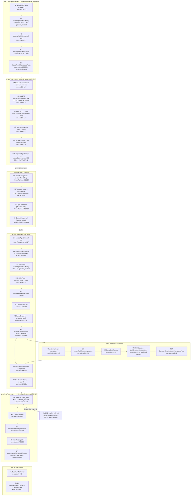

# F1 — Owner Operator v1 Run A (the turn lane)

**Merge:** `d8e3f334f` #1270, 2026-09-12 · migration 120 · 24 `src/` + 8 `worker/` +
1 `supabase/` production files · flag `OWNER_OPERATOR_ENABLED`, **off in every
environment** (`docs/currents.md:16`; `readFlag` is `process.env[name] === 'true'`,
`src/lib/config/flags.ts:21-23`).

**This is the pass's priority chart.** Run B (Apply, Decline, receipts, the
Operator screen) starts the moment this pass ships; §"Run B seams" in
`03-unified-proposal.md` U1 rules on every seam it will touch.

**119 nodes** charted, every one `file:line`-cited. Run A is **server-side
only** — `find src/app -iname '*operator*' -not -path '*api*'` is empty, so
there is no browser surface yet and the client nodes are notional.

---

## The spine



## The seven terminals

`TURN_FAILURE_REASON` has **seven** members. Six are domain terminals the
worker writes through a fenced status update; the seventh is written by the
failed-hook.

| Reason | Site | Turn row | Outbox row | Log level | Sentry |
|---|---|---|---|---|---|
| `predecessor_stalled` | `AgentTurnWorker.ts:114-121` → `failTurnFenced` `turns.ts:424-446` | `status='failed'`, fenced | `markOutboxCompletedIfOwned`, same tx | `warn` `:122` | no |
| `unauthorized` (reauth) | `:168` | yes | yes, same tx | `warn` `:171` | no |
| `account_offboarding` | `:167` | yes | yes, same tx | `warn` `:171` (shared line) | no |
| `unauthorized` (voice vanished) | `:226` | yes | yes, same tx | `warn` `:229` | no |
| `model_output_invalid` | `:201` | yes | yes, same tx | `warn` `:204` | no |
| `budget_exceeded` | `:289` | yes | yes, same tx | `warn` `:292` | no |
| `operator_disabled` | `:331` → `failTurnAndCompleteOutbox` `turns.ts:494-509` | conditional on outbox CAS | CAS runs **first** | `log` (info) `:324` | no |
| **`exhausted`** (7th, failed-hook) | `failed-hook.ts:67-71` → `failTurnIfNonTerminal` `turns.ts:462-476` | yes | `markOutboxFailed` `:53` | `log`/`error` | **yes** — generic `attachJobFailureSink` `worker/index.ts:566-573`, `job-failure-sink.ts:64` |

### Verdict on the arch-log claim — **PARTLY TRUE, and materially misleading as compressed**

The arch log's one-liner is *"the `agent_turn` lane's six domain terminals emit
logs only."* Read literally that is **false**: every one of the six writes a
real state transition — the turn row to `failed` **and** the outbox row
completed, in one transaction.

The spec's fuller sentence is correct and is what the log compressed away:
*"None of the six domain terminals calls Sentry, and that is ONE go-live
decision"* (`docs/roadmap/2026-09-11-owner-operator/README.md:638`). The claim
is about the **alerting channel**, not about persistence. Under that reading it
is TRUE: five `warn` lines and one `log` line, and nothing pages a human.

**The one exit that genuinely writes nothing is the lease-lost branch at
completion** (`AgentTurnWorker.ts:367-372`, fence miss at `turns.ts:392`) — and
the spec is careful to exclude it from the six, because it resolves nothing and
leaves the turn `running` for the lease-holder or the watchdog.

> **Correction to carry forward.** The arch log's compression should say
> *"none of the six domain terminals pages"*, not *"emit logs only"*. The
> current phrasing understates that these paths persist state and would mislead
> a Run B author reasoning about what a failed turn leaves behind.

## The two things called "fenced" — and they are different

The codebase uses "fence" for two unrelated mechanisms, and its own comments
mix them (`context.ts:63-65` says *"frozen at fenced completion"* meaning (b)).

**(a) The LLM code fence.** `stripCodeFences` (`run-task.ts:61-65`,
`/^```(?:json)?\s*([\s\S]*?)\s*```$/`) → `JSON.parse` (`:74`) →
`OperatorModelOutputSchema.safeParse` (`:87`, a `.strict()` discriminated union
at `schema.ts:204-209`). A malformed fence or malformed JSON becomes
`LLMStructuredOutputError` with a **sanitised** cause — `err.name` only, never
the raw `SyntaxError` message, which would embed a completion snippet
(`run-task.ts:76-79`). It is **terminal for the attempt, deliberately not
transient**: at temperature 0 the same provider reproduces the same bad shape,
so the *fallback provider* is the retry, not the queue (`run-task.ts:24-29`).
Every billed-but-invalid completion is still charged — `model-call.ts:127-154`
catches it, records an `api_costs` row per billed attempt via
`tryRecordOperatorCost` (`:45-72`), and returns `{kind:'invalid_shape'}`
**through** the cost guard rather than throwing past it (`:79-81`).

**(b) The concurrency fence.** `completeTurnFenced` / `failTurnFenced` —
`UPDATE … WHERE attempt_token = X AND status = 'running'`. Only one concurrent
dispatch's write matches. `count === 0` means another attempt owns the turn;
the caller discards and exits.

## Invariants — measured

| Invariant | Verdict | Evidence |
|---|---|---|
| **#2 transactional outbox** | **PASS, both directions** | Creation: `agent_turns` INSERT + `job_outbox` INSERT in one `sql.begin` (`turns.ts:121-213`, outbox at `:205`). Completion: terminal UPDATE + proposals + supersession + unsupported + conversation touch + `markOutboxCompletedIfOwned` in one `sql.begin` (`turns.ts:380-421`). Raw `INSERT INTO job_outbox` with no `ON CONFLICT` is sanctioned at `job-outbox-helpers.ts:496-503` — no generic `(topic, aggregate_id)` partial index exists; dedup is `agent_turns_account_client_key_uniq` instead |
| **#12 entry points orchestrate** | **PASS** | Three routes at 101 / 54 / 51 lines; no inline error branch over ~30 lines. `AgentTurnWorker.ts` is 384 lines but decomposes into `settleClaimMiss`, `waitOrFailOnPredecessor`, `generateAndAssemble`, `handleTurnError`, each delegating to `src/lib/agents/operator/*` |
| **#15 explicit DB client** | **PASS** | `grep -rln '@/lib/db/server' src/lib/agents/operator/ worker/jobs/agent-turn/` returns only the three route files (composition roots) and tests. All 10 domain modules take `sql`/`tx` explicitly |
| **Idempotency** | **PASS, two keys at two layers** | Domain: `agent_turns_account_client_key_uniq` on `(account_id, client_turn_key)` (migration `120:74`), client-minted UUID, payload-compared by `sameTurnPayload` (`turns.ts:48-55`). Worker: the **outbox id** (`outbox.ts:56-66`), not the BullMQ jobId — which changes per re-dispatch (`${entry.id}_${entry.attempts}`, `OutboxPoller.ts:301`) |
| **Tenant scoping** | **PASS** | Every statement in `turns.ts`, `authorize.ts`, `proposals.ts`, `context.ts`, `reads.ts` carries `account_id`; location-scoped rows also carry `business_id`/`location_id` (`context.ts:206`, `turns.ts:44-46`, `authorize.ts:40-46`) |
| **#13 no `NEXT_PUBLIC_*` companion** | **PASS** | `rg 'NEXT_PUBLIC_OWNER_OPERATOR'` — zero code hits |
| **CSRF / same-origin** | **POST yes, GET no** | `withSameOrigin()` on `turns/route.ts:101`; the two GET routes rely on `requireOwnerWithAccount` alone. Consistent with the repo pattern (mutations wrapped, reads not) and with the POST route's own comment that an impersonating admin may look but not act (`:40-44`) |
| **MFA / AAL2** | **GAP — see `03-unified-proposal.md` U1-A** | `/api/operator` is absent from `isProtectedOwnerApiRoute` (`src/lib/shared/protected-routes.ts:47-59`); `rg 'operator' src/lib/shared/protected-routes.ts` → no hits |

## Line counts

`src/lib/agents/operator/` — **11 production files, 2,683 lines**:
`flags.ts` 11 · `authorize.ts` 59 · `prompt.ts` 63 · `model-call.ts` 187 ·
`catalog.ts` 208 · `schema.ts` 242 · `reads.ts` 278 · `proposals.ts` 313 ·
`context.ts` 377 · `render.ts` 435 · `turns.ts` 510.

`worker/jobs/agent-turn/` — **3 production files, 488 lines**:
`constants.ts` 22 · `failed-hook.ts` 82 · `AgentTurnWorker.ts` 384.

`src/app/api/operator/` — **3 routes, 206 lines.**

Tests: 3,456 lines under `src/lib/agents/operator/__tests__/` (11 files,
largest `turn-worker.integration.test.ts` at 1,158) + 365 under
`worker/jobs/agent-turn/__tests__/` + 371 for the routes. **Test:production
ratio 1.3:1** — the highest of any subsystem charted in this pass.

## Latent seams — every one LATENT, and why

The flag is unset everywhere (`docs/currents.md:16`). Off means the routes 404
before any write and a dispatched job fails `operator_disabled` before loading
tenant context. **Nothing below can fire in production today.**

1. **Account-default (`locationId = undefined`) proposals are wired but
   structurally unreachable.** The schema (`location_id UUID NULL`),
   `buildProposalRows` (`proposals.ts:73`) and `supersedePendingProposals`'s
   `IS NOT DISTINCT FROM` NULL handling (`:122-134`) all support it, but
   `validateProposalScope` rejects a `scopeRule: 'location'` proposal with no
   `locationId` (`render.ts:207-209`) and **every** Run A catalog operation is
   `scopeRule: 'location'` (`catalog.ts:139-172`). Deliberate and commented;
   not a defect. **LATENT by design.**
2. **`record_unsupported_request` is a decorative catalog entry.** It is
   `kind:'capture'`, visible to the model through `modelVisibleOperations()`
   (`catalog.ts:173-177, 193-203`), but `proposableOperation()` returns `null`
   for it (`:205-208`) and the model's `unsupported` output is free-form
   `{request, context}` with no `operation` field (`schema.ts:199-202`). Not a
   defect — but an easy misread for an author who assumes every catalog entry
   is invoked by id.
3. **Sentry paging for `agent_turn` exhaustion has code but no rule.**
   `attachJobFailureSink` fires `Sentry.captureException` tagged
   `subsystem:worker_job, queue:agent_turn` today. What is missing is the
   external Sentry→Discord rule:
   `docs/runbooks/beta-launch-alerting.md:412` marks row 11 *"REQUIRED BEFORE
   `OWNER_OPERATOR_ENABLED` GOES ON; NOT CONFIGURED BY THIS CHANGE"*. Already
   tracked in-repo (`docs/progresstracking.md:1072`); re-resolves true at HEAD.
   **This is the Run B rule-11 Sentry build CLAUDE.md's routing row already
   names as owed.**
4. **`agent_turns_account_client_key_uniq` is keyed on
   `(account_id, client_turn_key)`, not on the actor.** `sameTurnPayload`
   compares `conversation_id`/`location_id`/`owner_text` but never
   `actor_user_id` (`turns.ts:48-55`). `client_turn_key` is a client-minted
   UUID, so the protection is keyed on the client's random value rather than on
   who is asking. **Not exploitable; effectively unreachable.** Recorded for
   completeness only.
5. **Owner Operator does not use the run spine.**
   `grep -rn 'agent_runs\|agent_outcomes\|run-spine' src/lib/agents/operator/
   worker/jobs/agent-turn/` returns nothing. This is a deliberate choice — the
   Operator has its own four tables from migration 120 — but CLAUDE.md's
   sentence *"Every persona action is recorded on the run spine"* describes
   Reply/Guardian/Insights. A reader applying it literally to the Operator would
   expect rows that do not exist. **Documentation finding, not a code defect.**
   Carried as **H8** in `04-handoff-prompts.md`.

## Migration 120 — verified in lockstep

Four tables (`agent_conversations` 5 cols, `agent_turns` 16, `agent_proposals`
23, `agent_unsupported_requests` 6), three indexes, RLS enabled on all four.
Introspected on **both** live Supabase projects on 2026-09-12: column
fingerprints and index definitions are **byte-identical**. Detail in
`00-health-baseline.md` §7.
