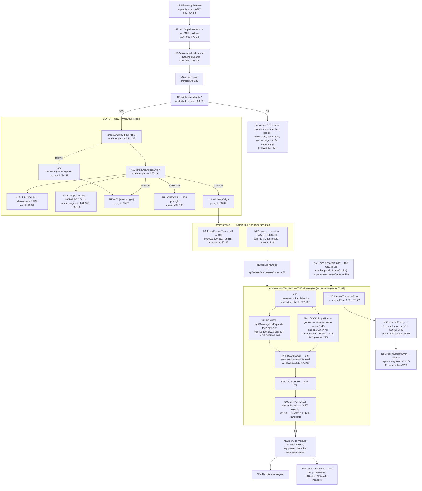

# F2 — The Admin API transport seam (CORS, bearer, dual-mode AAL2)

**Theme A, first half · `e36f975e5` #1213 (transport seam + dual-mode gate) ·
`6e14c8a23` #1217 (CORS, one owner in `src/proxy.ts`) · `ba207f57d` #1220
(nine GET handlers folded onto `requireAdminWithAal2`; `ci:admin-aal2` widened
to every handler) · `c951bc2eb` #1229 (bearer through proxy, CSRF split) ·
`f4a3441d0` #1266 (bearer-only finish) · `c5e94e6ca` #1268 (caught 500 → Sentry).**

**73 nodes.** ADRs of record: 0024 (the split), 0025 (dual-mode gate), 0026,
0028 (the contract), 0029 (link ownership + legacy shell), 0030 (starter +
token plumbing), 0031 (retirement order).

---

## The request path

## The dual-mode gate — **one owner, not two implementations**

`requireAdminWithAal2` (`src/lib/auth/admin-mfa-gate.ts:52-89`) is the single
gate. Both transports converge inside it through `resolveAdminApiIdentity`
(`src/lib/auth/verified-identity.ts:222-229`).

| | Bearer mode | Cookie mode |
|---|---|---|
| Reachable for | every `/api/admin/**` route | **only** `/api/admin/impersonation/**`, and only when no `Authorization` header is present (`verified-identity.ts:225`) |
| Identity | `getClaims(token, {allowExpired:true})` for locally-verified signature + `aal` claim, then `getUser(token)` for revocation-aware liveness (`:158-214`; rationale ADR 0025:97-107) | `getUser()` + `getAuthenticatorAssuranceLevel()` (`:124-142`) — unchanged byte-for-byte per #1183, comment `:105-109` |
| AAL source | `claims.aal` (`:211`) | the AAL call |
| **Shared** | **role check `:79` and the STRICT AAL2 comparison `:85-86` — both transports feed the same two lines** | ← |

**Precedence is unambiguous:** an `Authorization` header always wins, and a
malformed one never falls back to a cookie (`src/lib/auth/admin-transport.ts:9-25`).

**CSRF is asymmetric, and correctly so.** After #1266, ordinary bearer Admin
API routes carry **no** CSRF wrapper at all — `withSameOriginUnlessBearer` was
deleted (`git show f4a3441d0 -- src/app/api/.../disconnect/route.ts`). Only the
two impersonation routes retain `withSameOrigin()`
(`src/app/api/admin/impersonation/start/route.ts:119` and `end/route.ts`),
because they are the two that still run on cookies.

**What is genuinely NOT shared with the owner path:**
`requireRoleOr401`/`requireRole` (`route-helpers.ts:86-99`,
`src/lib/db/auth.ts:134-143`) is cookie-only and never touches this seam — by
design, ADR 0025 D1: *"the owner API's auth surface does not widen."*

## Single-owner claims, verified

| Concern | Owner | Evidence |
|---|---|---|
| CORS headers | `src/proxy.ts` **only** | `grep -rl 'Access-Control' src/` returns `proxy.ts` and test files, nothing else |
| Self-origin comparison | `isSelfOrigin`, `src/lib/shared/csrf.ts:40-51` | consumed by CORS (`admin-origins.ts:183`) **and** CSRF (`csrf.ts:78`) |
| Bearer parsing | `readBearerToken` / `isBearerRequest`, `admin-transport.ts:23-42` | one definition, imported by `proxy.ts` and `verified-identity.ts` |
| `ADMIN_APP_URL` | `adminAppUrl()`, `src/lib/config/admin-app-url.ts:6-21` | 12 call sites, **none** re-reads `process.env.ADMIN_APP_URL` |

This is a genuinely good result and is recorded as such: a wave this large
usually leaves two CORS writers and three env readers behind. It left none.

## The one real duplication in the seam

**`src/proxy.ts:260-271` hand-rolls the lenient AAL check that already exists
as `requireAal2FromSupabase` at `src/lib/auth/mfa.ts:16-27`.** Both compute
`data.nextLevel === 'aal2' && data.currentLevel !== 'aal2'`. The proxy never
imports it.

- **Is it wrong?** Yes — genuine duplication.
- **Is it reachable?** Both paths run on every protected page/owner request,
  but the bodies are behaviourally identical, so there is **no observable
  divergence today**. The risk is drift if one is edited.
- **LIVE as duplication, LATENT as a defect.** It predates this wave but was
  not consolidated even though `proxy.ts` was heavily rewritten inside it.

> **Looks like duplication, is deliberate divergence — do NOT unify.**
> `requireAal2FromSupabase` (lenient, `mfa.ts:16-27`, proxy) vs
> `requireCurrentAal2FromSupabase` (strict, `mfa.ts:29-40`, `page-gate.ts:75`
> and the gate's own `:85-86`). Two security postures on purpose; ADR 0025
> §Context names the split as accepted. **New DO-NOT-UNIFY entry.**

## Error-response shape — the pervasive divergence

`internalError()` always emits `{error:'internal_error'}` **plus**
`NO_STORE_HEADERS` (`admin-mfa-gate.ts:27-30`). But roughly **16 route-local
`catch` blocks bypass it entirely**, with ad hoc prose and **no cache headers
at all**:

- `src/app/api/admin/costs/route.ts:39` — `{error:'Failed to fetch cost data'}`
- `src/app/api/admin/nav-counts/route.ts:20`
- `src/app/api/admin/jobs/route.ts:45`
- `src/app/api/admin/businesses/[id]/route.ts:44`, `:110`

**Is it wrong?** Arguably — it is inconsistent with the gate's own no-store
discipline. **Is it reachable?** These are 400/404/500 JSON bodies on
`dynamic = 'force-dynamic'` routes with no explicit header; a misconfigured
intermediary could retain a stale error. Browsers are unlikely to cache a
header-less JSON error. **Low severity, not exploitable.**

**And it is disclosed, not hidden.** ADR 0028 measured *"37 distinct error
string literals … `errorResponse()` used in ZERO admin routes"*
(`docs/adr/0028-admin-api-contract.md:29-35`) and its D5 amendment
**explicitly declines** to normalise it (`:60-65`). This pass does not
re-propose the normalisation; it records that the `Cache-Control` half is a
separate, cheaper question than the prose half, and carries only that half
as **H7 (LOW)**.

Also cosmetic: 17 of 18 `internalError()` call sites use the label convention
`'[api/admin/<path>] <verb> failed:'`; the one outlier is
`src/app/api/admin/businesses/[id]/disconnect/route.ts:45`
(`internalError('admin/businesses/[id]/disconnect', error)` — no brackets, no
verb). The Sentry tag is always `admin-mfa-gate`, so nothing breaks.

## Invariants

| Invariant | Verdict | Evidence |
|---|---|---|
| **#1 Vercel = UI only**, with the #1226 manual-Disconnect exception | **PASS, and the exception IS bounded as CLAUDE.md claims** | `disconnectZernioConnection` (`src/lib/zernio/disconnect.ts:22-103`) is short DB work plus one best-effort external call under the existing 10 s transport timeout (ADR 0001:26-44). **One** domain module, explicit `sql`, called from both `src/app/api/zernio/disconnect/route.ts:180` (owner, cookie) and `src/app/api/admin/businesses/[id]/disconnect/route.ts:35` (admin, bearer). No profile deletion, no billing, no background work |
| **#12 entry points orchestrate** | **PASS, with one pre-existing soft spot** | No route handler has an error branch over 30 lines (largest: `flagged/route.ts:179-184` = 6). Soft: `flagged/route.ts` `POST` embeds disposition rules inside its `sql.begin` body (`:94-178`, 84 lines) rather than a `src/lib/admin/*` service — predates the wave, untouched beyond the gate migration |
| **#15 db client as parameter** | **PASS** | `requireAdminPage(sql, …)` `page-gate.ts:39` · `resolveAdminActor(sql, req, opts)` `resolve-actor.ts:65` · `disconnectZernioConnection(sql, …)` `disconnect.ts:22` · `getAdminNavCounts(sql)` `nav-counts-service.ts:18`. The one singleton import, `src/lib/db/auth.ts:3`, is the CLAUDE.md-named owner-classified auth gate |
| **#13 no `NEXT_PUBLIC_*` companion** | **PASS** | `grep -r 'NEXT_PUBLIC_ADMIN' src/` → nothing. `ADMIN_APP_URL` and `ADMIN_APP_ORIGINS` are both server-only with a single accessor each |

## Stale documentation found — two instances, both LIVE as docs, zero runtime effect

1. **`docs/adr/0001-nextjs-oauth-handshake-carveout.md:41-43`** says the new
   Admin disconnect route uses *"the canonical Admin AAL2 gate **and
   bearer-aware same-origin wrapper**."* #1266 (`f4a3441d0`) **deleted**
   `withSameOriginUnlessBearer` from that exact route. The removal was the
   intended end state (ADR 0025 D8 / ADR 0031 D6 — bearer-only routes carry no
   CSRF wrapper); only the prose is wrong. The ADR was last touched by #1239,
   one merge before the deletion.
2. **`src/lib/admin/nav-counts-service.ts:16`** says the route is *"behind
   `requireRoleOr401(admin)`."* It has used `requireAdminWithAal2` since the
   #1184/#1220 fold (`nav-counts/route.ts:12`).

Both are the same class as the finding in `07-handoff-reverification.md` §C:
a claim that lives only in prose, edited out of the code by a later PR that had
no mechanical reason to notice it. Carried as **H6**.

## No live security defect

Every check traced — bearer verification order, the strict-vs-lenient AAL
split, the CORS allowlist's fail-closed behaviour, and contract-drift
detection — matched its governing ADR's stated design, with an AST-audited,
CI-enforced backstop (`ci:admin-aal2`, `ci:admin-contract`, both green, see
`00-health-baseline.md` §8).
